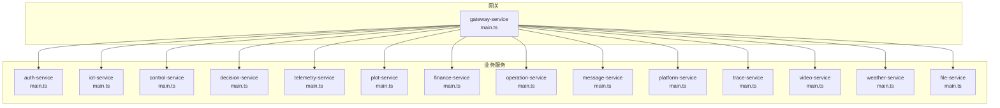
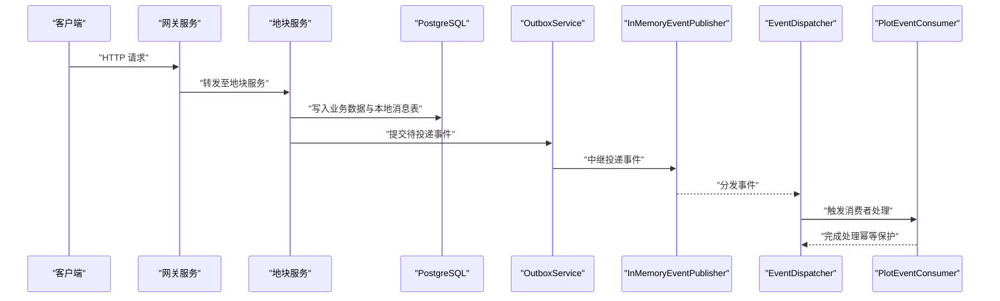
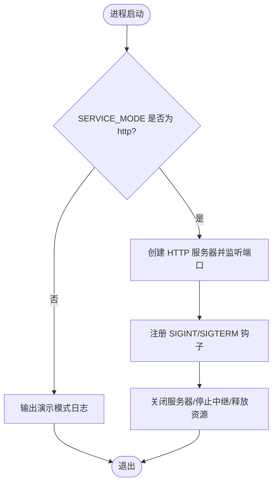
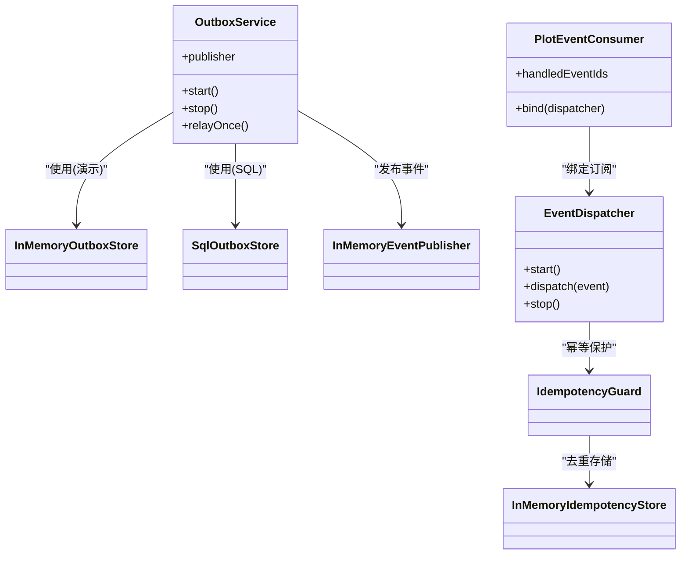
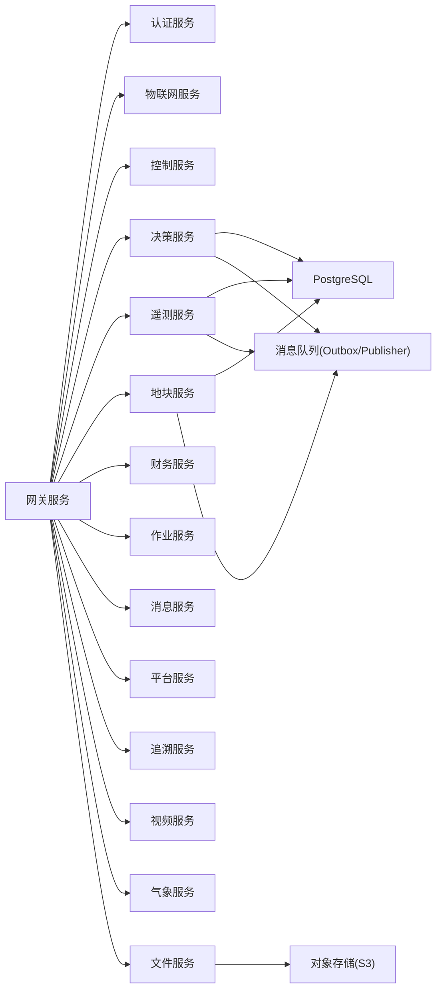

# 服务架构模式

<cite>
**本文引用的文件**   
- [apps/plot-service/src/main.ts](file://apps/plot-service/src/main.ts)
- [apps/decision-service/src/main.ts](file://apps/decision-service/src/main.ts)
- [apps/telemetry-service/src/main.ts](file://apps/telemetry-service/src/main.ts)
- [apps/file-service/src/main.ts](file://apps/file-service/src/main.ts)
- [apps/auth-service/src/main.ts](file://apps/auth-service/src/main.ts)
- [apps/control-service/src/main.ts](file://apps/control-service/src/main.ts)
- [apps/gateway-service/src/main.ts](file://apps/gateway-service/src/main.ts)
- [apps/iot-service/src/main.ts](file://apps/iot-service/src/main.ts)
- [apps/message-service/src/main.ts](file://apps/message-service/src/main.ts)
- [apps/operation-service/src/main.ts](file://apps/operation-service/src/main.ts)
- [apps/platform-service/src/main.ts](file://apps/platform-service/src/main.ts)
- [apps/trace-service/src/main.ts](file://apps/trace-service/src/main.ts)
- [apps/video-service/src/main.ts](file://apps/video-service/src/main.ts)
- [apps/weather-service/src/main.ts](file://apps/weather-service/src/main.ts)
</cite>

## 目录
1. [引言](#引言)
2. [项目结构](#项目结构)
3. [核心组件](#核心组件)
4. [架构总览](#架构总览)
5. [详细组件分析](#详细组件分析)
6. [依赖关系分析](#依赖关系分析)
7. [性能与可观测性](#性能与可观测性)
8. [故障排查指南](#故障排查指南)
9. [结论](#结论)
10. [附录：配置与环境变量规范](#附录配置与环境变量规范)

## 引言
本文件面向智慧农业平台的微服务架构，聚焦 NestJS 模块设计模式、组合根装配、依赖注入容器管理、生命周期钩子使用、事件驱动架构（本地消息表、事件分发器与消费者绑定）、配置加载与多环境适配。文档以仓库中各服务的入口 main.ts 为线索，梳理统一的启动模式与差异点，并给出最佳实践建议。

## 项目结构
仓库采用多应用（apps）+ 共享包（packages）的 Monorepo 组织方式。每个业务领域对应一个 NestJS 服务，统一通过各自的 src/main.ts 作为进程入口，负责：
- 初始化日志与可观测性
- 根据环境变量选择运行模式（HTTP 或演示模式）
- 装配基础设施（数据库、对象存储、消息队列）
- 创建 HTTP 服务器并监听端口
- 注册优雅关闭钩子（SIGINT/SIGTERM）

图表来源
- [apps/gateway-service/src/main.ts:1-15](file://apps/gateway-service/src/main.ts#L1-L15)
- [apps/auth-service/src/main.ts:1-15](file://apps/auth-service/src/main.ts#L1-L15)
- [apps/iot-service/src/main.ts:1-15](file://apps/iot-service/src/main.ts#L1-L15)
- [apps/control-service/src/main.ts:1-15](file://apps/control-service/src/main.ts#L1-L15)
- [apps/decision-service/src/main.ts:1-59](file://apps/decision-service/src/main.ts#L1-L59)
- [apps/telemetry-service/src/main.ts:1-60](file://apps/telemetry-service/src/main.ts#L1-L60)
- [apps/plot-service/src/main.ts:1-179](file://apps/plot-service/src/main.ts#L1-L179)
- [apps/finance-service/src/main.ts:1-15](file://apps/finance-service/src/main.ts#L1-L15)
- [apps/operation-service/src/main.ts:1-15](file://apps/operation-service/src/main.ts#L1-L15)
- [apps/message-service/src/main.ts:1-15](file://apps/message-service/src/main.ts#L1-L15)
- [apps/platform-service/src/main.ts:1-15](file://apps/platform-service/src/main.ts#L1-L15)
- [apps/trace-service/src/main.ts:1-15](file://apps/trace-service/src/main.ts#L1-L15)
- [apps/video-service/src/main.ts:1-15](file://apps/video-service/src/main.ts#L1-L15)
- [apps/weather-service/src/main.ts:1-15](file://apps/weather-service/src/main.ts#L1-L15)
- [apps/file-service/src/main.ts:1-25](file://apps/file-service/src/main.ts#L1-L25)

章节来源
- [apps/gateway-service/src/main.ts:1-15](file://apps/gateway-service/src/main.ts#L1-L15)
- [apps/plot-service/src/main.ts:1-179](file://apps/plot-service/src/main.ts#L1-L179)

## 核心组件
- 组合根（Composition Root）：每个服务的 bootstrap 函数负责装配依赖、选择实现、启动 HTTP 或演示流程。
- 配置加载：plot-service 显式调用 loadConfig 合并默认值与 process.env；其他服务直接读取环境变量。
- 可观测性：决策与服务通过 LoggerService 与 configureDecorators 注入日志能力；plot-service 同时注入 MetricsService。
- 数据访问：decision-service 与 telemetry-service 通过 PgClientAdapter 连接 PostgreSQL；plot-service 通过 PrismaService 封装数据库连接池与慢查询监控。
- 事件驱动：plot-service 与 decision-service/telemetry-service 使用 OutboxService + InMemoryEventPublisher 实现本地消息表与事件发布；plot-service 还包含 EventDispatcher 与 IdempotencyGuard 保证幂等消费。
- HTTP 服务器：所有服务在 SERVICE_MODE=http 时创建各自 http.ts 暴露的 createXxxHttpServer 并监听端口。

章节来源
- [apps/plot-service/src/main.ts:48-113](file://apps/plot-service/src/main.ts#L48-L113)
- [apps/decision-service/src/main.ts:18-55](file://apps/decision-service/src/main.ts#L18-L55)
- [apps/telemetry-service/src/main.ts:17-57](file://apps/telemetry-service/src/main.ts#L17-L57)
- [apps/file-service/src/main.ts:5-21](file://apps/file-service/src/main.ts#L5-L21)

## 架构总览
下图展示典型请求从网关到业务服务，再到本地消息表与事件分发的端到端流程。

图表来源
- [apps/plot-service/src/main.ts:115-158](file://apps/plot-service/src/main.ts#L115-L158)
- [apps/plot-service/src/main.ts:63-80](file://apps/plot-service/src/main.ts#L63-L80)

## 详细组件分析

### 组合根与生命周期管理
- 通用模式：大多数服务在 SERVICE_MODE=http 时创建 HTTP 服务器并监听端口，否则输出 demo 模式日志。
- 优雅关闭：decision-service、telemetry-service、plot-service 在 SIGINT/SIGTERM 中关闭服务器、停止中继、断开数据库连接或销毁模块。
- 演示模式：未启用 HTTP 时，plot-service 会执行完整链路示例（建档 → 中继 → 消费 → 幂等校验）。

图表来源
- [apps/decision-service/src/main.ts:40-47](file://apps/decision-service/src/main.ts#L40-L47)
- [apps/telemetry-service/src/main.ts:43-50](file://apps/telemetry-service/src/main.ts#L43-L50)
- [apps/plot-service/src/main.ts:105-112](file://apps/plot-service/src/main.ts#L105-L112)

章节来源
- [apps/auth-service/src/main.ts:1-15](file://apps/auth-service/src/main.ts#L1-L15)
- [apps/control-service/src/main.ts:1-15](file://apps/control-service/src/main.ts#L1-L15)
- [apps/gateway-service/src/main.ts:1-15](file://apps/gateway-service/src/main.ts#L1-L15)
- [apps/iot-service/src/main.ts:1-15](file://apps/iot-service/src/main.ts#L1-L15)
- [apps/message-service/src/main.ts:1-15](file://apps/message-service/src/main.ts#L1-L15)
- [apps/operation-service/src/main.ts:1-15](file://apps/operation-service/src/main.ts#L1-L15)
- [apps/platform-service/src/main.ts:1-15](file://apps/platform-service/src/main.ts#L1-L15)
- [apps/trace-service/src/main.ts:1-15](file://apps/trace-service/src/main.ts#L1-L15)
- [apps/video-service/src/main.ts:1-15](file://apps/video-service/src/main.ts#L1-L15)
- [apps/weather-service/src/main.ts:1-15](file://apps/weather-service/src/main.ts#L1-L15)
- [apps/decision-service/src/main.ts:18-55](file://apps/decision-service/src/main.ts#L18-L55)
- [apps/telemetry-service/src/main.ts:17-57](file://apps/telemetry-service/src/main.ts#L17-L57)
- [apps/plot-service/src/main.ts:48-113](file://apps/plot-service/src/main.ts#L48-L113)

### 配置加载与多环境适配
- plot-service：通过 loadConfig 提供默认配置（NODE_ENV、SERVICE_NAME、LOG_LEVEL、DB_URL、MQ_BROKERS、MQ_GROUP_ID），并与 process.env 合并，随后用于 LoggerService、PrismaService 与 OutboxService。
- decision-service/telemetry-service：直接读取 LOG_LEVEL、DB_URL、TENANT_ID、SERVICE_MODE 等环境变量，按条件切换 SQL/内存实现。
- file-service：根据 FILE_STORAGE_MODE 选择 S3ObjectStorage 或默认实现，并通过 FILE_S3_* 环境变量配置连接参数。

章节来源
- [apps/plot-service/src/main.ts:48-57](file://apps/plot-service/src/main.ts#L48-L57)
- [apps/decision-service/src/main.ts:18-38](file://apps/decision-service/src/main.ts#L18-L38)
- [apps/telemetry-service/src/main.ts:17-41](file://apps/telemetry-service/src/main.ts#L17-L41)
- [apps/file-service/src/main.ts:5-16](file://apps/file-service/src/main.ts#L5-L16)

### 事件驱动架构（本地消息表、事件分发器与消费者）
- 本地消息表：plot-service 使用 InMemoryOutboxStore 与 OutboxService 将业务事务与事件持久化解耦；decision-service/telemetry-service 使用 SqlOutboxStore 将事件落库并由中继定时投递。
- 事件分发器：plot-service 通过 EventDispatcher 与 IdempotencyGuard 保证同一事件多次投递时的幂等处理，并提供 onError 回调记录重试策略。
- 消费者绑定：plot-service 中的 PlotEventConsumer 通过 bind(dispatcher) 订阅事件。

图表来源
- [apps/plot-service/src/main.ts:63-80](file://apps/plot-service/src/main.ts#L63-L80)
- [apps/plot-service/src/main.ts:115-158](file://apps/plot-service/src/main.ts#L115-L158)
- [apps/decision-service/src/main.ts:23-38](file://apps/decision-service/src/main.ts#L23-L38)
- [apps/telemetry-service/src/main.ts:21-41](file://apps/telemetry-service/src/main.ts#L21-L41)

章节来源
- [apps/plot-service/src/main.ts:63-80](file://apps/plot-service/src/main.ts#L63-L80)
- [apps/plot-service/src/main.ts:115-158](file://apps/plot-service/src/main.ts#L115-L158)
- [apps/decision-service/src/main.ts:23-38](file://apps/decision-service/src/main.ts#L23-L38)
- [apps/telemetry-service/src/main.ts:21-41](file://apps/telemetry-service/src/main.ts#L21-L41)

### 依赖注入与模块组织规范
- 组合根优先：当前仓库在服务入口进行手工装配，便于在不依赖 Nest 框架的情况下验证依赖关系；接入 Nest 后应通过 AppModule.forRoot 导入并交由框架托管生命周期。
- 依赖注入容器：NestJS 容器负责解析 Provider、Module、Controller 的生命周期；建议在 Nest 环境下使用 @Injectable、@Module、@Controller 等装饰器声明依赖。
- 横切关注点：日志、指标、追踪应在组合根或 Nest 拦截器/守卫中统一注入，避免散落在业务代码中。
- 模块边界：每个服务内按“HTTP 层 → 业务服务 → 仓储/适配器”分层，外部依赖通过构造函数注入，保持单一职责与高内聚低耦合。

章节来源
- [apps/plot-service/src/main.ts:1-8](file://apps/plot-service/src/main.ts#L1-L8)

### HTTP 服务器初始化与端口管理
- 所有服务在 SERVICE_MODE=http 时调用各自 createXxxHttpServer 并监听端口，端口默认值由 PORT 环境变量决定，未设置时使用服务固定默认值。
- 网关服务默认端口 8080，其余服务端口范围 3001-3014。

章节来源
- [apps/gateway-service/src/main.ts:4-10](file://apps/gateway-service/src/main.ts#L4-L10)
- [apps/auth-service/src/main.ts:4-10](file://apps/auth-service/src/main.ts#L4-L10)
- [apps/iot-service/src/main.ts:4-10](file://apps/iot-service/src/main.ts#L4-L10)
- [apps/control-service/src/main.ts:4-10](file://apps/control-service/src/main.ts#L4-L10)
- [apps/decision-service/src/main.ts:18-39](file://apps/decision-service/src/main.ts#L18-L39)
- [apps/telemetry-service/src/main.ts:17-42](file://apps/telemetry-service/src/main.ts#L17-L42)
- [apps/plot-service/src/main.ts:101-105](file://apps/plot-service/src/main.ts#L101-L105)
- [apps/finance-service/src/main.ts:4-10](file://apps/finance-service/src/main.ts#L4-L10)
- [apps/operation-service/src/main.ts:4-10](file://apps/operation-service/src/main.ts#L4-L10)
- [apps/message-service/src/main.ts:4-10](file://apps/message-service/src/main.ts#L4-L10)
- [apps/platform-service/src/main.ts:4-10](file://apps/platform-service/src/main.ts#L4-L10)
- [apps/trace-service/src/main.ts:4-10](file://apps/trace-service/src/main.ts#L4-L10)
- [apps/video-service/src/main.ts:4-10](file://apps/video-service/src/main.ts#L4-L10)
- [apps/weather-service/src/main.ts:4-10](file://apps/weather-service/src/main.ts#L4-L10)
- [apps/file-service/src/main.ts:6-18](file://apps/file-service/src/main.ts#L6-L18)

## 依赖关系分析
- 服务间耦合：网关服务作为统一入口，聚合各业务服务；业务服务之间通过事件总线（Outbox/Publisher）异步解耦。
- 基础设施依赖：PostgreSQL（PgClientAdapter/PrismaService）、对象存储（S3ObjectStorage）、消息队列（OutboxService + Publisher）。
- 横向依赖：LoggerService、MetricsService、configureDecorators 在各服务中统一注入。

图表来源
- [apps/decision-service/src/main.ts:23-38](file://apps/decision-service/src/main.ts#L23-L38)
- [apps/telemetry-service/src/main.ts:21-41](file://apps/telemetry-service/src/main.ts#L21-L41)
- [apps/plot-service/src/main.ts:82-99](file://apps/plot-service/src/main.ts#L82-L99)
- [apps/file-service/src/main.ts:6-16](file://apps/file-service/src/main.ts#L6-L16)

章节来源
- [apps/decision-service/src/main.ts:23-38](file://apps/decision-service/src/main.ts#L23-L38)
- [apps/telemetry-service/src/main.ts:21-41](file://apps/telemetry-service/src/main.ts#L21-L41)
- [apps/plot-service/src/main.ts:82-99](file://apps/plot-service/src/main.ts#L82-L99)
- [apps/file-service/src/main.ts:6-16](file://apps/file-service/src/main.ts#L6-L16)

## 性能与可观测性
- 数据库连接池：plot-service 通过 PrismaService 传入 poolSize、slowQueryMs 等参数，便于监控慢查询与调优连接池大小。
- 日志级别：decision-service/telemetry-service 支持 debug/info/warn/error 白名单过滤，减少生产环境日志开销。
- 指标采集：plot-service 注入 MetricsService，可在关键路径埋点采集吞吐、延迟与错误率。
- 事件幂等：IdempotencyGuard 基于 InMemoryIdempotencyStore 防止重复消费，降低下游压力与数据不一致风险。

章节来源
- [apps/plot-service/src/main.ts:82-91](file://apps/plot-service/src/main.ts#L82-L91)
- [apps/decision-service/src/main.ts:13-21](file://apps/decision-service/src/main.ts#L13-L21)
- [apps/telemetry-service/src/main.ts:12-20](file://apps/telemetry-service/src/main.ts#L12-L20)
- [apps/plot-service/src/main.ts:72-77](file://apps/plot-service/src/main.ts#L72-L77)

## 故障排查指南
- 无法启动 HTTP 服务：检查 SERVICE_MODE 是否设置为 http，确认 PORT 未被占用。
- 数据库连接失败：检查 DB_URL 是否正确，PG 服务是否可达；SQL 模式下需确保连接已建立且具备权限。
- 事件未投递：确认 OutboxService 已 start，中继任务正常执行；检查 InMemoryEventPublisher 或实际 Broker 连通性。
- 重复消费导致异常：确认 IdempotencyGuard 与 InMemoryIdempotencyStore 已正确配置；核对 eventId 唯一性。
- 优雅关闭无效：确认 SIGINT/SIGTERM 钩子已注册，并在回调中关闭服务器、停止中继、断开数据库连接。

章节来源
- [apps/decision-service/src/main.ts:40-47](file://apps/decision-service/src/main.ts#L40-L47)
- [apps/telemetry-service/src/main.ts:43-50](file://apps/telemetry-service/src/main.ts#L43-L50)
- [apps/plot-service/src/main.ts:105-112](file://apps/plot-service/src/main.ts#L105-L112)
- [apps/plot-service/src/main.ts:72-80](file://apps/plot-service/src/main.ts#L72-L80)

## 结论
该智慧农业平台在每个服务入口实现了统一的组合根装配模式，结合环境变量实现多环境适配与功能开关。通过 OutboxService 与 EventDispatcher 构建的事件驱动架构，有效解耦了业务与基础设施，提升了系统的可扩展性与容错能力。建议在 NestJS 环境下进一步利用框架的依赖注入容器与生命周期钩子，将组合根逻辑迁移至 AppModule.forRoot 与相关生命周期方法中，以获得更好的可测试性与可维护性。

## 附录：配置与环境变量规范
- 通用环境变量
  - SERVICE_MODE：http | 其他（demo 模式）
  - PORT：服务监听端口
  - LOG_LEVEL：debug | info | warn | error
  - TENANT_ID：租户标识
- 数据库
  - DB_URL：PostgreSQL 连接串
- 消息与事件
  - MQ_BROKERS：消息代理地址
  - MQ_GROUP_ID：消费者组 ID
- 文件存储
  - FILE_STORAGE_MODE：s3 | 其他
  - FILE_S3_ENDPOINT / FILE_S3_BUCKET / FILE_S3_REGION / FILE_S3_ACCESS_KEY / FILE_S3_SECRET_KEY
- 服务特定
  - DECISION_REPOSITORY_MODE：memory | sql
  - TELEMETRY_REPOSITORY_MODE：memory | sql
  - TELEMETRY_PUBLISH_EVENTS：true | false
  - PLOT_REPOSITORY_MODE：sql | memory

章节来源
- [apps/plot-service/src/main.ts:48-57](file://apps/plot-service/src/main.ts#L48-L57)
- [apps/decision-service/src/main.ts:23-38](file://apps/decision-service/src/main.ts#L23-L38)
- [apps/telemetry-service/src/main.ts:21-41](file://apps/telemetry-service/src/main.ts#L21-L41)
- [apps/file-service/src/main.ts:6-16](file://apps/file-service/src/main.ts#L6-L16)