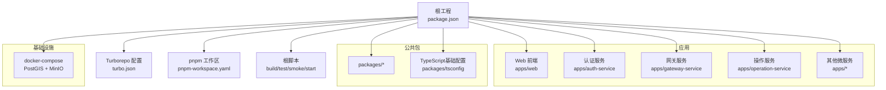
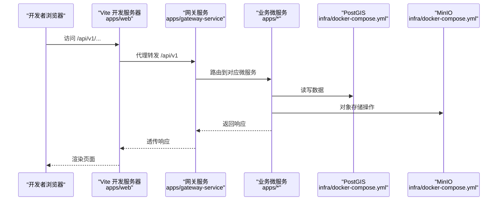
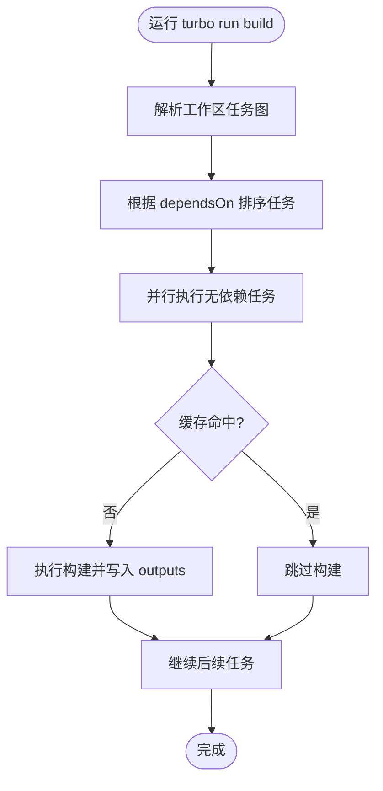
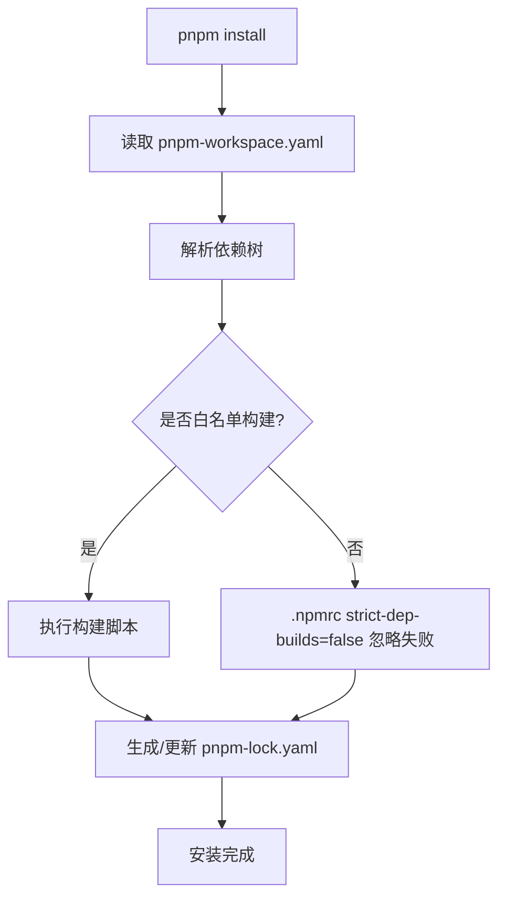
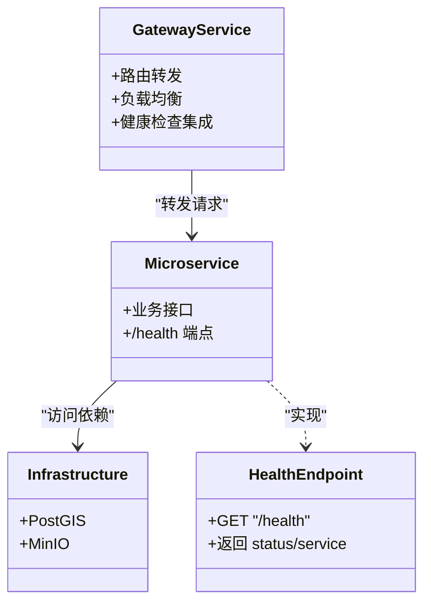
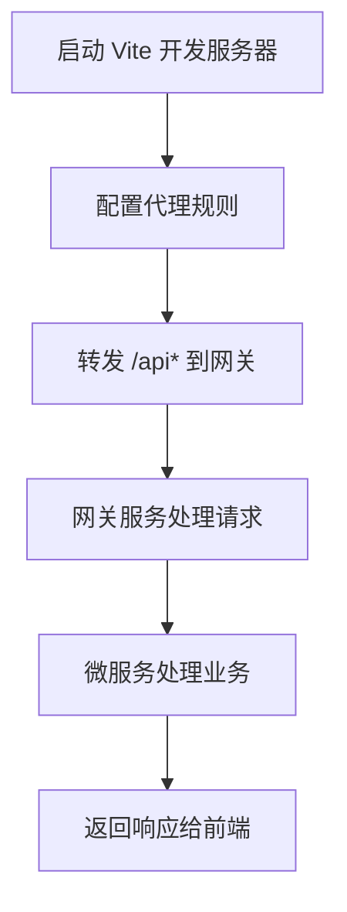
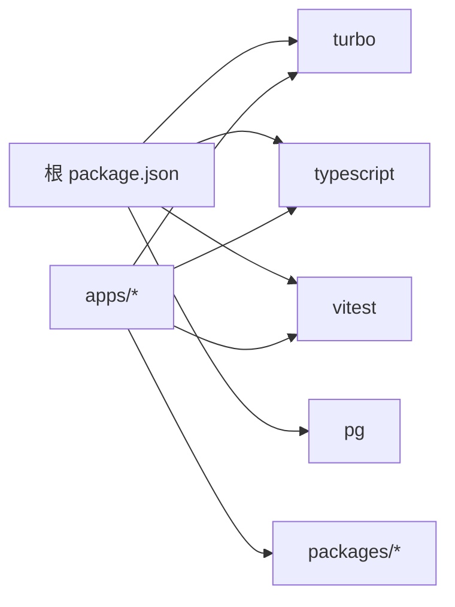

# 构建与部署

<cite>
**本文引用的文件**   
- [package.json](file://package.json)
- [turbo.json](file://turbo.json)
- [pnpm-workspace.yaml](file://pnpm-workspace.yaml)
- [.npmrc](file://.npmrc)
- [infra/docker-compose.yml](file://infra/docker-compose.yml)
- [apps/web/vite.config.js](file://apps/web/vite.config.js)
- [apps/auth-service/src/http.ts](file://apps/auth-service/src/http.ts)
- [apps/gateway-service/src/http.ts](file://apps/gateway-service/src/http.ts)
- [apps/operation-service/src/task.repository.ts](file://apps/operation-service/src/task.repository.ts)
- [packages/tsconfig/base.json](file://packages/tsconfig/base.json)
</cite>

## 更新摘要
**已进行的更改**
- 增强了构建系统的类型安全性，修复了task.repository.ts中的traceId字段类型错误
- 更新了TypeScript严格模式配置说明，确保编译正确性
- 强化了任务仓库的类型定义和接口一致性

## 目录
1. [简介](#简介)
2. [项目结构](#项目结构)
3. [核心组件](#核心组件)
4. [架构总览](#架构总览)
5. [详细组件分析](#详细组件分析)
6. [依赖关系分析](#依赖关系分析)
7. [性能考虑](#性能考虑)
8. [故障排查指南](#故障排查指南)
9. [结论](#结论)
10. [附录](#附录)

## 简介
本指南面向智慧农业平台的构建与部署，覆盖以下关键主题：
- Turborepo 任务编排：并行构建、增量构建、缓存策略
- pnpm workspace 包管理：依赖解析、版本锁定、工作区脚本
- Docker 镜像构建优化：多阶段构建、镜像最小化（实践建议）
- 微服务部署策略：服务发现、负载均衡、健康检查
- CI/CD 流水线配置：自动化部署流程、回滚策略
- 性能调优与资源优化建议

本项目采用 monorepo 组织方式，前端为 Vue + Vite，后端为多个 NestJS 风格的 Node.js 微服务。基础设施通过 docker-compose 提供 PostGIS 与 MinIO。

**最新更新**：增强了构建系统的类型安全性，修复了task.repository.ts中的traceId字段类型错误，确保TypeScript严格模式下的编译正确性。

## 项目结构
仓库采用根级 package.json 统一管理脚本与工作区；Turborepo 负责跨包任务编排；pnpm workspace 管理依赖与工作区脚本；infra 目录提供本地基础设施编排。

**图示来源**
- [package.json:10-29](file://package.json#L10-L29)
- [turbo.json:1-15](file://turbo.json#L1-L15)
- [pnpm-workspace.yaml:1-14](file://pnpm-workspace.yaml#L1-L14)
- [infra/docker-compose.yml:1-39](file://infra/docker-compose.yml#L1-L39)

**章节来源**
- [package.json:1-46](file://package.json#L1-L46)
- [turbo.json:1-15](file://turbo.json#L1-L15)
- [pnpm-workspace.yaml:1-14](file://pnpm-workspace.yaml#L1-L14)
- [infra/docker-compose.yml:1-39](file://infra/docker-compose.yml#L1-L39)

## 核心组件
- Turborepo 任务编排
  - 定义 build 与 typecheck 任务，并通过 dependsOn 实现依赖顺序执行
  - 输出产物与类型信息用于增量构建与缓存命中
- pnpm workspace
  - 声明 packages/* 与 apps/* 两个工作区
  - 白名单允许特定原生依赖的构建脚本执行，避免安装失败
  - .npmrc 关闭严格构建脚本校验，提升安装稳定性
- TypeScript 严格模式配置
  - 启用 strict、noUncheckedIndexedAccess、exactOptionalPropertyTypes 等严格选项
  - 确保类型安全，防止运行时错误
- 应用与基础设施
  - 前端使用 Vite 开发服务器并代理到网关
  - 基础设施通过 docker-compose 启动 PostGIS 与 MinIO，并提供健康检查

**章节来源**
- [turbo.json:1-15](file://turbo.json#L1-L15)
- [pnpm-workspace.yaml:1-14](file://pnpm-workspace.yaml#L1-L14)
- [.npmrc:1-4](file://.npmrc#L1-L4)
- [packages/tsconfig/base.json:4-22](file://packages/tsconfig/base.json#L4-L22)
- [apps/web/vite.config.js:1-31](file://apps/web/vite.config.js#L1-L31)
- [infra/docker-compose.yml:1-39](file://infra/docker-compose.yml#L1-L39)

## 架构总览
下图展示从前端到网关再到各微服务的请求路径，以及基础设施依赖。

**图示来源**
- [apps/web/vite.config.js:15-29](file://apps/web/vite.config.js#L15-L29)
- [apps/gateway-service/src/http.ts:29-29](file://apps/gateway-service/src/http.ts#L29-L29)
- [infra/docker-compose.yml:1-39](file://infra/docker-compose.yml#L1-L39)

## 详细组件分析

### Turborepo 任务编排与缓存
- 任务定义
  - build：依赖同级包的 build 先完成，确保依赖先行构建
  - typecheck：同样依赖同级包的 build，保证类型检查基于最新产物
- 增量构建与缓存
  - outputs 指定 dist/** 与 *.tsbuildinfo 作为缓存键的一部分
  - 当输入未变化且缓存命中时，跳过重复构建
- 并行构建
  - 默认启用并行执行，结合 dependsOn 控制依赖顺序
- 推荐用法
  - 使用根脚本触发 turbo run build，仅构建变更包及其下游依赖

**图示来源**
- [turbo.json:4-12](file://turbo.json#L4-L12)

**章节来源**
- [turbo.json:1-15](file://turbo.json#L1-L15)

### pnpm workspace 包管理与脚本
- 工作区范围
  - packages/* 与 apps/* 被识别为工作区
- 构建脚本放行
  - allowBuilds 白名单允许 esbuild、vue-demi 等原生依赖构建脚本执行
  - .npmrc 中 strict-dep-builds=false 避免非白名单构建导致整体失败
- 版本锁定
  - pnpm-lock.yaml 由 pnpm 生成，确保团队与 CI 环境一致
- 工作区脚本
  - 根 package.json 暴露 build、test、smoke、start 等统一入口
  - 通过 turbo 或 tsc -b 进行跨包构建与类型检查

**图示来源**
- [pnpm-workspace.yaml:1-14](file://pnpm-workspace.yaml#L1-L14)
- [.npmrc:1-4](file://.npmrc#L1-L4)
- [package.json:14-29](file://package.json#L14-L29)

**章节来源**
- [pnpm-workspace.yaml:1-14](file://pnpm-workspace.yaml#L1-L14)
- [.npmrc:1-4](file://.npmrc#L1-L4)
- [package.json:1-46](file://package.json#L1-L46)

### TypeScript 严格模式与类型安全
- 严格编译器选项
  - strict: true - 启用所有严格类型检查选项
  - noUncheckedIndexedAccess: true - 索引访问需要显式空值检查
  - exactOptionalPropertyTypes: true - 精确可选属性类型
  - noImplicitOverride: true - 强制显式 override 关键字
  - useUnknownInCatchVariables: true - catch 变量默认为 unknown
- 类型安全增强
  - 修复 task.repository.ts 中的 traceId 字段类型错误
  - 确保接口定义与实际实现的一致性
  - 强化任务状态流转的类型约束

**更新**：增强了TypeScript严格模式配置，修复了任务仓库中的类型安全问题。

**章节来源**
- [packages/tsconfig/base.json:4-22](file://packages/tsconfig/base.json#L4-L22)
- [apps/operation-service/src/task.repository.ts:50-61](file://apps/operation-service/src/task.repository.ts#L50-L61)

### Docker 镜像构建优化与多阶段构建
当前仓库未包含应用的 Dockerfile，但可基于现有架构给出最佳实践建议：
- 多阶段构建
  - 第一阶段：Node 基础镜像，安装依赖并执行 pnpm build/turbo build，产出 dist
  - 第二阶段：精简运行时镜像（如 node:slim），仅拷贝 dist 与必要系统库
- 镜像最小化
  - 移除 devDependencies，仅保留生产依赖
  - 使用非 root 用户运行进程
  - 使用 .dockerignore 排除 node_modules、dist、测试与文档
- 缓存加速
  - 分层缓存 node_modules 与 pnpm store
  - 将依赖安装与源码构建分阶段，减少无效重建
- 安全加固
  - 定期扫描镜像漏洞
  - 固定基础镜像标签，避免漂移

[本节为通用实践建议，不直接分析具体代码文件]

### 微服务部署策略
- 服务发现
  - 可通过环境变量注入服务地址，或使用轻量注册中心（如 Consul/Nacos）
  - 网关集中路由，内部服务通过内网域名或服务名访问
- 负载均衡
  - 网关层做请求分发，按权重或健康状态选择实例
  - 水平扩展服务副本，配合容器编排自动扩缩容
- 健康检查
  - 各服务提供 /health 端点，返回服务名称与状态
  - 编排平台周期性探测，剔除不健康实例
  - 基础设施（PostGIS、MinIO）也具备健康检查

**图示来源**
- [apps/gateway-service/src/http.ts:29-29](file://apps/gateway-service/src/http.ts#L29-L29)
- [apps/auth-service/src/http.ts:15-15](file://apps/auth-service/src/http.ts#L15-L15)
- [infra/docker-compose.yml:13-17](file://infra/docker-compose.yml#L13-L17)
- [infra/docker-compose.yml:30-34](file://infra/docker-compose.yml#L30-L34)

**章节来源**
- [apps/gateway-service/src/http.ts:29-29](file://apps/gateway-service/src/http.ts#L29-L29)
- [apps/auth-service/src/http.ts:15-15](file://apps/auth-service/src/http.ts#L15-L15)
- [infra/docker-compose.yml:1-39](file://infra/docker-compose.yml#L1-L39)

### CI/CD 流水线配置与自动化部署
- 构建阶段
  - 安装依赖：pnpm install
  - 类型检查：tsc -b --dry 或 turbo run typecheck
  - 构建产物：turbo run build
  - 单元测试：vitest run
- 打包与推送
  - 构建镜像：docker buildx build --push
  - 推送制品：registry 推送镜像与元数据
- 部署阶段
  - 滚动更新：逐步替换旧实例，验证健康后切换流量
  - 蓝绿发布：双环境切换，快速回滚
- 回滚策略
  - 保留上一稳定版本镜像标签
  - 一键回滚命令，恢复上一个已知良好版本
- 质量门禁
  - 代码规范检查、安全扫描、覆盖率阈值

[本节为通用流水线设计建议，不直接分析具体代码文件]

### 前端开发与代理
- Vite 开发服务器
  - 端口 3000，支持热重载
  - 代理 /api 与 /api/v1 到网关 localhost:8080
- 生产构建
  - 通过 turbo 构建，产物由静态服务器托管

**图示来源**
- [apps/web/vite.config.js:15-29](file://apps/web/vite.config.js#L15-L29)

**章节来源**
- [apps/web/vite.config.js:1-31](file://apps/web/vite.config.js#L1-L31)

## 依赖关系分析
- 工作区依赖
  - apps/* 与 packages/* 共享依赖，避免重复安装
  - pnpm-lock.yaml 锁定所有依赖版本，确保一致性
- 构建依赖
  - turbo 驱动跨包构建顺序
  - typescript 与 vitest 用于类型检查与测试
- 运行时依赖
  - pg 数据库客户端
  - NestJS 相关依赖在各服务中声明

**图示来源**
- [package.json:31-44](file://package.json#L31-L44)
- [pnpm-workspace.yaml:1-4](file://pnpm-workspace.yaml#L1-L4)

**章节来源**
- [package.json:1-46](file://package.json#L1-L46)
- [pnpm-workspace.yaml:1-14](file://pnpm-workspace.yaml#L1-L14)

## 性能考虑
- 构建性能
  - 使用 turbo 并行构建与增量构建，减少重复编译
  - 合理划分工作区，降低无关包的重构范围
- 依赖安装
  - 利用 pnpm 硬链接与内容寻址存储，提升安装速度
  - 在 CI 中缓存 node_modules 与 pnpm store
- 运行时性能
  - 网关层限流与连接池优化
  - 数据库查询优化与索引设计
  - 对象存储大文件分片上传与 CDN 加速
- 资源优化
  - 容器 CPU/内存限制与请求配额
  - 监控与告警：QPS、延迟、错误率、资源使用率

[本节为通用性能优化建议，不直接分析具体代码文件]

## 故障排查指南
- 依赖安装失败
  - 检查 pnpm-workspace.yaml 的 allowBuilds 白名单是否包含所需原生依赖
  - 确认 .npmrc 的 strict-dep-builds=false 已生效
- 构建缓存未命中
  - 检查 turbo.json 的 outputs 是否包含产物与 tsbuildinfo
  - 清理缓存后重试，观察增量构建效果
- TypeScript 编译错误
  - 检查 packages/tsconfig/base.json 的严格模式配置
  - 确认 traceId 等字段的类型定义正确
  - 使用 tsc --noEmit 进行类型检查而不生成文件
- 服务健康检查失败
  - 确认各服务 /health 端点正常返回
  - 检查基础设施健康检查配置（PostGIS、MinIO）
- 前端代理异常
  - 确认 Vite 代理目标地址与网关端口一致
  - 检查网关服务是否正常运行

**章节来源**
- [pnpm-workspace.yaml:5-14](file://pnpm-workspace.yaml#L5-L14)
- [.npmrc:1-4](file://.npmrc#L1-L4)
- [turbo.json:4-12](file://turbo.json#L4-L12)
- [packages/tsconfig/base.json:4-22](file://packages/tsconfig/base.json#L4-L22)
- [apps/operation-service/src/task.repository.ts:50-61](file://apps/operation-service/src/task.repository.ts#L50-L61)
- [apps/auth-service/src/http.ts:15-15](file://apps/auth-service/src/http.ts#L15-L15)
- [apps/gateway-service/src/http.ts:29-29](file://apps/gateway-service/src/http.ts#L29-L29)
- [infra/docker-compose.yml:13-17](file://infra/docker-compose.yml#L13-L17)
- [infra/docker-compose.yml:30-34](file://infra/docker-compose.yml#L30-L34)
- [apps/web/vite.config.js:15-29](file://apps/web/vite.config.js#L15-L29)

## 结论
本指南围绕 Turborepo 与 pnpm workspace 的构建编排、依赖管理与缓存策略，结合基础设施编排与微服务健康检查，提供了完整的构建与部署方案。**最新更新**增强了TypeScript严格模式下的类型安全性，修复了任务仓库中的traceId字段类型错误，确保编译正确性。建议在 CI/CD 中引入多阶段镜像构建与滚动发布，配合完善的监控与回滚机制，保障平台的高可用与可维护性。

## 附录
- 常用命令
  - 构建：pnpm run build:changed
  - 类型检查：pnpm run typecheck
  - 测试：pnpm run test
  - 启动服务：pnpm run start:services
  - 健康检查：pnpm run health:services
  - 初始化 MinIO：pnpm run init:minio
  - 数据库迁移：pnpm run db:migrate

**章节来源**
- [package.json:14-29](file://package.json#L14-L29)