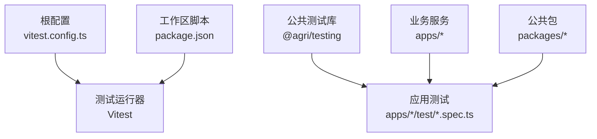
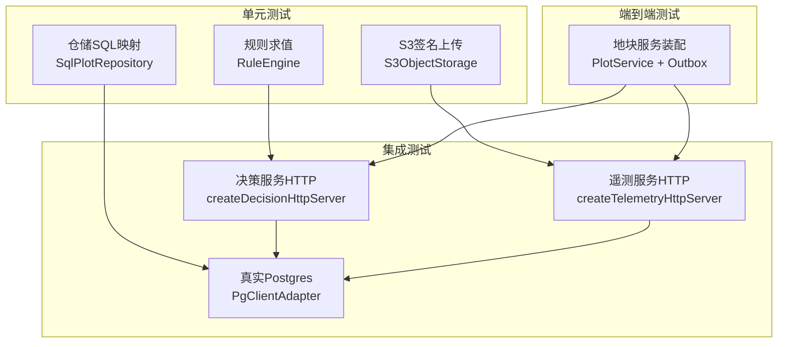
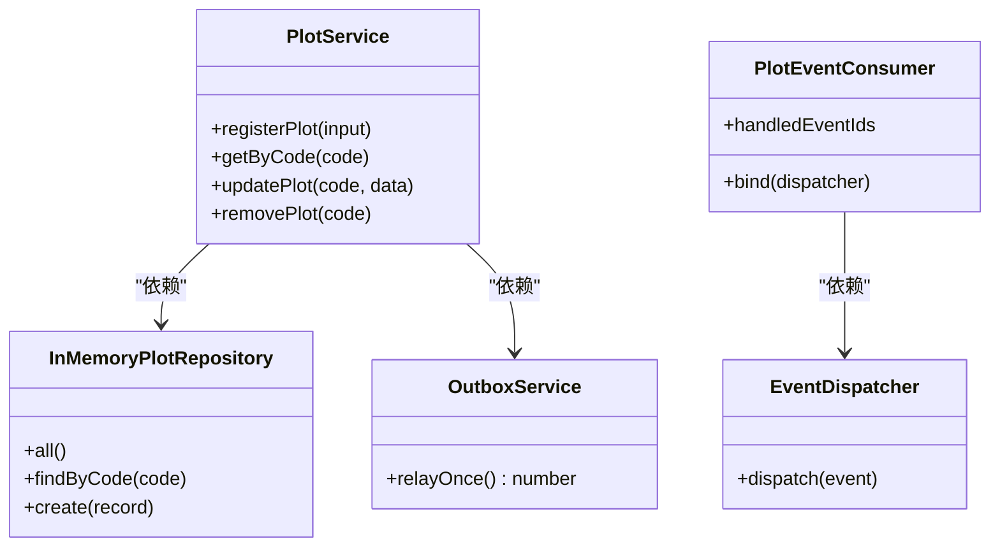
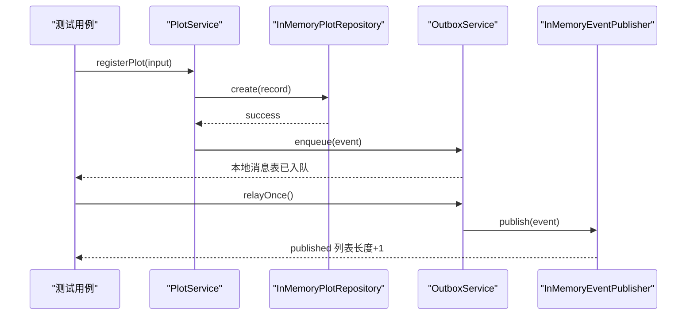
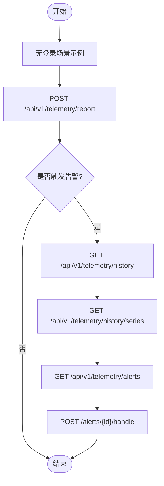
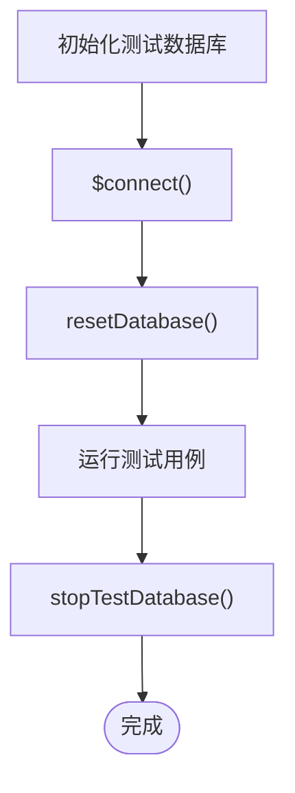
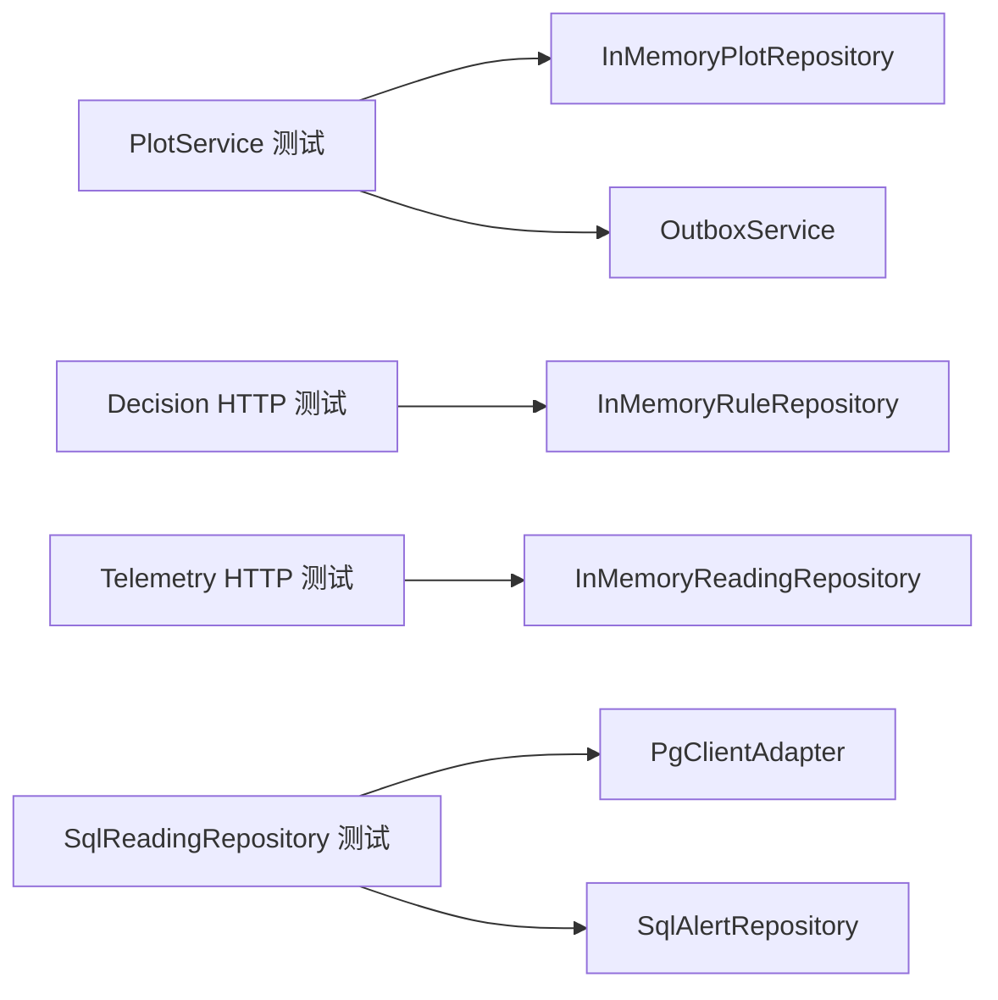

# 测试策略

<cite>
**本文引用的文件**   
- [vitest.config.ts](file://vitest.config.ts)
- [package.json](file://package.json)
- [packages/testing/src/index.ts](file://packages/testing/src/index.ts)
- [packages/testing/src/test-database.ts](file://packages/testing/src/test-database.ts)
- [packages/testing/src/module-builder.ts](file://packages/testing/src/module-builder.ts)
- [apps/plot-service/test/plot-service.spec.ts](file://apps/plot-service/test/plot-service.spec.ts)
- [apps/plot-service/test/sql-plot-repository.spec.ts](file://apps/plot-service/test/sql-plot-repository.spec.ts)
- [apps/decision-service/test/decision.spec.ts](file://apps/decision-service/test/decision.spec.ts)
- [apps/decision-service/test/sql-decision-repository.spec.ts](file://apps/decision-service/test/sql-decision-repository.spec.ts)
- [apps/file-service/test/s3-storage.spec.ts](file://apps/file-service/test/s3-storage.spec.ts)
- [apps/telemetry-service/test/telemetry.spec.ts](file://apps/telemetry-service/test/telemetry.spec.ts)
- [apps/telemetry-service/test/sql-reading-repository.spec.ts](file://apps/telemetry-service/test/sql-reading-repository.spec.ts)
</cite>

## 目录
1. [引言](#引言)
2. [项目结构](#项目结构)
3. [核心组件](#核心组件)
4. [架构总览](#架构总览)
5. [详细组件分析](#详细组件分析)
6. [依赖分析](#依赖分析)
7. [性能考虑](#性能考虑)
8. [故障排查指南](#故障排查指南)
9. [结论](#结论)
10. [附录](#附录)

## 引言
本测试策略面向智慧农业平台，覆盖单元测试、集成测试与端到端测试的完整体系。目标包括：
- 明确服务层、控制器层、仓储层的测试边界与编写规范
- 设计数据库、消息队列、外部API的集成测试方案
- 制定端到端测试策略、测试数据管理与环境搭建流程
- 优化Vitest配置、设定覆盖率要求与持续集成流程
- 统一Mock策略、测试工具使用与性能测试方法
- 沉淀最佳实践与常见问题解决方案

## 项目结构
仓库采用多包工作区结构，业务微服务位于 apps 下，公共能力位于 packages 下；测试用例统一以 .spec.ts 命名并按模块组织在各自 test 目录中。根级 vitest.config.ts 提供全局测试配置与工作区别名映射，package.json 暴露统一的测试脚本入口。

图表来源
- [vitest.config.ts:10-40](file://vitest.config.ts#L10-L40)
- [package.json:14-20](file://package.json#L14-L20)

章节来源
- [vitest.config.ts:1-42](file://vitest.config.ts#L1-L42)
- [package.json:1-46](file://package.json#L1-L46)

## 核心组件
- 测试运行与别名：通过 vitest.config.ts 将 @agri/* 别名直接指向源码，避免构建顺序问题，并开启装饰器转译以支持NestJS生态。
- 测试基础设施：@agri/testing 提供测试数据库句柄、模块构造器、事件总线内存实现、夹具等通用能力。
- 服务装配测试：plot-service 示例展示了替换仓储与消息实现，保留真实代码路径的装配测试模式。
- HTTP接口测试：decision-service 与 telemetry-service 通过启动本地HTTP服务器进行接口级验证。
- SQL仓储测试：各服务的 Sql*Repository 测试通过伪造客户端或真实数据库（条件执行）验证SQL与事务行为。

章节来源
- [vitest.config.ts:10-40](file://vitest.config.ts#L10-L40)
- [packages/testing/src/index.ts:1-25](file://packages/testing/src/index.ts#L1-L25)
- [apps/plot-service/test/plot-service.spec.ts:24-68](file://apps/plot-service/test/plot-service.spec.ts#L24-L68)
- [apps/decision-service/test/decision.spec.ts:9-31](file://apps/decision-service/test/decision.spec.ts#L9-L31)
- [apps/telemetry-service/test/telemetry.spec.ts:7-24](file://apps/telemetry-service/test/telemetry.spec.ts#L7-L24)

## 架构总览
测试架构分层如下：
- 单元测试层：针对领域逻辑、规则引擎、存储适配器进行隔离测试，使用内存实现或伪造对象。
- 集成测试层：通过真实Postgres（可选）与MinIO（通过签名请求模拟）验证持久化与外部交互。
- 端到端测试层：启动HTTP服务，验证跨层调用链路与状态流转。

图表来源
- [apps/decision-service/test/decision.spec.ts:9-31](file://apps/decision-service/test/decision.spec.ts#L9-L31)
- [apps/telemetry-service/test/telemetry.spec.ts:7-24](file://apps/telemetry-service/test/telemetry.spec.ts#L7-L24)
- [apps/telemetry-service/test/sql-reading-repository.spec.ts:8-43](file://apps/telemetry-service/test/sql-reading-repository.spec.ts#L8-L43)
- [apps/plot-service/test/plot-service.spec.ts:24-68](file://apps/plot-service/test/plot-service.spec.ts#L24-L68)

## 详细组件分析

### 单元测试编写规范
- 服务层测试
  - 原则：仅替换外部依赖（仓储、消息、外部API），保持领域逻辑真实执行。
  - 示例：地块服务装配测试通过内存仓储与内存消息实现验证“建档→写消息表→中继投递→消费者幂等”链路。
  - 断言重点：业务结果、错误码、消息入队与消费幂等性。
- 控制器层测试
  - 原则：启动轻量HTTP服务器，注入内存仓储，验证路由、参数校验、响应结构与状态码。
  - 示例：决策服务与遥测服务的HTTP接口测试均遵循此模式。
- 仓储层测试
  - 原则：对SQL仓储使用伪造客户端记录SQL语句，断言查询/更新语义；必要时接入真实数据库进行冒烟测试。
  - 示例：SqlPlotRepository 与 SqlReadingRepository 的测试分别展示伪造客户端与真实库两种模式。

章节来源
- [apps/plot-service/test/plot-service.spec.ts:24-68](file://apps/plot-service/test/plot-service.spec.ts#L24-L68)
- [apps/decision-service/test/decision.spec.ts:9-31](file://apps/decision-service/test/decision.spec.ts#L9-L31)
- [apps/telemetry-service/test/telemetry.spec.ts:7-24](file://apps/telemetry-service/test/telemetry.spec.ts#L7-L24)
- [apps/plot-service/test/sql-plot-repository.spec.ts:5-15](file://apps/plot-service/test/sql-plot-repository.spec.ts#L5-L15)
- [apps/telemetry-service/test/sql-reading-repository.spec.ts:8-43](file://apps/telemetry-service/test/sql-reading-repository.spec.ts#L8-L43)

#### 服务层测试类图（以地块服务为例）

图表来源
- [apps/plot-service/test/plot-service.spec.ts:44-68](file://apps/plot-service/test/plot-service.spec.ts#L44-L68)

### 集成测试设计
- 数据库测试
  - 模式A：伪造客户端记录SQL与事务边界，适用于快速单元级SQL验证。
  - 模式B：条件执行真实Postgres（DB_URL存在时），用于迁移与SQL仓储冒烟。
- 消息队列测试
  - 使用内存事件发布器与出队服务，验证本地消息表与中继投递的正确性与幂等性。
- 外部API测试
  - S3兼容存储通过拦截 fetch 实现签名请求断言，404转换为空值处理。

图表来源
- [apps/plot-service/test/plot-service.spec.ts:124-133](file://apps/plot-service/test/plot-service.spec.ts#L124-L133)

章节来源
- [apps/decision-service/test/sql-decision-repository.spec.ts:8-46](file://apps/decision-service/test/sql-decision-repository.spec.ts#L8-L46)
- [apps/telemetry-service/test/sql-reading-repository.spec.ts:8-43](file://apps/telemetry-service/test/sql-reading-repository.spec.ts#L8-L43)
- [apps/file-service/test/s3-storage.spec.ts:4-19](file://apps/file-service/test/s3-storage.spec.ts#L4-L19)

### 端到端测试策略
- 目标：验证从HTTP入口到领域逻辑、持久化与消息投递的完整链路。
- 方法：
  - 启动服务HTTP实例，注入内存仓储与消息实现。
  - 发送HTTP请求，断言响应状态、数据结构与副作用（如告警、处方生成）。
  - 组合多个用例形成场景流（上报读数→阈值触发→告警→历史查询→处理告警）。

图表来源
- [apps/telemetry-service/test/telemetry.spec.ts:26-67](file://apps/telemetry-service/test/telemetry.spec.ts#L26-L67)

章节来源
- [apps/telemetry-service/test/telemetry.spec.ts:26-67](file://apps/telemetry-service/test/telemetry.spec.ts#L26-L67)

### 测试数据管理
- 夹具与工厂：@agri/testing 提供 plot/device/grid/season/telemetry 等夹具，便于构造领域实体。
- 测试数据库句柄：提供连接、事务、原始SQL观察与重置能力，默认清空业务表顺序按外键依赖。
- 数据隔离：每个测试可使用独立 schema 或清理策略，避免用例间污染。

图表来源
- [packages/testing/src/test-database.ts:94-119](file://packages/testing/src/test-database.ts#L94-L119)

章节来源
- [packages/testing/src/index.ts:8-23](file://packages/testing/src/index.ts#L8-L23)
- [packages/testing/src/test-database.ts:39-48](file://packages/testing/src/test-database.ts#L39-L48)

### 测试环境搭建
- Node版本：>=24.0.0（由工作区脚本约束）。
- Vitest运行：根脚本 test 与 test:watch 提供运行与监听模式。
- 环境变量：DB_URL 控制真实库冒烟测试是否执行。
- 基础设施：scripts 提供健康检查、服务启动、MinIO初始化与数据库迁移脚本。

章节来源
- [package.json:7-9](file://package.json#L7-L9)
- [package.json:14-29](file://package.json#L14-L29)
- [apps/decision-service/test/sql-decision-repository.spec.ts:8-11](file://apps/decision-service/test/sql-decision-repository.spec.ts#L8-L11)

### Vitest配置优化
- 别名映射：@agri/* 直连源码，避免构建顺序问题。
- 装饰器支持：esbuild tsconfigRaw 启用 experimentalDecorators，确保NestJS装饰器在测试期登记处理器。
- 包含范围：packages/**/test 与 apps/**/test 下的 .spec.ts 自动发现。
- 运行环境：node 环境，默认报告器。

章节来源
- [vitest.config.ts:10-40](file://vitest.config.ts#L10-L40)

### 测试覆盖率要求
- 建议指标：
  - 行覆盖率≥80%
  - 分支覆盖率≥70%
  - 函数覆盖率≥85%
  - 语句覆盖率≥80%
- 报告输出：结合CI阶段生成HTML与JSON报告，归档至制品库。
- 门禁策略：低于阈值则失败，阻止合并。

[本节为通用指导，不直接分析具体文件]

### 持续集成测试流程
- 步骤：
  1) 安装依赖
  2) 类型检查（tsc -b --dry）
  3) 运行单元测试（vitest run）
  4) 运行集成测试（DB_URL存在时）
  5) 生成覆盖率报告
  6) 部署冒烟脚本（smoke-*）
- 并行策略：按包并行执行测试，减少整体耗时。
- 缓存策略：缓存 node_modules 与构建产物。

[本节为通用指导，不直接分析具体文件]

### Mock策略
- 仓储Mock：使用 InMemory*Repository 或伪造 PrismaClientLike 客户端，记录SQL与返回数据。
- 消息Mock：使用 InMemoryEventPublisher 与 InMemoryOutboxStore 验证事件入队与中继投递。
- 外部API Mock：拦截 fetch 实现，断言签名请求与状态码转换。
- NestJS模块Mock：使用 TestModuleBuilder 集中声明替换项，避免分散装配。

章节来源
- [apps/plot-service/test/plot-service.spec.ts:53-68](file://apps/plot-service/test/plot-service.spec.ts#L53-L68)
- [apps/plot-service/test/sql-plot-repository.spec.ts:5-15](file://apps/plot-service/test/sql-plot-repository.spec.ts#L5-L15)
- [apps/file-service/test/s3-storage.spec.ts:4-19](file://apps/file-service/test/s3-storage.spec.ts#L4-L19)
- [packages/testing/src/module-builder.ts:11-58](file://packages/testing/src/module-builder.ts#L11-L58)

### 测试工具使用
- @nestjs/testing：编译测试模块、替换提供者。
- Vitest：断言、异步测试、vi.fn 模拟函数。
- PgClientAdapter：从URL创建真实数据库客户端，用于冒烟测试。
- 夹具：@agri/testing 提供的领域实体夹具简化数据构造。

章节来源
- [packages/testing/src/module-builder.ts:1-69](file://packages/testing/src/module-builder.ts#L1-L69)
- [apps/decision-service/test/sql-decision-repository.spec.ts:1-11](file://apps/decision-service/test/sql-decision-repository.spec.ts#L1-L11)
- [packages/testing/src/index.ts:1-25](file://packages/testing/src/index.ts#L1-L25)

### 性能测试方法
- 基准测试：对规则引擎 evaluate 与仓储批量写入进行基准测量。
- 负载测试：使用HTTP客户端并发上报遥测数据，观察延迟与吞吐。
- 资源监控：关注CPU、内存、数据库连接池与慢查询日志。
- 回归基线：将关键指标纳入CI，防止性能退化。

[本节为通用指导，不直接分析具体文件]

## 依赖分析
测试用例与服务之间的依赖关系如下：
- 服务层测试依赖仓储与消息实现（内存或伪造）
- HTTP接口测试依赖服务与仓储（内存）
- SQL仓储测试依赖数据库客户端（伪造或真实）

图表来源
- [apps/plot-service/test/plot-service.spec.ts:53-68](file://apps/plot-service/test/plot-service.spec.ts#L53-L68)
- [apps/decision-service/test/decision.spec.ts:9-31](file://apps/decision-service/test/decision.spec.ts#L9-L31)
- [apps/telemetry-service/test/telemetry.spec.ts:7-24](file://apps/telemetry-service/test/telemetry.spec.ts#L7-L24)
- [apps/telemetry-service/test/sql-reading-repository.spec.ts:8-43](file://apps/telemetry-service/test/sql-reading-repository.spec.ts#L8-L43)

章节来源
- [apps/plot-service/test/plot-service.spec.ts:53-68](file://apps/plot-service/test/plot-service.spec.ts#L53-L68)
- [apps/decision-service/test/decision.spec.ts:9-31](file://apps/decision-service/test/decision.spec.ts#L9-L31)
- [apps/telemetry-service/test/telemetry.spec.ts:7-24](file://apps/telemetry-service/test/telemetry.spec.ts#L7-L24)
- [apps/telemetry-service/test/sql-reading-repository.spec.ts:8-43](file://apps/telemetry-service/test/sql-reading-repository.spec.ts#L8-L43)

## 性能考虑
- 测试并行度：合理设置 Vitest 并发数，避免数据库连接耗尽。
- 数据准备成本：优先使用内存仓储与夹具，减少I/O开销。
- 外部依赖隔离：通过Mock与内存实现避免网络抖动影响稳定性。
- 慢查询观测：在测试数据库句柄中记录SQL，便于定位潜在性能问题。

[本节为通用指导，不直接分析具体文件]

## 故障排查指南
- 装饰器未登记：确认 vitest.config.ts 已启用 experimentalDecorators。
- 别名解析失败：检查 @agri/* 别名映射是否正确指向源码路径。
- 数据库连接失败：确认 DB_URL 与环境变量配置，或使用伪造客户端跳过真实库。
- 端口冲突：HTTP测试中使用随机端口并正确关闭服务器。
- 消息重复消费：验证 IdempotencyGuard 与事件ID去重逻辑。

章节来源
- [vitest.config.ts:14-20](file://vitest.config.ts#L14-L20)
- [vitest.config.ts:21-34](file://vitest.config.ts#L21-L34)
- [apps/decision-service/test/decision.spec.ts:9-21](file://apps/decision-service/test/decision.spec.ts#L9-L21)
- [apps/telemetry-service/test/telemetry.spec.ts:7-19](file://apps/telemetry-service/test/telemetry.spec.ts#L7-L19)
- [apps/plot-service/test/plot-service.spec.ts:135-156](file://apps/plot-service/test/plot-service.spec.ts#L135-L156)

## 结论
本测试策略围绕“隔离、可观测、可复用”的原则，构建了从单元到端到端的完整测试体系。通过统一的测试基础设施与清晰的Mock策略，既保证了测试速度与稳定性，又覆盖了关键业务链路。建议在CI中固化覆盖率门禁与冒烟脚本，持续提升质量与交付效率。

[本节为总结性内容，不直接分析具体文件]

## 附录
- 常用命令
  - 运行测试：pnpm test
  - 监听模式：pnpm test:watch
  - 类型检查：pnpm typecheck
  - 数据库迁移：pnpm db:migrate
  - 健康检查：pnpm health:services
- 关键路径
  - 测试配置：vitest.config.ts
  - 测试库入口：packages/testing/src/index.ts
  - 测试数据库：packages/testing/src/test-database.ts
  - 模块构造器：packages/testing/src/module-builder.ts

章节来源
- [package.json:14-29](file://package.json#L14-L29)
- [vitest.config.ts:10-40](file://vitest.config.ts#L10-L40)
- [packages/testing/src/index.ts:1-25](file://packages/testing/src/index.ts#L1-L25)
- [packages/testing/src/test-database.ts:94-119](file://packages/testing/src/test-database.ts#L94-L119)
- [packages/testing/src/module-builder.ts:11-58](file://packages/testing/src/module-builder.ts#L11-L58)