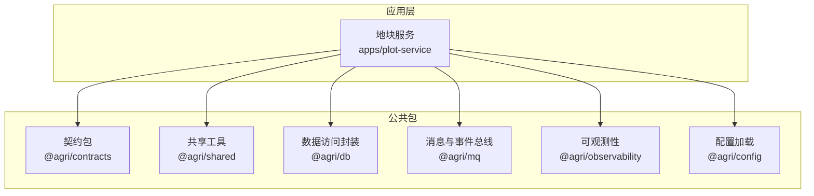
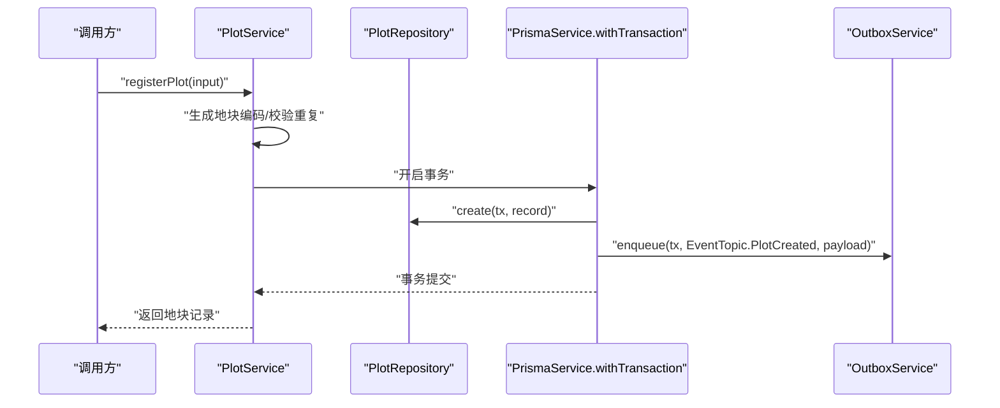
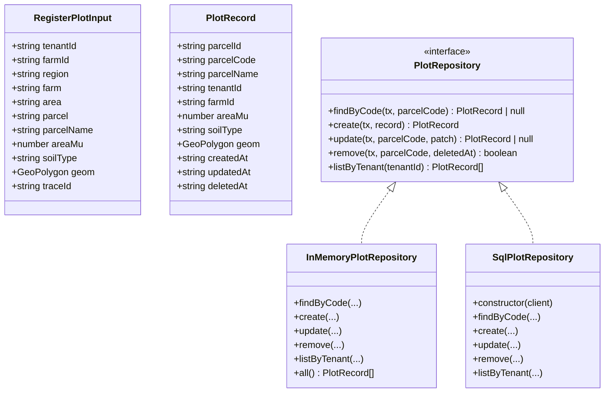
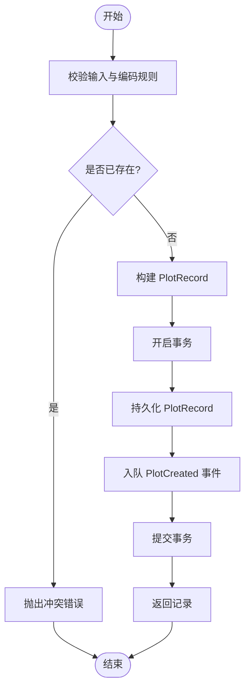
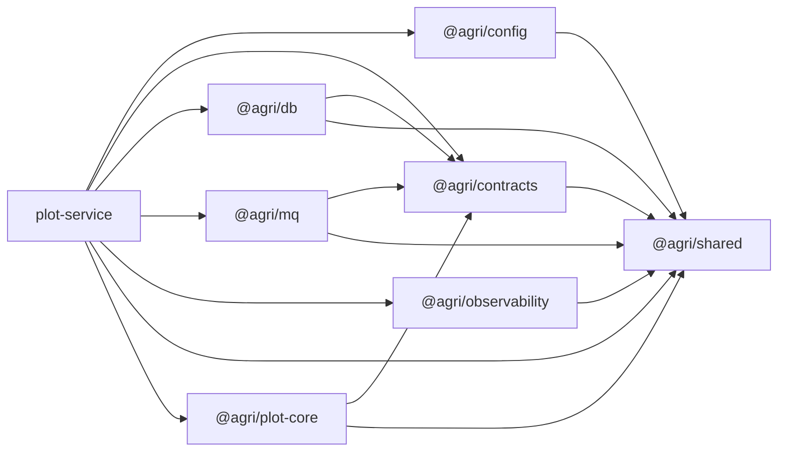
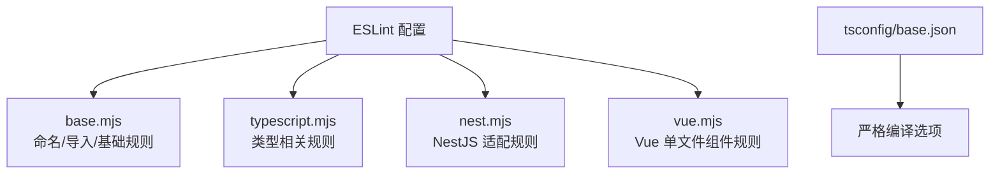

# 编码规范

<cite>
**本文引用的文件**   
- [README.md](file://README.md)
- [packages/tsconfig/base.json](file://packages/tsconfig/base.json)
- [packages/eslint-config/base.mjs](file://packages/eslint-config/base.mjs)
- [packages/eslint-config/typescript.mjs](file://packages/eslint-config/typescript.mjs)
- [packages/eslint-config/nest.mjs](file://packages/eslint-config/nest.mjs)
- [packages/eslint-config/vue.mjs](file://packages/eslint-config/vue.mjs)
- [packages/contracts/src/index.ts](file://packages/contracts/src/index.ts)
- [packages/shared/src/index.ts](file://packages/shared/src/index.ts)
- [apps/plot-service/src/plot.service.ts](file://apps/plot-service/src/plot.service.ts)
- [apps/plot-service/src/plot.repository.ts](file://apps/plot-service/src/plot.repository.ts)
</cite>

## 目录
1. [引言](#引言)
2. [项目结构](#项目结构)
3. [核心组件](#核心组件)
4. [架构总览](#架构总览)
5. [详细组件分析](#详细组件分析)
6. [依赖关系分析](#依赖关系分析)
7. [性能与可观测性](#性能与可观测性)
8. [错误处理与日志规范](#错误处理与日志规范)
9. [代码审查检查点](#代码审查检查点)
10. [自动化格式化工具配置](#自动化格式化工具配置)
11. [结论](#结论)

## 引言
本编码规范面向智慧农业平台，覆盖 TypeScript 类型定义、接口设计、泛型使用、命名约定、文件组织、注释规范，以及领域驱动设计在代码中的体现（实体、值对象、聚合根、仓储接口）。同时给出错误处理模式、日志记录规范、性能优化技巧、代码审查检查点和自动化格式化工具配置建议。

## 项目结构
平台采用 pnpm workspace + Turborepo + tsc -b 的工程引用方式，公共包与微服务通过工程引用串联构建链。契约包只定义不实现，能力包之间禁止循环引用；空间运算下沉数据库，事件投递遵循本地消息表与幂等消费。

**图示来源**
- [README.md:58-84](file://README.md#L58-L84)
- [README.md:86-103](file://README.md#L86-L103)

**章节来源**
- [README.md:58-118](file://README.md#L58-L118)

## 核心组件
- 契约包：平台级接口真相来源，仅导出类型、DTO、枚举、事件与错误码，不依赖任何能力包。
- 共享工具：异常基类、时间、单位换算、分页、标识生成等通用能力。
- 数据访问封装：客户端生命周期、事务、分库路由、分页与软删除。
- 消息与事件总线：发布订阅、本地消息表、重试死信与幂等。
- 可观测性：结构化日志、链路追踪、指标采集与运行期采集器。
- 配置加载：环境变量校验结构、启动期配置加载、密钥读取。

**章节来源**
- [packages/contracts/src/index.ts:1-12](file://packages/contracts/src/index.ts#L1-L12)
- [packages/shared/src/index.ts:1-11](file://packages/shared/src/index.ts#L1-L11)
- [README.md:86-103](file://README.md#L86-L103)

## 架构总览
下图展示“地块建档”关键流程：业务数据与待投递事件写入同一事务，提交后由中继投递，消费侧基于 eventId 幂等去重。

**图示来源**
- [apps/plot-service/src/plot.service.ts:48-104](file://apps/plot-service/src/plot.service.ts#L48-L104)

**章节来源**
- [apps/plot-service/src/plot.service.ts:13-104](file://apps/plot-service/src/plot.service.ts#L13-L104)

## 详细组件分析

### TypeScript 类型与接口设计
- 契约包作为唯一接口真相来源，所有跨进程/跨服务的 DTO、事件载荷、错误码、枚举均在此定义。
- 服务内部使用明确的输入输出接口，避免隐式 any；对外暴露的接口需具备稳定语义。
- 泛型用于统一响应信封、分页结果、仓储查询等场景，保持类型安全与复用。

**图示来源**
- [apps/plot-service/src/plot.service.ts:21-37](file://apps/plot-service/src/plot.service.ts#L21-L37)
- [apps/plot-service/src/plot.repository.ts:11-42](file://apps/plot-service/src/plot.repository.ts#L11-L42)
- [apps/plot-service/src/plot.repository.ts:52-92](file://apps/plot-service/src/plot.repository.ts#L52-L92)
- [apps/plot-service/src/plot.repository.ts:94-186](file://apps/plot-service/src/plot.repository.ts#L94-L186)

**章节来源**
- [apps/plot-service/src/plot.service.ts:21-37](file://apps/plot-service/src/plot.service.ts#L21-L37)
- [apps/plot-service/src/plot.repository.ts:11-42](file://apps/plot-service/src/plot.repository.ts#L11-L42)

### 命名约定
- 类型与接口：PascalCase。
- 变量与函数：camelCase，允许 UPPER_CASE 常量与 PascalCase 工厂函数。
- 类名：PascalCase。
- 导入顺序：内置模块、外部依赖、内部模块、父级、同级、索引，组间空行分隔，按字母升序。
- Vue 组件：多词组件名强制，模板/脚本/样式顺序固定。

**章节来源**
- [packages/eslint-config/base.mjs:18-42](file://packages/eslint-config/base.mjs#L18-L42)
- [packages/eslint-config/vue.mjs:5-11](file://packages/eslint-config/vue.mjs#L5-L11)

### 文件组织结构
- 每个包的 src/index.ts 为唯一对外入口，其他文件不构成公开契约。
- 契约包与能力包分离，能力包之间禁止循环引用。
- 服务工程以 NestJS 模块组织，示例服务刻意不启动监听进程，接入适配器后由 AppModule 托管生命周期。

**章节来源**
- [README.md:84-85](file://README.md#L84-L85)
- [README.md:147-155](file://README.md#L147-L155)

### 注释规范
- 对关键方法提供 JSDoc 说明参数与返回值。
- 对领域概念（如地块编码、事务边界）添加行内注释解释约束与原因。
- 对外部约束（如坐标系统、面积单位）在类型或字段旁标注。

**章节来源**
- [apps/plot-service/src/plot.service.ts:13-19](file://apps/plot-service/src/plot.service.ts#L13-L19)
- [apps/plot-service/src/plot.service.ts:48-52](file://apps/plot-service/src/plot.service.ts#L48-L52)
- [apps/plot-service/src/plot.repository.ts:4-9](file://apps/plot-service/src/plot.repository.ts#L4-L9)

### 领域驱动设计体现
- 实体：PlotRecord 承载地块持久化状态，包含业务主键 parcelCode、租户隔离 tenantId、几何 geom 与审计字段。
- 值对象：GeoPolygon 作为不可变几何值对象，确保坐标系统与精度约束。
- 聚合根：PlotService 协调编码生成、重复校验、事务内持久化与事件入队，维护一致性边界。
- 仓储接口：PlotRepository 抽象数据访问，提供内存与 SQL 两种实现，隐藏存储细节。

**图示来源**
- [apps/plot-service/src/plot.service.ts:48-104](file://apps/plot-service/src/plot.service.ts#L48-L104)

**章节来源**
- [apps/plot-service/src/plot.service.ts:39-104](file://apps/plot-service/src/plot.service.ts#L39-L104)
- [apps/plot-service/src/plot.repository.ts:11-42](file://apps/plot-service/src/plot.repository.ts#L11-L42)

## 依赖关系分析
- 契约包仅依赖 zod，不依赖任何能力包，前端可低成本引用。
- 能力包之间禁止循环引用；示例服务依赖配置、契约、数据库、消息、可观测性与共享工具。
- 空间运算下沉数据库，坐标统一 CGCS2000（EPSG:4490），仅在出参方向换算。

**图示来源**
- [README.md:86-103](file://README.md#L86-L103)
- [README.md:105-118](file://README.md#L105-L118)

**章节来源**
- [README.md:86-118](file://README.md#L86-L118)

## 性能与可观测性
- 分页每页上限 200，排序字段必须命中服务端白名单，避免全表扫描与任意排序。
- 时序数据不在 @agri/db 范围内，由物联感知服务直连时序库；缓存由各服务自行使用缓存中间件。
- 结构化日志与链路追踪通过 @agri/observability 提供，便于问题定位与性能分析。

**章节来源**
- [README.md:116-118](file://README.md#L116-L118)

## 错误处理与日志规范
- 错误码分段：域缩写-分类码-序号（如 PLOT-409-001），含义一经发布不得修改。
- 业务异常使用统一异常基类（如 ConflictError、NotFoundError），并携带错误码。
- HTTP 层统一响应信封 ApiResponse，包含 code、message、data、traceId、timestamp。
- 日志应结构化，包含 traceId、tenantId、producer 等上下文，便于链路追踪。

**章节来源**
- [README.md:117-118](file://README.md#L117-L118)
- [apps/plot-service/src/plot.service.ts:62-64](file://apps/plot-service/src/plot.service.ts#L62-L64)
- [apps/plot-service/src/plot.service.ts:113-115](file://apps/plot-service/src/plot.service.ts#L113-L115)

## 代码审查检查点
- 类型安全
  - 禁止 any；显式返回类型；严格可选属性访问；catch 变量 useUnknown。
  - 契约包导出变更视为平台级接口变更，需评估兼容性。
- 命名与风格
  - 类型/接口/类 PascalCase；变量/函数 camelCase；导入分组与排序。
- 领域建模
  - 实体/值对象/聚合根职责清晰；仓储接口明确；事务边界显式。
- 错误与日志
  - 错误码规范；结构化日志；traceId 贯穿请求。
- 性能
  - 分页上限与排序白名单；空间运算落库；避免 N+1 查询。
- 测试
  - 装饰器元数据差异；测试提供者显式 inject；内存/夹具替代真实中间件。

**章节来源**
- [packages/eslint-config/base.mjs:18-42](file://packages/eslint-config/base.mjs#L18-L42)
- [packages/eslint-config/typescript.mjs:1-34](file://packages/eslint-config/typescript.mjs#L1-L34)
- [packages/eslint-config/nest.mjs:1-14](file://packages/eslint-config/nest.mjs#L1-L14)
- [packages/eslint-config/vue.mjs:1-12](file://packages/eslint-config/vue.mjs#L1-L12)
- [README.md:157-166](file://README.md#L157-L166)

## 自动化格式化工具配置
- TypeScript 编译
  - 目标 ES2023；NodeNext 模块解析；strict 模式；noUncheckedIndexedAccess；exactOptionalPropertyTypes；noImplicitOverride；noFallthroughCasesInSwitch；useUnknownInCatchVariables；isolatedModules；sourceMap。
- ESLint 规则
  - 基础规则：no-console（允许 warn/error）、no-debugger、no-var、prefer-const、eqeqeq、no-duplicate-imports、no-fallthrough、no-throw-literal。
  - TypeScript 规则：naming-convention、consistent-type-imports、no-explicit-any、explicit-function-return-type（warn，公共包可提升为 error）、explicit-module-boundary-types、no-unsafe-assignment/member-access、no-floating-promises、await-thenable。
  - Nest 规则：no-extraneous-class（允许装饰器）、parameter-properties（优先 class-property）、no-console（服务内统一日志）。
  - Vue 规则：multi-word-component-names、no-unused-vars、component-tags-order。
- 架构约束
  - 依赖方向校验与跨层引用校验，防止循环依赖与越层调用。

**图示来源**
- [packages/eslint-config/base.mjs:1-44](file://packages/eslint-config/base.mjs#L1-L44)
- [packages/eslint-config/typescript.mjs:1-34](file://packages/eslint-config/typescript.mjs#L1-L34)
- [packages/eslint-config/nest.mjs:1-14](file://packages/eslint-config/nest.mjs#L1-L14)
- [packages/eslint-config/vue.mjs:1-12](file://packages/eslint-config/vue.mjs#L1-L12)
- [packages/tsconfig/base.json:1-24](file://packages/tsconfig/base.json#L1-L24)

**章节来源**
- [packages/tsconfig/base.json:1-24](file://packages/tsconfig/base.json#L1-L24)
- [packages/eslint-config/base.mjs:1-44](file://packages/eslint-config/base.mjs#L1-L44)
- [packages/eslint-config/typescript.mjs:1-34](file://packages/eslint-config/typescript.mjs#L1-L34)
- [packages/eslint-config/nest.mjs:1-14](file://packages/eslint-config/nest.mjs#L1-L14)
- [packages/eslint-config/vue.mjs:1-12](file://packages/eslint-config/vue.mjs#L1-L12)

## 结论
本规范以契约包为核心、能力包为支撑，结合严格的 TypeScript 编译与 ESLint 规则，确保类型安全、命名一致、依赖可控。领域模型通过实体、值对象、聚合根与仓储接口清晰表达业务边界；错误处理与日志规范保障可观测性与可维护性；分页、排序与空间运算策略兼顾性能与正确性。建议在新增服务与公共包时严格遵循本规范，并通过自动化检查与代码审查持续落地。