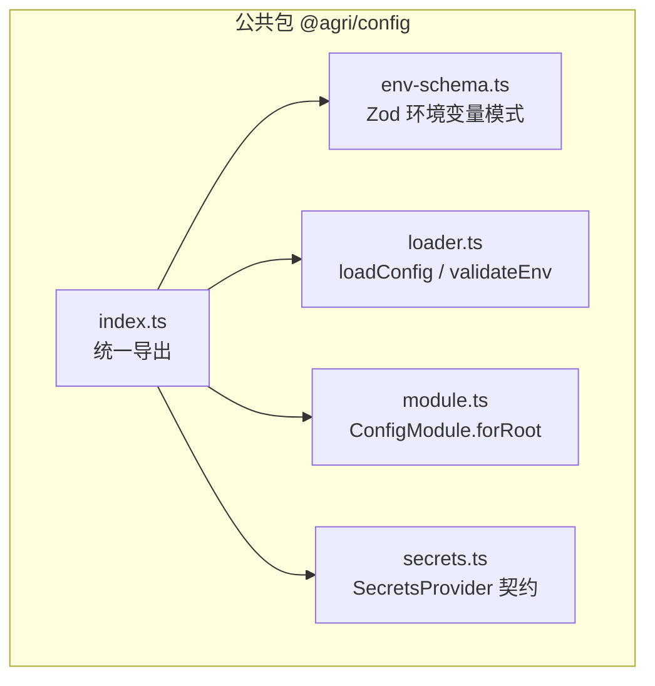
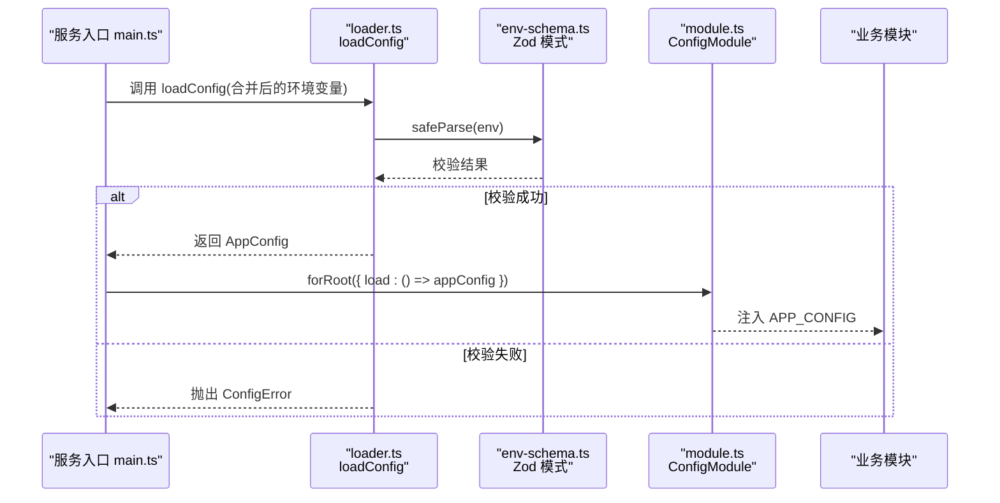
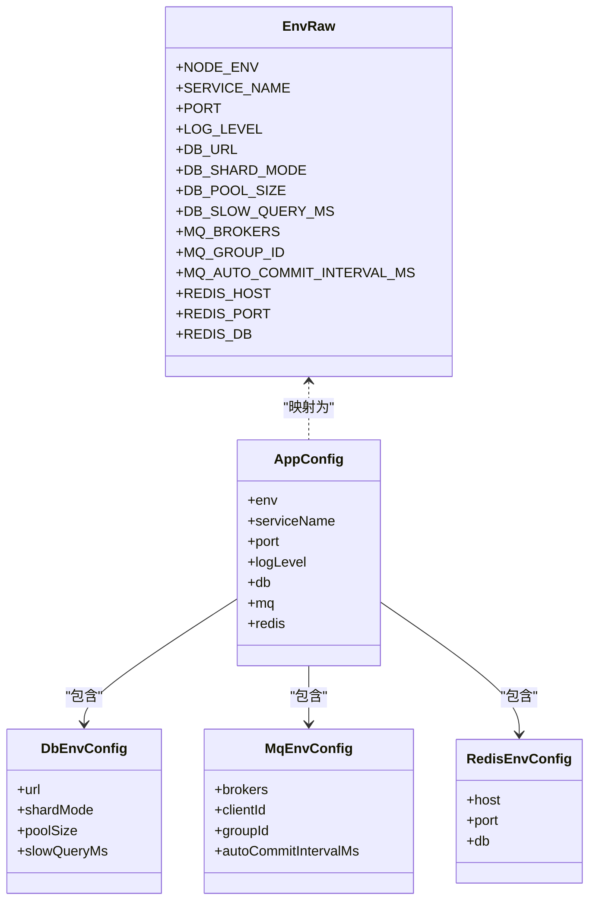
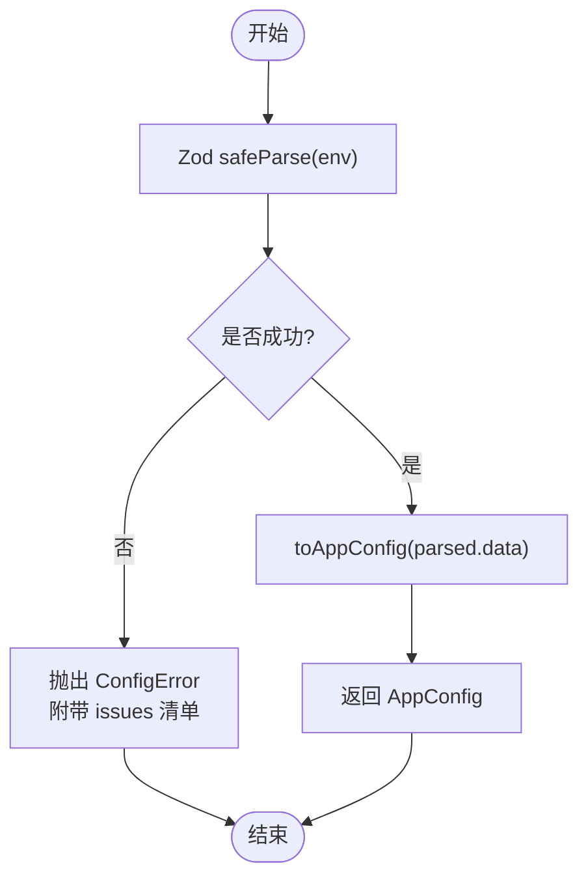
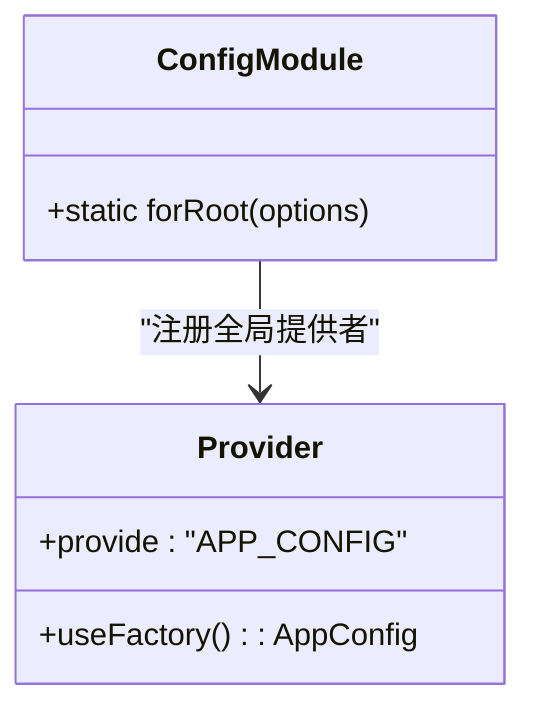
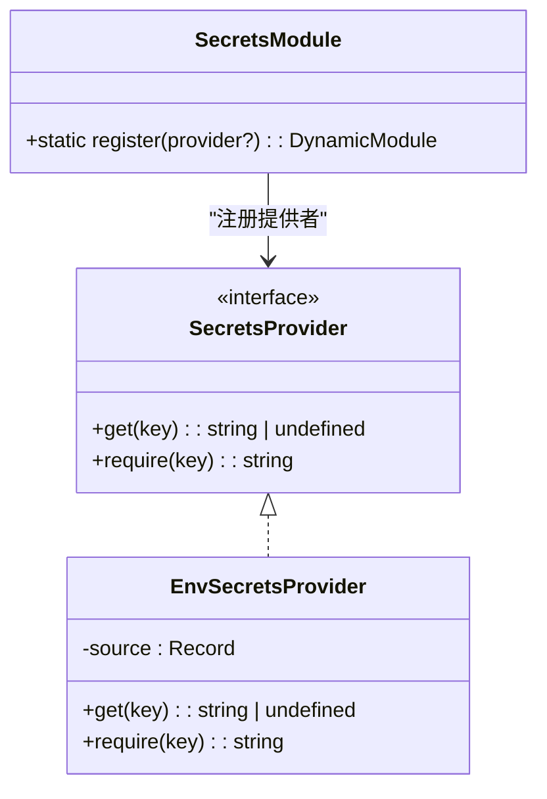
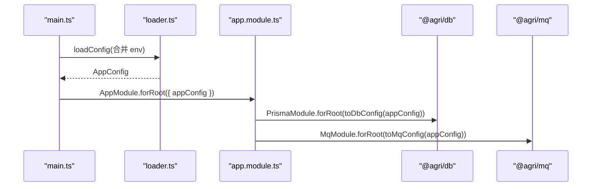
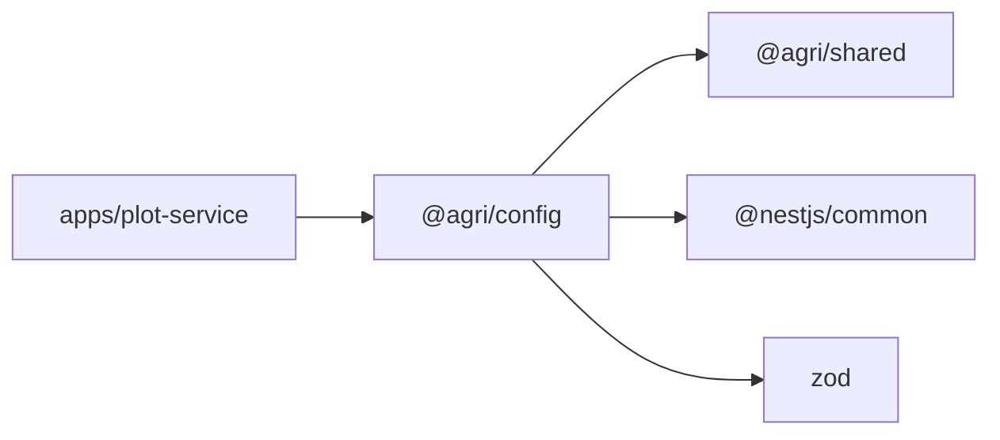

# 配置管理

<cite>
**本文引用的文件**   
- [packages/config/src/index.ts](file://packages/config/src/index.ts)
- [packages/config/src/env-schema.ts](file://packages/config/src/env-schema.ts)
- [packages/config/src/loader.ts](file://packages/config/src/loader.ts)
- [packages/config/src/module.ts](file://packages/config/src/module.ts)
- [packages/config/src/secrets.ts](file://packages/config/src/secrets.ts)
- [apps/plot-service/src/app.module.ts](file://apps/plot-service/src/app.module.ts)
- [apps/plot-service/src/main.ts](file://apps/plot-service/src/main.ts)
- [packages/config/package.json](file://packages/config/package.json)
- [README.md](file://README.md)
</cite>

## 目录
1. [引言](#引言)
2. [项目结构](#项目结构)
3. [核心组件](#核心组件)
4. [架构总览](#架构总览)
5. [详细组件分析](#详细组件分析)
6. [依赖关系分析](#依赖关系分析)
7. [性能与容量特性](#性能与容量特性)
8. [多环境与敏感信息管理](#多环境与敏感信息管理)
9. [最佳实践](#最佳实践)
10. [故障排查与环境差异处理](#故障排查与环境差异处理)
11. [结论](#结论)

## 引言
本文件面向智慧农业平台，系统性说明 `@agri/config` 包的设计与使用方式，覆盖配置加载顺序、环境变量映射、配置校验机制、NestJS 集成方式、数据库连接配置、消息队列配置、缓存配置、密钥读取契约，以及多环境管理与配置迁移策略。该包将“配置错误”从运行期偶发问题收敛到启动期确定性失败，并通过 Zod 提供强类型的环境变量契约，便于在开发、测试、生产环境中保持一致的配置治理。

## 项目结构
`@agri/config` 是公共能力包之一，职责为“配置加载与校验：环境变量校验结构、启动期配置加载、密钥读取”。其对外入口统一导出四个子模块：环境变量模式定义、配置加载器、NestJS 配置模块、密钥提供者。

**图表来源**
- [packages/config/src/index.ts:1-9](file://packages/config/src/index.ts#L1-L9)
- [packages/config/src/env-schema.ts:1-78](file://packages/config/src/env-schema.ts#L1-L78)
- [packages/config/src/loader.ts:1-80](file://packages/config/src/loader.ts#L1-L80)
- [packages/config/src/module.ts:1-41](file://packages/config/src/module.ts#L1-L41)
- [packages/config/src/secrets.ts:1-61](file://packages/config/src/secrets.ts#L1-L61)

**章节来源**
- [packages/config/package.json:1-28](file://packages/config/package.json#L1-L28)
- [README.md:86-103](file://README.md#L86-L103)

## 核心组件
- 环境变量模式与类型：通过 Zod 声明所有环境变量及其默认值、取值范围与必填约束，并导出应用级配置结构。
- 配置加载器：提供仅校验的预检函数和启动期加载函数；失败时抛出结构化异常，包含问题清单。
- NestJS 配置模块：全局模块，暴露可注入的应用配置令牌，支持自定义加载函数以适配测试注入。
- 密钥提供者契约：定义统一的密钥读取接口，并提供基于环境变量的默认实现；缺失密钥时抛出配置异常。

**章节来源**
- [packages/config/src/env-schema.ts:1-78](file://packages/config/src/env-schema.ts#L1-L78)
- [packages/config/src/loader.ts:1-80](file://packages/config/src/loader.ts#L1-L80)
- [packages/config/src/module.ts:1-41](file://packages/config/src/module.ts#L1-L41)
- [packages/config/src/secrets.ts:1-61](file://packages/config/src/secrets.ts#L1-L61)

## 架构总览
下图展示服务启动时配置装配的关键路径：入口调用配置加载器得到应用配置，随后由 NestJS 模块注册为全局提供者，业务模块按需注入。

**图表来源**
- [apps/plot-service/src/main.ts:48-57](file://apps/plot-service/src/main.ts#L48-L57)
- [packages/config/src/loader.ts:66-79](file://packages/config/src/loader.ts#L66-L79)
- [packages/config/src/env-schema.ts:10-40](file://packages/config/src/env-schema.ts#L10-L40)
- [packages/config/src/module.ts:24-39](file://packages/config/src/module.ts#L24-L39)

## 详细组件分析

### 环境变量模式与类型（env-schema.ts）
- 设计要点
  - 单一真相源：所有环境变量在此集中声明，新增字段必须在此扩展。
  - 严格校验：对端口、日志级别、分片模式、连接池大小、慢查询阈值等做范围与类型校验。
  - 默认值：对非敏感且安全的参数设置合理默认值，降低本地开发门槛。
  - 类型导出：导出 `EnvRaw`、`AppConfig`、`DbEnvConfig`、`MqEnvConfig`、`RedisEnvConfig`，供上层按域消费。
- 关键配置项
  - 通用：`NODE_ENV`、`SERVICE_NAME`、`PORT`、`LOG_LEVEL`
  - 数据库：`DB_URL`、`DB_SHARD_MODE`、`DB_POOL_SIZE`、`DB_SLOW_QUERY_MS`
  - 消息队列：`MQ_BROKERS`、`MQ_GROUP_ID`、`MQ_AUTO_COMMIT_INTERVAL_MS`
  - 缓存：`REDIS_HOST`、`REDIS_PORT`、`REDIS_DB`

**图表来源**
- [packages/config/src/env-schema.ts:10-78](file://packages/config/src/env-schema.ts#L10-L78)

**章节来源**
- [packages/config/src/env-schema.ts:1-78](file://packages/config/src/env-schema.ts#L1-L78)

### 配置加载器（loader.ts）
- 设计要点
  - 预检：`validateEnv` 用于部署前检查，不抛错，返回问题清单。
  - 启动加载：`loadConfig` 在校验失败时抛出 `ConfigError`，携带可读的问题清单，便于运维定位。
  - 归并：`toAppConfig` 将原始环境变量转换为按域分组的应用配置对象。
- 数据流
  - 输入：环境变量来源（默认进程环境）。
  - 输出：`AppConfig`。
  - 失败：抛出 `ConfigError`，包含每个字段的校验问题。

**图表来源**
- [packages/config/src/loader.ts:21-79](file://packages/config/src/loader.ts#L21-L79)

**章节来源**
- [packages/config/src/loader.ts:1-80](file://packages/config/src/loader.ts#L1-L80)

### NestJS 配置模块（module.ts）
- 设计要点
  - 全局模块：只需在根模块导入一次，即可在全局注入 `APP_CONFIG`。
  - 工厂注入：`forRoot` 通过 `useFactory` 创建配置实例，支持传入自定义 `load` 函数或指定 `env` 来源，便于测试注入固定配置。
- 使用方式
  - 在示例服务的根模块中，通过 `ConfigModule.forRoot({ load: () => appConfig })` 注入已解析的配置。

**图表来源**
- [packages/config/src/module.ts:24-39](file://packages/config/src/module.ts#L24-L39)

**章节来源**
- [packages/config/src/module.ts:1-41](file://packages/config/src/module.ts#L1-L41)
- [apps/plot-service/src/app.module.ts:83-89](file://apps/plot-service/src/app.module.ts#L83-L89)

### 密钥提供者（secrets.ts）
- 设计要点
  - 契约抽象：`SecretsProvider` 定义 `get` 与 `require` 两种读取语义。
  - 默认实现：`EnvSecretsProvider` 从环境变量读取；缺失时 `require` 抛出 `ConfigError`。
  - 模块注册：`SecretsModule.register` 支持注入自定义实现，便于对接外部密钥管理服务。
- 安全约定
  - 密钥一律从环境或密钥服务读取，禁止硬编码、镜像内嵌、日志与事件泄露。

**图表来源**
- [packages/config/src/secrets.ts:6-60](file://packages/config/src/secrets.ts#L6-L60)

**章节来源**
- [packages/config/src/secrets.ts:1-61](file://packages/config/src/secrets.ts#L1-L61)

### 服务装配与配置消费（app.module.ts 与 main.ts）
- 装配流程
  - 入口 `main.ts` 先调用 `loadConfig` 获取 `AppConfig`，再构造基础设施与业务依赖。
  - 根模块 `app.module.ts` 通过 `ConfigModule.forRoot({ load: () => appConfig })` 把配置注入容器。
  - 数据库与消息队列配置分别通过转换函数映射到对应模块所需结构。
- 配置消费
  - 日志与指标初始化使用 `serviceName` 与 `logLevel`。
  - 数据库连接使用 `db.url`、`db.shardMode`、`db.poolSize`、`db.slowQueryMs`。
  - 消息队列使用 `mq.brokers`、`mq.clientId`、`mq.groupId`、`mq.autoCommitIntervalMs`。

**图表来源**
- [apps/plot-service/src/main.ts:48-91](file://apps/plot-service/src/main.ts#L48-L91)
- [apps/plot-service/src/app.module.ts:69-77](file://apps/plot-service/src/app.module.ts#L69-L77)
- [apps/plot-service/src/app.module.ts:180-195](file://apps/plot-service/src/app.module.ts#L180-L195)

**章节来源**
- [apps/plot-service/src/main.ts:48-91](file://apps/plot-service/src/main.ts#L48-L91)
- [apps/plot-service/src/app.module.ts:69-77](file://apps/plot-service/src/app.module.ts#L69-L77)
- [apps/plot-service/src/app.module.ts:180-195](file://apps/plot-service/src/app.module.ts#L180-L195)

## 依赖关系分析
- 包依赖
  - `@agri/config` 依赖 `@nestjs/common` 与 `zod`，并通过工作区引用 `@agri/shared`。
- 模块耦合
  - 业务模块仅依赖 `AppConfig` 与 `ConfigModule`，不直接感知环境变量细节，提升内聚性。
  - 密钥读取通过 `SecretsProvider` 解耦具体存储后端。

**图表来源**
- [packages/config/package.json:18-22](file://packages/config/package.json#L18-L22)
- [apps/plot-service/src/app.module.ts:4-6](file://apps/plot-service/src/app.module.ts#L4-L6)

**章节来源**
- [packages/config/package.json:1-28](file://packages/config/package.json#L1-L28)
- [apps/plot-service/src/app.module.ts:1-10](file://apps/plot-service/src/app.module.ts#L1-L10)

## 性能与容量特性
- 配置校验在启动期执行，避免运行期因配置错误导致不稳定。
- 连接池大小 `DB_POOL_SIZE` 需结合容器副本数与数据库最大连接数进行反推，防止连接耗尽。
- 消息队列自动提交间隔 `MQ_AUTO_COMMIT_INTERVAL_MS` 越大吞吐越高，但重复窗口更宽，需权衡一致性。
- 慢查询阈值 `DB_SLOW_QUERY_MS` 用于观测与告警，建议根据实际负载调优。

[本节为通用指导，不直接分析具体文件]

## 多环境与敏感信息管理

### 多环境配置管理
- 环境枚举：`NODE_ENV` 限定为 `development`、`test`、`production`，默认 `development`。
- 推荐分层
  - 基础层：仓库内默认值（如端口、日志级别、Redis 默认地址）。
  - 环境层：通过环境变量覆盖（数据库连接串、消息队列地址、消费者组）。
  - 租户/实例层：通过运行时注入（如 `SERVICE_NAME`、`MQ_GROUP_ID`）。
- 本地开发
  - 可在入口处合并默认环境变量，再叠加 `process.env`，保证最小可用配置。

**章节来源**
- [packages/config/src/env-schema.ts:10-18](file://packages/config/src/env-schema.ts#L10-L18)
- [apps/plot-service/src/main.ts:48-57](file://apps/plot-service/src/main.ts#L48-L57)

### 敏感信息加密存储与读取
- 密钥一律通过 `SecretsProvider` 读取，默认实现从环境变量获取。
- 缺失密钥时 `require` 抛出 `ConfigError`，便于快速定位。
- 生产环境建议替换为外部密钥管理服务（如云厂商 KMS），通过 `SecretsModule.register` 注入自定义实现。

**章节来源**
- [packages/config/src/secrets.ts:6-60](file://packages/config/src/secrets.ts#L6-L60)

### 配置热更新
- 当前实现为启动期一次性加载，未内置热更新机制。
- 若需热更新，建议在业务层引入配置中心客户端，监听变更并刷新内存中的配置对象；同时确保下游组件（数据库连接池、消息客户端）具备重连或重建能力。

[本节为通用指导，不直接分析具体文件]

## 最佳实践

### 配置分层与默认值
- 在 `env-schema.ts` 中为安全且合理的参数设置默认值，减少本地开发成本。
- 将易变、环境相关的参数（数据库 URL、消息队列地址、消费者组）全部外置为环境变量。
- 使用 `SERVICE_NAME` 区分不同服务实例，便于日志与链路追踪。

**章节来源**
- [packages/config/src/env-schema.ts:10-40](file://packages/config/src/env-schema.ts#L10-L40)

### 配置迁移策略
- 新增配置项时，先在 `env-schema.ts` 中声明并设置默认值，再在业务代码中消费。
- 对破坏性变更（如字段改名、类型变化）应提供兼容层或灰度脚本，确保旧版本仍可启动。
- 使用 `validateEnv` 在部署前预检，提前发现缺失或非法配置。

**章节来源**
- [packages/config/src/loader.ts:21-35](file://packages/config/src/loader.ts#L21-L35)

### 配置验证机制
- 启动期强制校验，失败即终止进程，避免半配置运行。
- 校验失败时抛出 `ConfigError`，包含字段路径与原因，便于自动化告警与修复指引。

**章节来源**
- [packages/config/src/loader.ts:66-79](file://packages/config/src/loader.ts#L66-L79)

## 故障排查与环境差异处理

### 常见配置问题
- 缺少必填环境变量：如 `DB_URL`、`MQ_BROKERS`、`MQ_GROUP_ID`。
- 类型或范围错误：如端口不在合法范围、连接池过大、日志级别非法。
- 密钥缺失：通过 `SECRETS_PROVIDER` 读取的密钥未注入。

排查步骤
1. 使用 `validateEnv` 预检环境变量，查看问题清单。
2. 检查 `NODE_ENV` 是否与预期一致。
3. 核对数据库连接串、消息队列地址、消费者组是否正确。
4. 确认密钥已通过环境变量或密钥服务注入。

**章节来源**
- [packages/config/src/loader.ts:21-35](file://packages/config/src/loader.ts#L21-L35)
- [packages/config/src/secrets.ts:35-41](file://packages/config/src/secrets.ts#L35-L41)

### 环境差异处理
- 开发环境：可使用内存消息总线与内存仓储，快速验证装配链路与业务逻辑。
- 测试环境：通过 `ConfigModule.forRoot({ load: () => fixedConfig })` 注入固定配置，隔离外部依赖。
- 生产环境：启用真实数据库、消息中间件与缓存，并根据集群规模调整连接池与提交间隔。

**章节来源**
- [apps/plot-service/src/main.ts:63-77](file://apps/plot-service/src/main.ts#L63-L77)
- [packages/config/src/module.ts:27-32](file://packages/config/src/module.ts#L27-L32)

## 结论
`@agri/config` 通过 Zod 模式、启动期校验、NestJS 全局模块与密钥提供者契约，构建了稳定、可测试、可扩展的配置体系。它将配置错误前置到启动期，明确环境变量契约，并为数据库、消息队列、缓存等基础设施提供一致的装配入口。在多环境场景下，建议遵循“默认值 + 环境变量 + 运行时注入”的分层策略，并结合部署前预检与密钥服务，保障系统在生产环境的可靠性与可维护性。