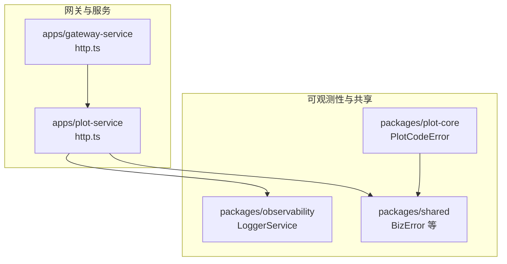
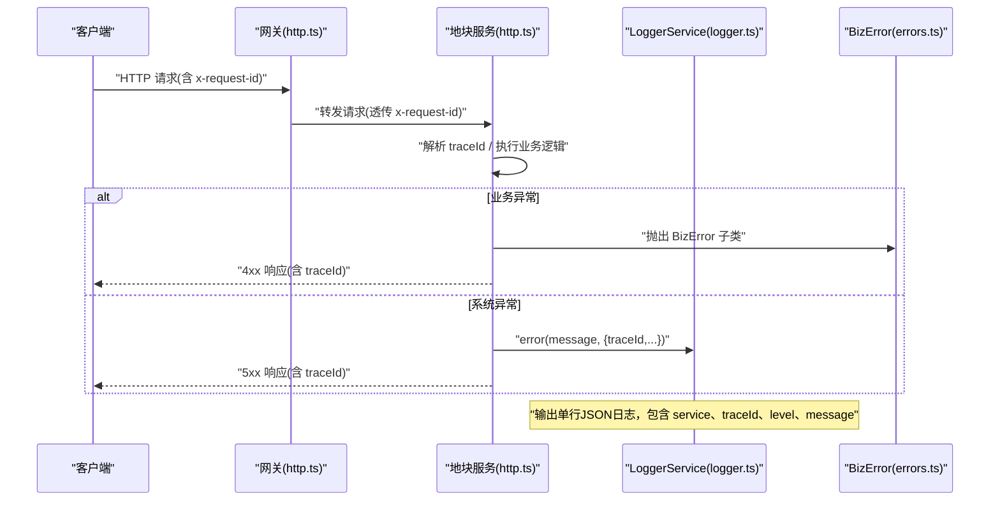
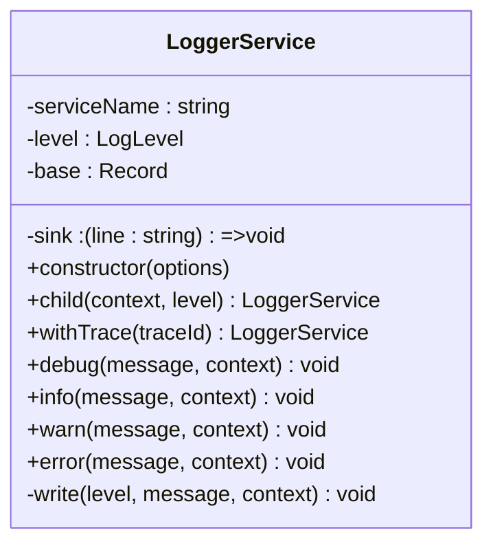
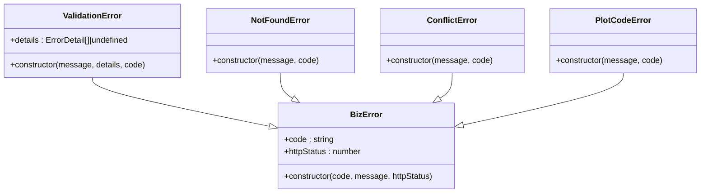
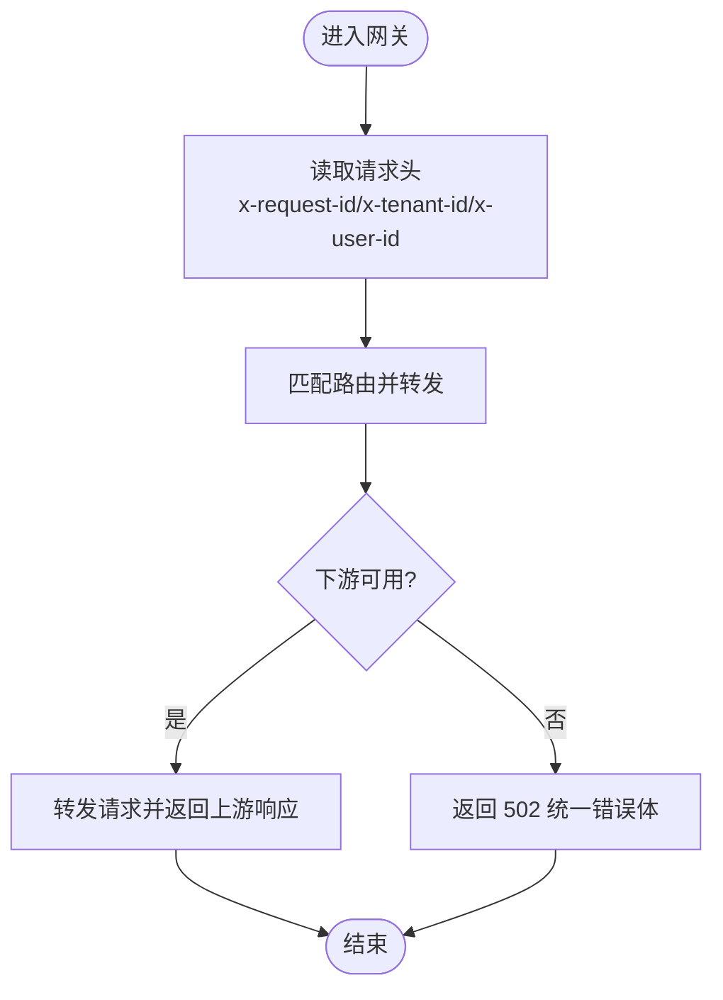
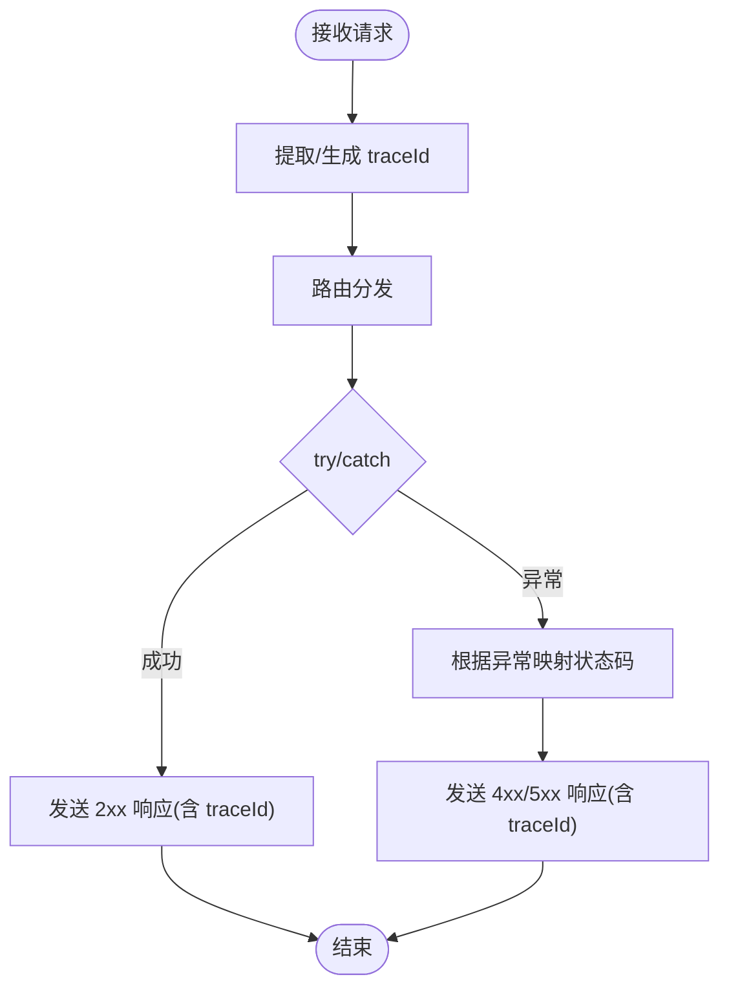
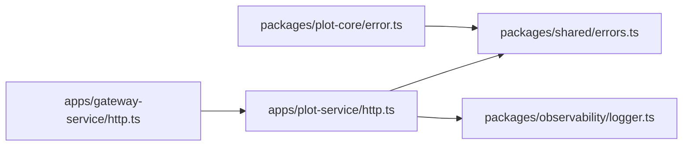

# 错误处理与日志

<cite>
**本文引用的文件**   
- [packages/observability/src/logger.ts](file://packages/observability/src/logger.ts)
- [packages/shared/src/errors.ts](file://packages/shared/src/errors.ts)
- [packages/plot-core/src/error.ts](file://packages/plot-core/src/error.ts)
- [apps/gateway-service/src/http.ts](file://apps/gateway-service/src/http.ts)
- [apps/plot-service/src/http.ts](file://apps/plot-service/src/http.ts)
</cite>

## 目录
1. [引言](#引言)
2. [项目结构](#项目结构)
3. [核心组件](#核心组件)
4. [架构总览](#架构总览)
5. [详细组件分析](#详细组件分析)
6. [依赖关系分析](#依赖关系分析)
7. [性能考虑](#性能考虑)
8. [故障排查指南](#故障排查指南)
9. [结论](#结论)
10. [附录](#附录)

## 引言
本规范面向智慧农业平台，统一后端微服务的错误处理与结构化日志记录实践。目标包括：
- 建立统一的日志格式、级别与上下文字段，确保跨服务可追踪。
- 明确异常分类（业务异常、系统异常、第三方服务异常）及处理策略。
- 实现分布式链路追踪ID的生成、透传与记录。
- 提供错误监控告警、日志聚合分析与问题定位方法。
- 给出日志性能优化与存储策略建议。

## 项目结构
本项目采用多包多应用的结构，错误与日志相关能力集中在共享包与可观测性包中，并在各微服务中复用：
- packages/observability：结构化日志器 LoggerService，定义日志级别、固定字段、子日志器派生与链路ID注入。
- packages/shared：业务异常基类 BizError 与常见业务异常类型（校验失败、未找到、冲突）。
- packages/plot-core：领域内具体业务异常 PlotCodeError，继承 BizError。
- apps/gateway-service：网关层负责路由转发、健康检查、请求ID透传与下游不可用时的统一错误响应。
- apps/plot-service：地块服务示例，展示请求ID提取、响应体包含 traceId、以及基础异常捕获与状态码映射。

**图示来源** 
- [packages/observability/src/logger.ts:1-102](file://packages/observability/src/logger.ts#L1-L102)
- [packages/shared/src/errors.ts:1-53](file://packages/shared/src/errors.ts#L1-L53)
- [packages/plot-core/src/error.ts:1-11](file://packages/plot-core/src/error.ts#L1-L11)
- [apps/gateway-service/src/http.ts:1-41](file://apps/gateway-service/src/http.ts#L1-L41)
- [apps/plot-service/src/http.ts:1-109](file://apps/plot-service/src/http.ts#L1-L109)

**章节来源**
- [packages/observability/src/logger.ts:1-102](file://packages/observability/src/logger.ts#L1-L102)
- [packages/shared/src/errors.ts:1-53](file://packages/shared/src/errors.ts#L1-L53)
- [packages/plot-core/src/error.ts:1-11](file://packages/plot-core/src/error.ts#L1-L11)
- [apps/gateway-service/src/http.ts:1-41](file://apps/gateway-service/src/http.ts#L1-L41)
- [apps/plot-service/src/http.ts:1-109](file://apps/plot-service/src/http.ts#L1-L109)

## 核心组件
- 结构化日志器 LoggerService
  - 固定字段：timestamp、level、service、message，支持扩展字段；traceId 作为可选上下文字段贯穿调用链。
  - 日志级别：debug、info、warn、error，数值权重控制过滤。
  - 子日志器 child/withTrace：自动携带上下文或链路ID，便于按租户、模块、请求维度切分日志。
  - sink 可插拔：默认输出到标准输出，测试或采集端可替换为自定义写入函数。
- 业务异常体系 BizError 及其子类
  - BizError：统一携带 code、httpStatus，便于全局过滤器转换为HTTP响应。
  - ValidationError、NotFoundError、ConflictError：覆盖参数校验、资源不存在、状态冲突等常见场景。
  - PlotCodeError：地块领域内的编码异常，继承 BizError，便于统一识别与处理。
- 网关 http.ts
  - 路由匹配与转发，透传 x-request-id、x-tenant-id、x-user-id 等上下文头。
  - 下游不可用时返回统一 502 错误体，包含 code、message、data、timestamp。
- 地块服务 http.ts
  - 从请求头读取或生成 traceId，并在响应体中回显 traceId。
  - 基础 try/catch 将异常消息映射为 404/400 响应。

**章节来源**
- [packages/observability/src/logger.ts:1-102](file://packages/observability/src/logger.ts#L1-L102)
- [packages/shared/src/errors.ts:1-53](file://packages/shared/src/errors.ts#L1-L53)
- [packages/plot-core/src/error.ts:1-11](file://packages/plot-core/src/error.ts#L1-L11)
- [apps/gateway-service/src/http.ts:1-41](file://apps/gateway-service/src/http.ts#L1-L41)
- [apps/plot-service/src/http.ts:1-109](file://apps/plot-service/src/http.ts#L1-L109)

## 架构总览
下图展示一次跨网关调用的错误处理与日志记录流程，体现链路ID透传、异常分类与结构化日志输出。

**图示来源**
- [apps/gateway-service/src/http.ts:26-40](file://apps/gateway-service/src/http.ts#L26-L40)
- [apps/plot-service/src/http.ts:11-20](file://apps/plot-service/src/http.ts#L11-L20)
- [packages/observability/src/logger.ts:39-101](file://packages/observability/src/logger.ts#L39-L101)
- [packages/shared/src/errors.ts:7-52](file://packages/shared/src/errors.ts#L7-L52)

## 详细组件分析

### 结构化日志器 LoggerService
- 设计要点
  - 固定字段保障可检索性：timestamp、level、service、message。
  - 通过 child/withTrace 实现上下文与链路ID的自动传播。
  - sink 抽象使日志输出可替换，便于对接日志采集器或测试断言。
- 使用建议
  - 在请求入口创建 LoggerService 实例并注入 serviceName。
  - 使用 withTrace(traceId) 派生子日志器，后续所有日志自动携带 traceId。
  - 对关键路径使用 info/debug，对可恢复问题使用 warn，对不可恢复问题使用 error。
  - 避免在 message 中拼接敏感信息，改用 context 字段并以脱敏值填充。

**图示来源**
- [packages/observability/src/logger.ts:39-101](file://packages/observability/src/logger.ts#L39-L101)

**章节来源**
- [packages/observability/src/logger.ts:1-102](file://packages/observability/src/logger.ts#L1-L102)

### 业务异常体系 BizError 与子类
- 设计要点
  - BizError 统一携带 code 与 httpStatus，便于全局过滤器直接映射HTTP响应。
  - ValidationError、NotFoundError、ConflictError 覆盖常见业务场景，减少重复分支判断。
  - PlotCodeError 用于地块领域的编码异常，便于按领域划分错误码前缀。
- 使用建议
  - 在业务层优先抛出 BizError 子类，而非裸 Error。
  - 在控制器/处理器层捕获 BizError，将其转换为统一响应结构。
  - 非业务异常（如网络、序列化、数据库连接）应视为系统异常，记录 error 日志并返回 5xx。

**图示来源**
- [packages/shared/src/errors.ts:7-52](file://packages/shared/src/errors.ts#L7-L52)
- [packages/plot-core/src/error.ts:4-9](file://packages/plot-core/src/error.ts#L4-L9)

**章节来源**
- [packages/shared/src/errors.ts:1-53](file://packages/shared/src/errors.ts#L1-L53)
- [packages/plot-core/src/error.ts:1-11](file://packages/plot-core/src/error.ts#L1-L11)

### 网关与服务的链路ID透传
- 网关
  - 透传 x-request-id、x-tenant-id、x-user-id 等头部至下游服务。
  - 下游不可用时返回统一 502 错误体，包含 code、message、data、timestamp。
- 地块服务
  - 从请求头读取 x-request-id，若缺失则生成随机ID。
  - 响应体 ApiResponse 中包含 traceId，便于前端与日志关联。

**图示来源**
- [apps/gateway-service/src/http.ts:26-40](file://apps/gateway-service/src/http.ts#L26-L40)

**章节来源**
- [apps/gateway-service/src/http.ts:1-41](file://apps/gateway-service/src/http.ts#L1-L41)
- [apps/plot-service/src/http.ts:11-20](file://apps/plot-service/src/http.ts#L11-L20)

### 请求处理与异常映射流程
- 地块服务
  - 解析 traceId，构造 ApiResponse 并回显 traceId。
  - 基础 try/catch 根据异常消息关键字映射 404/400。
  - 建议在更高层统一捕获 BizError 子类，依据 httpStatus 返回对应状态码。

**图示来源**
- [apps/plot-service/src/http.ts:11-20](file://apps/plot-service/src/http.ts#L11-L20)
- [apps/plot-service/src/http.ts:100-103](file://apps/plot-service/src/http.ts#L100-L103)

**章节来源**
- [apps/plot-service/src/http.ts:1-109](file://apps/plot-service/src/http.ts#L1-L109)

## 依赖关系分析
- LoggerService 被服务层用于结构化日志输出，不耦合具体框架。
- BizError 及其子类被业务层抛出，由全局异常过滤器或控制器捕获并转换。
- PlotCodeError 依赖 BizError，体现领域异常的统一基类。
- 网关与服务之间通过 HTTP 头传递链路ID与租户上下文。

**图示来源**
- [apps/gateway-service/src/http.ts:1-41](file://apps/gateway-service/src/http.ts#L1-L41)
- [apps/plot-service/src/http.ts:1-109](file://apps/plot-service/src/http.ts#L1-L109)
- [packages/shared/src/errors.ts:1-53](file://packages/shared/src/errors.ts#L1-L53)
- [packages/observability/src/logger.ts:1-102](file://packages/observability/src/logger.ts#L1-L102)
- [packages/plot-core/src/error.ts:1-11](file://packages/plot-core/src/error.ts#L1-L11)

**章节来源**
- [apps/gateway-service/src/http.ts:1-41](file://apps/gateway-service/src/http.ts#L1-L41)
- [apps/plot-service/src/http.ts:1-109](file://apps/plot-service/src/http.ts#L1-L109)
- [packages/shared/src/errors.ts:1-53](file://packages/shared/src/errors.ts#L1-L53)
- [packages/observability/src/logger.ts:1-102](file://packages/observability/src/logger.ts#L1-L102)
- [packages/plot-core/src/error.ts:1-11](file://packages/plot-core/src/error.ts#L1-L11)

## 性能考虑
- 日志级别过滤
  - 使用 LoggerService 内置级别权重进行过滤，避免在低优先级环境下输出 debug 日志。
- 异步与缓冲
  - 将 sink 替换为批量写入或异步队列，降低同步 I/O 对请求延迟的影响。
- 上下文最小化
  - 仅记录必要字段，避免大对象序列化；敏感字段必须脱敏后再放入 context。
- 采样与降级
  - 在高吞吐场景下对 debug 日志进行采样；当采集端不可用时降级为本地落盘或丢弃。
- 链路ID开销
  - 仅在必要时注入 traceId，避免在高频短生命周期任务中频繁分配字符串。

[本节为通用指导，无需代码引用]

## 故障排查指南
- 快速定位
  - 通过 traceId 在日志系统中聚合一次请求的全链路日志，观察 LoggerService 输出的 JSON 行。
  - 在网关与服务中确认 x-request-id 是否一致，确保链路ID透传正确。
- 异常分类
  - 业务异常：优先捕获 BizError 子类，查看 code 与 httpStatus，定位业务规则或数据问题。
  - 系统异常：关注 error 级别日志，结合堆栈与上下文字段（如 tenantId、userId）定位基础设施或第三方依赖问题。
  - 第三方服务异常：网关返回 502 时，检查下游服务健康与超时配置，同时收集上下游 traceId 对比。
- 日志聚合与分析
  - 将 LoggerService 的 sink 指向日志采集器（如 stdout -> 采集代理 -> 集中式日志系统），按 service、level、traceId 索引。
  - 构建仪表盘统计 error/warn 比率、P95/P99 延迟、下游不可用率。
- 告警配置
  - 基于 error 日志数量、特定 code 出现频率、下游 502 比例设置阈值告警。
  - 针对关键业务接口（如地块注册、遥测上报）设置独立告警通道。
- 问题定位方法
  - 以 traceId 为轴心拉取全链路日志，结合业务上下文（租户、用户、地块编码）缩小范围。
  - 对于间歇性问题，开启短期 debug 采样并保留少量样本日志用于复现分析。

**章节来源**
- [packages/observability/src/logger.ts:39-101](file://packages/observability/src/logger.ts#L39-L101)
- [apps/gateway-service/src/http.ts:26-40](file://apps/gateway-service/src/http.ts#L26-L40)
- [apps/plot-service/src/http.ts:11-20](file://apps/plot-service/src/http.ts#L11-L20)
- [packages/shared/src/errors.ts:7-52](file://packages/shared/src/errors.ts#L7-L52)

## 结论
通过统一的 LoggerService 与 BizError 异常体系，配合网关与服务中的链路ID透传，本平台实现了可观测、可追踪、可告警的错误处理与日志记录机制。建议在各微服务中遵循本规范，持续完善告警与可视化，提升问题定位效率与系统稳定性。

[本节为总结性内容，无需代码引用]

## 附录
- 日志字段约定
  - timestamp：ISO 时间戳
  - level：debug/info/warn/error
  - service：服务名
  - message：人类可读消息
  - traceId：链路ID（可选但推荐）
  - 其他上下文：tenantId、userId、bizKey 等（按需添加，注意脱敏）
- 错误码命名建议
  - 系统级：SYS-xxx-yyy
  - 业务域：DOMAIN-xxx-yyy（如 PLOT-xxx-yyy）
  - 第三方：EXT-xxx-yyy
- 敏感数据处理
  - 不在 message 中输出明文密码、密钥、手机号、身份证号等。
  - 如需记录标识，使用哈希或掩码后的值，并在 context 中标注字段含义。

[本节为补充说明，无需代码引用]