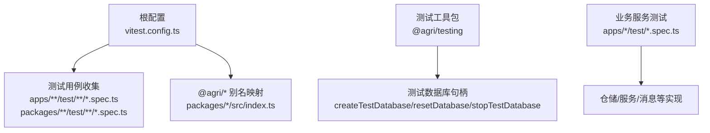
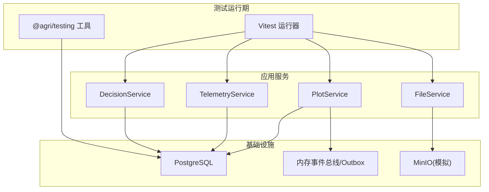
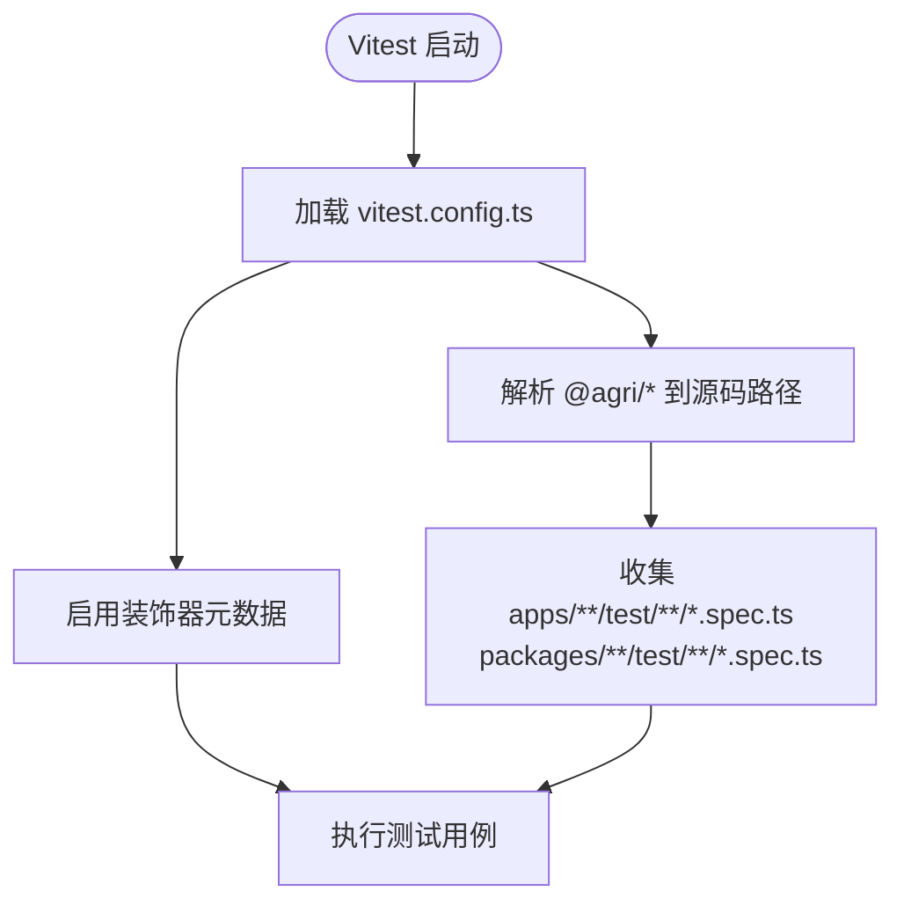
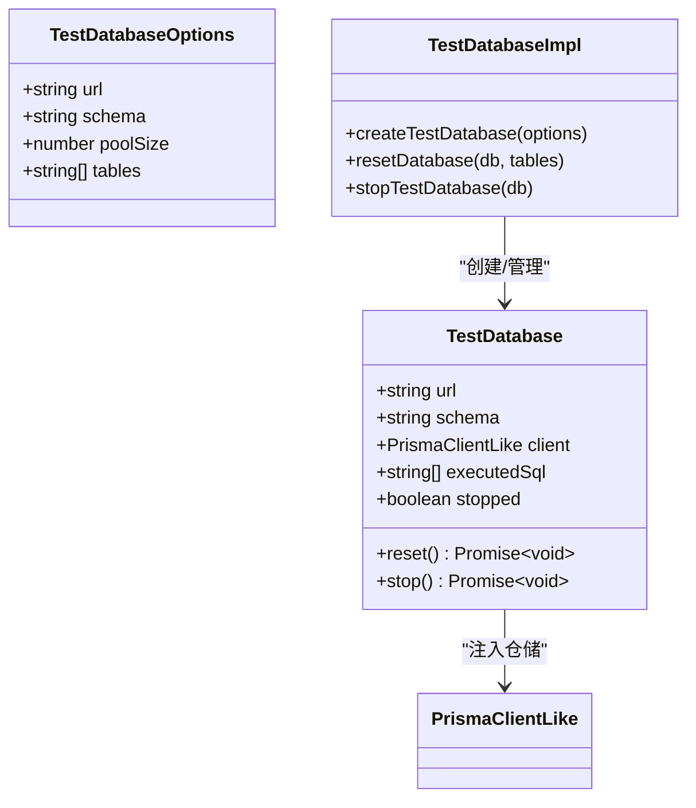
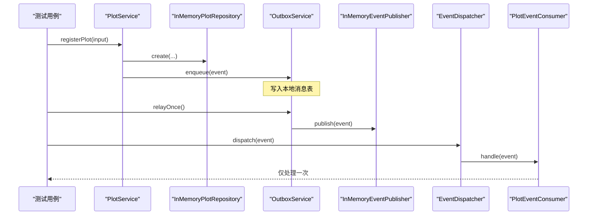
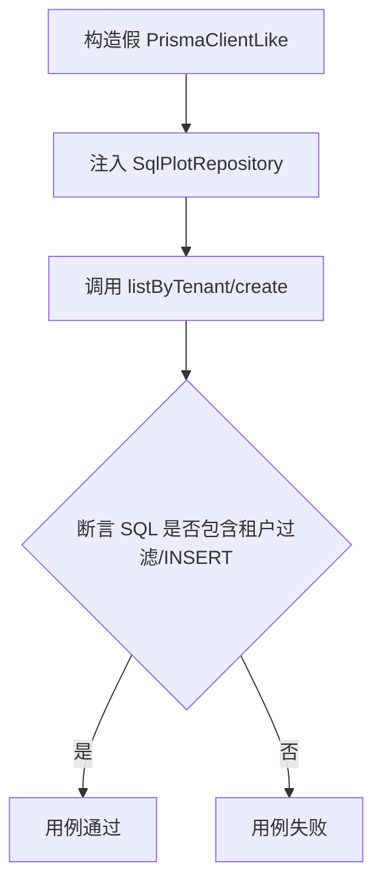
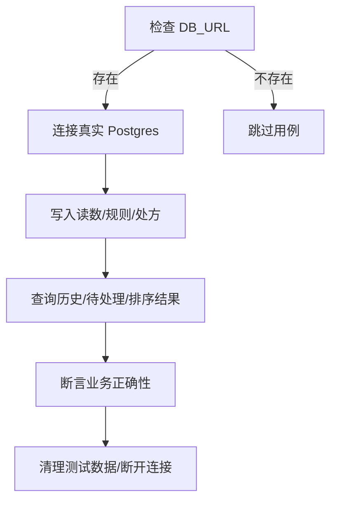
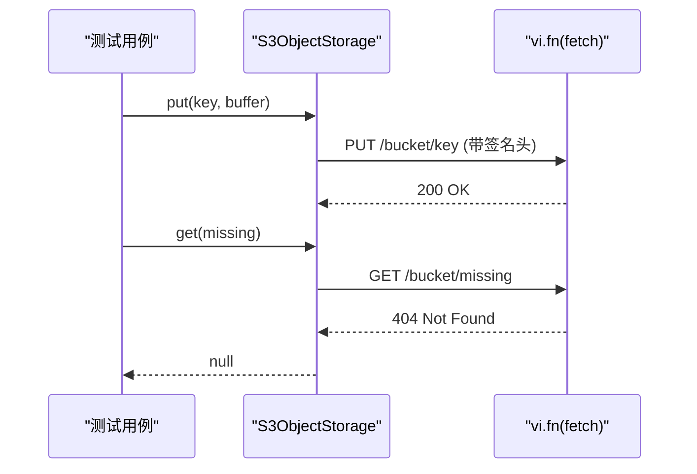
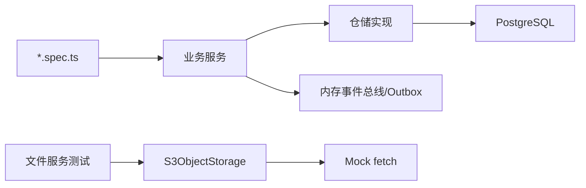

# 测试策略

<cite>
**本文引用的文件**   
- [vitest.config.ts](file://vitest.config.ts)
- [package.json](file://package.json)
- [packages/testing/src/index.ts](file://packages/testing/src/index.ts)
- [packages/testing/src/test-database.ts](file://packages/testing/src/test-database.ts)
- [apps/plot-service/test/plot-service.spec.ts](file://apps/plot-service/test/plot-service.spec.ts)
- [apps/plot-service/test/sql-plot-repository.spec.ts](file://apps/plot-service/test/sql-plot-repository.spec.ts)
- [apps/telemetry-service/test/sql-reading-repository.spec.ts](file://apps/telemetry-service/test/sql-reading-repository.spec.ts)
- [apps/file-service/test/s3-storage.spec.ts](file://apps/file-service/test/s3-storage.spec.ts)
- [apps/decision-service/test/sql-decision-repository.spec.ts](file://apps/decision-service/test/sql-decision-repository.spec.ts)
</cite>

## 目录
1. [引言](#引言)
2. [项目结构](#项目结构)
3. [核心组件](#核心组件)
4. [架构总览](#架构总览)
5. [详细组件分析](#详细组件分析)
6. [依赖关系分析](#依赖关系分析)
7. [性能考虑](#性能考虑)
8. [故障排查指南](#故障排查指南)
9. [结论](#结论)
10. [附录](#附录)

## 引言
本测试策略面向智慧农业平台，目标是在单体仓库与多服务架构下，建立可维护、可扩展且高可信的测试体系。文档围绕 Vitest 配置与使用、单元测试/集成测试/端到端测试的组织方式、Mock 数据生成、测试数据库管理、异步测试处理、覆盖率要求、公共包测试模式、外部服务模拟、性能测试方法，以及 CI/CD 自动化、报告生成和问题定位技巧展开，并提供最佳实践与常见问题解决方案。

## 项目结构
平台采用 monorepo 组织：业务微服务位于 apps/*，公共能力位于 packages/*，根级 vitest.config.ts 统一测试入口与别名解析，package.json 提供统一的测试脚本。

图表来源
- [vitest.config.ts:10-40](file://vitest.config.ts#L10-L40)
- [packages/testing/src/index.ts:1-25](file://packages/testing/src/index.ts#L1-L25)

章节来源
- [vitest.config.ts:1-42](file://vitest.config.ts#L1-L42)
- [package.json:14-29](file://package.json#L14-L29)

## 核心组件
- 测试运行器与别名：Vitest 在 Node 环境执行，通过 esbuild 开启装饰器语义，并通过 alias 将 @agri/* 指向源码，避免构建顺序问题。
- 测试工具包：@agri/testing 暴露时钟冻结、内存事件总线、测试数据库句柄、模块装配器与领域 Fixture 生成器。
- 测试数据库：提供假客户端（记录 SQL、事务边界）与真实库冒烟测试两种模式，支持按 schema 隔离与表级复位。
- 服务装配测试：以 plot-service 为例，替换仓储与消息实现，验证“建档 → 本地消息表 → 中继 → 消费幂等”的完整链路。

章节来源
- [vitest.config.ts:10-40](file://vitest.config.ts#L10-L40)
- [packages/testing/src/index.ts:1-25](file://packages/testing/src/index.ts#L1-L25)
- [packages/testing/src/test-database.ts:1-138](file://packages/testing/src/test-database.ts#L1-L138)
- [apps/plot-service/test/plot-service.spec.ts:24-69](file://apps/plot-service/test/plot-service.spec.ts#L24-L69)

## 架构总览
下图展示测试在仓库中的分层与交互：Vitest 收集用例，调用业务服务；仓储层可选择内存实现或真实 Postgres；消息层使用内存事件总线与 Outbox；对象存储通过 Mock fetch 模拟 MinIO。

图表来源
- [vitest.config.ts:36-40](file://vitest.config.ts#L36-L40)
- [packages/testing/src/index.ts:1-25](file://packages/testing/src/index.ts#L1-L25)
- [apps/plot-service/test/plot-service.spec.ts:24-69](file://apps/plot-service/test/plot-service.spec.ts#L24-L69)
- [apps/file-service/test/s3-storage.spec.ts:1-20](file://apps/file-service/test/s3-storage.spec.ts#L1-L20)

## 详细组件分析

### Vitest 配置与别名解析
- 测试环境为 node，包含 apps 与 packages 下的 .spec.ts。
- 通过 esbuild tsconfigRaw 开启 experimentalDecorators，保证 Nest 装饰器在测试期正常登记处理器。
- 通过 resolve.alias 将 @agri/* 直接指向源码，避免测试依赖构建产物顺序。

图表来源
- [vitest.config.ts:10-40](file://vitest.config.ts#L10-L40)

章节来源
- [vitest.config.ts:1-42](file://vitest.config.ts#L1-L42)

### 测试数据库与事务断言
- TestDatabaseOptions 支持 url/schema/poolSize/tables 配置，默认清空业务表并重启自增序列。
- createFakeClient 构造 PrismaClientLike 假客户端，记录 CONNECT/BEGIN/COMMIT/ROLLBACK 及原始 SQL，便于断言事务边界与 SQL 文本。
- resetDatabase 与 stopTestDatabase 提供数据复位与连接释放。

图表来源
- [packages/testing/src/test-database.ts:11-37](file://packages/testing/src/test-database.ts#L11-L37)
- [packages/testing/src/test-database.ts:50-87](file://packages/testing/src/test-database.ts#L50-L87)
- [packages/testing/src/test-database.ts:94-138](file://packages/testing/src/test-database.ts#L94-L138)

章节来源
- [packages/testing/src/test-database.ts:1-138](file://packages/testing/src/test-database.ts#L1-L138)

### 服务装配与事件幂等测试（地块服务）
- 通过 InMemoryPlotRepository、InMemoryEventPublisher、InMemoryOutboxStore、IdempotencyGuard 等替换外部依赖，验证服务主流程与事件消费幂等性。
- 用例覆盖：建档生成编码、重复建档冲突、查询未找到、更新与软删除、本地消息表入队与中继投递、重复事件只消费一次。

图表来源
- [apps/plot-service/test/plot-service.spec.ts:43-69](file://apps/plot-service/test/plot-service.spec.ts#L43-L69)
- [apps/plot-service/test/plot-service.spec.ts:88-157](file://apps/plot-service/test/plot-service.spec.ts#L88-L157)

章节来源
- [apps/plot-service/test/plot-service.spec.ts:1-158](file://apps/plot-service/test/plot-service.spec.ts#L1-L158)

### 仓储层单元测试（SQL 仓储）
- SqlPlotRepository 测试通过自定义 PrismaClientLike 模拟 $queryRawUnsafe/$executeRawUnsafe/$transaction，断言 SQL 片段与字段映射。
- 适合快速回归 SQL 变更与事务边界。

图表来源
- [apps/plot-service/test/sql-plot-repository.spec.ts:5-15](file://apps/plot-service/test/sql-plot-repository.spec.ts#L5-L15)
- [apps/plot-service/test/sql-plot-repository.spec.ts:17-34](file://apps/plot-service/test/sql-plot-repository.spec.ts#L17-L34)

章节来源
- [apps/plot-service/test/sql-plot-repository.spec.ts:1-35](file://apps/plot-service/test/sql-plot-repository.spec.ts#L1-L35)

### 真实数据库冒烟测试（遥测/决策服务）
- 通过环境变量 DB_URL 控制是否执行真实库用例，避免在普通开发时误连生产。
- 遥测服务：写入读数、查询历史序列、最新值校验、告警创建/待处理/已处理状态流转。
- 决策服务：规则 CRUD、处方留痕、Outbox 入队与待发送列表校验。

图表来源
- [apps/telemetry-service/test/sql-reading-repository.spec.ts:6-43](file://apps/telemetry-service/test/sql-reading-repository.spec.ts#L6-L43)
- [apps/decision-service/test/sql-decision-repository.spec.ts:8-46](file://apps/decision-service/test/sql-decision-repository.spec.ts#L8-L46)
- [apps/decision-service/test/sql-decision-repository.spec.ts:48-96](file://apps/decision-service/test/sql-decision-repository.spec.ts#L48-L96)

章节来源
- [apps/telemetry-service/test/sql-reading-repository.spec.ts:1-44](file://apps/telemetry-service/test/sql-reading-repository.spec.ts#L1-L44)
- [apps/decision-service/test/sql-decision-repository.spec.ts:1-97](file://apps/decision-service/test/sql-decision-repository.spec.ts#L1-L97)

### 外部服务模拟（对象存储）
- 使用 vi.fn 替换全局 fetch，构造 MinIO 兼容签名请求与响应，断言 URL、方法与 Authorization 头。
- 对 404 读取返回空值的异常路径进行验证。

图表来源
- [apps/file-service/test/s3-storage.spec.ts:1-20](file://apps/file-service/test/s3-storage.spec.ts#L1-L20)

章节来源
- [apps/file-service/test/s3-storage.spec.ts:1-20](file://apps/file-service/test/s3-storage.spec.ts#L1-L20)

### 公共包的测试模式
- @agri/testing 作为纯测试依赖，对外暴露时钟冻结、内存事件总线、测试数据库句柄、模块装配器与领域 Fixture。
- 其他公共包（如 contracts/db/mq/shared）可通过 Vitest 别名直连源码，配合内存实现完成单元与集成测试。

章节来源
- [packages/testing/src/index.ts:1-25](file://packages/testing/src/index.ts#L1-L25)
- [vitest.config.ts:21-34](file://vitest.config.ts#L21-L34)

## 依赖关系分析
- 测试用例依赖业务服务与仓储实现；仓储实现依赖数据库适配器或内存实现。
- 消息相关用例依赖内存事件总线与 Outbox 实现，避免外部消息中间件耦合。
- 对象存储用例通过 Mock fetch 解耦真实 MinIO。

图表来源
- [apps/plot-service/test/plot-service.spec.ts:24-69](file://apps/plot-service/test/plot-service.spec.ts#L24-L69)
- [apps/file-service/test/s3-storage.spec.ts:1-20](file://apps/file-service/test/s3-storage.spec.ts#L1-L20)

章节来源
- [apps/plot-service/test/plot-service.spec.ts:1-158](file://apps/plot-service/test/plot-service.spec.ts#L1-L158)
- [apps/file-service/test/s3-storage.spec.ts:1-20](file://apps/file-service/test/s3-storage.spec.ts#L1-L20)

## 性能考虑
- 优先使用内存仓储与内存事件总线进行单元测试，减少 I/O 开销。
- 仅在必要时启用真实数据库冒烟测试，并通过环境变量开关控制。
- 对复杂查询与批量写入场景，结合日志与慢查询阈值（如服务中 slowQueryMs）进行回归观测。
- 使用 Vitest 并行执行用例，缩短反馈时间；对重型用例拆分至独立套件。

[本节为通用指导，不直接分析具体文件]

## 故障排查指南
- 装饰器未生效：确认 Vitest 已开启 experimentalDecorators；Nest 测试需引入 reflect-metadata。
- 别名解析失败：检查 vitest.config.ts 中 @agri/* 的 alias 是否指向正确的源码路径。
- 事务断言失败：查看 TestDatabase.executedSql 中 BEGIN/COMMIT/ROLLBACK 顺序与 SQL 内容。
- 真实库用例无法执行：确认 DB_URL 环境变量已设置，且数据库可用。
- 外部服务报错：检查 Mock fetch 返回值与状态码是否符合预期。

章节来源
- [vitest.config.ts:14-20](file://vitest.config.ts#L14-L20)
- [packages/testing/src/test-database.ts:50-87](file://packages/testing/src/test-database.ts#L50-L87)
- [apps/telemetry-service/test/sql-reading-repository.spec.ts:6-43](file://apps/telemetry-service/test/sql-reading-repository.spec.ts#L6-L43)
- [apps/file-service/test/s3-storage.spec.ts:1-20](file://apps/file-service/test/s3-storage.spec.ts#L1-L20)

## 结论
本测试策略以 Vitest 为核心，结合 @agri/testing 提供的测试工具，构建了从单元到集成的分层测试体系。通过别名直连源码、内存实现替代外部依赖、假客户端记录 SQL 与事务边界、以及条件执行的真实库冒烟测试，既保证了测试速度与稳定性，又覆盖了关键业务链路与基础设施交互。建议在 CI 中固化测试命令与报告输出，逐步提升覆盖率基线，持续改进测试质量。

[本节为总结性内容，不直接分析具体文件]

## 附录

### 测试类型与组织建议
- 单元测试：针对函数/类/仓储逻辑，优先使用内存实现与 Mock。
- 集成测试：组合服务、仓储与消息组件，验证跨组件协作。
- 端到端测试：基于 HTTP 或 CLI 的冒烟脚本，验证服务健康与基本流程。

### 覆盖率要求与报告
- 建议以包为单位设定覆盖率门槛（语句/分支/函数/行）。
- 在 CI 中生成 HTML 与 JSON 报告，作为质量门禁。

### CI/CD 自动化
- 安装依赖后执行 pnpm test 或 vitest run。
- 可选：在需要真实库的场景下，启动容器化 Postgres，设置 DB_URL 后再运行冒烟用例。
- 上传测试报告与覆盖率摘要，失败即阻断合并。

### 最佳实践
- 用例命名清晰，描述行为而非实现细节。
- 每个用例保持独立，避免共享可变状态。
- 使用 Fixture 生成领域数据，避免硬编码。
- 对异步操作使用 await，避免竞态条件。
- 对副作用（网络/磁盘/数据库）进行 Mock 或沙箱化。

### 常见问题与解决
- 装饰器未注册：确保测试环境与构建环境一致开启装饰器选项。
- 测试间互相污染：为每个用例或套件创建独立实例或使用 beforeAll/afterAll 重置。
- 外部依赖不稳定：用内存实现或 Mock 替代，必要时再接入真实服务。
- 测试速度慢：拆分重型用例，启用并行执行，减少不必要的 I/O。

[本节为通用指导，不直接分析具体文件]