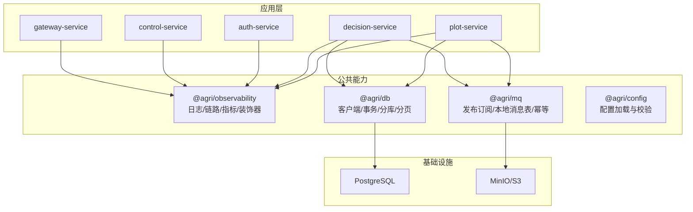
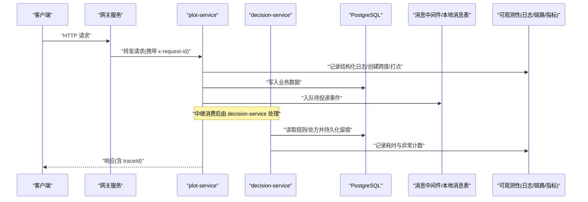
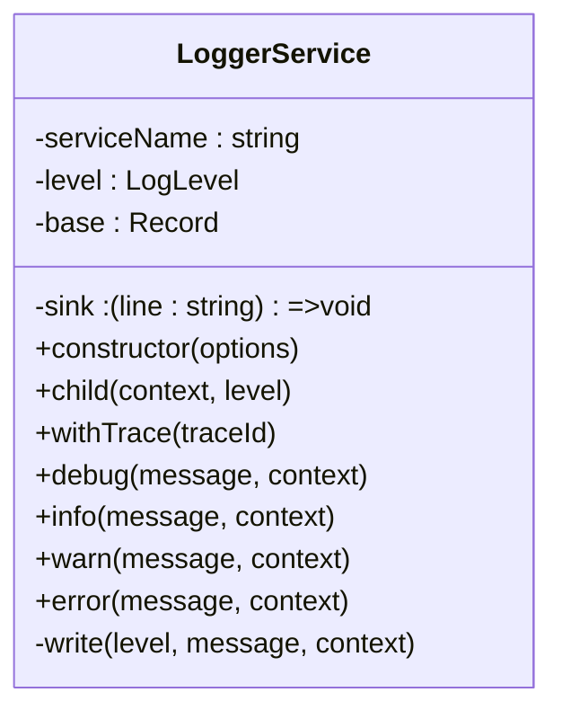
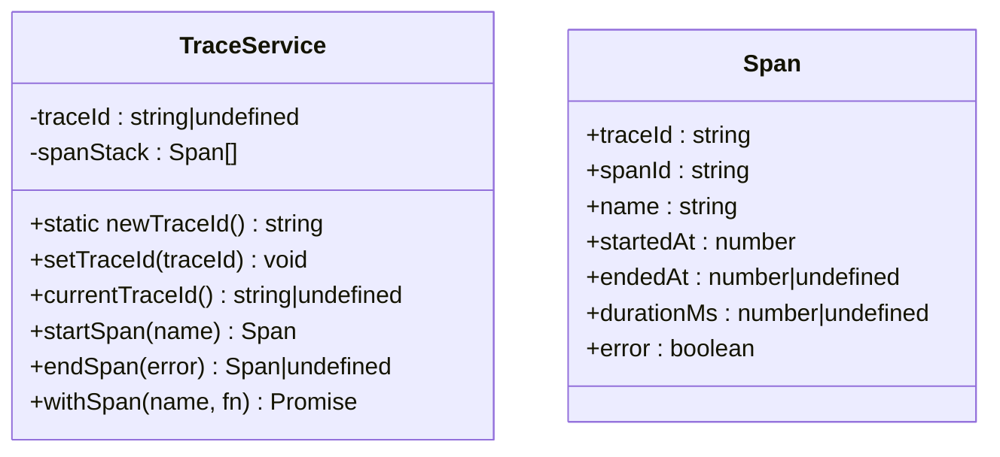
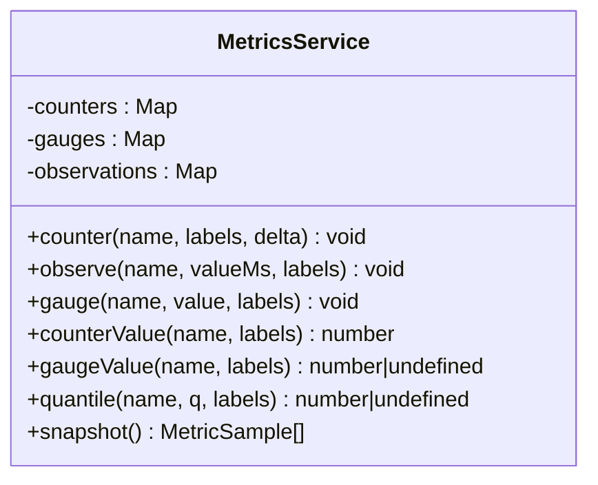
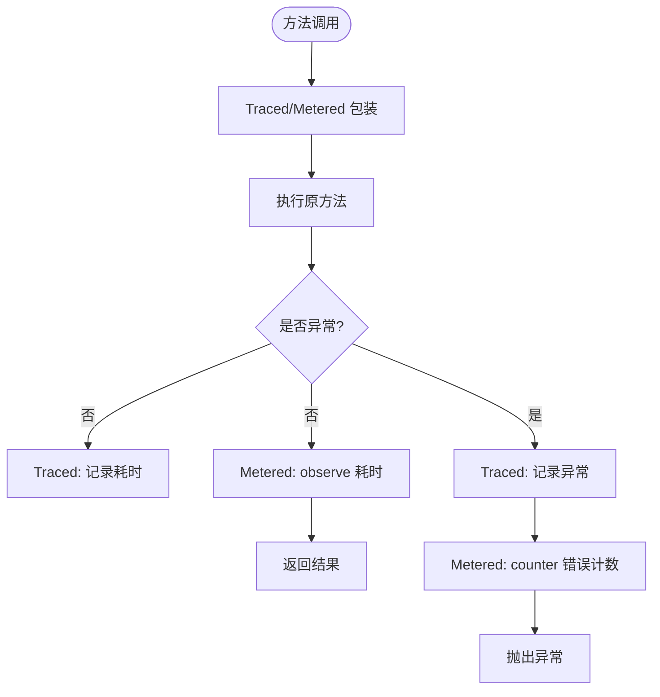
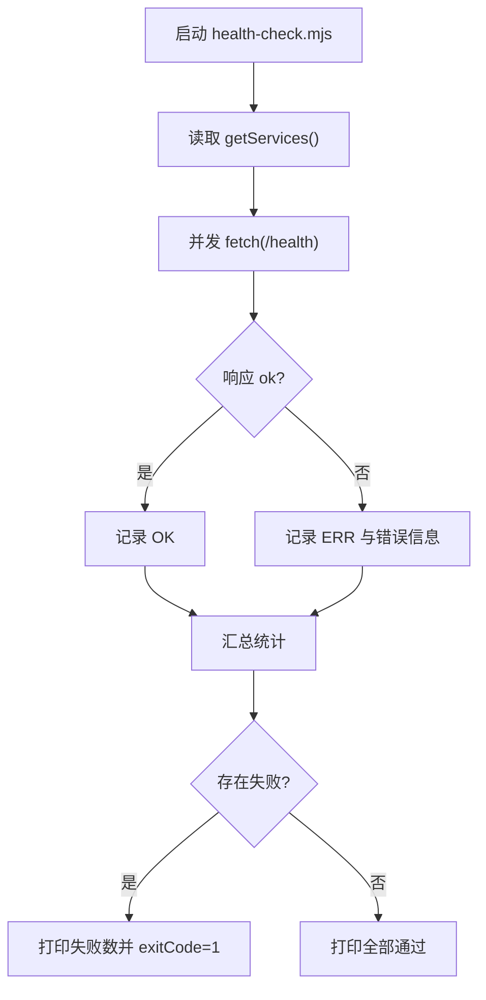
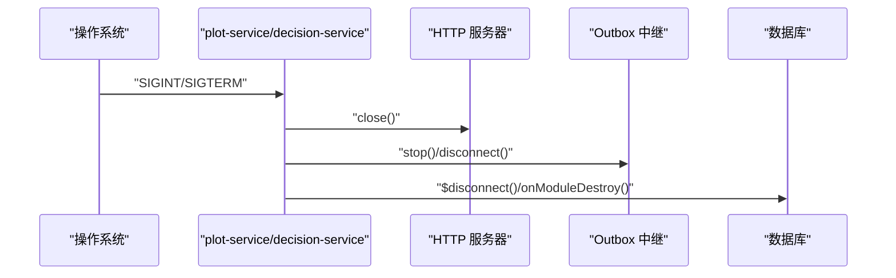
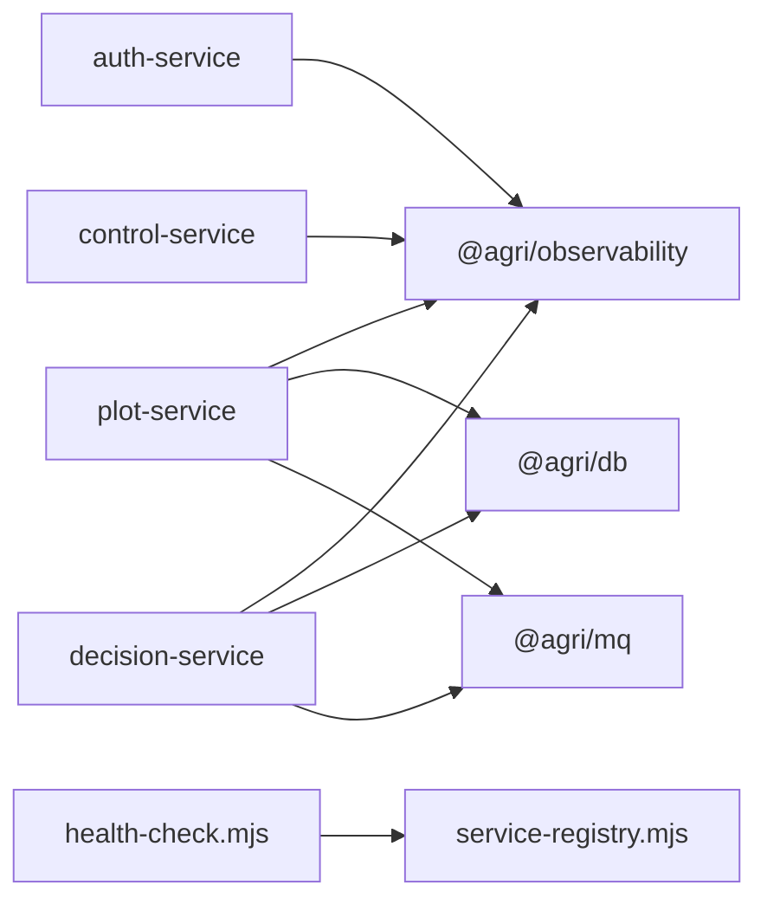

# 调试与故障排查

<cite>
**本文引用的文件**   
- [README.md](file://README.md)
- [scripts/health-check.mjs](file://scripts/health-check.mjs)
- [scripts/service-registry.mjs](file://scripts/service-registry.mjs)
- [apps/plot-service/src/main.ts](file://apps/plot-service/src/main.ts)
- [apps/decision-service/src/main.ts](file://apps/decision-service/src/main.ts)
- [packages/observability/src/logger.ts](file://packages/observability/src/logger.ts)
- [packages/observability/src/trace.ts](file://packages/observability/src/trace.ts)
- [packages/observability/src/metrics.ts](file://packages/observability/src/metrics.ts)
- [packages/observability/src/decorators.ts](file://packages/observability/src/decorators.ts)
</cite>

## 目录
1. [引言](#引言)
2. [项目结构](#项目结构)
3. [核心组件](#核心组件)
4. [架构总览](#架构总览)
5. [详细组件分析](#详细组件分析)
6. [依赖关系分析](#依赖关系分析)
7. [性能考虑](#性能考虑)
8. [故障排查指南](#故障排查指南)
9. [结论](#结论)
10. [附录](#附录)

## 引言
本指南面向智慧农业平台运维与研发人员，聚焦 Node.js 微服务在开发、测试与生产环境中的调试与故障排查。内容覆盖：
- Node.js 调试器使用（断点、变量、调用栈）
- 分布式链路追踪与日志聚合
- 指标采集与性能瓶颈定位
- 健康检查脚本与服务状态监控
- 异常告警配置建议
- 常见错误模式识别与处理（连接超时、内存泄漏、死锁等）
- 生产诊断工具与指标解读

## 项目结构
仓库采用 pnpm workspace + Turborepo + TypeScript 工程引用组织，包含多个 NestJS 微服务与公共能力包。关键目录与职责：
- apps：各业务微服务入口与 HTTP 适配层
- packages：可复用能力（配置、数据库、消息、可观测性、契约等）
- scripts：运行期脚本（健康检查、服务注册、冒烟测试等）
- infra：基础设施（PostgreSQL 迁移、Docker Compose）

图示来源
- [README.md:58-82](file://README.md#L58-L82)
- [scripts/service-registry.mjs:1-22](file://scripts/service-registry.mjs#L1-L22)

章节来源
- [README.md:1-167](file://README.md#L1-L167)

## 核心组件
本节聚焦与调试和故障排查直接相关的可观测性与运行支撑组件：
- 结构化日志 LoggerService：统一 service、traceId、level、message 字段，便于跨服务串联请求
- 链路追踪 TraceService：生成 traceId/spanId，记录阶段耗时与异常标记
- 指标 MetricsService：计数器、直方图、当前值型指标，暴露事件循环延迟、活动句柄、连接池占用等关键信号
- 方法级装饰器 Traced/Metered：自动埋点耗时与错误计数，辅助快速定位热点与异常路径
- 健康检查与健康脚本：HTTP /health 端点 + scripts/health-check.mjs 批量探测

章节来源
- [packages/observability/src/logger.ts:1-102](file://packages/observability/src/logger.ts#L1-L102)
- [packages/observability/src/trace.ts:1-83](file://packages/observability/src/trace.ts#L1-L83)
- [packages/observability/src/metrics.ts:1-106](file://packages/observability/src/metrics.ts#L1-L106)
- [packages/observability/src/decorators.ts:1-90](file://packages/observability/src/decorators.ts#L1-L90)
- [scripts/health-check.mjs:1-12](file://scripts/health-check.mjs#L1-L12)

## 架构总览
下图展示一次典型请求从网关进入下游服务、落库与事件投递的链路，以及日志、链路、指标的注入点。

图示来源
- [apps/plot-service/src/main.ts:48-112](file://apps/plot-service/src/main.ts#L48-L112)
- [apps/decision-service/src/main.ts:18-55](file://apps/decision-service/src/main.ts#L18-L55)
- [packages/observability/src/logger.ts:40-100](file://packages/observability/src/logger.ts#L40-L100)
- [packages/observability/src/trace.ts:26-82](file://packages/observability/src/trace.ts#L26-L82)
- [packages/observability/src/metrics.ts:43-104](file://packages/observability/src/metrics.ts#L43-L104)

## 详细组件分析

### 结构化日志组件 LoggerService
- 固定字段：timestamp、level、service、message、traceId；支持 child/withTrace 派生子日志器
- 输出 sink 默认 stdout，测试可替换为采集函数
- 级别权重控制 debug/info/warn/error，便于按环境裁剪日志量

图示来源
- [packages/observability/src/logger.ts:40-100](file://packages/observability/src/logger.ts#L40-L100)

章节来源
- [packages/observability/src/logger.ts:1-102](file://packages/observability/src/logger.ts#L1-L102)

### 链路追踪组件 TraceService
- 提供 newTraceId/setTraceId/currentTraceId/startSpan/endSpan/withSpan
- Span 包含 traceId/spanId/name/startedAt/endedAt/durationMs/error
- 建议在网关或 HTTP 入口设置 traceId，并在关键阶段包裹 withSpan

图示来源
- [packages/observability/src/trace.ts:10-82](file://packages/observability/src/trace.ts#L10-L82)

章节来源
- [packages/observability/src/trace.ts:1-83](file://packages/observability/src/trace.ts#L1-L83)

### 指标采集组件 MetricsService
- 三类指标：计数器(counter)、直方图(observe)、当前值(gauge)
- 内置标准指标名：http_request_duration_ms、event_loop_lag_ms、active_handles、db_pool_in_use、mq_consume_duration_ms、mq_dead_letter_total、device_telemetry_total
- 提供 quantile/snapshot 用于告警判定与导出

图示来源
- [packages/observability/src/metrics.ts:15-104](file://packages/observability/src/metrics.ts#L15-L104)

章节来源
- [packages/observability/src/metrics.ts:1-106](file://packages/observability/src/metrics.ts#L1-L106)

### 方法级装饰器 Traced/Metered
- Traced：自动记录方法耗时与异常信息到日志
- Metered：自动记录方法耗时直方图与错误计数
- 通过 configureDecorators 注入 logger/metrics

图示来源
- [packages/observability/src/decorators.ts:21-89](file://packages/observability/src/decorators.ts#L21-L89)

章节来源
- [packages/observability/src/decorators.ts:1-90](file://packages/observability/src/decorators.ts#L1-L90)

### 健康检查与服务发现
- 服务注册表 service-registry.mjs 维护服务名、端口与入口映射，支持环境变量覆盖端口
- health-check.mjs 遍历注册表，并发访问各服务的 /health 端点，汇总 OK/ERR 状态并退出码

图示来源
- [scripts/service-registry.mjs:1-22](file://scripts/service-registry.mjs#L1-L22)
- [scripts/health-check.mjs:1-12](file://scripts/health-check.mjs#L1-L12)

章节来源
- [scripts/service-registry.mjs:1-22](file://scripts/service-registry.mjs#L1-L22)
- [scripts/health-check.mjs:1-12](file://scripts/health-check.mjs#L1-L12)

### 服务启动与优雅停机
- plot-service 与 decision-service 均监听 SIGINT/SIGTERM，关闭 HTTP 服务器、停止事件分发/中继、释放数据库连接
- 支持 SERVICE_MODE=http 与 demo/memory/sql 多种运行模式

图示来源
- [apps/plot-service/src/main.ts:101-112](file://apps/plot-service/src/main.ts#L101-L112)
- [apps/decision-service/src/main.ts:40-47](file://apps/decision-service/src/main.ts#L40-L47)

章节来源
- [apps/plot-service/src/main.ts:48-179](file://apps/plot-service/src/main.ts#L48-L179)
- [apps/decision-service/src/main.ts:18-59](file://apps/decision-service/src/main.ts#L18-L59)

## 依赖关系分析
- 可观测性被所有服务依赖，用于统一日志、链路、指标
- 数据库与消息能力下沉至公共包，服务侧仅装配具体实现
- 健康检查脚本依赖服务注册表，不耦合具体服务实现

图示来源
- [apps/plot-service/src/main.ts:12-31](file://apps/plot-service/src/main.ts#L12-L31)
- [apps/decision-service/src/main.ts:3-11](file://apps/decision-service/src/main.ts#L3-L11)
- [scripts/health-check.mjs:1-2](file://scripts/health-check.mjs#L1-L2)
- [scripts/service-registry.mjs:1-22](file://scripts/service-registry.mjs#L1-L22)

章节来源
- [apps/plot-service/src/main.ts:1-179](file://apps/plot-service/src/main.ts#L1-L179)
- [apps/decision-service/src/main.ts:1-59](file://apps/decision-service/src/main.ts#L1-L59)
- [scripts/health-check.mjs:1-12](file://scripts/health-check.mjs#L1-L12)
- [scripts/service-registry.mjs:1-22](file://scripts/service-registry.mjs#L1-L22)

## 性能考虑
- 事件循环延迟 event_loop_lag_ms：Node.js 单线程模型下，阻塞操作会拉长事件循环周期，导致整体吞吐下降
- 活动句柄 active_handles：持续增长通常意味着未释放定时器、连接或流
- 数据库连接池占用 db_pool_in_use：高占用且长时不释放，可能引发连接耗尽
- 消息消费耗时 mq_consume_duration_ms：消费逻辑过长或重试风暴会放大延迟
- 直方图样本上限：observe 保留最近 1000 个样本，避免长期运行内存增长

优化建议：
- 将重计算与 IO 移出事件循环主路径，必要时使用 worker_threads
- 合理设置连接池大小与慢查询阈值，避免长事务
- 对高频方法谨慎使用装饰器埋点，避免标签爆炸
- 结合量化指标 quantile 设定告警阈值（如 P95/P99）

章节来源
- [packages/observability/src/metrics.ts:1-106](file://packages/observability/src/metrics.ts#L1-L106)

## 故障排查指南

### Node.js 调试器使用方法
- 启动方式
  - 开发环境：使用 IDE 或命令行附加调试器到目标进程
  - 生产环境：谨慎开启调试端口，配合网络白名单与最小权限原则
- 断点调试
  - 在服务入口与关键业务方法设置断点，观察参数与返回值
  - 结合 Traced/Metered 输出的耗时与异常信息，缩小问题范围
- 变量检查
  - 关注 traceId、service、level、message 等关键字段，确认上下文是否正确透传
  - 检查 metrics snapshot 中计数器与当前值是否异常
- 调用栈分析
  - 捕获异常时查看完整堆栈，定位异步回调链路与 Promise 链
  - 若出现“无调用栈”或“原生模块”，优先检查外部依赖与 N-API/C++ 扩展

实践要点：
- 在 HTTP 入口设置断点，验证 x-request-id 透传与 traceId 初始化
- 在 Outbox 中继与消费者处设置断点，验证事件幂等与重试策略
- 在数据库连接建立/释放处设置断点，验证连接生命周期

章节来源
- [packages/observability/src/decorators.ts:21-89](file://packages/observability/src/decorators.ts#L21-L89)
- [apps/plot-service/src/main.ts:101-112](file://apps/plot-service/src/main.ts#L101-L112)
- [apps/decision-service/src/main.ts:40-47](file://apps/decision-service/src/main.ts#L40-L47)

### 分布式系统链路追踪
- 链路标识
  - 网关生成 x-request-id 并透传到下游
  - TraceService.setTraceId 在入口处设置，后续 withSpan 自动继承
- 日志关联
  - 每条日志必须包含 service 与 traceId，便于跨服务检索
  - 使用 LoggerService.withTrace 派生带链路上下文的子日志器
- 跨度划分
  - 以业务阶段为单位划分 span，如“建档”、“中继”、“消费”、“写库”
  - 异常分支需标记 error=true，便于链路可视化

排查步骤：
- 根据 traceId 在日志系统中拉取全链路日志
- 对比各 span.durationMs，定位最慢阶段
- 检查异常 span.error 与对应日志 error 信息

章节来源
- [packages/observability/src/trace.ts:26-82](file://packages/observability/src/trace.ts#L26-L82)
- [packages/observability/src/logger.ts:56-69](file://packages/observability/src/logger.ts#L56-L69)

### 日志聚合分析与检索
- 日志格式
  - 单行 JSON，字段包括 timestamp、level、service、message、traceId
- 聚合建议
  - 使用集中式日志系统（如 ELK/Loki）按 service 与 traceId 索引
  - 对 warn/error 级别设置告警规则
- 常见问题
  - 缺失 traceId：检查网关透传与入口 setTraceId
  - 日志丢失：检查 sink 输出与日志采集代理

章节来源
- [packages/observability/src/logger.ts:20-100](file://packages/observability/src/logger.ts#L20-L100)

### 性能瓶颈定位
- 指标解读
  - http_request_duration_ms：接口耗时分布，结合 quantile 评估 P95/P99
  - event_loop_lag_ms：事件循环阻塞程度
  - active_handles：句柄泄漏迹象
  - db_pool_in_use：连接池压力
  - mq_consume_duration_ms：消费耗时
  - mq_dead_letter_total：死信累积
- 定位流程
  - 先查指标快照 snapshot，筛选异常时间窗口
  - 再按 traceId 拉取链路日志，定位慢 span
  - 最后结合代码断点与堆栈分析根因

章节来源
- [packages/observability/src/metrics.ts:15-104](file://packages/observability/src/metrics.ts#L15-L104)

### 健康检查脚本与服务状态监控
- 使用方式
  - 运行 health-check.mjs 批量探测各服务 /health
  - 失败服务会打印 ERR 并设置非零退出码
- 监控集成
  - 将 health-check 纳入 CI/CD 或定时任务
  - 结合告警系统对失败率与恢复时长进行监控

章节来源
- [scripts/health-check.mjs:1-12](file://scripts/health-check.mjs#L1-L12)
- [scripts/service-registry.mjs:1-22](file://scripts/service-registry.mjs#L1-L22)

### 异常告警配置建议
- 基于指标
  - http_request_duration_ms 的 P95/P99 超过阈值
  - event_loop_lag_ms 持续升高
  - active_handles 持续增长
  - db_pool_in_use 接近上限
  - mq_dead_letter_total 突增
- 基于日志
  - error 级别日志数量突增
  - 特定 service 或 traceId 范围内连续错误
- 基于健康检查
  - /health 失败比例超过阈值
  - 服务恢复时间过长

章节来源
- [packages/observability/src/metrics.ts:15-104](file://packages/observability/src/metrics.ts#L15-L104)
- [scripts/health-check.mjs:1-12](file://scripts/health-check.mjs#L1-L12)

### 常见错误模式与解决方法
- 连接超时
  - 现象：数据库或消息中间件连接失败，日志中出现连接错误
  - 排查：检查 DB_URL、MQ_BROKERS、网络连通性与凭据
  - 解决：调整超时与重试策略，确保连接池大小合理
- 内存泄漏
  - 现象：active_handles 持续增长，RSS 不断上升
  - 排查：检查未关闭的连接、定时器、事件监听器
  - 解决：确保在 SIGTERM 中释放资源，避免闭包持有大对象
- 死锁
  - 现象：事件循环停滞，event_loop_lag_ms 飙升
  - 排查：检查同步阻塞逻辑、无限循环、未 resolve 的 Promise
  - 解决：拆分任务、引入超时与取消机制，避免长时间持锁

章节来源
- [packages/observability/src/metrics.ts:1-106](file://packages/observability/src/metrics.ts#L1-L106)
- [apps/plot-service/src/main.ts:101-112](file://apps/plot-service/src/main.ts#L101-L112)
- [apps/decision-service/src/main.ts:40-47](file://apps/decision-service/src/main.ts#L40-L47)

### 生产环境的诊断工具与指标解读
- 诊断工具
  - Node.js 内置调试器（--inspect）
  - 性能分析器（--prof）与堆快照（process.memoryUsage）
  - 指标导出与 Prometheus/Grafana 集成
- 指标解读
  - 先看趋势再看绝对值，结合业务峰值判断
  - 多指标联动：耗时升高 + 事件循环延迟升高 + 连接池占用升高 = 典型过载
  - 死信增多 + 消费耗时升高 = 下游不可用或幂等失效

章节来源
- [packages/observability/src/metrics.ts:1-106](file://packages/observability/src/metrics.ts#L1-L106)

## 结论
通过统一的日志、链路、指标与装饰器埋点，平台实现了可观测性闭环。结合健康检查脚本与服务优雅停机机制，可在开发与生产环境中高效定位问题、降低 MTTR。建议在生产环境持续完善告警规则与指标看板，形成“监测—告警—定位—修复—复盘”的闭环流程。

## 附录
- 常用命令
  - 全量编译：pnpm run build
  - 启动全部服务：pnpm start:services
  - 健康检查：pnpm health:services
  - 前端开发：pnpm --filter @agri/web dev
- 参考文档
  - README 提供了工程结构与运行说明，可作为排障起点

章节来源
- [README.md:12-53](file://README.md#L12-L53)