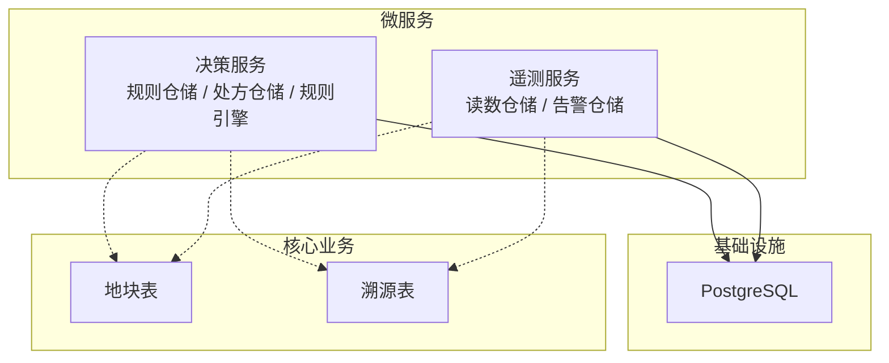
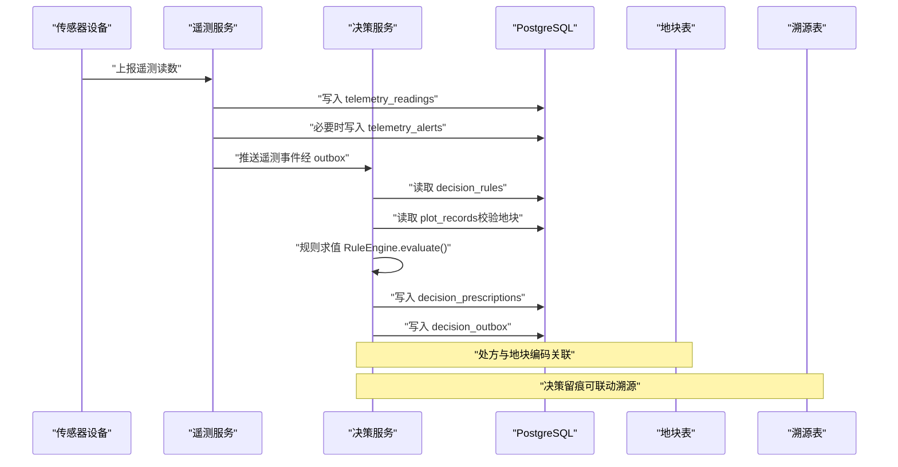
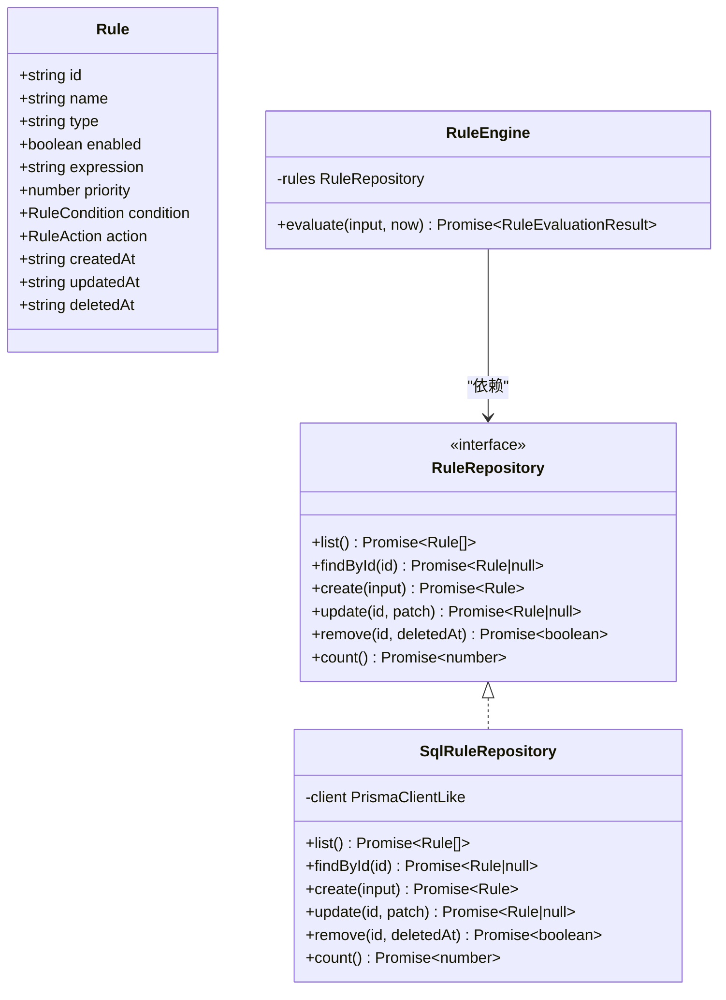
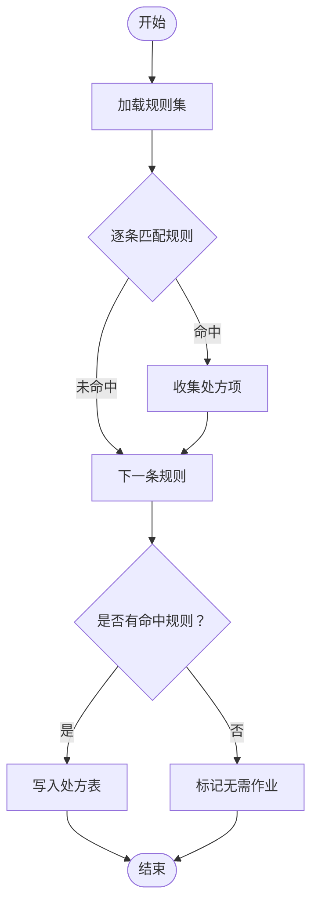
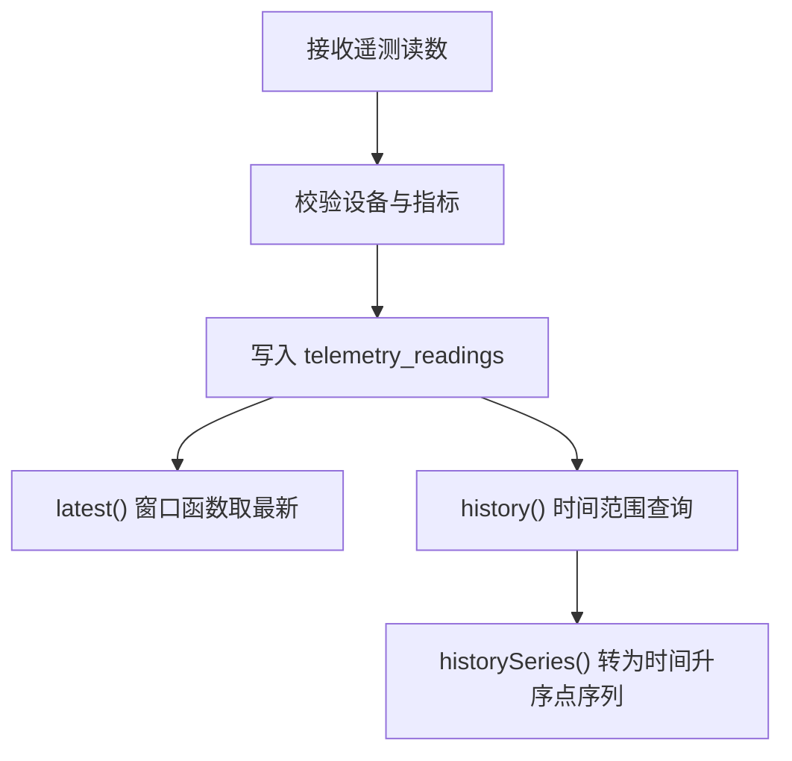
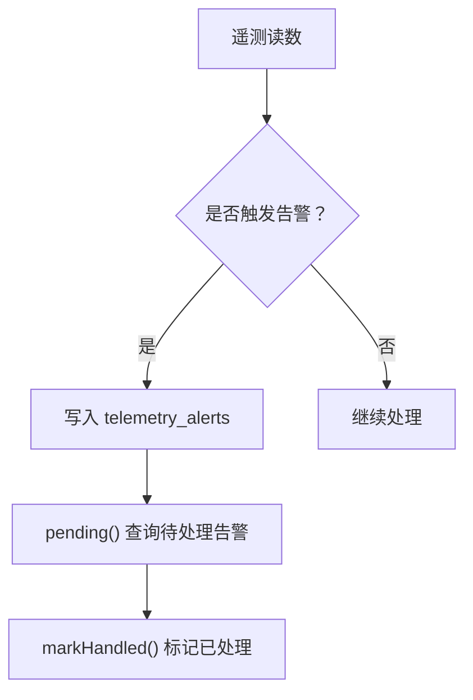
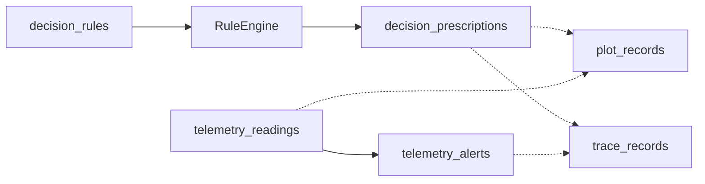

# 决策与遥测表

<cite>
**本文引用的文件**   
- [001_initial_schema.sql](file://infra/postgres/migrations/001_initial_schema.sql)
- [002_decision_telemetry.sql](file://infra/postgres/migrations/002_decision_telemetry.sql)
- [rule.repository.ts](file://apps/decision-service/src/rule.repository.ts)
- [prescription.repository.ts](file://apps/decision-service/src/prescription.repository.ts)
- [rule.engine.ts](file://apps/decision-service/src/rule.engine.ts)
- [reading.repository.ts](file://apps/telemetry-service/src/reading.repository.ts)
</cite>

## 目录
1. [引言](#引言)
2. [项目结构](#项目结构)
3. [核心数据模型](#核心数据模型)
4. [架构总览](#架构总览)
5. [详细组件分析](#详细组件分析)
6. [依赖关系分析](#依赖关系分析)
7. [性能与容量规划](#性能与容量规划)
8. [故障排查指南](#故障排查指南)
9. [结论](#结论)

## 引言
本文件面向智慧农业平台的智能决策与遥测子系统，聚焦数据库设计、数据模型与业务流程的数据存储方案。文档覆盖以下范围：
- 决策规则表、处方表、遥测读数表、告警表的字段、约束与索引设计。
- 决策引擎的规则条件、执行结果、处方生成的数据流与留痕机制。
- 遥测数据的时序特性、采集频率建议、存储优化策略与历史数据管理。
- 告警机制的数据结构设计，包括级别、触发条件、处理状态等。
- 与地块表、溯源表的关联关系说明。
- 数据量预估、分区策略与性能优化建议。

## 项目结构
与本次文档相关的代码与迁移脚本分布如下：
- 初始业务表（地块、财务、溯源）位于初始迁移脚本中。
- 决策与遥测相关的新增表位于第二版迁移脚本中。
- 决策服务提供规则仓储、处方仓储与规则求值引擎。
- 遥测服务提供读数仓储与告警仓储。

**图表来源**
- [001_initial_schema.sql:3-40](file://infra/postgres/migrations/001_initial_schema.sql#L3-L40)
- [002_decision_telemetry.sql:5-87](file://infra/postgres/migrations/002_decision_telemetry.sql#L5-L87)
- [rule.repository.ts:181-296](file://apps/decision-service/src/rule.repository.ts#L181-L296)
- [prescription.repository.ts:85-154](file://apps/decision-service/src/prescription.repository.ts#L85-L154)
- [reading.repository.ts:96-202](file://apps/telemetry-service/src/reading.repository.ts#L96-L202)

**章节来源**
- [001_initial_schema.sql:1-41](file://infra/postgres/migrations/001_initial_schema.sql#L1-L41)
- [002_decision_telemetry.sql:1-88](file://infra/postgres/migrations/002_decision_telemetry.sql#L1-L88)

## 核心数据模型
本节从数据库视角梳理关键表结构、字段含义、约束与索引，并说明其业务语义。

### 决策规则表 decision_rules
- 用途：以数据形式存储决策规则，支持热更新；每条规则包含类型、启用状态、人类可读表达式、优先级、条件 JSON、动作 JSON 及审计时间戳。
- 关键字段：
  - id：主键。
  - rule_name：规则名称。
  - rule_type：规则类型，枚举灌溉、施肥、病虫害预警。
  - enabled：是否启用。
  - expression：人类可读表达式，用于展示与留痕。
  - priority：优先级，数值越小越先匹配。
  - condition_json：条件对象，如土壤含水率阈值、降雨概率阈值、生育期。
  - action_json：动作对象，如用量、单位、原因。
  - created_at / updated_at / deleted_at：审计与软删除。
- 索引：按启用状态与优先级过滤的复合索引，提升规则列表查询效率。

**章节来源**
- [002_decision_telemetry.sql:5-18](file://infra/postgres/migrations/002_decision_telemetry.sql#L5-L18)
- [rule.repository.ts:11-48](file://apps/decision-service/src/rule.repository.ts#L11-L48)
- [rule.repository.ts:181-296](file://apps/decision-service/src/rule.repository.ts#L181-L296)

### 决策处方表 decision_prescriptions
- 用途：记录每次决策评估的结果，保留输入快照、命中规则清单与生成动作，满足决策留痕与事后复核。
- 关键字段：
  - id：主键。
  - plot_code / plot_name：关联地块编码与名称。
  - status：处方状态，推荐或无需作业。
  - soil_moisture / rain_probability：输入时的墒情与降雨概率快照。
  - growth_stage：作物生育期。
  - inputs_json：完整输入快照。
  - matched_rules_json：命中的规则摘要。
  - actions_json：生成的处方明细数组。
  - generated_at / issued_at：生成时间与下发时间（有动作时下发）。
- 索引：按地块与生成时间倒序的复合索引，便于按地块查看处方历史。

**章节来源**
- [002_decision_telemetry.sql:20-34](file://infra/postgres/migrations/002_decision_telemetry.sql#L20-L34)
- [prescription.repository.ts:17-59](file://apps/decision-service/src/prescription.repository.ts#L17-L59)
- [prescription.repository.ts:85-154](file://apps/decision-service/src/prescription.repository.ts#L85-L154)

### 遥测读数表 telemetry_readings
- 用途：持久化设备上报的时序读数，支撑按设备与时间窗的历史查询与趋势图展示。
- 关键字段：
  - id：主键。
  - device_id：设备标识。
  - plot_code：所属地块编码。
  - metric：指标名称。
  - value：数值。
  - unit：单位。
  - recorded_at：采集时间。
- 索引：
  - 按设备、指标与时间的复合索引，加速最新值与历史查询。
  - 按时间倒序索引，支持大范围时间窗口扫描。

**章节来源**
- [002_decision_telemetry.sql:36-46](file://infra/postgres/migrations/002_decision_telemetry.sql#L36-L46)
- [reading.repository.ts:4-13](file://apps/telemetry-service/src/reading.repository.ts#L4-L13)
- [reading.repository.ts:96-162](file://apps/telemetry-service/src/reading.repository.ts#L96-L162)

### 遥测告警表 telemetry_alerts
- 用途：持久化由遥测数据触发的告警，支持待处理查询与处理状态追踪。
- 关键字段：
  - id：主键。
  - device_id / plot_code：关联设备与地块。
  - level：告警级别（例如提示、警告、严重）。
  - metric：触发指标。
  - message：告警消息。
  - created_at：创建时间。
  - handled / handled_at：处理状态与处理时间。
- 索引：按处理状态与创建时间的复合索引，加速待处理告警查询。

**章节来源**
- [002_decision_telemetry.sql:48-59](file://infra/postgres/migrations/002_decision_telemetry.sql#L48-L59)
- [reading.repository.ts:15-26](file://apps/telemetry-service/src/reading.repository.ts#L15-L26)
- [reading.repository.ts:164-202](file://apps/telemetry-service/src/reading.repository.ts#L164-L202)

### 出队表 decision_outbox / telemetry_outbox
- 用途：实现可靠的消息出队，确保决策与遥测事件最终一致地投递到消息队列。
- 关键字段：主题、负载 JSON、租户、追踪 ID、生产者、创建时间、发布时间、重试次数、最后错误信息。
- 索引：未发布记录的创建时间索引，便于出队器扫描。

**章节来源**
- [002_decision_telemetry.sql:61-87](file://infra/postgres/migrations/002_decision_telemetry.sql#L61-L87)

### 核心业务表关联
- 地块表 plot_records：提供地块编码、名称、面积、地理几何等基础信息；决策与遥测通过 plot_code 与之关联。
- 溯源表 trace_records：记录操作事件；决策与遥测可结合溯源进行审计与追溯。

**章节来源**
- [001_initial_schema.sql:3-40](file://infra/postgres/migrations/001_initial_schema.sql#L3-L40)

## 架构总览
下图展示决策与遥测在系统中的交互关系，以及它们与核心业务表的关联。

**图表来源**
- [reading.repository.ts:96-162](file://apps/telemetry-service/src/reading.repository.ts#L96-L162)
- [reading.repository.ts:164-202](file://apps/telemetry-service/src/reading.repository.ts#L164-L202)
- [rule.repository.ts:181-296](file://apps/decision-service/src/rule.repository.ts#L181-L296)
- [prescription.repository.ts:85-154](file://apps/decision-service/src/prescription.repository.ts#L85-L154)
- [rule.engine.ts:81-96](file://apps/decision-service/src/rule.engine.ts#L81-L96)
- [001_initial_schema.sql:3-40](file://infra/postgres/migrations/001_initial_schema.sql#L3-L40)
- [002_decision_telemetry.sql:5-87](file://infra/postgres/migrations/002_decision_telemetry.sql#L5-L87)

## 详细组件分析

### 决策规则与规则引擎
- 规则定义：
  - 规则类型：灌溉、施肥、病虫害预警。
  - 条件对象：土壤含水率低于阈值、未来降雨概率低于阈值、生育期匹配。
  - 动作对象：类型、用量、单位、原因。
- 规则仓储：
  - 内存实现用于测试与本地模式。
  - PostgreSQL 实现直接读写 decision_rules 表，使用 JSONB 存储条件与动作。
  - 支持新增、修改、停用与计数，采用软删除。
- 规则引擎：
  - 每次求值从仓储读取最新规则集，实现“热更新”。
  - 对输入（地块、作物、生育期、墒情、降雨概率）逐条匹配，返回命中规则与处方项。
  - 处方项包含投入品编码、用量、执行时间窗。

**图表来源**
- [rule.repository.ts:11-84](file://apps/decision-service/src/rule.repository.ts#L11-L84)
- [rule.repository.ts:181-296](file://apps/decision-service/src/rule.repository.ts#L181-L296)
- [rule.engine.ts:12-33](file://apps/decision-service/src/rule.engine.ts#L12-L33)
- [rule.engine.ts:81-96](file://apps/decision-service/src/rule.engine.ts#L81-L96)

**章节来源**
- [rule.repository.ts:11-84](file://apps/decision-service/src/rule.repository.ts#L11-L84)
- [rule.repository.ts:181-296](file://apps/decision-service/src/rule.repository.ts#L181-L296)
- [rule.engine.ts:12-96](file://apps/decision-service/src/rule.engine.ts#L12-L96)

### 处方生成流程
- 输入：地块编码、地块名称、作物、生育期、墒情、降雨概率。
- 过程：
  - 读取最新规则集。
  - 逐条匹配规则，收集命中规则与处方项。
  - 将输入快照、命中规则与动作写入处方表。
  - 若存在动作，则设置下发时间为生成时间。
- 输出：处方记录，包含状态、输入快照、命中规则与动作明细。

**图表来源**
- [rule.engine.ts:81-96](file://apps/decision-service/src/rule.engine.ts#L81-L96)
- [prescription.repository.ts:85-154](file://apps/decision-service/src/prescription.repository.ts#L85-L154)

**章节来源**
- [rule.engine.ts:81-96](file://apps/decision-service/src/rule.engine.ts#L81-L96)
- [prescription.repository.ts:17-59](file://apps/decision-service/src/prescription.repository.ts#L17-L59)
- [prescription.repository.ts:85-154](file://apps/decision-service/src/prescription.repository.ts#L85-L154)

### 遥测读数与时序查询
- 写入：
  - 使用 ULID 作为主键，保证有序且分布式安全。
  - 写入 telemetry_readings，包含设备、地块、指标、数值、单位与时间。
- 查询：
  - latest：每个设备每个指标的最近一次读数，使用窗口函数排序取第一条。
  - history：按设备、指标、时间范围查询历史，限制最大返回条数。
  - historySeries：返回时间升序的点序列，供前端趋势图直接使用。
- 索引：
  - 设备+指标+时间复合索引，加速 latest 与 history。
  - 时间倒序索引，支持大范围时间窗口扫描。

**图表来源**
- [reading.repository.ts:96-162](file://apps/telemetry-service/src/reading.repository.ts#L96-L162)

**章节来源**
- [reading.repository.ts:4-13](file://apps/telemetry-service/src/reading.repository.ts#L4-L13)
- [reading.repository.ts:96-162](file://apps/telemetry-service/src/reading.repository.ts#L96-L162)

### 告警机制数据结构
- 触发：
  - 当遥测读数超过阈值或出现异常时，写入 telemetry_alerts。
- 字段：
  - level：告警级别（例如提示、警告、严重），具体取值由业务约定。
  - metric：触发指标。
  - message：告警消息。
  - handled / handled_at：处理状态与处理时间。
- 查询：
  - pending：按创建时间倒序返回未处理告警，限制数量。
  - markHandled：标记为已处理并记录处理时间。

**图表来源**
- [reading.repository.ts:164-202](file://apps/telemetry-service/src/reading.repository.ts#L164-L202)

**章节来源**
- [reading.repository.ts:15-26](file://apps/telemetry-service/src/reading.repository.ts#L15-L26)
- [reading.repository.ts:164-202](file://apps/telemetry-service/src/reading.repository.ts#L164-L202)

## 依赖关系分析
- 决策服务依赖：
  - 规则仓储：读取 decision_rules，支持热更新。
  - 处方仓储：写入 decision_prescriptions，保留决策留痕。
  - 规则引擎：根据规则与输入计算处方项。
- 遥测服务依赖：
  - 读数仓储：写入 telemetry_readings，提供 latest/history/historySeries。
  - 告警仓储：写入 telemetry_alerts，提供 pending/markHandled。
- 与核心业务表的关系：
  - 通过 plot_code 与地块表关联，确保决策与遥测的地块上下文正确。
  - 可与溯源表联动，形成完整的操作与数据审计链。

**图表来源**
- [rule.repository.ts:181-296](file://apps/decision-service/src/rule.repository.ts#L181-L296)
- [prescription.repository.ts:85-154](file://apps/decision-service/src/prescription.repository.ts#L85-L154)
- [reading.repository.ts:96-202](file://apps/telemetry-service/src/reading.repository.ts#L96-L202)
- [001_initial_schema.sql:3-40](file://infra/postgres/migrations/001_initial_schema.sql#L3-L40)

**章节来源**
- [rule.repository.ts:181-296](file://apps/decision-service/src/rule.repository.ts#L181-L296)
- [prescription.repository.ts:85-154](file://apps/decision-service/src/prescription.repository.ts#L85-L154)
- [reading.repository.ts:96-202](file://apps/telemetry-service/src/reading.repository.ts#L96-L202)
- [001_initial_schema.sql:3-40](file://infra/postgres/migrations/001_initial_schema.sql#L3-L40)

## 性能与容量规划

### 数据量预估
- 遥测读数：
  - 假设 N 台设备，每台设备 M 个指标，采集频率 F 次/分钟。
  - 日增量 ≈ N × M × F × 60 × 24。
  - 示例：100 设备 × 5 指标 × 1 次/分钟 ≈ 72 万行/天。
- 告警：
  - 取决于阈值配置与异常比例，通常远小于读数。
- 处方：
  - 取决于决策触发频率，通常为小时级或事件驱动。
- 规则：
  - 规模较小，通常几十到几百条。

### 分区策略
- 遥测读数表：
  - 建议按时间分区（按月或按周），减少单表体积，提升历史查询性能。
  - 配合 recorded_at 倒序索引，优化时间窗口扫描。
- 告警表：
  - 可按时间分区，并按处理状态建立局部索引，加速待处理查询。
- 处方表：
  - 可按时间分区，并按地块编码与时间复合索引，优化按地块历史查询。
- 规则表：
  - 数据量小，无需分区；保持启用状态与优先级的复合索引即可。

### 索引与查询优化
- 遥测读数：
  - 使用 (device_id, metric, recorded_at DESC) 复合索引，加速 latest 与 history。
  - 单独维护 recorded_at DESC 索引，支持大范围时间窗口扫描。
- 处方：
  - 使用 (plot_code, generated_at DESC) 复合索引，优化按地块历史查询。
- 告警：
  - 使用 (handled, created_at DESC) 复合索引，加速待处理告警查询。
- 规则：
  - 使用 (enabled, priority) 复合索引，加速规则列表加载。

### 写入与批处理
- 遥测读数：
  - 建议使用批量插入与事务控制，降低锁竞争与网络开销。
  - 控制单次批次大小（例如 500-2000 行），避免过大事务。
- 告警：
  - 去重与合并策略：同一设备、指标、短时间窗口内重复告警可合并。
- 处方：
  - 决策触发频率较低，可直接单条写入；如需高并发，可使用批量写入。

### 历史数据管理
- 归档与清理：
  - 对超过保留期的遥测数据进行归档至冷存储，原表删除。
  - 告警与处方可根据业务保留策略进行归档。
- 压缩与降采样：
  - 对长期历史数据做降采样（例如分钟级聚合为小时级），减少存储压力。

**章节来源**
- [002_decision_telemetry.sql:36-59](file://infra/postgres/migrations/002_decision_telemetry.sql#L36-L59)
- [reading.repository.ts:120-162](file://apps/telemetry-service/src/reading.repository.ts#L120-L162)
- [prescription.repository.ts:120-154](file://apps/decision-service/src/prescription.repository.ts#L120-L154)

## 故障排查指南
- 规则未生效：
  - 检查 decision_rules.enabled 是否为真。
  - 检查 rule.priority 与 condition_json 是否正确。
  - 确认规则仓储 list() 查询是否过滤了 deleted_at。
- 处方未生成：
  - 检查 RuleEngine.evaluate() 是否命中规则。
  - 检查 prescription.create() 是否成功写入 decision_prescriptions。
  - 核对 inputs_json 与 matched_rules_json 内容。
- 遥测查询缓慢：
  - 检查 telemetry_readings 的索引是否存在且有效。
  - 确认查询是否使用了 device_id、metric、recorded_at 条件。
  - 考虑按时间分区与归档历史数据。
- 告警堆积：
  - 检查 telemetry_alerts.handled 状态。
  - 确认 pending() 与 markHandled() 逻辑是否正常。
  - 考虑告警合并与限流策略。

**章节来源**
- [rule.repository.ts:206-296](file://apps/decision-service/src/rule.repository.ts#L206-L296)
- [prescription.repository.ts:93-154](file://apps/decision-service/src/prescription.repository.ts#L93-L154)
- [reading.repository.ts:120-202](file://apps/telemetry-service/src/reading.repository.ts#L120-L202)

## 结论
本设计通过决策规则表、处方表、遥测读数表与告警表，构建了智慧农业平台的核心数据模型。规则以数据形式存储并支持热更新，处方保留输入快照与命中规则以实现决策留痕；遥测数据具备明确的时序特性，并通过索引与分区策略保障查询性能；告警机制提供级别、触发条件与处理状态的完整数据结构。这些表与地块表、溯源表通过编码关联，形成闭环的业务审计链。建议在大规模场景下实施时间分区、归档与降采样策略，并结合批量写入与去重合并优化整体性能。