# 数据库设计

<cite>
**本文引用的文件**   
- [infra/postgres/001_initial_schema.sql](file://infra/postgres/001_initial_schema.sql)
- [infra/postgres/migrations/001_initial_schema.sql](file://infra/postgres/migrations/001_initial_schema.sql)
- [infra/postgres/migrations/002_decision_telemetry.sql](file://infra/postgres/migrations/002_decision_telemetry.sql)
- [infra/postgres/migrations/004_identity_accounts.sql](file://infra/postgres/migrations/004_identity_accounts.sql)
- [infra/postgres/migrations/005_control_commands.sql](file://infra/postgres/migrations/005_control_commands.sql)
- [infra/postgres/migrations/007_auth_sessions.sql](file://infra/postgres/migrations/007_auth_sessions.sql)
- [infra/postgres/migrations/008_agro_monitoring.sql](file://infra/postgres/migrations/008_agro_monitoring.sql)
- [infra/postgres/migrations/009_plot_zones.sql](file://infra/postgres/migrations/009_plot_zones.sql)
- [infra/postgres/migrations/010_demo_data.sql](file://infra/postgres/migrations/010_demo_data.sql)
- [infra/postgres/migrations/011_plot_profile.sql](file://infra/postgres/migrations/011_plot_profile.sql)
- [infra/postgres/migrations/016_operation_tasks.sql](file://infra/postgres/migrations/016_operation_tasks.sql)
- [infra/postgres/migrations/027_plot_change_logs.sql](file://infra/postgres/migrations/027_plot_change_logs.sql)
- [infra/postgres/migrations/029_plot_change_log_actions.sql](file://infra/postgres/migrations/029_plot_change_log_actions.sql)
- [infra/postgres/migrations/030_operation_task_demo_data.sql](file://infra/postgres/migrations/030_operation_task_demo_data.sql)
- [infra/postgres/migrations/031_control_command_receipt.sql](file://infra/postgres/migrations/031_control_command_receipt.sql)
- [infra/postgres/migrations/032_control_command_tenant.sql](file://infra/postgres/migrations/032_control_command_tenant.sql)
- [apps/plot-service/src/plot.repository.ts](file://apps/plot-service/src/plot.repository.ts)
- [apps/plot-service/src/zone.repository.ts](file://apps/plot-service/src/zone.repository.ts)
- [apps/plot-service/src/zone.geometry.ts](file://apps/plot-service/src/zone.geometry.ts)
- [apps/plot-service/src/plot-change-log.repository.ts](file://apps/plot-service/src/plot-change-log.repository.ts)
- [apps/plot-service/src/plot.service.ts](file://apps/plot-service/src/plot.service.ts)
- [apps/plot-service/src/http.ts](file://apps/plot-service/src/http.ts)
- [apps/finance-service/src/repository.ts](file://apps/finance-service/src/repository.ts)
- [apps/trace-service/src/repository.ts](file://apps/trace-service/src/repository.ts)
- [apps/decision-service/src/rule.repository.ts](file://apps/decision-service/src/rule.repository.ts)
- [apps/telemetry-service/src/reading.repository.ts](file://apps/telemetry-service/src/reading.repository.ts)
- [apps/telemetry-service/src/pest.repository.ts](file://apps/telemetry-service/src/pest.repository.ts)
- [apps/auth-service/src/session.repository.ts](file://apps/auth-service/src/session.repository.ts)
- [apps/auth-service/src/http.ts](file://apps/auth-service/src/http.ts)
- [apps/operation-service/src/task.repository.ts](file://apps/operation-service/src/task.repository.ts)
- [apps/operation-service/src/http.ts](file://apps/operation-service/src/http.ts)
- [apps/operation-service/src/outbox.repository.ts](file://apps/operation-service/src/outbox.repository.ts)
- [apps/control-service/src/control.repository.ts](file://apps/control-service/src/control.repository.ts)
- [apps/control-service/src/http.ts](file://apps/control-service/src/http.ts)
- [apps/control-service/src/consumer.ts](file://apps/control-service/src/consumer.ts)
- [packages/contracts/src/events/payload.ts](file://packages/contracts/src/events/payload.ts)
- [packages/contracts/src/events/topic.ts](file://packages/contracts/src/events/topic.ts)
</cite>

## 更新摘要
**变更内容**   
- 新增控制指令租户归属迁移 032，为 control_commands 表添加 tenant_id 列，实现多租户数据隔离
- 优化控制指令索引策略，新增按租户+时间排序的复合索引，提升租户级查询性能
- 重构待回执看板索引，支持单租户场景下的待回执指令快速查询
- 完善控制指令生命周期管理，确保跨租户访问安全与数据隔离

## 目录
1. [引言](#引言)
2. [项目结构](#项目结构)
3. [核心组件](#核心组件)
4. [架构总览](#架构总览)
5. [详细组件分析](#详细组件分析)
6. [依赖关系分析](#依赖关系分析)
7. [性能考虑](#性能考虑)
8. [故障排查指南](#故障排查指南)
9. [结论](#结论)
10. [附录](#附录)

## 引言
本数据库设计文档面向智慧农业平台，基于 PostgreSQL + PostGIS 构建，覆盖地块空间数据、财务记录、溯源记录、决策规则与处方、遥测读数与告警、系统账号与会话管理、农事任务管理与跨服务的事件出队表、控制指令生命周期管理等核心领域。文档从实体关系、字段定义、主外键与约束、索引策略、数据验证与业务规则、访问模式、缓存与性能、生命周期与归档、迁移与版本管理、安全与隐私等维度进行系统化说明，并给出可落地的架构图、ER 图与关键流程时序图。

## 项目结构
本项目采用多服务架构，每个领域服务通过仓储层直接访问 PostgreSQL；PostGIS 扩展用于地块边界的空间存储与查询；迁移脚本集中管理数据库 schema 演进。

```mermaid
graph TB
subgraph "基础设施"
PG["PostgreSQL<br/>PostGIS 扩展"]
MIG1["迁移 001：初始 schema"]
MIG2["迁移 002：决策与遥测"]
MIG4["迁移 004：身份账户"]
MIG5["迁移 005：控制指令"]
MIG7["迁移 007：认证会话"]
MIG8["迁移 008：四情监测"]
MIG9["迁移 009：片区管理"]
MIG10["迁移 010：演示数据"]
MIG11["迁移 011：地块档案"]
MIG16["迁移 016：农事任务"]
MIG27["迁移 027：地块变更日志"]
MIG29["迁移 029：变更日志动作扩展"]
MIG30["迁移 030：农事任务演示数据"]
MIG31["迁移 031：控制指令回执"]
MIG32["迁移 032：控制指令租户"]
end
subgraph "领域服务"
PLOT["地块服务<br/>plot.repository.ts"]
ZONE["片区服务<br/>zone.repository.ts"]
FIN["财务服务<br/>repository.ts"]
TRACE["溯源服务<br/>repository.ts"]
DEC["决策服务<br/>rule.repository.ts"]
TEL["遥测服务<br/>reading.repository.ts"]
PEST["虫情服务<br/>pest.repository.ts"]
AUTH["认证服务<br/>session.repository.ts"]
OPS["农事任务服务<br/>task.repository.ts"]
CTRL["控制服务<br/>control.repository.ts"]
end
PLOT --> PG
ZONE --> PG
FIN --> PG
TRACE --> PG
DEC --> PG
TEL --> PG
PEST --> PG
AUTH --> PG
OPS --> PG
CTRL --> PG
MIG1 --> PG
MIG2 --> PG
MIG4 --> PG
MIG5 --> PG
MIG7 --> PG
MIG8 --> PG
MIG9 --> PG
MIG10 --> PG
MIG11 --> PG
MIG16 --> PG
MIG27 --> PG
MIG29 --> PG
MIG30 --> PG
MIG31 --> PG
MIG32 --> PG
```

**图表来源**
- [infra/postgres/001_initial_schema.sql:1-41](file://infra/postgres/001_initial_schema.sql#L1-L41)
- [infra/postgres/migrations/002_decision_telemetry.sql:1-88](file://infra/postgres/migrations/002_decision_telemetry.sql#L1-L88)
- [infra/postgres/migrations/004_identity_accounts.sql:1-59](file://infra/postgres/migrations/004_identity_accounts.sql#L1-L59)
- [infra/postgres/migrations/005_control_commands.sql:1-23](file://infra/postgres/migrations/005_control_commands.sql#L1-L23)
- [infra/postgres/migrations/007_auth_sessions.sql:1-21](file://infra/postgres/migrations/007_auth_sessions.sql#L1-L21)
- [infra/postgres/migrations/008_agro_monitoring.sql:1-74](file://infra/postgres/migrations/008_agro_monitoring.sql#L1-L74)
- [infra/postgres/migrations/009_plot_zones.sql:1-48](file://infra/postgres/migrations/009_plot_zones.sql#L1-L48)
- [infra/postgres/migrations/010_demo_data.sql:1-334](file://infra/postgres/migrations/010_demo_data.sql#L1-L334)
- [infra/postgres/migrations/011_plot_profile.sql:1-47](file://infra/postgres/migrations/011_plot_profile.sql#L1-L47)
- [infra/postgres/migrations/016_operation_tasks.sql:1-36](file://infra/postgres/migrations/016_operation_tasks.sql#L1-L36)
- [infra/postgres/migrations/027_plot_change_logs.sql:1-21](file://infra/postgres/migrations/027_plot_change_logs.sql#L1-L21)
- [infra/postgres/migrations/029_plot_change_log_actions.sql:1-10](file://infra/postgres/migrations/029_plot_change_log_actions.sql#L1-L10)
- [infra/postgres/migrations/030_operation_task_demo_data.sql:1-48](file://infra/postgres/migrations/030_operation_task_demo_data.sql#L1-L48)
- [infra/postgres/migrations/031_control_command_receipt.sql:1-38](file://infra/postgres/migrations/031_control_command_receipt.sql#L1-L38)
- [infra/postgres/migrations/032_control_command_tenant.sql:1-22](file://infra/postgres/migrations/032_control_command_tenant.sql#L1-L22)
- [apps/plot-service/src/plot.repository.ts:94-186](file://apps/plot-service/src/plot.repository.ts#L94-L186)
- [apps/plot-service/src/zone.repository.ts:114-193](file://apps/plot-service/src/zone.repository.ts#L114-L193)
- [apps/finance-service/src/repository.ts:14-21](file://apps/finance-service/src/repository.ts#L14-L21)
- [apps/trace-service/src/repository.ts:13-19](file://apps/trace-service/src/repository.ts#L13-L19)
- [apps/decision-service/src/rule.repository.ts:181-296](file://apps/decision-service/src/rule.repository.ts#L181-L296)
- [apps/telemetry-service/src/reading.repository.ts:96-202](file://apps/telemetry-service/src/reading.repository.ts#L96-L202)
- [apps/telemetry-service/src/pest.repository.ts:64-113](file://apps/telemetry-service/src/pest.repository.ts#L64-L113)
- [apps/auth-service/src/session.repository.ts:117-162](file://apps/auth-service/src/session.repository.ts#L117-L162)
- [apps/operation-service/src/task.repository.ts:1-153](file://apps/operation-service/src/task.repository.ts#L1-L153)
- [apps/control-service/src/control.repository.ts:1-200](file://apps/control-service/src/control.repository.ts#L1-L200)

## 核心组件
- 地块表 plot_records：承载地块基础信息与空间边界（JSONB），支持软删除与租户隔离，新增地块类型、状态、当前作物、负责人等档案字段。
- 财务表 finance_entries：记录投入与产出，按地块与季节统计。
- 溯源表 trace_records：记录农事操作与事件，支持按地块时间线回溯。
- 决策规则表 decision_rules：以数据形式存储规则，支持热更新与优先级排序。
- 决策处方表 decision_prescriptions：留存每次决策的输入、命中规则与动作。
- 遥测读数表 telemetry_readings：高频时序数据，支持设备/指标/时间窗口查询。
- 遥测告警表 telemetry_alerts：未处理告警队列，支持标记已处理。
- **四情监测阈值规则表 telemetry_rules：动态阈值配置，支持苗情/虫情/灾情统一判定口径。**
- **虫情事件表 telemetry_pest_events：AI识别的病虫害记录，支持分级展示与处理跟踪。**
- **基础设施线路表 infra_lines：一张图的灌溉管线、施肥管线、电力线路与道路管理。**
- **片区管理表 plot_zones：地块片区化组织，支持配色、边界与成员管理。**
- **地块变更日志表 plot_change_logs：追加式操作时间线，支持 CREATE/UPDATE/DELETE/MERGE/SPLIT 五种动作类型。**
- **农事任务表 operation_tasks：农事作业任务管理，支持六种作业类型与四种状态的生命周期管理。**
- **农事任务出队表 operation_outbox：可靠消息投递的持久化缓冲，用于任务完成事件。**
- **控制指令表 control_commands：设备控制指令生命周期管理，支持五态状态机与完整回执链路，现已实现完整的租户隔离。**
- **认证用户表 auth_users：系统账号管理，支持状态控制与权限分配。**
- **认证会话表 auth_sessions：持久化登录会话，支持立即失效与多实例共享。**
- 出队表 decision_outbox / telemetry_outbox：可靠消息投递的持久化缓冲。

**章节来源**
- [infra/postgres/001_initial_schema.sql:3-40](file://infra/postgres/001_initial_schema.sql#L3-L40)
- [infra/postgres/migrations/002_decision_telemetry.sql:5-87](file://infra/postgres/migrations/002_decision_telemetry.sql#L5-L87)
- [infra/postgres/migrations/004_identity_accounts.sql:8-20](file://infra/postgres/migrations/004_identity_accounts.sql#L8-L20)
- [infra/postgres/migrations/005_control_commands.sql:7-20](file://infra/postgres/migrations/005_control_commands.sql#L7-L20)
- [infra/postgres/migrations/007_auth_sessions.sql:10-17](file://infra/postgres/migrations/007_auth_sessions.sql#L10-L17)
- [infra/postgres/migrations/008_agro_monitoring.sql:11-74](file://infra/postgres/migrations/008_agro_monitoring.sql#L11-L74)
- [infra/postgres/migrations/009_plot_zones.sql:12-48](file://infra/postgres/migrations/009_plot_zones.sql#L12-L48)
- [infra/postgres/migrations/011_plot_profile.sql:14-47](file://infra/postgres/migrations/011_plot_profile.sql#L14-L47)
- [infra/postgres/migrations/016_operation_tasks.sql:1-36](file://infra/postgres/migrations/016_operation_tasks.sql#L1-L36)
- [infra/postgres/migrations/027_plot_change_logs.sql:9-17](file://infra/postgres/migrations/027_plot_change_logs.sql#L9-L17)
- [infra/postgres/migrations/029_plot_change_log_actions.sql:6-9](file://infra/postgres/migrations/029_plot_change_log_actions.sql#L6-L9)

## 架构总览
下图展示各服务与数据库表的映射关系，以及关键读写路径。

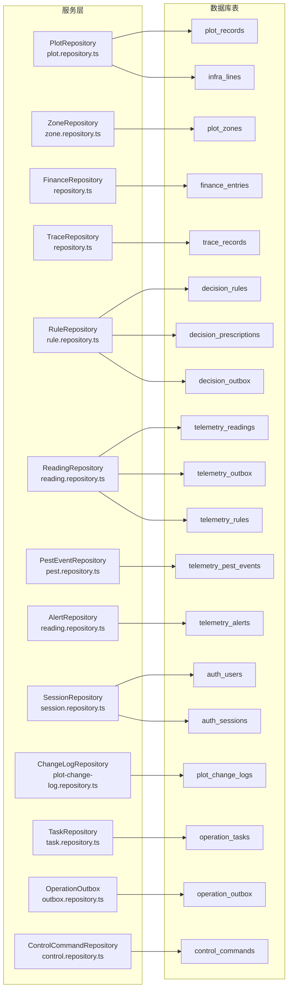

**图表来源**
- [apps/plot-service/src/plot.repository.ts:94-186](file://apps/plot-service/src/plot.repository.ts#L94-L186)
- [apps/plot-service/src/zone.repository.ts:114-193](file://apps/plot-service/src/zone.repository.ts#L114-L193)
- [apps/finance-service/src/repository.ts:14-21](file://apps/finance-service/src/repository.ts#L14-L21)
- [apps/trace-service/src/repository.ts:13-19](file://apps/trace-service/src/repository.ts#L13-L19)
- [apps/decision-service/src/rule.repository.ts:181-296](file://apps/decision-service/src/rule.repository.ts#L181-L296)
- [apps/telemetry-service/src/reading.repository.ts:96-202](file://apps/telemetry-service/src/reading.repository.ts#L96-L202)
- [apps/telemetry-service/src/pest.repository.ts:64-113](file://apps/telemetry-service/src/pest.repository.ts#L64-L113)
- [apps/auth-service/src/session.repository.ts:117-162](file://apps/auth-service/src/session.repository.ts#L117-L162)
- [apps/plot-service/src/plot-change-log.repository.ts:52-83](file://apps/plot-service/src/plot-change-log.repository.ts#L52-L83)
- [apps/operation-service/src/task.repository.ts:106-153](file://apps/operation-service/src/task.repository.ts#L106-L153)
- [apps/operation-service/src/outbox.repository.ts:6-15](file://apps/operation-service/src/outbox.repository.ts#L6-L15)
- [apps/control-service/src/control.repository.ts:160-200](file://apps/control-service/src/control.repository.ts#L160-L200)

## 详细组件分析

### 实体关系与 ER 图
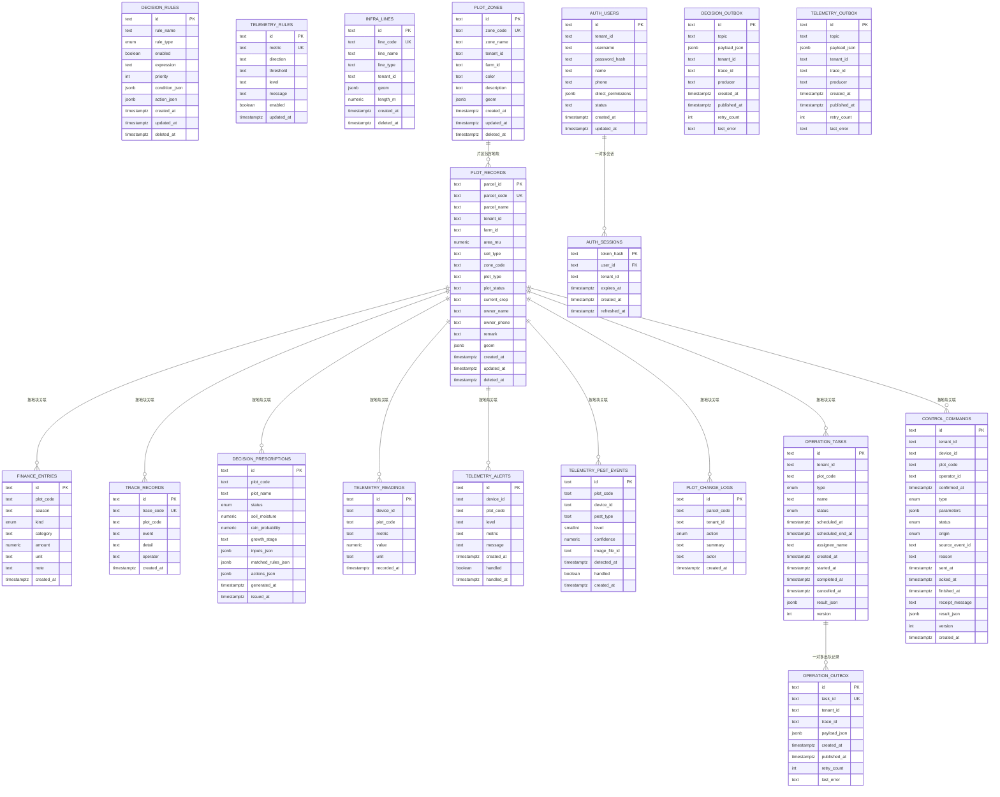

**图表来源**
- [infra/postgres/001_initial_schema.sql:3-40](file://infra/postgres/001_initial_schema.sql#L3-L40)
- [infra/postgres/migrations/002_decision_telemetry.sql:5-87](file://infra/postgres/migrations/002_decision_telemetry.sql#L5-L87)
- [infra/postgres/migrations/004_identity_accounts.sql:8-20](file://infra/postgres/migrations/004_identity_accounts.sql#L8-L20)
- [infra/postgres/migrations/005_control_commands.sql:7-20](file://infra/postgres/migrations/005_control_commands.sql#L7-L20)
- [infra/postgres/migrations/007_auth_sessions.sql:10-17](file://infra/postgres/migrations/007_auth_sessions.sql#L10-L17)
- [infra/postgres/migrations/008_agro_monitoring.sql:11-74](file://infra/postgres/migrations/008_agro_monitoring.sql#L11-L74)
- [infra/postgres/migrations/009_plot_zones.sql:12-48](file://infra/postgres/migrations/009_plot_zones.sql#L12-L48)
- [infra/postgres/migrations/011_plot_profile.sql:14-47](file://infra/postgres/migrations/011_plot_profile.sql#L14-L47)
- [infra/postgres/migrations/016_operation_tasks.sql:1-36](file://infra/postgres/migrations/016_operation_tasks.sql#L1-L36)
- [infra/postgres/migrations/027_plot_change_logs.sql:9-17](file://infra/postgres/migrations/027_plot_change_logs.sql#L9-L17)
- [infra/postgres/migrations/029_plot_change_log_actions.sql:6-9](file://infra/postgres/migrations/029_plot_change_log_actions.sql#L6-L9)
- [infra/postgres/migrations/031_control_command_receipt.sql:19-24](file://infra/postgres/migrations/031_control_command_receipt.sql#L19-L24)
- [infra/postgres/migrations/032_control_command_tenant.sql:10-11](file://infra/postgres/migrations/032_control_command_tenant.sql#L10-L11)

#### 表结构与字段定义
- plot_records
  - 主键：parcel_id
  - 唯一键：parcel_code
  - 关键字段：tenant_id、farm_id、area_mu（>=0）、geom（JSONB，CGCS2000/EPSG:4490）
  - **新增档案字段：plot_type（FIELD/GREENHOUSE/ORCHARD/AQUACULTURE）、plot_status（DRAFT/ACTIVE/FALLOW/ARCHIVED）、current_crop、owner_name、owner_phone、remark**
  - **片区关联：zone_code 关联到 plot_zones.zone_code**
  - 审计字段：created_at、updated_at、deleted_at（软删除）
  - 索引：idx_plot_records_tenant_created(tenant_id, created_at DESC) WHERE deleted_at IS NULL
  - **新增索引：idx_plot_records_profile(tenant_id, plot_status, plot_type) WHERE deleted_at IS NULL**
- finance_entries
  - 主键：id
  - 校验：kind IN ('INPUT','OUTPUT')，amount >= 0
  - 索引：idx_finance_entries_plot_created(plot_code, created_at DESC)
- trace_records
  - 主键：id
  - 唯一键：trace_code
  - 索引：idx_trace_records_plot_created(plot_code, created_at DESC)
- decision_rules
  - 主键：id
  - 校验：rule_type IN ('IRRIGATION','FERTILIZATION','PEST_WARNING')
  - JSONB：condition_json、action_json
  - 索引：idx_decision_rules_enabled(enabled, priority) WHERE deleted_at IS NULL
- decision_prescriptions
  - 主键：id
  - 校验：status IN ('RECOMMENDED','NO_ACTION')
  - JSONB：inputs_json、matched_rules_json、actions_json
  - 索引：idx_decision_prescriptions_plot(plot_code, generated_at DESC)
- telemetry_readings
  - 主键：id
  - 索引：idx_telemetry_readings_device_time(device_id, metric, recorded_at DESC)、idx_telemetry_readings_time(recorded_at DESC)
- telemetry_alerts
  - 主键：id
  - 索引：idx_telemetry_alerts_pending(handled, created_at DESC)
- **telemetry_rules**
  - 主键：id
  - 唯一键：metric（同一指标只保留一条规则）
  - 校验：direction IN ('above', 'below')，level IN ('INFO', 'WARNING', 'CRITICAL')
  - 关键字段：threshold（数值阈值）、message（告警消息）、enabled（启用状态）
  - 索引：uq_telemetry_rules_metric(metric)
- **telemetry_pest_events**
  - 主键：id
  - 校验：level BETWEEN 1 AND 3（轻微/中等/严重），confidence BETWEEN 0 AND 1
  - 关键字段：pest_type（害虫类型）、image_file_id（关联图片文件）、detected_at（检测时间）、handled（处理状态）
  - 索引：idx_pest_events_plot_time(plot_code, detected_at DESC)、idx_pest_events_pending(handled, detected_at DESC)
- **infra_lines**
  - 主键：id
  - 唯一键：line_code
  - 校验：line_type IN ('IRRIGATION_PIPE', 'FERTILIZATION_PIPE', 'ELECTRIC_LINE', 'ROAD')
  - 关键字段：geom（GeoJSON LineString，CGCS2000/EPSG:4490）、length_m（线路长度）
  - 索引：idx_infra_lines_tenant(tenant_id, line_type) WHERE deleted_at IS NULL
- **plot_zones**
  - 主键：id
  - 唯一键：zone_code
  - 关键字段：zone_name（片区名称）、color（地图配色）、description（描述）、geom（可选边界Polygon）
  - 审计字段：created_at、updated_at、deleted_at（软删除）
  - 索引：idx_plot_zones_tenant(tenant_id, farm_id) WHERE deleted_at IS NULL
- **plot_change_logs**
  - 主键：id
  - 关键字段：parcel_code（地块编码引用）、tenant_id（租户隔离）、action（变更动作）、summary（人类可读摘要）、actor（操作人标识）
  - **动作枚举：CREATE（建档）、UPDATE（修改）、DELETE（删除）、MERGE（合并生成）、SPLIT（拆分生成）**
  - 索引：idx_plot_change_logs_plot(parcel_code, created_at DESC)
  - **约束：action CHECK (action IN ('CREATE', 'UPDATE', 'DELETE', 'MERGE', 'SPLIT'))**
- **operation_tasks**
  - 主键：id
  - 唯一键：无（id 为主键）
  - 校验：type IN ('TILLAGE','SEEDING','IRRIGATION','WEEDING','SPRAYING','FERTILIZATION')，status IN ('PENDING','RUNNING','COMPLETED','CANCELLED')
  - 关键字段：tenant_id、plot_code、name、scheduled_at、scheduled_end_at、assignee_name、result_json（JSONB）
  - 状态约束：RUNNING 必有 started_at，COMPLETED 必有 started_at/completed_at/result_json，CANCELLED 必有 cancelled_at
  - 索引：idx_operation_tasks_tenant_created(tenant_id, created_at DESC, id DESC)、idx_operation_tasks_plot(tenant_id, plot_code)
- **operation_outbox**
  - 主键：id
  - 唯一键：task_id（关联 operation_tasks.id）
  - 关键字段：tenant_id、trace_id、payload_json（JSONB）、retry_count、last_error
  - 索引：idx_operation_outbox_pending(created_at) WHERE published_at IS NULL
- **control_commands**
  - 主键：id
  - 唯一键：source_event_id（自动指令去重）
  - **租户隔离：tenant_id 字段实现多租户数据隔离，所有查询和写入都必须带租户上下文**
  - 校验：type IN ('SEEDING','IRRIGATION','WEEDING','FERTILIZATION','ESTOP')，status IN ('QUEUED','SENT','ACKED','DONE','FAILED')，origin IN ('MANUAL','EVENT')
  - **生命周期字段：sent_at（下发时间）、acked_at（接收时间）、finished_at（结束时间）、receipt_message（回执消息）、result_json（结果快照）、version（乐观锁版本）**
  - **时间顺序约束：sent_at ≤ acked_at ≤ finished_at**
  - 关键字段：device_id、plot_code、operator_id、confirmed_at（人工确认时间）、parameters（JSONB参数）、reason（指令缘由）
  - **索引优化：idx_control_commands_tenant_created(tenant_id, created_at DESC, id DESC) 支持租户级列表查询，idx_control_commands_open(tenant_id, created_at DESC, id) WHERE status IN ('QUEUED','SENT','ACKED') 支持单租户待回执看板**
- **auth_users**
  - 主键：id
  - 唯一键：(tenant_id, username)
  - 校验：status IN ('ACTIVE', 'DISABLED')
  - JSONB：direct_permissions
  - 索引：idx_auth_users_tenant_created(tenant_id, created_at DESC)
- **auth_sessions**
  - 主键：token_hash
  - 外键：user_id REFERENCES auth_users(id) ON DELETE CASCADE
  - 关键字段：tenant_id、expires_at、refreshed_at
  - 索引：idx_auth_sessions_user(user_id)、idx_auth_sessions_expires(expires_at)
- decision_outbox / telemetry_outbox
  - 主键：id
  - JSONB：payload_json
  - 索引：idx_*_outbox_pending(created_at) WHERE published_at IS NULL

**章节来源**
- [infra/postgres/001_initial_schema.sql:3-40](file://infra/postgres/001_initial_schema.sql#L3-L40)
- [infra/postgres/migrations/002_decision_telemetry.sql:5-87](file://infra/postgres/migrations/002_decision_telemetry.sql#L5-L87)
- [infra/postgres/migrations/004_identity_accounts.sql:8-20](file://infra/postgres/migrations/004_identity_accounts.sql#L8-L20)
- [infra/postgres/migrations/005_control_commands.sql:7-20](file://infra/postgres/migrations/005_control_commands.sql#L7-L20)
- [infra/postgres/migrations/007_auth_sessions.sql:10-17](file://infra/postgres/migrations/007_auth_sessions.sql#L10-L17)
- [infra/postgres/migrations/008_agro_monitoring.sql:11-74](file://infra/postgres/migrations/008_agro_monitoring.sql#L11-L74)
- [infra/postgres/migrations/009_plot_zones.sql:12-48](file://infra/postgres/migrations/009_plot_zones.sql#L12-L48)
- [infra/postgres/migrations/011_plot_profile.sql:14-47](file://infra/postgres/migrations/011_plot_profile.sql#L14-L47)
- [infra/postgres/migrations/016_operation_tasks.sql:1-21](file://infra/postgres/migrations/016_operation_tasks.sql#L1-L21)
- [infra/postgres/migrations/027_plot_change_logs.sql:9-17](file://infra/postgres/migrations/027_plot_change_logs.sql#L9-L17)
- [infra/postgres/migrations/029_plot_change_log_actions.sql:6-9](file://infra/postgres/migrations/029_plot_change_log_actions.sql#L6-L9)
- [infra/postgres/migrations/031_control_command_receipt.sql:8-37](file://infra/postgres/migrations/031_control_command_receipt.sql#L8-L37)
- [infra/postgres/migrations/032_control_command_tenant.sql:10-21](file://infra/postgres/migrations/032_control_command_tenant.sql#L10-L21)

#### 主键/外键与约束设计
- 主键：所有表均使用 TEXT 类型主键，便于分布式 ID 生成（如 ULID）。
- 唯一约束：parcel_code、trace_code、(tenant_id, username)、metric、line_code、zone_code、task_id、source_event_id 保证业务编码唯一性。
- 检查约束：area_mu >= 0、amount >= 0、kind/status/rule_type/type/status 枚举值限制、level/confidence 范围限制、action 枚举值限制。
- **控制指令约束：status IN ('QUEUED','SENT','ACKED','DONE','FAILED')，type IN ('SEEDING','IRRIGATION','WEEDING','FERTILIZATION','ESTOP')，origin IN ('MANUAL','EVENT')**
- **时间顺序约束：(sent_at IS NULL OR acked_at IS NULL OR acked_at >= sent_at) AND (acked_at IS NULL OR finished_at IS NULL OR finished_at >= acked_at)**
- 软删除：plot_records、decision_rules、infra_lines、plot_zones 使用 deleted_at 实现逻辑删除，配合部分索引提升查询性能。
- **外键约束：auth_sessions.user_id 引用 auth_users.id，operation_outbox.task_id 引用 operation_tasks.id，级联删除确保相关数据一致性。**
- 状态约束：operation_tasks 的状态转换约束确保 RUNNING/COMPLETED/CANCELLED 状态的必需字段完整性。
- 外键：当前 schema 中仅 auth_sessions 和 operation_outbox 显式声明了外键约束，其他关联依赖应用层一致性校验与事务控制。

**章节来源**
- [infra/postgres/001_initial_schema.sql:3-40](file://infra/postgres/001_initial_schema.sql#L3-L40)
- [infra/postgres/migrations/002_decision_telemetry.sql:5-87](file://infra/postgres/migrations/002_decision_telemetry.sql#L5-L87)
- [infra/postgres/migrations/004_identity_accounts.sql:8-20](file://infra/postgres/migrations/004_identity_accounts.sql#L8-L20)
- [infra/postgres/migrations/005_control_commands.sql:13-15](file://infra/postgres/migrations/005_control_commands.sql#L13-L15)
- [infra/postgres/migrations/007_auth_sessions.sql:10-17](file://infra/postgres/migrations/007_auth_sessions.sql#L10-L17)
- [infra/postgres/migrations/008_agro_monitoring.sql:11-74](file://infra/postgres/migrations/008_agro_monitoring.sql#L11-L74)
- [infra/postgres/migrations/009_plot_zones.sql:12-48](file://infra/postgres/migrations/009_plot_zones.sql#L12-L48)
- [infra/postgres/migrations/011_plot_profile.sql:14-47](file://infra/postgres/migrations/011_plot_profile.sql#L14-L47)
- [infra/postgres/migrations/016_operation_tasks.sql:17-21](file://infra/postgres/migrations/016_operation_tasks.sql#L17-L21)
- [infra/postgres/migrations/027_plot_change_logs.sql:13](file://infra/postgres/migrations/027_plot_change_logs.sql#L13)
- [infra/postgres/migrations/029_plot_change_log_actions.sql:6-9](file://infra/postgres/migrations/029_plot_change_log_actions.sql#L6-L9)
- [infra/postgres/migrations/031_control_command_receipt.sql:8-33](file://infra/postgres/migrations/031_control_command_receipt.sql#L8-L33)

#### 数据验证规则与业务规则
- 地块面积非负；土壤类型可选；边界几何为 JSONB，建议统一 CGCS2000（EPSG:4490）。
- **地块档案字段：plot_type 限定为大田/大棚/果园/水产养殖四种类型；plot_status 限定为草稿/种植中/休耕/已归档四种状态；current_crop 为自由文本；owner_name/owner_phone 为负责人信息。**
- **片区管理：zone_code 全局唯一，一旦用过不再分配给其他片区；geom 可选，无实测边界时前端按成员地块凸包显示。**
- 财务条目金额非负，类别限定 INPUT/OUTPUT；按季节与地块汇总利润。
- 溯源记录需包含操作人、事件与详情，按地块时间线回溯。
- 决策规则支持热更新：启用状态、优先级、条件与动作 JSONB 化；默认灌溉规则开箱可用。
- 遥测读数按设备+指标取最新值；历史查询支持设备/指标/时间窗过滤，默认上限 200，最大 2000。
- 告警默认未处理，支持批量待处理列表与单条标记已处理。
- **四情监测阈值：direction 区分上限/下限，level 分为 INFO/WARNING/CRITICAL 三级；同一指标只保留一条规则避免重复告警。**
- **虫情事件：level 1/2/3 对应轻微/中等/严重，confidence 0-1 置信度；支持图片附件与处理状态跟踪。**
- **基础设施线路：line_type 限定为灌溉管线/施肥管线/电力线路/道路四种类型；geom 为 GeoJSON LineString。**
- **认证用户状态控制：ACTIVE/DISABLED 状态管理，支持账号停用功能。**
- **会话安全管理：token 以 sha256 散列存储，支持滑动续期、立即失效和多实例共享。**
- **地块变更日志：action 限定为 CREATE/UPDATE/DELETE/MERGE/SPLIT 五种动作类型；summary 提供人类可读的操作摘要；actor 记录操作人标识。**
- **农事任务类型：type 限定为整地(TILLAGE)/播种(SEEDING)/灌溉(IRRIGATION)/除草(WEEDING)/植保(SPRAYING)/施肥(FERTILIZATION)六种作业类型。**
- **农事任务状态：status 限定为待执行(PENDING)/进行中(RUNNING)/已完成(COMPLETED)/已取消(CANCELLED)四种状态，支持状态机转换。**
- **农事任务时间约束：scheduled_end_at 必须晚于 scheduled_at；RUNNING 状态必须有 started_at；COMPLETED 状态必须有 started_at/completed_at/result_json；CANCELLED 状态必须有 cancelled_at。**
- **农事任务结果：result_json 包含 outcome(success/partial/failed)、finishedAreaMu(实际作业面积)、notes(作业说明)，仅在 COMPLETED 状态时写入。**
- **控制指令类型：type 限定为播种(SEEDING)/灌溉(IRRIGATION)/除草(WEEDING)/施肥(FERTILIZATION)/急停(ESTOP)五种类型，其中 ESTOP 为安全急停指令。**
- **控制指令状态机：status 限定为入队(QUEUED)/已下发(SENT)/已接收(ACKED)/执行完成(DONE)/失败(FAILED)五态，支持 QUEUED→SENT→ACKED→DONE 完整链路，任一在途状态均可被 FAILED 收口。**
- **控制指令来源：origin 限定为人工(MANUAL)/事件(EVENT)，人工指令需要二次确认，自动指令由越限或处方事件触发。**
- **控制指令时间顺序：sent_at ≤ acked_at ≤ finished_at，确保下发时间早于接收时间，接收时间早于结束时间。**
- **控制指令乐观锁：version 字段每次状态跃迁 +1，防止并发回执冲突。**
- **控制指令租户隔离：tenant_id 字段实现多租户数据隔离，所有查询和写入都必须带租户上下文，跨租户的 id 一律当作不存在。**
- **急停指令特殊约束：DONE 状态必须带 result.confirmed=true，确保设备确实停止。**

**章节来源**
- [apps/plot-service/src/plot.repository.ts:11-28](file://apps/plot-service/src/plot.repository.ts#L11-L28)
- [apps/plot-service/src/zone.repository.ts:14-47](file://apps/plot-service/src/zone.repository.ts#L14-L47)
- [apps/finance-service/src/repository.ts:3-5](file://apps/finance-service/src/repository.ts#L3-L5)
- [apps/trace-service/src/repository.ts:3-4](file://apps/trace-service/src/repository.ts#L3-L4)
- [apps/decision-service/src/rule.repository.ts:11-48](file://apps/decision-service/src/rule.repository.ts#L11-L48)
- [apps/telemetry-service/src/reading.repository.ts:4-51](file://apps/telemetry-service/src/reading.repository.ts#L4-L51)
- [apps/telemetry-service/src/pest.repository.ts:47-61](file://apps/telemetry-service/src/pest.repository.ts#L47-L61)
- [apps/auth-service/src/session.repository.ts:6-15](file://apps/auth-service/src/session.repository.ts#L6-L15)
- [infra/postgres/migrations/007_auth_sessions.sql:3-8](file://infra/postgres/migrations/007_auth_sessions.sql#L3-L8)
- [infra/postgres/migrations/008_agro_monitoring.sql:11-74](file://infra/postgres/migrations/008_agro_monitoring.sql#L11-L74)
- [infra/postgres/migrations/009_plot_zones.sql:12-48](file://infra/postgres/migrations/009_plot_zones.sql#L12-L48)
- [infra/postgres/migrations/011_plot_profile.sql:14-47](file://infra/postgres/migrations/011_plot_profile.sql#L14-L47)
- [infra/postgres/migrations/016_operation_tasks.sql:4-20](file://infra/postgres/migrations/016_operation_tasks.sql#L4-L20)
- [infra/postgres/migrations/027_plot_change_logs.sql:9-17](file://infra/postgres/migrations/027_plot_change_logs.sql#L9-L17)
- [infra/postgres/migrations/029_plot_change_log_actions.sql:6-9](file://infra/postgres/migrations/029_plot_change_log_actions.sql#L6-L9)
- [infra/postgres/migrations/031_control_command_receipt.sql:8-33](file://infra/postgres/migrations/031_control_command_receipt.sql#L8-L33)
- [infra/postgres/migrations/032_control_command_tenant.sql:3-11](file://infra/postgres/migrations/032_control_command_tenant.sql#L3-L11)
- [apps/control-service/src/control.repository.ts:16-17](file://apps/control-service/src/control.repository.ts#L16-L17)
- [apps/control-service/src/http.ts:64-71](file://apps/control-service/src/http.ts#L64-L71)

#### 数据访问模式
- 仓储层封装 SQL，提供事务感知执行器 executor(tx)，优先使用传入事务对象，否则回退到客户端连接。
- 典型写入：create/update/remove 使用 $executeRawUnsafe；读取使用 $queryRawUnsafe。
- 事务边界显式传递，避免隐式上下文扩大事务范围。
- **认证会话访问：支持创建、查找、续期、删除、批量清理等操作，所有 token 均以散列形式存储。**
- **片区管理访问：支持按租户列出、按编码查找、创建、更新、软删除等操作，支持几何数据的序列化处理。**
- **虫情事件访问：支持创建、分页查询、标记已处理、计数等操作，支持按地块和处理状态筛选。**
- **地块变更日志访问：支持追加写入和按地块倒序查询，不修改历史日志以保证审计完整性。**
- **农事任务访问：支持分页查询、创建、状态转换等操作，状态转换与出队写入原子操作，确保事件可靠性。**
- **农事任务出队访问：支持待处理事件查询、标记已发布、标记失败重试等操作。**
- **控制指令访问：支持创建、分页查询、状态跃迁等操作，状态跃迁使用乐观锁确保并发安全，支持设备回执和人工回填，现已实现完整的租户隔离。**

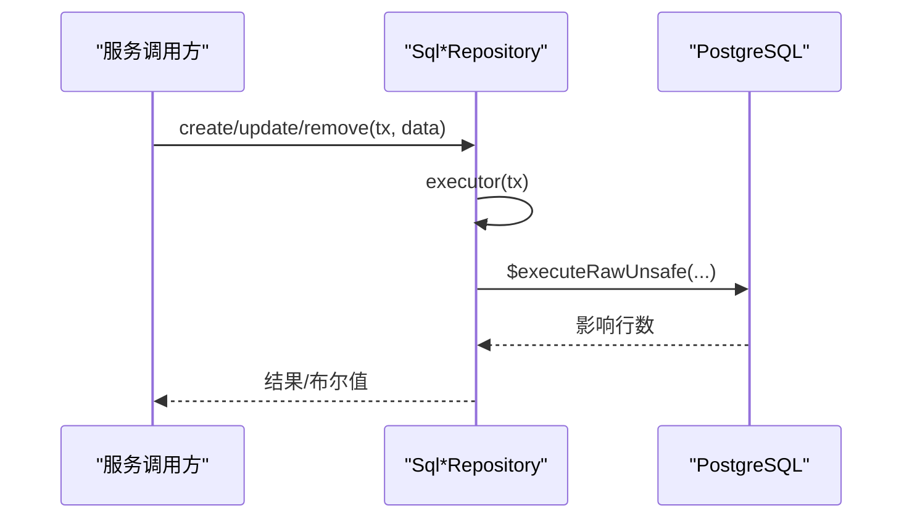

**图表来源**
- [apps/plot-service/src/plot.repository.ts:98-100](file://apps/plot-service/src/plot.repository.ts#L98-L100)
- [apps/plot-service/src/zone.repository.ts:117-119](file://apps/plot-service/src/zone.repository.ts#L117-L119)
- [apps/telemetry-service/src/pest.repository.ts:67-69](file://apps/telemetry-service/src/pest.repository.ts#L67-L69)
- [apps/decision-service/src/rule.repository.ts:185-187](file://apps/decision-service/src/rule.repository.ts#L185-L187)
- [apps/telemetry-service/src/reading.repository.ts:100-102](file://apps/telemetry-service/src/reading.repository.ts#L100-L102)
- [apps/plot-service/src/plot-change-log.repository.ts:60-72](file://apps/plot-service/src/plot-change-log.repository.ts#L60-L72)
- [apps/operation-service/src/task.repository.ts:138-151](file://apps/operation-service/src/task.repository.ts#L138-L151)
- [apps/operation-service/src/outbox.repository.ts:9-14](file://apps/operation-service/src/outbox.repository.ts#L9-L14)
- [apps/control-service/src/control.repository.ts:164-186](file://apps/control-service/src/control.repository.ts#L164-L186)

**章节来源**
- [apps/plot-service/src/plot.repository.ts:94-186](file://apps/plot-service/src/plot.repository.ts#L94-L186)
- [apps/plot-service/src/zone.repository.ts:114-193](file://apps/plot-service/src/zone.repository.ts#L114-L193)
- [apps/telemetry-service/src/pest.repository.ts:64-113](file://apps/telemetry-service/src/pest.repository.ts#L64-L113)
- [apps/decision-service/src/rule.repository.ts:181-296](file://apps/decision-service/src/rule.repository.ts#L181-L296)
- [apps/telemetry-service/src/reading.repository.ts:96-202](file://apps/telemetry-service/src/reading.repository.ts#L96-L202)
- [apps/auth-service/src/session.repository.ts:117-162](file://apps/auth-service/src/session.repository.ts#L117-L162)
- [apps/plot-service/src/plot-change-log.repository.ts:52-83](file://apps/plot-service/src/plot-change-log.repository.ts#L52-L83)
- [apps/operation-service/src/task.repository.ts:106-153](file://apps/operation-service/src/task.repository.ts#L106-L153)
- [apps/operation-service/src/outbox.repository.ts:6-15](file://apps/operation-service/src/outbox.repository.ts#L6-L15)
- [apps/control-service/src/control.repository.ts:160-200](file://apps/control-service/src/control.repository.ts#L160-L200)

#### 示例数据（概念性）
- 地块：包含 parcel_code、parcel_name、tenant_id、farm_id、area_mu、geom(JSONB)、时间戳与软删除标记，**新增 plot_type、plot_status、current_crop、owner_name、owner_phone、remark 等档案字段**。
- 财务：按 plot_code、season、kind、category、amount、unit、note 记录投入/产出。
- 溯源：trace_code、plot_code、event、detail、operator、created_at。
- 决策规则：rule_name、rule_type、enabled、expression、priority、condition_json、action_json。
- 遥测读数：device_id、plot_code、metric、value、unit、recorded_at。
- 遥测告警：level、message、handled、handled_at。
- **四情监测规则：metric、direction、threshold、level、message、enabled、updated_at。**
- **虫情事件：plot_code、device_id、pest_type、level、confidence、image_file_id、detected_at、handled。**
- **基础设施线路：line_code、line_name、line_type、tenant_id、geom(LineString)、length_m。**
- **片区管理：zone_code、zone_name、tenant_id、farm_id、color、description、geom(Polygon)。**
- **地块变更日志：id、parcel_code、tenant_id、action(CREATE/UPDATE/DELETE/MERGE/SPLIT)、summary、actor、created_at。**
- **农事任务：id、tenant_id、plot_code、type、name、status、scheduled_at、scheduled_end_at、assignee_name、created_at、started_at、completed_at、cancelled_at、result_json、version。**
- **农事任务出队：id、task_id、tenant_id、trace_id、payload_json、created_at、published_at、retry_count、last_error。**
- **控制指令：id、tenant_id、device_id、plot_code、operator_id、confirmed_at、type、parameters、status、origin、source_event_id、reason、sent_at、acked_at、finished_at、receipt_message、result_json、version、created_at。**
- **认证用户：id、tenant_id、username、password_hash、name、phone、direct_permissions、status、时间戳。**
- **认证会话：token_hash、user_id、tenant_id、expires_at、created_at、refreshed_at。**

[本节为概念性示例，不直接分析具体文件]

### 控制指令生命周期管理
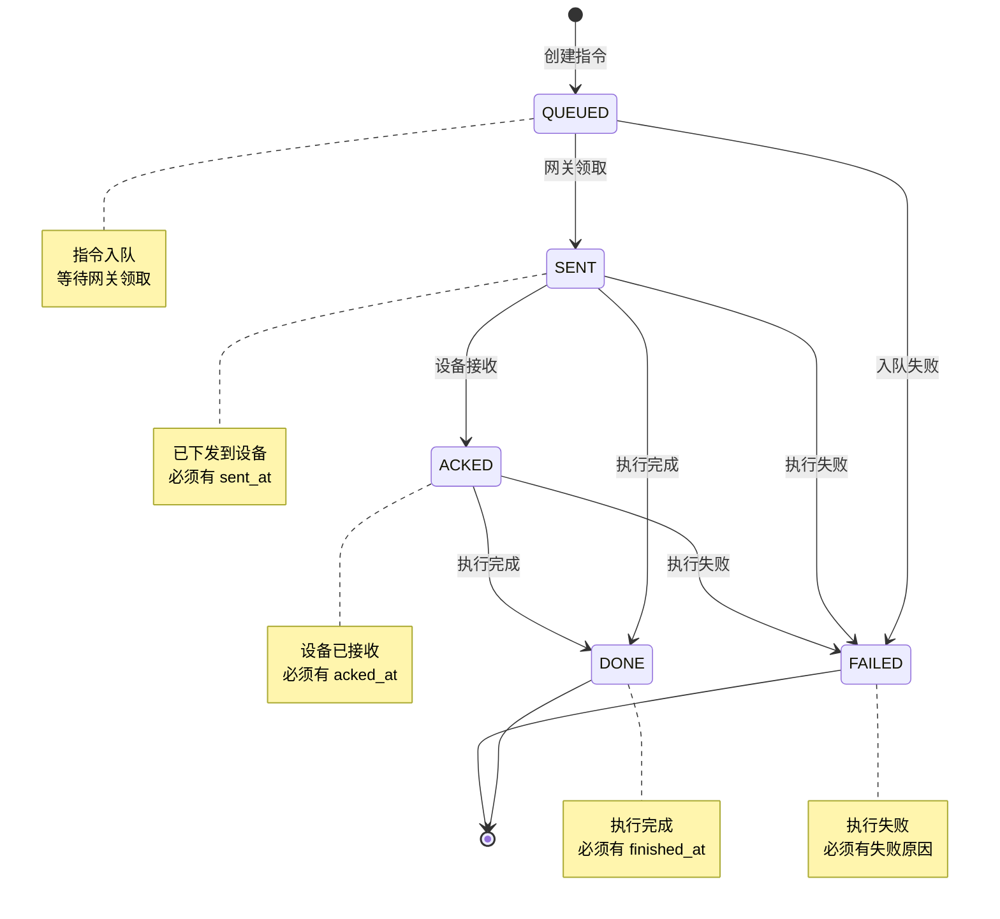

**图表来源**
- [apps/control-service/src/control.repository.ts:31-37](file://apps/control-service/src/control.repository.ts#L31-L37)
- [infra/postgres/migrations/031_control_command_receipt.sql:8-11](file://infra/postgres/migrations/031_control_command_receipt.sql#L8-L11)

**章节来源**
- [apps/control-service/src/control.repository.ts:31-37](file://apps/control-service/src/control.repository.ts#L31-L37)
- [infra/postgres/migrations/031_control_command_receipt.sql:8-11](file://infra/postgres/migrations/031_control_command_receipt.sql#L8-L11)

### 控制指令回执处理流程
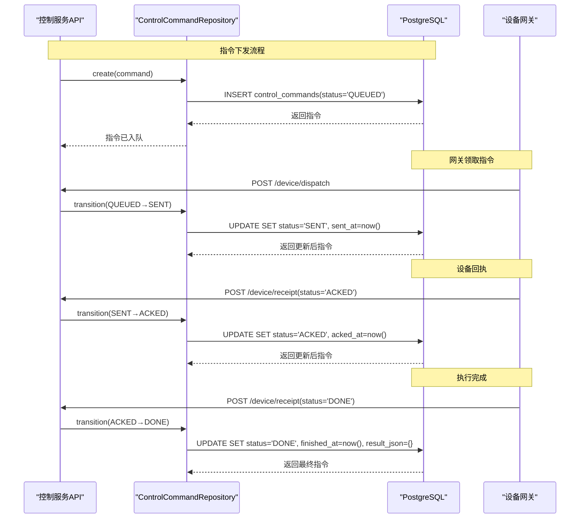

**图表来源**
- [apps/control-service/src/http.ts:208-264](file://apps/control-service/src/http.ts#L208-L264)
- [apps/control-service/src/control.repository.ts:255-283](file://apps/control-service/src/control.repository.ts#L255-L283)

**章节来源**
- [apps/control-service/src/http.ts:208-264](file://apps/control-service/src/http.ts#L208-L264)
- [apps/control-service/src/control.repository.ts:255-283](file://apps/control-service/src/control.repository.ts#L255-L283)

### 农事任务生命周期管理
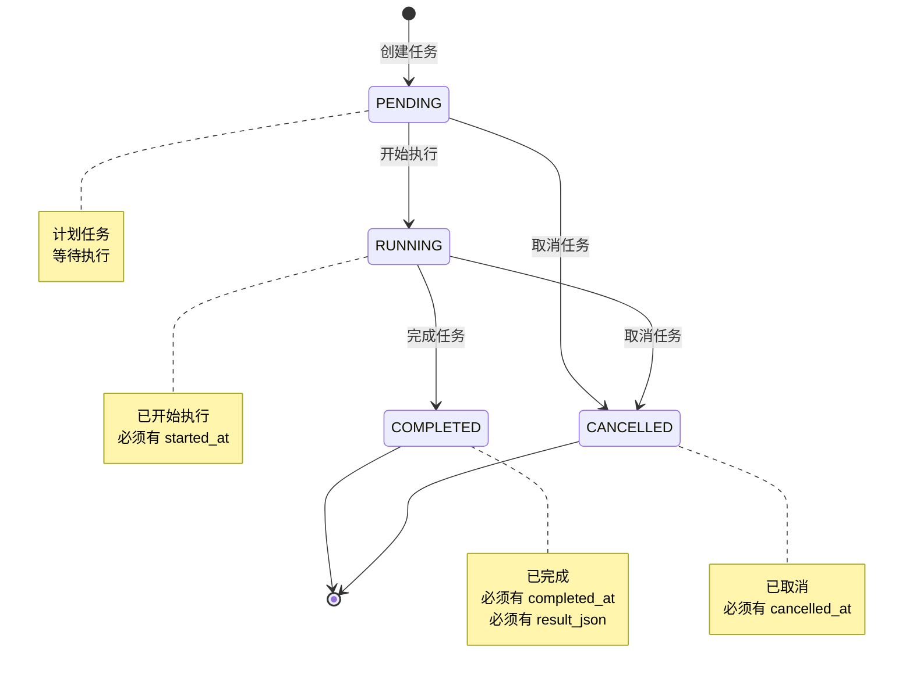

**图表来源**
- [apps/operation-service/src/task.repository.ts:48-53](file://apps/operation-service/src/task.repository.ts#L48-L53)
- [infra/postgres/migrations/016_operation_tasks.sql:7-20](file://infra/postgres/migrations/016_operation_tasks.sql#L7-L20)

**章节来源**
- [apps/operation-service/src/task.repository.ts:48-53](file://apps/operation-service/src/task.repository.ts#L48-L53)
- [infra/postgres/migrations/016_operation_tasks.sql:7-20](file://infra/postgres/migrations/016_operation_tasks.sql#L7-L20)

### 农事任务演示数据加载流程
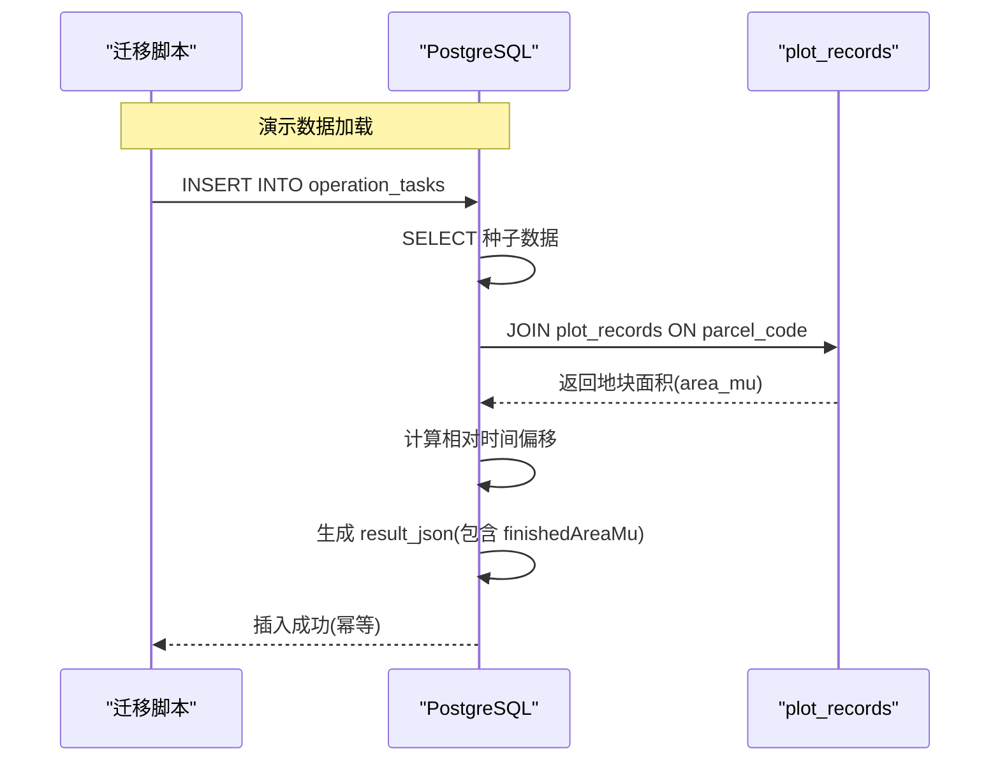

**图表来源**
- [infra/postgres/migrations/030_operation_task_demo_data.sql:14-47](file://infra/postgres/migrations/030_operation_task_demo_data.sql#L14-L47)

**章节来源**
- [infra/postgres/migrations/030_operation_task_demo_data.sql:1-48](file://infra/postgres/migrations/030_operation_task_demo_data.sql#L1-L48)

### 地块合并与拆分流程
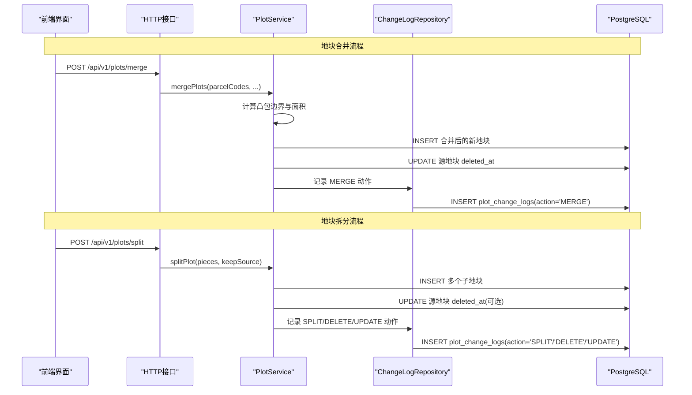

**图表来源**
- [apps/plot-service/src/http.ts:616-679](file://apps/plot-service/src/http.ts#L616-L679)
- [apps/plot-service/src/plot.service.ts:276-411](file://apps/plot-service/src/plot.service.ts#L276-L411)
- [apps/plot-service/src/plot-change-log.repository.ts:60-72](file://apps/plot-service/src/plot-change-log.repository.ts#L60-L72)

**章节来源**
- [apps/plot-service/src/http.ts:616-679](file://apps/plot-service/src/http.ts#L616-L679)
- [apps/plot-service/src/plot.service.ts:276-411](file://apps/plot-service/src/plot.service.ts#L276-L411)
- [apps/plot-service/src/plot-change-log.repository.ts:52-83](file://apps/plot-service/src/plot-change-log.repository.ts#L52-L83)

### 片区管理与地块档案流程
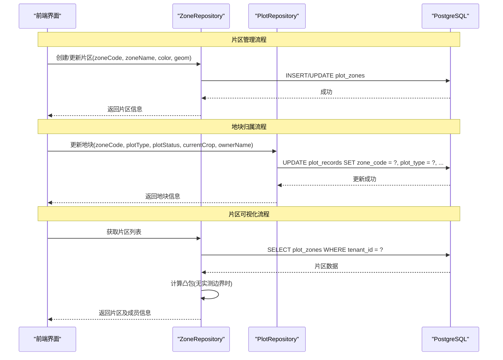

**图表来源**
- [apps/plot-service/src/zone.repository.ts:121-193](file://apps/plot-service/src/zone.repository.ts#L121-L193)
- [apps/plot-service/src/plot.repository.ts:169-200](file://apps/plot-service/src/plot.repository.ts#L169-L200)
- [apps/plot-service/src/zone.geometry.ts:34-75](file://apps/plot-service/src/zone.geometry.ts#L34-L75)

**章节来源**
- [apps/plot-service/src/zone.repository.ts:114-193](file://apps/plot-service/src/zone.repository.ts#L114-L193)
- [apps/plot-service/src/plot.repository.ts:138-200](file://apps/plot-service/src/plot.repository.ts#L138-L200)
- [apps/plot-service/src/zone.geometry.ts:1-75](file://apps/plot-service/src/zone.geometry.ts#L1-L75)

### 四情监测与虫情处理流程
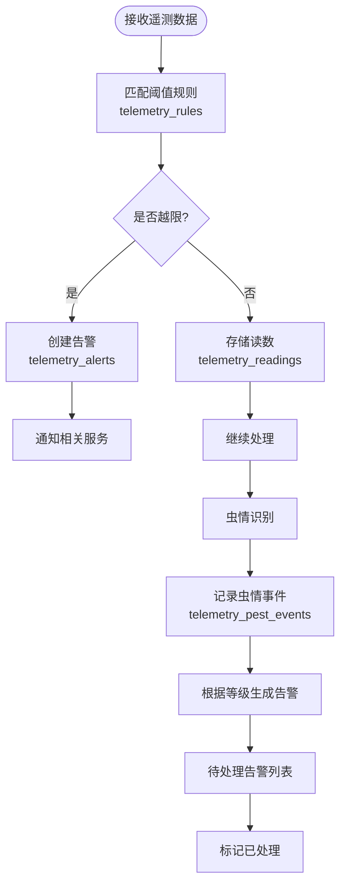

**图表来源**
- [apps/telemetry-service/src/reading.repository.ts:104-118](file://apps/telemetry-service/src/reading.repository.ts#L104-L118)
- [apps/telemetry-service/src/pest.repository.ts:71-113](file://apps/telemetry-service/src/pest.repository.ts#L71-L113)
- [infra/postgres/migrations/008_agro_monitoring.sql:11-74](file://infra/postgres/migrations/008_agro_monitoring.sql#L11-L74)

**章节来源**
- [apps/telemetry-service/src/reading.repository.ts:96-202](file://apps/telemetry-service/src/reading.repository.ts#L96-L202)
- [apps/telemetry-service/src/pest.repository.ts:64-113](file://apps/telemetry-service/src/pest.repository.ts#L64-L113)
- [infra/postgres/migrations/008_agro_monitoring.sql:11-74](file://infra/postgres/migrations/008_agro_monitoring.sql#L11-L74)

### 决策规则与处方生成流程
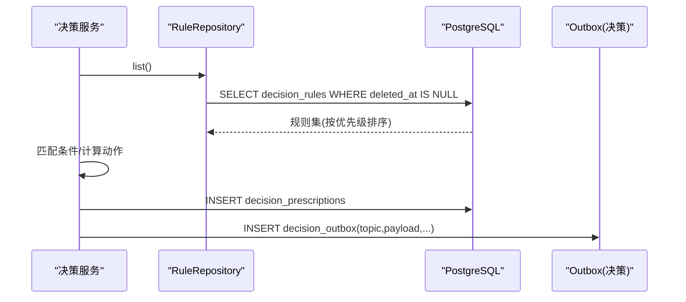

**图表来源**
- [apps/decision-service/src/rule.repository.ts:206-212](file://apps/decision-service/src/rule.repository.ts#L206-L212)
- [infra/postgres/migrations/002_decision_telemetry.sql:5-34](file://infra/postgres/migrations/002_decision_telemetry.sql#L5-L34)
- [infra/postgres/migrations/002_decision_telemetry.sql:61-73](file://infra/postgres/migrations/002_decision_telemetry.sql#L61-L73)

**章节来源**
- [apps/decision-service/src/rule.repository.ts:11-48](file://apps/decision-service/src/rule.repository.ts#L11-L48)
- [apps/decision-service/src/rule.repository.ts:181-296](file://apps/decision-service/src/rule.repository.ts#L181-L296)
- [infra/postgres/migrations/002_decision_telemetry.sql:5-34](file://infra/postgres/migrations/002_decision_telemetry.sql#L5-L34)

### 遥测读数与告警处理流程
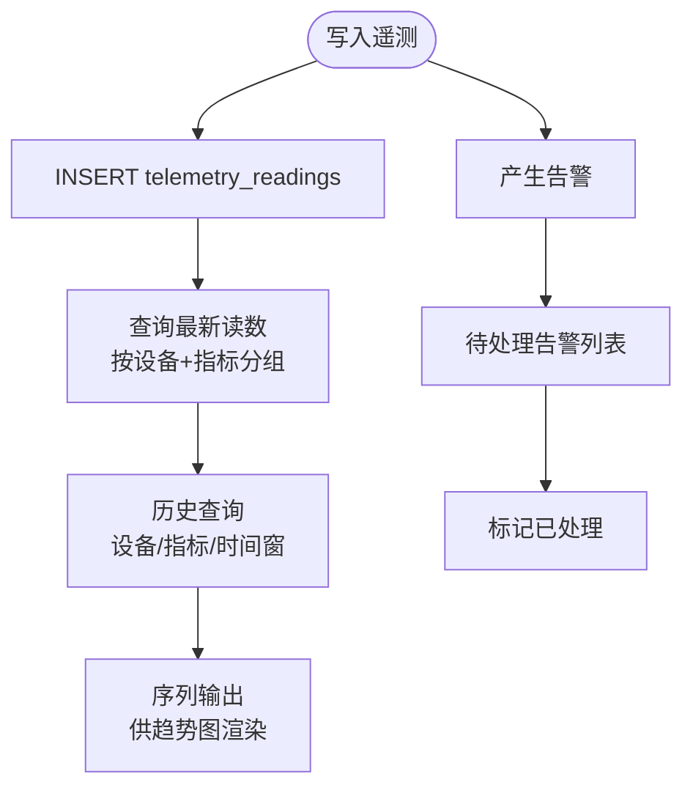

**图表来源**
- [apps/telemetry-service/src/reading.repository.ts:104-118](file://apps/telemetry-service/src/reading.repository.ts#L104-L118)
- [apps/telemetry-service/src/reading.repository.ts:120-156](file://apps/telemetry-service/src/reading.repository.ts#L120-L156)
- [apps/telemetry-service/src/reading.repository.ts:171-201](file://apps/telemetry-service/src/reading.repository.ts#L171-L201)

**章节来源**
- [apps/telemetry-service/src/reading.repository.ts:96-202](file://apps/telemetry-service/src/reading.repository.ts#L96-L202)

### 农事任务完成事件处理流程
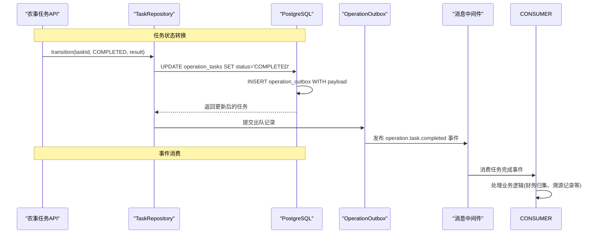

**图表来源**
- [apps/operation-service/src/task.repository.ts:138-151](file://apps/operation-service/src/task.repository.ts#L138-L151)
- [apps/operation-service/src/outbox.repository.ts:9-14](file://apps/operation-service/src/outbox.repository.ts#L9-L14)
- [packages/contracts/src/events/topic.ts:13](file://packages/contracts/src/events/topic.ts#L13)
- [packages/contracts/src/events/payload.ts:91-102](file://packages/contracts/src/events/payload.ts#L91-L102)

**章节来源**
- [apps/operation-service/src/task.repository.ts:138-151](file://apps/operation-service/src/task.repository.ts#L138-L151)
- [apps/operation-service/src/outbox.repository.ts:9-14](file://apps/operation-service/src/outbox.repository.ts#L9-L14)
- [packages/contracts/src/events/topic.ts:13](file://packages/contracts/src/events/topic.ts#L13)
- [packages/contracts/src/events/payload.ts:91-102](file://packages/contracts/src/events/payload.ts#L91-L102)

## 依赖关系分析
- 服务与表耦合：
  - PlotRepository ↔ plot_records
  - ZoneRepository ↔ plot_zones
  - FinanceRepository ↔ finance_entries
  - TraceRepository ↔ trace_records
  - RuleRepository ↔ decision_rules / decision_prescriptions / decision_outbox
  - ReadingRepository/AlertRepository ↔ telemetry_readings / telemetry_alerts / telemetry_outbox
  - PestEventRepository ↔ telemetry_pest_events
  - **TelemetryService ↔ telemetry_rules**
  - SessionRepository ↔ auth_sessions / auth_users
  - **PlotService ↔ plot_change_logs（通过 ChangeLogRepository）**
  - **TaskRepository ↔ operation_tasks / operation_outbox**
  - **ControlCommandRepository ↔ control_commands**
- 间接依赖：
  - 决策服务依赖遥测读数作为规则输入（由业务侧聚合后传入）。
  - 出队表与消息中间件解耦服务间通信，保障最终一致性。
  - **认证服务与会话表强依赖，支持多实例部署和会话立即失效。**
  - **片区与地块存在逻辑关联，通过 zone_code 字段建立关系。**
  - **四情监测规则与遥测告警存在业务关联，规则触发告警生成。**
  - **地块变更日志与地块档案存在逻辑关联，通过 parcel_code 字段建立关系。**
  - **农事任务与地块存在逻辑关联，通过 plot_code 字段建立关系。**
  - **农事任务出队与任务表存在强关联，通过 task_id 外键约束建立关系。**
  - **控制指令与地块存在逻辑关联，通过 plot_code 字段建立关系。**
  - **控制指令与遥测/决策服务存在业务关联，由越限或处方事件触发。**
  - **控制指令现已实现完整的租户隔离，与 operation_tasks 和 video_ptz_commands 保持同一隔离口径。**

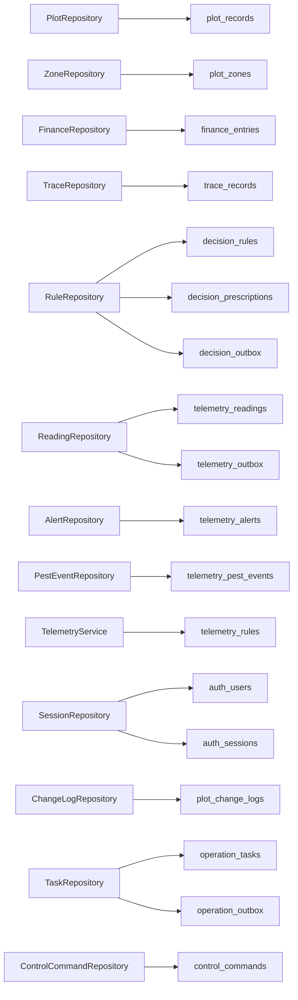

**图表来源**
- [apps/plot-service/src/plot.repository.ts:94-186](file://apps/plot-service/src/plot.repository.ts#L94-L186)
- [apps/plot-service/src/zone.repository.ts:114-193](file://apps/plot-service/src/zone.repository.ts#L114-L193)
- [apps/finance-service/src/repository.ts:14-21](file://apps/finance-service/src/repository.ts#L14-L21)
- [apps/trace-service/src/repository.ts:13-19](file://apps/trace-service/src/repository.ts#L13-L19)
- [apps/decision-service/src/rule.repository.ts:181-296](file://apps/decision-service/src/rule.repository.ts#L181-L296)
- [apps/telemetry-service/src/reading.repository.ts:96-202](file://apps/telemetry-service/src/reading.repository.ts#L96-L202)
- [apps/telemetry-service/src/pest.repository.ts:64-113](file://apps/telemetry-service/src/pest.repository.ts#L64-L113)
- [apps/auth-service/src/session.repository.ts:117-162](file://apps/auth-service/src/session.repository.ts#L117-L162)
- [apps/plot-service/src/plot-change-log.repository.ts:52-83](file://apps/plot-service/src/plot-change-log.repository.ts#L52-L83)
- [apps/operation-service/src/task.repository.ts:106-153](file://apps/operation-service/src/task.repository.ts#L106-L153)
- [apps/control-service/src/control.repository.ts:160-200](file://apps/control-service/src/control.repository.ts#L160-L200)

**章节来源**
- [apps/plot-service/src/plot.repository.ts:94-186](file://apps/plot-service/src/plot.repository.ts#L94-L186)
- [apps/plot-service/src/zone.repository.ts:114-193](file://apps/plot-service/src/zone.repository.ts#L114-L193)
- [apps/finance-service/src/repository.ts:14-21](file://apps/finance-service/src/repository.ts#L14-L21)
- [apps/trace-service/src/repository.ts:13-19](file://apps/trace-service/src/repository.ts#L13-L19)
- [apps/decision-service/src/rule.repository.ts:181-296](file://apps/decision-service/src/rule.repository.ts#L181-L296)
- [apps/telemetry-service/src/reading.repository.ts:96-202](file://apps/telemetry-service/src/reading.repository.ts#L96-L202)
- [apps/telemetry-service/src/pest.repository.ts:64-113](file://apps/telemetry-service/src/pest.repository.ts#L64-L113)
- [apps/auth-service/src/session.repository.ts:117-162](file://apps/auth-service/src/session.repository.ts#L117-L162)
- [apps/plot-service/src/plot-change-log.repository.ts:52-83](file://apps/plot-service/src/plot-change-log.repository.ts#L52-L83)
- [apps/operation-service/src/task.repository.ts:106-153](file://apps/operation-service/src/task.repository.ts#L106-L153)
- [apps/control-service/src/control.repository.ts:160-200](file://apps/control-service/src/control.repository.ts#L160-L200)

## 性能考虑
- 索引优化
  - 租户+时间降序索引：plot_records.tenant_id + created_at（软删除过滤）。
  - 地块+时间降序索引：finance_entries、trace_records 常用查询路径。
  - 规则启用+优先级索引：decision_rules.enabled + priority（软删除过滤）。
  - 遥测设备+指标+时间索引：telemetry_readings.device_id + metric + recorded_at。
  - 全局时间索引：telemetry_readings.recorded_at。
  - 告警待处理索引：telemetry_alerts.handled + created_at。
  - 出队未发布索引：decision_outbox/telemetry_outbox.created_at WHERE published_at IS NULL。
  - **认证会话索引：auth_sessions.user_id 快速查找用户会话，auth_sessions.expires_at 支持批量清理。**
  - **四情监测规则索引：telemetry_rules.metric 唯一索引，避免重复规则。**
  - **虫情事件索引：telemetry_pest_events.plot_code + detected_at、handled + detected_at 优化查询。**
  - **基础设施线路索引：infra_lines.tenant_id + line_type 支持按租户和类型筛选。**
  - **片区索引：plot_zones.tenant_id + farm_id 支持按农场筛选。**
  - **地块档案索引：plot_records.tenant_id + plot_status + plot_type 支持列表页筛选。**
  - **地块变更日志索引：plot_change_logs.parcel_code + created_at 支持按地块时间线查询。**
  - **农事任务索引：operation_tasks.tenant_id + created_at DESC + id DESC 支持分页查询，operation_tasks.tenant_id + plot_code 支持按地块筛选。**
  - **农事任务出队索引：operation_outbox.created_at WHERE published_at IS NULL 支持待处理事件查询。**
  - **控制指令索引优化：idx_control_commands_tenant_created(tenant_id, created_at DESC, id DESC) 支持租户级列表查询，idx_control_commands_open(tenant_id, created_at DESC, id) WHERE status IN ('QUEUED','SENT','ACKED') 支持单租户待回执看板查询。**
- 查询优化
  - 遥测最新值使用窗口函数 ROW_NUMBER 分区取最近一条。
  - 历史查询默认 limit=200，最大 2000，防止大结果集拖慢响应。
  - 规则列表按 priority、created_at 排序，确保稳定顺序。
  - **会话查找使用 EXPIRES_AT > NOW() 在数据库层面过滤过期会话。**
  - **片区查询按 zone_code ASC 排序，确保稳定的列表顺序。**
  - **虫情事件查询支持 pendingOnly 参数，优化待处理事件查询。**
  - **地块变更日志查询按 created_at DESC, id DESC 排序，确保最新的变更记录在前。**
  - **农事任务查询支持 keyword 模糊搜索、status/type/plotCode 过滤、from/to 时间范围筛选。**
  - **控制指令查询支持 plotCode、origin、type、status、deviceId、from/to 过滤，pending 参数优化待回执指令查询，现已支持租户级查询优化。**
- 写入优化
  - 使用原生 SQL 批量插入/更新，减少 ORM 开销。
  - 软删除利用部分索引降低扫描成本。
  - **会话创建使用 ON CONFLICT DO UPDATE 实现幂等写入。**
  - **演示数据使用 ON CONFLICT DO NOTHING 确保迁移幂等性。**
  - **地块变更日志使用追加式写入，避免修改历史数据。**
  - **农事任务状态转换使用原子 UPDATE + INSERT 操作，确保状态变更与出队写入的一致性。**
  - **控制指令创建使用 ON CONFLICT DO NOTHING 确保自动指令幂等性。**
- 扩展建议
  - 对遥测表考虑分区（按时间或地块），结合 pg_partman 或原生分区表。
  - 对 JSONB 字段建立 GIN 索引（如 condition_json/action_json）以提升复杂条件检索。
  - 对地理字段建议使用 PostGIS 几何类型替代 JSONB，以获得空间算子与索引优势。
  - **对认证会话表考虑按 expires_at 分区，优化过期清理性能。**
  - **对虫情事件表考虑按 detected_at 分区，优化时间范围查询。**
  - **对基础设施线路表考虑按 line_type 分区，优化不同类型线路的管理。**
  - **对地块变更日志表考虑按 parcel_code 分区，优化大规模地块的审计查询。**
  - **对农事任务表考虑按 tenant_id + created_at 分区，优化大规模任务的查询性能。**
  - **对农事任务出队表考虑按 created_at 分区，优化事件处理的吞吐能力。**
  - **对控制指令表考虑按 tenant_id + status + created_at 分区，优化多租户场景下的查询性能。**

**章节来源**
- [infra/postgres/001_initial_schema.sql:16-16](file://infra/postgres/001_initial_schema.sql#L16-L16)
- [infra/postgres/001_initial_schema.sql:29-29](file://infra/postgres/001_initial_schema.sql#L29-L29)
- [infra/postgres/001_initial_schema.sql:40-40](file://infra/postgres/001_initial_schema.sql#L40-L40)
- [infra/postgres/migrations/002_decision_telemetry.sql:18-18](file://infra/postgres/migrations/002_decision_telemetry.sql#L18-L18)
- [infra/postgres/migrations/002_decision_telemetry.sql:34-34](file://infra/postgres/migrations/002_decision_telemetry.sql#L34-L34)
- [infra/postgres/migrations/002_decision_telemetry.sql:45-46](file://infra/postgres/migrations/002_decision_telemetry.sql#L45-L46)
- [infra/postgres/migrations/002_decision_telemetry.sql:59-59](file://infra/postgres/migrations/002_decision_telemetry.sql#L59-L59)
- [infra/postgres/migrations/002_decision_telemetry.sql:73-73](file://infra/postgres/migrations/002_decision_telemetry.sql#L73-L73)
- [infra/postgres/migrations/005_control_commands.sql:22-23](file://infra/postgres/migrations/005_control_commands.sql#L22-L23)
- [infra/postgres/migrations/007_auth_sessions.sql:19-20](file://infra/postgres/migrations/007_auth_sessions.sql#L19-L20)
- [infra/postgres/migrations/008_agro_monitoring.sql:23-49](file://infra/postgres/migrations/008_agro_monitoring.sql#L23-L49)
- [infra/postgres/migrations/009_plot_zones.sql:26-29](file://infra/postgres/migrations/009_plot_zones.sql#L26-L29)
- [infra/postgres/migrations/011_plot_profile.sql:22-22](file://infra/postgres/migrations/011_plot_profile.sql#L22-L22)
- [infra/postgres/migrations/016_operation_tasks.sql:22-23](file://infra/postgres/migrations/016_operation_tasks.sql#L22-L23)
- [infra/postgres/migrations/027_plot_change_logs.sql:20-21](file://infra/postgres/migrations/027_plot_change_logs.sql#L20-L21)
- [infra/postgres/migrations/031_control_command_receipt.sql:36-37](file://infra/postgres/migrations/031_control_command_receipt.sql#L36-L37)
- [infra/postgres/migrations/032_control_command_tenant.sql:14-21](file://infra/postgres/migrations/032_control_command_tenant.sql#L14-L21)
- [apps/telemetry-service/src/reading.repository.ts:120-133](file://apps/telemetry-service/src/reading.repository.ts#L120-L133)
- [apps/telemetry-service/src/reading.repository.ts:135-156](file://apps/telemetry-service/src/reading.repository.ts#L135-L156)
- [apps/decision-service/src/rule.repository.ts:206-212](file://apps/decision-service/src/rule.repository.ts#L206-L212)
- [apps/auth-service/src/session.repository.ts:120-161](file://apps/auth-service/src/session.repository.ts#L120-L161)
- [apps/operation-service/src/task.repository.ts:108-122](file://apps/operation-service/src/task.repository.ts#L108-L122)
- [apps/control-service/src/control.repository.ts:188-239](file://apps/control-service/src/control.repository.ts#L188-L239)

## 故障排查指南
- 遥测数据缺失或重复
  - 检查写入是否处于事务中，确认 executor(tx) 正确选择事务对象。
  - 核对 ulid 生成与去重策略，避免并发写入冲突。
- 规则未生效
  - 检查 decision_rules.enabled 与 priority 配置；确认 condition_json/action_json 规范化。
  - 查看 outbox 是否成功 publish，last_error 是否记录错误信息。
- 告警堆积
  - 检查 pending 列表与 markHandled 接口调用；确认 handled_at 更新时间戳。
- 地块查询缓慢
  - 确认 tenant_id 与 created_at 索引命中；检查 deleted_at 过滤是否正确。
- 财务汇总异常
  - 校验 kind 枚举与 amount 非负约束；确认 GROUP BY kind 聚合逻辑。
- **认证会话问题**
  - 检查 auth_sessions 表是否存在，确认迁移 007 已执行。
  - 验证 token_hash 是否正确生成和存储，确认 expires_at 字段正常更新。
  - 检查用户状态是否为 ACTIVE，确认 user_id 外键约束正常。
  - 监控会话清理任务，确认过期会话被及时清理。
- **四情监测规则问题**
  - 检查 telemetry_rules 表中规则是否正确配置，确认 metric 唯一性约束。
  - 验证 direction 和 level 枚举值是否符合规范。
  - 检查规则启用状态 enabled 是否正确设置。
- **虫情事件处理问题**
  - 检查 telemetry_pest_events 表数据完整性，确认 level 和 confidence 范围约束。
  - 验证图片文件关联 image_file_id 是否正确。
  - 检查处理状态 handled 更新逻辑是否正常。
- **片区管理问题**
  - 检查 plot_zones 表数据完整性，确认 zone_code 唯一性约束。
  - 验证地块 zone_code 关联是否正确，确认片区归属关系。
  - 检查几何数据 geom 格式是否正确，确认 Polygon 坐标有效性。
- **地块档案字段问题**
  - 检查 plot_type 和 plot_status 枚举值是否符合规范。
  - 验证 current_crop、owner_name、owner_phone 等字段数据完整性。
  - 确认索引 idx_plot_records_profile 是否正确创建。
- **地块变更日志问题**
  - 检查 plot_change_logs 表是否存在，确认迁移 027 和 029 已执行。
  - 验证 action 枚举值是否符合 CREATE/UPDATE/DELETE/MERGE/SPLIT 规范。
  - 检查 summary 字段是否包含有意义的操作描述。
  - 确认 actor 字段正确记录了操作人标识。
  - 验证索引 idx_plot_change_logs_plot 是否正确创建。
- **农事任务问题**
  - 检查 operation_tasks 表是否存在，确认迁移 016 已执行。
  - 验证 type 枚举值是否符合 TILLAGE/SEEDING/IRRIGATION/WEEDING/SPRAYING/FERTILIZATION 规范。
  - 检查 status 状态转换是否符合 PENDING→RUNNING→COMPLETED 或 PENDING→CANCELLED 的规则。
  - 验证时间字段约束：RUNNING 必须有 started_at，COMPLETED 必须有 completed_at 和 result_json，CANCELLED 必须有 cancelled_at。
  - 检查 result_json 字段结构是否包含 outcome、finishedAreaMu、notes 字段。
  - 确认索引 idx_operation_tasks_tenant_created 和 idx_operation_tasks_plot 是否正确创建。
- **农事任务演示数据问题**
  - 检查迁移 030 是否执行成功，确认八条演示任务数据已插入。
  - 验证演示任务覆盖六种作业类型和四种状态。
  - 检查演示任务的时间偏移计算是否正确，确保有正在进行、未来排程和历史完成的任务。
  - 验证演示任务的 finishedAreaMu 是否从 plot_records.area_mu 动态获取。
  - 确认演示数据使用 ON CONFLICT DO NOTHING 确保幂等性。
- **农事任务出队问题**
  - 检查 operation_outbox 表是否存在，确认迁移 016 已执行。
  - 验证 task_id 外键约束是否正确关联到 operation_tasks.id。
  - 检查待处理事件的查询逻辑，确认 published_at IS NULL 过滤条件。
  - 监控事件发布状态，确认 published_at 字段正常更新。
  - 检查重试机制，确认 retry_count 和 last_error 字段正确记录失败信息。
- **控制指令问题**
  - 检查 control_commands 表是否存在，确认迁移 005、031 和 032 已执行。
  - 验证 type 枚举值是否符合 SEEDING/IRRIGATION/WEEDING/FERTILIZATION/ESTOP 规范。
  - 检查 status 状态转换是否符合 QUEUED→SENT→ACKED→DONE 或任意状态→FAILED 的规则。
  - 验证时间字段约束：sent_at ≤ acked_at ≤ finished_at。
  - 检查 result_json 字段结构，特别是急停指令的 result.confirmed 字段。
  - 确认索引 idx_control_commands_tenant_created 和 idx_control_commands_open 是否正确创建。
  - 验证乐观锁 version 字段是否正确递增，防止并发回执冲突。
  - 检查设备回执接口是否正确调用，确认 receipt_message 和 result_json 字段更新。
  - **租户隔离问题：确认 tenant_id 字段是否正确设置，跨租户查询是否被正确拒绝。**
  - **租户查询性能：检查租户级索引是否命中，确认列表查询和待回执看板查询性能。**

**章节来源**
- [apps/telemetry-service/src/reading.repository.ts:104-118](file://apps/telemetry-service/src/reading.repository.ts#L104-L118)
- [apps/decision-service/src/rule.repository.ts:189-204](file://apps/decision-service/src/rule.repository.ts#L189-L204)
- [infra/postgres/migrations/002_decision_telemetry.sql:61-73](file://infra/postgres/migrations/002_decision_telemetry.sql#L61-L73)
- [apps/telemetry-service/src/reading.repository.ts:186-201](file://apps/telemetry-service/src/reading.repository.ts#L186-L201)
- [infra/postgres/001_initial_schema.sql:16-16](file://infra/postgres/001_initial_schema.sql#L16-L16)
- [apps/finance-service/src/repository.ts:18-21](file://apps/finance-service/src/repository.ts#L18-L21)
- [infra/postgres/migrations/007_auth_sessions.sql:10-20](file://infra/postgres/migrations/007_auth_sessions.sql#L10-L20)
- [infra/postgres/migrations/008_agro_monitoring.sql:11-74](file://infra/postgres/migrations/008_agro_monitoring.sql#L11-L74)
- [infra/postgres/migrations/009_plot_zones.sql:12-48](file://infra/postgres/migrations/009_plot_zones.sql#L12-L48)
- [infra/postgres/migrations/011_plot_profile.sql:14-47](file://infra/postgres/migrations/011_plot_profile.sql#L14-L47)
- [infra/postgres/migrations/016_operation_tasks.sql:1-36](file://infra/postgres/migrations/016_operation_tasks.sql#L1-L36)
- [infra/postgres/migrations/027_plot_change_logs.sql:9-21](file://infra/postgres/migrations/027_plot_change_logs.sql#L9-L21)
- [infra/postgres/migrations/029_plot_change_log_actions.sql:6-9](file://infra/postgres/migrations/029_plot_change_log_actions.sql#L6-L9)
- [infra/postgres/migrations/030_operation_task_demo_data.sql:1-48](file://infra/postgres/migrations/030_operation_task_demo_data.sql#L1-L48)
- [infra/postgres/migrations/031_control_command_receipt.sql:8-37](file://infra/postgres/migrations/031_control_command_receipt.sql#L8-L37)
- [infra/postgres/migrations/032_control_command_tenant.sql:1-22](file://infra/postgres/migrations/032_control_command_tenant.sql#L1-L22)
- [apps/control-service/src/control.repository.ts:160-200](file://apps/control-service/src/control.repository.ts#L160-L200)

## 结论
该数据库设计以 PostgreSQL + PostGIS 为基础，围绕地块、财务、溯源、决策与遥测五大域构建了清晰的数据模型与访问路径。通过迁移脚本统一管理 schema 演进，仓储层封装事务与 SQL，结合索引与约束保障性能与一致性。**新增的四情监测阈值规则表、虫情事件表、基础设施线路表和片区管理表进一步完善了平台的监测管理能力，而地块档案字段的增强则提升了地块管理的精细化程度。** 新增的认证会话表 auth_sessions 提供了安全的会话管理机制，支持多实例部署、会话立即失效和高频访问场景。**地块变更日志表 plot_change_logs 的引入完善了审计追踪能力，支持 CREATE/UPDATE/DELETE/MERGE/SPLIT 五种动作类型，确保所有地块操作都有完整的时间线记录。** **农事任务表 operation_tasks 及其出队表 operation_outbox 的引入完善了农事作业的全生命周期管理，支持六种作业类型与四种状态的状态机转换，并通过可靠的出队机制确保任务完成事件的最终一致性。** **控制指令表 control_commands 的完整生命周期跟踪实现了设备控制的闭环管理，支持五态状态机（QUEUED→SENT→ACKED→DONE/FAILED）和完整回执链路，确保设备指令的可追溯性和可靠性。** 新增的演示数据迁移 030 为平台提供了开箱即用的演示能力，覆盖所有核心业务场景。**全量演示数据的引入使得平台具备开箱即用的演示能力，覆盖了所有核心业务场景。** 新增的控制指令租户隔离迁移 032 进一步增强了系统的安全性和可扩展性，确保多租户环境下的数据隔离和查询性能。**建议在后续迭代中引入 PostGIS 几何类型、JSONB GIN 索引与遥测表分区，进一步提升空间查询与高吞吐场景能力。**

## 附录

### 数据生命周期、保留与归档
- 遥测读数：建议按时间分区，保留策略例如近 90 天热数据，历史数据归档至冷存储。
- 告警：已处理告警定期归档，未处理告警保持在线可查。
- 决策规则：启用/停用变更保留审计；历史版本可归档。
- 财务与溯源：按年度/季节归档，支持合规审计。
- 地块：软删除保留一定宽限期，之后物理清理或归档。
- **四情监测规则：规则变更保留审计日志，历史版本可追溯。**
- **虫情事件：已处理事件定期归档，未处理事件保持在线可查。**
- **基础设施线路：线路变更保留审计，废弃线路软删除保留。**
- **片区管理：片区变更保留审计，废弃片区软删除保留。**
- **地块变更日志：变更日志永久保留，不可修改或删除，确保审计完整性。**
- **农事任务：任务记录永久保留，已完成任务的结果数据长期存档，支持作业追溯。**
- **农事任务出队：出队记录在事件发布后保留一定时间，支持故障排查与审计。**
- **控制指令：指令记录永久保留，包含完整生命周期轨迹和设备回执信息，支持设备操作审计。**
- **认证会话：会话过期后自动清理，支持批量 prune 操作；用户删除时级联清理相关会话。**

[本节为通用指导，不直接分析具体文件]

### 数据迁移与版本管理
- 迁移脚本：
  - 001_initial_schema.sql：创建 PostGIS 扩展与初始三张表（地块、财务、溯源）。
  - 002_decision_telemetry.sql：新增决策规则、处方、遥测读数/告警与两个 outbox 表。
  - 004_identity_accounts.sql：新增系统账号、角色权限与审计日志表。
  - **005_control_commands.sql：新增控制指令表，支持基础指令管理。**
  - **031_control_command_receipt.sql：扩展控制指令表，添加完整生命周期跟踪字段。**
  - **032_control_command_tenant.sql：为控制指令表添加租户隔离字段和优化索引。**
  - **007_auth_sessions.sql：新增认证会话表，支持持久化会话管理。**
  - **008_agro_monitoring.sql：新增四情监测阈值规则、虫情事件与基础设施线路表。**
  - **009_plot_zones.sql：新增片区管理表，扩展地块表增加片区关联字段。**
  - **010_demo_data.sql：提供全量演示数据，覆盖所有业务场景。**
  - **011_plot_profile.sql：扩展地块表增加档案字段，优化查询性能。**
  - **016_operation_tasks.sql：新增农事任务表与出队表，支持任务生命周期管理。**
  - **027_plot_change_logs.sql：新增地块变更日志表，支持追加式操作时间线。**
  - **029_plot_change_log_actions.sql：扩展地块变更日志动作枚举，支持 MERGE/SPLIT 操作。**
  - **030_operation_task_demo_data.sql：新增农事任务演示数据，填充六种作业类型与四种状态的真实数据。**
- 版本管理建议：
  - 迁移编号递增，禁止修改已执行迁移。
  - 回滚策略：为每个迁移编写反向脚本，并在 CI 中验证幂等性。
  - 环境隔离：开发/测试/生产分别维护独立数据库实例。
  - **演示数据迁移应独立于业务迁移，支持选择性加载。**
  - **变更日志迁移应保持向后兼容，确保现有历史数据不受影响。**
  - **农事任务演示数据迁移应确保幂等性，避免重复插入演示数据。**
  - **控制指令生命周期迁移应确保向后兼容，旧行自动落入新枚举子集。**
  - **控制指令租户隔离迁移应确保向后兼容，存量行自动填充演示租户标识。**

**章节来源**
- [infra/postgres/001_initial_schema.sql:1-41](file://infra/postgres/001_initial_schema.sql#L1-L41)
- [infra/postgres/migrations/002_decision_telemetry.sql:1-88](file://infra/postgres/migrations/002_decision_telemetry.sql#L1-L88)
- [infra/postgres/migrations/004_identity_accounts.sql:1-59](file://infra/postgres/migrations/004_identity_accounts.sql#L1-L59)
- [infra/postgres/migrations/005_control_commands.sql:1-23](file://infra/postgres/migrations/005_control_commands.sql#L1-L23)
- [infra/postgres/migrations/007_auth_sessions.sql:1-21](file://infra/postgres/migrations/007_auth_sessions.sql#L1-L21)
- [infra/postgres/migrations/008_agro_monitoring.sql:1-74](file://infra/postgres/migrations/008_agro_monitoring.sql#L1-L74)
- [infra/postgres/migrations/009_plot_zones.sql:1-48](file://infra/postgres/migrations/009_plot_zones.sql#L1-L48)
- [infra/postgres/migrations/010_demo_data.sql:1-334](file://infra/postgres/migrations/010_demo_data.sql#L1-L334)
- [infra/postgres/migrations/011_plot_profile.sql:1-47](file://infra/postgres/migrations/011_plot_profile.sql#L1-L47)
- [infra/postgres/migrations/016_operation_tasks.sql:1-36](file://infra/postgres/migrations/016_operation_tasks.sql#L1-L36)
- [infra/postgres/migrations/027_plot_change_logs.sql:1-21](file://infra/postgres/migrations/027_plot_change_logs.sql#L1-L21)
- [infra/postgres/migrations/029_plot_change_log_actions.sql:1-10](file://infra/postgres/migrations/029_plot_change_log_actions.sql#L1-L10)
- [infra/postgres/migrations/030_operation_task_demo_data.sql:1-48](file://infra/postgres/migrations/030_operation_task_demo_data.sql#L1-L48)
- [infra/postgres/migrations/031_control_command_receipt.sql:1-38](file://infra/postgres/migrations/031_control_command_receipt.sql#L1-L38)
- [infra/postgres/migrations/032_control_command_tenant.sql:1-22](file://infra/postgres/migrations/032_control_command_tenant.sql#L1-L22)

### 数据安全、隐私与访问控制
- 最小权限原则：服务账号仅授予对应 schema 的 DML 权限，禁止 DDL。
- 敏感字段：对 tenant_id、plot_code 等标识符在日志中脱敏。
- 传输加密：强制 TLS 连接数据库。
- 审计留痕：所有写操作记录 created_at/updated_at/deleted_at，决策与遥测 outbox 保留 trace_id 以便追踪。
- 访问控制：结合网关与服务鉴权，按租户隔离数据访问。
- **认证安全：token 以 sha256 散列存储，不落明文；支持账号停用、改密时立即回收所有会话；用户删除时级联清理会话。**
- **虫情图片安全：图片文件通过 file_service 管理，数据库仅存储文件ID，避免直接存储敏感图片数据。**
- **片区边界安全：片区几何数据可能包含敏感地理位置信息，需要适当的访问控制。**
- **地块变更日志安全：变更日志作为审计对象，应限制修改权限，确保操作轨迹的不可篡改性。**
- **农事任务数据安全：任务结果中的作业面积和说明信息可能包含敏感业务数据，需要适当的访问控制。**
- **农事任务出队安全：出队记录包含 trace_id 和 payload_json，需要保护事件载荷的机密性。**
- **控制指令安全：指令参数和结果可能包含敏感设备控制信息，需要适当的访问控制和审计。**
- **控制指令回执安全：设备回执包含设备状态和执行结果，需要保护设备通信的安全性。**
- **控制指令租户隔离安全：tenant_id 字段确保多租户数据隔离，防止跨租户数据泄露。**

[本节为通用指导，不直接分析具体文件]

### 认证会话安全策略
- **Token 安全**：使用 32 字节随机数生成 token，sha256 散列存储，防止数据库泄露后的冒用风险。
- **会话失效**：支持立即失效机制，账号停用、改密、删除时自动回收所有相关会话。
- **多实例支持**：会话存储在数据库中，支持水平扩展的多实例部署。
- **滑动续期**：支持会话滑动续期，前端并发请求不会互相踢下线。
- **批量清理**：提供定时清理任务，自动删除过期会话，保持数据库整洁。

**章节来源**
- [apps/auth-service/src/session.repository.ts:6-15](file://apps/auth-service/src/session.repository.ts#L6-L15)
- [apps/auth-service/src/session.repository.ts:41-49](file://apps/auth-service/src/session.repository.ts#L41-L49)
- [infra/postgres/migrations/007_auth_sessions.sql:3-8](file://infra/postgres/migrations/007_auth_sessions.sql#L3-L8)
- [apps/auth-service/src/http.ts:233-248](file://apps/auth-service/src/http.ts#L233-L248)

### 片区几何计算工具
片区几何计算工具提供了凸包算法实现，用于在没有实测边界的情况下计算片区范围：

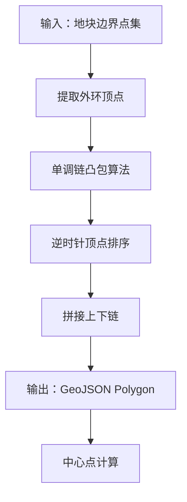

**图表来源**
- [apps/plot-service/src/zone.geometry.ts:17-75](file://apps/plot-service/src/zone.geometry.ts#L17-L75)

**章节来源**
- [apps/plot-service/src/zone.geometry.ts:1-75](file://apps/plot-service/src/zone.geometry.ts#L1-L75)

### 地块变更日志审计流程
地块变更日志提供了完整的操作审计能力，支持五种动作类型的追踪：

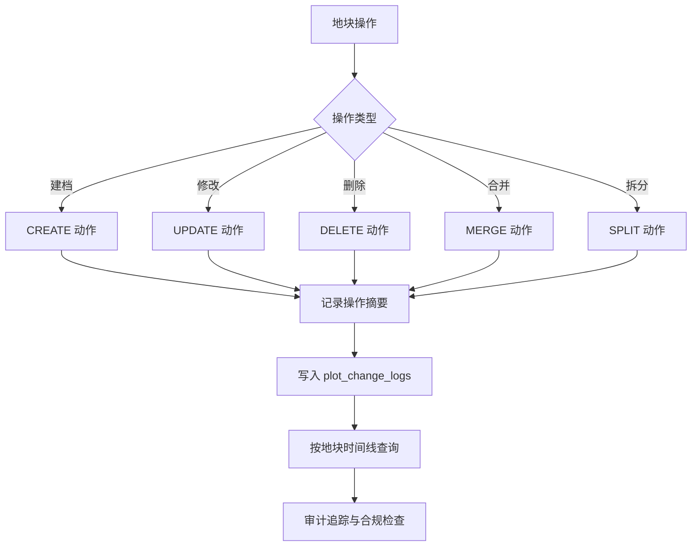

**图表来源**
- [apps/plot-service/src/http.ts:116-128](file://apps/plot-service/src/http.ts#L116-L128)
- [apps/plot-service/src/plot-change-log.repository.ts:14-30](file://apps/plot-service/src/plot-change-log.repository.ts#L14-L30)
- [infra/postgres/migrations/027_plot_change_logs.sql:9-17](file://infra/postgres/migrations/027_plot_change_logs.sql#L9-L17)
- [infra/postgres/migrations/029_plot_change_log_actions.sql:6-9](file://infra/postgres/migrations/029_plot_change_log_actions.sql#L6-L9)

**章节来源**
- [apps/plot-service/src/http.ts:116-128](file://apps/plot-service/src/http.ts#L116-L128)
- [apps/plot-service/src/plot-change-log.repository.ts:14-30](file://apps/plot-service/src/plot-change-log.repository.ts#L14-L30)
- [infra/postgres/migrations/027_plot_change_logs.sql:9-17](file://infra/postgres/migrations/027_plot_change_logs.sql#L9-L17)
- [infra/postgres/migrations/029_plot_change_log_actions.sql:6-9](file://infra/postgres/migrations/029_plot_change_log_actions.sql#L6-L9)

### 农事任务演示数据规范
农事任务演示数据遵循严格的业务规则，确保在任何部署时间都能展示真实的业务场景：

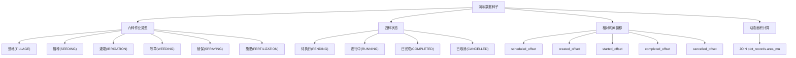

**图表来源**
- [infra/postgres/migrations/030_operation_task_demo_data.sql:36-45](file://infra/postgres/migrations/030_operation_task_demo_data.sql#L36-L45)

**章节来源**
- [infra/postgres/migrations/030_operation_task_demo_data.sql:1-48](file://infra/postgres/migrations/030_operation_task_demo_data.sql#L1-L48)
- [apps/operation-service/src/http.ts:15-24](file://apps/operation-service/src/http.ts#L15-L24)
- [apps/operation-service/src/task.repository.ts:6-9](file://apps/operation-service/src/task.repository.ts#L6-L9)

### 控制指令生命周期规范
控制指令生命周期遵循严格的状态机规则，确保设备控制的可靠性和可追溯性：

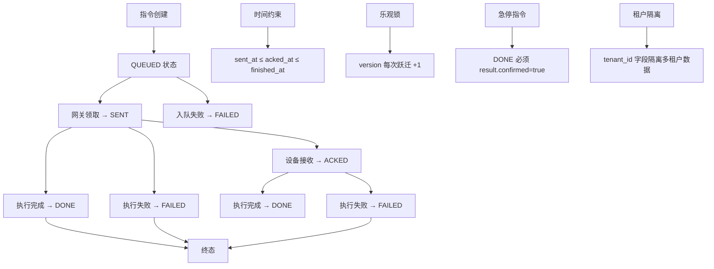

**图表来源**
- [apps/control-service/src/control.repository.ts:31-37](file://apps/control-service/src/control.repository.ts#L31-L37)
- [infra/postgres/migrations/031_control_command_receipt.sql:8-33](file://infra/postgres/migrations/031_control_command_receipt.sql#L8-L33)
- [infra/postgres/migrations/032_control_command_tenant.sql:10-21](file://infra/postgres/migrations/032_control_command_tenant.sql#L10-L21)
- [apps/control-service/src/http.ts:243-246](file://apps/control-service/src/http.ts#L243-L246)

**章节来源**
- [apps/control-service/src/control.repository.ts:31-37](file://apps/control-service/src/control.repository.ts#L31-L37)
- [infra/postgres/migrations/031_control_command_receipt.sql:8-33](file://infra/postgres/migrations/031_control_command_receipt.sql#L8-L33)
- [infra/postgres/migrations/032_control_command_tenant.sql:1-22](file://infra/postgres/migrations/032_control_command_tenant.sql#L1-L22)
- [apps/control-service/src/http.ts:243-246](file://apps/control-service/src/http.ts#L243-L246)