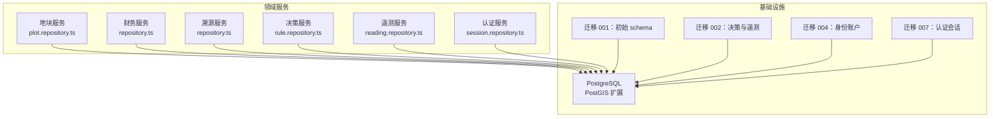
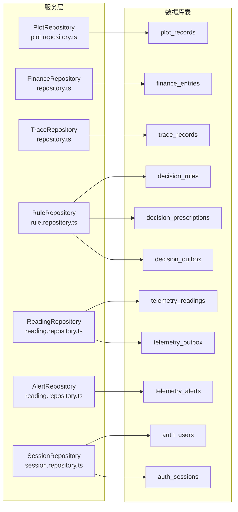
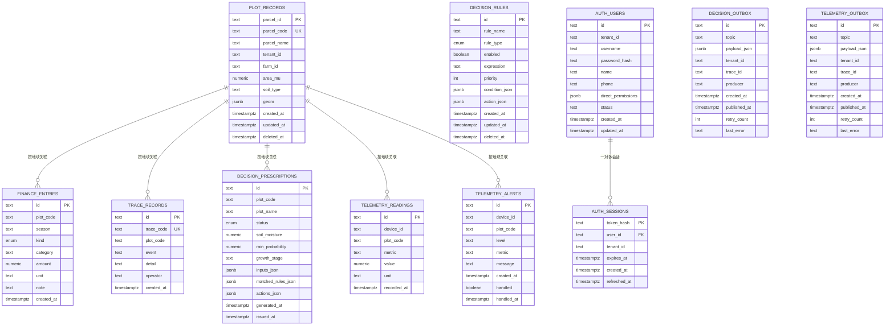
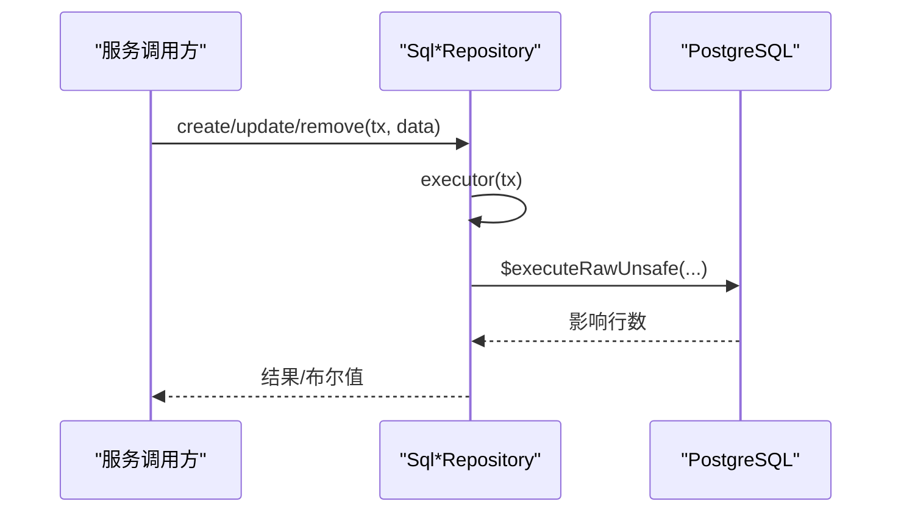
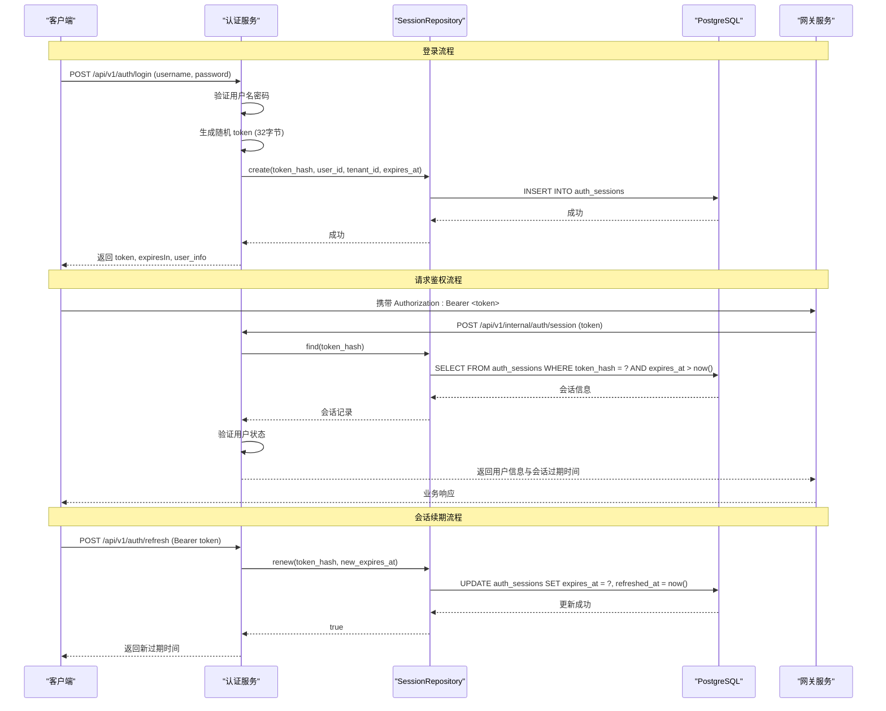
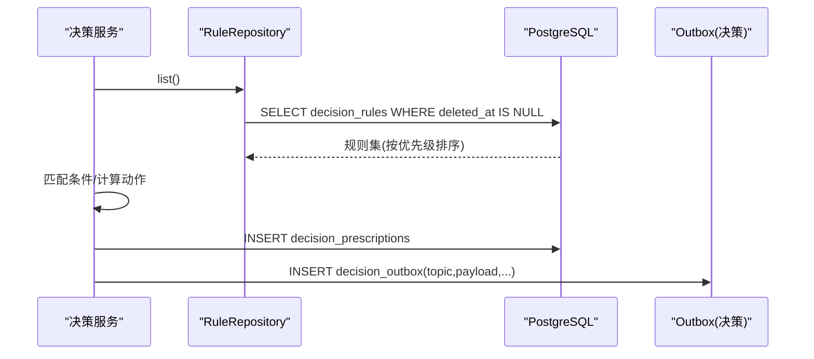
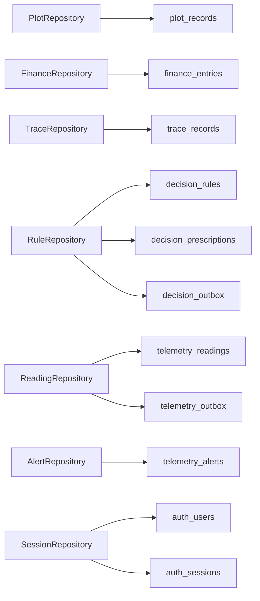

# 数据库设计

<cite>
**本文引用的文件**   
- [infra/postgres/001_initial_schema.sql](file://infra/postgres/001_initial_schema.sql)
- [infra/postgres/migrations/001_initial_schema.sql](file://infra/postgres/migrations/001_initial_schema.sql)
- [infra/postgres/migrations/002_decision_telemetry.sql](file://infra/postgres/migrations/002_decision_telemetry.sql)
- [infra/postgres/migrations/004_identity_accounts.sql](file://infra/postgres/migrations/004_identity_accounts.sql)
- [infra/postgres/migrations/007_auth_sessions.sql](file://infra/postgres/migrations/007_auth_sessions.sql)
- [apps/plot-service/src/plot.repository.ts](file://apps/plot-service/src/plot.repository.ts)
- [apps/finance-service/src/repository.ts](file://apps/finance-service/src/repository.ts)
- [apps/trace-service/src/repository.ts](file://apps/trace-service/src/repository.ts)
- [apps/decision-service/src/rule.repository.ts](file://apps/decision-service/src/rule.repository.ts)
- [apps/telemetry-service/src/reading.repository.ts](file://apps/telemetry-service/src/reading.repository.ts)
- [apps/auth-service/src/session.repository.ts](file://apps/auth-service/src/session.repository.ts)
- [apps/auth-service/src/http.ts](file://apps/auth-service/src/http.ts)
</cite>

## 更新摘要
**变更内容**   
- 新增认证会话持久化表 auth_sessions，支持多实例部署和会话立即失效
- 更新实体关系图，包含用户认证与会话管理
- 新增会话生命周期管理和安全策略说明
- 扩展数据访问模式，涵盖认证服务的数据操作

## 目录
1. [引言](#引言)
2. [项目结构](#项目结构)
3. [核心组件](#核心组件)
4. [架构总览](#架构总览)
5. [详细组件分析](#详细组件分析)
6. [依赖关系分析](#依赖关系分析)
7. [性能考虑](#性能考虑)
8. [故障排查指南](#故障排查指南)
9. [结论](#结论)
10. [附录](#附录)

## 引言
本数据库设计文档面向智慧农业平台，基于 PostgreSQL + PostGIS 构建，覆盖地块空间数据、财务记录、溯源记录、决策规则与处方、遥测读数与告警、系统账号与会话管理，以及跨服务的事件出队表。文档从实体关系、字段定义、主外键与约束、索引策略、数据验证与业务规则、访问模式、缓存与性能、生命周期与归档、迁移与版本管理、安全与隐私等维度进行系统化说明，并给出可落地的架构图、ER 图与关键流程时序图。

## 项目结构
本项目采用多服务架构，每个领域服务通过仓储层直接访问 PostgreSQL；PostGIS 扩展用于地块边界的空间存储与查询；迁移脚本集中管理数据库 schema 演进。

**图表来源**
- [infra/postgres/001_initial_schema.sql:1-41](file://infra/postgres/001_initial_schema.sql#L1-L41)
- [infra/postgres/migrations/002_decision_telemetry.sql:1-88](file://infra/postgres/migrations/002_decision_telemetry.sql#L1-L88)
- [infra/postgres/migrations/004_identity_accounts.sql:1-59](file://infra/postgres/migrations/004_identity_accounts.sql#L1-L59)
- [infra/postgres/migrations/007_auth_sessions.sql:1-21](file://infra/postgres/migrations/007_auth_sessions.sql#L1-L21)
- [apps/plot-service/src/plot.repository.ts:94-186](file://apps/plot-service/src/plot.repository.ts#L94-L186)
- [apps/finance-service/src/repository.ts:14-21](file://apps/finance-service/src/repository.ts#L14-L21)
- [apps/trace-service/src/repository.ts:13-19](file://apps/trace-service/src/repository.ts#L13-L19)
- [apps/decision-service/src/rule.repository.ts:181-296](file://apps/decision-service/src/rule.repository.ts#L181-L296)
- [apps/telemetry-service/src/reading.repository.ts:96-202](file://apps/telemetry-service/src/reading.repository.ts#L96-L202)
- [apps/auth-service/src/session.repository.ts:117-162](file://apps/auth-service/src/session.repository.ts#L117-L162)

## 核心组件
- 地块表 plot_records：承载地块基础信息与空间边界（JSONB），支持软删除与租户隔离。
- 财务表 finance_entries：记录投入与产出，按地块与季节统计。
- 溯源表 trace_records：记录农事操作与事件，支持按地块时间线回溯。
- 决策规则表 decision_rules：以数据形式存储规则，支持热更新与优先级排序。
- 决策处方表 decision_prescriptions：留存每次决策的输入、命中规则与动作。
- 遥测读数表 telemetry_readings：高频时序数据，支持设备/指标/时间窗口查询。
- 遥测告警表 telemetry_alerts：未处理告警队列，支持标记已处理。
- **认证用户表 auth_users：系统账号管理，支持状态控制与权限分配。**
- **认证会话表 auth_sessions：持久化登录会话，支持立即失效与多实例共享。**
- 出队表 decision_outbox / telemetry_outbox：可靠消息投递的持久化缓冲。

**章节来源**
- [infra/postgres/001_initial_schema.sql:3-40](file://infra/postgres/001_initial_schema.sql#L3-L40)
- [infra/postgres/migrations/002_decision_telemetry.sql:5-87](file://infra/postgres/migrations/002_decision_telemetry.sql#L5-L87)
- [infra/postgres/migrations/004_identity_accounts.sql:8-20](file://infra/postgres/migrations/004_identity_accounts.sql#L8-L20)
- [infra/postgres/migrations/007_auth_sessions.sql:10-17](file://infra/postgres/migrations/007_auth_sessions.sql#L10-L17)

## 架构总览
下图展示各服务与数据库表的映射关系，以及关键读写路径。

**图表来源**
- [apps/plot-service/src/plot.repository.ts:94-186](file://apps/plot-service/src/plot.repository.ts#L94-L186)
- [apps/finance-service/src/repository.ts:14-21](file://apps/finance-service/src/repository.ts#L14-L21)
- [apps/trace-service/src/repository.ts:13-19](file://apps/trace-service/src/repository.ts#L13-L19)
- [apps/decision-service/src/rule.repository.ts:181-296](file://apps/decision-service/src/rule.repository.ts#L181-L296)
- [apps/telemetry-service/src/reading.repository.ts:96-202](file://apps/telemetry-service/src/reading.repository.ts#L96-L202)
- [apps/auth-service/src/session.repository.ts:117-162](file://apps/auth-service/src/session.repository.ts#L117-L162)
- [infra/postgres/001_initial_schema.sql:3-40](file://infra/postgres/001_initial_schema.sql#L3-L40)
- [infra/postgres/migrations/002_decision_telemetry.sql:5-87](file://infra/postgres/migrations/002_decision_telemetry.sql#L5-L87)
- [infra/postgres/migrations/004_identity_accounts.sql:8-20](file://infra/postgres/migrations/004_identity_accounts.sql#L8-L20)
- [infra/postgres/migrations/007_auth_sessions.sql:10-17](file://infra/postgres/migrations/007_auth_sessions.sql#L10-L17)

## 详细组件分析

### 实体关系与 ER 图

**图表来源**
- [infra/postgres/001_initial_schema.sql:3-40](file://infra/postgres/001_initial_schema.sql#L3-L40)
- [infra/postgres/migrations/002_decision_telemetry.sql:5-87](file://infra/postgres/migrations/002_decision_telemetry.sql#L5-L87)
- [infra/postgres/migrations/004_identity_accounts.sql:8-20](file://infra/postgres/migrations/004_identity_accounts.sql#L8-L20)
- [infra/postgres/migrations/007_auth_sessions.sql:10-17](file://infra/postgres/migrations/007_auth_sessions.sql#L10-L17)

#### 表结构与字段定义
- plot_records
  - 主键：parcel_id
  - 唯一键：parcel_code
  - 关键字段：tenant_id、farm_id、area_mu（>=0）、geom（JSONB，CGCS2000/EPSG:4490）
  - 审计字段：created_at、updated_at、deleted_at（软删除）
  - 索引：idx_plot_records_tenant_created(tenant_id, created_at DESC) WHERE deleted_at IS NULL
- finance_entries
  - 主键：id
  - 校验：kind IN ('INPUT','OUTPUT')，amount >= 0
  - 索引：idx_finance_entries_plot_created(plot_code, created_at DESC)
- trace_records
  - 主键：id
  - 唯一键：trace_code
  - 索引：idx_trace_records_plot_created(plot_code, created_at DESC)
- decision_rules
  - 主键：id
  - 校验：rule_type IN ('IRRIGATION','FERTILIZATION','PEST_WARNING')
  - JSONB：condition_json、action_json
  - 索引：idx_decision_rules_enabled(enabled, priority) WHERE deleted_at IS NULL
- decision_prescriptions
  - 主键：id
  - 校验：status IN ('RECOMMENDED','NO_ACTION')
  - JSONB：inputs_json、matched_rules_json、actions_json
  - 索引：idx_decision_prescriptions_plot(plot_code, generated_at DESC)
- telemetry_readings
  - 主键：id
  - 索引：idx_telemetry_readings_device_time(device_id, metric, recorded_at DESC)、idx_telemetry_readings_time(recorded_at DESC)
- telemetry_alerts
  - 主键：id
  - 索引：idx_telemetry_alerts_pending(handled, created_at DESC)
- **auth_users**
  - 主键：id
  - 唯一键：(tenant_id, username)
  - 校验：status IN ('ACTIVE', 'DISABLED')
  - JSONB：direct_permissions
  - 索引：idx_auth_users_tenant_created(tenant_id, created_at DESC)
- **auth_sessions**
  - 主键：token_hash
  - 外键：user_id REFERENCES auth_users(id) ON DELETE CASCADE
  - 关键字段：tenant_id、expires_at、refreshed_at
  - 索引：idx_auth_sessions_user(user_id)、idx_auth_sessions_expires(expires_at)
- decision_outbox / telemetry_outbox
  - 主键：id
  - JSONB：payload_json
  - 索引：idx_*_outbox_pending(created_at) WHERE published_at IS NULL

**章节来源**
- [infra/postgres/001_initial_schema.sql:3-40](file://infra/postgres/001_initial_schema.sql#L3-L40)
- [infra/postgres/migrations/002_decision_telemetry.sql:5-87](file://infra/postgres/migrations/002_decision_telemetry.sql#L5-L87)
- [infra/postgres/migrations/004_identity_accounts.sql:8-20](file://infra/postgres/migrations/004_identity_accounts.sql#L8-L20)
- [infra/postgres/migrations/007_auth_sessions.sql:10-17](file://infra/postgres/migrations/007_auth_sessions.sql#L10-L17)

#### 主键/外键与约束设计
- 主键：所有表均使用 TEXT 类型主键，便于分布式 ID 生成（如 ULID）。
- 唯一约束：parcel_code、trace_code、(tenant_id, username) 保证业务编码唯一性。
- 检查约束：area_mu >= 0、amount >= 0、kind/status/rule_type 枚举值限制。
- 软删除：plot_records、decision_rules 使用 deleted_at 实现逻辑删除，配合部分索引提升查询性能。
- **外键约束：auth_sessions.user_id 引用 auth_users.id，级联删除确保账号删除时会话自动清理。**
- 外键：当前 schema 未显式声明外键，依赖应用层一致性校验与事务控制。

**章节来源**
- [infra/postgres/001_initial_schema.sql:3-40](file://infra/postgres/001_initial_schema.sql#L3-L40)
- [infra/postgres/migrations/002_decision_telemetry.sql:5-87](file://infra/postgres/migrations/002_decision_telemetry.sql#L5-L87)
- [infra/postgres/migrations/004_identity_accounts.sql:8-20](file://infra/postgres/migrations/004_identity_accounts.sql#L8-L20)
- [infra/postgres/migrations/007_auth_sessions.sql:10-17](file://infra/postgres/migrations/007_auth_sessions.sql#L10-L17)

#### 数据验证规则与业务规则
- 地块面积非负；土壤类型可选；边界几何为 JSONB，建议统一 CGCS2000（EPSG:4490）。
- 财务条目金额非负，类别限定 INPUT/OUTPUT；按季节与地块汇总利润。
- 溯源记录需包含操作人、事件与详情，按地块时间线回溯。
- 决策规则支持热更新：启用状态、优先级、条件与动作 JSONB 化；默认灌溉规则开箱可用。
- 遥测读数按设备+指标取最新值；历史查询支持设备/指标/时间窗过滤，默认上限 200，最大 2000。
- 告警默认未处理，支持批量待处理列表与单条标记已处理。
- **认证用户状态控制：ACTIVE/DISABLED 状态管理，支持账号停用功能。**
- **会话安全管理：token 以 sha256 散列存储，支持滑动续期、立即失效和多实例共享。**

**章节来源**
- [apps/plot-service/src/plot.repository.ts:11-28](file://apps/plot-service/src/plot.repository.ts#L11-L28)
- [apps/finance-service/src/repository.ts:3-5](file://apps/finance-service/src/repository.ts#L3-L5)
- [apps/trace-service/src/repository.ts:3-4](file://apps/trace-service/src/repository.ts#L3-L4)
- [apps/decision-service/src/rule.repository.ts:11-48](file://apps/decision-service/src/rule.repository.ts#L11-L48)
- [apps/telemetry-service/src/reading.repository.ts:4-51](file://apps/telemetry-service/src/reading.repository.ts#L4-L51)
- [apps/auth-service/src/session.repository.ts:6-15](file://apps/auth-service/src/session.repository.ts#L6-L15)
- [infra/postgres/migrations/007_auth_sessions.sql:3-8](file://infra/postgres/migrations/007_auth_sessions.sql#L3-L8)

#### 数据访问模式
- 仓储层封装 SQL，提供事务感知执行器 executor(tx)，优先使用传入事务对象，否则回退到客户端连接。
- 典型写入：create/update/remove 使用 $executeRawUnsafe；读取使用 $queryRawUnsafe。
- 事务边界显式传递，避免隐式上下文扩大事务范围。
- **认证会话访问：支持创建、查找、续期、删除、批量清理等操作，所有 token 均以散列形式存储。**

**图表来源**
- [apps/plot-service/src/plot.repository.ts:98-100](file://apps/plot-service/src/plot.repository.ts#L98-L100)
- [apps/decision-service/src/rule.repository.ts:185-187](file://apps/decision-service/src/rule.repository.ts#L185-L187)
- [apps/telemetry-service/src/reading.repository.ts:100-102](file://apps/telemetry-service/src/reading.repository.ts#L100-L102)

**章节来源**
- [apps/plot-service/src/plot.repository.ts:94-186](file://apps/plot-service/src/plot.repository.ts#L94-L186)
- [apps/decision-service/src/rule.repository.ts:181-296](file://apps/decision-service/src/rule.repository.ts#L181-L296)
- [apps/telemetry-service/src/reading.repository.ts:96-202](file://apps/telemetry-service/src/reading.repository.ts#L96-L202)
- [apps/auth-service/src/session.repository.ts:117-162](file://apps/auth-service/src/session.repository.ts#L117-L162)

#### 示例数据（概念性）
- 地块：包含 parcel_code、parcel_name、tenant_id、farm_id、area_mu、geom(JSONB)、时间戳与软删除标记。
- 财务：按 plot_code、season、kind、category、amount、unit、note 记录投入/产出。
- 溯源：trace_code、plot_code、event、detail、operator、created_at。
- 决策规则：rule_name、rule_type、enabled、expression、priority、condition_json、action_json。
- 遥测读数：device_id、plot_code、metric、value、unit、recorded_at。
- 遥测告警：level、message、handled、handled_at。
- **认证用户：id、tenant_id、username、password_hash、name、phone、direct_permissions、status、时间戳。**
- **认证会话：token_hash、user_id、tenant_id、expires_at、created_at、refreshed_at。**

[本节为概念性示例，不直接分析具体文件]

### 认证与会话管理流程

**图表来源**
- [apps/auth-service/src/http.ts:165-182](file://apps/auth-service/src/http.ts#L165-L182)
- [apps/auth-service/src/http.ts:185-194](file://apps/auth-service/src/http.ts#L185-L194)
- [apps/auth-service/src/http.ts:154-163](file://apps/auth-service/src/http.ts#L154-L163)
- [apps/auth-service/src/session.repository.ts:120-161](file://apps/auth-service/src/session.repository.ts#L120-L161)

**章节来源**
- [apps/auth-service/src/http.ts:165-182](file://apps/auth-service/src/http.ts#L165-L182)
- [apps/auth-service/src/http.ts:185-194](file://apps/auth-service/src/http.ts#L185-L194)
- [apps/auth-service/src/http.ts:154-163](file://apps/auth-service/src/http.ts#L154-L163)
- [apps/auth-service/src/session.repository.ts:120-161](file://apps/auth-service/src/session.repository.ts#L120-L161)

### 决策规则与处方生成流程

**图表来源**
- [apps/decision-service/src/rule.repository.ts:206-212](file://apps/decision-service/src/rule.repository.ts#L206-L212)
- [infra/postgres/migrations/002_decision_telemetry.sql:5-34](file://infra/postgres/migrations/002_decision_telemetry.sql#L5-L34)
- [infra/postgres/migrations/002_decision_telemetry.sql:61-73](file://infra/postgres/migrations/002_decision_telemetry.sql#L61-L73)

**章节来源**
- [apps/decision-service/src/rule.repository.ts:11-48](file://apps/decision-service/src/rule.repository.ts#L11-L48)
- [apps/decision-service/src/rule.repository.ts:181-296](file://apps/decision-service/src/rule.repository.ts#L181-L296)
- [infra/postgres/migrations/002_decision_telemetry.sql:5-34](file://infra/postgres/migrations/002_decision_telemetry.sql#L5-L34)

### 遥测读数与告警处理流程

**图表来源**
- [apps/telemetry-service/src/reading.repository.ts:104-118](file://apps/telemetry-service/src/reading.repository.ts#L104-L118)
- [apps/telemetry-service/src/reading.repository.ts:120-156](file://apps/telemetry-service/src/reading.repository.ts#L120-L156)
- [apps/telemetry-service/src/reading.repository.ts:171-201](file://apps/telemetry-service/src/reading.repository.ts#L171-L201)

**章节来源**
- [apps/telemetry-service/src/reading.repository.ts:96-202](file://apps/telemetry-service/src/reading.repository.ts#L96-L202)

## 依赖关系分析
- 服务与表耦合：
  - PlotRepository ↔ plot_records
  - FinanceRepository ↔ finance_entries
  - TraceRepository ↔ trace_records
  - RuleRepository ↔ decision_rules / decision_prescriptions / decision_outbox
  - ReadingRepository/AlertRepository ↔ telemetry_readings / telemetry_alerts / telemetry_outbox
  - **SessionRepository ↔ auth_sessions / auth_users**
- 间接依赖：
  - 决策服务依赖遥测读数作为规则输入（由业务侧聚合后传入）。
  - 出队表与消息中间件解耦服务间通信，保障最终一致性。
  - **认证服务与会话表强依赖，支持多实例部署和会话立即失效。**

**图表来源**
- [apps/plot-service/src/plot.repository.ts:94-186](file://apps/plot-service/src/plot.repository.ts#L94-L186)
- [apps/finance-service/src/repository.ts:14-21](file://apps/finance-service/src/repository.ts#L14-L21)
- [apps/trace-service/src/repository.ts:13-19](file://apps/trace-service/src/repository.ts#L13-L19)
- [apps/decision-service/src/rule.repository.ts:181-296](file://apps/decision-service/src/rule.repository.ts#L181-L296)
- [apps/telemetry-service/src/reading.repository.ts:96-202](file://apps/telemetry-service/src/reading.repository.ts#L96-L202)
- [apps/auth-service/src/session.repository.ts:117-162](file://apps/auth-service/src/session.repository.ts#L117-L162)

**章节来源**
- [apps/plot-service/src/plot.repository.ts:94-186](file://apps/plot-service/src/plot.repository.ts#L94-L186)
- [apps/finance-service/src/repository.ts:14-21](file://apps/finance-service/src/repository.ts#L14-L21)
- [apps/trace-service/src/repository.ts:13-19](file://apps/trace-service/src/repository.ts#L13-L19)
- [apps/decision-service/src/rule.repository.ts:181-296](file://apps/decision-service/src/rule.repository.ts#L181-L296)
- [apps/telemetry-service/src/reading.repository.ts:96-202](file://apps/telemetry-service/src/reading.repository.ts#L96-L202)
- [apps/auth-service/src/session.repository.ts:117-162](file://apps/auth-service/src/session.repository.ts#L117-L162)

## 性能考虑
- 索引优化
  - 租户+时间降序索引：plot_records.tenant_id + created_at（软删除过滤）。
  - 地块+时间降序索引：finance_entries、trace_records 常用查询路径。
  - 规则启用+优先级索引：decision_rules.enabled + priority（软删除过滤）。
  - 遥测设备+指标+时间索引：telemetry_readings.device_id + metric + recorded_at。
  - 全局时间索引：telemetry_readings.recorded_at。
  - 告警待处理索引：telemetry_alerts.handled + created_at。
  - 出队未发布索引：decision_outbox/telemetry_outbox.created_at WHERE published_at IS NULL。
  - **认证会话索引：auth_sessions.user_id 快速查找用户会话，auth_sessions.expires_at 支持批量清理。**
- 查询优化
  - 遥测最新值使用窗口函数 ROW_NUMBER 分区取最近一条。
  - 历史查询默认 limit=200，最大 2000，防止大结果集拖慢响应。
  - 规则列表按 priority、created_at 排序，确保稳定顺序。
  - **会话查找使用 EXPIRES_AT > NOW() 在数据库层面过滤过期会话。**
- 写入优化
  - 使用原生 SQL 批量插入/更新，减少 ORM 开销。
  - 软删除利用部分索引降低扫描成本。
  - **会话创建使用 ON CONFLICT DO UPDATE 实现幂等写入。**
- 扩展建议
  - 对遥测表考虑分区（按时间或地块），结合 pg_partman 或原生分区表。
  - 对 JSONB 字段建立 GIN 索引（如 condition_json/action_json）以提升复杂条件检索。
  - 对地理字段建议使用 PostGIS 几何类型替代 JSONB，以获得空间算子与索引优势。
  - **对认证会话表考虑按 expires_at 分区，优化过期清理性能。**

**章节来源**
- [infra/postgres/001_initial_schema.sql:16-16](file://infra/postgres/001_initial_schema.sql#L16-L16)
- [infra/postgres/001_initial_schema.sql:29-29](file://infra/postgres/001_initial_schema.sql#L29-L29)
- [infra/postgres/001_initial_schema.sql:40-40](file://infra/postgres/001_initial_schema.sql#L40-L40)
- [infra/postgres/migrations/002_decision_telemetry.sql:18-18](file://infra/postgres/migrations/002_decision_telemetry.sql#L18-L18)
- [infra/postgres/migrations/002_decision_telemetry.sql:34-34](file://infra/postgres/migrations/002_decision_telemetry.sql#L34-L34)
- [infra/postgres/migrations/002_decision_telemetry.sql:45-46](file://infra/postgres/migrations/002_decision_telemetry.sql#L45-L46)
- [infra/postgres/migrations/002_decision_telemetry.sql:59-59](file://infra/postgres/migrations/002_decision_telemetry.sql#L59-L59)
- [infra/postgres/migrations/002_decision_telemetry.sql:73-73](file://infra/postgres/migrations/002_decision_telemetry.sql#L73-L73)
- [infra/postgres/migrations/007_auth_sessions.sql:19-20](file://infra/postgres/migrations/007_auth_sessions.sql#L19-L20)
- [apps/telemetry-service/src/reading.repository.ts:120-133](file://apps/telemetry-service/src/reading.repository.ts#L120-L133)
- [apps/telemetry-service/src/reading.repository.ts:135-156](file://apps/telemetry-service/src/reading.repository.ts#L135-L156)
- [apps/decision-service/src/rule.repository.ts:206-212](file://apps/decision-service/src/rule.repository.ts#L206-L212)
- [apps/auth-service/src/session.repository.ts:120-161](file://apps/auth-service/src/session.repository.ts#L120-L161)

## 故障排查指南
- 遥测数据缺失或重复
  - 检查写入是否处于事务中，确认 executor(tx) 正确选择事务对象。
  - 核对 ulid 生成与去重策略，避免并发写入冲突。
- 规则未生效
  - 检查 decision_rules.enabled 与 priority 配置；确认 condition_json/action_json 规范化。
  - 查看 outbox 是否成功 publish，last_error 是否记录错误信息。
- 告警堆积
  - 检查 pending 列表与 markHandled 接口调用；确认 handled_at 更新时间戳。
- 地块查询缓慢
  - 确认 tenant_id 与 created_at 索引命中；检查 deleted_at 过滤是否正确。
- 财务汇总异常
  - 校验 kind 枚举与 amount 非负约束；确认 GROUP BY kind 聚合逻辑。
- **认证会话问题**
  - 检查 auth_sessions 表是否存在，确认迁移 007 已执行。
  - 验证 token_hash 是否正确生成和存储，确认 expires_at 字段正常更新。
  - 检查用户状态是否为 ACTIVE，确认 user_id 外键约束正常。
  - 监控会话清理任务，确认过期会话被及时清理。

**章节来源**
- [apps/telemetry-service/src/reading.repository.ts:104-118](file://apps/telemetry-service/src/reading.repository.ts#L104-L118)
- [apps/decision-service/src/rule.repository.ts:189-204](file://apps/decision-service/src/rule.repository.ts#L189-L204)
- [infra/postgres/migrations/002_decision_telemetry.sql:61-73](file://infra/postgres/migrations/002_decision_telemetry.sql#L61-L73)
- [apps/telemetry-service/src/reading.repository.ts:186-201](file://apps/telemetry-service/src/reading.repository.ts#L186-L201)
- [infra/postgres/001_initial_schema.sql:16-16](file://infra/postgres/001_initial_schema.sql#L16-L16)
- [apps/finance-service/src/repository.ts:18-21](file://apps/finance-service/src/repository.ts#L18-L21)
- [infra/postgres/migrations/007_auth_sessions.sql:10-20](file://infra/postgres/migrations/007_auth_sessions.sql#L10-L20)

## 结论
该数据库设计以 PostgreSQL + PostGIS 为基础，围绕地块、财务、溯源、决策与遥测五大域构建了清晰的数据模型与访问路径。通过迁移脚本统一管理 schema 演进，仓储层封装事务与 SQL，结合索引与约束保障性能与一致性。**新增的认证会话表 auth_sessions 提供了安全的会话管理机制，支持多实例部署、会话立即失效和高频访问场景。** 建议在后续迭代中引入 PostGIS 几何类型、JSONB GIN 索引与遥测表分区，进一步提升空间查询与高吞吐场景能力。

## 附录

### 数据生命周期、保留与归档
- 遥测读数：建议按时间分区，保留策略例如近 90 天热数据，历史数据归档至冷存储。
- 告警：已处理告警定期归档，未处理告警保持在线可查。
- 决策规则：启用/停用变更保留审计；历史版本可归档。
- 财务与溯源：按年度/季节归档，支持合规审计。
- 地块：软删除保留一定宽限期，之后物理清理或归档。
- **认证会话：会话过期后自动清理，支持批量 prune 操作；用户删除时级联清理相关会话。**

[本节为通用指导，不直接分析具体文件]

### 数据迁移与版本管理
- 迁移脚本：
  - 001_initial_schema.sql：创建 PostGIS 扩展与初始三张表（地块、财务、溯源）。
  - 002_decision_telemetry.sql：新增决策规则、处方、遥测读数/告警与两个 outbox 表。
  - 004_identity_accounts.sql：新增系统账号、角色权限与审计日志表。
  - **007_auth_sessions.sql：新增认证会话表，支持持久化会话管理。**
- 版本管理建议：
  - 迁移编号递增，禁止修改已执行迁移。
  - 回滚策略：为每个迁移编写反向脚本，并在 CI 中验证幂等性。
  - 环境隔离：开发/测试/生产分别维护独立数据库实例。

**章节来源**
- [infra/postgres/001_initial_schema.sql:1-41](file://infra/postgres/001_initial_schema.sql#L1-L41)
- [infra/postgres/migrations/002_decision_telemetry.sql:1-88](file://infra/postgres/migrations/002_decision_telemetry.sql#L1-L88)
- [infra/postgres/migrations/004_identity_accounts.sql:1-59](file://infra/postgres/migrations/004_identity_accounts.sql#L1-L59)
- [infra/postgres/migrations/007_auth_sessions.sql:1-21](file://infra/postgres/migrations/007_auth_sessions.sql#L1-L21)

### 数据安全、隐私与访问控制
- 最小权限原则：服务账号仅授予对应 schema 的 DML 权限，禁止 DDL。
- 敏感字段：对 tenant_id、plot_code 等标识符在日志中脱敏。
- 传输加密：强制 TLS 连接数据库。
- 审计留痕：所有写操作记录 created_at/updated_at/deleted_at，决策与遥测 outbox 保留 trace_id 以便追踪。
- 访问控制：结合网关与服务鉴权，按租户隔离数据访问。
- **认证安全：token 以 sha256 散列存储，不落明文；支持账号停用、改密时立即回收所有会话；用户删除时级联清理会话。**

[本节为通用指导，不直接分析具体文件]

### 认证会话安全策略
- **Token 安全**：使用 32 字节随机数生成 token，sha256 散列存储，防止数据库泄露后的冒用风险。
- **会话失效**：支持立即失效机制，账号停用、改密、删除时自动回收所有相关会话。
- **多实例支持**：会话存储在数据库中，支持水平扩展的多实例部署。
- **滑动续期**：支持会话滑动续期，前端并发请求不会互相踢下线。
- **批量清理**：提供定时清理任务，自动删除过期会话，保持数据库整洁。

**章节来源**
- [apps/auth-service/src/session.repository.ts:6-15](file://apps/auth-service/src/session.repository.ts#L6-L15)
- [apps/auth-service/src/session.repository.ts:41-49](file://apps/auth-service/src/session.repository.ts#L41-L49)
- [infra/postgres/migrations/007_auth_sessions.sql:3-8](file://infra/postgres/migrations/007_auth_sessions.sql#L3-L8)
- [apps/auth-service/src/http.ts:233-248](file://apps/auth-service/src/http.ts#L233-L248)