# 数据库设计

<cite>
**本文引用的文件**   
- [infra/postgres/001_initial_schema.sql](file://infra/postgres/001_initial_schema.sql)
- [infra/postgres/migrations/001_initial_schema.sql](file://infra/postgres/migrations/001_initial_schema.sql)
- [infra/postgres/migrations/002_decision_telemetry.sql](file://infra/postgres/migrations/002_decision_telemetry.sql)
- [infra/postgres/migrations/003_event_bus_messages.sql](file://infra/postgres/migrations/003_event_bus_messages.sql)
- [infra/postgres/migrations/004_identity_accounts.sql](file://infra/postgres/migrations/004_identity_accounts.sql)
- [infra/postgres/migrations/005_control_commands.sql](file://infra/postgres/migrations/005_control_commands.sql)
- [infra/postgres/migrations/007_auth_sessions.sql](file://infra/postgres/migrations/007_auth_sessions.sql)
- [infra/postgres/migrations/008_agro_monitoring.sql](file://infra/postgres/migrations/008_agro_monitoring.sql)
- [infra/postgres/migrations/009_plot_zones.sql](file://infra/postgres/migrations/009_plot_zones.sql)
- [infra/postgres/migrations/010_demo_data.sql](file://infra/postgres/migrations/010_demo_data.sql)
- [infra/postgres/migrations/011_plot_profile.sql](file://infra/postgres/migrations/011_plot_profile.sql)
- [infra/postgres/migrations/016_operation_tasks.sql](file://infra/postgres/migrations/016_operation_tasks.sql)
- [infra/postgres/migrations/027_plot_change_logs.sql](file://infra/postgres/migrations/027_plot_change_logs.sql)
- [infra/postgres/migrations/029_plot_change_log_actions.sql](file://infra/postgres/migrations/029_plot_change_log_actions.sql)
- [infra/postgres/migrations/030_operation_task_demo_data.sql](file://infra/postgres/migrations/030_operation_task_demo_data.sql)
- [infra/postgres/migrations/031_control_command_receipt.sql](file://infra/postgres/migrations/031_control_command_receipt.sql)
- [infra/postgres/migrations/032_control_command_tenant.sql](file://infra/postgres/migrations/032_control_command_tenant.sql)
- [infra/postgres/migrations/033_control_outbox.sql](file://infra/postgres/migrations/033_control_outbox.sql)
- [infra/postgres/migrations/034_decision_prescription_executions.sql](file://infra/postgres/migrations/034_decision_prescription_executions.sql)
- [infra/postgres/migrations/039_operation_task_change_logs.sql](file://infra/postgres/migrations/039_operation_task_change_logs.sql)
- [infra/postgres/migrations/044_reset_plots_lines.sql](file://infra/postgres/migrations/044_reset_plots_lines.sql)
- [infra/postgres/migrations/045_smoke_residue_cleanup.sql](file://infra/postgres/migrations/045_smoke_residue_cleanup.sql)
- [infra/postgres/migrations/046_history_clear_demo_restore.sql](file://infra/postgres/migrations/046_history_clear_demo_restore.sql)
- [infra/postgres/migrations/047_infra_line_attributes.sql](file://infra/postgres/migrations/047_infra_line_attributes.sql)
- [infra/postgres/migrations/048_ai_event_types_message_dispatch.sql](file://infra/postgres/migrations/048_ai_event_types_message_dispatch.sql)
- [infra/postgres/migrations/049_telemetry_quality.sql](file://infra/postgres/migrations/049_telemetry_quality.sql)
- [apps/plot-service/src/plot.repository.ts](file://apps/plot-service/src/plot.repository.ts)
- [apps/plot-service/src/zone.repository.ts](file://apps/plot-service/src/zone.repository.ts)
- [apps/plot-service/src/zone.geometry.ts](file://apps/plot-service/src/zone.geometry.ts)
- [apps/plot-service/src/plot-change-log.repository.ts](file://apps/plot-service/src/plot-change-log.repository.ts)
- [apps/plot-service/src/plot.service.ts](file://apps/plot-service/src/plot.service.ts)
- [apps/plot-service/src/http.ts](file://apps/plot-service/src/http.ts)
- [apps/plot-service/src/infra-line.repository.ts](file://apps/plot-service/src/infra-line.repository.ts)
- [apps/finance-service/src/repository.ts](file://apps/finance-service/src/repository.ts)
- [apps/trace-service/src/repository.ts](file://apps/trace-service/src/repository.ts)
- [apps/decision-service/src/rule.repository.ts](file://apps/decision-service/src/rule.repository.ts)
- [apps/decision-service/src/execution.repository.ts](file://apps/decision-service/src/execution.repository.ts)
- [apps/decision-service/src/consumer.ts](file://apps/decision-service/src/consumer.ts)
- [apps/decision-service/src/http.ts](file://apps/decision-service/src/http.ts)
- [apps/decision-service/src/main.ts](file://apps/decision-service/src/main.ts)
- [apps/control-service/src/command-finished.ts](file://apps/control-service/src/command-finished.ts)
- [apps/telemetry-service/src/reading.repository.ts](file://apps/telemetry-service/src/reading.repository.ts)
- [apps/telemetry-service/src/pest.repository.ts](file://apps/telemetry-service/src/pest.repository.ts)
- [apps/telemetry-service/src/quality-log.repository.ts](file://apps/telemetry-service/src/quality-log.repository.ts)
- [apps/telemetry-service/src/quality.ts](file://apps/telemetry-service/src/quality.ts)
- [apps/auth-service/src/session.repository.ts](file://apps/auth-service/src/session.repository.ts)
- [apps/auth-service/src/http.ts](file://apps/auth-service/src/http.ts)
- [apps/operation-service/src/task.repository.ts](file://apps/operation-service/src/task.repository.ts)
- [apps/operation-service/src/http.ts](file://apps/operation-service/src/http.ts)
- [apps/operation-service/src/outbox.repository.ts](file://apps/operation-service/src/outbox.repository.ts)
- [apps/control-service/src/control.repository.ts](file://apps/control-service/src/control.repository.ts)
- [apps/control-service/src/http.ts](file://apps/control-service/src/http.ts)
- [apps/control-service/src/consumer.ts](file://apps/control-service/src/consumer.ts)
- [apps/message-service/src/message.repository.ts](file://apps/message-service/src/message.repository.ts)
- [apps/video-service/src/ai-event.repository.ts](file://apps/video-service/src/ai-event.repository.ts)
- [packages/contracts/src/events/payload.ts](file://packages/contracts/src/events/payload.ts)
- [packages/contracts/src/events/topic.ts](file://packages/contracts/src/events/topic.ts)
- [packages/contracts/src/enums/domain.enum.ts](file://packages/contracts/src/enums/domain.enum.ts)
</cite>

## 更新摘要
**变更内容**   
- 新增基础设施线路属性扩展：宽度、限速、适用机型、启用状态、模板复用等五组核心属性
- AI事件类型从单一虫情扩展至七类事件：人员闯入、农机状态、涝情、倒伏、火情、烟雾
- 消息中心新增派单处置字段：dispatched、dispatched_by、dispatch_note、dispatched_at
- 遥测数据质量治理：新增quality_flags标记和telemetry_quality_logs审计日志表
- 完善数据验证规则和业务规则，支持更精细化的基础设施管理和AI事件处理

## 目录
1. [引言](#引言)
2. [项目结构](#项目结构)
3. [核心组件](#核心组件)
4. [架构总览](#架构总览)
5. [详细组件分析](#详细组件分析)
6. [依赖关系分析](#依赖关系分析)
7. [性能考虑](#性能考虑)
8. [故障排查指南](#故障排查指南)
9. [结论](#结论)
10. [附录](#附录)

## 引言
本数据库设计文档面向智慧农业平台，基于 PostgreSQL + PostGIS 构建，覆盖地块空间数据、财务记录、溯源记录、决策规则与处方、遥测读数与告警、系统账号与会话管理、农事任务管理与跨服务的事件出队表、控制指令生命周期管理以及**处方执行回流**等核心领域。文档从实体关系、字段定义、主外键与约束、索引策略、数据验证与业务规则、访问模式、缓存与性能、生命周期与归档、迁移与版本管理、安全与隐私等维度进行系统化说明，并给出可落地的架构图、ER 图与关键流程时序图。

**更新** 新增基础设施线路属性扩展、AI事件类型扩展、消息分发字段、遥测质量日志表等三个重要迁移，进一步完善了平台的监测管理能力、AI事件处理能力和数据质量控制能力。

## 项目结构
本项目采用多服务架构，每个领域服务通过仓储层直接访问 PostgreSQL；PostGIS 扩展用于地块边界的空间存储与查询；迁移脚本集中管理数据库 schema 演进。

```mermaid
graph TB
subgraph "基础设施"
PG["PostgreSQL<br/>PostGIS 扩展"]
MIG1["迁移 001：初始 schema"]
MIG2["迁移 002：决策与遥测"]
MIG3["迁移 003：事件总线消息"]
MIG4["迁移 004：身份账户"]
MIG5["迁移 005：控制指令"]
MIG7["迁移 007：认证会话"]
MIG8["迁移 008：四情监测"]
MIG9["迁移 009：片区管理"]
MIG10["迁移 010：演示数据"]
MIG11["迁移 011：地块档案"]
MIG16["迁移 016：农事任务"]
MIG27["迁移 027：地块变更日志"]
MIG29["迁移 029：变更日志动作扩展"]
MIG30["迁移 030：农事任务演示数据"]
MIG31["迁移 031：控制指令回执"]
MIG32["迁移 032：控制指令租户"]
MIG33["迁移 033：控制出队表"]
MIG34["迁移 034：处方执行回流"]
MIG39["迁移 039：农事任务变更日志"]
MIG44["迁移 044：重置地块线路"]
MIG45["迁移 045：冒烟残留清理"]
MIG46["迁移 046：业务历史清理+演示账号恢复"]
MIG47["迁移 047：基础设施线路属性扩展"]
MIG48["迁移 048：AI事件类型扩展+消息分发"]
MIG49["迁移 049：遥测质量日志"]
end
subgraph "领域服务"
PLOT["地块服务<br/>plot.repository.ts"]
ZONE["片区服务<br/>zone.repository.ts"]
FIN["财务服务<br/>repository.ts"]
TRACE["溯源服务<br/>repository.ts"]
DEC["决策服务<br/>rule.repository.ts"]
TEL["遥测服务<br/>reading.repository.ts"]
PEST["虫情服务<br/>pest.repository.ts"]
AUTH["认证服务<br/>session.repository.ts"]
OPS["农事任务服务<br/>task.repository.ts"]
CTRL["控制服务<br/>control.repository.ts"]
VIDEO["视频服务<br/>ai-event.repository.ts"]
MSG["消息服务<br/>message.repository.ts"]
end
PLOT --> PG
ZONE --> PG
FIN --> PG
TRACE --> PG
DEC --> PG
TEL --> PG
PEST --> PG
AUTH --> PG
OPS --> PG
CTRL --> PG
VIDEO --> PG
MSG --> PG
MIG1 --> PG
MIG2 --> PG
MIG3 --> PG
MIG4 --> PG
MIG5 --> PG
MIG7 --> PG
MIG8 --> PG
MIG9 --> PG
MIG10 --> PG
MIG11 --> PG
MIG16 --> PG
MIG27 --> PG
MIG29 --> PG
MIG30 --> PG
MIG31 --> PG
MIG32 --> PG
MIG33 --> PG
MIG34 --> PG
MIG39 --> PG
MIG44 --> PG
MIG45 --> PG
MIG46 --> PG
MIG47 --> PG
MIG48 --> PG
MIG49 --> PG
```

**图表来源**
- [infra/postgres/001_initial_schema.sql:1-41](file://infra/postgres/001_initial_schema.sql#L1-L41)
- [infra/postgres/migrations/002_decision_telemetry.sql:1-88](file://infra/postgres/migrations/002_decision_telemetry.sql#L1-L88)
- [infra/postgres/migrations/003_event_bus_messages.sql:1-62](file://infra/postgres/migrations/003_event_bus_messages.sql#L1-L62)
- [infra/postgres/migrations/004_identity_accounts.sql:1-59](file://infra/postgres/migrations/004_identity_accounts.sql#L1-L59)
- [infra/postgres/migrations/005_control_commands.sql:1-23](file://infra/postgres/migrations/005_control_commands.sql#L1-L23)
- [infra/postgres/migrations/007_auth_sessions.sql:1-21](file://infra/postgres/migrations/007_auth_sessions.sql#L1-L21)
- [infra/postgres/migrations/008_agro_monitoring.sql:1-74](file://infra/postgres/migrations/008_agro_monitoring.sql#L1-L74)
- [infra/postgres/migrations/009_plot_zones.sql:1-48](file://infra/postgres/migrations/009_plot_zones.sql#L1-L48)
- [infra/postgres/migrations/010_demo_data.sql:1-334](file://infra/postgres/migrations/010_demo_data.sql#L1-L334)
- [infra/postgres/migrations/011_plot_profile.sql:1-47](file://infra/postgres/migrations/011_plot_profile.sql#L1-L47)
- [infra/postgres/migrations/016_operation_tasks.sql:1-36](file://infra/postgres/migrations/016_operation_tasks.sql#L1-L36)
- [infra/postgres/migrations/027_plot_change_logs.sql:1-21](file://infra/postgres/migrations/027_plot_change_logs.sql#L1-L21)
- [infra/postgres/migrations/029_plot_change_log_actions.sql:1-10](file://infra/postgres/migrations/029_plot_change_log_actions.sql#L1-L10)
- [infra/postgres/migrations/030_operation_task_demo_data.sql:1-48](file://infra/postgres/migrations/030_operation_task_demo_data.sql#L1-L48)
- [infra/postgres/migrations/031_control_command_receipt.sql:1-38](file://infra/postgres/migrations/031_control_command_receipt.sql#L1-L38)
- [infra/postgres/migrations/032_control_command_tenant.sql:1-22](file://infra/postgres/migrations/032_control_command_tenant.sql#L1-L22)
- [infra/postgres/migrations/033_control_outbox.sql:1-20](file://infra/postgres/migrations/033_control_outbox.sql#L1-L20)
- [infra/postgres/migrations/034_decision_prescription_executions.sql:1-33](file://infra/postgres/migrations/034_decision_prescription_executions.sql#L1-L33)
- [infra/postgres/migrations/039_operation_task_change_logs.sql:1-30](file://infra/postgres/migrations/039_operation_task_change_logs.sql#L1-L30)
- [infra/postgres/migrations/044_reset_plots_lines.sql:1-100](file://infra/postgres/migrations/044_reset_plots_lines.sql#L1-L100)
- [infra/postgres/migrations/045_smoke_residue_cleanup.sql:1-7](file://infra/postgres/migrations/045_smoke_residue_cleanup.sql#L1-L7)
- [infra/postgres/migrations/046_history_clear_demo_restore.sql:1-49](file://infra/postgres/migrations/046_history_clear_demo_restore.sql#L1-L49)
- [infra/postgres/migrations/047_infra_line_attributes.sql:1-22](file://infra/postgres/migrations/047_infra_line_attributes.sql#L1-L22)
- [infra/postgres/migrations/048_ai_event_types_message_dispatch.sql:1-27](file://infra/postgres/migrations/048_ai_event_types_message_dispatch.sql#L1-L27)
- [infra/postgres/migrations/049_telemetry_quality.sql:1-26](file://infra/postgres/migrations/049_telemetry_quality.sql#L1-L26)

## 核心组件
- 地块表 plot_records：承载地块基础信息与空间边界（JSONB），支持软删除与租户隔离，新增地块类型、状态、当前作物、负责人等档案字段。
- 财务表 finance_entries：记录投入与产出，按地块与季节统计。
- 溯源表 trace_records：记录农事操作与事件，支持按地块时间线回溯。
- 决策规则表 decision_rules：以数据形式存储规则，支持热更新与优先级排序。
- 决策处方表 decision_prescriptions：留存每次决策的输入、命中规则与动作。
- **处方执行回流表 decision_prescription_executions：记录灌溉/施肥指令的实际执行结果，包括用水量、施肥量、持续时间、设备信息和来源归属。**
- **决策处方结果表 decision_prescription_outcomes：记录处方执行后的效果评估与阈值调整建议。**
- 遥测读数表 telemetry_readings：高频时序数据，支持设备/指标/时间窗口查询，**新增 quality_flags 质量标记字段**。
- 遥测告警表 telemetry_alerts：未处理告警队列，支持标记已处理。
- **四情监测阈值规则表 telemetry_rules：动态阈值配置，支持苗情/虫情/灾情统一判定口径。**
- **虫情事件表 telemetry_pest_events：AI识别的病虫害记录，支持分级展示与处理跟踪。**
- **基础设施线路表 infra_lines：一张图的灌溉管线、施肥管线、电力线路与道路管理，新增宽度、限速、适用机型、启用状态、模板复用等属性。**
- **片区管理表 plot_zones：地块片区化组织，支持配色、边界与成员管理。**
- **地块变更日志表 plot_change_logs：追加式操作时间线，支持 CREATE/UPDATE/DELETE/MERGE/SPLIT 五种动作类型。**
- **农事任务表 operation_tasks：农事作业任务管理，支持六种作业类型与四种状态的生命周期管理。**
- **农事任务变更日志表 operation_task_change_logs：任务操作的追加式留痕，支持 CREATE/TRANSITION/ARCHIVE 三种动作类型。**
- **农事任务出队表 operation_outbox：可靠消息投递的持久化缓冲，用于任务完成事件。**
- **控制指令表 control_commands：设备控制指令生命周期管理，支持五态状态机与完整回执链路，现已实现完整的租户隔离。**
- **控制出队表 control_outbox：控制指令事件的本地消息表，保证状态改到位与事件发出去同时成功。**
- **认证用户表 auth_users：系统账号管理，支持状态控制与权限分配。**
- **认证会话表 auth_sessions：持久化登录会话，支持立即失效与多实例共享。**
- **视频AI事件表 video_ai_events：AI识别事件记录，新增 event_type 字段支持七类事件类型。**
- **消息中心表 ops_messages：消息管理，新增派单处置字段 dispatched、dispatched_by、dispatch_note、dispatched_at。**
- **遥测质量日志表 telemetry_quality_logs：质量异常审计日志，记录可疑读数的详细信息。**
- 出队表 decision_outbox / telemetry_outbox：可靠消息投递的持久化缓冲。

**章节来源**
- [infra/postgres/001_initial_schema.sql:3-40](file://infra/postgres/001_initial_schema.sql#L3-L40)
- [infra/postgres/migrations/002_decision_telemetry.sql:5-87](file://infra/postgres/migrations/002_decision_telemetry.sql#L5-L87)
- [infra/postgres/migrations/003_event_bus_messages.sql:45-62](file://infra/postgres/migrations/003_event_bus_messages.sql#L45-L62)
- [infra/postgres/migrations/004_identity_accounts.sql:8-20](file://infra/postgres/migrations/004_identity_accounts.sql#L8-L20)
- [infra/postgres/migrations/005_control_commands.sql:7-20](file://infra/postgres/migrations/005_control_commands.sql#L7-L20)
- [infra/postgres/migrations/007_auth_sessions.sql:10-17](file://infra/postgres/migrations/007_auth_sessions.sql#L10-L17)
- [infra/postgres/migrations/008_agro_monitoring.sql:11-74](file://infra/postgres/migrations/008_agro_monitoring.sql#L11-L74)
- [infra/postgres/migrations/009_plot_zones.sql:12-48](file://infra/postgres/migrations/009_plot_zones.sql#L12-L48)
- [infra/postgres/migrations/011_plot_profile.sql:14-47](file://infra/postgres/migrations/011_plot_profile.sql#L14-L47)
- [infra/postgres/migrations/016_operation_tasks.sql:1-36](file://infra/postgres/migrations/016_operation_tasks.sql#L1-L36)
- [infra/postgres/migrations/027_plot_change_logs.sql:9-17](file://infra/postgres/migrations/027_plot_change_logs.sql#L9-L17)
- [infra/postgres/migrations/029_plot_change_log_actions.sql:6-9](file://infra/postgres/migrations/029_plot_change_log_actions.sql#L6-L9)
- [infra/postgres/migrations/031_control_command_receipt.sql:19-24](file://infra/postgres/migrations/031_control_command_receipt.sql#L19-L24)
- [infra/postgres/migrations/032_control_command_tenant.sql:10-11](file://infra/postgres/migrations/032_control_command_tenant.sql#L10-L11)
- [infra/postgres/migrations/033_control_outbox.sql:7-19](file://infra/postgres/migrations/033_control_outbox.sql#L7-L19)
- [infra/postgres/migrations/034_decision_prescription_executions.sql:9-30](file://infra/postgres/migrations/034_decision_prescription_executions.sql#L9-L30)
- [infra/postgres/migrations/039_operation_task_change_logs.sql:16-29](file://infra/postgres/migrations/039_operation_task_change_logs.sql#L16-L29)
- [infra/postgres/migrations/047_infra_line_attributes.sql:8-22](file://infra/postgres/migrations/047_infra_line_attributes.sql#L8-L22)
- [infra/postgres/migrations/048_ai_event_types_message_dispatch.sql:11-27](file://infra/postgres/migrations/048_ai_event_types_message_dispatch.sql#L11-L27)
- [infra/postgres/migrations/049_telemetry_quality.sql:7-26](file://infra/postgres/migrations/049_telemetry_quality.sql#L7-L26)

## 架构总览
下图展示各服务与数据库表的映射关系，以及关键读写路径。

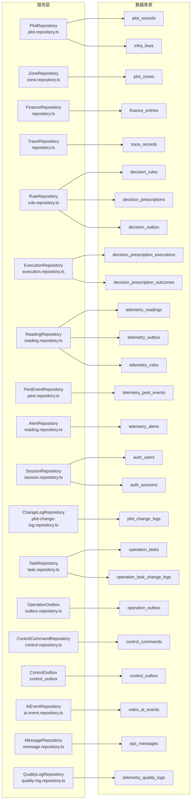

**图表来源**
- [apps/plot-service/src/plot.repository.ts:94-186](file://apps/plot-service/src/plot.repository.ts#L94-L186)
- [apps/plot-service/src/zone.repository.ts:114-193](file://apps/plot-service/src/zone.repository.ts#L114-L193)
- [apps/finance-service/src/repository.ts:14-21](file://apps/finance-service/src/repository.ts#L14-L21)
- [apps/trace-service/src/repository.ts:13-19](file://apps/trace-service/src/repository.ts#L13-L19)
- [apps/decision-service/src/rule.repository.ts:181-296](file://apps/decision-service/src/rule.repository.ts#L181-L296)
- [apps/decision-service/src/execution.repository.ts:94-157](file://apps/decision-service/src/execution.repository.ts#L94-L157)
- [apps/telemetry-service/src/reading.repository.ts:96-202](file://apps/telemetry-service/src/reading.repository.ts#L96-L202)
- [apps/telemetry-service/src/pest.repository.ts:64-113](file://apps/telemetry-service/src/pest.repository.ts#L64-L113)
- [apps/auth-service/src/session.repository.ts:117-162](file://apps/auth-service/src/session.repository.ts#L117-L162)
- [apps/plot-service/src/plot-change-log.repository.ts:52-83](file://apps/plot-service/src/plot-change-log.repository.ts#L52-L83)
- [apps/operation-service/src/task.repository.ts:106-153](file://apps/operation-service/src/task.repository.ts#L106-L153)
- [apps/operation-service/src/outbox.repository.ts:6-15](file://apps/operation-service/src/outbox.repository.ts#L6-L15)
- [apps/control-service/src/control.repository.ts:160-200](file://apps/control-service/src/control.repository.ts#L160-L200)
- [apps/video-service/src/ai-event.repository.ts:133-189](file://apps/video-service/src/ai-event.repository.ts#L133-L189)
- [apps/message-service/src/message.repository.ts:173-252](file://apps/message-service/src/message.repository.ts#L173-L252)
- [apps/telemetry-service/src/quality-log.repository.ts:56-108](file://apps/telemetry-service/src/quality-log.repository.ts#L56-L108)

## 详细组件分析

### 实体关系与 ER 图
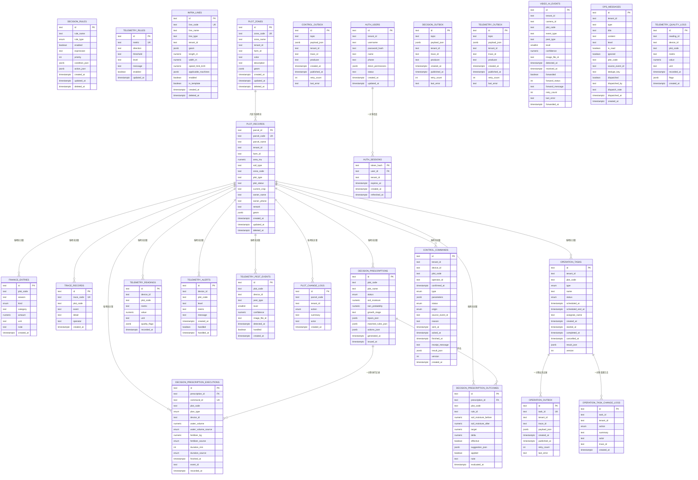

**图表来源**
- [infra/postgres/001_initial_schema.sql:3-40](file://infra/postgres/001_initial_schema.sql#L3-L40)
- [infra/postgres/migrations/002_decision_telemetry.sql:5-87](file://infra/postgres/migrations/002_decision_telemetry.sql#L5-L87)
- [infra/postgres/migrations/003_event_bus_messages.sql:45-62](file://infra/postgres/migrations/003_event_bus_messages.sql#L45-L62)
- [infra/postgres/migrations/004_identity_accounts.sql:8-20](file://infra/postgres/migrations/004_identity_accounts.sql#L8-L20)
- [infra/postgres/migrations/005_control_commands.sql:7-20](file://infra/postgres/migrations/005_control_commands.sql#L7-L20)
- [infra/postgres/migrations/007_auth_sessions.sql:10-17](file://infra/postgres/migrations/007_auth_sessions.sql#L10-L17)
- [infra/postgres/migrations/008_agro_monitoring.sql:11-74](file://infra/postgres/migrations/008_agro_monitoring.sql#L11-L74)
- [infra/postgres/migrations/009_plot_zones.sql:12-48](file://infra/postgres/migrations/009_plot_zones.sql#L12-L48)
- [infra/postgres/migrations/011_plot_profile.sql:14-47](file://infra/postgres/migrations/011_plot_profile.sql#L14-L47)
- [infra/postgres/migrations/016_operation_tasks.sql:1-36](file://infra/postgres/migrations/016_operation_tasks.sql#L1-L36)
- [infra/postgres/migrations/027_plot_change_logs.sql:9-17](file://infra/postgres/migrations/027_plot_change_logs.sql#L9-L17)
- [infra/postgres/migrations/029_plot_change_log_actions.sql:6-9](file://infra/postgres/migrations/029_plot_change_log_actions.sql#L6-L9)
- [infra/postgres/migrations/031_control_command_receipt.sql:19-24](file://infra/postgres/migrations/031_control_command_receipt.sql#L19-L24)
- [infra/postgres/migrations/032_control_command_tenant.sql:10-11](file://infra/postgres/migrations/032_control_command_tenant.sql#L10-L11)
- [infra/postgres/migrations/033_control_outbox.sql:7-19](file://infra/postgres/migrations/033_control_outbox.sql#L7-L19)
- [infra/postgres/migrations/034_decision_prescription_executions.sql:9-30](file://infra/postgres/migrations/034_decision_prescription_executions.sql#L9-L30)
- [infra/postgres/migrations/039_operation_task_change_logs.sql:16-29](file://infra/postgres/migrations/039_operation_task_change_logs.sql#L16-L29)
- [infra/postgres/migrations/047_infra_line_attributes.sql:8-22](file://infra/postgres/migrations/047_infra_line_attributes.sql#L8-L22)
- [infra/postgres/migrations/048_ai_event_types_message_dispatch.sql:11-27](file://infra/postgres/migrations/048_ai_event_types_message_dispatch.sql#L11-L27)
- [infra/postgres/migrations/049_telemetry_quality.sql:7-26](file://infra/postgres/migrations/049_telemetry_quality.sql#L7-L26)

#### 表结构与字段定义
- plot_records
  - 主键：parcel_id
  - 唯一键：parcel_code
  - 关键字段：tenant_id、farm_id、area_mu（>=0）、geom（JSONB，CGCS2000/EPSG:4490）
  - **新增档案字段：plot_type（FIELD/GREENHOUSE/ORCHARD/AQUACULTURE）、plot_status（DRAFT/ACTIVE/FALLOW/ARCHIVED）、current_crop、owner_name、owner_phone、remark**
  - **片区关联：zone_code 关联到 plot_zones.zone_code**
  - 审计字段：created_at、updated_at、deleted_at（软删除）
  - 索引：idx_plot_records_tenant_created(tenant_id, created_at DESC) WHERE deleted_at IS NULL
  - **新增索引：idx_plot_records_profile(tenant_id, plot_status, plot_type) WHERE deleted_at IS NULL**
- finance_entries
  - 主键：id
  - 校验：kind IN ('INPUT','OUTPUT')，amount >= 0
  - 索引：idx_finance_entries_plot_created(plot_code, created_at DESC)
- trace_records
  - 主键：id
  - 唯一键：trace_code
  - 索引：idx_trace_records_plot_created(plot_code, created_at DESC)
- decision_rules
  - 主键：id
  - 校验：rule_type IN ('IRRIGATION','FERTILIZATION','PEST_WARNING')
  - JSONB：condition_json、action_json
  - 索引：idx_decision_rules_enabled(enabled, priority) WHERE deleted_at IS NULL
- decision_prescriptions
  - 主键：id
  - 校验：status IN ('RECOMMENDED','NO_ACTION')
  - JSONB：inputs_json、matched_rules_json、actions_json
  - 索引：idx_decision_prescriptions_plot(plot_code, generated_at DESC)
- **decision_prescription_executions**
  - 主键：id
  - 唯一键：command_id（同一条指令只记一次，事件重放幂等）
  - 校验：plan_type IN ('irrigation','fertilization')，duration_source IN ('DEVICE','RUNTIME')
  - **关键字段：prescription_id（关联处方留痕）、device_id（执行设备）、water_volume（立方米）、water_volume_source（DEVICE/PLAN）、fertilizer_kg（千克）、fertilizer_source（DEVICE/PLAN）、duration_min（分钟）、finished_at（完成时间）、event_id（来源事件标识）**
  - **用量来源语义：DEVICE表示设备实测值，PLAN表示按指令参数计算的理论值；两列可空，设备未上报且无法推算时留空不编造**
  - 索引：idx_decision_executions_prescription(prescription_id, finished_at DESC)、idx_decision_executions_plot(plot_code, finished_at DESC)
- **decision_prescription_outcomes**
  - 主键：id
  - 关键字段：prescription_id（关联处方留痕）、plot_code（地块编码）、rule_id（触发规则ID）
  - **土壤湿度字段：soil_moisture_before（执行前）、soil_moisture_after（执行后）、target（目标值）、delta（变化量）**
  - **效果评估字段：effective（是否有效）、applied（是否应用）、suggestion_json（建议内容）、note（备注）**
  - 索引：idx_decision_outcomes_prescription(prescription_id, evaluated_at DESC)、idx_decision_outcomes_plot(plot_code, evaluated_at DESC)
- telemetry_readings
  - 主键：id
  - **新增 quality_flags 字段：JSONB数组，存储 OUT_OF_RANGE/STUCK_VALUE/TIMESTAMP_ANOMALY 三类质量标记**
  - 索引：idx_telemetry_readings_device_time(device_id, metric, recorded_at DESC)、idx_telemetry_readings_time(recorded_at DESC)、idx_telemetry_readings_clean(device_id, metric, recorded_at DESC) WHERE quality_flags = '[]'::jsonb
- telemetry_alerts
  - 主键：id
  - 索引：idx_telemetry_alerts_pending(handled, created_at DESC)
- **telemetry_rules**
  - 主键：id
  - 唯一键：metric（同一指标只保留一条规则）
  - 校验：direction IN ('above', 'below')，level IN ('INFO', 'WARNING', 'CRITICAL')
  - 关键字段：threshold（数值阈值）、message（告警消息）、enabled（启用状态）
  - 索引：uq_telemetry_rules_metric(metric)
- **telemetry_pest_events**
  - 主键：id
  - 校验：level BETWEEN 1 AND 3（轻微/中等/严重），confidence BETWEEN 0 AND 1
  - 关键字段：pest_type（害虫类型）、image_file_id（关联图片文件）、detected_at（检测时间）、handled（处理状态）
  - 索引：idx_pest_events_plot_time(plot_code, detected_at DESC)、idx_pest_events_pending(handled, detected_at DESC)
- **infra_lines**
  - 主键：id
  - 唯一键：line_code
  - 校验：line_type IN ('IRRIGATION_PIPE', 'FERTILIZATION_PIPE', 'ELECTRIC_LINE', 'ROAD')
  - **新增属性字段：width_m（宽度，单位米）、speed_limit_kmh（限速，单位公里/小时）、applicable_machines（适用机型JSONB数组）、enabled（启用状态）、is_template（模板标记）**
  - **关键字段：geom（GeoJSON LineString，CGCS2000/EPSG:4490）、length_m（线路长度）**
  - **约束：width_m > 0（如果填写）、speed_limit_kmh > 0（如果填写）、applicable_machines为JSONB数组**
  - 索引：idx_infra_lines_tenant(tenant_id, line_type) WHERE deleted_at IS NULL、idx_infra_lines_enabled(tenant_id, enabled) WHERE deleted_at IS NULL
- **plot_zones**
  - 主键：id
  - 唯一键：zone_code
  - 关键字段：zone_name（片区名称）、color（地图配色）、description（描述）、geom（可选边界Polygon）
  - 审计字段：created_at、updated_at、deleted_at（软删除）
  - 索引：idx_plot_zones_tenant(tenant_id, farm_id) WHERE deleted_at IS NULL
- **plot_change_logs**
  - 主键：id
  - 关键字段：parcel_code（地块编码引用）、tenant_id（租户隔离）、action（变更动作）、summary（人类可读摘要）、actor（操作人标识）
  - **动作枚举：CREATE（建档）、UPDATE（修改）、DELETE（删除）、MERGE（合并生成）、SPLIT（拆分生成）**
  - 索引：idx_plot_change_logs_plot(parcel_code, created_at DESC)
  - **约束：action CHECK (action IN ('CREATE', 'UPDATE', 'DELETE', 'MERGE', 'SPLIT'))**
- **operation_tasks**
  - 主键：id
  - 唯一键：无（id 为主键）
  - 校验：type IN ('TILLAGE','SEEDING','IRRIGATION','WEEDING','SPRAYING','FERTILIZATION')，status IN ('PENDING','RUNNING','COMPLETED','CANCELLED')
  - 关键字段：tenant_id、plot_code、name、scheduled_at、scheduled_end_at、assignee_name、result_json（JSONB）
  - 状态约束：RUNNING 必有 started_at，COMPLETED 必有 started_at/completed_at/result_json，CANCELLED 必有 cancelled_at
  - 索引：idx_operation_tasks_tenant_created(tenant_id, created_at DESC, id DESC)、idx_operation_tasks_plot(tenant_id, plot_code)
- **operation_task_change_logs**
  - 主键：id
  - 关键字段：task_id（任务编码引用）、tenant_id（租户隔离）、action（变更动作）、summary（人类可读摘要）、actor（操作人标识）、trace_id（追踪ID）
  - **动作枚举：CREATE（建档）、TRANSITION（状态跃迁）、ARCHIVE（归档删除）**
  - 索引：idx_operation_task_change_logs_task(task_id, created_at DESC)
  - **约束：action CHECK (action IN ('CREATE', 'TRANSITION', 'ARCHIVE'))**
- **operation_outbox**
  - 主键：id
  - 唯一键：task_id（关联 operation_tasks.id）
  - 关键字段：tenant_id、trace_id、payload_json（JSONB）、retry_count、last_error
  - 索引：idx_operation_outbox_pending(created_at) WHERE published_at IS NULL
- **control_commands**
  - 主键：id
  - 唯一键：source_event_id（自动指令去重）
  - **租户隔离：tenant_id 字段实现多租户数据隔离，所有查询和写入都必须带租户上下文**
  - 校验：type IN ('SEEDING','IRRIGATION','WEEDING','FERTILIZATION','ESTOP')，status IN ('QUEUED','SENT','ACKED','DONE','FAILED')，origin IN ('MANUAL','EVENT')
  - **生命周期字段：sent_at（下发时间）、acked_at（接收时间）、finished_at（结束时间）、receipt_message（回执消息）、result_json（结果快照）、version（乐观锁版本）**
  - **时间顺序约束：sent_at ≤ acked_at ≤ finished_at**
  - 关键字段：device_id、plot_code、operator_id、confirmed_at（人工确认时间）、parameters（JSONB参数）、reason（指令缘由）
  - **索引优化：idx_control_commands_tenant_created(tenant_id, created_at DESC, id DESC) 支持租户级列表查询，idx_control_commands_open(tenant_id, created_at DESC, id) WHERE status IN ('QUEUED','SENT','ACKED') 支持单租户待回执看板**
- **control_outbox**
  - 主键：id
  - 关键字段：topic（主题）、payload_json（JSONB载荷）、tenant_id（租户隔离）、trace_id（追踪ID）、producer（生产者标识）
  - **可靠性字段：created_at（创建时间）、published_at（发布时间）、retry_count（重试次数）、last_error（最后错误）**
  - 索引：idx_control_outbox_pending(created_at) WHERE published_at IS NULL
- **auth_users**
  - 主键：id
  - 唯一键：(tenant_id, username)
  - 校验：status IN ('ACTIVE', 'DISABLED')
  - JSONB：direct_permissions
  - 索引：idx_auth_users_tenant_created(tenant_id, created_at DESC)
- **auth_sessions**
  - 主键：token_hash
  - 外键：user_id REFERENCES auth_users(id) ON DELETE CASCADE
  - 关键字段：tenant_id、expires_at、refreshed_at
  - 索引：idx_auth_sessions_user(user_id)、idx_auth_sessions_expires(expires_at)
- **video_ai_events**
  - 主键：id
  - **新增 event_type 字段：TEXT类型，默认值为'PEST'，支持七类事件：PEST、PERSON_INTRUSION、MACHINE_STATUS、FLOOD、LODGING、FIRE、SMOKE**
  - **pest_type 字段放宽：当event_type不为PEST时可空，PEST类型时必填**
  - 关键字段：tenant_id、camera_id、plot_code、level（1-3）、confidence（0-1）、detected_at、received_at、forwarded、forward_status、forward_message、retry_count、last_error、forwarded_at
  - 索引：idx_video_ai_events_type(tenant_id, event_type, received_at DESC)
- **ops_messages**
  - 主键：id
  - **新增派单处置字段：dispatched（BOOLEAN，默认FALSE）、dispatched_by（TEXT，默认空串）、dispatch_note（TEXT，默认空串）、dispatched_at（TIMESTAMPTZ，可空）**
  - 关键字段：tenant_id、type、title、content、level、is_read、ignored、plot_code、source_event_id、dedupe_key、created_at
  - **业务规则：dispatched与ignored互斥使用，派单顺带标已读**
- **telemetry_quality_logs**
  - 主键：id
  - 关键字段：reading_id（关联遥测读数）、device_id、plot_code、metric、value、unit、recorded_at、flags（JSONB数组，存储质量标记）、created_at
  - 索引：idx_telemetry_quality_logs_time(created_at DESC)、idx_telemetry_quality_logs_device(device_id, metric, created_at DESC)
- decision_outbox / telemetry_outbox
  - 主键：id
  - JSONB：payload_json
  - 索引：idx_*_outbox_pending(created_at) WHERE published_at IS NULL

**章节来源**
- [infra/postgres/001_initial_schema.sql:3-40](file://infra/postgres/001_initial_schema.sql#L3-L40)
- [infra/postgres/migrations/002_decision_telemetry.sql:5-87](file://infra/postgres/migrations/002_decision_telemetry.sql#L5-L87)
- [infra/postgres/migrations/003_event_bus_messages.sql:45-62](file://infra/postgres/migrations/003_event_bus_messages.sql#L45-L62)
- [infra/postgres/migrations/004_identity_accounts.sql:8-20](file://infra/postgres/migrations/004_identity_accounts.sql#L8-L20)
- [infra/postgres/migrations/005_control_commands.sql:7-20](file://infra/postgres/migrations/005_control_commands.sql#L7-L20)
- [infra/postgres/migrations/007_auth_sessions.sql:10-17](file://infra/postgres/migrations/007_auth_sessions.sql#L10-L17)
- [infra/postgres/migrations/008_agro_monitoring.sql:11-74](file://infra/postgres/migrations/008_agro_monitoring.sql#L11-L74)
- [infra/postgres/migrations/009_plot_zones.sql:12-48](file://infra/postgres/migrations/009_plot_zones.sql#L12-L48)
- [infra/postgres/migrations/011_plot_profile.sql:14-47](file://infra/postgres/migrations/011_plot_profile.sql#L14-L47)
- [infra/postgres/migrations/016_operation_tasks.sql:1-21](file://infra/postgres/migrations/016_operation_tasks.sql#L1-L21)
- [infra/postgres/migrations/027_plot_change_logs.sql:9-17](file://infra/postgres/migrations/027_plot_change_logs.sql#L9-L17)
- [infra/postgres/migrations/029_plot_change_log_actions.sql:6-9](file://infra/postgres/migrations/029_plot_change_log_actions.sql#L6-L9)
- [infra/postgres/migrations/031_control_command_receipt.sql:8-37](file://infra/postgres/migrations/031_control_command_receipt.sql#L8-L37)
- [infra/postgres/migrations/032_control_command_tenant.sql:10-21](file://infra/postgres/migrations/032_control_command_tenant.sql#L10-L21)
- [infra/postgres/migrations/033_control_outbox.sql:7-19](file://infra/postgres/migrations/033_control_outbox.sql#L7-L19)
- [infra/postgres/migrations/034_decision_prescription_executions.sql:9-32](file://infra/postgres/migrations/034_decision_prescription_executions.sql#L9-L32)
- [infra/postgres/migrations/039_operation_task_change_logs.sql:16-29](file://infra/postgres/migrations/039_operation_task_change_logs.sql#L16-L29)
- [infra/postgres/migrations/047_infra_line_attributes.sql:8-22](file://infra/postgres/migrations/047_infra_line_attributes.sql#L8-L22)
- [infra/postgres/migrations/048_ai_event_types_message_dispatch.sql:11-27](file://infra/postgres/migrations/048_ai_event_types_message_dispatch.sql#L11-L27)
- [infra/postgres/migrations/049_telemetry_quality.sql:7-26](file://infra/postgres/migrations/049_telemetry_quality.sql#L7-L26)

#### 主键/外键与约束设计
- 主键：所有表均使用 TEXT 类型主键，便于分布式 ID 生成（如 ULID）。
- 唯一约束：parcel_code、trace_code、(tenant_id, username)、metric、line_code、zone_code、task_id、source_event_id、command_id 保证业务编码唯一性。
- 检查约束：area_mu >= 0、amount >= 0、kind/status/rule_type/type/status 枚举值限制、level/confidence 范围限制、action 枚举值限制、plan_type/duration_source 枚举值限制。
- **控制指令约束：status IN ('QUEUED','SENT','ACKED','DONE','FAILED')，type IN ('SEEDING','IRRIGATION','WEEDING','FERTILIZATION','ESTOP')，origin IN ('MANUAL','EVENT')**
- **处方执行回流约束：plan_type IN ('irrigation','fertilization')，water_volume_source IN ('DEVICE','PLAN')，fertilizer_source IN ('DEVICE','PLAN')，duration_source IN ('DEVICE','RUNTIME')**
- **处方结果评估约束：effective BOOLEAN、applied BOOLEAN DEFAULT FALSE**
- **农事任务变更日志约束：action IN ('CREATE', 'TRANSITION', 'ARCHIVE')**
- **时间顺序约束：sent_at ≤ acked_at ≤ finished_at**
- **基础设施线路约束：width_m > 0（如果填写）、speed_limit_kmh > 0（如果填写）、applicable_machines为JSONB数组、line_type IN ('IRRIGATION_PIPE', 'FERTILIZATION_PIPE', 'ELECTRIC_LINE', 'ROAD')**
- **AI事件类型约束：event_type IN ('PEST', 'PERSON_INTRUSION', 'MACHINE_STATUS', 'FLOOD', 'LODGING', 'FIRE', 'SMOKE')，当event_type <> 'PEST'时pest_type可为空**
- **遥测质量标记约束：quality_flags为JSONB数组，支持 OUT_OF_RANGE、STUCK_VALUE、TIMESTAMP_ANOMALY 三类标记**
- **消息派单约束：dispatched与ignored互斥使用，派单顺带标已读**
- 软删除：plot_records、decision_rules、infra_lines、plot_zones 使用 deleted_at 实现逻辑删除，配合部分索引提升查询性能。
- **外键约束：auth_sessions.user_id 引用 auth_users(id)，operation_outbox.task_id 引用 operation_tasks(id)，决策处方与执行记录通过 prescription_id 建立逻辑关联。**
- 状态约束：operation_tasks 的状态转换约束确保 RUNNING/COMPLETED/CANCELLED 状态的必需字段完整性。
- 外键：当前 schema 中仅 auth_sessions 和 operation_outbox 显式声明了外键约束，其他关联依赖应用层一致性校验与事务控制。

**章节来源**
- [infra/postgres/001_initial_schema.sql:3-40](file://infra/postgres/001_initial_schema.sql#L3-L40)
- [infra/postgres/migrations/002_decision_telemetry.sql:5-87](file://infra/postgres/migrations/002_decision_telemetry.sql#L5-L87)
- [infra/postgres/migrations/003_event_bus_messages.sql:45-62](file://infra/postgres/migrations/003_event_bus_messages.sql#L45-L62)
- [infra/postgres/migrations/004_identity_accounts.sql:8-20](file://infra/postgres/migrations/004_identity_accounts.sql#L8-L20)
- [infra/postgres/migrations/005_control_commands.sql:13-15](file://infra/postgres/migrations/005_control_commands.sql#L13-L15)
- [infra/postgres/migrations/007_auth_sessions.sql:10-17](file://infra/postgres/migrations/007_auth_sessions.sql#L10-L17)
- [infra/postgres/migrations/008_agro_monitoring.sql:11-74](file://infra/postgres/migrations/008_agro_monitoring.sql#L11-L74)
- [infra/postgres/migrations/009_plot_zones.sql:12-48](file://infra/postgres/migrations/009_plot_zones.sql#L12-L48)
- [infra/postgres/migrations/011_plot_profile.sql:14-47](file://infra/postgres/migrations/011_plot_profile.sql#L14-L47)
- [infra/postgres/migrations/016_operation_tasks.sql:17-21](file://infra/postgres/migrations/016_operation_tasks.sql#L17-L21)
- [infra/postgres/migrations/027_plot_change_logs.sql:13](file://infra/postgres/migrations/027_plot_change_logs.sql#L13)
- [infra/postgres/migrations/029_plot_change_log_actions.sql:6-9](file://infra/postgres/migrations/029_plot_change_log_actions.sql#L6-L9)
- [infra/postgres/migrations/031_control_command_receipt.sql:8-33](file://infra/postgres/migrations/031_control_command_receipt.sql#L8-L33)
- [infra/postgres/migrations/034_decision_prescription_executions.sql:16-25](file://infra/postgres/migrations/034_decision_prescription_executions.sql#L16-L25)
- [infra/postgres/migrations/039_operation_task_change_logs.sql:20](file://infra/postgres/migrations/039_operation_task_change_logs.sql#L20)
- [infra/postgres/migrations/047_infra_line_attributes.sql:14-19](file://infra/postgres/migrations/047_infra_line_attributes.sql#L14-L19)
- [infra/postgres/migrations/048_ai_event_types_message_dispatch.sql:12-20](file://infra/postgres/migrations/048_ai_event_types_message_dispatch.sql#L12-L20)
- [infra/postgres/migrations/049_telemetry_quality.sql:7-11](file://infra/postgres/migrations/049_telemetry_quality.sql#L7-L11)

#### 数据验证规则与业务规则
- 地块面积非负；土壤类型可选；边界几何为 JSONB，建议统一 CGCS2000（EPSG:4490）。
- **地块档案字段：plot_type 限定为大田/大棚/果园/水产养殖四种类型；plot_status 限定为草稿/种植中/休耕/已归档四种状态；current_crop 为自由文本；owner_name/owner_phone 为负责人信息。**
- **片区管理：zone_code 全局唯一，一旦用过不再分配给其他片区；geom 可选，无实测边界时前端按成员地块凸包显示。**
- 财务条目金额非负，类别限定 INPUT/OUTPUT；按季节与地块汇总利润。
- 溯源记录需包含操作人、事件与详情，按地块时间线回溯。
- 决策规则支持热更新：启用状态、优先级、条件与动作 JSONB 化；默认灌溉规则开箱可用。
- 遥测读数按设备+指标取最新值；历史查询支持设备/指标/时间窗过滤，默认上限 200，最大 2000。
- 告警默认未处理，支持批量待处理列表与单条标记已处理。
- **四情监测阈值：direction 区分上限/下限，level 分为 INFO/WARNING/CRITICAL 三级；同一指标只保留一条规则避免重复告警。**
- **虫情事件：level 1/2/3 对应轻微/中等/严重，confidence 0-1 置信度；支持图片附件与处理状态跟踪。**
- **基础设施线路：line_type 限定为灌溉管线/施肥管线/电力线路/道路四种类型；geom 为 GeoJSON LineString；width_m/speed_limit_kmh选填但必须为正数；applicable_machines为机器类型白名单数组；enabled控制线路可见性；is_template标记模板复用。**
- **AI事件类型：event_type支持七类事件（PEST/PERSON_INTRUSION/MACHINE_STATUS/FLOOD/LODGING/FIRE/SMOKE）；PEST类型时pest_type必填，其他类型可空；level 1-3表示严重程度；confidence 0-1表示置信度。**
- **消息派单处置：dispatched与ignored互斥使用；派单操作会同时设置is_read=true；dispatched_by记录派单人；dispatch_note记录派单备注；dispatched_at记录派单时间。**
- **遥测质量标记：OUT_OF_RANGE表示超量程；STUCK_VALUE表示连续不变；TIMESTAMP_ANOMALY表示时间戳异常；标记只标注不拒收，曲线与汇总默认剔除带标记读数。**
- **认证用户状态控制：ACTIVE/DISABLED 状态管理，支持账号停用功能。**
- **会话安全管理：token 以 sha256 散列存储，支持滑动续期、立即失效和多实例共享。**
- **地块变更日志：action 限定为 CREATE/UPDATE/DELETE/MERGE/SPLIT 五种动作类型；summary 提供人类可读的操作摘要；actor 记录操作人标识。**
- **农事任务类型：type 限定为整地(TILLAGE)/播种(SEEDING)/灌溉(IRRIGATION)/除草(WEEDING)/植保(SPRAYING)/施肥(FERTILIZATION)六种作业类型。**
- **农事任务状态：status 限定为待执行(PENDING)/进行中(RUNNING)/已完成(COMPLETED)/已取消(CANCELLED)四种状态，支持状态机转换。**
- **农事任务时间约束：scheduled_end_at 必须晚于 scheduled_at；RUNNING 状态必须有 started_at；COMPLETED 状态必须有 started_at/completed_at/result_json；CANCELLED 状态必须有 cancelled_at。**
- **农事任务结果：result_json 包含 outcome(success/partial/failed)、finishedAreaMu(实际作业面积)、notes(作业说明)，仅在 COMPLETED 状态时写入。**
- **农事任务变更日志：action 限定为 CREATE/TRANSITION/ARCHIVE 三种动作类型；summary 提供操作摘要；actor 记录操作人标识；trace_id 支持追踪关联。**
- **控制指令类型：type 限定为播种(SEEDING)/灌溉(IRRIGATION)/除草(WEEDING)/施肥(FERTILIZATION)/急停(ESTOP)五种类型，其中 ESTOP 为安全急停指令。**
- **控制指令状态机：status 限定为入队(QUEUED)/已下发(SENT)/已接收(ACKED)/执行完成(DONE)/失败(FAILED)五态，支持 QUEUED→SENT→ACKED→DONE 完整链路，任一在途状态均可被 FAILED 收口。**
- **控制指令来源：origin 限定为人工(MANUAL)/事件(EVENT)，人工指令需要二次确认，自动指令由越限或处方事件触发。**
- **控制指令时间顺序：sent_at ≤ acked_at ≤ finished_at，确保下发时间早于接收时间，接收时间早于结束时间。**
- **控制指令乐观锁：version 字段每次状态跃迁 +1，防止并发回执冲突。**
- **控制指令租户隔离：tenant_id 字段实现多租户数据隔离，所有查询和写入都必须带租户上下文，跨租户的 id 一律当作不存在。**
- **急停指令特殊约束：DONE 状态必须带 result.confirmed=true，确保设备确实停止。**
- **处方执行回流：plan_type 限定为 irrigation/fertilization 两种类型；water_volume_source/fertilizer_source 限定为 DEVICE/PLAN 两种来源；duration_source 限定为 DEVICE/RUNTIME 两种时长计算方式。**
- **处方执行用量语义：DEVICE 表示设备实测值，PLAN 表示按指令参数计算的理论值；两列可空，设备未上报且无法推算时留空不编造，宁缺不造。**
- **处方执行幂等性：command_id 唯一索引确保同一条指令重投只记一次，首次留痕不被覆盖。**
- **处方执行地块溯源：plot_code 以处方留痕为准，即使指令参数被人工改动也不影响执行记录的准确性。**
- **处方结果评估：effective 表示处方执行是否达到预期效果；applied 表示评估结果是否被应用；suggestion_json 包含阈值调整建议；note 提供评估备注。**

**章节来源**
- [apps/plot-service/src/plot.repository.ts:11-28](file://apps/plot-service/src/plot.repository.ts#L11-L28)
- [apps/plot-service/src/zone.repository.ts:14-47](file://apps/plot-service/src/zone.repository.ts#L14-L47)
- [apps/finance-service/src/repository.ts:3-5](file://apps/finance-service/src/repository.ts#L3-L5)
- [apps/trace-service/src/repository.ts:3-4](file://apps/trace-service/src/repository.ts#L3-L4)
- [apps/decision-service/src/rule.repository.ts:11-48](file://apps/decision-service/src/rule.repository.ts#L11-L48)
- [apps/decision-service/src/execution.repository.ts:15-39](file://apps/decision-service/src/execution.repository.ts#L15-L39)
- [apps/telemetry-service/src/reading.repository.ts:4-51](file://apps/telemetry-service/src/reading.repository.ts#L4-L51)
- [apps/telemetry-service/src/pest.repository.ts:47-61](file://apps/telemetry-service/src/pest.repository.ts#L47-L61)
- [apps/telemetry-service/src/quality.ts:1-65](file://apps/telemetry-service/src/quality.ts#L1-L65)
- [apps/auth-service/src/session.repository.ts:6-15](file://apps/auth-service/src/session.repository.ts#L6-L15)
- [infra/postgres/migrations/007_auth_sessions.sql:3-8](file://infra/postgres/migrations/007_auth_sessions.sql#L3-L8)
- [infra/postgres/migrations/008_agro_monitoring.sql:11-74](file://infra/postgres/migrations/008_agro_monitoring.sql#L11-L74)
- [infra/postgres/migrations/009_plot_zones.sql:12-48](file://infra/postgres/migrations/009_plot_zones.sql#L12-L48)
- [infra/postgres/migrations/011_plot_profile.sql:14-47](file://infra/postgres/migrations/011_plot_profile.sql#L14-L47)
- [infra/postgres/migrations/016_operation_tasks.sql:4-20](file://infra/postgres/migrations/016_operation_tasks.sql#L4-L20)
- [infra/postgres/migrations/027_plot_change_logs.sql:9-17](file://infra/postgres/migrations/027_plot_change_logs.sql#L9-L17)
- [infra/postgres/migrations/029_plot_change_log_actions.sql:6-9](file://infra/postgres/migrations/029_plot_change_log_actions.sql#L6-L9)
- [infra/postgres/migrations/031_control_command_receipt.sql:8-33](file://infra/postgres/migrations/031_control_command_receipt.sql#L8-L33)
- [infra/postgres/migrations/032_control_command_tenant.sql:3-11](file://infra/postgres/migrations/032_control_command_tenant.sql#L3-L11)
- [infra/postgres/migrations/034_decision_prescription_executions.sql:16-25](file://infra/postgres/migrations/034_decision_prescription_executions.sql#L16-L25)
- [infra/postgres/migrations/039_operation_task_change_logs.sql:20](file://infra/postgres/migrations/039_operation_task_change_logs.sql#L20)
- [infra/postgres/migrations/047_infra_line_attributes.sql:1-6](file://infra/postgres/migrations/047_infra_line_attributes.sql#L1-L6)
- [infra/postgres/migrations/048_ai_event_types_message_dispatch.sql:4-9](file://infra/postgres/migrations/048_ai_event_types_message_dispatch.sql#L4-L9)
- [infra/postgres/migrations/049_telemetry_quality.sql:1-5](file://infra/postgres/migrations/049_telemetry_quality.sql#L1-L5)
- [apps/control-service/src/control.repository.ts:16-17](file://apps/control-service/src/control.repository.ts#L16-L17)
- [apps/control-service/src/http.ts:64-71](file://apps/control-service/src/http.ts#L64-L71)

#### 数据访问模式
- 仓储层封装 SQL，提供事务感知执行器 executor(tx)，优先使用传入事务对象，否则回退到客户端连接。
- 典型写入：create/update/remove 使用 $executeRawUnsafe；读取使用 $queryRawUnsafe。
- 事务边界显式传递，避免隐式上下文扩大事务范围。
- **认证会话访问：支持创建、查找、续期、删除、批量清理等操作，所有 token 均以散列形式存储。**
- **片区管理访问：支持按租户列出、按编码查找、创建、更新、软删除等操作，支持几何数据的序列化处理。**
- **虫情事件访问：支持创建、分页查询、标记已处理、计数等操作，支持按地块和处理状态筛选。**
- **地块变更日志访问：支持追加写入和按地块倒序查询，不修改历史日志以保证审计完整性。**
- **农事任务访问：支持分页查询、创建、状态转换等操作，状态转换与出队写入原子操作，确保事件可靠性。**
- **农事任务变更日志访问：支持追加写入和按任务倒序查询，不修改历史日志以保证审计完整性。**
- **农事任务出队访问：支持待处理事件查询、标记已发布、标记失败重试等操作。**
- **控制指令访问：支持创建、分页查询、状态跃迁等操作，状态跃迁使用乐观锁确保并发安全，支持设备回执和人工回填，现已实现完整的租户隔离。**
- **控制出队访问：支持待处理事件查询、标记已发布、标记失败重试等操作，与控制指令状态跃迁同事务写入。**
- **处方执行回流访问：支持幂等写入（command_id 去重）、按处方或地块查询、按指令ID查找等操作，默认返回最近 200 条记录。**
- **基础设施线路访问：支持按租户列出、按编码查找、创建、更新、软删除等操作，支持新属性的增删改查，支持模板复制功能。**
- **视频AI事件访问：支持创建、分页查询、转发状态更新、重试等操作，支持按事件类型筛选。**
- **消息中心访问：支持分页查询、标记已读、忽略、派单等操作，支持派单处置字段的管理。**
- **遥测质量日志访问：支持追加写入、按设备/指标/标记筛选、计数等操作，支持质量异常的审计查询。**

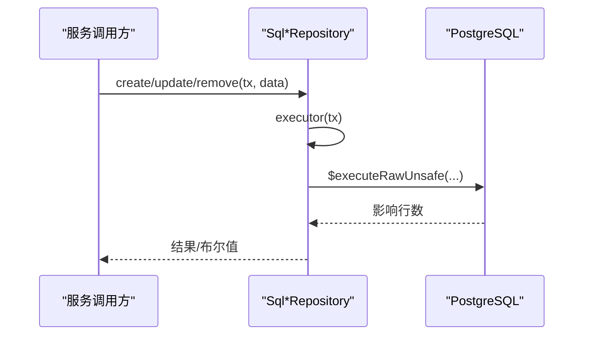

**图表来源**
- [apps/plot-service/src/plot.repository.ts:98-100](file://apps/plot-service/src/plot.repository.ts#L98-L100)
- [apps/plot-service/src/zone.repository.ts:117-119](file://apps/plot-service/src/zone.repository.ts#L117-L119)
- [apps/telemetry-service/src/pest.repository.ts:67-69](file://apps/telemetry-service/src/pest.repository.ts#L67-L69)
- [apps/decision-service/src/rule.repository.ts:185-187](file://apps/decision-service/src/rule.repository.ts#L185-L187)
- [apps/decision-service/src/execution.repository.ts:101-126](file://apps/decision-service/src/execution.repository.ts#L101-L126)
- [apps/telemetry-service/src/reading.repository.ts:100-102](file://apps/telemetry-service/src/reading.repository.ts#L100-L102)
- [apps/plot-service/src/plot-change-log.repository.ts:60-72](file://apps/plot-service/src/plot-change-log.repository.ts#L60-L72)
- [apps/operation-service/src/task.repository.ts:138-151](file://apps/operation-service/src/task.repository.ts#L138-L151)
- [apps/operation-service/src/outbox.repository.ts:9-14](file://apps/operation-service/src/outbox.repository.ts#L9-L14)
- [apps/control-service/src/control.repository.ts:164-186](file://apps/control-service/src/control.repository.ts#L164-L186)
- [apps/telemetry-service/src/quality-log.repository.ts:64-80](file://apps/telemetry-service/src/quality-log.repository.ts#L64-L80)

**章节来源**
- [apps/plot-service/src/plot.repository.ts:94-186](file://apps/plot-service/src/plot.repository.ts#L94-L186)
- [apps/plot-service/src/zone.repository.ts:114-193](file://apps/plot-service/src/zone.repository.ts#L114-L193)
- [apps/telemetry-service/src/pest.repository.ts:64-113](file://apps/telemetry-service/src/pest.repository.ts#L64-L113)
- [apps/decision-service/src/rule.repository.ts:181-296](file://apps/decision-service/src/rule.repository.ts#L181-L296)
- [apps/decision-service/src/execution.repository.ts:94-157](file://apps/decision-service/src/execution.repository.ts#L94-L157)
- [apps/telemetry-service/src/reading.repository.ts:96-202](file://apps/telemetry-service/src/reading.repository.ts#L96-L202)
- [apps/auth-service/src/session.repository.ts:117-162](file://apps/auth-service/src/session.repository.ts#L117-L162)
- [apps/plot-service/src/plot-change-log.repository.ts:52-83](file://apps/plot-service/src/plot-change-log.repository.ts#L52-L83)
- [apps/operation-service/src/task.repository.ts:106-153](file://apps/operation-service/src/task.repository.ts#L106-L153)
- [apps/operation-service/src/outbox.repository.ts:6-15](file://apps/operation-service/src/outbox.repository.ts#L6-L15)
- [apps/control-service/src/control.repository.ts:160-200](file://apps/control-service/src/control.repository.ts#L160-L200)
- [apps/telemetry-service/src/quality-log.repository.ts:56-108](file://apps/telemetry-service/src/quality-log.repository.ts#L56-L108)

#### 示例数据（概念性）
- 地块：包含 parcel_code、parcel_name、tenant_id、farm_id、area_mu、geom(JSONB)、时间戳与软删除标记，**新增 plot_type、plot_status、current_crop、owner_name、owner_phone、remark 等档案字段**。
- 财务：按 plot_code、season、kind、category、amount、unit、note 记录投入/产出。
- 溯源：trace_code、plot_code、event、detail、operator、created_at。
- 决策规则：rule_name、rule_type、enabled、expression、priority、condition_json、action_json。
- 决策处方：id、plot_code、plot_name、status、soil_moisture、rain_probability、growth_stage、inputs_json、matched_rules_json、actions_json、generated_at、issued_at。
- **处方执行回流：id、prescription_id、command_id、plot_code、plan_type(irrigation/fertilization)、device_id、water_volume(立方米)、water_volume_source(DEVICE/PLAN)、fertilizer_kg(千克)、fertilizer_source(DEVICE/PLAN)、duration_min(分钟)、duration_source(DEVICE/RUNTIME)、finished_at、event_id、recorded_at。**
- **处方结果评估：id、prescription_id、plot_code、rule_id、soil_moisture_before、soil_moisture_after、target、delta、effective、suggestion_json、applied、note、evaluated_at。**
- 遥测读数：device_id、plot_code、metric、value、unit、recorded_at，**新增 quality_flags(JSONB数组)**。
- 遥测告警：level、message、handled、handled_at。
- **四情监测规则：metric、direction、threshold、level、message、enabled、updated_at。**
- **虫情事件：plot_code、device_id、pest_type、level、confidence、image_file_id、detected_at、handled。**
- **基础设施线路：line_code、line_name、line_type、tenant_id、geom(LineString)、length_m、width_m、speed_limit_kmh、applicable_machines(JSONB数组)、enabled、is_template。**
- **片区管理：zone_code、zone_name、tenant_id、farm_id、color、description、geom(Polygon)。**
- **地块变更日志：id、parcel_code、tenant_id、action(CREATE/UPDATE/DELETE/MERGE/SPLIT)、summary、actor、created_at。**
- **农事任务：id、tenant_id、plot_code、type、name、status、scheduled_at、scheduled_end_at、assignee_name、created_at、started_at、completed_at、cancelled_at、result_json、version。**
- **农事任务变更日志：id、task_id、tenant_id、action(CREATE/TRANSITION/ARCHIVE)、summary、actor、trace_id、created_at。**
- **农事任务出队：id、task_id、tenant_id、trace_id、payload_json、created_at、published_at、retry_count、last_error。**
- **控制指令：id、tenant_id、device_id、plot_code、operator_id、confirmed_at、type、parameters、status、origin、source_event_id、reason、sent_at、acked_at、finished_at、receipt_message、result_json、version、created_at。**
- **控制出队：id、topic、payload_json、tenant_id、trace_id、producer、created_at、published_at、retry_count、last_error。**
- **认证用户：id、tenant_id、username、password_hash、name、phone、direct_permissions、status、时间戳。**
- **认证会话：token_hash、user_id、tenant_id、expires_at、created_at、refreshed_at。**
- **视频AI事件：id、tenant_id、camera_id、plot_code、event_type(PEST/PERSON_INTRUSION/MACHINE_STATUS/FLOOD/LODGING/FIRE/SMOKE)、pest_type、level、confidence、image_file_id、detected_at、received_at、forwarded、forward_status、forward_message、retry_count、last_error、forwarded_at。**
- **消息中心：id、tenant_id、type、title、content、level、is_read、ignored、plot_code、source_event_id、dedupe_key、dispatched、dispatched_by、dispatch_note、dispatched_at、created_at。**
- **遥测质量日志：id、reading_id、device_id、plot_code、metric、value、unit、recorded_at、flags(JSONB数组)、created_at。**

[本节为概念性示例，不直接分析具体文件]

### 基础设施线路属性扩展机制

**新增** 迁移 047 实现了基础设施线路台账的五组核心属性扩展，支持更精细化的线路管理：

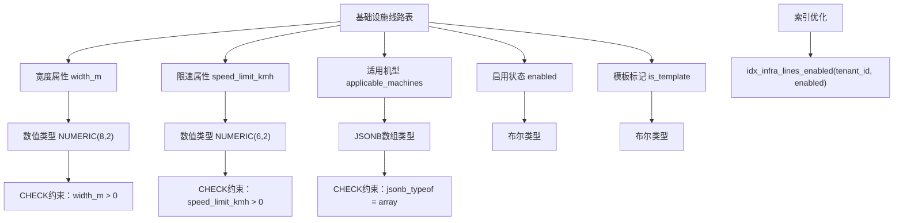

**图表来源**
- [infra/postgres/migrations/047_infra_line_attributes.sql:8-22](file://infra/postgres/migrations/047_infra_line_attributes.sql#L8-L22)

**章节来源**
- [infra/postgres/migrations/047_infra_line_attributes.sql:1-22](file://infra/postgres/migrations/047_infra_line_attributes.sql#L1-L22)

### AI事件类型扩展与消息分发机制

**新增** 迁移 048 实现了AI事件类型的扩展和消息中心的派单处置功能：

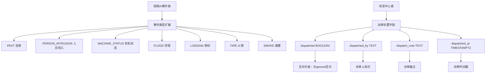

**图表来源**
- [infra/postgres/migrations/048_ai_event_types_message_dispatch.sql:11-27](file://infra/postgres/migrations/048_ai_event_types_message_dispatch.sql#L11-L27)

**章节来源**
- [infra/postgres/migrations/048_ai_event_types_message_dispatch.sql:1-27](file://infra/postgres/migrations/048_ai_event_types_message_dispatch.sql#L1-L27)

### 遥测数据质量治理机制

**新增** 迁移 049 实现了遥测数据的质量治理体系，包括质量标记和审计日志：

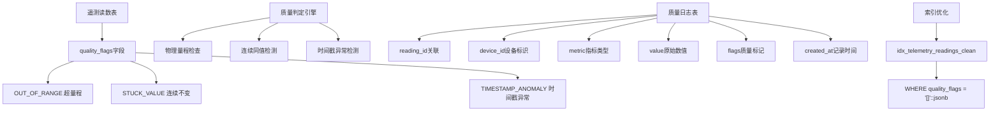

**图表来源**
- [infra/postgres/migrations/049_telemetry_quality.sql:7-26](file://infra/postgres/migrations/049_telemetry_quality.sql#L7-L26)

**章节来源**
- [infra/postgres/migrations/049_telemetry_quality.sql:1-26](file://infra/postgres/migrations/049_telemetry_quality.sql#L1-L26)

### 业务历史清理与演示账号恢复机制

**新增** 迁移 046 实现了业务历史七表清理与演示账号恢复机制，确保平台在业务历史清理后仍能保持空列表可用态。

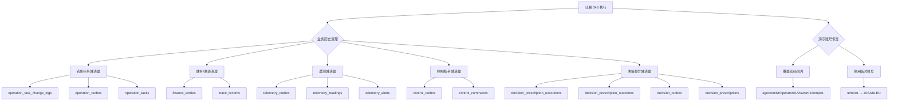

**图表来源**
- [infra/postgres/migrations/046_history_clear_demo_restore.sql:12-34](file://infra/postgres/migrations/046_history_clear_demo_restore.sql#L12-L34)
- [infra/postgres/migrations/046_history_clear_demo_restore.sql:36-49](file://infra/postgres/migrations/046_history_clear_demo_restore.sql#L36-L49)

**章节来源**
- [infra/postgres/migrations/046_history_clear_demo_restore.sql:1-49](file://infra/postgres/migrations/046_history_clear_demo_restore.sql#L1-L49)

### 处方执行回流完整链路
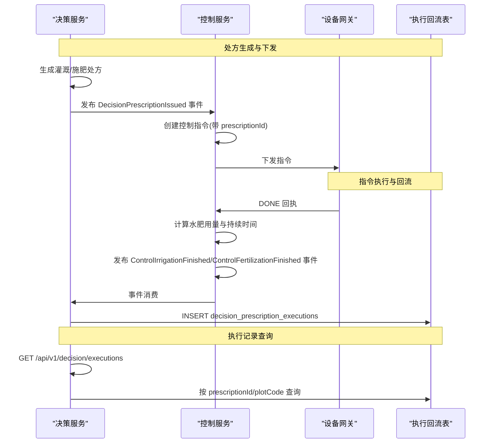

**图表来源**
- [apps/decision-service/src/consumer.ts:67-114](file://apps/decision-service/src/consumer.ts#L67-L114)
- [apps/control-service/src/command-finished.ts:117-135](file://apps/control-service/src/command-finished.ts#L117-L135)
- [apps/decision-service/src/http.ts:301-313](file://apps/decision-service/src/http.ts#L301-L313)

**章节来源**
- [apps/decision-service/src/consumer.ts:19-114](file://apps/decision-service/src/consumer.ts#L19-L114)
- [apps/control-service/src/command-finished.ts:8-135](file://apps/control-service/src/command-finished.ts#L8-L135)
- [apps/decision-service/src/http.ts:301-313](file://apps/decision-service/src/http.ts#L301-L313)

### 控制指令生命周期管理
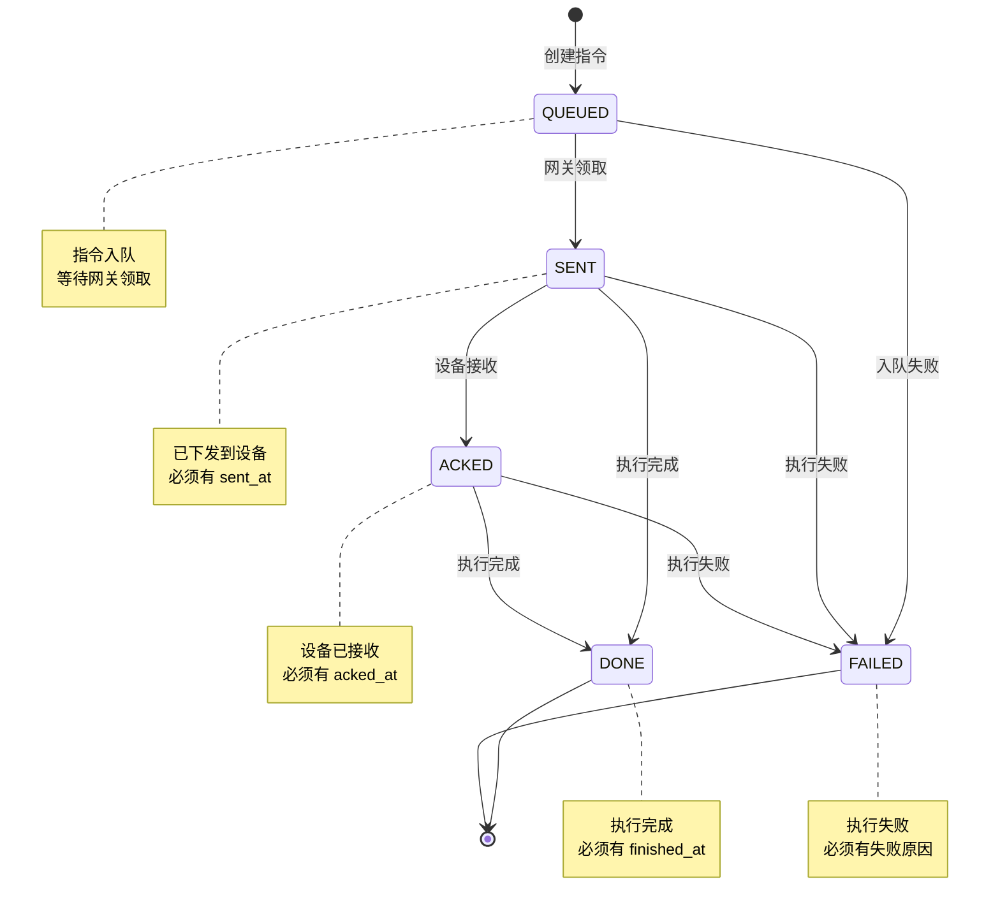

**图表来源**
- [apps/control-service/src/control.repository.ts:31-37](file://apps/control-service/src/control.repository.ts#L31-L37)
- [infra/postgres/migrations/031_control_command_receipt.sql:8-11](file://infra/postgres/migrations/031_control_command_receipt.sql#L8-L11)

**章节来源**
- [apps/control-service/src/control.repository.ts:31-37](file://apps/control-service/src/control.repository.ts#L31-L37)
- [infra/postgres/migrations/031_control_command_receipt.sql:8-11](file://infra/postgres/migrations/031_control_command_receipt.sql#L8-L11)

### 控制指令回执处理流程
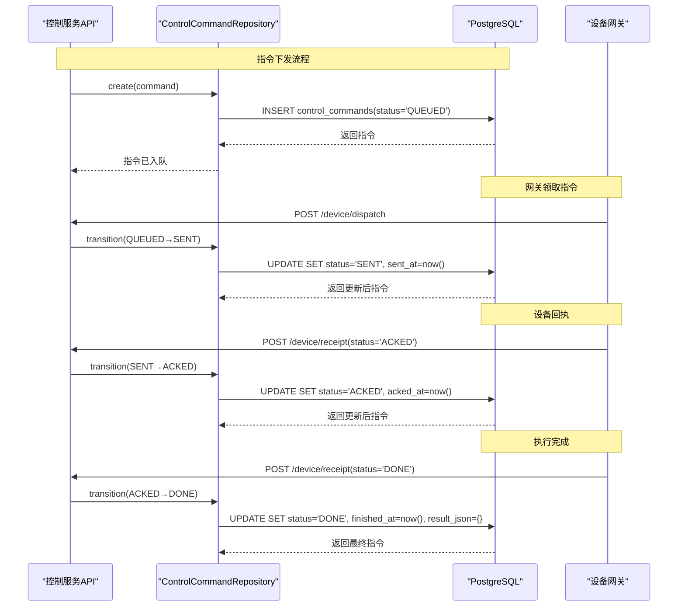

**图表来源**
- [apps/control-service/src/http.ts:208-264](file://apps/control-service/src/http.ts#L208-L264)
- [apps/control-service/src/control.repository.ts:255-283](file://apps/control-service/src/control.repository.ts#L255-L283)

**章节来源**
- [apps/control-service/src/http.ts:208-264](file://apps/control-service/src/http.ts#L208-L264)
- [apps/control-service/src/control.repository.ts:255-283](file://apps/control-service/src/control.repository.ts#L255-L283)

### 农事任务生命周期管理
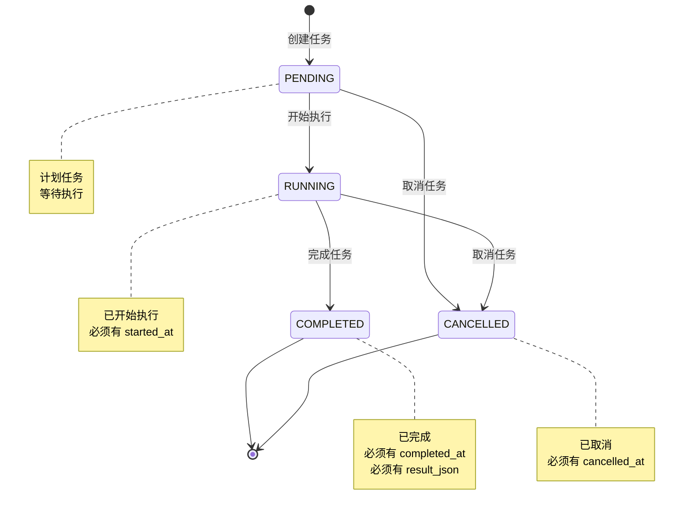

**图表来源**
- [apps/operation-service/src/task.repository.ts:48-53](file://apps/operation-service/src/task.repository.ts#L48-L53)
- [infra/postgres/migrations/016_operation_tasks.sql:7-20](file://infra/postgres/migrations/016_operation_tasks.sql#L7-L20)

**章节来源**
- [apps/operation-service/src/task.repository.ts:48-53](file://apps/operation-service/src/task.repository.ts#L48-L53)
- [infra/postgres/migrations/016_operation_tasks.sql:7-20](file://infra/postgres/migrations/016_operation_tasks.sql#L7-L20)

### 农事任务演示数据加载流程
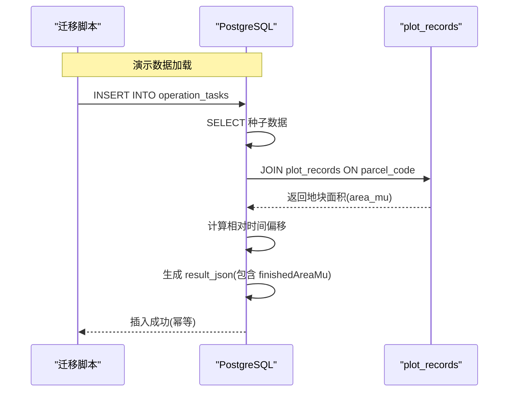

**图表来源**
- [infra/postgres/migrations/030_operation_task_demo_data.sql:14-47](file://infra/postgres/migrations/030_operation_task_demo_data.sql#L14-L47)

**章节来源**
- [infra/postgres/migrations/030_operation_task_demo_data.sql:1-48](file://infra/postgres/migrations/030_operation_task_demo_data.sql#L1-L48)

### 地块合并与拆分流程
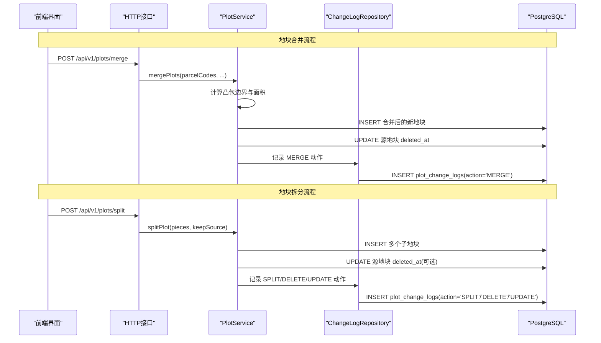

**图表来源**
- [apps/plot-service/src/http.ts:616-679](file://apps/plot-service/src/http.ts#L616-L679)
- [apps/plot-service/src/plot.service.ts:276-411](file://apps/plot-service/src/plot.service.ts#L276-L411)
- [apps/plot-service/src/plot-change-log.repository.ts:60-72](file://apps/plot-service/src/plot-change-log.repository.ts#L60-L72)

**章节来源**
- [apps/plot-service/src/http.ts:616-679](file://apps/plot-service/src/http.ts#L616-L679)
- [apps/plot-service/src/plot.service.ts:276-411](file://apps/plot-service/src/plot.service.ts#L276-L411)
- [apps/plot-service/src/plot-change-log.repository.ts:52-83](file://apps/plot-service/src/plot-change-log.repository.ts#L52-L83)

### 片区管理与地块档案流程
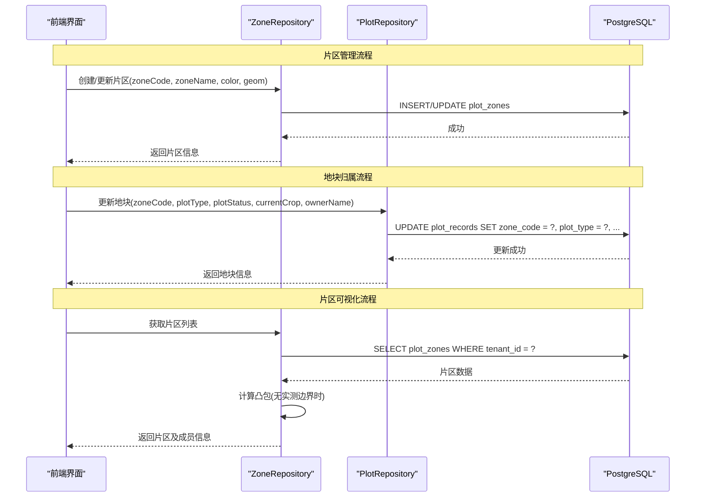

**图表来源**
- [apps/plot-service/src/zone.repository.ts:121-193](file://apps/plot-service/src/zone.repository.ts#L121-L193)
- [apps/plot-service/src/plot.repository.ts:169-200](file://apps/plot-service/src/plot.repository.ts#L169-L200)
- [apps/plot-service/src/zone.geometry.ts:34-75](file://apps/plot-service/src/zone.geometry.ts#L34-L75)

**章节来源**
- [apps/plot-service/src/zone.repository.ts:114-193](file://apps/plot-service/src/zone.repository.ts#L114-L193)
- [apps/plot-service/src/plot.repository.ts:138-200](file://apps/plot-service/src/plot.repository.ts#L138-L200)
- [apps/plot-service/src/zone.geometry.ts:1-75](file://apps/plot-service/src/zone.geometry.ts#L1-L75)

### 四情监测与虫情处理流程
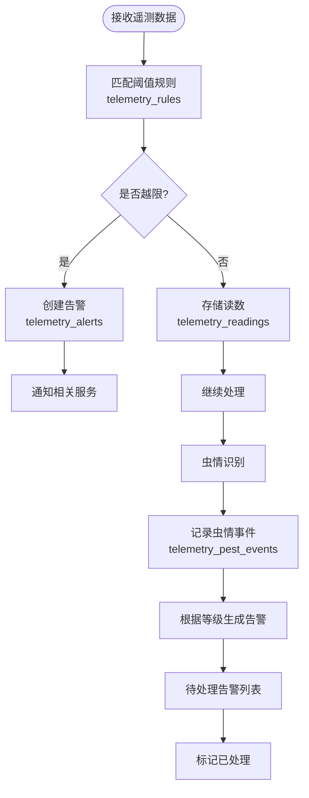

**图表来源**
- [apps/telemetry-service/src/reading.repository.ts:104-118](file://apps/telemetry-service/src/reading.repository.ts#L104-L118)
- [apps/telemetry-service/src/pest.repository.ts:71-113](file://apps/telemetry-service/src/pest.repository.ts#L71-L113)
- [infra/postgres/migrations/008_agro_monitoring.sql:11-74](file://infra/postgres/migrations/008_agro_monitoring.sql#L11-L74)

**章节来源**
- [apps/telemetry-service/src/reading.repository.ts:96-202](file://apps/telemetry-service/src/reading.repository.ts#L96-L202)
- [apps/telemetry-service/src/pest.repository.ts:64-113](file://apps/telemetry-service/src/pest.repository.ts#L64-L113)
- [infra/postgres/migrations/008_agro_monitoring.sql:11-74](file://infra/postgres/migrations/008_agro_monitoring.sql#L11-L74)

### 决策规则与处方生成流程
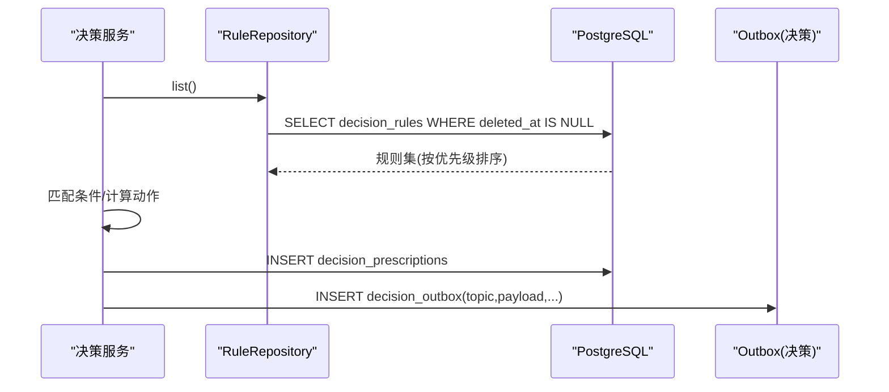

**图表来源**
- [apps/decision-service/src/rule.repository.ts:206-212](file://apps/decision-service/src/rule.repository.ts#L206-L212)
- [infra/postgres/migrations/002_decision_telemetry.sql:5-34](file://infra/postgres/migrations/002_decision_telemetry.sql#L5-L34)
- [infra/postgres/migrations/002_decision_telemetry.sql:61-73](file://infra/postgres/migrations/002_decision_telemetry.sql#L61-L73)

**章节来源**
- [apps/decision-service/src/rule.repository.ts:11-48](file://apps/decision-service/src/rule.repository.ts#L11-L48)
- [apps/decision-service/src/rule.repository.ts:181-296](file://apps/decision-service/src/rule.repository.ts#L181-L296)
- [infra/postgres/migrations/002_decision_telemetry.sql:5-34](file://infra/postgres/migrations/002_decision_telemetry.sql#L5-L34)

### 遥测读数与告警处理流程
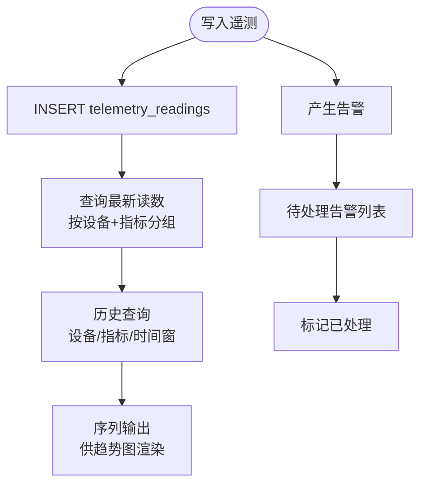

**图表来源**
- [apps/telemetry-service/src/reading.repository.ts:104-118](file://apps/telemetry-service/src/reading.repository.ts#L104-L118)
- [apps/telemetry-service/src/reading.repository.ts:120-156](file://apps/telemetry-service/src/reading.repository.ts#L120-L156)
- [apps/telemetry-service/src/reading.repository.ts:171-201](file://apps/telemetry-service/src/reading.repository.ts#L171-L201)

**章节来源**
- [apps/telemetry-service/src/reading.repository.ts:96-202](file://apps/telemetry-service/src/reading.repository.ts#L96-L202)

### 农事任务完成事件处理流程
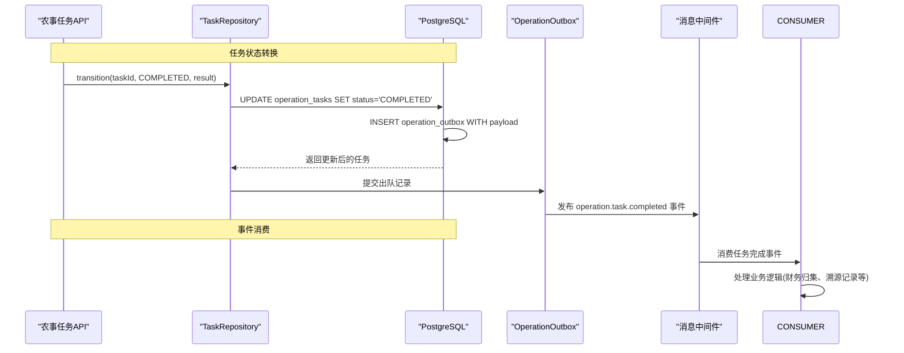

**图表来源**
- [apps/operation-service/src/task.repository.ts:138-151](file://apps/operation-service/src/task.repository.ts#L138-L151)
- [apps/operation-service/src/outbox.repository.ts:9-14](file://apps/operation-service/src/outbox.repository.ts#L9-L14)
- [packages/contracts/src/events/topic.ts:13](file://packages/contracts/src/events/topic.ts#L13)
- [packages/contracts/src/events/payload.ts:91-102](file://packages/contracts/src/events/payload.ts#L91-L102)

**章节来源**
- [apps/operation-service/src/task.repository.ts:138-151](file://apps/operation-service/src/task.repository.ts#L138-L151)
- [apps/operation-service/src/outbox.repository.ts:9-14](file://apps/operation-service/src/outbox.repository.ts#L9-L14)
- [packages/contracts/src/events/topic.ts:13](file://packages/contracts/src/events/topic.ts#L13)
- [packages/contracts/src/events/payload.ts:91-102](file://packages/contracts/src/events/payload.ts#L91-L102)

## 依赖关系分析
- 服务与表耦合：
  - PlotRepository ↔ plot_records
  - ZoneRepository ↔ plot_zones
  - FinanceRepository ↔ finance_entries
  - TraceRepository ↔ trace_records
  - RuleRepository ↔ decision_rules / decision_prescriptions / decision_outbox
  - **ExecutionRepository ↔ decision_prescription_executions / decision_prescription_outcomes**
  - ReadingRepository/AlertRepository ↔ telemetry_readings / telemetry_alerts / telemetry_outbox
  - PestEventRepository ↔ telemetry_pest_events
  - **TelemetryService ↔ telemetry_rules**
  - SessionRepository ↔ auth_sessions / auth_users
  - **PlotService ↔ plot_change_logs（通过 ChangeLogRepository）**
  - **TaskRepository ↔ operation_tasks / operation_outbox / operation_task_change_logs**
  - **ControlCommandRepository ↔ control_commands / control_outbox**
  - **VideoService ↔ video_ai_events**
  - **MessageService ↔ ops_messages**
  - **QualityLogRepository ↔ telemetry_quality_logs**
- 间接依赖：
  - 决策服务依赖遥测读数作为规则输入（由业务侧聚合后传入）。
  - **决策服务依赖处方执行回流表记录实际执行事实，支撑效果评估闭环。**
  - **控制服务通过结单事件驱动决策服务的执行回流消费。**
  - 出队表与消息中间件解耦服务间通信，保障最终一致性。
  - **认证服务与会话表强依赖，支持多实例部署和会话立即失效。**
  - **片区与地块存在逻辑关联，通过 zone_code 字段建立关系。**
  - **四情监测规则与遥测告警存在业务关联，规则触发告警生成。**
  - **地块变更日志与地块档案存在逻辑关联，通过 parcel_code 字段建立关系。**
  - **农事任务与地块存在逻辑关联，通过 plot_code 字段建立关系。**
  - **农事任务出队与任务表存在强关联，通过 task_id 外键约束建立关系。**
  - **控制指令与地块存在逻辑关联，通过 plot_code 字段建立关系。**
  - **控制指令与遥测/决策服务存在业务关联，由越限或处方事件触发。**
  - **控制指令现已实现完整的租户隔离，与 operation_tasks 和 video_ptz_commands 保持同一隔离口径。**
  - **视频AI事件与消息中心存在业务关联，AI识别事件触发消息生成。**
  - **遥测质量日志与遥测读数存在强关联，通过 reading_id 建立关系。**

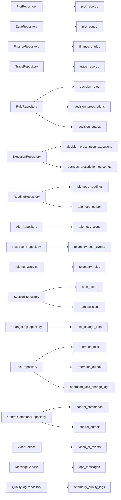

**图表来源**
- [apps/plot-service/src/plot.repository.ts:94-186](file://apps/plot-service/src/plot.repository.ts#L94-L186)
- [apps/plot-service/src/zone.repository.ts:114-193](file://apps/plot-service/src/zone.repository.ts#L114-L193)
- [apps/finance-service/src/repository.ts:14-21](file://apps/finance-service/src/repository.ts#L14-L21)
- [apps/trace-service/src/repository.ts:13-19](file://apps/trace-service/src/repository.ts#L13-L19)
- [apps/decision-service/src/rule.repository.ts:181-296](file://apps/decision-service/src/rule.repository.ts#L181-L296)
- [apps/decision-service/src/execution.repository.ts:94-157](file://apps/decision-service/src/execution.repository.ts#L94-L157)
- [apps/telemetry-service/src/reading.repository.ts:96-202](file://apps/telemetry-service/src/reading.repository.ts#L96-L202)
- [apps/telemetry-service/src/pest.repository.ts:64-113](file://apps/telemetry-service/src/pest.repository.ts#L64-L113)
- [apps/auth-service/src/session.repository.ts:117-162](file://apps/auth-service/src/session.repository.ts#L117-L162)
- [apps/plot-service/src/plot-change-log.repository.ts:52-83](file://apps/plot-service/src/plot-change-log.repository.ts#L52-L83)
- [apps/operation-service/src/task.repository.ts:106-153](file://apps/operation-service/src/task.repository.ts#L106-L153)
- [apps/control-service/src/control.repository.ts:160-200](file://apps/control-service/src/control.repository.ts#L160-L200)
- [apps/video-service/src/ai-event.repository.ts:133-189](file://apps/video-service/src/ai-event.repository.ts#L133-L189)
- [apps/message-service/src/message.repository.ts:173-252](file://apps/message-service/src/message.repository.ts#L173-L252)
- [apps/telemetry-service/src/quality-log.repository.ts:56-108](file://apps/telemetry-service/src/quality-log.repository.ts#L56-L108)

**章节来源**
- [apps/plot-service/src/plot.repository.ts:94-186](file://apps/plot-service/src/plot.repository.ts#L94-L186)
- [apps/plot-service/src/zone.repository.ts:114-193](file://apps/plot-service/src/zone.repository.ts#L114-L193)
- [apps/finance-service/src/repository.ts:14-21](file://apps/finance-service/src/repository.ts#L14-L21)
- [apps/trace-service/src/repository.ts:13-19](file://apps/trace-service/src/repository.ts#L13-L19)
- [apps/decision-service/src/rule.repository.ts:181-296](file://apps/decision-service/src/rule.repository.ts#L181-L296)
- [apps/decision-service/src/execution.repository.ts:94-157](file://apps/decision-service/src/execution.repository.ts#L94-L157)
- [apps/telemetry-service/src/reading.repository.ts:96-202](file://apps/telemetry-service/src/reading.repository.ts#L96-L202)
- [apps/telemetry-service/src/pest.repository.ts:64-113](file://apps/telemetry-service/src/pest.repository.ts#L64-L113)
- [apps/auth-service/src/session.repository.ts:117-162](file://apps/auth-service/src/session.repository.ts#L117-L162)
- [apps/plot-service/src/plot-change-log.repository.ts:52-83](file://apps/plot-service/src/plot-change-log.repository.ts#L52-L83)
- [apps/operation-service/src/task.repository.ts:106-153](file://apps/operation-service/src/task.repository.ts#L106-L153)
- [apps/control-service/src/control.repository.ts:160-200](file://apps/control-service/src/control.repository.ts#L160-L200)
- [apps/video-service/src/ai-event.repository.ts:133-189](file://apps/video-service/src/ai-event.repository.ts#L133-L189)
- [apps/message-service/src/message.repository.ts:173-252](file://apps/message-service/src/message.repository.ts#L173-L252)
- [apps/telemetry-service/src/quality-log.repository.ts:56-108](file://apps/telemetry-service/src/quality-log.repository.ts#L56-L108)

## 性能考虑
- 索引优化
  - 租户+时间降序索引：plot_records.tenant_id + created_at（软删除过滤）。
  - 地块+时间降序索引：finance_entries、trace_records 常用查询路径。
  - 规则启用+优先级索引：decision_rules.enabled + priority（软删除过滤）。
  - 遥测设备+指标+时间索引：telemetry_readings.device_id + metric + recorded_at。
  - 全局时间索引：telemetry_readings.recorded_at。
  - 告警待处理索引：telemetry_alerts.handled + created_at。
  - 出队未发布索引：decision_outbox/telemetry_outbox.created_at WHERE published_at IS NULL。
  - **处方执行回流索引：decision_prescription_executions.command_id 唯一索引确保幂等写入，idx_decision_executions_prescription(prescription_id, finished_at DESC) 支持按处方查询执行历史，idx_decision_executions_plot(plot_code, finished_at DESC) 支持按地块查询执行统计。**
  - **处方结果评估索引：idx_decision_outcomes_prescription(prescription_id, evaluated_at DESC)、idx_decision_outcomes_plot(plot_code, evaluated_at DESC)**
  - 认证会话索引：auth_sessions.user_id 快速查找用户会话，auth_sessions.expires_at 支持批量清理。
  - 四情监测规则索引：telemetry_rules.metric 唯一索引，避免重复规则。
  - 虫情事件索引：telemetry_pest_events.plot_code + detected_at、handled + detected_at 优化查询。
  - 基础设施线路索引：infra_lines.tenant_id + line_type 支持按租户和类型筛选，**新增 idx_infra_lines_enabled(tenant_id, enabled) 支持按启用状态筛选**。
  - 片区索引：plot_zones.tenant_id + farm_id 支持按农场筛选。
  - 地块档案索引：plot_records.tenant_id + plot_status + plot_type 支持列表页筛选。
  - 地块变更日志索引：plot_change_logs.parcel_code + created_at 支持按地块时间线查询。
  - 农事任务索引：operation_tasks.tenant_id + created_at DESC + id DESC 支持分页查询，operation_tasks.tenant_id + plot_code 支持按地块筛选。
  - **农事任务变更日志索引：idx_operation_task_change_logs_task(task_id, created_at DESC) 支持按任务时间线查询。**
  - 农事任务出队索引：operation_outbox.created_at WHERE published_at IS NULL 支持待处理事件查询。
  - 控制指令索引优化：idx_control_commands_tenant_created(tenant_id, created_at DESC, id DESC) 支持租户级列表查询，idx_control_commands_open(tenant_id, created_at DESC, id) WHERE status IN ('QUEUED','SENT','ACKED') 支持单租户待回执看板查询。
  - **控制出队索引：idx_control_outbox_pending(created_at) WHERE published_at IS NULL 支持待处理事件查询。**
  - **视频AI事件索引：idx_video_ai_events_type(tenant_id, event_type, received_at DESC) 支持按事件类型筛选。**
  - **遥测质量日志索引：idx_telemetry_quality_logs_time(created_at DESC)、idx_telemetry_quality_logs_device(device_id, metric, created_at DESC) 支持质量异常审计查询。**
  - **遥测干净数据索引：idx_telemetry_readings_clean(device_id, metric, recorded_at DESC) WHERE quality_flags = '[]'::jsonb 优化高质量数据查询。**
- 查询优化
  - 遥测最新值使用窗口函数 ROW_NUMBER 分区取最近一条。
  - 历史查询默认 limit=200，最大 2000，防止大结果集拖慢响应。
  - 规则列表按 priority、created_at 排序，确保稳定顺序。
  - **处方执行查询默认返回最近 200 条记录，支持按 prescriptionId 和 plotCode 过滤，按 finished_at DESC, id DESC 排序。**
  - **处方结果评估查询支持按 prescriptionId 和 plotCode 过滤，按 evaluated_at DESC 排序。**
  - 会话查找使用 EXPIRES_AT > NOW() 在数据库层面过滤过期会话。
  - 片区查询按 zone_code ASC 排序，确保稳定的列表顺序。
  - 虫情事件查询支持 pendingOnly 参数，优化待处理事件查询。
  - 地块变更日志查询按 created_at DESC, id DESC 排序，确保最新的变更记录在前。
  - **农事任务变更日志查询按 created_at DESC, id DESC 排序，确保最新的变更记录在前。**
  - 农事任务查询支持 keyword 模糊搜索、status/type/plotCode 过滤、from/to 时间范围筛选。
  - 控制指令查询支持 plotCode、origin、type、status、deviceId、from/to 过滤，pending 参数优化待回执指令查询，现已支持租户级查询优化。
  - **基础设施线路查询支持按租户、启用状态、模板标记、适用机型等条件筛选。**
  - **视频AI事件查询支持按事件类型、转发状态、地块等条件筛选。**
  - **遥测质量日志查询支持按设备、指标、质量标记等条件筛选。**
- 写入优化
  - 使用原生 SQL 批量插入/更新，减少 ORM 开销。
  - 软删除利用部分索引降低扫描成本。
  - **处方执行回流使用 ON CONFLICT (command_id) DO NOTHING 确保事件重放幂等性，同一条指令只记录一次。**
  - 会话创建使用 ON CONFLICT DO UPDATE 实现幂等写入。
  - 演示数据使用 ON CONFLICT DO NOTHING 确保迁移幂等性。
  - 地块变更日志使用追加式写入，避免修改历史数据。
  - **农事任务变更日志使用追加式写入，避免修改历史数据。**
  - 农事任务状态转换使用原子 UPDATE + INSERT 操作，确保状态变更与出队写入的一致性。
  - 控制指令创建使用 ON CONFLICT DO NOTHING 确保自动指令幂等性。
  - **控制出队与控制指令状态跃迁同事务写入，保证状态改到位与事件发出去同时成功。**
  - **遥测质量日志使用追加式写入，记录每条可疑读数的详细信息。**
- 扩展建议
  - 对遥测表考虑分区（按时间或地块），结合 pg_partman 或原生分区表。
  - 对 JSONB 字段建立 GIN 索引（如 condition_json/action_json）以提升复杂条件检索。
  - 对地理字段建议使用 PostGIS 几何类型替代 JSONB，以获得空间算子与索引优势。
  - **对处方执行回流表考虑按 finished_at 分区，优化时间范围查询性能。**
  - **对处方结果评估表考虑按 evaluated_at 分区，优化时间范围查询性能。**
  - 对认证会话表考虑按 expires_at 分区，优化过期清理性能。
  - 对虫情事件表考虑按 detected_at 分区，优化时间范围查询。
  - 对基础设施线路表考虑按 line_type 分区，优化不同类型线路的管理。
  - 对地块变更日志表考虑按 parcel_code 分区，优化大规模地块的审计查询。
  - **对农事任务变更日志表考虑按 task_id 分区，优化大规模任务的审计查询。**
  - 对农事任务表考虑按 tenant_id + created_at 分区，优化大规模任务的查询性能。
  - 对农事任务出队表考虑按 created_at 分区，优化事件处理的吞吐能力。
  - **对控制出队表考虑按 created_at 分区，优化事件处理的吞吐能力。**
  - 对控制指令表考虑按 tenant_id + status + created_at 分区，优化多租户场景下的查询性能。
  - **对视频AI事件表考虑按 received_at 分区，优化AI事件的时间范围查询。**
  - **对遥测质量日志表考虑按 created_at 分区，优化质量异常的审计查询。**

**章节来源**
- [infra/postgres/001_initial_schema.sql:16-16](file://infra/postgres/001_initial_schema.sql#L16-L16)
- [infra/postgres/001_initial_schema.sql:29-29](file://infra/postgres/001_initial_schema.sql#L29-L29)
- [infra/postgres/001_initial_schema.sql:40-40](file://infra/postgres/001_initial_schema.sql#L40-L40)
- [infra/postgres/migrations/002_decision_telemetry.sql:18-18](file://infra/postgres/migrations/002_decision_telemetry.sql#L18-L18)
- [infra/postgres/migrations/002_decision_telemetry.sql:34-34](file://infra/postgres/migrations/002_decision_telemetry.sql#L34-L34)
- [infra/postgres/migrations/002_decision_telemetry.sql:45-46](file://infra/postgres/migrations/002_decision_telemetry.sql#L45-L46)
- [infra/postgres/migrations/002_decision_telemetry.sql:59-59](file://infra/postgres/migrations/002_decision_telemetry.sql#L59-L59)
- [infra/postgres/migrations/002_decision_telemetry.sql:73-73](file://infra/postgres/migrations/002_decision_telemetry.sql#L73-L73)
- [infra/postgres/migrations/003_event_bus_messages.sql:60-61](file://infra/postgres/migrations/003_event_bus_messages.sql#L60-L61)
- [infra/postgres/migrations/005_control_commands.sql:22-23](file://infra/postgres/migrations/005_control_commands.sql#L22-L23)
- [infra/postgres/migrations/007_auth_sessions.sql:19-20](file://infra/postgres/migrations/007_auth_sessions.sql#L19-L20)
- [infra/postgres/migrations/008_agro_monitoring.sql:23-49](file://infra/postgres/migrations/008_agro_monitoring.sql#L23-L49)
- [infra/postgres/migrations/009_plot_zones.sql:26-29](file://infra/postgres/migrations/009_plot_zones.sql#L26-L29)
- [infra/postgres/migrations/011_plot_profile.sql:22-22](file://infra/postgres/migrations/011_plot_profile.sql#L22-L22)
- [infra/postgres/migrations/016_operation_tasks.sql:22-23](file://infra/postgres/migrations/016_operation_tasks.sql#L22-L23)
- [infra/postgres/migrations/027_plot_change_logs.sql:20-21](file://infra/postgres/migrations/027_plot_change_logs.sql#L20-L21)
- [infra/postgres/migrations/031_control_command_receipt.sql:36-37](file://infra/postgres/migrations/031_control_command_receipt.sql#L36-L37)
- [infra/postgres/migrations/032_control_command_tenant.sql:14-21](file://infra/postgres/migrations/032_control_command_tenant.sql#L14-L21)
- [infra/postgres/migrations/033_control_outbox.sql:19](file://infra/postgres/migrations/033_control_outbox.sql#L19)
- [infra/postgres/migrations/034_decision_prescription_executions.sql:31-32](file://infra/postgres/migrations/034_decision_prescription_executions.sql#L31-L32)
- [infra/postgres/migrations/039_operation_task_change_logs.sql:28-29](file://infra/postgres/migrations/039_operation_task_change_logs.sql#L28-L29)
- [infra/postgres/migrations/047_infra_line_attributes.sql:22](file://infra/postgres/migrations/047_infra_line_attributes.sql#L22)
- [infra/postgres/migrations/048_ai_event_types_message_dispatch.sql:22](file://infra/postgres/migrations/048_ai_event_types_message_dispatch.sql#L22)
- [infra/postgres/migrations/049_telemetry_quality.sql:10-11](file://infra/postgres/migrations/049_telemetry_quality.sql#L10-L11)
- [infra/postgres/migrations/049_telemetry_quality.sql:25-26](file://infra/postgres/migrations/049_telemetry_quality.sql#L25-L26)
- [apps/telemetry-service/src/reading.repository.ts:120-133](file://apps/telemetry-service/src/reading.repository.ts#L120-L133)
- [apps/telemetry-service/src/reading.repository.ts:135-156](file://apps/telemetry-service/src/reading.repository.ts#L135-L156)
- [apps/decision-service/src/rule.repository.ts:206-212](file://apps/decision-service/src/rule.repository.ts#L206-L212)
- [apps/decision-service/src/execution.repository.ts:128-147](file://apps/decision-service/src/execution.repository.ts#L128-L147)
- [apps/auth-service/src/session.repository.ts:120-161](file://apps/auth-service/src/session.repository.ts#L120-L161)
- [apps/operation-service/src/task.repository.ts:108-122](file://apps/operation-service/src/task.repository.ts#L108-L122)
- [apps/control-service/src/control.repository.ts:188-239](file://apps/control-service/src/control.repository.ts#L188-L239)

## 故障排查指南
- 遥测数据缺失或重复
  - 检查写入是否处于事务中，确认 executor(tx) 正确选择事务对象。
  - 核对 ulid 生成与去重策略，避免并发写入冲突。
- 规则未生效
  - 检查 decision_rules.enabled 与 priority 配置；确认 condition_json/action_json 规范化。
  - 查看 outbox 是否成功 publish，last_error 是否记录错误信息。
- 告警堆积
  - 检查 pending 列表与 markHandled 接口调用；确认 handled_at 更新时间戳。
- 地块查询缓慢
  - 确认 tenant_id 与 created_at 索引命中；检查 deleted_at 过滤是否正确。
- 财务汇总异常
  - 校验 kind 枚举与 amount 非负约束；确认 GROUP BY kind 聚合逻辑。
- **认证会话问题**
  - 检查 auth_sessions 表是否存在，确认迁移 007 已执行。
  - 验证 token_hash 是否正确生成和存储，确认 expires_at 字段正常更新。
  - 检查用户状态是否为 ACTIVE，确认 user_id 外键约束正常。
  - 监控会话清理任务，确认过期会话被及时清理。
- **四情监测规则问题**
  - 检查 telemetry_rules 表中规则是否正确配置，确认 metric 唯一性约束。
  - 验证 direction 和 level 枚举值是否符合规范。
  - 检查规则启用状态 enabled 是否正确设置。
- **虫情事件处理问题**
  - 检查 telemetry_pest_events 表数据完整性，确认 level 和 confidence 范围约束。
  - 验证图片文件关联 image_file_id 是否正确。
  - 检查处理状态 handled 更新逻辑是否正常。
- **片区管理问题**
  - 检查 plot_zones 表数据完整性，确认 zone_code 唯一性约束。
  - 验证地块 zone_code 关联是否正确，确认片区归属关系。
  - 检查几何数据 geom 格式是否正确，确认 Polygon 坐标有效性。
- **地块档案字段问题**
  - 检查 plot_type 和 plot_status 枚举值是否符合规范。
  - 验证 current_crop、owner_name、owner_phone 等字段数据完整性。
  - 确认索引 idx_plot_records_profile 是否正确创建。
- **地块变更日志问题**
  - 检查 plot_change_logs 表是否存在，确认迁移 027 和 029 已执行。
  - 验证 action 枚举值是否符合 CREATE/UPDATE/DELETE/MERGE/SPLIT 规范。
  - 检查 summary 字段是否包含有意义的操作描述。
  - 确认 actor 字段正确记录了操作人标识。
  - 验证索引 idx_plot_change_logs_plot 是否正确创建。
- **农事任务问题**
  - 检查 operation_tasks 表是否存在，确认迁移 016 已执行。
  - 验证 type 枚举值是否符合 TILLAGE/SEEDING/IRRIGATION/WEEDING/SPRAYING/FERTILIZATION 规范。
  - 检查 status 状态转换是否符合 PENDING→RUNNING→COMPLETED 或 PENDING→CANCELLED 的规则。
  - 验证时间字段约束：RUNNING 必须有 started_at，COMPLETED 必须有 completed_at 和 result_json，CANCELLED 必须有 cancelled_at。
  - 检查 result_json 字段结构是否包含 outcome、finishedAreaMu、notes 字段。
  - 确认索引 idx_operation_tasks_tenant_created 和 idx_operation_tasks_plot 是否正确创建。
- **农事任务变更日志问题**
  - 检查 operation_task_change_logs 表是否存在，确认迁移 039 已执行。
  - 验证 action 枚举值是否符合 CREATE/TRANSITION/ARCHIVE 规范。
  - 检查 summary 字段是否包含有意义的操作描述。
  - 确认 actor 字段正确记录了操作人标识。
  - 验证 trace_id 字段是否正确记录追踪ID。
  - 确认索引 idx_operation_task_change_logs_task 是否正确创建。
- **农事任务演示数据问题**
  - 检查迁移 030 是否执行成功，确认八条演示任务数据已插入。
  - 验证演示任务覆盖六种作业类型和四种状态。
  - 检查演示任务的时间偏移计算是否正确，确保有正在进行、未来排程和历史完成的任务。
  - 验证演示任务的 finishedAreaMu 是否从 plot_records.area_mu 动态获取。
  - 确认演示数据使用 ON CONFLICT DO NOTHING 确保幂等性。
- **农事任务出队问题**
  - 检查 operation_outbox 表是否存在，确认迁移 016 已执行。
  - 验证 task_id 外键约束是否正确关联到 operation_tasks.id。
  - 检查待处理事件的查询逻辑，确认 published_at IS NULL 过滤条件。
  - 监控事件发布状态，确认 published_at 字段正常更新。
  - 检查重试机制，确认 retry_count 和 last_error 字段正确记录失败信息。
- **控制指令问题**
  - 检查 control_commands 表是否存在，确认迁移 005、031 和 032 已执行。
  - 验证 type 枚举值是否符合 SEEDING/IRRIGATION/WEEDING/FERTILIZATION/ESTOP 规范。
  - 检查 status 状态转换是否符合 QUEUED→SENT→ACKED→DONE 或任意状态→FAILED 的规则。
  - 验证时间字段约束：sent_at ≤ acked_at ≤ finished_at。
  - 检查 result_json 字段结构，特别是急停指令的 result.confirmed 字段。
  - 确认索引 idx_control_commands_tenant_created 和 idx_control_commands_open 是否正确创建。
  - 验证乐观锁 version 字段是否正确递增，防止并发回执冲突。
  - 检查设备回执接口是否正确调用，确认 receipt_message 和 result_json 字段更新。
  - **租户隔离问题：确认 tenant_id 字段是否正确设置，跨租户查询是否被正确拒绝。**
  - **租户查询性能：检查租户级索引是否命中，确认列表查询和待回执看板查询性能。**
- **控制出队问题**
  - 检查 control_outbox 表是否存在，确认迁移 033 已执行。
  - 验证 topic、payload_json、tenant_id、trace_id、producer 字段是否正确设置。
  - 检查待处理事件的查询逻辑，确认 published_at IS NULL 过滤条件。
  - 监控事件发布状态，确认 published_at 字段正常更新。
  - 检查重试机制，确认 retry_count 和 last_error 字段正确记录失败信息。
  - **与控制指令状态跃迁的事务一致性：确认状态变更与出队写入在同一事务中。**
- **处方执行回流问题**
  - 检查 decision_prescription_executions 表是否存在，确认迁移 034 已执行。
  - 验证 plan_type 枚举值是否符合 irrigation/fertilization 规范。
  - 检查 water_volume_source/fertilizer_source 枚举值是否符合 DEVICE/PLAN 规范。
  - 验证 duration_source 枚举值是否符合 DEVICE/RUNTIME 规范。
  - 确认 command_id 唯一索引是否正确创建，确保事件重放幂等性。
  - 检查 idx_decision_executions_prescription 和 idx_decision_executions_plot 索引是否正确创建。
  - 验证处方执行回流接口 GET /api/v1/decision/executions 是否正常工作。
  - **用量来源语义：确认 DEVICE 表示设备实测值，PLAN 表示按指令参数计算的理论值。**
  - **事件重放幂等性：确认同一条指令的重投事件不会重复记账。**
  - **处方关联完整性：确认 prescriptionId 对应的处方存在，避免指向空处方的记录。**
- **处方结果评估问题**
  - 检查 decision_prescription_outcomes 表是否存在，确认迁移 003 已执行。
  - 验证 soil_moisture_before/soil_moisture_after/target/delta 字段数据完整性。
  - 检查 effective/applied 布尔字段是否正确设置。
  - 验证 suggestion_json 字段结构是否包含有效的建议内容。
  - 确认索引 idx_decision_outcomes_prescription 和 idx_decision_outcomes_plot 是否正确创建。
  - **处方关联完整性：确认 prescriptionId 对应的处方存在，避免指向空处方的记录。**
- **基础设施线路问题**
  - 检查 infra_lines 表是否存在，确认迁移 047 已执行。
  - 验证 width_m/speed_limit_kmh 数值约束是否正确（如果填写必须为正数）。
  - 检查 applicable_machines JSONB数组格式是否正确。
  - 验证 enabled/is_template 布尔字段是否正确设置。
  - 确认 idx_infra_lines_enabled 索引是否正确创建。
  - 检查线路模板复制功能是否正常工作。
- **视频AI事件问题**
  - 检查 video_ai_events 表是否存在，确认迁移 048 已执行。
  - 验证 event_type 枚举值是否符合 PEST/PERSON_INTRUSION/MACHINE_STATUS/FLOOD/LODGING/FIRE/SMOKE 规范。
  - 检查 pest_type 字段条件约束：当event_type不为PEST时可空，PEST类型时必填。
  - 确认 idx_video_ai_events_type 索引是否正确创建。
  - 验证事件类型标签映射是否正确。
- **消息中心问题**
  - 检查 ops_messages 表是否存在，确认迁移 048 已执行。
  - 验证 dispatched/dispatched_by/dispatch_note/dispatched_at 字段是否正确设置。
  - 检查派单与忽略的互斥约束是否正确。
  - 确认派单操作会同时设置 is_read=true。
  - 验证消息查询是否支持新的派单字段筛选。
- **遥测质量问题**
  - 检查 telemetry_readings.quality_flags 字段是否正确添加。
  - 验证 telemetry_quality_logs 表是否正确创建。
  - 检查 quality_flags 数组内容是否符合 OUT_OF_RANGE/STUCK_VALUE/TIMESTAMP_ANOMALY 规范。
  - 确认 idx_telemetry_readings_clean 和 idx_telemetry_quality_logs_* 索引是否正确创建。
  - 验证质量判定逻辑 detectQualityFlags 是否正常工作。
  - 检查质量日志记录是否准确反映可疑读数的详细信息。
- **业务历史清理问题**
  - 检查迁移 046 是否执行成功，确认七张核心业务表历史数据已清理。
  - 验证 devices 表数据是否保留，确认设备台账未被误删。
  - 检查演示账号密码是否正确重置，确认 temp01 账号已被停用。
  - 确认业务页面历史列表为空列表可用态，无悬空引用。
  - 验证各表 outbox 队列/执行/结局/变更留痕辅表已同步清理。

**章节来源**
- [apps/telemetry-service/src/reading.repository.ts:104-118](file://apps/telemetry-service/src/reading.repository.ts#L104-L118)
- [apps/decision-service/src/rule.repository.ts:189-204](file://apps/decision-service/src/rule.repository.ts#L189-L204)
- [infra/postgres/migrations/002_decision_telemetry.sql:61-73](file://infra/postgres/migrations/002_decision_telemetry.sql#L61-L73)
- [infra/postgres/migrations/003_event_bus_messages.sql:45-62](file://infra/postgres/migrations/003_event_bus_messages.sql#L45-L62)
- [apps/telemetry-service/src/reading.repository.ts:186-201](file://apps/telemetry-service/src/reading.repository.ts#L186-L201)
- [infra/postgres/001_initial_schema.sql:16-16](file://infra/postgres/001_initial_schema.sql#L16-L16)
- [apps/finance-service/src/repository.ts:18-21](file://apps/finance-service/src/repository.ts#L18-L21)
- [infra/postgres/migrations/007_auth_sessions.sql:10-20](file://infra/postgres/migrations/007_auth_sessions.sql#L10-L20)
- [infra/postgres/migrations/008_agro_monitoring.sql:11-74](file://infra/postgres/migrations/008_agro_monitoring.sql#L11-L74)
- [infra/postgres/migrations/009_plot_zones.sql:12-48](file://infra/postgres/migrations/009_plot_zones.sql#L12-L48)
- [infra/postgres/migrations/011_plot_profile.sql:14-47](file://infra/postgres/migrations/011_plot_profile.sql#L14-L47)
- [infra/postgres/migrations/016_operation_tasks.sql:1-36](file://infra/postgres/migrations/016_operation_tasks.sql#L1-L36)
- [infra/postgres/migrations/027_plot_change_logs.sql:9-21](file://infra/postgres/migrations/027_plot_change_logs.sql#L9-L21)
- [infra/postgres/migrations/029_plot_change_log_actions.sql:6-9](file://infra/postgres/migrations/029_plot_change_log_actions.sql#L6-L9)
- [infra/postgres/migrations/030_operation_task_demo_data.sql:1-48](file://infra/postgres/migrations/030_operation_task_demo_data.sql#L1-L48)
- [infra/postgres/migrations/031_control_command_receipt.sql:8-37](file://infra/postgres/migrations/031_control_command_receipt.sql#L8-L37)
- [infra/postgres/migrations/032_control_command_tenant.sql:1-22](file://infra/postgres/migrations/032_control_command_tenant.sql#L1-L22)
- [infra/postgres/migrations/033_control_outbox.sql:1-20](file://infra/postgres/migrations/033_control_outbox.sql#L1-L20)
- [infra/postgres/migrations/034_decision_prescription_executions.sql:1-33](file://infra/postgres/migrations/034_decision_prescription_executions.sql#L1-L33)
- [infra/postgres/migrations/039_operation_task_change_logs.sql:1-30](file://infra/postgres/migrations/039_operation_task_change_logs.sql#L1-L30)
- [infra/postgres/migrations/046_history_clear_demo_restore.sql:1-49](file://infra/postgres/migrations/046_history_clear_demo_restore.sql#L1-L49)
- [infra/postgres/migrations/047_infra_line_attributes.sql:1-22](file://infra/postgres/migrations/047_infra_line_attributes.sql#L1-L22)
- [infra/postgres/migrations/048_ai_event_types_message_dispatch.sql:1-27](file://infra/postgres/migrations/048_ai_event_types_message_dispatch.sql#L1-L27)
- [infra/postgres/migrations/049_telemetry_quality.sql:1-26](file://infra/postgres/migrations/049_telemetry_quality.sql#L1-L26)
- [apps/control-service/src/control.repository.ts:160-200](file://apps/control-service/src/control.repository.ts#L160-L200)
- [apps/decision-service/src/execution.repository.ts:94-157](file://apps/decision-service/src/execution.repository.ts#L94-L157)
- [apps/telemetry-service/src/quality.ts:1-65](file://apps/telemetry-service/src/quality.ts#L1-L65)

## 结论
该数据库设计以 PostgreSQL + PostGIS 为基础，围绕地块、财务、溯源、决策与遥测五大域构建了清晰的数据模型与访问路径。通过迁移脚本统一管理 schema 演进，仓储层封装事务与 SQL，结合索引与约束保障性能与一致性。**新增的四情监测阈值规则表、虫情事件表、基础设施线路表和片区管理表进一步完善了平台的监测管理能力，而地块档案字段的增强则提升了地块管理的精细化程度。** 新增的认证会话表 auth_sessions 提供了安全的会话管理机制，支持多实例部署、会话立即失效和高频访问场景。**地块变更日志表 plot_change_logs 的引入完善了审计追踪能力，支持 CREATE/UPDATE/DELETE/MERGE/SPLIT 五种动作类型，确保所有地块操作都有完整的时间线记录。** **农事任务表 operation_tasks 及其出队表 operation_outbox 的引入完善了农事作业的全生命周期管理，支持六种作业类型与四种状态的状态机转换，并通过可靠的出队机制确保任务完成事件的最终一致性。** **控制指令表 control_commands 的完整生命周期跟踪实现了设备控制的闭环管理，支持五态状态机（QUEUED→SENT→ACKED→DONE/FAILED）和完整回执链路，确保设备指令的可追溯性和可靠性。** **新增的处方执行回流表 decision_prescription_executions 实现了决策→控制→执行的完整闭环，使处方效果评估具备客观执行事实支撑，包括用水量、施肥量、持续时间、设备信息和来源归属的完整追踪。** **新增的决策处方结果表 decision_prescription_outcomes 完善了处方效果评估机制，支持土壤湿度变化分析和阈值调整建议。** **新增的控制出队表 control_outbox 保证了控制指令事件投递的可靠性，与控制指令状态跃迁同事务写入。** **新增的农事任务变更日志表 operation_task_change_logs 完善了农事任务的审计追踪能力，支持 CREATE/TRANSITION/ARCHIVE 三种动作类型的完整操作轨迹记录。** **迁移 046 的业务历史清理机制确保了平台在业务历史清理后仍能保持空列表可用态，同时保留了设备台账、系统配置数据和审计日志等关键基础设施数据。** **演示账号恢复机制确保了开发环境的账号安全性，通过密码重置和临时账号停用保障了系统安全。** 全量演示数据的引入使得平台具备开箱即用的演示能力，覆盖了所有核心业务场景。**新增的控制指令租户隔离迁移 032 进一步增强了系统的安全性和可扩展性，确保多租户环境下的数据隔离和查询性能。** **新增的基础设施线路属性扩展（迁移047）提供了更精细化的线路管理能力，支持宽度、限速、适用机型、启用状态、模板复用等核心属性。** **新增的AI事件类型扩展（迁移048）将视频AI事件从单一虫情扩展至七类事件，支持人员闯入、农机状态、涝情、倒伏、火情、烟雾等多种场景。** **新增的消息分发字段（迁移048）完善了消息中心的派单处置功能，支持转交线下处置的工作流。** **新增的遥测质量治理体系（迁移049）提供了数据质量控制能力，包括质量标记和审计日志，确保遥测数据的准确性和可靠性。** **建议在后续迭代中引入 PostGIS 几何类型、JSONB GIN 索引与遥测表分区，进一步提升空间查询与高吞吐场景能力。**

## 附录

### 数据生命周期、保留与归档
- 遥测读数：建议按时间分区，保留策略例如近 90 天热数据，历史数据归档至冷存储。
- 告警：已处理告警定期归档，未处理告警保持在线可查。
- 决策规则：启用/停用变更保留审计；历史版本可归档。
- 财务与溯源：按年度/季节归档，支持合规审计。
- 地块：软删除保留一定宽限期，之后物理清理或归档。
- **四情监测规则：规则变更保留审计日志，历史版本可追溯。**
- **虫情事件：已处理事件定期归档，未处理事件保持在线可查。**
- **基础设施线路：线路变更保留审计，废弃线路软删除保留。**
- **片区管理：片区变更保留审计，废弃片区软删除保留。**
- **地块变更日志：变更日志永久保留，不可修改或删除，确保审计完整性。**
- **农事任务：任务记录永久保留，已完成任务的结果数据长期存档，支持作业追溯。**
- **农事任务变更日志：变更日志永久保留，不可修改或删除，确保审计完整性。**
- **农事任务出队：出队记录在事件发布后保留一定时间，支持故障排查与审计。**
- **控制指令：指令记录永久保留，包含完整生命周期轨迹和设备回执信息，支持设备操作审计。**
- **控制出队：出队记录在事件发布后保留一定时间，支持故障排查与审计。**
- **处方执行回流：执行记录永久保留，包含完整的执行事实和水肥用量统计，支持处方效果分析和用量审计。**
- **处方结果评估：评估记录永久保留，包含完整的土壤湿度变化和阈值调整建议，支持处方效果分析。**
- **认证会话：会话过期后自动清理，支持批量 prune 操作；用户删除时级联清理相关会话。**
- **视频AI事件：AI识别事件记录永久保留，支持事件追溯和分析。**
- **消息中心：消息记录永久保留，派单处置信息作为审计依据长期存档。**
- **遥测质量日志：质量异常日志永久保留，支持数据质量审计和问题追溯。**
- **业务历史清理：七张核心业务表历史数据可按需清理，但设备台账、系统配置和审计日志等关键数据保留。**

[本节为通用指导，不直接分析具体文件]

### 数据迁移与版本管理
- 迁移脚本：
  - 001_initial_schema.sql：创建 PostGIS 扩展与初始三张表（地块、财务、溯源）。
  - 002_decision_telemetry.sql：新增决策规则、处方、遥测读数/告警与两个 outbox 表。
  - **003_event_bus_messages.sql：新增决策处方结果表 decision_prescription_outcomes，支持处方效果评估。**
  - 004_identity_accounts.sql：新增系统账号、角色权限与审计日志表。
  - **005_control_commands.sql：新增控制指令表，支持基础指令管理。**
  - **031_control_command_receipt.sql：扩展控制指令表，添加完整生命周期跟踪字段。**
  - **032_control_command_tenant.sql：为控制指令表添加租户隔离字段和优化索引。**
  - **033_control_outbox.sql：新增控制出队表，保证控制指令事件投递的可靠性。**
  - **034_decision_prescription_executions.sql：新增处方执行回流表，记录灌溉/施肥指令的实际执行结果。**
  - **039_operation_task_change_logs.sql：新增农事任务变更日志表，支持任务操作的追加式留痕。**
  - **007_auth_sessions.sql：新增认证会话表，支持持久化会话管理。**
  - **008_agro_monitoring.sql：新增四情监测阈值规则、虫情事件与基础设施线路表。**
  - **009_plot_zones.sql：新增片区管理表，扩展地块表增加片区关联字段。**
  - **010_demo_data.sql：提供全量演示数据，覆盖所有业务场景。**
  - **011_plot_profile.sql：扩展地块表增加档案字段，优化查询性能。**
  - **016_operation_tasks.sql：新增农事任务表与出队表，支持任务生命周期管理。**
  - **027_plot_change_logs.sql：新增地块变更日志表，支持追加式操作时间线。**
  - **029_plot_change_log_actions.sql：扩展地块变更日志动作枚举，支持 MERGE/SPLIT 操作。**
  - **030_operation_task_demo_data.sql：新增农事任务演示数据，填充六种作业类型与四种状态的真实数据。**
  - **044_reset_plots_lines.sql：重置地块与线路数据，清理历史业务表。**
  - **045_smoke_residue_cleanup.sql：清除历史冒烟测试残留的悬空地块引用。**
  - **046_history_clear_demo_restore.sql：清业务历史七表 + 恢复演示账号种子态。**
  - **047_infra_line_attributes.sql：扩展基础设施线路表，新增宽度、限速、适用机型、启用状态、模板复用等属性。**
  - **048_ai_event_types_message_dispatch.sql：扩展视频AI事件类型至七类，新增消息中心派单处置字段。**
  - **049_telemetry_quality.sql：新增遥测质量标记字段和质量日志表，完善数据质量控制。**
- 版本管理建议：
  - 迁移编号递增，禁止修改已执行迁移。
  - 回滚策略：为每个迁移编写反向脚本，并在 CI 中验证幂等性。
  - 环境隔离：开发/测试/生产分别维护独立数据库实例。
  - **演示数据迁移应独立于业务迁移，支持选择性加载。**
  - **变更日志迁移应保持向后兼容，确保现有历史数据不受影响。**
  - **农事任务演示数据迁移应确保幂等性，避免重复插入演示数据。**
  - **控制指令生命周期迁移应确保向后兼容，旧行自动落入新枚举子集。**
  - **控制指令租户隔离迁移应确保向后兼容，存量行自动填充演示租户标识。**
  - **处方执行回流迁移应确保向后兼容，不影响现有的决策与控制系统。**
  - **业务历史清理迁移应确保数据安全，明确清理范围和保留策略。**
  - **演示账号恢复迁移应确保密码安全性和账号状态正确性。**
  - **基础设施线路属性迁移应确保向后兼容，新字段具有合理的默认值。**
  - **AI事件类型迁移应确保向后兼容，存量事件默认为PEST类型。**
  - **遥测质量迁移应确保向后兼容，存量读数默认无质量标记。**

**章节来源**
- [infra/postgres/001_initial_schema.sql:1-41](file://infra/postgres/001_initial_schema.sql#L1-L41)
- [infra/postgres/migrations/002_decision_telemetry.sql:1-88](file://infra/postgres/migrations/002_decision_telemetry.sql#L1-L88)
- [infra/postgres/migrations/003_event_bus_messages.sql:1-62](file://infra/postgres/migrations/003_event_bus_messages.sql#L1-L62)
- [infra/postgres/migrations/004_identity_accounts.sql:1-59](file://infra/postgres/migrations/004_identity_accounts.sql#L1-L59)
- [infra/postgres/migrations/005_control_commands.sql:1-23](file://infra/postgres/migrations/005_control_commands.sql#L1-L23)
- [infra/postgres/migrations/007_auth_sessions.sql:1-21](file://infra/postgres/migrations/007_auth_sessions.sql#L1-L21)
- [infra/postgres/migrations/008_agro_monitoring.sql:1-74](file://infra/postgres/migrations/008_agro_monitoring.sql#L1-L74)
- [infra/postgres/migrations/009_plot_zones.sql:1-48](file://infra/postgres/migrations/009_plot_zones.sql#L1-L48)
- [infra/postgres/migrations/010_demo_data.sql:1-334](file://infra/postgres/migrations/010_demo_data.sql#L1-L334)
- [infra/postgres/migrations/011_plot_profile.sql:1-47](file://infra/postgres/migrations/011_plot_profile.sql#L1-L47)
- [infra/postgres/migrations/016_operation_tasks.sql:1-36](file://infra/postgres/migrations/016_operation_tasks.sql#L1-L36)
- [infra/postgres/migrations/027_plot_change_logs.sql:1-21](file://infra/postgres/migrations/027_plot_change_logs.sql#L1-L21)
- [infra/postgres/migrations/029_plot_change_log_actions.sql:1-10](file://infra/postgres/migrations/029_plot_change_log_actions.sql#L1-L10)
- [infra/postgres/migrations/030_operation_task_demo_data.sql:1-48](file://infra/postgres/migrations/030_operation_task_demo_data.sql#L1-L48)
- [infra/postgres/migrations/031_control_command_receipt.sql:1-38](file://infra/postgres/migrations/031_control_command_receipt.sql#L1-L38)
- [infra/postgres/migrations/032_control_command_tenant.sql:1-22](file://infra/postgres/migrations/032_control_command_tenant.sql#L1-L22)
- [infra/postgres/migrations/033_control_outbox.sql:1-20](file://infra/postgres/migrations/033_control_outbox.sql#L1-L20)
- [infra/postgres/migrations/034_decision_prescription_executions.sql:1-33](file://infra/postgres/migrations/034_decision_prescription_executions.sql#L1-L33)
- [infra/postgres/migrations/039_operation_task_change_logs.sql:1-30](file://infra/postgres/migrations/039_operation_task_change_logs.sql#L1-L30)
- [infra/postgres/migrations/044_reset_plots_lines.sql:1-100](file://infra/postgres/migrations/044_reset_plots_lines.sql#L1-L100)
- [infra/postgres/migrations/045_smoke_residue_cleanup.sql:1-7](file://infra/postgres/migrations/045_smoke_residue_cleanup.sql#L1-L7)
- [infra/postgres/migrations/046_history_clear_demo_restore.sql:1-49](file://infra/postgres/migrations/046_history_clear_demo_restore.sql#L1-L49)
- [infra/postgres/migrations/047_infra_line_attributes.sql:1-22](file://infra/postgres/migrations/047_infra_line_attributes.sql#L1-L22)
- [infra/postgres/migrations/048_ai_event_types_message_dispatch.sql:1-27](file://infra/postgres/migrations/048_ai_event_types_message_dispatch.sql#L1-L27)
- [infra/postgres/migrations/049_telemetry_quality.sql:1-26](file://infra/postgres/migrations/049_telemetry_quality.sql#L1-L26)

### 数据安全、隐私与访问控制
- 最小权限原则：服务账号仅授予对应 schema 的 DML 权限，禁止 DDL。
- 敏感字段：对 tenant_id、plot_code 等标识符在日志中脱敏。
- 传输加密：强制 TLS 连接数据库。
- 审计留痕：所有写操作记录 created_at/updated_at/deleted_at，决策与遥测 outbox 保留 trace_id 以便追踪。
- 访问控制：结合网关与服务鉴权，按租户隔离数据访问。
- **认证安全：token 以 sha256 散列存储，不落明文；支持账号停用、改密时立即回收所有会话；用户删除时级联清理会话。**
- **虫情图片安全：图片文件通过 file_service 管理，数据库仅存储文件ID，避免直接存储敏感图片数据。**
- **片区边界安全：片区几何数据可能包含敏感地理位置信息，需要适当的访问控制。**
- **地块变更日志安全：变更日志作为审计对象，应限制修改权限，确保操作轨迹的不可篡改性。**
- **农事任务数据安全：任务结果中的作业面积和说明信息可能包含敏感业务数据，需要适当的访问控制。**
- **农事任务变更日志安全：变更日志作为审计对象，应限制修改权限，确保操作轨迹的不可篡改性。**
- **农事任务出队安全：出队记录包含 trace_id 和 payload_json，需要保护事件载荷的机密性。**
- **控制指令安全：指令参数和结果可能包含敏感设备控制信息，需要适当的访问控制和审计。**
- **控制指令回执安全：设备回执包含设备状态和执行结果，需要保护设备通信的安全性。**
- **控制指令租户隔离安全：tenant_id 字段确保多租户数据隔离，防止跨租户数据泄露。**
- **控制出队安全：出队记录包含 trace_id 和 payload_json，需要保护事件载荷的机密性。**
- **处方执行回流安全：执行记录包含水肥用量和设备信息，需要保护用量统计数据的机密性，同时保留完整的执行审计轨迹。**
- **处方结果评估安全：评估记录包含土壤湿度变化和阈值调整建议，需要保护敏感农业数据，同时保留完整的评估审计轨迹。**
- **基础设施线路安全：线路几何数据和属性信息需要适当的访问控制，模板数据需要保护。**
- **视频AI事件安全：AI识别结果和图片附件需要保护，事件类型信息需要适当的访问控制。**
- **消息中心安全：消息内容和派单信息需要保护，派单处置记录作为审计依据需要完整性保护。**
- **遥测质量数据安全：质量标记和质量日志需要保护，防止恶意篡改数据质量状态。**
- **业务历史清理安全：清理操作应有严格的权限控制，确保只有授权人员可以执行历史数据清理。**
- **演示账号恢复安全：密码重置操作应记录审计日志，确保账号恢复过程的可追溯性。**

[本节为通用指导，不直接分析具体文件]

### 认证会话安全策略
- **Token 安全**：使用 32 字节随机数生成 token，sha256 散列存储，防止数据库泄露后的冒用风险。
- **会话失效**：支持立即失效机制，账号停用、改密、删除时自动回收所有相关会话。
- **多实例支持**：会话存储在数据库中，支持水平扩展的多实例部署。
- **滑动续期**：支持会话滑动续期，前端并发请求不会互相踢下线。
- **批量清理**：提供定时清理任务，自动删除过期会话，保持数据库整洁。

**章节来源**
- [apps/auth-service/src/session.repository.ts:6-15](file://apps/auth-service/src/session.repository.ts#L6-L15)
- [apps/auth-service/src/session.repository.ts:41-49](file://apps/auth-service/src/session.repository.ts#L41-L49)
- [infra/postgres/migrations/007_auth_sessions.sql:3-8](file://infra/postgres/migrations/007_auth_sessions.sql#L3-L8)
- [apps/auth-service/src/http.ts:233-248](file://apps/auth-service/src/http.ts#L233-L248)

### 片区几何计算工具
片区几何计算工具提供了凸包算法实现，用于在没有实测边界的情况下计算片区范围：

```mermaid
flowchart TD
A["输入：地块边界点集"] --> B["提取外环顶点"]
B --> C["单调链凸包算法"]
C --> D["逆时针顶点排序"]
D --> E["拼接上下链"]
E --> F["输出：GeoJSON Polygon"]
F --> G["中心点计算"]
```

**图表来源**
- [apps/plot-service/src/zone.geometry.ts:17-75](file://apps/plot-service/src/zone.geometry.ts#L17-L75)

**章节来源**
- [apps/plot-service/src/zone.geometry.ts:1-75](file://apps/plot-service/src/zone.geometry.ts#L1-L75)

### 地块变更日志审计流程
地块变更日志提供了完整的操作审计能力，支持五种动作类型的追踪：

```mermaid
flowchart TD
A["地块操作"] --> B{"操作类型"}
B --> |建档| C["CREATE 动作"]
B --> |修改| D["UPDATE 动作"]
B --> |删除| E["DELETE 动作"]
B --> |合并| F["MERGE 动作"]
B --> |拆分| G["SPLIT 动作"]
C --> H["记录操作摘要"]
D --> H
E --> H
F --> H
G --> H
H --> I["写入 plot_change_logs"]
I --> J["按地块时间线查询"]
J --> K["审计追踪与合规检查"]
```

**图表来源**
- [apps/plot-service/src/http.ts:116-128](file://apps/plot-service/src/http.ts#L116-L128)
- [apps/plot-service/src/plot-change-log.repository.ts:14-30](file://apps/plot-service/src/plot-change-log.repository.ts#L14-L30)
- [infra/postgres/migrations/027_plot_change_logs.sql:9-17](file://infra/postgres/migrations/027_plot_change_logs.sql#L9-L17)
- [infra/postgres/migrations/029_plot_change_log_actions.sql:6-9](file://infra/postgres/migrations/029_plot_change_log_actions.sql#L6-L9)

**章节来源**
- [apps/plot-service/src/http.ts:116-128](file://apps/plot-service/src/http.ts#L116-L128)
- [apps/plot-service/src/plot-change-log.repository.ts:14-30](file://apps/plot-service/src/plot-change-log.repository.ts#L14-L30)
- [infra/postgres/migrations/027_plot_change_logs.sql:9-17](file://infra/postgres/migrations/027_plot_change_logs.sql#L9-L17)
- [infra/postgres/migrations/029_plot_change_log_actions.sql:6-9](file://infra/postgres/migrations/029_plot_change_log_actions.sql#L6-L9)

### 农事任务演示数据规范
农事任务演示数据遵循严格的业务规则，确保在任何部署时间都能展示真实的业务场景：

```mermaid
flowchart TD
A["演示数据种子"] --> B["六种作业类型"]
B --> C["整地(TILLAGE)"]
B --> D["播种(SEEDING)"]
B --> E["灌溉(IRRIGATION)"]
B --> F["除草(WEEDING)"]
B --> G["植保(SPRAYING)"]
B --> H["施肥(FERTILIZATION)"]
A --> I["四种状态"]
I --> J["待执行(PENDING)"]
I --> K["进行中(RUNNING)"]
I --> L["已完成(COMPLETED)"]
I --> M["已取消(CANCELLED)"]
A --> N["相对时间偏移"]
N --> O["scheduled_offset"]
N --> P["created_offset"]
N --> Q["started_offset"]
N --> R["completed_offset"]
N --> S["cancelled_offset"]
A --> T["动态面积计算"]
T --> U["JOIN plot_records.area_mu"]
```

**图表来源**
- [infra/postgres/migrations/030_operation_task_demo_data.sql:36-45](file://infra/postgres/migrations/030_operation_task_demo_data.sql#L36-L45)

**章节来源**
- [infra/postgres/migrations/030_operation_task_demo_data.sql:1-48](file://infra/postgres/migrations/030_operation_task_demo_data.sql#L1-L48)
- [apps/operation-service/src/http.ts:15-24](file://apps/operation-service/src/http.ts#L15-L24)
- [apps/operation-service/src/task.repository.ts:6-9](file://apps/operation-service/src/task.repository.ts#L6-L9)

### 控制指令生命周期规范
控制指令生命周期遵循严格的状态机规则，确保设备控制的可靠性和可追溯性：

```mermaid
flowchart TD
A["指令创建"] --> B["QUEUED 状态"]
B --> C["网关领取 → SENT"]
B --> D["入队失败 → FAILED"]
C --> E["设备接收 → ACKED"]
C --> F["执行完成 → DONE"]
C --> G["执行失败 → FAILED"]
E --> H["执行完成 → DONE"]
E --> I["执行失败 → FAILED"]
F --> J["终态"]
G --> J
I --> J
K["时间约束"] --> L["sent_at ≤ acked_at ≤ finished_at"]
M["乐观锁"] --> N["version 每次跃迁 +1"]
O["急停指令"] --> P["DONE 必须 result.confirmed=true"]
Q["租户隔离"] --> R["tenant_id 字段隔离多租户数据"]
```

**图表来源**
- [apps/control-service/src/control.repository.ts:31-37](file://apps/control-service/src/control.repository.ts#L31-L37)
- [infra/postgres/migrations/031_control_command_receipt.sql:8-33](file://infra/postgres/migrations/031_control_command_receipt.sql#L8-L33)
- [infra/postgres/migrations/032_control_command_tenant.sql:10-21](file://infra/postgres/migrations/032_control_command_tenant.sql#L10-L21)
- [apps/control-service/src/http.ts:243-246](file://apps/control-service/src/http.ts#L243-L246)

**章节来源**
- [apps/control-service/src/control.repository.ts:31-37](file://apps/control-service/src/control.repository.ts#L31-L37)
- [infra/postgres/migrations/031_control_command_receipt.sql:8-33](file://infra/postgres/migrations/031_control_command_receipt.sql#L8-L33)
- [infra/postgres/migrations/032_control_command_tenant.sql:1-22](file://infra/postgres/migrations/032_control_command_tenant.sql#L1-L22)
- [apps/control-service/src/http.ts:243-246](file://apps/control-service/src/http.ts#L243-L246)

### 处方执行回流技术规范
处方执行回流遵循严格的数据质量和幂等性要求，确保执行事实的准确性和可追溯性：

```mermaid
flowchart TD
A["控制指令 DONE 回执"] --> B["构建结单事件"]
B --> C["发布 ControlIrrigationFinished/ControlFertilizationFinished"]
C --> D["决策服务事件消费"]
D --> E["校验载荷字段"]
E --> F{"是否有 prescriptionId?"}
F --> |否| G["跳过记录(人工指令)"]
F --> |是| H["查找处方留痕"]
H --> I{"处方是否存在?"}
I --> |否| J["抛出错误(数据不一致)"]
I --> |是| K["构建执行记录"]
K --> L["用量来源判断"]
L --> M["DEVICE: 设备实测值"]
L --> N["PLAN: 按参数计算值"]
L --> O["空值: 无法确定"]
M --> P["写入 decision_prescription_executions"]
N --> P
O --> P
P --> Q["command_id 唯一索引幂等"]
```

**图表来源**
- [apps/control-service/src/command-finished.ts:117-135](file://apps/control-service/src/command-finished.ts#L117-L135)
- [apps/decision-service/src/consumer.ts:44-114](file://apps/decision-service/src/consumer.ts#L44-L114)
- [apps/decision-service/src/execution.repository.ts:101-126](file://apps/decision-service/src/execution.repository.ts#L101-L126)

**章节来源**
- [apps/control-service/src/command-finished.ts:8-135](file://apps/control-service/src/command-finished.ts#L8-L135)
- [apps/decision-service/src/consumer.ts:19-114](file://apps/decision-service/src/consumer.ts#L19-L114)
- [apps/decision-service/src/execution.repository.ts:94-157](file://apps/decision-service/src/execution.repository.ts#L94-L157)
- [infra/postgres/migrations/034_decision_prescription_executions.sql:1-33](file://infra/postgres/migrations/034_decision_prescription_executions.sql#L1-L33)

### 业务历史清理技术规范
业务历史清理遵循严格的数据安全和完整性要求，确保清理操作的可控性和可追溯性：

```mermaid
flowchart TD
A["迁移 046 执行"] --> B["业务历史清理"]
B --> C["农事任务域清理"]
B --> D["财务/溯源清理"]
B --> E["遥测域清理"]
B --> F["控制指令域清理"]
B --> G["决策处方域清理"]
C --> H["operation_task_change_logs"]
C --> I["operation_outbox"]
C --> J["operation_tasks"]
D --> K["finance_entries"]
D --> L["trace_records"]
E --> M["telemetry_outbox"]
E --> N["telemetry_readings"]
E --> O["telemetry_alerts"]
F --> P["control_outbox"]
F --> Q["control_commands"]
G --> R["decision_prescription_executions"]
G --> S["decision_prescription_outcomes"]
G --> T["decision_outbox"]
G --> U["decision_prescriptions"]
A --> V["演示账号恢复"]
V --> W["重置密码哈希"]
V --> X["停用临时账号"]
W --> Y["agronomist/operator01/viewer01/temp01"]
X --> Z["temp01 → DISABLED"]
```

**图表来源**
- [infra/postgres/migrations/046_history_clear_demo_restore.sql:12-34](file://infra/postgres/migrations/046_history_clear_demo_restore.sql#L12-L34)
- [infra/postgres/migrations/046_history_clear_demo_restore.sql:36-49](file://infra/postgres/migrations/046_history_clear_demo_restore.sql#L36-L49)

**章节来源**
- [infra/postgres/migrations/046_history_clear_demo_restore.sql:1-49](file://infra/postgres/migrations/046_history_clear_demo_restore.sql#L1-L49)

### 基础设施线路属性管理规范
基础设施线路属性管理遵循严格的数据验证和业务规则，确保线路台账信息的准确性和可用性：

```mermaid
flowchart TD
A["基础设施线路"] --> B["宽度属性 width_m"]
A --> C["限速属性 speed_limit_kmh"]
A --> D["适用机型 applicable_machines"]
A --> E["启用状态 enabled"]
A --> F["模板标记 is_template"]
B --> G["NUMERIC(8,2) 类型"]
C --> H["NUMERIC(6,2) 类型"]
D --> I["JSONB 数组类型"]
E --> J["BOOLEAN 类型"]
F --> K["BOOLEAN 类型"]
G --> L["CHECK: width_m > 0"]
H --> M["CHECK: speed_limit_kmh > 0"]
I --> N["CHECK: jsonb_typeof = array"]
O["索引优化"] --> P["idx_infra_lines_enabled"]
P --> Q["WHERE deleted_at IS NULL"]
R["模板复用"] --> S["is_template = true"]
S --> T["复制几何与属性"]
```

**图表来源**
- [infra/postgres/migrations/047_infra_line_attributes.sql:8-22](file://infra/postgres/migrations/047_infra_line_attributes.sql#L8-L22)

**章节来源**
- [infra/postgres/migrations/047_infra_line_attributes.sql:1-22](file://infra/postgres/migrations/047_infra_line_attributes.sql#L1-L22)

### AI事件类型扩展规范
AI事件类型扩展遵循严格的枚举约束和条件必填规则，确保事件数据的规范性和一致性：

```mermaid
flowchart TD
A["视频AI事件"] --> B["event_type 字段"]
B --> C["PEST 虫情"]
B --> D["PERSON_INTRUSION 人员闯入"]
B --> E["MACHINE_STATUS 农机状态"]
B --> F["FLOOD 涝情"]
B --> G["LODGING 倒伏"]
B --> H["FIRE 火情"]
B --> I["SMOKE 烟雾"]
J["pest_type 条件约束"] --> K["PEST类型时必填"]
J --> L["其他类型可空"]
M["索引优化"] --> N["idx_video_ai_events_type"]
N --> O["tenant_id, event_type, received_at DESC"]
```

**图表来源**
- [infra/postgres/migrations/048_ai_event_types_message_dispatch.sql:11-22](file://infra/postgres/migrations/048_ai_event_types_message_dispatch.sql#L11-L22)

**章节来源**
- [infra/postgres/migrations/048_ai_event_types_message_dispatch.sql:1-27](file://infra/postgres/migrations/048_ai_event_types_message_dispatch.sql#L1-L27)

### 遥测质量治理规范
遥测质量治理遵循严格的质量判定规则和审计要求，确保数据质量的准确性和可追溯性：

```mermaid
flowchart TD
A["遥测读数"] --> B["quality_flags 字段"]
B --> C["OUT_OF_RANGE 超量程"]
B --> D["STUCK_VALUE 连续不变"]
B --> E["TIMESTAMP_ANOMALY 时间戳异常"]
F["质量判定引擎"] --> G["物理量程检查"]
F --> H["连续同值检测"]
F --> I["时间戳异常检测"]
J["质量日志表"] --> K["reading_id 关联"]
J --> L["device_id 设备标识"]
J --> M["metric 指标类型"]
J --> N["value 原始数值"]
J --> O["flags 质量标记"]
J --> P["created_at 记录时间"]
Q["索引优化"] --> R["idx_telemetry_readings_clean"]
R --> S["WHERE quality_flags = '[]'::jsonb"]
```

**图表来源**
- [infra/postgres/migrations/049_telemetry_quality.sql:7-26](file://infra/postgres/migrations/049_telemetry_quality.sql#L7-L26)

**章节来源**
- [infra/postgres/migrations/049_telemetry_quality.sql:1-26](file://infra/postgres/migrations/049_telemetry_quality.sql#L1-L26)