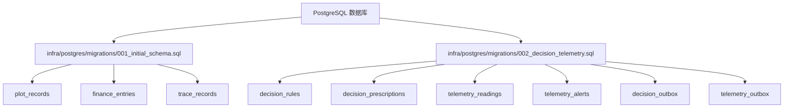
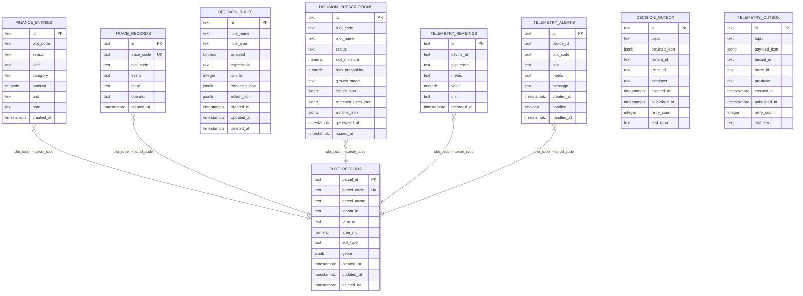
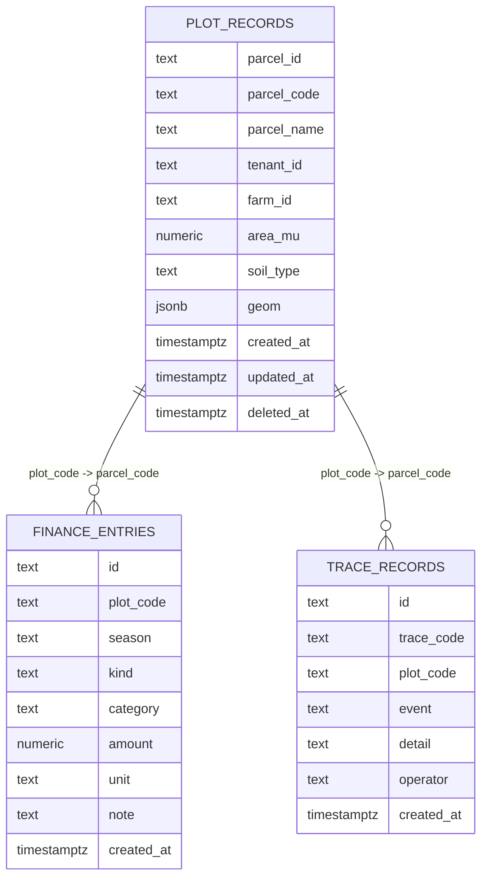
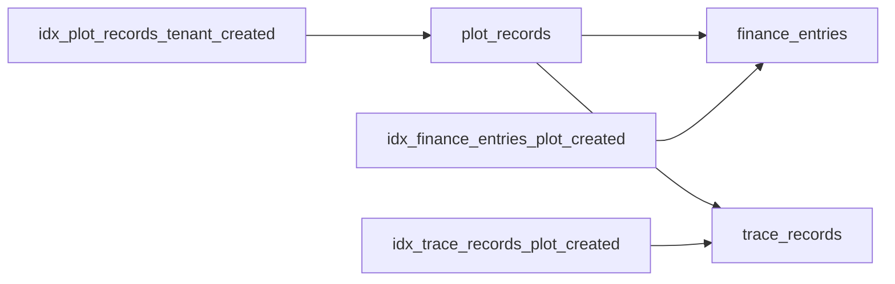

# 核心表结构

<cite>
**本文引用的文件**   
- [infra/postgres/migrations/001_initial_schema.sql](file://infra/postgres/migrations/001_initial_schema.sql)
- [infra/postgres/migrations/002_decision_telemetry.sql](file://infra/postgres/migrations/002_decision_telemetry.sql)
</cite>

## 目录
1. [引言](#引言)
2. [项目结构](#项目结构)
3. [核心组件](#核心组件)
4. [架构总览](#架构总览)
5. [详细组件分析](#详细组件分析)
6. [依赖关系分析](#依赖关系分析)
7. [性能考虑](#性能考虑)
8. [故障排查指南](#故障排查指南)
9. [结论](#结论)
10. [附录](#附录)

## 引言
本文件面向智慧农业平台的核心业务数据模型，聚焦以下三张核心表的数据库设计：
- plot_records（地块记录表）
- finance_entries（财务记录表）
- trace_records（溯源记录表）

文档将详细说明字段定义、数据类型、约束条件与业务规则；解释主键设计策略（parcel_id、id、trace_code）；说明外键关系与引用完整性；提供ER图与示例数据；文档化软删除机制（deleted_at）与时间戳模式（created_at、updated_at）；并给出数据验证规则与CHECK约束的业务含义。

## 项目结构
数据库DDL位于PostgreSQL迁移脚本中，核心三表定义在初始迁移脚本中，扩展表（决策与遥测）在后续迁移脚本中。

图表来源
- [infra/postgres/migrations/001_initial_schema.sql:1-41](file://infra/postgres/migrations/001_initial_schema.sql#L1-L41)
- [infra/postgres/migrations/002_decision_telemetry.sql:1-88](file://infra/postgres/migrations/002_decision_telemetry.sql#L1-L88)

章节来源
- [infra/postgres/migrations/001_initial_schema.sql:1-41](file://infra/postgres/migrations/001_initial_schema.sql#L1-L41)
- [infra/postgres/migrations/002_decision_telemetry.sql:1-88](file://infra/postgres/migrations/002_decision_telemetry.sql#L1-L88)

## 核心组件
本节对三张核心表进行逐字段说明，包括类型、约束与业务含义。

### 地块记录表 plot_records
- parcel_id TEXT PRIMARY KEY
  - 主键，唯一标识一个地块实体。采用文本型UUID或业务ID，便于跨系统传递与分布式生成。
- parcel_code TEXT NOT NULL UNIQUE
  - 地块编码，业务可读的唯一标识，用于对外展示与查询。
- parcel_name TEXT NOT NULL
  - 地块名称。
- tenant_id TEXT NOT NULL
  - 租户ID，多租户隔离的关键维度。
- farm_id TEXT NOT NULL
  - 所属农场ID，用于归属与权限控制。
- area_mu NUMERIC(14, 2) NOT NULL CHECK (area_mu >= 0)
  - 面积（亩），保留两位小数，非负数校验。
- soil_type TEXT
  - 土壤类型，可选字段。
- geom JSONB NOT NULL
  - 地块几何信息，使用JSONB存储多边形坐标等空间数据，配合PostGIS扩展使用。
- created_at TIMESTAMPTZ NOT NULL
  - 创建时间（带时区）。
- updated_at TIMESTAMPTZ NOT NULL
  - 更新时间（带时区）。
- deleted_at TIMESTAMPTZ
  - 软删除时间，为空表示未删除，非空表示已逻辑删除。

索引
- idx_plot_records_tenant_created ON (tenant_id, created_at DESC) WHERE deleted_at IS NULL
  - 按租户+时间倒序查询活跃地块列表的优化索引。

业务规则
- 面积必须为非负数。
- 仅未软删除的记录参与默认查询（通过WHERE deleted_at IS NULL过滤）。
- 几何信息以JSONB形式存储，便于灵活扩展。

章节来源
- [infra/postgres/migrations/001_initial_schema.sql:3-16](file://infra/postgres/migrations/001_initial_schema.sql#L3-L16)

### 财务记录表 finance_entries
- id TEXT PRIMARY KEY
  - 主键，财务条目唯一标识。
- plot_code TEXT NOT NULL
  - 关联的地块编码，作为业务维度的外键参考（当前DDL未声明物理外键）。
- season TEXT NOT NULL
  - 农事季节，如“春播”“秋收”。
- kind TEXT NOT NULL CHECK (kind IN ('INPUT', 'OUTPUT'))
  - 收支类型：投入或产出。
- category TEXT NOT NULL
  - 费用/收入类别，如“种子”“化肥”“人工”“产量”。
- amount NUMERIC(14, 2) NOT NULL CHECK (amount >= 0)
  - 金额或数量，非负数校验。
- unit TEXT NOT NULL
  - 单位，如“元”“公斤”“升”。
- note TEXT NOT NULL DEFAULT ''
  - 备注，默认空字符串。
- created_at TIMESTAMPTZ NOT NULL
  - 创建时间（带时区）。

索引
- idx_finance_entries_plot_created ON (plot_code, created_at DESC)
  - 按地块+时间倒序查询财务明细的优化索引。

业务规则
- kind仅允许“INPUT”或“OUTPUT”。
- amount非负。
- 无物理外键约束，需由应用层保证plot_code与plot_records.parcel_code的一致性。

章节来源
- [infra/postgres/migrations/001_initial_schema.sql:18-29](file://infra/postgres/migrations/001_initial_schema.sql#L18-L29)

### 溯源记录表 trace_records
- id TEXT PRIMARY KEY
  - 主键，溯源条目唯一标识。
- trace_code TEXT NOT NULL UNIQUE
  - 溯源编码，全局唯一，常用于产品批次或批次追溯码。
- plot_code TEXT NOT NULL
  - 关联的地块编码，作为业务维度的外键参考（当前DDL未声明物理外键）。
- event TEXT NOT NULL
  - 事件类型，如“播种”“施肥”“喷药”“收获”。
- detail TEXT NOT NULL
  - 事件详情，结构化或非结构化描述。
- operator TEXT NOT NULL
  - 操作人，记录执行者。
- created_at TIMESTAMPTZ NOT NULL
  - 创建时间（带时区）。

索引
- idx_trace_records_plot_created ON (plot_code, created_at DESC)
  - 按地块+时间倒序查询溯源记录的优化索引。

业务规则
- trace_code全局唯一，避免重复批次码。
- 无物理外键约束，需由应用层保证plot_code与plot_records.parcel_code的一致性。

章节来源
- [infra/postgres/migrations/001_initial_schema.sql:31-40](file://infra/postgres/migrations/001_initial_schema.sql#L31-L40)

## 架构总览
下图展示了三张核心表之间的概念关系以及与其他扩展表的关系。注意：当前DDL未声明物理外键，因此关系为业务语义上的引用，而非数据库级强制约束。

图表来源
- [infra/postgres/migrations/001_initial_schema.sql:3-40](file://infra/postgres/migrations/001_initial_schema.sql#L3-L40)
- [infra/postgres/migrations/002_decision_telemetry.sql:5-87](file://infra/postgres/migrations/002_decision_telemetry.sql#L5-L87)

## 详细组件分析

### 主键设计与标识符策略
- parcel_id（plot_records）
  - 作为地块实体的主键，承载地块的唯一身份。采用TEXT类型便于分布式ID生成与跨服务传递。
- id（finance_entries、trace_records）
  - 作为流水类记录的主键，确保每条财务或溯源记录唯一可追踪。
- trace_code（trace_records）
  - 作为业务层面的溯源编码，要求全局唯一，便于消费者扫码或查询溯源链。

章节来源
- [infra/postgres/migrations/001_initial_schema.sql:3-40](file://infra/postgres/migrations/001_initial_schema.sql#L3-L40)

### 外键关系与引用完整性
- 当前DDL未声明物理外键约束，但存在明确的业务引用关系：
  - finance_entries.plot_code 引用 plot_records.parcel_code
  - trace_records.plot_code 引用 plot_records.parcel_code
  - decision_prescriptions.plot_code、telemetry_readings.plot_code、telemetry_alerts.plot_code 同样引用地块编码
- 引用完整性由应用层保证，建议在写入前校验目标地块是否存在且未被软删除。

章节来源
- [infra/postgres/migrations/001_initial_schema.sql:18-40](file://infra/postgres/migrations/001_initial_schema.sql#L18-L40)
- [infra/postgres/migrations/002_decision_telemetry.sql:20-58](file://infra/postgres/migrations/002_decision_telemetry.sql#L20-L58)

### 软删除机制（deleted_at）
- plot_records与decision_rules包含deleted_at字段，实现逻辑删除。
- 查询时应默认过滤deleted_at IS NULL，或通过索引idx_plot_records_tenant_created加速。
- 更新或删除操作应设置deleted_at为当前时间，而非物理删除行。

章节来源
- [infra/postgres/migrations/001_initial_schema.sql:3-16](file://infra/postgres/migrations/001_initial_schema.sql#L3-L16)
- [infra/postgres/migrations/002_decision_telemetry.sql:5-18](file://infra/postgres/migrations/002_decision_telemetry.sql#L5-L18)

### 时间戳字段设计模式
- created_at：记录创建时间，TIMESTAMPTZ类型，带时区，保证跨时区一致性。
- updated_at：记录更新时间，TIMESTAMPTZ类型，适用于需要审计变更时间的场景（如plot_records、decision_rules）。
- recorded_at：遥测读数专用时间戳，TIMESTAMPTZ类型，用于时序查询。

章节来源
- [infra/postgres/migrations/001_initial_schema.sql:12-14](file://infra/postgres/migrations/001_initial_schema.sql#L12-L14)
- [infra/postgres/migrations/002_decision_telemetry.sql:14-16](file://infra/postgres/migrations/002_decision_telemetry.sql#L14-L16)
- [infra/postgres/migrations/002_decision_telemetry.sql:43](file://infra/postgres/migrations/002_decision_telemetry.sql#L43)

### 数据验证规则与CHECK约束
- plot_records.area_mu >= 0：面积非负，防止无效数据。
- finance_entries.kind IN ('INPUT', 'OUTPUT')：限定收支类型，保证分类一致。
- finance_entries.amount >= 0：金额/数量非负，符合业务语义。

章节来源
- [infra/postgres/migrations/001_initial_schema.sql:9](file://infra/postgres/migrations/001_initial_schema.sql#L9)
- [infra/postgres/migrations/001_initial_schema.sql:22-24](file://infra/postgres/migrations/001_initial_schema.sql#L22-L24)

### ER图与示例数据
以下为概念性ER图与示例数据，帮助理解字段与关系。

示例数据（概念性）
- plot_records
  - parcel_id: "p-001"
  - parcel_code: "P001"
  - parcel_name: "北田A区"
  - tenant_id: "t-100"
  - farm_id: "f-10"
  - area_mu: 120.50
  - soil_type: "壤土"
  - geom: {"type":"Polygon","coordinates":[[...]]}
  - created_at: "2024-01-01T08:00:00+08:00"
  - updated_at: "2024-01-02T10:00:00+08:00"
  - deleted_at: null
- finance_entries
  - id: "fe-001"
  - plot_code: "P001"
  - season: "春播"
  - kind: "INPUT"
  - category: "种子"
  - amount: 3000.00
  - unit: "元"
  - note: "购买优质小麦种子"
  - created_at: "2024-01-05T09:00:00+08:00"
- trace_records
  - id: "tr-001"
  - trace_code: "TC-20240105-001"
  - plot_code: "P001"
  - event: "播种"
  - detail: "机播作业，行距20cm"
  - operator: "张三"
  - created_at: "2024-01-05T10:00:00+08:00"

## 依赖关系分析
- 表间耦合
  - finance_entries与trace_records均通过plot_code引用plot_records，形成一对多关系。
  - 由于未声明物理外键，耦合度较低，但需在应用层维护一致性。
- 索引依赖
  - 高频查询路径依赖索引：
    - plot_records.tenant_id + created_at（活跃地块列表）
    - finance_entries.plot_code + created_at（地块财务明细）
    - trace_records.plot_code + created_at（地块溯源历史）

图表来源
- [infra/postgres/migrations/001_initial_schema.sql:16](file://infra/postgres/migrations/001_initial_schema.sql#L16)
- [infra/postgres/migrations/001_initial_schema.sql:29](file://infra/postgres/migrations/001_initial_schema.sql#L29)
- [infra/postgres/migrations/001_initial_schema.sql:40](file://infra/postgres/migrations/001_initial_schema.sql#L40)

章节来源
- [infra/postgres/migrations/001_initial_schema.sql:16-40](file://infra/postgres/migrations/001_initial_schema.sql#L16-L40)

## 性能考虑
- 索引优化
  - 针对tenant_id与created_at的组合索引，提升多租户下地块列表查询性能。
  - 针对plot_code与created_at的组合索引，提升财务与溯源明细的时间序列查询。
- 软删除过滤
  - 所有涉及活跃数据的查询应加上WHERE deleted_at IS NULL，利用部分索引减少扫描范围。
- JSONB字段
  - geom与各类JSONB字段适合灵活扩展，但应避免在JSONB中进行复杂检索；必要时建立GIN索引或提取常用字段。

章节来源
- [infra/postgres/migrations/001_initial_schema.sql:16](file://infra/postgres/migrations/001_initial_schema.sql#L16)
- [infra/postgres/migrations/001_initial_schema.sql:29](file://infra/postgres/migrations/001_initial_schema.sql#L29)
- [infra/postgres/migrations/001_initial_schema.sql:40](file://infra/postgres/migrations/001_initial_schema.sql#L40)

## 故障排查指南
- 插入失败
  - 检查CHECK约束：area_mu、amount非负；kind取值合法。
  - 检查UNIQUE约束：parcel_code、trace_code是否重复。
- 查询异常
  - 确认是否遗漏deleted_at IS NULL过滤导致返回已删除数据。
  - 核对plot_code是否与plot_records.parcel_code一致，避免应用层不一致。
- 性能问题
  - 确认查询是否命中组合索引（tenant_id+created_at、plot_code+created_at）。
  - 避免对JSONB字段进行全表扫描，必要时拆分或建立GIN索引。

章节来源
- [infra/postgres/migrations/001_initial_schema.sql:9-14](file://infra/postgres/migrations/001_initial_schema.sql#L9-L14)
- [infra/postgres/migrations/001_initial_schema.sql:22-24](file://infra/postgres/migrations/001_initial_schema.sql#L22-L24)
- [infra/postgres/migrations/001_initial_schema.sql:16-16](file://infra/postgres/migrations/001_initial_schema.sql#L16-L16)
- [infra/postgres/migrations/001_initial_schema.sql:29-29](file://infra/postgres/migrations/001_initial_schema.sql#L29-L29)
- [infra/postgres/migrations/001_initial_schema.sql:40-40](file://infra/postgres/migrations/001_initial_schema.sql#L40-L40)

## 结论
本设计以简洁的三张核心表支撑智慧农业平台的地块管理、财务核算与溯源追溯能力。通过合理的标识符设计、CHECK约束与索引优化，在保证数据质量的同时提升了查询性能。软删除与时间戳模式增强了可审计性与生命周期管理能力。尽管未声明物理外键，但通过业务语义与索引设计实现了清晰的引用关系，便于微服务架构下的解耦与扩展。

## 附录
- 相关扩展表（决策与遥测）
  - decision_rules：规则配置，支持热更新与优先级排序。
  - decision_prescriptions：处方结果，记录输入、匹配规则与动作。
  - telemetry_readings：设备读数，支持按设备与时序查询。
  - telemetry_alerts：告警记录，支持处理状态跟踪。
  - decision_outbox / telemetry_outbox：消息出站表，保障可靠投递。

章节来源
- [infra/postgres/migrations/002_decision_telemetry.sql:5-87](file://infra/postgres/migrations/002_decision_telemetry.sql#L5-L87)