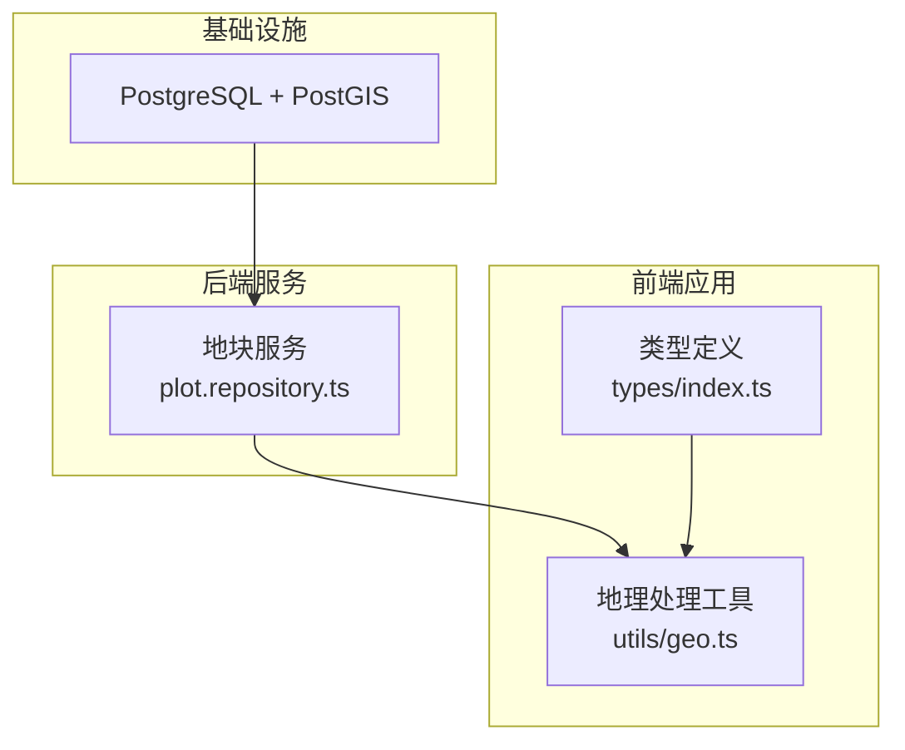
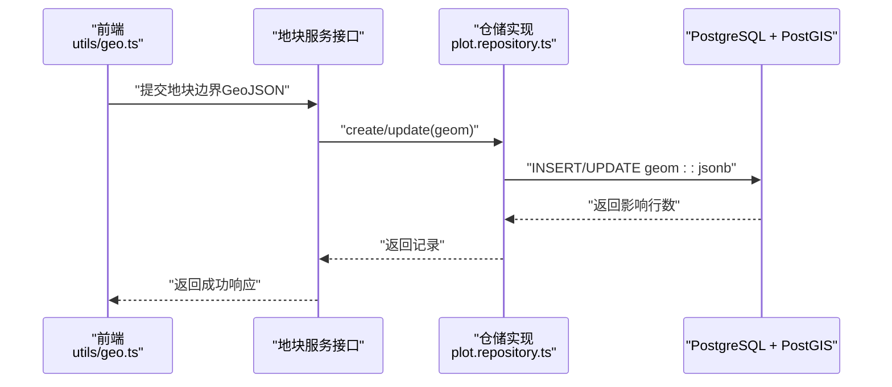
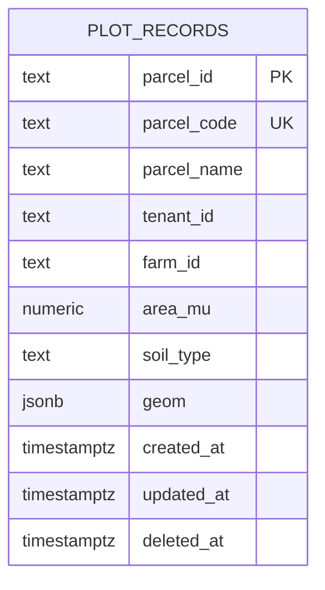
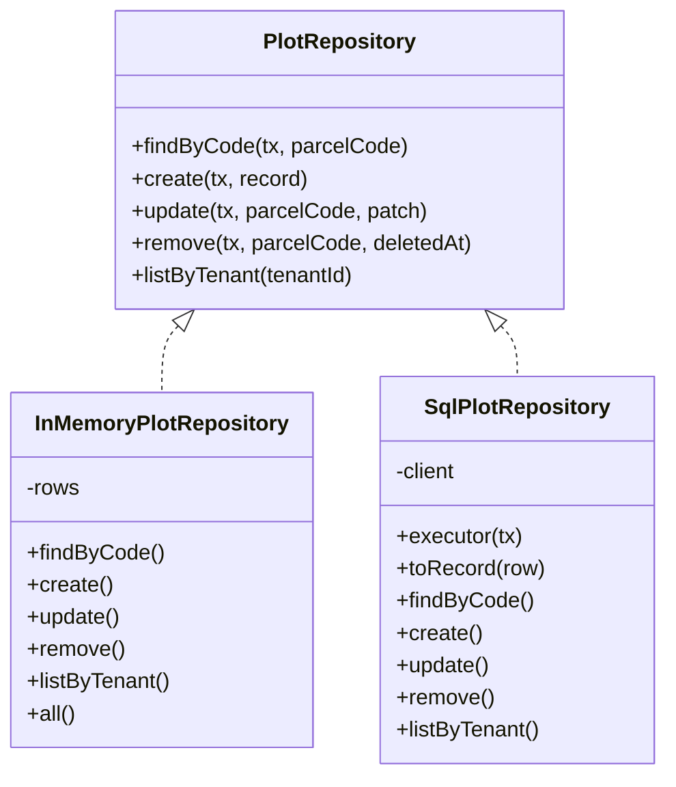
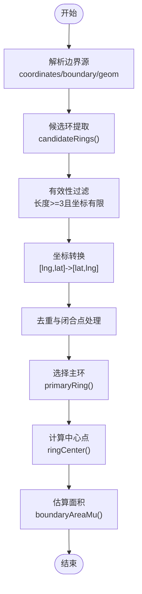
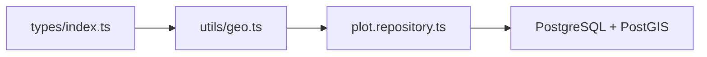

# 空间数据设计

<cite>
**本文引用的文件**   
- [infra/postgres/001_initial_schema.sql](file://infra/postgres/001_initial_schema.sql)
- [apps/plot-service/src/plot.repository.ts](file://apps/plot-service/src/plot.repository.ts)
- [apps/web/src/utils/geo.ts](file://apps/web/src/utils/geo.ts)
- [apps/web/src/types/index.ts](file://apps/web/src/types/index.ts)
</cite>

## 目录
1. [引言](#引言)
2. [项目结构](#项目结构)
3. [核心组件](#核心组件)
4. [架构总览](#架构总览)
5. [详细组件分析](#详细组件分析)
6. [依赖关系分析](#依赖关系分析)
7. [性能与索引优化](#性能与索引优化)
8. [空间操作最佳实践](#空间操作最佳实践)
9. [常见空间查询示例](#常见空间查询示例)
10. [导入导出工具与方法](#导入导出工具与方法)
11. [备份恢复与一致性](#备份恢复与一致性)
12. [故障排查指南](#故障排查指南)
13. [结论](#结论)

## 引言
本设计文档面向智慧农业平台的空间数据存储，重点说明 PostGIS 扩展的使用方式、地块边界数据的存储策略与几何字段 JSONB 的设计规范。文档涵盖坐标系统（CGCS2000/EPSG:4490）、几何类型选择、精度控制、边界录入与更新流程、GiST 空间索引规划、坐标系转换与距离/面积计算的最佳实践，以及常见空间查询、导入导出、备份恢复和数据一致性保障方案。

## 项目结构
本项目采用多服务微前端+微后端架构，空间数据相关代码主要分布在以下位置：
- 数据库迁移与表结构定义位于 infra/postgres 目录。
- 地块仓储实现位于 apps/plot-service/src/plot.repository.ts。
- 前端地理数据处理与展示逻辑位于 apps/web/src/utils/geo.ts。
- 前端类型定义包含地块模型与几何字段注释，位于 apps/web/src/types/index.ts。

**图表来源**
- [infra/postgres/001_initial_schema.sql:1-16](file://infra/postgres/001_initial_schema.sql#L1-L16)
- [apps/plot-service/src/plot.repository.ts:94-186](file://apps/plot-service/src/plot.repository.ts#L94-L186)
- [apps/web/src/utils/geo.ts:1-131](file://apps/web/src/utils/geo.ts#L1-L131)
- [apps/web/src/types/index.ts:72-96](file://apps/web/src/types/index.ts#L72-L96)

**章节来源**
- [infra/postgres/001_initial_schema.sql:1-16](file://infra/postgres/001_initial_schema.sql#L1-L16)
- [apps/plot-service/src/plot.repository.ts:94-186](file://apps/plot-service/src/plot.repository.ts#L94-L186)
- [apps/web/src/utils/geo.ts:1-131](file://apps/web/src/utils/geo.ts#L1-L131)
- [apps/web/src/types/index.ts:72-96](file://apps/web/src/types/index.ts#L72-L96)

## 核心组件
- 数据库层：启用 PostGIS 扩展，定义 plot_records 表，geom 字段使用 JSONB 存储 GeoJSON 几何。
- 仓储层：提供按编码查询、创建、更新、软删除和租户列表等能力；写入时以 JSON.stringify 将几何对象序列化为 JSONB。
- 前端层：解析多种边界格式（GeoJSON Polygon/MultiPolygon、历史数组），统一转换为 Leaflet 渲染所需的 [lat, lng] 环，并计算中心点与近似面积。

**章节来源**
- [infra/postgres/001_initial_schema.sql:1-16](file://infra/postgres/001_initial_schema.sql#L1-L16)
- [apps/plot-service/src/plot.repository.ts:11-28](file://apps/plot-service/src/plot.repository.ts#L11-L28)
- [apps/plot-service/src/plot.repository.ts:94-186](file://apps/plot-service/src/plot.repository.ts#L94-L186)
- [apps/web/src/utils/geo.ts:1-131](file://apps/web/src/utils/geo.ts#L1-L131)
- [apps/web/src/types/index.ts:72-96](file://apps/web/src/types/index.ts#L72-L96)

## 架构总览
下图展示了从前端到数据库的空间数据流转：前端解析与校验边界，调用后端仓储进行持久化；数据库通过 JSONB 存储几何，并在需要时结合 PostGIS 进行空间运算。

**图表来源**
- [apps/web/src/utils/geo.ts:90-114](file://apps/web/src/utils/geo.ts#L90-L114)
- [apps/plot-service/src/plot.repository.ts:129-168](file://apps/plot-service/src/plot.repository.ts#L129-L168)
- [infra/postgres/001_initial_schema.sql:1-16](file://infra/postgres/001_initial_schema.sql#L1-L16)

## 详细组件分析

### 数据库表结构与 PostGIS 扩展
- 启用 PostGIS 扩展，为后续空间函数与索引提供基础。
- plot_records 表包含地块标识、名称、租户、农场、面积、土壤类型、几何字段与审计时间戳，支持软删除。
- geom 字段类型为 JSONB，用于存储 CGCS2000（EPSG:4490）的 GeoJSON 几何对象。

**图表来源**
- [infra/postgres/001_initial_schema.sql:1-16](file://infra/postgres/001_initial_schema.sql#L1-L16)

**章节来源**
- [infra/postgres/001_initial_schema.sql:1-16](file://infra/postgres/001_initial_schema.sql#L1-L16)

### 仓储层：PlotRepository 与 SqlPlotRepository
- 契约接口定义了按编码查询、创建、更新、软删除与租户列表等方法。
- SQL 实现通过 $queryRawUnsafe/$executeRawUnsafe 执行原生 SQL，并将 geom 作为 JSONB 参数传递。
- 更新时使用 COALESCE 选择性更新字段，避免覆盖未变更值。

**图表来源**
- [apps/plot-service/src/plot.repository.ts:30-50](file://apps/plot-service/src/plot.repository.ts#L30-L50)
- [apps/plot-service/src/plot.repository.ts:52-92](file://apps/plot-service/src/plot.repository.ts#L52-L92)
- [apps/plot-service/src/plot.repository.ts:94-186](file://apps/plot-service/src/plot.repository.ts#L94-L186)

**章节来源**
- [apps/plot-service/src/plot.repository.ts:30-50](file://apps/plot-service/src/plot.repository.ts#L30-L50)
- [apps/plot-service/src/plot.repository.ts:94-186](file://apps/plot-service/src/plot.repository.ts#L94-L186)

### 前端地理处理：边界解析与面积估算
- 支持多种输入格式：GeoJSON Polygon/MultiPolygon、历史数组、带 coordinates/rings/outer 的对象。
- 将原始 [lng, lat] 转换为 Leaflet 使用的 [lat, lng]，去重首尾点，剔除退化环。
- 选择面积最大的外环作为主环，计算中心点与近似面积（平方度转平方米再转亩）。

**图表来源**
- [apps/web/src/utils/geo.ts:17-45](file://apps/web/src/utils/geo.ts#L17-L45)
- [apps/web/src/utils/geo.ts:47-88](file://apps/web/src/utils/geo.ts#L47-L88)
- [apps/web/src/utils/geo.ts:90-128](file://apps/web/src/utils/geo.ts#L90-L128)

**章节来源**
- [apps/web/src/utils/geo.ts:1-131](file://apps/web/src/utils/geo.ts#L1-L131)

### 前端类型定义：地块模型与几何字段
- Plot 类型包含 id、parcelCode、name、areaMu、geom 等字段，其中 geom 被注释为“CGCS2000 GeoJSON Polygon”。
- 该类型用于前后端交互的数据契约，确保几何字段在传输过程中保持一致的结构与语义。

**章节来源**
- [apps/web/src/types/index.ts:72-96](file://apps/web/src/types/index.ts#L72-L96)

## 依赖关系分析
- 前端 utils/geo.ts 依赖 types/index.ts 中的 Plot 类型，用于边界解析与展示。
- 后端 plot.repository.ts 依赖 Prisma 客户端契约，直接操作 PostgreSQL 表，并通过 JSONB 存取几何。
- 数据库层依赖 PostGIS 扩展，为未来空间函数与索引提供支撑。

**图表来源**
- [apps/web/src/types/index.ts:72-96](file://apps/web/src/types/index.ts#L72-L96)
- [apps/web/src/utils/geo.ts:1-131](file://apps/web/src/utils/geo.ts#L1-L131)
- [apps/plot-service/src/plot.repository.ts:94-186](file://apps/plot-service/src/plot.repository.ts#L94-L186)
- [infra/postgres/001_initial_schema.sql:1-16](file://infra/postgres/001_initial_schema.sql#L1-L16)

**章节来源**
- [apps/web/src/types/index.ts:72-96](file://apps/web/src/types/index.ts#L72-L96)
- [apps/web/src/utils/geo.ts:1-131](file://apps/web/src/utils/geo.ts#L1-L131)
- [apps/plot-service/src/plot.repository.ts:94-186](file://apps/plot-service/src/plot.repository.ts#L94-L186)
- [infra/postgres/001_initial_schema.sql:1-16](file://infra/postgres/001_initial_schema.sql#L1-L16)

## 性能与索引优化
- 当前已为非空 deleted_at 的行创建复合索引 idx_plot_records_tenant_created，提升按租户与时间的查询性能。
- 建议为 geom 字段添加 GiST 空间索引，以加速范围查询、包含判断与邻近搜索。由于 geom 是 JSONB，可考虑：
  - 若几何始终为 Polygon，可在应用层保证结构一致，并使用 GIN 或 GiST 对 JSONB 路径索引（例如 $.coordinates）。
  - 若需使用 PostGIS 空间函数，建议新增 spatial_geom 列（geometry(Polygon, 4490)）并建立 GiST 索引，同时保留 JSONB 用于兼容与展示。
- 建议在高频查询条件下对 (tenant_id, deleted_at IS NULL) 条件进行部分索引优化，减少无效扫描。

**章节来源**
- [infra/postgres/001_initial_schema.sql:1-16](file://infra/postgres/001_initial_schema.sql#L1-L16)

## 空间操作最佳实践
- 坐标系统：统一使用 CGCS2000（EPSG:4490），所有几何入库前应在应用层完成坐标转换，避免在数据库中进行复杂转换。
- 几何类型选择：优先使用 Polygon 表示地块边界；MultiPolygon 用于复杂多块区域；Point 可用于设备位置。
- 精度控制：
  - 前端坐标保留足够小数位（建议至少 6 位小数），以减少累积误差。
  - 面积计算建议使用 PostGIS ST_Area(geometry, true) 获取球面面积，单位换算为亩。
- 距离计算：使用 ST_Distance_Sphere 或 ST_Distance 根据是否使用投影坐标系选择合适函数。
- 拓扑校验：入库前校验环闭合、无自相交、外环逆时针（或遵循约定），避免无效几何导致计算异常。

[本节为通用指导，不直接分析具体文件]

## 常见空间查询示例
以下为基于 PostGIS 的常见空间查询思路（以 SQL 描述为主，便于迁移至实际环境）：
- 地块范围查询：查找与给定矩形框相交的地块。
  - 思路：将 JSONB.geom 转换为 geometry(Polygon, 4490)，使用 && 或 ST_Intersects 进行范围筛选。
- 设备位置查询：查找位于某地块内的设备点位。
  - 思路：设备位置使用 Point 几何，使用 ST_Within(point, polygon) 判断包含关系。
- 邻近地块查询：查找距某地块中心一定距离内的其他地块。
  - 思路：使用 ST_Centroid(polygon) 与 ST_Distance_Sphere(pointA, pointB) 计算距离阈值。

[本节为概念性示例，不直接分析具体文件]

## 导入导出工具与方法
- 导入：
  - 批量导入 GeoJSON 文件：可使用 ogr2ogr 将 GeoJSON 导入 PostgreSQL，并映射到 geom JSONB 字段；或在应用层解析后批量 INSERT。
  - 导入 WKT/WKB：使用 ST_GeomFromWKT/ST_GeomFromWKB 转换为 geometry，再转为 JSONB 存储。
- 导出：
  - 导出 GeoJSON：使用 ST_AsGeoJSON(geometry) 生成标准 GeoJSON，便于前端与第三方系统消费。
  - 导出 CSV/Excel：导出属性字段与几何文本（WKT），供离线分析。

[本节为通用指导，不直接分析具体文件]

## 备份恢复与一致性
- 备份恢复：
  - 使用 pg_dump/pg_restore 对数据库进行全量或增量备份，确保包含 PostGIS 扩展与空间数据。
  - 针对大表可采用分区或归档策略，降低备份体积与恢复时间。
- 一致性保证：
  - 事务：仓储方法接受显式事务对象，确保写入原子性。
  - 约束：area_mu 非负检查、deleted_at 软删除标记，保证业务一致性。
  - 幂等：创建与更新应支持幂等键（如 parcel_code），避免重复写入。

**章节来源**
- [apps/plot-service/src/plot.repository.ts:4-9](file://apps/plot-service/src/plot.repository.ts#L4-L9)
- [infra/postgres/001_initial_schema.sql:1-16](file://infra/postgres/001_initial_schema.sql#L1-L16)

## 故障排查指南
- 几何解析失败：
  - 现象：前端 parsePlotBoundary 返回 null。
  - 排查：检查输入的 coordinates/boundary/geom 是否为有效数组或对象；确认坐标顺序与数值有效性。
- 面积异常：
  - 现象：boundaryAreaMu 返回 0 或异常值。
  - 排查：确认主环存在且长度≥3；检查坐标是否经过去重与闭合处理。
- 查询性能差：
  - 现象：按租户或空间条件查询慢。
  - 排查：确认是否存在必要索引；评估是否需要为 geom 添加 GiST 索引或新增 spatial_geom 列。

**章节来源**
- [apps/web/src/utils/geo.ts:90-128](file://apps/web/src/utils/geo.ts#L90-L128)
- [infra/postgres/001_initial_schema.sql:1-16](file://infra/postgres/001_initial_schema.sql#L1-L16)

## 结论
本设计通过 PostGIS 扩展与 JSONB 几何字段，构建了灵活且可扩展的地块空间数据存储方案。仓储层提供清晰的 CRUD 契约，前端具备健壮的边界解析与展示能力。建议在现有基础上引入 GiST 空间索引与 geometry 列以提升空间查询性能，并严格遵循坐标系统与精度控制规范，确保数据一致性与计算准确性。