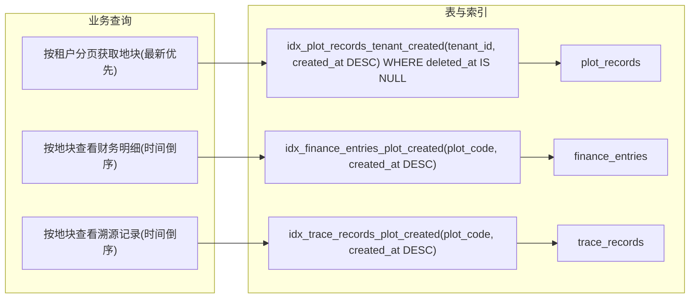
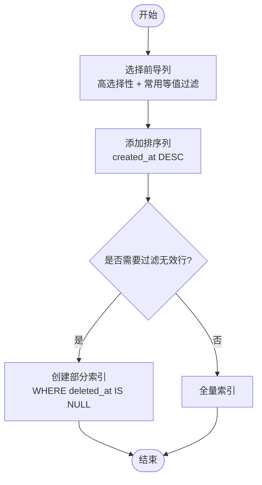

# 索引优化

<cite>
**本文引用的文件**   
- [infra/postgres/001_initial_schema.sql](file://infra/postgres/001_initial_schema.sql)
- [infra/postgres/migrations/001_initial_schema.sql](file://infra/postgres/migrations/001_initial_schema.sql)
- [infra/postgres/migrations/002_decision_telemetry.sql](file://infra/postgres/migrations/002_decision_telemetry.sql)
</cite>

## 目录
1. [引言](#引言)
2. [项目结构](#项目结构)
3. [核心组件](#核心组件)
4. [架构总览](#架构总览)
5. [详细组件分析](#详细组件分析)
6. [依赖关系分析](#依赖关系分析)
7. [性能考量](#性能考量)
8. [故障排查指南](#故障排查指南)
9. [结论](#结论)
10. [附录](#附录)

## 引言
本文面向智慧农业平台的数据库层，聚焦 PostgreSQL 的索引设计与性能优化。重点围绕以下复合索引展开：
- idx_plot_records_tenant_created
- idx_finance_entries_plot_created
- idx_trace_records_plot_created

文档将解释这些索引的设计原理、适用查询模式、PostgreSQL 索引类型选择依据（B-tree、GiST、GIN 等）、查询性能分析方法（EXPLAIN 计划解读与慢查询优化）、索引维护策略（定期重建、统计信息更新），以及不同数据规模下的设计建议与基准测试思路，并讨论索引对写入性能的影响与平衡策略。

## 项目结构
本项目在 infra/postgres 下集中管理数据库初始化脚本与迁移脚本，包含表结构与索引定义。关键文件如下：
- infra/postgres/001_initial_schema.sql：初始表结构与基础索引
- infra/postgres/migrations/001_initial_schema.sql：与上者一致的初始结构（迁移入口）
- infra/postgres/migrations/002_decision_telemetry.sql：决策与遥测相关表及索引

```mermaid
graph TB
A["infra/postgres/001_initial_schema.sql"] --> B["表: plot_records<br/>索引: idx_plot_records_tenant_created"]
A --> C["表: finance_entries<br/>索引: idx_finance_entries_plot_created"]
A --> D["表: trace_records<br/>索引: idx_trace_records_plot_created"]
E["infra/postgres/migrations/001_initial_schema.sql"] --> B
E --> C
E --> D
F["infra/postgres/migrations/002_decision_telemetry.sql"] --> G["表: decision_rules<br/>索引: idx_decision_rules_enabled"]
F --> H["表: decision_prescriptions<br/>索引: idx_decision_prescriptions_plot"]
F --> I["表: telemetry_readings<br/>索引: idx_telemetry_readings_device_time, idx_telemetry_readings_time"]
F --> J["表: telemetry_alerts<br/>索引: idx_telemetry_alerts_pending"]
F --> K["表: decision_outbox<br/>索引: idx_decision_outbox_pending"]
F --> L["表: telemetry_outbox<br/>索引: idx_telemetry_outbox_pending"]
```

图表来源
- [infra/postgres/001_initial_schema.sql:1-41](file://infra/postgres/001_initial_schema.sql#L1-L41)
- [infra/postgres/migrations/001_initial_schema.sql:1-41](file://infra/postgres/migrations/001_initial_schema.sql#L1-L41)
- [infra/postgres/migrations/002_decision_telemetry.sql:1-88](file://infra/postgres/migrations/002_decision_telemetry.sql#L1-L88)

章节来源
- [infra/postgres/001_initial_schema.sql:1-41](file://infra/postgres/001_initial_schema.sql#L1-L41)
- [infra/postgres/migrations/001_initial_schema.sql:1-41](file://infra/postgres/migrations/001_initial_schema.sql#L1-L41)
- [infra/postgres/migrations/002_decision_telemetry.sql:1-88](file://infra/postgres/migrations/002_decision_telemetry.sql#L1-L88)

## 核心组件
本节聚焦三个核心业务表及其对应索引，说明字段语义、常见查询场景与索引匹配关系。

- plot_records（地块记录）
  - 关键字段：tenant_id、created_at、deleted_at
  - 典型查询：按租户分页获取最近的地块记录；软删除过滤
  - 索引：idx_plot_records_tenant_created(tenant_id, created_at DESC) WHERE deleted_at IS NULL
  - 设计要点：前导列 tenant_id 用于租户隔离；第二列 created_at DESC 支持“最新优先”的分页排序；部分索引仅包含未删除行，减少无用扫描

- finance_entries（财务条目）
  - 关键字段：plot_code、created_at
  - 典型查询：按地块时间倒序查看收支明细
  - 索引：idx_finance_entries_plot_created(plot_code, created_at DESC)
  - 设计要点：以地块为粒度聚合财务流水，时间倒序满足列表展示需求

- trace_records（溯源记录）
  - 关键字段：plot_code、created_at
  - 典型查询：按地块查看操作历史，按时间倒序
  - 索引：idx_trace_records_plot_created(plot_code, created_at DESC)
  - 设计要点：与财务类似，强调“地块+时间倒序”的访问路径

章节来源
- [infra/postgres/001_initial_schema.sql:3-16](file://infra/postgres/001_initial_schema.sql#L3-L16)
- [infra/postgres/001_initial_schema.sql:18-29](file://infra/postgres/001_initial_schema.sql#L18-L29)
- [infra/postgres/001_initial_schema.sql:31-40](file://infra/postgres/001_initial_schema.sql#L31-L40)

## 架构总览
下图展示了与索引相关的表、索引与典型查询之间的映射关系，帮助理解索引如何支撑业务查询。

图表来源
- [infra/postgres/001_initial_schema.sql:3-40](file://infra/postgres/001_initial_schema.sql#L3-L40)

## 详细组件分析

### 复合索引设计原理与查询模式匹配
- 前导列选择原则
  - 高选择性且常用于等值过滤的列作为前导列，例如 tenant_id、plot_code
  - 第二列通常用于排序或范围过滤，如 created_at
- 排序方向与降序索引
  - 使用 created_at DESC 可避免额外排序步骤，直接利用索引顺序返回结果
- 部分索引的使用
  - 针对软删除场景，WHERE deleted_at IS NULL 的部分索引只索引有效行，降低索引体积与扫描成本

图表来源
- [infra/postgres/001_initial_schema.sql:16](file://infra/postgres/001_initial_schema.sql#L16)

章节来源
- [infra/postgres/001_initial_schema.sql:16](file://infra/postgres/001_initial_schema.sql#L16)
- [infra/postgres/001_initial_schema.sql:29](file://infra/postgres/001_initial_schema.sql#L29)
- [infra/postgres/001_initial_schema.sql:40](file://infra/postgres/001_initial_schema.sql#L40)

### PostgreSQL 索引类型选择依据
- B-tree
  - 适用于等值查询、范围查询与排序（ASC/DESC）
  - 本项目的复合索引均为 B-tree 默认实现，满足 tenant_id/plot_code 等值过滤与 created_at 排序
- GiST
  - 适用于几何、全文检索、范围类型等复杂数据类型
  - 当前 schema 中 geom 字段为 JSONB，未建立空间索引；若后续引入 PostGIS 几何类型，可考虑 GiST
- GIN
  - 适用于 JSONB、数组、全文检索等需要多键快速定位的场景
  - 若频繁基于 JSONB 子键查询，可评估 GIN 索引的收益与代价

章节来源
- [infra/postgres/001_initial_schema.sql:11](file://infra/postgres/001_initial_schema.sql#L11)

### 其他重要索引与用途
- decision_rules
  - 索引：idx_decision_rules_enabled(enabled, priority) WHERE deleted_at IS NULL
  - 用途：启用规则的热加载与优先级排序，结合软删除过滤
- decision_prescriptions
  - 索引：idx_decision_prescriptions_plot(plot_code, generated_at DESC)
  - 用途：按地块查看处方生成历史，时间倒序
- telemetry_readings
  - 索引：idx_telemetry_readings_device_time(device_id, metric, recorded_at DESC)、idx_telemetry_readings_time(recorded_at DESC)
  - 用途：设备维度指标时序查询与全局时间窗口查询
- telemetry_alerts
  - 索引：idx_telemetry_alerts_pending(handled, created_at DESC)
  - 用途：待处理告警列表，按时间倒序
- outbox 表（decision_outbox、telemetry_outbox）
  - 索引：idx_decision_outbox_pending(created_at) WHERE published_at IS NULL、idx_telemetry_outbox_pending(created_at) WHERE published_at IS NULL
  - 用途：消息出队任务按创建时间调度

章节来源
- [infra/postgres/migrations/002_decision_telemetry.sql:5-18](file://infra/postgres/migrations/002_decision_telemetry.sql#L5-L18)
- [infra/postgres/migrations/002_decision_telemetry.sql:20-34](file://infra/postgres/migrations/002_decision_telemetry.sql#L20-L34)
- [infra/postgres/migrations/002_decision_telemetry.sql:36-46](file://infra/postgres/migrations/002_decision_telemetry.sql#L36-L46)
- [infra/postgres/migrations/002_decision_telemetry.sql:48-59](file://infra/postgres/migrations/002_decision_telemetry.sql#L48-L59)
- [infra/postgres/migrations/002_decision_telemetry.sql:61-73](file://infra/postgres/migrations/002_decision_telemetry.sql#L61-L73)
- [infra/postgres/migrations/002_decision_telemetry.sql:75-87](file://infra/postgres/migrations/002_decision_telemetry.sql#L75-L87)

### 查询性能分析方法
- EXPLAIN/EXPLAIN ANALYZE
  - 观察是否使用目标索引（Index Scan/Index Only Scan）
  - 关注 Seq Scan、Sort、Hash Join 等可能表明索引缺失或统计信息过时的节点
- 慢查询定位
  - 开启 pg_stat_statements，识别高频慢查询
  - 结合业务日志与 SQL 文本，定位缺少合适索引的查询
- 验证索引有效性
  - 对比有无索引的执行计划与耗时
  - 检查索引选择性（selectivity）与基数（cardinality）估算是否准确

章节来源
- [infra/postgres/001_initial_schema.sql:16](file://infra/postgres/001_initial_schema.sql#L16)
- [infra/postgres/001_initial_schema.sql:29](file://infra/postgres/001_initial_schema.sql#L29)
- [infra/postgres/001_initial_schema.sql:40](file://infra/postgres/001_initial_schema.sql#L40)

### 索引维护策略
- 统计信息更新
  - 定期执行 ANALYZE 或 autovacuum.analyze_scale_factor 调优，确保 planner 估算准确
- 索引重建
  - 对于频繁更新的热点表，必要时使用 REINDEX 修复碎片或重建索引
- 监控与评估
  - 通过 pg_stat_user_indexes 观察索引使用率，剔除低效索引
  - 结合 pg_stat_activity 与慢查询日志，持续优化

章节来源
- [infra/postgres/migrations/002_decision_telemetry.sql:18](file://infra/postgres/migrations/002_decision_telemetry.sql#L18)
- [infra/postgres/migrations/002_decision_telemetry.sql:45-46](file://infra/postgres/migrations/002_decision_telemetry.sql#L45-L46)

### 不同数据规模下的索引设计建议
- 小规模（万级以内）
  - 复合索引足以覆盖主要查询；谨慎增加索引数量，避免写入放大
- 中规模（十万至百万级）
  - 强化“分区键+时间”类索引；对 JSONB 高频子键评估 GIN
  - 对热点表（如 telemetry_readings）考虑分区表+局部索引
- 大规模（千万级以上）
  - 采用分区表（按时间或租户）；结合部分索引与覆盖索引
  - 对时序数据采用专用方案（如 TimescaleDB）或物化视图预聚合

[本节为通用指导，不直接分析具体文件]

### 索引对写入性能的影响与平衡策略
- 写入放大
  - 每个索引在 INSERT/UPDATE/DELETE 时都需要维护，过多索引会降低写入吞吐
- 平衡策略
  - 优先保证读多写少的高频查询路径有合适索引
  - 对低频查询使用函数索引或应用层缓存替代
  - 分批写入与批量提交，减少索引抖动
  - 使用部分索引缩小索引范围，降低维护成本

[本节为通用指导，不直接分析具体文件]

## 依赖关系分析
下图展示表与索引之间的依赖关系，突出各索引服务的查询路径。

```mermaid
graph TB
PR["plot_records"] --> IPR["idx_plot_records_tenant_created"]
FE["finance_entries"] --> IFE["idx_finance_entries_plot_created"]
TR["trace_records"] --> ITR["idx_trace_records_plot_created"]
DR["decision_rules"] --> IDR["idx_decision_rules_enabled"]
DP["decision_prescriptions"] --> IDP["idx_decision_prescriptions_plot"]
TRD["telemetry_readings"] --> ITD1["idx_telemetry_readings_device_time"]
TRD --> ITD2["idx_telemetry_readings_time"]
TAL["telemetry_alerts"] --> ITA["idx_telemetry_alerts_pending"]
DOB["decision_outbox"] --> IDOB["idx_decision_outbox_pending"]
TOB["telemetry_outbox"] --> ITOB["idx_telemetry_outbox_pending"]
```

图表来源
- [infra/postgres/001_initial_schema.sql:3-40](file://infra/postgres/001_initial_schema.sql#L3-L40)
- [infra/postgres/migrations/002_decision_telemetry.sql:5-87](file://infra/postgres/migrations/002_decision_telemetry.sql#L5-L87)

章节来源
- [infra/postgres/001_initial_schema.sql:3-40](file://infra/postgres/001_initial_schema.sql#L3-L40)
- [infra/postgres/migrations/002_decision_telemetry.sql:5-87](file://infra/postgres/migrations/002_decision_telemetry.sql#L5-L87)

## 性能考量
- 读取性能
  - 复合索引应严格匹配查询的等值条件与排序列，避免不必要的 Sort 节点
  - 部分索引可减少无关数据的扫描与维护开销
- 写入性能
  - 控制索引数量，避免过度索引导致写入延迟上升
  - 对高并发写入场景，考虑批处理与异步落库
- 存储与内存
  - 大索引会占用更多磁盘与共享缓冲，需评估物理资源
  - 合理设置 work_mem 与 maintenance_work_mem，提升排序与建索引效率

[本节为通用指导，不直接分析具体文件]

## 故障排查指南
- 常见问题
  - 查询走全表扫描：检查 WHERE 条件是否与索引前导列一致
  - 出现 Sort 节点：确认排序列与索引顺序一致（ASC/DESC）
  - 统计信息陈旧：执行 ANALYZE 后复测
- 诊断步骤
  - 使用 EXPLAIN ANALYZE 获取实际执行计划
  - 核对 pg_stat_user_indexes 中的索引使用次数
  - 对热点表进行分区与索引拆分，降低单索引压力

章节来源
- [infra/postgres/001_initial_schema.sql:16](file://infra/postgres/001_initial_schema.sql#L16)
- [infra/postgres/001_initial_schema.sql:29](file://infra/postgres/001_initial_schema.sql#L29)
- [infra/postgres/001_initial_schema.sql:40](file://infra/postgres/001_initial_schema.sql#L40)

## 结论
本项目通过合理的复合索引与部分索引，精准匹配了“租户+时间”“地块+时间”等高频查询模式，显著提升了读取性能。同时，决策与遥测模块引入了更多维度的索引，覆盖了规则热更新、处方历史、时序指标与告警处理等场景。建议在后续演进中：
- 持续用 EXPLAIN 与慢查询日志驱动索引优化
- 根据数据规模引入分区与更细粒度的索引策略
- 谨慎权衡索引带来的写入代价，保持读写平衡

[本节为总结性内容，不直接分析具体文件]

## 附录
- 基准测试建议
  - 构造不同数据规模（1万、10万、100万、1000万）的测试数据集
  - 分别测量无索引、单列索引、复合索引、部分索引的查询耗时
  - 对比写入吞吐（INSERT/UPDATE/DELETE）在不同索引配置下的变化
- 参考实践
  - 对 JSONB 字段进行热点子键查询时，评估 GIN 索引的收益
  - 对时序数据采用分区表+局部索引，或引入时序数据库

[本节为通用指导，不直接分析具体文件]