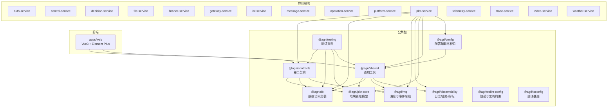
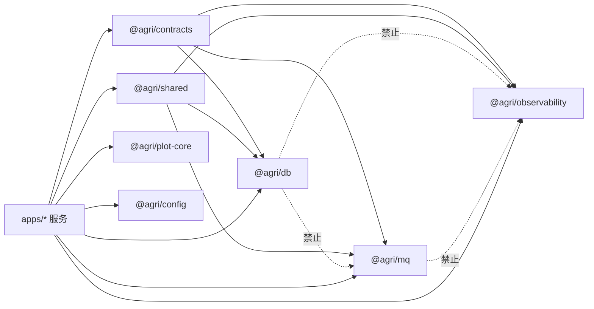
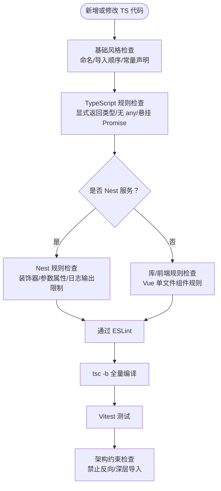
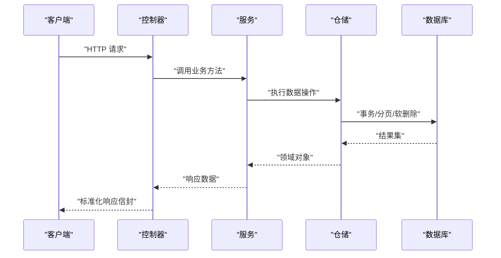
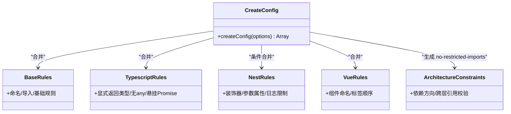

# 代码规范

<cite>
**本文引用的文件**   
- [README.md](file://README.md)
- [tsconfig.json](file://tsconfig.json)
- [packages/tsconfig/base.json](file://packages/tsconfig/base.json)
- [packages/eslint-config/README.md](file://packages/eslint-config/README.md)
- [packages/eslint-config/index.mjs](file://packages/eslint-config/index.mjs)
- [packages/eslint-config/base.mjs](file://packages/eslint-config/base.mjs)
- [packages/eslint-config/typescript.mjs](file://packages/eslint-config/typescript.mjs)
- [packages/eslint-config/nest.mjs](file://packages/eslint-config/nest.mjs)
- [packages/eslint-config/vue.mjs](file://packages/eslint-config/vue.mjs)
- [packages/eslint-config/architecture.mjs](file://packages/eslint-config/architecture.mjs)
</cite>

## 目录
1. [引言](#引言)
2. [项目结构](#项目结构)
3. [核心组件](#核心组件)
4. [架构总览](#架构总览)
5. [详细组件分析](#详细组件分析)
6. [依赖分析](#依赖分析)
7. [性能考虑](#性能考虑)
8. [故障排查指南](#故障排查指南)
9. [结论](#结论)
10. [附录](#附录)

## 引言
本规范面向智慧农业平台，覆盖 TypeScript 编码规范、NestJS 框架规范、ESLint 规则配置与质量门禁、Git 工作流建议、重构指导与架构约束原则。仓库采用 pnpm workspace + Turborepo + tsc -b 的工程引用体系，后端基于 NestJS 11 + TypeScript 5.9，前端为 Vue 管理后台；公共包与能力包通过契约解耦，服务之间通过共享类型通信，禁止直接源码互引。

## 项目结构
仓库以“公共包 + 应用服务 + 前端”分层组织：
- packages：公共包与能力包（contracts、shared、db、mq、observability、plot-core、config、testing、eslint-config、tsconfig）
- apps：HTTP 微服务与前端 web
- infra：基础设施脚本与数据库迁移
- scripts：工程级脚本（构建、健康检查、冒烟测试等）

**图表来源**
- [README.md:86-103](file://README.md#L86-L103)
- [tsconfig.json:3-26](file://tsconfig.json#L3-L26)

**章节来源**
- [README.md:58-103](file://README.md#L58-L103)
- [tsconfig.json:1-29](file://tsconfig.json#L1-L29)

## 核心组件
- TypeScript 编译基座：统一严格模式、模块解析、源映射与类型安全开关，作为所有子工程的继承基线。
- ESLint 配置中心：提供 base、typescript、nest、vue、architecture 可组合规则集，并通过 createConfig 组装扁平配置，支持插件降级与架构约束。
- 契约包：仅依赖 zod，不依赖运行期能力包，供前后端共享响应信封、事件、错误码与枚举。
- 能力包：db、mq、observability 同层解耦，禁止互相依赖；对外暴露稳定 API。
- 应用服务：每个服务独立 Nest 模块，通过契约包共享类型通信，禁止直接导入其他服务源码。

**章节来源**
- [packages/tsconfig/base.json:1-24](file://packages/tsconfig/base.json#L1-L24)
- [packages/eslint-config/README.md:1-59](file://packages/eslint-config/README.md#L1-L59)
- [README.md:86-118](file://README.md#L86-L118)

## 架构总览
下图展示“契约包 → 能力包 → 应用服务”的依赖方向与边界，体现“依赖只向下、同层解耦、应用层互不引用”的原则。

**图表来源**
- [packages/eslint-config/architecture.mjs:7-58](file://packages/eslint-config/architecture.mjs#L7-L58)
- [README.md:105-118](file://README.md#L105-L118)

## 详细组件分析

### TypeScript 编码规范
- 基线编译器选项：启用 strict、noUncheckedIndexedAccess、exactOptionalPropertyTypes、noImplicitOverride、useUnknownInCatchVariables、isolatedModules 等，确保强类型与可维护性。
- 命名与导入：类型与接口使用 PascalCase；变量函数允许 camelCase/PascalCase；强制 type-imports；统一导入顺序（内置、外部、内部、父级、同级、索引）。
- 显式返回类型：默认 warn，公共包可通过 withStrictReturnType 提升为 error。
- 异步与 Promise：禁止悬挂 Promise，await 必须作用于 Thenable。
- 前端 Vue：多词组件名、组件标签顺序、模板内未使用变量检查。

**图表来源**
- [packages/tsconfig/base.json:4-22](file://packages/tsconfig/base.json#L4-L22)
- [packages/eslint-config/base.mjs:5-43](file://packages/eslint-config/base.mjs#L5-L43)
- [packages/eslint-config/typescript.mjs:5-33](file://packages/eslint-config/typescript.mjs#L5-L33)
- [packages/eslint-config/nest.mjs:4-13](file://packages/eslint-config/nest.mjs#L4-L13)
- [packages/eslint-config/vue.mjs:5-11](file://packages/eslint-config/vue.mjs#L5-L11)
- [packages/eslint-config/architecture.mjs:7-58](file://packages/eslint-config/architecture.mjs#L7-L58)

**章节来源**
- [packages/tsconfig/base.json:1-24](file://packages/tsconfig/base.json#L1-L24)
- [packages/eslint-config/base.mjs:1-44](file://packages/eslint-config/base.mjs#L1-L44)
- [packages/eslint-config/typescript.mjs:1-34](file://packages/eslint-config/typescript.mjs#L1-L34)
- [packages/eslint-config/nest.mjs:1-14](file://packages/eslint-config/nest.mjs#L1-L14)
- [packages/eslint-config/vue.mjs:1-12](file://packages/eslint-config/vue.mjs#L1-L12)

### NestJS 框架规范
- 模块设计：每个服务一个 Nest 模块，按需装配 ConfigModule、PrismaModule、MqModule 等能力包模块。
- 控制器与服务分层：控制器负责 HTTP 适配与参数校验，服务承载业务逻辑，仓储封装数据访问。
- 装饰器使用：遵循 Nest 装饰器语义；测试构造提供者时显式 inject，避免依赖类型元数据自动注入。
- 日志输出：服务内统一使用日志服务，禁止 console 调试输出（测试与脚本豁免）。

**图表来源**
- [README.md:149-155](file://README.md#L149-L155)
- [README.md:159-164](file://README.md#L159-L164)

**章节来源**
- [README.md:149-164](file://README.md#L149-L164)
- [packages/eslint-config/nest.mjs:4-13](file://packages/eslint-config/nest.mjs#L4-L13)

### ESLint 规则配置说明
- 入口函数 createConfig：按 framework（library/nest/vue）合并规则组，支持 architecture 开关与 tsconfigRootDir 类型感知。
- 插件降级策略：@typescript-eslint/eslint-plugin、eslint-plugin-import、eslint-plugin-vue 为可选依赖，未安装时对应规则跳过，架构约束仍生效。
- 规则分组：
  - base：命名、导入顺序、未使用变量、no-console/no-debugger 等。
  - typescript：显式返回类型、module boundary 类型、unsafe 赋值/成员访问、悬挂 Promise、await-thenable。
  - nest：装饰器相关类、参数属性、日志输出限制。
  - vue：多词组件名、组件标签顺序、模板未使用变量。
  - architecture：依赖方向与跨层引用校验。

**图表来源**
- [packages/eslint-config/index.mjs:18-134](file://packages/eslint-config/index.mjs#L18-L134)
- [packages/eslint-config/base.mjs:5-43](file://packages/eslint-config/base.mjs#L5-L43)
- [packages/eslint-config/typescript.mjs:5-33](file://packages/eslint-config/typescript.mjs#L5-L33)
- [packages/eslint-config/nest.mjs:4-13](file://packages/eslint-config/nest.mjs#L4-L13)
- [packages/eslint-config/vue.mjs:5-11](file://packages/eslint-config/vue.mjs#L5-L11)
- [packages/eslint-config/architecture.mjs:7-58](file://packages/eslint-config/architecture.mjs#L7-L58)

**章节来源**
- [packages/eslint-config/README.md:1-59](file://packages/eslint-config/README.md#L1-L59)
- [packages/eslint-config/index.mjs:1-144](file://packages/eslint-config/index.mjs#L1-L144)
- [packages/eslint-config/base.mjs:1-44](file://packages/eslint-config/base.mjs#L1-L44)
- [packages/eslint-config/typescript.mjs:1-34](file://packages/eslint-config/typescript.mjs#L1-L34)
- [packages/eslint-config/nest.mjs:1-14](file://packages/eslint-config/nest.mjs#L1-L14)
- [packages/eslint-config/vue.mjs:1-12](file://packages/eslint-config/vue.mjs#L1-L12)
- [packages/eslint-config/architecture.mjs:1-59](file://packages/eslint-config/architecture.mjs#L1-L59)

### Git 工作流规范（建议）
- 分支管理
  - main：受保护的生产分支，仅允许合并 PR。
  - develop：集成开发分支，日常功能合并目标。
  - feature/*：功能分支，从 develop 切出，完成后提交 PR 到 develop。
  - hotfix/*：紧急修复分支，从 main 切出，完成后同时合并回 main 与 develop。
- 提交信息格式
  - 类型：feat/fix/docs/style/refactor/perf/test/build/ci/chore/revert
  - 范围：影响模块或服务名，如 plot-service、contracts
  - 主题：简洁描述变更目的，不超过 72 字符
  - 正文：动机与影响面，必要时列出破坏性变更
  - 结尾：关联 Issue/PR 编号
- 代码审查流程
  - 至少一名 Maintainer 批准
  - CI 必须通过（build、test、lint、architecture check）
  - 涉及契约包或公共包变更需额外评审
  - 大改动需附带设计说明与迁移计划

[本节为通用流程建议，不直接分析具体文件]

### 代码重构指导与架构约束原则
- 重构原则
  - 小步快跑：每次 PR 只做一件事，保持可回滚。
  - 先加测试：对关键路径先补充用例，再实施重构。
  - 保持契约稳定：对外类型与错误码变更需评估下游影响。
  - 依赖收敛：将重复逻辑下沉至公共包，避免服务间复制。
- 架构约束
  - 公共包不得引用应用层。
  - 契约包不得依赖能力包。
  - 能力包同层解耦（db/mq/observability 互不依赖）。
  - 应用层互不引用，通过契约包共享类型通信。
  - 禁止深层导入，只从包入口或声明的子路径导入。

**章节来源**
- [packages/eslint-config/architecture.mjs:7-58](file://packages/eslint-config/architecture.mjs#L7-L58)
- [README.md:105-118](file://README.md#L105-L118)

## 依赖分析
根 tsconfig.json 通过 references 串联所有公共包与应用服务，形成单一构建链。新增服务需在根清单中注册工程引用，并在服务根模块装配所需能力包模块。

```mermaid
graph TB
root_ts["根 tsconfig.json<br/>references 清单"] --> pkg_shared["@agri/shared"]
root_ts --> pkg_config["@agri/config"]
root_ts --> pkg_contracts["@agri/contracts"]
root_ts --> pkg_plot_core["@agri/plot-core"]
root_ts --> pkg_observability["@agri/observability"]
root_ts --> pkg_db["@agri/db"]
root_ts --> pkg_mq["@agri/mq"]
root_ts --> pkg_testing["@agri/testing"]
root_ts --> app_plot["apps/plot-service"]
root_ts --> app_auth["apps/auth-service"]
root_ts --> app_control["apps/control-service"]
root_ts --> app_decision["apps/decision-service"]
root_ts --> app_file["apps/file-service"]
root_ts --> app_finance["apps/finance-service"]
root_ts --> app_gateway["apps/gateway-service"]
root_ts --> app_iot["apps/iot-service"]
root_ts --> app_message["apps/message-service"]
root_ts --> app_operation["apps/operation-service"]
root_ts --> app_platform["apps/platform-service"]
root_ts --> app_telemetry["apps/telemetry-service"]
root_ts --> app_trace["apps/trace-service"]
root_ts --> app_video["apps/video-service"]
root_ts --> app_weather["apps/weather-service"]
```

**图表来源**
- [tsconfig.json:3-26](file://tsconfig.json#L3-L26)

**章节来源**
- [tsconfig.json:1-29](file://tsconfig.json#L1-L29)
- [README.md:149-155](file://README.md#L149-L155)

## 性能考虑
- 空间运算下沉数据库：叠加、缓冲区、面积计算由 PostGIS 完成，坐标统一 CGCS2000（EPSG:4490），仅在出参方向换算。
- 分页与排序：每页上限 200，排序字段服务端白名单校验，避免全表扫描与任意排序。
- 事件投递与消费：本地消息表保证业务数据与事件写入同一事务；消费侧 eventId 幂等去重，重试指数退避，超限转死信。
- 缓存策略：由各服务自行使用缓存中间件，时序数据不走 @agri/db，物联感知服务直连时序库。

**章节来源**
- [README.md:112-118](file://README.md#L112-L118)

## 故障排查指南
- 装饰器元数据问题
  - 生产编译开启 experimentalDecorators 与 emitDecoratorMetadata；测试期仅开启前者。
  - 测试构造提供者需显式 inject，不要依赖类型元数据自动注入。
- 数据库与消息中间件
  - 示例工程使用内存实现替代真实中间件，用于验证装配关系与调用链；接入真实环境需实现 PrismaClientFactory、EventPublisher、EventSubscriber。
- ESLint 与架构约束
  - 若出现“插件未找到”，属于预期降级行为；架构约束仍通过 no-restricted-imports 生效。
  - 若触发架构约束报错，检查是否违反“依赖只向下、同层解耦、应用层互不引用、禁止深层导入”。

**章节来源**
- [README.md:159-166](file://README.md#L159-L166)
- [packages/eslint-config/README.md:44-59](file://packages/eslint-config/README.md#L44-L59)

## 结论
本规范以 TypeScript 严格基线与 ESLint 规则为核心，结合 NestJS 分层约定与架构约束，确保代码风格一致、依赖关系正确、可测试性与可维护性可控。建议在团队内推广该规范，并将其纳入 CI 流水线，持续保障工程质量。

## 附录
- 快速开始命令参考：见 README 中的命令表与说明。
- 扩展指引：新增服务、事件、表与仓储的接入步骤见 README 扩展指引。

**章节来源**
- [README.md:12-53](file://README.md#L12-L53)
- [README.md:147-166](file://README.md#L147-L166)