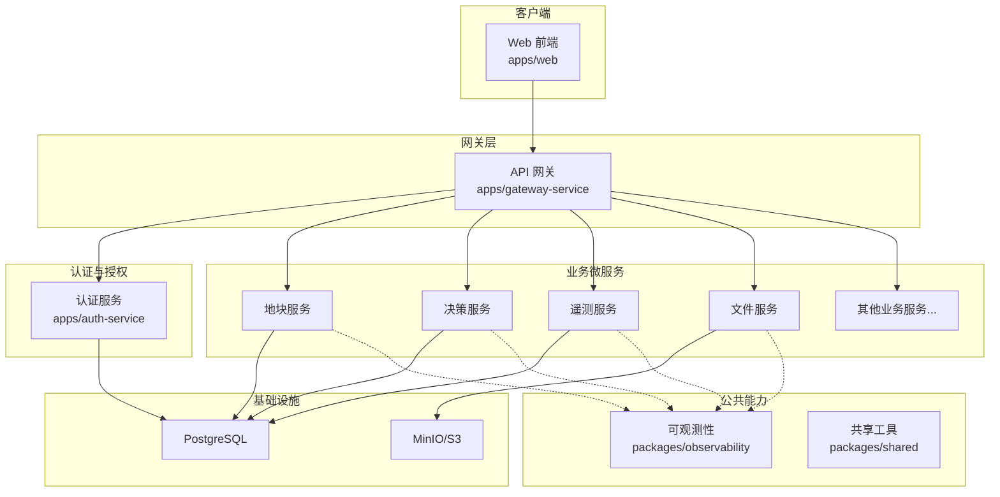
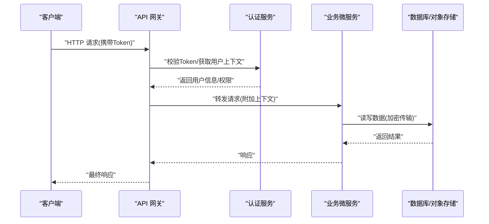
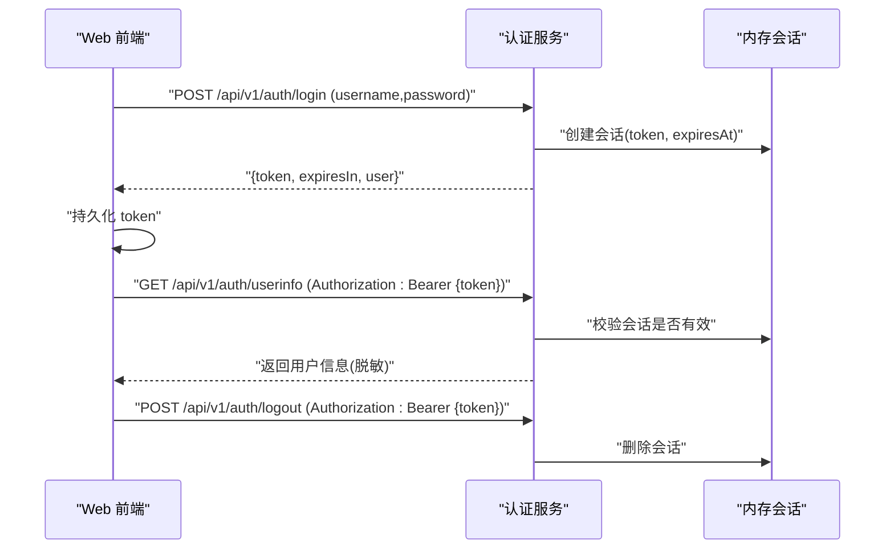
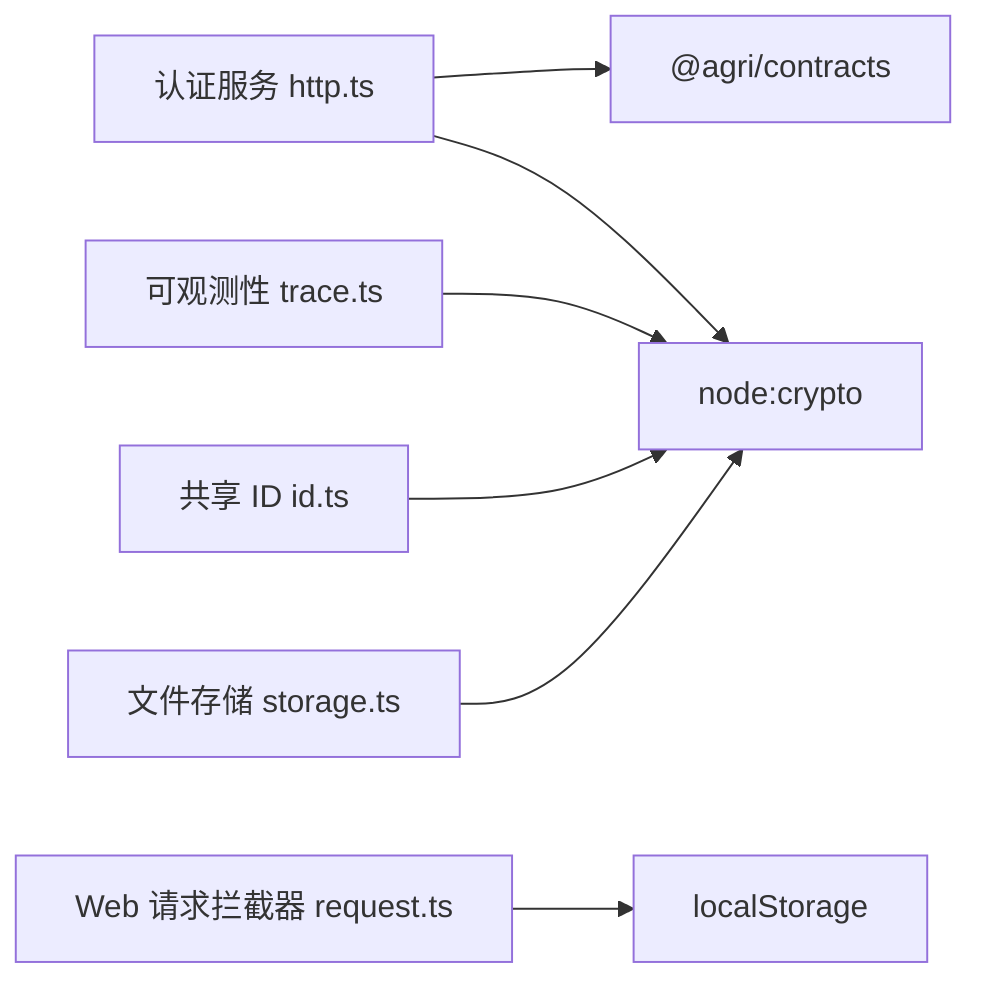

# 安全实践

<cite>
**本文引用的文件**   
- [README.md](file://README.md)
- [apps/auth-service/src/http.ts](file://apps/auth-service/src/http.ts)
- [apps/web/src/utils/request.ts](file://apps/web/src/utils/request.ts)
- [apps/web/src/stores/index.ts](file://apps/web/src/stores/index.ts)
- [apps/web/src/router/index.ts](file://apps/web/src/router/index.ts)
- [packages/observability/src/trace.ts](file://packages/observability/src/trace.ts)
- [packages/shared/src/id.ts](file://packages/shared/src/id.ts)
- [apps/file-service/src/storage.ts](file://apps/file-service/src/storage.ts)
</cite>

## 目录
1. [引言](#引言)
2. [项目结构](#项目结构)
3. [核心组件](#核心组件)
4. [架构总览](#架构总览)
5. [详细组件分析](#详细组件分析)
6. [依赖分析](#依赖分析)
7. [性能考虑](#性能考虑)
8. [故障排查指南](#故障排查指南)
9. [结论](#结论)
10. [附录](#附录)

## 引言
本指南面向智慧农业平台的安全建设，围绕身份认证、数据加密、访问控制、安全编码规范、审计与威胁检测等维度，结合仓库现有实现给出可落地的实践建议。当前代码库提供了轻量鉴权服务、前端令牌管理、通用追踪与ID生成能力，以及文件存储中的哈希工具；同时工程采用多微服务架构（NestJS + TypeScript），具备扩展为完整网关与权限体系的基础。

## 项目结构
仓库采用多包工作区与多应用微服务组织：
- apps 下包含多个业务微服务与前端 web 应用
- packages 下提供公共能力（配置、契约、数据库、消息、可观测性、共享工具等）
- infra 提供基础设施脚本与数据库迁移

图表来源
- [README.md:58-82](file://README.md#L58-L82)

章节来源
- [README.md:1-10](file://README.md#L1-L10)
- [README.md:58-82](file://README.md#L58-L82)

## 核心组件
- 认证服务：提供登录、登出、用户信息查询接口，基于内存会话的 Bearer Token 鉴权。
- Web 前端：在请求拦截器中注入 Authorization 头，并在路由守卫中校验登录态。
- 可观测性：统一 traceId 生成与日志追踪，便于审计与排障。
- 共享工具：ID 生成与通用能力，支撑令牌与事件标识。
- 文件服务：提供哈希/HMAC 工具，可用于完整性校验与签名。

章节来源
- [apps/auth-service/src/http.ts:1-21](file://apps/auth-service/src/http.ts#L1-L21)
- [apps/web/src/utils/request.ts:16-18](file://apps/web/src/utils/request.ts#L16-L18)
- [apps/web/src/router/index.ts:148-149](file://apps/web/src/router/index.ts#L148-L149)
- [packages/observability/src/trace.ts:1](file://packages/observability/src/trace.ts#L1)
- [packages/shared/src/id.ts:1](file://packages/shared/src/id.ts#L1)
- [apps/file-service/src/storage.ts:1](file://apps/file-service/src/storage.ts#L1)

## 架构总览
从安全视角，系统边界如下：
- 外部流量经 API 网关进入，网关负责协议转换、限流、基础鉴权与审计。
- 认证服务签发并验证令牌，维护会话状态。
- 业务微服务通过网关或内部总线进行受控调用，遵循最小权限原则。
- 数据存储使用 PostgreSQL 与 MinIO/S3，需启用传输加密与静态加密。
- 可观测性贯穿全链路，记录关键安全事件。

图表来源
- [apps/auth-service/src/http.ts:14-20](file://apps/auth-service/src/http.ts#L14-L20)
- [apps/web/src/utils/request.ts:16-18](file://apps/web/src/utils/request.ts#L16-L18)

## 详细组件分析

### 身份认证机制
- 令牌模型：当前实现使用随机 UUID 作为会话令牌，服务端内存保存会话过期时间，客户端以 Bearer 方式传递。
- 登录流程：用户名密码校验成功后签发令牌，返回 token 与有效期。
- 登出流程：移除服务端会话，使令牌失效。
- 用户信息：受保护接口要求有效令牌，返回脱敏后的用户信息。

图表来源
- [apps/auth-service/src/http.ts:14-20](file://apps/auth-service/src/http.ts#L14-L20)
- [apps/web/src/stores/index.ts:16-32](file://apps/web/src/stores/index.ts#L16-L32)

章节来源
- [apps/auth-service/src/http.ts:6-20](file://apps/auth-service/src/http.ts#L6-L20)
- [apps/web/src/stores/index.ts:16-32](file://apps/web/src/stores/index.ts#L16-L32)

#### JWT 令牌管理与 OAuth2 集成建议
- 现状：当前未实现 JWT 与 OAuth2，仅使用内存会话令牌。
- 建议：
  - 引入标准 JWT 库，签发短期 Access Token 与长期 Refresh Token，设置合理过期时间与刷新策略。
  - 使用安全的密钥管理方案（如 KMS/Secrets Manager）管理签名私钥与对称密钥。
  - 接入 OAuth2 授权服务器，支持授权码模式（PKCE for SPA）、设备码模式（IoT）。
  - 将角色与权限放入 Token 声明或后端缓存，网关与服务端做细粒度校验。

[本节为概念性建议，不直接分析具体文件]

#### 用户权限控制
- 现状：用户对象包含 roles 与 permissions 字段，但鉴权逻辑未在示例中体现。
- 建议：
  - 在网关层实施 RBAC/ABAC 策略，按资源与动作进行授权。
  - 在服务层对敏感操作进行二次校验，避免越权。
  - 将权限变更纳入审计日志，确保可追溯。

[本节为概念性建议，不直接分析具体文件]

### 数据加密策略
- 传输层安全：
  - 所有对外接口应强制 HTTPS，禁用明文 HTTP。
  - 网关与反向代理启用 TLS 终止，证书由可信 CA 颁发。
- 静态数据加密：
  - 数据库启用透明加密（TDE）或列级加密，敏感字段（如手机号、身份证号）单独加密。
  - 对象存储启用服务端加密（SSE-KMS），并对上传内容计算 HMAC 用于完整性校验。
- 密钥管理：
  - 密钥与配置分离，禁止硬编码；使用环境变量或密钥管理服务注入。
  - 定期轮换密钥，保留历史密钥用于解密旧数据。

章节来源
- [apps/file-service/src/storage.ts:1](file://apps/file-service/src/storage.ts#L1)

### 访问控制模式
- API 网关安全配置：
  - 强制鉴权：拒绝无令牌或无效令牌的请求。
  - 速率限制与 IP 白名单：防止暴力破解与滥用。
  - 输入校验与输出过滤：统一在网关或中间件层处理。
- 微服务间认证：
  - 服务间调用使用 mTLS 或内部 Token，禁止跨网段直连。
  - 服务发现与注册中心配合，限制暴露面。
- 数据权限控制：
  - 租户隔离：按 tenantId 过滤数据范围。
  - 行级权限：基于用户角色与资源归属动态构建查询条件。

[本节为概念性建议，不直接分析具体文件]

### 安全编码规范
- 输入验证：
  - 对所有入参进行类型、长度、格式校验，优先使用强类型与校验库。
  - 对 JSON 载荷进行严格解析，拒绝非法结构。
- SQL 注入防护：
  - 禁止字符串拼接 SQL，使用参数化查询或 ORM。
  - 对排序字段、分页参数进行白名单校验。
- XSS 防护：
  - 前端渲染对用户输入进行转义，避免直接插入 HTML。
  - 后端输出前对敏感字符进行编码。
- 错误处理：
  - 统一错误响应格式，避免泄露堆栈与内部细节。
  - 记录结构化日志，包含 traceId、用户标识、操作资源与结果。

章节来源
- [apps/auth-service/src/http.ts:11-12](file://apps/auth-service/src/http.ts#L11-L12)
- [apps/auth-service/src/http.ts:9-10](file://apps/auth-service/src/http.ts#L9-L10)

### 安全审计日志与威胁检测
- 审计日志：
  - 记录登录成功/失败、登出、权限变更、敏感数据访问等关键事件。
  - 日志包含时间、用户、IP、traceId、操作详情与结果。
- 威胁检测：
  - 基于规则与统计模型检测异常行为（如频繁失败登录、异常高频访问）。
  - 与 SIEM 系统集成，实现告警与自动阻断。
- 追踪与可观测性：
  - 使用统一 traceId 贯穿请求链路，便于定位问题与审计。
  - 指标采集覆盖认证失败率、延迟分布、错误率等安全相关指标。

章节来源
- [packages/observability/src/trace.ts:1](file://packages/observability/src/trace.ts#L1)
- [apps/auth-service/src/http.ts:9-10](file://apps/auth-service/src/http.ts#L9-L10)

## 依赖分析
- 认证服务依赖 Node.js 内置 crypto 生成随机令牌，依赖 contracts 定义统一响应体。
- Web 前端依赖本地存储与请求拦截器注入令牌。
- 可观测性与 ID 生成依赖 crypto 模块生成唯一标识。
- 文件服务依赖 crypto 提供哈希/HMAC 能力。

图表来源
- [apps/auth-service/src/http.ts:1-5](file://apps/auth-service/src/http.ts#L1-L5)
- [apps/web/src/utils/request.ts:16-18](file://apps/web/src/utils/request.ts#L16-L18)
- [packages/observability/src/trace.ts:1](file://packages/observability/src/trace.ts#L1)
- [packages/shared/src/id.ts:1](file://packages/shared/src/id.ts#L1)
- [apps/file-service/src/storage.ts:1](file://apps/file-service/src/storage.ts#L1)

章节来源
- [apps/auth-service/src/http.ts:1-5](file://apps/auth-service/src/http.ts#L1-L5)
- [apps/web/src/utils/request.ts:16-18](file://apps/web/src/utils/request.ts#L16-L18)
- [packages/observability/src/trace.ts:1](file://packages/observability/src/trace.ts#L1)
- [packages/shared/src/id.ts:1](file://packages/shared/src/id.ts#L1)
- [apps/file-service/src/storage.ts:1](file://apps/file-service/src/storage.ts#L1)

## 性能考虑
- 令牌校验：
  - 将令牌校验下沉至网关层，减少业务服务开销。
  - 使用 Redis 缓存会话或 JWT 黑名单，提升并发性能。
- 加密与哈希：
  - 对大文件分块计算哈希，避免阻塞主线程。
  - 数据库连接池与索引优化，减少慢查询。
- 日志与追踪：
  - 异步写入审计日志，避免影响主流程。
  - 采样高负载下的追踪数据，降低开销。

[本节为通用指导，不直接分析具体文件]

## 故障排查指南
- 登录失败：
  - 检查用户名密码是否正确，确认认证服务健康端点可用。
  - 查看审计日志中失败原因与 traceId。
- 令牌无效：
  - 确认前端是否正确注入 Authorization 头。
  - 检查会话是否过期或被登出。
- 权限不足：
  - 核对用户角色与资源权限映射。
  - 检查网关与服务端的权限策略配置。
- 数据异常：
  - 检查数据库连接与事务边界。
  - 查看对象存储的加密与完整性校验结果。

章节来源
- [apps/auth-service/src/http.ts:14-20](file://apps/auth-service/src/http.ts#L14-L20)
- [apps/web/src/utils/request.ts:16-18](file://apps/web/src/utils/request.ts#L16-L18)

## 结论
当前仓库提供了轻量认证、前端令牌管理与基础可观测能力，具备向企业级安全体系演进的基础。建议在网关层统一鉴权与审计，引入 JWT/OAuth2 与密钥管理，完善 RBAC/ABAC 权限模型，强化输入校验与输出过滤，并通过 SIEM 与指标监控实现威胁检测与快速响应。

## 附录
- 参考命令与脚本：
  - 启动全部服务与健康检查见根 README。
  - 数据库迁移与基础设施检查见 scripts 目录。

章节来源
- [README.md:12-53](file://README.md#L12-L53)