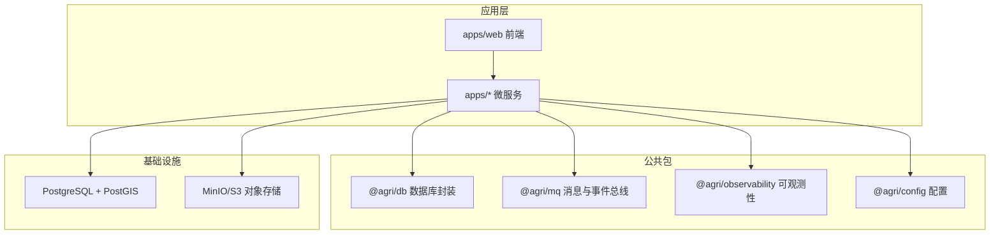
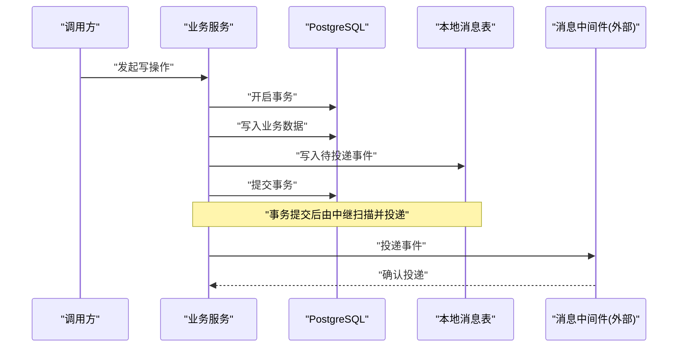
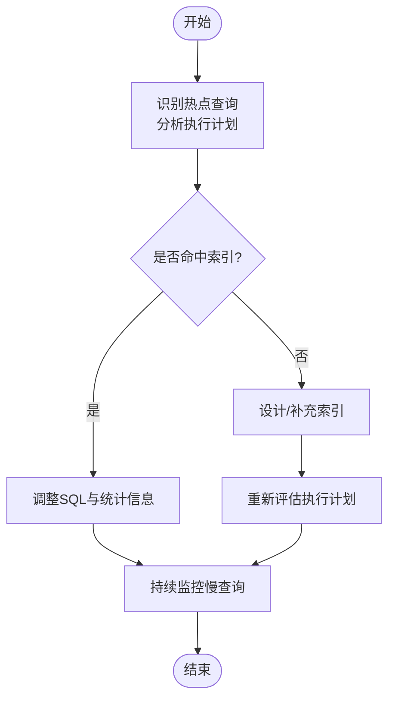
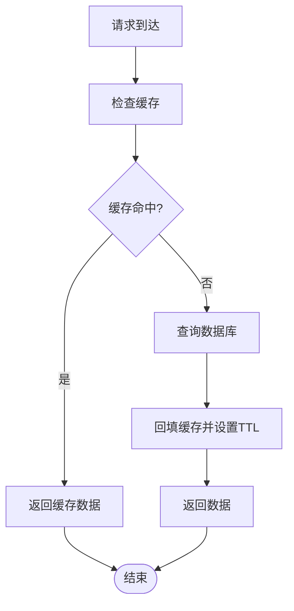
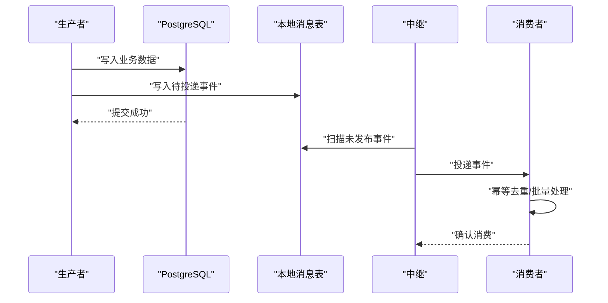
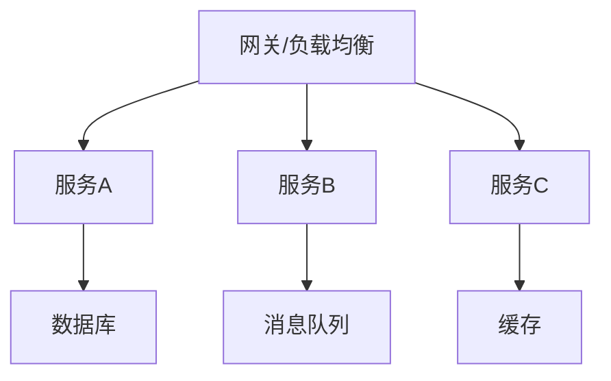
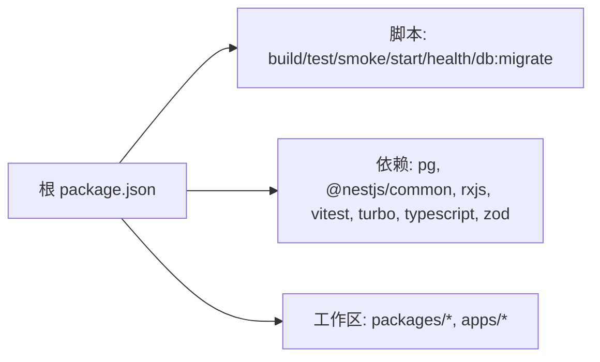

# 性能优化

<cite>
**本文引用的文件**   
- [README.md](file://README.md)
- [package.json](file://package.json)
- [001_initial_schema.sql](file://infra/postgres/001_initial_schema.sql)
- [002_decision_telemetry.sql](file://infra/postgres/migrations/002_decision_telemetry.sql)
</cite>

## 目录
1. [引言](#引言)
2. [项目结构](#项目结构)
3. [核心组件](#核心组件)
4. [架构总览](#架构总览)
5. [详细组件分析](#详细组件分析)
6. [依赖关系分析](#依赖关系分析)
7. [性能考量](#性能考量)
8. [故障排查指南](#故障排查指南)
9. [结论](#结论)
10. [附录](#附录)

## 引言
本指南面向智慧农业平台的后端与基础设施团队，聚焦数据库、缓存、异步处理与微服务四个维度的性能优化。平台采用 NestJS + TypeScript 的微服务架构，公共能力以包形式沉淀（数据库访问、消息与事件总线、可观测性等），并通过 PostgreSQL 与 PostGIS 承载业务与时序数据。本文结合仓库中的数据库迁移脚本与工程说明，给出可落地的优化策略、监控指标与排障建议。

## 项目结构
仓库采用 pnpm workspace + Turborepo 的多包工程：
- apps：HTTP 微服务与前端管理后台
- packages：公共能力包（配置、契约、数据库封装、消息队列、可观测性、测试工具等）
- infra：PostgreSQL 初始化与迁移脚本
- scripts：运维脚本（健康检查、冒烟测试、服务启动、数据库迁移等）

图示来源
- [README.md:58-100](file://README.md#L58-L100)

章节来源
- [README.md:58-100](file://README.md#L58-L100)

## 核心组件
- 数据库封装与事务：提供客户端生命周期、事务边界、分页与软删除；要求仓储方法显式传入事务对象，避免事务边界扩大。
- 消息与事件总线：本地消息表 + 中继投递 + 消费幂等；重试按指数退避，失败转死信。
- 可观测性：结构化日志、链路追踪、指标采集与运行期采集器。
- 配置加载：环境变量校验与密钥读取，启动期装配。

章节来源
- [README.md:75-99](file://README.md#L75-L99)
- [README.md:112-118](file://README.md#L112-L118)

## 架构总览
下图展示典型的数据写入与事件投递流程，体现“业务数据与待投递事件同事务”的一致性保障。

图示来源
- [README.md:114-115](file://README.md#L114-L115)

## 详细组件分析

### 数据库优化策略（PostgreSQL + PostGIS）
- 查询优化
  - 优先使用覆盖索引与复合索引，减少回表；对高频过滤字段建立选择性高的索引。
  - 对 JSONB 字段进行谓词下推或拆分到列族，避免全表扫描。
  - 时序类查询尽量按时间范围+设备维度过滤，利用分区或时间降序索引。
- 索引设计
  - 已定义多张关键表的复合索引，如按租户+创建时间、按地块+时间、按设备+指标+时间的索引，利于常见查询路径。
  - 针对软删除场景，使用部分索引仅包含未删除记录，提升查询效率。
- 连接池配置
  - 根据服务实例数与 CPU 核数估算最大连接数，避免连接风暴；为不同服务划分独立连接池或数据库用户。
  - 设置合理的空闲超时与最小连接数，降低冷启动开销。
- 事务处理最佳实践
  - 明确事务边界，短事务优先；将非必要的 I/O 移出事务。
  - 仓储方法首参显式传入事务对象，避免隐式扩大事务范围。
  - 对可重试错误进行分类，配合重试与补偿机制。

章节来源
- [001_initial_schema.sql:1-41](file://infra/postgres/001_initial_schema.sql#L1-L41)
- [002_decision_telemetry.sql:1-88](file://infra/postgres/migrations/002_decision_telemetry.sql#L1-L88)
- [README.md:112-118](file://README.md#L112-L118)

### 缓存策略（Redis）
- 缓存模式
  - Cache-Aside：读时先查缓存，未命中再回源数据库并回填；写时更新数据库并失效缓存。
  - Read/Write Through：通过缓存代理读写，适合强一致场景。
  - Write-Behind：批量合并写，适合高吞吐但允许短暂不一致的场景。
- 数据一致性保证
  - 使用版本号或时间戳作为缓存键后缀，避免脏读。
  - 对热点数据采用双写+延迟双删或订阅变更流的方式降低不一致窗口。
- 缓存失效机制
  - 基于 TTL 的过期策略；对热点键采用随机抖动避免雪崩。
  - 对批量更新采用前缀失效或逻辑标记失效，配合懒加载重建。

[本节为概念性内容，不直接分析具体文件]

### 异步处理模式（消息队列）
- 本地消息表 + 中继投递
  - 业务数据与待投递事件在同一事务中持久化，确保最终一致性。
  - 中继定时扫描未发布事件，按指数退避重试，失败进入死信队列。
- 批量处理
  - 消费者侧按批次拉取消息，聚合计算后再写库，降低锁竞争与 IO 次数。
- 背压处理
  - 消费者侧维护队列长度阈值，超过阈值时暂停拉取或降级处理，保护下游。
  - 结合速率限制与令牌桶算法控制吞吐。

图示来源
- [README.md:114-115](file://README.md#L114-L115)

章节来源
- [README.md:114-115](file://README.md#L114-L115)

### 微服务性能调优
- 负载均衡
  - 网关层做请求分发与健康检查，服务侧无状态扩展。
  - 合理设置连接复用与超时，避免长尾延迟。
- 服务间通信优化
  - 优先使用 HTTP/2 或 gRPC 降低序列化与传输开销。
  - 对热点接口增加限流与熔断，防止级联故障。
- 资源管理
  - 按服务特性分配 CPU/内存配额，避免争抢。
  - 启用 GC 参数调优与堆外内存监控，避免频繁 Full GC。

[本节为概念性内容，不直接分析具体文件]

## 依赖关系分析
根 package.json 定义了工作区、脚本与依赖，pg 作为数据库驱动被引入，构建与测试通过 tsc/vitest/turbo 编排。

图示来源
- [package.json:1-45](file://package.json#L1-L45)

章节来源
- [package.json:1-45](file://package.json#L1-L45)

## 性能考量
- 数据库
  - 关注慢查询与锁等待，定期分析执行计划与统计信息。
  - 对大表进行分区或归档，减少热数据体积。
  - 合理使用 PostGIS 空间函数，避免在应用层做复杂几何运算。
- 缓存
  - 命中率与过期率是关键指标；对热点键做单独监控。
  - 注意缓存穿透与雪崩防护，采用布隆过滤器与随机 TTL。
- 异步
  - 监控堆积量、消费延迟与重试次数；设置告警阈值。
  - 消费者侧实现背压与降级，避免雪崩。
- 微服务
  - 监控 QPS、P95/P99 延迟、错误率与资源利用率。
  - 对关键链路增加分布式追踪，定位瓶颈。

[本节为通用指导，不直接分析具体文件]

## 故障排查指南
- 数据库
  - 慢查询：启用慢查询日志，结合 EXPLAIN ANALYZE 定位问题。
  - 连接耗尽：检查连接池上限与泄漏，必要时重启回收。
  - 锁冲突：查看锁等待图，缩短事务或拆分更新顺序。
- 缓存
  - 命中率骤降：检查键命名与失效策略，核对上游数据一致性。
  - 雪崩：观察 TTL 分布，加入随机抖动与预热。
- 异步
  - 堆积增长：检查消费者处理能力与下游依赖，扩容或降级。
  - 重复消费：确认幂等键与去重逻辑生效。
- 微服务
  - 高延迟：检查 GC、线程池、网络 RTT 与下游依赖。
  - 错误率上升：查看熔断与重试策略，定位异常根因。

章节来源
- [README.md:112-118](file://README.md#L112-L118)

## 结论
通过合理的索引设计与查询优化、稳健的缓存策略、可靠的异步处理与微服务治理，平台可在高并发与大数据量场景下保持稳定与高性能。建议在生产环境持续采集指标与链路追踪，结合容量规划与压测结果迭代优化。

[本节为总结性内容，不直接分析具体文件]

## 附录
- 常用监控指标
  - 数据库：连接数、慢查询数、锁等待、缓冲命中率、IOPS。
  - 缓存：命中率、过期数、内存使用、网络带宽。
  - 消息队列：堆积量、消费延迟、重试次数、死信数量。
  - 微服务：QPS、延迟分位、错误率、CPU/内存/GC。
- 参考命令
  - 健康检查与服务冒烟：见根脚本 health:services、smoke:services。
  - 数据库迁移：db:migrate。

章节来源
- [package.json:14-28](file://package.json#L14-L28)
- [README.md:120-145](file://README.md#L120-L145)