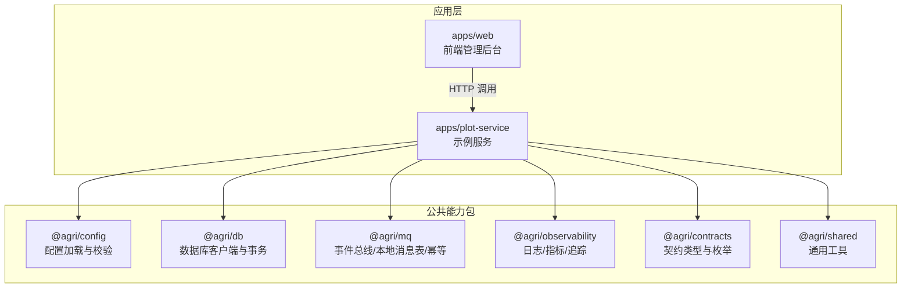
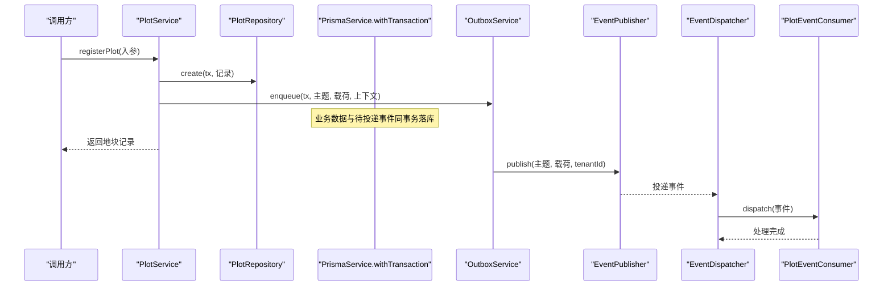
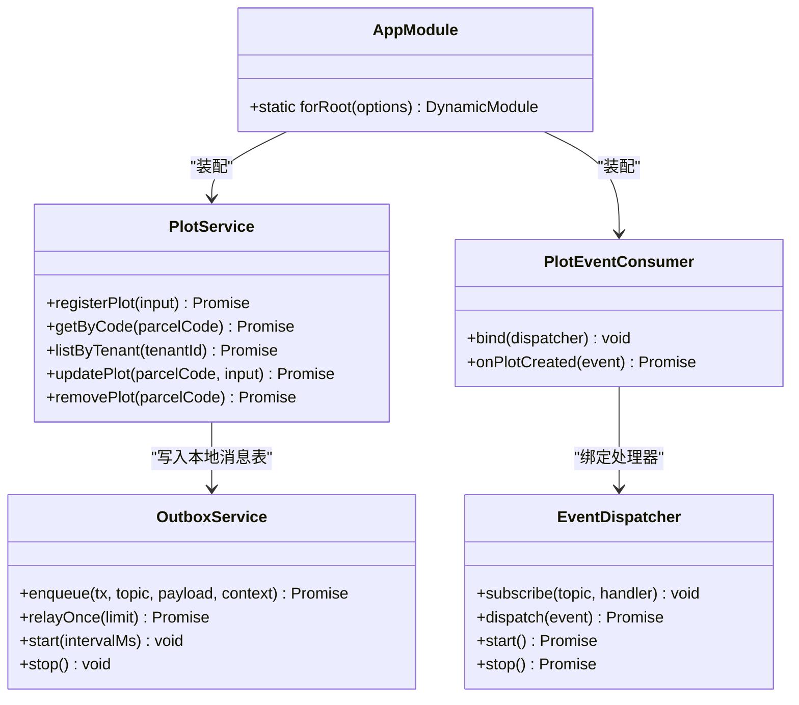
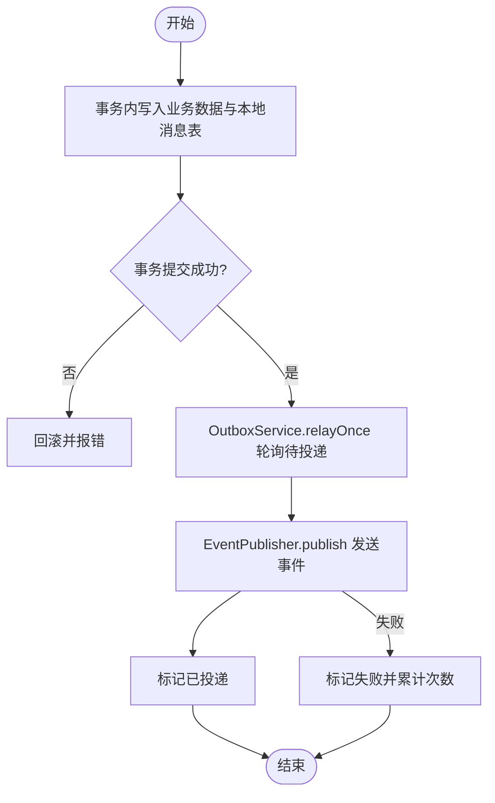
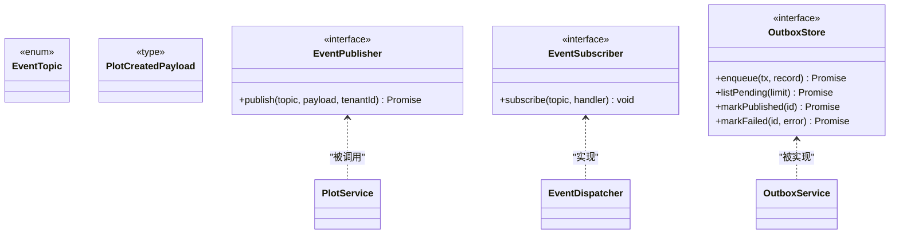
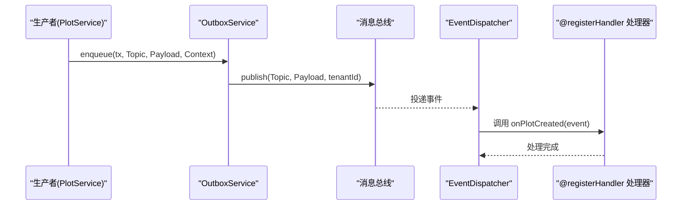
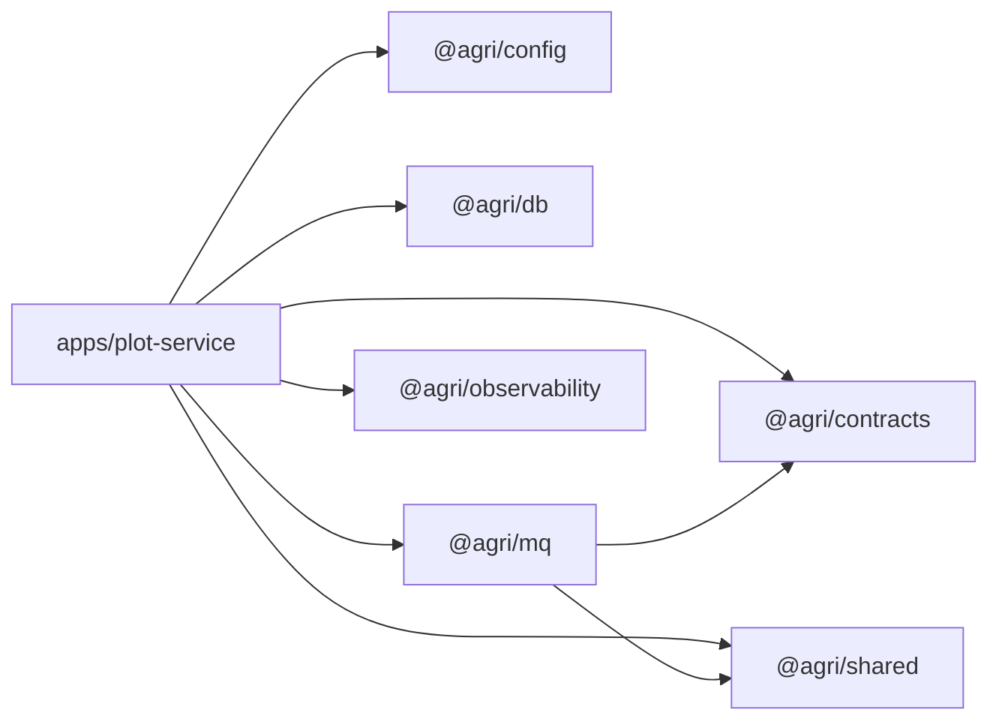

# 扩展指南

<cite>
**本文引用的文件**   
- [README.md](file://README.md)
- [package.json](file://package.json)
- [apps/plot-service/src/app.module.ts](file://apps/plot-service/src/app.module.ts)
- [apps/plot-service/src/main.ts](file://apps/plot-service/src/main.ts)
- [packages/mq/src/index.ts](file://packages/mq/src/index.ts)
- [packages/config/src/index.ts](file://packages/config/src/index.ts)
- [packages/db/src/index.ts](file://packages/db/src/index.ts)
- [packages/mq/src/decorators.ts](file://packages/mq/src/decorators.ts)
- [packages/mq/src/subscriber.ts](file://packages/mq/src/subscriber.ts)
- [packages/mq/src/outbox.ts](file://packages/mq/src/outbox.ts)
- [apps/plot-service/src/plot.consumer.ts](file://apps/plot-service/src/plot.consumer.ts)
- [apps/plot-service/src/plot.service.ts](file://apps/plot-service/src/plot.service.ts)
</cite>

## 目录
1. [引言](#引言)
2. [项目结构](#项目结构)
3. [核心组件](#核心组件)
4. [架构总览](#架构总览)
5. [详细组件分析](#详细组件分析)
6. [依赖关系分析](#依赖关系分析)
7. [性能与可靠性考虑](#性能与可靠性考虑)
8. [故障排查指南](#故障排查指南)
9. [结论](#结论)
10. [附录：扩展示例与最佳实践](#附录扩展示例与最佳实践)

## 引言
本指南面向希望在智慧农业平台进行扩展开发的工程师，覆盖以下主题：
- 新功能开发流程：微服务创建模板、模块注册机制与依赖注入配置。
- 第三方系统集成模式：外部 API 适配、数据同步策略与错误处理机制。
- 插件开发规范：接口定义、生命周期管理与配置管理。
- 事件驱动扩展点：自定义事件发布订阅与消息处理器开发。
- 完整扩展示例与最佳实践案例。

平台采用 NestJS + TypeScript，以 pnpm workspace 组织公共包与微服务，通过 tsc -b 构建链串联工程引用；示例服务演示了“建档 → 本地消息表 → 中继投递 → 消费幂等”的完整链路。

**章节来源**
- [README.md:1-167](file://README.md#L1-L167)
- [package.json:1-46](file://package.json#L1-L46)

## 项目结构
仓库根包含公共能力包（packages）与应用服务（apps），其中 apps/plot-service 是完整的示例服务，展示了模块装配、仓储替换、消息与可观测性接入方式。

**图表来源**
- [README.md:58-100](file://README.md#L58-L100)
- [apps/plot-service/src/app.module.ts:1-32](file://apps/plot-service/src/app.module.ts#L1-L32)

**章节来源**
- [README.md:58-100](file://README.md#L58-L100)
- [package.json:10-13](file://package.json#L10-L13)

## 核心组件
- 配置中心：@agri/config 提供环境变量校验、启动期加载与密钥读取，支持在 Nest 模块中集中装配。
- 数据访问：@agri/db 封装客户端生命周期、事务、分片路由、分页与软删除，不包含业务模型。
- 消息与事件：@agri/mq 提供发布订阅、本地消息表、重试死信与幂等；装饰器用于声明式注册处理器。
- 可观测性：@agri/observability 提供结构化日志、链路追踪与指标采集。
- 契约与共享：@agri/contracts 定义事件主题、载荷与枚举；@agri/shared 提供异常基类、ID 生成与时间工具。

**章节来源**
- [packages/config/src/index.ts:1-9](file://packages/config/src/index.ts#L1-L9)
- [packages/db/src/index.ts:1-15](file://packages/db/src/index.ts#L1-L15)
- [packages/mq/src/index.ts:1-41](file://packages/mq/src/index.ts#L1-L41)
- [README.md:86-100](file://README.md#L86-L100)

## 架构总览
示例服务通过 AppModule.forRoot 完成基础设施、横切能力与业务能力的装配；main.ts 作为组合根，手工组装依赖并走通端到端链路。

**图表来源**
- [apps/plot-service/src/plot.service.ts:53-104](file://apps/plot-service/src/plot.service.ts#L53-L104)
- [packages/mq/src/outbox.ts:74-112](file://packages/mq/src/outbox.ts#L74-L112)
- [packages/mq/src/subscriber.ts:74-101](file://packages/mq/src/subscriber.ts#L74-L101)
- [apps/plot-service/src/plot.consumer.ts:20-28](file://apps/plot-service/src/plot.consumer.ts#L20-L28)

**章节来源**
- [apps/plot-service/src/app.module.ts:82-163](file://apps/plot-service/src/app.module.ts#L82-L163)
- [apps/plot-service/src/main.ts:48-113](file://apps/plot-service/src/main.ts#L48-L113)

## 详细组件分析

### 微服务创建模板与模块注册
- 复制 apps/plot-service 目录结构作为新服务模板。
- 在服务根 Nest 模块中导入 ConfigModule.forRoot、PrismaModule.forRoot、MqModule.forRoot。
- 使用 forRoot(options) 动态装配，将配置、数据库工厂、消息发布器/订阅器、仓储与本地消息表注入到业务服务。
- 通过 Provider 令牌（如 PLOT_REPOSITORY、OUTBOX_STORE、IDEMPOTENCY_STORE）实现可替换的基础设施实现。

**图表来源**
- [apps/plot-service/src/app.module.ts:82-163](file://apps/plot-service/src/app.module.ts#L82-L163)
- [apps/plot-service/src/plot.service.ts:39-139](file://apps/plot-service/src/plot.service.ts#L39-L139)
- [apps/plot-service/src/plot.consumer.ts:12-39](file://apps/plot-service/src/plot.consumer.ts#L12-L39)
- [packages/mq/src/outbox.ts:51-137](file://packages/mq/src/outbox.ts#L51-L137)
- [packages/mq/src/subscriber.ts:26-101](file://packages/mq/src/subscriber.ts#L26-L101)

**章节来源**
- [README.md:147-155](file://README.md#L147-L155)
- [apps/plot-service/src/app.module.ts:34-67](file://apps/plot-service/src/app.module.ts#L34-L67)
- [apps/plot-service/src/app.module.ts:82-163](file://apps/plot-service/src/app.module.ts#L82-L163)

### 依赖注入配置
- 基础设施提供者：ConfigModule、PrismaModule、LoggerService、MetricsService、TraceService、EventLoopLagCollector、HandleCollector。
- 业务提供者：PLOT_REPOSITORY、OUTBOX_STORE、IDEMPOTENCY_STORE、OutboxService、EventDispatcher、PlotEventConsumer、PlotService。
- 通过 useFactory 与 inject 显式装配，避免测试期对类型元数据的依赖。

**章节来源**
- [apps/plot-service/src/app.module.ts:86-163](file://apps/plot-service/src/app.module.ts#L86-L163)
- [README.md:159-161](file://README.md#L159-L161)

### 第三方系统集成模式
- 外部 API 适配：通过为 EventPublisher 与 EventSubscriber 提供具体实现，对接真实消息中间件；仓储与 PrismaClientFactory 同样可替换为生产实现。
- 数据同步策略：业务数据与事件写入同一事务（本地消息表），由 OutboxService.relayOnce 周期性或定时中继投递；消费侧基于 eventId 做幂等去重。
- 错误处理机制：分发器按 RetryPolicy 指数退避重试，超过最大次数转死信；OutboxStore.markFailed 累计失败原因；消费者抛错会触发 onError 回调。

**图表来源**
- [apps/plot-service/src/plot.service.ts:95-102](file://apps/plot-service/src/plot.service.ts#L95-L102)
- [packages/mq/src/outbox.ts:99-112](file://packages/mq/src/outbox.ts#L99-L112)
- [packages/mq/src/subscriber.ts:74-101](file://packages/mq/src/subscriber.ts#L74-L101)

**章节来源**
- [packages/mq/src/outbox.ts:6-12](file://packages/mq/src/outbox.ts#L6-L12)
- [packages/mq/src/subscriber.ts:74-101](file://packages/mq/src/subscriber.ts#L74-L101)
- [README.md:114-118](file://README.md#L114-L118)

### 插件开发规范
- 接口定义：通过 @agri/contracts 中的 EventTopic 与事件载荷类型定义扩展点；仓储、发布器、订阅器等接口位于 @agri/mq 与 @agri/db。
- 生命周期管理：消费者通过 bind(dispatcher) 将处理器注册到 EventDispatcher；分发器负责启动、停止与调度。
- 配置管理：使用 AppConfig 与 ConfigModule.forRoot 集中加载；MQ 配置通过 toMqConfig 转换后注入 MqModule.forRoot。

**图表来源**
- [packages/mq/src/types.js](file://packages/mq/src/types.js)
- [packages/mq/src/outbox.ts:31-41](file://packages/mq/src/outbox.ts#L31-L41)
- [apps/plot-service/src/plot.service.ts:1-12](file://apps/plot-service/src/plot.service.ts#L1-L12)

**章节来源**
- [packages/mq/src/decorators.ts:1-60](file://packages/mq/src/decorators.ts#L1-L60)
- [apps/plot-service/src/app.module.ts:180-195](file://apps/plot-service/src/app.module.ts#L180-L195)
- [packages/config/src/index.ts:1-9](file://packages/config/src/index.ts#L1-L9)

### 事件驱动扩展点
- 自定义事件：先在 @agri/contracts 中定义主题与载荷，再在生产者侧用 OutboxService.enqueue 入队，消费者侧用 @registerHandler 声明处理方法。
- 消息处理器：PlotEventConsumer 通过 buildHandlers(this) 自动发现并注册处理器；EventDispatcher 统一执行幂等、重试与死信。

**图表来源**
- [apps/plot-service/src/plot.service.ts:82-102](file://apps/plot-service/src/plot.service.ts#L82-L102)
- [packages/mq/src/outbox.ts:74-112](file://packages/mq/src/outbox.ts#L74-L112)
- [packages/mq/src/decorators.ts:25-34](file://packages/mq/src/decorators.ts#L25-L34)
- [apps/plot-service/src/plot.consumer.ts:20-28](file://apps/plot-service/src/plot.consumer.ts#L20-L28)

**章节来源**
- [README.md:153-155](file://README.md#L153-L155)
- [packages/mq/src/decorators.ts:1-60](file://packages/mq/src/decorators.ts#L1-L60)
- [packages/mq/src/subscriber.ts:51-60](file://packages/mq/src/subscriber.ts#L51-L60)

## 依赖关系分析
- 服务间耦合：业务服务仅依赖公共包的对外契约，不反向被基础设施包引用，便于测试替换。
- 直接依赖：
  - apps/plot-service 依赖 @agri/config、@agri/db、@agri/mq、@agri/observability、@agri/contracts、@agri/shared。
  - @agri/mq 依赖 @agri/contracts、@agri/shared、@nestjs/common。
  - @agri/db 暴露客户端、事务、分页、软删除等能力。
- 间接依赖：通过 App 模块装配，业务代码无需感知底层实现细节。

**图表来源**
- [apps/plot-service/src/app.module.ts:1-32](file://apps/plot-service/src/app.module.ts#L1-L32)
- [packages/mq/src/index.ts:1-41](file://packages/mq/src/index.ts#L1-L41)
- [packages/db/src/index.ts:1-15](file://packages/db/src/index.ts#L1-L15)

**章节来源**
- [README.md:86-100](file://README.md#L86-L100)
- [package.json:31-44](file://package.json#L31-L44)

## 性能与可靠性考虑
- 幂等与重试：EventDispatcher 基于 eventId 去重，按 RetryPolicy 指数退避重试，超限转死信，避免阻塞后续事件。
- 最终一致性：本地消息表保证业务数据与事件同时成功，允许重复投递，消费侧必须幂等。
- 资源控制：OutboxService.start 使用 unref 定时器，避免阻塞进程退出；EventDispatcher.stop 清理运行状态。
- 可观测性：LoggerService、MetricsService、TraceService 与 EventLoopLagCollector、HandleCollector 提供运行时洞察。

**章节来源**
- [packages/mq/src/subscriber.ts:74-101](file://packages/mq/src/subscriber.ts#L74-L101)
- [packages/mq/src/outbox.ts:114-137](file://packages/mq/src/outbox.ts#L114-L137)
- [apps/plot-service/src/app.module.ts:91-110](file://apps/plot-service/src/app.module.ts#L91-L110)

## 故障排查指南
- 事件未消费：检查 EventDispatcher.handlerCount 是否大于 0，确认消费者已通过 bind 注册处理器。
- 重复消费：确认 IdempotencyGuard 与 InMemoryIdempotencyStore 已正确装配；eventId 唯一性需由上游保证。
- 中继失败：查看 OutboxStore.markFailed 记录的 lastError 与 retryCount；调整 broker 连接与权限。
- 事务边界扩大：确保仓储方法首参显式传入事务对象，避免静默扩大事务范围。
- 配置缺失：启动期由 @agri/config 抛出配置错误，优先检查环境变量与密钥读取。

**章节来源**
- [packages/mq/src/subscriber.ts:57-60](file://packages/mq/src/subscriber.ts#L57-L60)
- [packages/mq/src/outbox.ts:107-109](file://packages/mq/src/outbox.ts#L107-L109)
- [README.md:153-155](file://README.md#L153-L155)
- [README.md:159-164](file://README.md#L159-L164)

## 结论
本扩展指南围绕“可装配、可替换、可观测、可靠”的原则，提供了从微服务模板、模块注册、依赖注入到事件驱动扩展点的完整路径。借助本地消息表与幂等重试机制，系统在保持最终一致性的同时具备高容错能力。建议新增功能时严格遵循契约分离、依赖方向约束与错误码分段约定，确保系统长期演进的可维护性与稳定性。

## 附录：扩展示例与最佳实践
- 新增业务服务
  - 复制 apps/plot-service 结构，添加工程引用，按需导入 ConfigModule、PrismaModule、MqModule。
  - 使用 forRoot(options) 装配仓储、消息与可观测性能力。
- 接 HTTP 适配器
  - 示例服务不强制监听进程；接入 Fastify 适配器后由 AppModule.forRoot 托管生命周期。
- 新增事件
  - 在 @agri/contracts 定义主题与载荷；生产者使用 OutboxService.enqueue；消费者使用 @registerHandler。
- 新增表与仓储
  - 在服务内定义模式，仓储方法首参显式传入事务对象，避免事务边界扩大。
- 最佳实践
  - 错误码分段：域缩写-分类码-序号，含义一经发布不得修改。
  - 时序数据下沉：物联感知服务直连时序库，缓存由各服务自行使用缓存中间件。
  - 空间运算下沉数据库：坐标统一 CGCS2000，仅在出参方向换算。

**章节来源**
- [README.md:147-167](file://README.md#L147-L167)
- [apps/plot-service/src/main.ts:101-113](file://apps/plot-service/src/main.ts#L101-L113)
- [apps/plot-service/src/plot.service.ts:119-137](file://apps/plot-service/src/plot.service.ts#L119-L137)