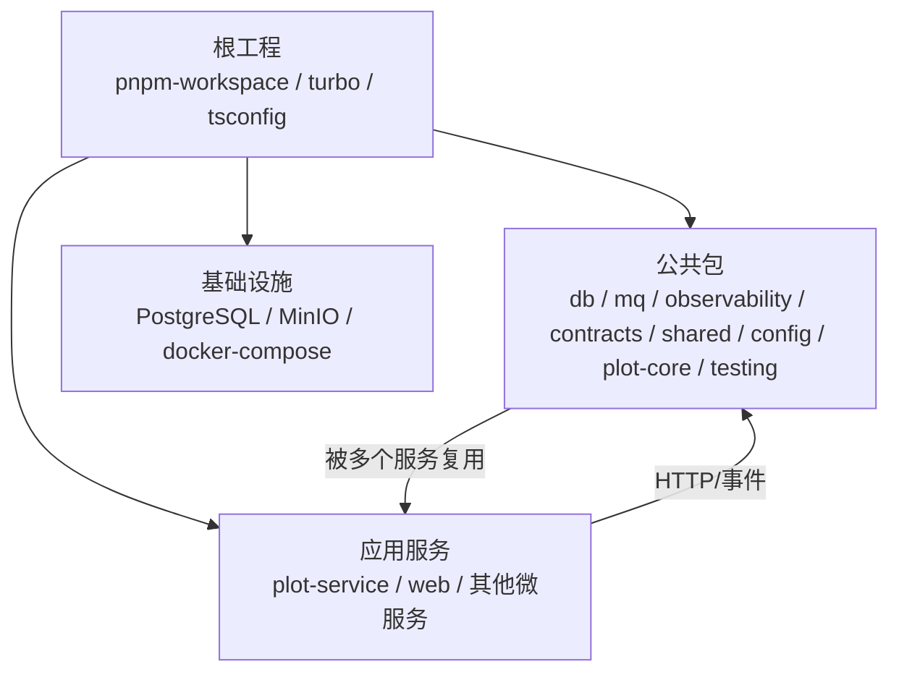
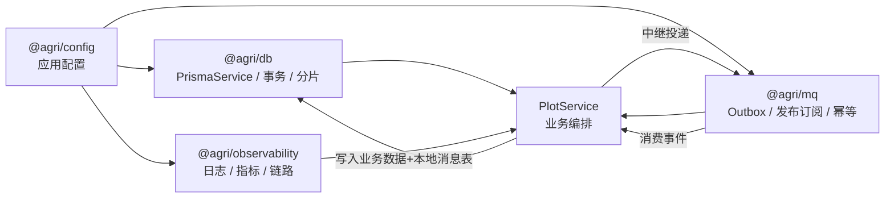
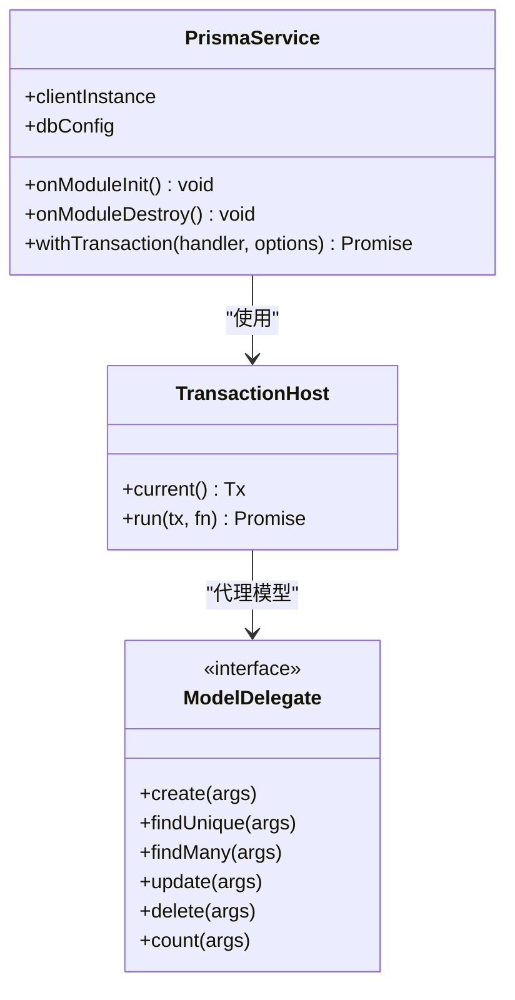
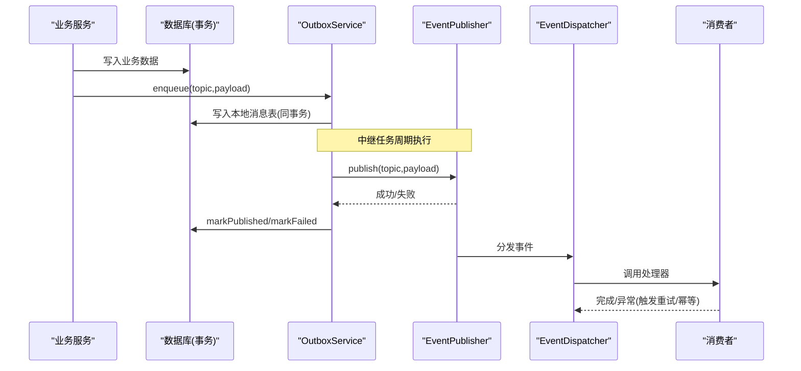
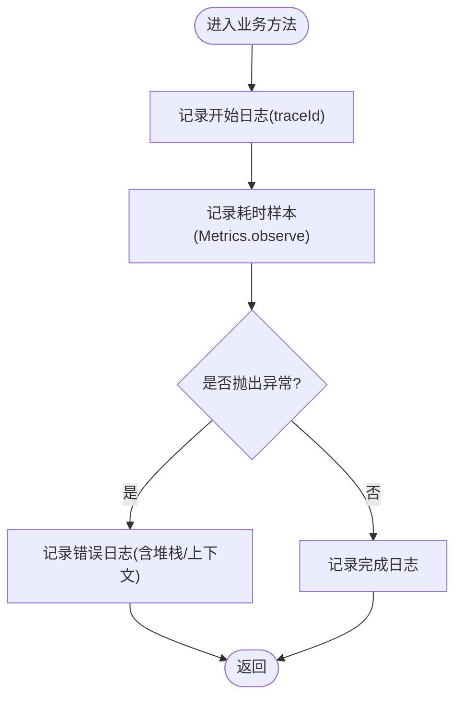
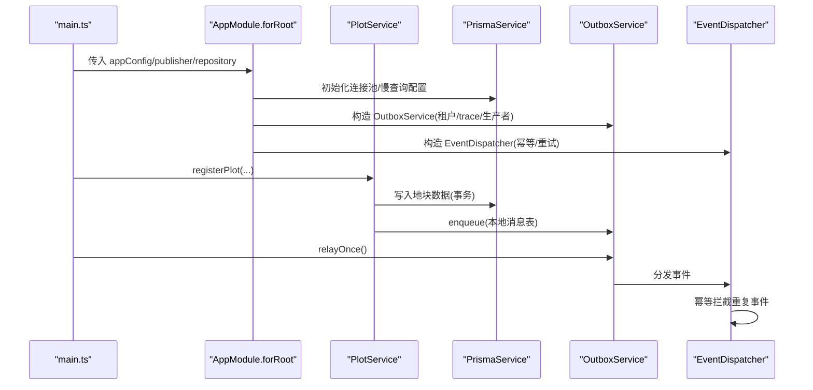
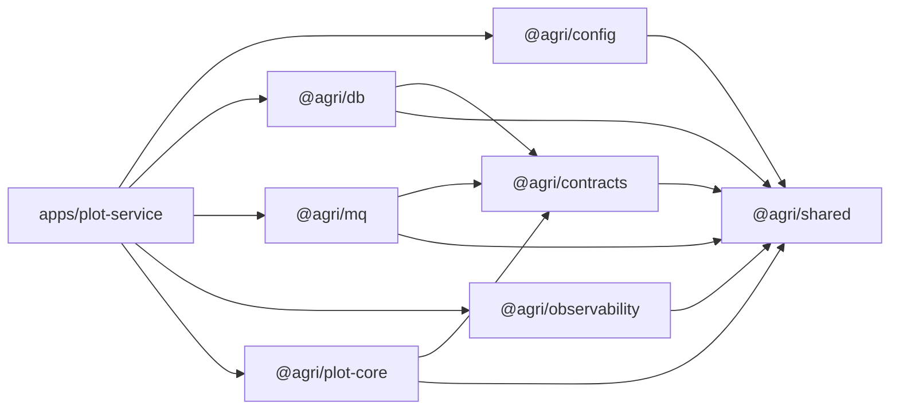

# 最佳实践

<cite>
**本文引用的文件**   
- [README.md](file://README.md)
- [package.json](file://package.json)
- [apps/plot-service/src/main.ts](file://apps/plot-service/src/main.ts)
- [apps/plot-service/src/app.module.ts](file://apps/plot-service/src/app.module.ts)
- [packages/db/src/index.ts](file://packages/db/src/index.ts)
- [packages/db/src/client.ts](file://packages/db/src/client.ts)
- [packages/db/src/transaction.ts](file://packages/db/src/transaction.ts)
- [packages/mq/src/index.ts](file://packages/mq/src/index.ts)
- [packages/mq/src/outbox.ts](file://packages/mq/src/outbox.ts)
- [packages/observability/src/index.ts](file://packages/observability/src/index.ts)
- [packages/observability/src/logger.ts](file://packages/observability/src/logger.ts)
- [packages/observability/src/metrics.ts](file://packages/observability/src/metrics.ts)
</cite>

## 目录
1. [引言](#引言)
2. [项目结构](#项目结构)
3. [核心组件](#核心组件)
4. [架构总览](#架构总览)
5. [详细组件分析](#详细组件分析)
6. [依赖关系分析](#依赖关系分析)
7. [性能优化策略](#性能优化策略)
8. [安全实践](#安全实践)
9. [扩展指南](#扩展指南)
10. [代码规范与命名约定](#代码规范与命名约定)
11. [错误处理、日志与可观测性](#错误处理日志与可观测性)
12. [常见问题与调优技巧](#常见问题与调优技巧)
13. [结论](#结论)

## 引言
本指南面向智慧农业平台后端工程，围绕性能优化、安全实践、扩展能力、代码规范、错误处理与可观测性给出可落地的最佳实践。平台以“地块”为最小管理单元，采用 NestJS + TypeScript 微服务架构，通过公共包统一数据库、消息、可观测性等横切能力，并以本地消息表实现最终一致的事件投递。

## 项目结构
仓库采用 pnpm workspace + Turborepo + tsc -b 的工程引用模式，根脚本负责全量构建、测试与服务启动；公共能力集中在 packages，业务微服务集中在 apps，基础设施配置在 infra。

**图示来源**  
- [README.md:58-82](file://README.md#L58-L82)  
- [package.json:10-28](file://package.json#L10-L28)

**章节来源**  
- [README.md:58-103](file://README.md#L58-L103)  
- [package.json:10-28](file://package.json#L10-L28)

## 核心组件
- 数据访问层：@agri/db 提供客户端生命周期、事务、分片、分页与软删除等通用能力，不绑定具体 ORM 模型。
- 消息与事件总线：@agri/mq 提供发布订阅、本地消息表、重试死信与幂等去重，保证事件“不丢也不重”。
- 可观测性：@agri/observability 提供结构化日志、链路追踪与指标采集，三者共享上下文标识，便于跨服务串联一次请求。
- 示例服务：apps/plot-service 演示了从建档到事件消费、中继投递与幂等的完整链路。

**章节来源**  
- [packages/db/src/index.ts:1-15](file://packages/db/src/index.ts#L1-L15)  
- [packages/mq/src/index.ts:1-41](file://packages/mq/src/index.ts#L1-L41)  
- [packages/observability/src/index.ts:1-10](file://packages/observability/src/index.ts#L1-L10)  
- [apps/plot-service/src/main.ts:1-31](file://apps/plot-service/src/main.ts#L1-L31)

## 架构总览
下图展示示例服务在运行时的装配顺序与关键交互：配置与数据库为基础设施，消息与可观测性为横切能力，业务服务仅依赖这些能力的对外契约。

**图示来源**  
- [apps/plot-service/src/app.module.ts:80-164](file://apps/plot-service/src/app.module.ts#L80-L164)  
- [packages/db/src/client.ts:31-87](file://packages/db/src/client.ts#L31-L87)  
- [packages/mq/src/outbox.ts:51-137](file://packages/mq/src/outbox.ts#L51-L137)  
- [packages/observability/src/logger.ts:40-101](file://packages/observability/src/logger.ts#L40-L101)

## 详细组件分析

### 数据访问与事务（@agri/db）
- PrismaService 封装客户端生命周期，模块初始化时建立连接，销毁时释放连接，避免连接泄漏。
- withTransaction 基于 AsyncLocalStorage 提供事务上下文，仓储层无需逐层透传事务对象，避免事务边界静默扩大或失效。
- 暴露 model 代理与 TransactionHost，使业务代码在事务中按模型名取用模型方法。

**图示来源**  
- [packages/db/src/client.ts:31-87](file://packages/db/src/client.ts#L31-L87)  
- [packages/db/src/transaction.ts:45-72](file://packages/db/src/transaction.ts#L45-L72)

**章节来源**  
- [packages/db/src/client.ts:1-87](file://packages/db/src/client.ts#L1-L87)  
- [packages/db/src/transaction.ts:1-72](file://packages/db/src/transaction.ts#L1-L72)

### 本地消息表与事件投递（@agri/mq）
- OutboxService 在事务内写入本地消息表，由中继任务周期性投递至消息中间件；失败记录会累计次数并保留最近错误原因。
- EventDispatcher 结合 IdempotencyGuard 对同一 eventId 做幂等去重，支持指数退避重试与死信。
- InMemoryOutboxStore 用于测试与本地开发，生产环境需替换为持久化实现。

**图示来源**  
- [packages/mq/src/outbox.ts:51-137](file://packages/mq/src/outbox.ts#L51-L137)  
- [packages/mq/src/index.ts:1-41](file://packages/mq/src/index.ts#L1-L41)

**章节来源**  
- [packages/mq/src/outbox.ts:1-171](file://packages/mq/src/outbox.ts#L1-L171)  
- [packages/mq/src/index.ts:1-41](file://packages/mq/src/index.ts#L1-L41)

### 可观测性（@agri/observability）
- LoggerService 输出单行 JSON 结构化日志，固定字段包含时间戳、级别、服务名、消息与 traceId，支持 child/withTrace 派生子日志器。
- MetricsService 提供计数器、直方图观测与当前值型指标，内置 HTTP 耗时、事件循环延迟、活动句柄、数据库池使用率、MQ 消费耗时、死信计数、设备遥测等标准指标。
- 装饰器与收集器将日志、指标与链路贯穿到业务方法。

**图示来源**  
- [packages/observability/src/logger.ts:40-101](file://packages/observability/src/logger.ts#L40-L101)  
- [packages/observability/src/metrics.ts:43-105](file://packages/observability/src/metrics.ts#L43-L105)

**章节来源**  
- [packages/observability/src/logger.ts:1-102](file://packages/observability/src/logger.ts#L1-L102)  
- [packages/observability/src/metrics.ts:1-106](file://packages/observability/src/metrics.ts#L1-L106)

### 示例服务装配与入口（apps/plot-service）
- main.ts 手工装配依赖，走通“建档 → 写本地消息表 → 中继投递 → 消费幂等”的完整链路；可选 HTTP 模式监听端口。
- app.module.ts 定义动态模块 forRoot，按依赖方向注入配置、数据库、消息、可观测性与业务服务，导出对外能力供其他模块使用。

**图示来源**  
- [apps/plot-service/src/main.ts:48-179](file://apps/plot-service/src/main.ts#L48-L179)  
- [apps/plot-service/src/app.module.ts:80-164](file://apps/plot-service/src/app.module.ts#L80-L164)

**章节来源**  
- [apps/plot-service/src/main.ts:1-179](file://apps/plot-service/src/main.ts#L1-L179)  
- [apps/plot-service/src/app.module.ts:1-196](file://apps/plot-service/src/app.module.ts#L1-L196)

## 依赖关系分析
- 依赖方向遵循“基础设施 → 横切能力 → 业务服务”，业务服务不反向依赖基础设施。
- @agri/contracts 只依赖 zod，不依赖任何能力包，确保前端可低成本引用。
- 能力包之间禁止循环引用，空间运算下沉数据库，时序数据由物联感知服务直连时序库。

**图示来源**  
- [README.md:86-118](file://README.md#L86-L118)  
- [apps/plot-service/src/app.module.ts:80-164](file://apps/plot-service/src/app.module.ts#L80-L164)

**章节来源**  
- [README.md:86-118](file://README.md#L86-L118)

## 性能优化策略

### 数据库优化
- 连接池与慢查询：通过 DbConfig 的 poolSize 与 slowQueryMs 控制连接规模与慢查询阈值，避免连接泄漏与长事务。
- 事务边界：使用 withTransaction 与 AsyncLocalStorage 的事务上下文，避免参数漏传导致事务边界扩大或失效。
- 分页与排序：分页每页上限 200，排序字段必须命中服务端白名单，防止全表扫描与排序开销。
- 空间运算下沉：叠加、缓冲区、面积等空间计算落在 PostGIS，坐标统一 CGCS2000（EPSG:4490），仅在出参方向换算。

**章节来源**  
- [packages/db/src/client.ts:31-87](file://packages/db/src/client.ts#L31-L87)  
- [packages/db/src/transaction.ts:45-72](file://packages/db/src/transaction.ts#L45-L72)  
- [README.md:105-118](file://README.md#L105-L118)

### 缓存策略
- 幂等存储：IdempotencyGuard 默认使用内存实现，生产环境应替换为 Redis 等分布式缓存，避免多实例重复处理。
- 热点数据：各服务可自行引入缓存中间件，注意缓存一致性（先更新数据库再更新缓存，或采用失效策略）。
- 指标监控：通过 MetricsService 的 gauge 与 counter 观察缓存命中率、过期率与读写延迟。

**章节来源**  
- [apps/plot-service/src/app.module.ts:167-178](file://apps/plot-service/src/app.module.ts#L167-L178)  
- [packages/observability/src/metrics.ts:43-105](file://packages/observability/src/metrics.ts#L43-L105)

### 异步处理
- 本地消息表：OutboxService 周期性中继待投递事件，失败记录累计次数并保留错误原因，超出重试上限转死信。
- 事件幂等：EventDispatcher 结合 IdempotencyGuard 对同一 eventId 去重，保障重复投递场景下的正确性。
- 重试策略：DEFAULT_RETRY_POLICY 提供指数退避，适合网络抖动与下游短暂不可用。

**章节来源**  
- [packages/mq/src/outbox.ts:51-137](file://packages/mq/src/outbox.ts#L51-L137)  
- [packages/mq/src/index.ts:1-41](file://packages/mq/src/index.ts#L1-L41)

## 安全实践

### 身份认证
- 建议网关层统一鉴权，校验 JWT/OAuth2 Token，并将用户身份与权限信息注入下游服务上下文。
- 服务内部使用细粒度访问控制，结合租户隔离（tenantId）限制资源访问范围。

### 数据加密
- 传输层强制 TLS，敏感字段（如密钥、令牌）通过配置中心或密钥管理服务读取，不落盘明文。
- 静态数据加密：对敏感列进行应用层加密或借助数据库透明加密，密钥与数据分离管理。

### 访问控制
- 接口级授权：基于角色/资源的 RBAC/ABAC 模型，校验操作权限后再执行业务逻辑。
- 数据级授权：所有查询与更新携带 tenantId，并在 SQL 层附加租户过滤条件，防止越权访问。

[本节为通用安全指导，不直接分析具体源码文件]

## 扩展指南

### 新功能开发
- 新增业务服务：复制 apps/plot-service 结构，在根 tsconfig.json 增加工程引用，在服务根模块导入 ConfigModule.forRoot、PrismaModule.forRoot、MqModule.forRoot。
- 接 HTTP 适配器：示例服务不启动监听进程，接入 @nestjs/platform-fastify 后由 AppModule.forRoot 托管生命周期；高并发建议使用 Fastify。
- 新增事件：先在 @agri/contracts 的 EventTopic 与 events/payload.ts 中定义主题与载荷，生产者侧用 OutboxService.enqueue 入队，消费者侧用 @registerHandler 声明处理方法。
- 新增表与仓储：在服务内定义模式，仓储方法首参显式传入事务对象，避免事务边界静默扩大。

**章节来源**  
- [README.md:147-156](file://README.md#L147-L156)

### 第三方集成
- 外部 API：通过统一的 HTTP 客户端封装，设置超时、重试与熔断策略，记录请求耗时与错误码。
- 存储集成：对象存储（S3/MinIO）通过独立存储服务暴露上传/下载接口，业务服务仅调用接口而不直接持有凭证。
- 消息中间件：实现 EventPublisher 与 EventSubscriber 接口对接 Kafka/RabbitMQ 等，保持与 InMemory 实现一致的语义。

[本节为通用集成指导，不直接分析具体源码文件]

### 插件开发
- 插件应作为独立包发布，通过 @agri/contracts 暴露类型与事件，通过 @agri/shared 复用工具函数。
- 插件不得引入业务服务，仅依赖公共能力包，确保可插拔与可替换。

[本节为通用插件指导，不直接分析具体源码文件]

## 代码规范与命名约定
- 包入口：每个包的 src/index.ts 是唯一对外入口，包内其他文件不构成公开契约。
- 契约与能力分离：@agri/contracts 只依赖 zod，不依赖任何能力包；能力包之间禁止循环引用。
- 错误码分段：域缩写-分类码-序号（如 PLOT-409-001），含义一经发布不得修改。
- 软删除统一字段：deletedAt；分页每页上限 200，排序字段必须命中服务端白名单。
- 装饰器元数据：生产编译开启 experimentalDecorators 与 emitDecoratorMetadata；测试期由 esbuild 转译，仅开启前者。

**章节来源**  
- [README.md:84-118](file://README.md#L84-L118)  
- [README.md:157-167](file://README.md#L157-L167)

## 错误处理、日志与可观测性

### 错误处理模式
- 业务异常：使用 BizError 抛出结构化错误，携带错误码与状态码，便于上层统一捕获与响应。
- 可重试错误：数据库事务与消息投递区分可重试与不可重试错误，避免无效重试放大故障。
- 死信处理：OutboxService 记录失败原因与重试次数，超过阈值转入死信队列，人工介入排查。

**章节来源**  
- [packages/db/src/transaction.ts:45-52](file://packages/db/src/transaction.ts#L45-L52)  
- [packages/mq/src/outbox.ts:99-137](file://packages/mq/src/outbox.ts#L99-L137)

### 日志记录
- 结构化日志：LoggerService 输出单行 JSON，固定字段包含 timestamp、level、service、message、traceId。
- 子日志器：child 与 withTrace 派生带上下文的日志器，便于按租户、请求链路聚合日志。
- 日志级别：debug/info/warn/error，按权重过滤，减少无关日志开销。

**章节来源**  
- [packages/observability/src/logger.ts:1-102](file://packages/observability/src/logger.ts#L1-L102)

### 可观测性实践
- 指标采集：MetricsService 提供计数器、直方图与当前值型指标，内置 HTTP 耗时、事件循环延迟、活动句柄、数据库池使用率、MQ 消费耗时、死信计数、设备遥测等标准指标。
- 收集器：EventLoopLagCollector 与 HandleCollector 自动采集运行时劣化信号，配合告警规则快速定位瓶颈。
- 链路追踪：TraceService 与日志、指标共享 traceId，跨服务串联一次请求。

**章节来源**  
- [packages/observability/src/metrics.ts:1-106](file://packages/observability/src/metrics.ts#L1-L106)  
- [apps/plot-service/src/app.module.ts:91-109](file://apps/plot-service/src/app.module.ts#L91-L109)

## 常见问题与调优技巧

### 常见问题
- 安装报错 ERR_PNPM_IGNORED_BUILDS：检查 pnpm-workspace.yaml 的 allowBuilds 白名单是否包含 esbuild。
- 装饰器元数据不一致：测试期构造提供者需显式声明 inject，不要依赖类型元数据自动注入。
- 数据库与消息中间件未接入：示例工程使用内存实现替代真实中间件，生产环境需实现 PrismaClientFactory、EventPublisher 与 EventSubscriber。

**章节来源**  
- [README.md:55-57](file://README.md#L55-L57)  
- [README.md:157-167](file://README.md#L157-L167)

### 性能调优技巧
- 调整连接池大小：根据 CPU 核数与 I/O 特征设置 poolSize，避免连接过多导致上下文切换开销。
- 慢查询治理：启用 slowQueryMs 阈值，定期分析慢查询语句，优化索引与 SQL 结构。
- 事件循环延迟：关注 event_loop_lag_ms 指标，避免长时间同步阻塞操作，拆分大任务为异步批次。
- 活动句柄数：监控 active_handles，及时关闭未使用的流、定时器与网络连接。
- 数据库池使用率：监控 db_pool_in_use，避免长事务占用连接，必要时引入读写分离与连接池隔离。
- 消息消费耗时：监控 mq_consume_duration_ms，优化消费者逻辑，避免重复查询与冗余计算。

**章节来源**  
- [packages/observability/src/metrics.ts:14-23](file://packages/observability/src/metrics.ts#L14-L23)  
- [packages/db/src/client.ts:31-87](file://packages/db/src/client.ts#L31-L87)

## 结论
本指南基于仓库现有实现，总结了智慧农业平台的性能优化、安全实践、扩展能力、代码规范与可观测性最佳实践。通过公共包统一横切能力、本地消息表保证最终一致、结构化日志与指标提升可观测性，平台可在规模化与复杂业务场景中保持稳定与高效。建议在接入真实中间件与数据库后，持续监控关键指标，迭代优化配置与实现。