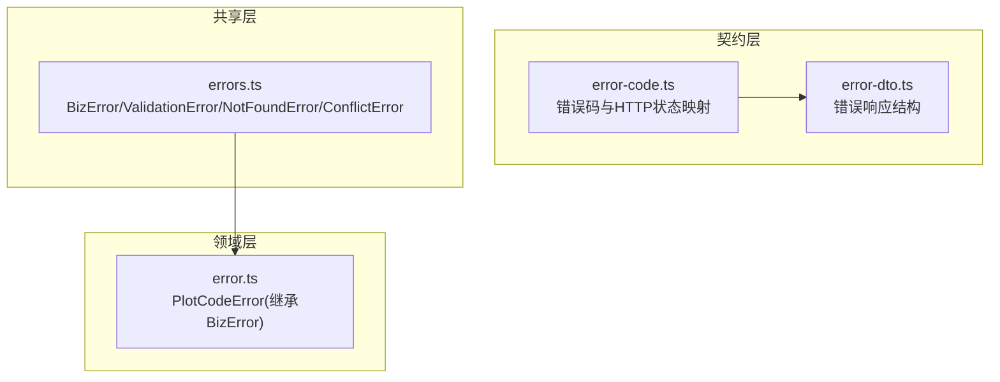
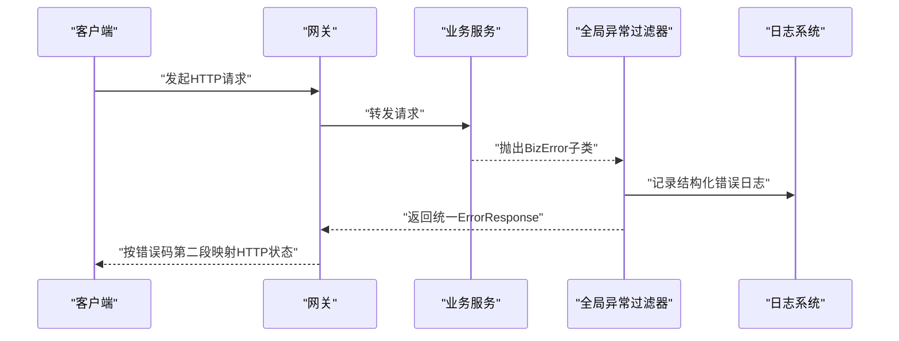
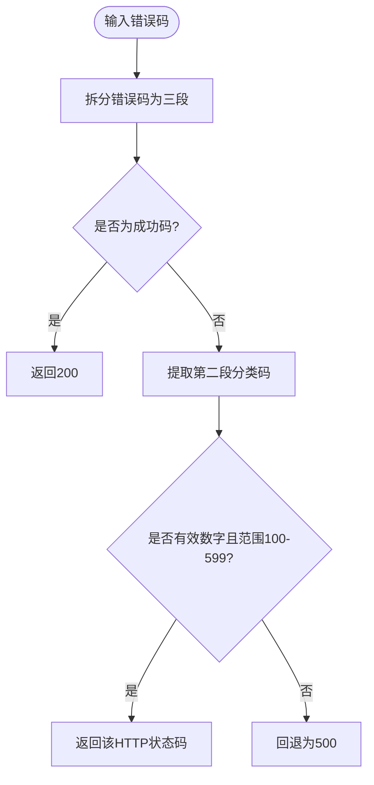
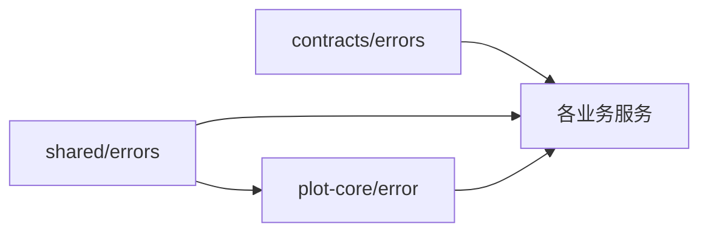
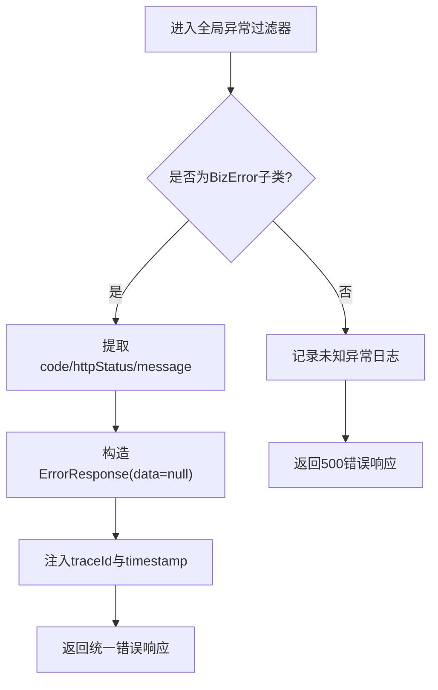

# 错误处理

<cite>
**本文引用的文件**   
- [packages/contracts/src/errors/error-code.ts](file://packages/contracts/src/errors/error-code.ts)
- [packages/contracts/src/errors/error-dto.ts](file://packages/contracts/src/errors/error-dto.ts)
- [packages/shared/src/errors.ts](file://packages/shared/src/errors.ts)
- [packages/plot-core/src/error.ts](file://packages/plot-core/src/error.ts)
</cite>

## 目录
1. [引言](#引言)
2. [项目结构](#项目结构)
3. [核心组件](#核心组件)
4. [架构总览](#架构总览)
5. [详细组件分析](#详细组件分析)
6. [依赖关系分析](#依赖关系分析)
7. [性能与可观测性](#性能与可观测性)
8. [故障恢复与重试](#故障恢复与重试)
9. [日志记录规范](#日志记录规范)
10. [全局错误处理机制](#全局错误处理机制)
11. [排障指南](#排障指南)
12. [结论](#结论)

## 引言
本文件为智慧农业平台提供统一的“错误处理最佳实践”，覆盖异常分类、处理策略、全局错误处理机制、日志规范、可观测性与告警、以及故障恢复与重试。目标是让业务异常、系统异常与第三方服务异常在网关与各微服务中保持一致的语义、结构与可观测性，同时保证用户端获得友好提示。

## 项目结构
本项目采用多包（monorepo）与多服务架构，错误相关能力集中在以下位置：
- 契约层（packages/contracts）：定义错误码与错误响应结构，供所有服务统一使用。
- 共享层（packages/shared）：提供业务异常基类与常用异常类型，便于各服务抛出一致的业务异常。
- 领域层（packages/plot-core）：基于共享异常扩展领域特定异常，便于全局过滤器识别与处理。



**图表来源** 
- [packages/contracts/src/errors/error-code.ts:1-66](file://packages/contracts/src/errors/error-code.ts#L1-L66)
- [packages/contracts/src/errors/error-dto.ts:1-12](file://packages/contracts/src/errors/error-dto.ts#L1-L12)
- [packages/shared/src/errors.ts:1-53](file://packages/shared/src/errors.ts#L1-L53)
- [packages/plot-core/src/error.ts:1-11](file://packages/plot-core/src/error.ts#L1-L11)

**章节来源**
- [packages/contracts/src/errors/error-code.ts:1-66](file://packages/contracts/src/errors/error-code.ts#L1-L66)
- [packages/contracts/src/errors/error-dto.ts:1-12](file://packages/contracts/src/errors/error-dto.ts#L1-L12)
- [packages/shared/src/errors.ts:1-53](file://packages/shared/src/errors.ts#L1-L53)
- [packages/plot-core/src/error.ts:1-11](file://packages/plot-core/src/error.ts#L1-L11)

## 核心组件
- 错误码与HTTP状态映射：集中定义错误码，并通过第二段分类码映射到HTTP状态码，便于网关统一路由与运维定位。
- 错误响应结构：统一失败响应的data为空，并包含code、message、details、traceId、timestamp等字段。
- 业务异常基类与常见异常：BizError作为基类，附带code与httpStatus；并提供参数校验、资源未找到、状态冲突等常见异常。
- 领域异常：PlotCodeError继承BizError，用于地块编码相关的业务异常，便于全局过滤器统一识别。

**章节来源**
- [packages/contracts/src/errors/error-code.ts:1-66](file://packages/contracts/src/errors/error-code.ts#L1-L66)
- [packages/contracts/src/errors/error-dto.ts:1-12](file://packages/contracts/src/errors/error-dto.ts#L1-L12)
- [packages/shared/src/errors.ts:1-53](file://packages/shared/src/errors.ts#L1-L53)
- [packages/plot-core/src/error.ts:1-11](file://packages/plot-core/src/error.ts#L1-L11)

## 架构总览
错误处理贯穿请求生命周期：控制器/处理器抛出业务异常 → 全局异常过滤器捕获 → 转换为统一ErrorResponse → 网关根据错误码第二段映射HTTP状态 → 客户端展示友好提示。



[本图为概念流程示意，不直接对应具体源码文件]

## 详细组件分析

### 错误码与HTTP状态映射
- 错误码格式：域缩写 - 分类码 - 序号，全大写，段间用连字符分隔。
- 网关仅读取第二段分类码即可决定HTTP状态码，运维仅读取第一段即可定位责任服务。
- 提供函数从错误码解析HTTP状态码，默认回退为500。



**图表来源** 
- [packages/contracts/src/errors/error-code.ts:56-65](file://packages/contracts/src/errors/error-code.ts#L56-L65)

**章节来源**
- [packages/contracts/src/errors/error-code.ts:1-66](file://packages/contracts/src/errors/error-code.ts#L1-L66)

### 错误响应结构
- 统一失败响应data为空，包含code、message、details、traceId、timestamp。
- details仅参数类错误返回，便于前端进行字段级提示。

```mermaid
classDiagram
class ErrorResponse {
+string code
+string message
+{field, reason}[] details
+string traceId
+number timestamp
}
```

**图表来源** 
- [packages/contracts/src/errors/error-dto.ts:1-12](file://packages/contracts/src/errors/error-dto.ts#L1-L12)

**章节来源**
- [packages/contracts/src/errors/error-dto.ts:1-12](file://packages/contracts/src/errors/error-dto.ts#L1-L12)

### 业务异常体系
- BizError：携带code与httpStatus，作为所有业务异常的基类。
- ValidationError：参数校验异常，支持details字段级明细。
- NotFoundError：资源未找到异常。
- ConflictError：状态冲突异常。
- PlotCodeError：地块编码相关异常，继承BizError，便于全局过滤器识别。

```mermaid
classDiagram
class BizError {
+string code
+number httpStatus
}
class ValidationError {
+{field, reason}[] details
}
class NotFoundError
class ConflictError
class PlotCodeError
BizError <|-- ValidationError
BizError <|-- NotFoundError
BizError <|-- ConflictError
BizError <|-- PlotCodeError
```

**图表来源** 
- [packages/shared/src/errors.ts:1-53](file://packages/shared/src/errors.ts#L1-L53)
- [packages/plot-core/src/error.ts:1-11](file://packages/plot-core/src/error.ts#L1-L11)

**章节来源**
- [packages/shared/src/errors.ts:1-53](file://packages/shared/src/errors.ts#L1-L53)
- [packages/plot-core/src/error.ts:1-11](file://packages/plot-core/src/error.ts#L1-L11)

## 依赖关系分析
- 契约层（contracts）被所有服务引用，确保错误码与响应结构一致性。
- 共享层（shared）提供基础异常类型，被领域层与其他服务复用。
- 领域层（plot-core）通过继承BizError扩展领域异常，保持与全局过滤器的兼容性。



**图表来源** 
- [packages/contracts/src/errors/error-code.ts:1-66](file://packages/contracts/src/errors/error-code.ts#L1-L66)
- [packages/contracts/src/errors/error-dto.ts:1-12](file://packages/contracts/src/errors/error-dto.ts#L1-L12)
- [packages/shared/src/errors.ts:1-53](file://packages/shared/src/errors.ts#L1-L53)
- [packages/plot-core/src/error.ts:1-11](file://packages/plot-core/src/error.ts#L1-L11)

**章节来源**
- [packages/contracts/src/errors/error-code.ts:1-66](file://packages/contracts/src/errors/error-code.ts#L1-L66)
- [packages/contracts/src/errors/error-dto.ts:1-12](file://packages/contracts/src/errors/error-dto.ts#L1-L12)
- [packages/shared/src/errors.ts:1-53](file://packages/shared/src/errors.ts#L1-L53)
- [packages/plot-core/src/error.ts:1-11](file://packages/plot-core/src/error.ts#L1-L11)

## 性能与可观测性
- 错误追踪：每个错误响应包含traceId，建议在全局过滤器中注入链路ID，并在日志中输出traceId以便跨服务关联。
- 性能监控：对高频错误码（如SYS-500-001、TELE-429-001）建立指标计数与延迟分布，结合网关HTTP状态统计。
- 告警配置：针对错误率突增、第三方依赖不可用（SYS-503-001）、限流（TELE-429-001）设置阈值告警。

[本节为通用指导，不直接分析具体源码文件]

## 故障恢复与重试
- 幂等性保障：对写操作接口实现幂等键或去重逻辑，避免重试导致重复副作用。
- 重试策略：
  - 网络抖动与临时性错误（如IOT命令超时CTL-408-001、IOT-408-001）可采用指数退避重试。
  - 限流错误（TELE-429-001）应遵循服务端返回的重试头或退避时间。
  - 非幂等写操作谨慎重试，必要时引入Outbox模式与补偿事务。
- 熔断与降级：对第三方依赖不可用（SYS-503-001）启用熔断器，快速失败并返回降级响应，避免雪崩。

[本节为通用指导，不直接分析具体源码文件]

## 日志记录规范
- 结构化日志：每条错误日志必须包含traceId、service、code、message、httpStatus、stack（仅在开发环境）。
- 日志级别：
  - ERROR：业务异常与系统异常（BizError及其子类）。
  - WARN：可恢复问题（如限流、重试次数接近上限）。
  - INFO：关键业务流程节点（如决策生成、作业调度完成）。
- 审计日志：对敏感操作（认证、授权、资金核算FIN-422-001）记录审计事件，包含操作人、资源ID、结果与时间戳。

[本节为通用指导，不直接分析具体源码文件]

## 全局错误处理机制
- 异常过滤器：在服务入口注册全局异常过滤器，捕获BizError及其子类，统一转换为ErrorResponse。
- 错误响应格式化：
  - data置空。
  - code使用契约层错误码。
  - message为用户可读信息。
  - details仅参数校验错误时填充。
  - traceId由过滤器注入。
  - timestamp为当前时间戳。
- 用户友好提示：前端根据code与message展示提示，details用于字段级高亮与提示。



[本图为概念流程示意，不直接对应具体源码文件]

**章节来源**
- [packages/contracts/src/errors/error-dto.ts:1-12](file://packages/contracts/src/errors/error-dto.ts#L1-L12)
- [packages/shared/src/errors.ts:1-53](file://packages/shared/src/errors.ts#L1-L53)

## 排障指南
- 快速定位：
  - 通过错误码第一段确定责任服务（例如PLOT、IOT、TELE、DEC、OPS、CTL、FIN、TRC）。
  - 通过第二段确定HTTP状态类别（4xx客户端错误、5xx服务端错误）。
  - 通过traceId在日志系统中检索完整调用链。
- 常见问题：
  - 参数校验失败：检查ValidationError的details字段，定位具体字段与原因。
  - 资源未找到：确认上游传入的资源ID是否正确，检查数据库或缓存一致性。
  - 状态冲突：检查并发写入与乐观锁版本号，必要时引入重试或合并策略。
  - 第三方依赖不可用：检查SYS-503-001与熔断器状态，确认下游健康检查与降级策略。
- 建议动作：
  - 在网关层聚合错误码统计，定期复盘高频错误。
  - 对第三方依赖增加健康检查与自动切换备用源。
  - 完善单元测试与集成测试，覆盖异常分支与边界条件。

**章节来源**
- [packages/contracts/src/errors/error-code.ts:1-66](file://packages/contracts/src/errors/error-code.ts#L1-L66)
- [packages/shared/src/errors.ts:1-53](file://packages/shared/src/errors.ts#L1-L53)

## 结论
通过统一的错误码契约、业务异常基类与错误响应结构，智慧农业平台实现了跨服务的错误语义一致与可观测性提升。配合全局异常过滤器、结构化日志、指标与告警、以及合理的重试与熔断策略，可在复杂分布式环境中稳定运行并快速定位问题。建议在后续迭代中持续完善审计日志与可观测性面板，形成闭环的错误治理体系。