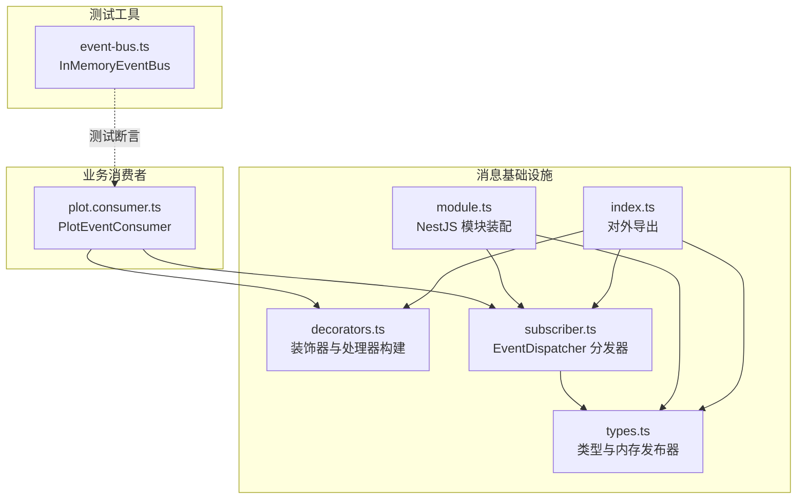
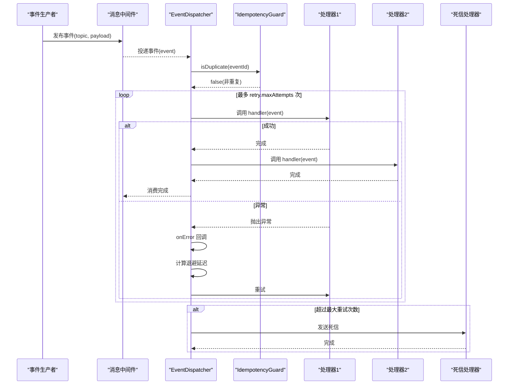
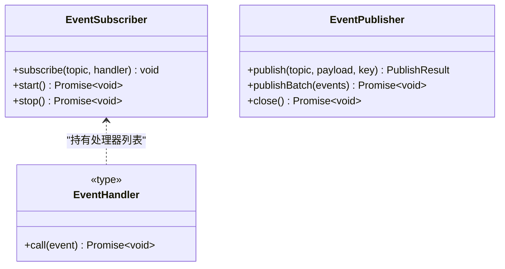
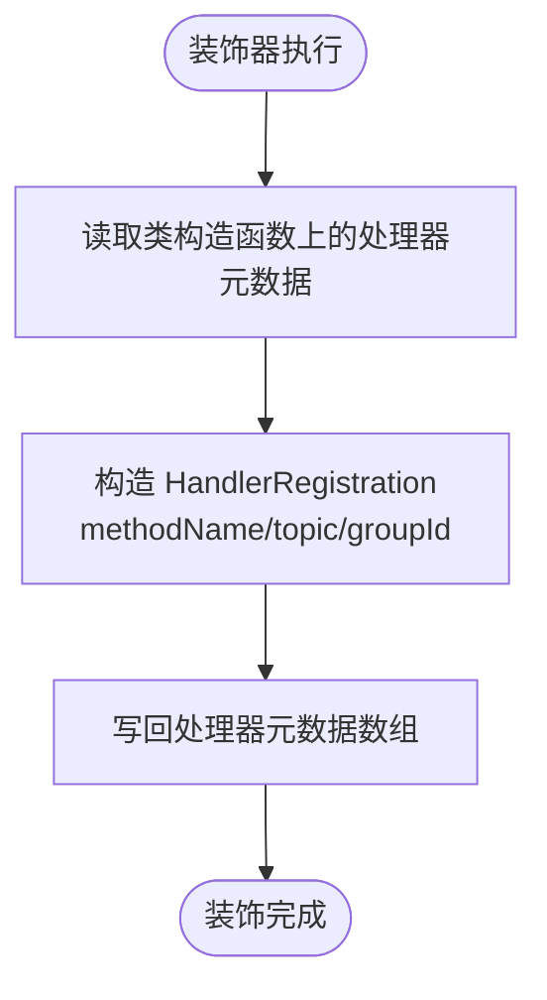
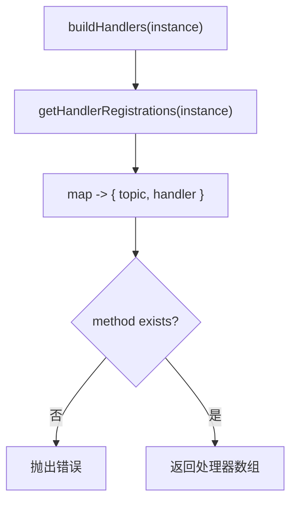
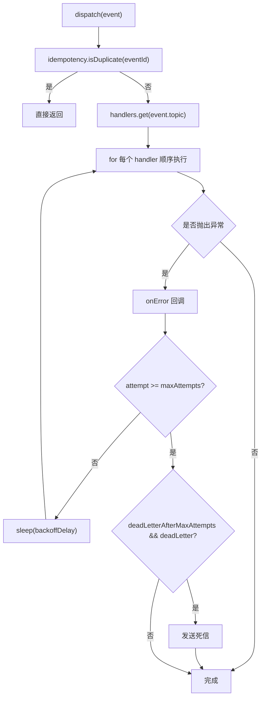
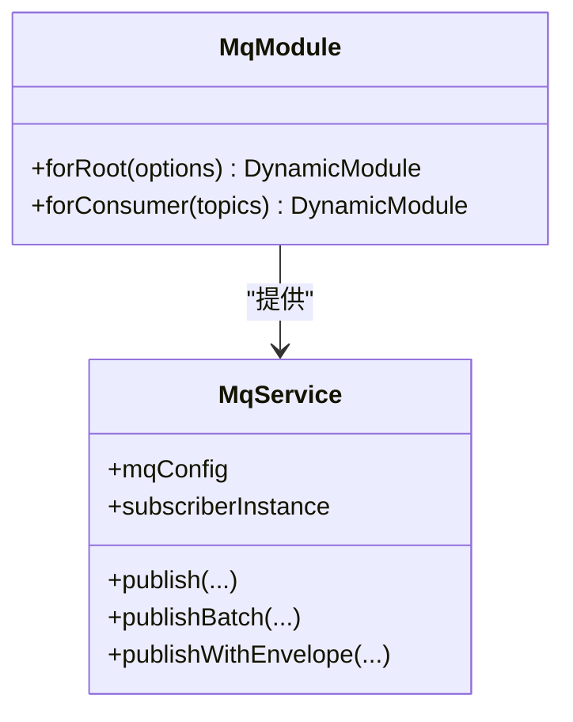
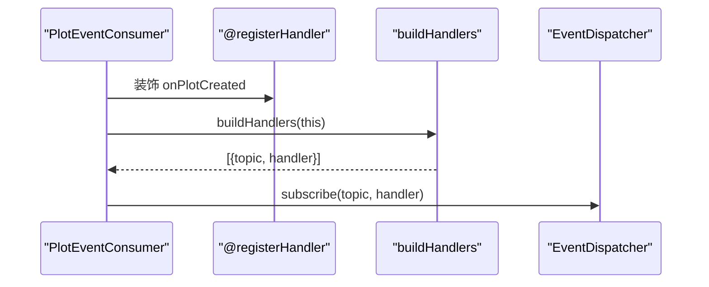
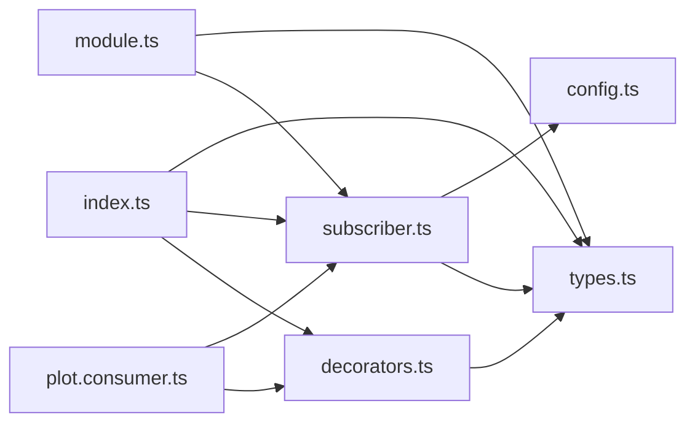

# 事件分发器

<cite>
**本文引用的文件**   
- [packages/mq/src/decorators.ts](file://packages/mq/src/decorators.ts)
- [packages/mq/src/types.ts](file://packages/mq/src/types.ts)
- [packages/mq/src/subscriber.ts](file://packages/mq/src/subscriber.ts)
- [packages/mq/src/index.ts](file://packages/mq/src/index.ts)
- [packages/mq/src/module.ts](file://packages/mq/src/module.ts)
- [apps/plot-service/src/plot.consumer.ts](file://apps/plot-service/src/plot.consumer.ts)
- [packages/testing/src/event-bus.ts](file://packages/testing/src/event-bus.ts)
</cite>

## 目录
1. [简介](#简介)
2. [项目结构](#项目结构)
3. [核心组件](#核心组件)
4. [架构总览](#架构总览)
5. [详细组件分析](#详细组件分析)
6. [依赖关系分析](#依赖关系分析)
7. [性能考量](#性能考量)
8. [故障排查指南](#故障排查指南)
9. [结论](#结论)
10. [附录](#附录)

## 简介
本文件面向事件分发器 EventDispatcher，系统性说明其在微服务中的事件订阅与分发机制。内容覆盖：
- EventHandler 接口定义与 EventSubscriber 契约
- registerHandler 装饰器的使用方式与元数据管理
- buildHandlers 的实现原理与处理器注册表管理
- 事件路由、错误处理、重试与死信策略
- 日志记录与可观测性接入点
- 在微服务中注册和处理不同类型事件处理器的最佳实践
- 性能优化建议与常见问题排查

## 项目结构
围绕事件分发能力，代码主要分布在以下位置：
- packages/mq：消息基础设施包，包含装饰器、类型、分发器、模块装配等
- apps/plot-service：示例业务消费者，演示如何使用装饰器与分发器
- packages/testing：测试用内存事件总线，用于验证发布订阅行为

图表来源
- [packages/mq/src/decorators.ts:1-60](file://packages/mq/src/decorators.ts#L1-L60)
- [packages/mq/src/types.ts:1-72](file://packages/mq/src/types.ts#L1-L72)
- [packages/mq/src/subscriber.ts:1-103](file://packages/mq/src/subscriber.ts#L1-L103)
- [packages/mq/src/module.ts:1-114](file://packages/mq/src/module.ts#L1-L114)
- [packages/mq/src/index.ts:1-41](file://packages/mq/src/index.ts#L1-L41)
- [apps/plot-service/src/plot.consumer.ts:1-40](file://apps/plot-service/src/plot.consumer.ts#L1-L40)
- [packages/testing/src/event-bus.ts:1-157](file://packages/testing/src/event-bus.ts#L1-L157)

章节来源
- [packages/mq/src/decorators.ts:1-60](file://packages/mq/src/decorators.ts#L1-L60)
- [packages/mq/src/types.ts:1-72](file://packages/mq/src/types.ts#L1-L72)
- [packages/mq/src/subscriber.ts:1-103](file://packages/mq/src/subscriber.ts#L1-L103)
- [packages/mq/src/module.ts:1-114](file://packages/mq/src/module.ts#L1-L114)
- [packages/mq/src/index.ts:1-41](file://packages/mq/src/index.ts#L1-L41)
- [apps/plot-service/src/plot.consumer.ts:1-40](file://apps/plot-service/src/plot.consumer.ts#L1-L40)
- [packages/testing/src/event-bus.ts:1-157](file://packages/testing/src/event-bus.ts#L1-L157)

## 核心组件
- EventHandler：统一的事件处理函数签名，接收领域事件并返回 Promise<void>
- EventSubscriber：订阅器契约，提供 subscribe、start、stop
- EventPublisher：发布器契约，提供 publish、publishBatch、close
- EventDispatcher：事件分发器实现，负责幂等、路由、重试、死信与错误回调
- registerHandler/buildHandlers：装饰器与处理器构建工具，将类方法声明为事件处理器
- MqModule/MqService：NestJS 模块与服务，装配发布器、订阅器与配置
- InMemoryEventPublisher：内存发布器，便于单元测试
- InMemoryEventBus（测试）：内存事件总线，模拟中间件发布订阅行为

章节来源
- [packages/mq/src/types.ts:1-72](file://packages/mq/src/types.ts#L1-L72)
- [packages/mq/src/subscriber.ts:1-103](file://packages/mq/src/subscriber.ts#L1-L103)
- [packages/mq/src/decorators.ts:1-60](file://packages/mq/src/decorators.ts#L1-L60)
- [packages/mq/src/module.ts:1-114](file://packages/mq/src/module.ts#L1-L114)
- [packages/testing/src/event-bus.ts:1-157](file://packages/testing/src/event-bus.ts#L1-L157)

## 架构总览
EventDispatcher 作为订阅端的核心编排者，承担以下职责：
- 维护主题到处理器列表的映射
- 对入站事件进行幂等判断
- 按顺序串行执行处理器
- 根据重试策略进行指数退避重试
- 达到最大重试次数后转入死信
- 通过 onError 回调输出错误日志

图表来源
- [packages/mq/src/subscriber.ts:25-103](file://packages/mq/src/subscriber.ts#L25-L103)
- [packages/mq/src/config.ts:1-200](file://packages/mq/src/config.ts#L1-L200)

## 详细组件分析

### EventHandler 与 EventSubscriber 契约
- EventHandler<T>：以领域事件为输入，异步无副作用的业务处理入口
- EventSubscriber：订阅器抽象，subscribe 支持同一主题多个处理器，按声明顺序串行执行；start/stop 控制生命周期

图表来源
- [packages/mq/src/types.ts:14-32](file://packages/mq/src/types.ts#L14-L32)

章节来源
- [packages/mq/src/types.ts:14-32](file://packages/mq/src/types.ts#L14-L32)

### registerHandler 装饰器与元数据管理
- HANDLER_METADATA：用于存储处理器登记信息的元数据键
- HandlerRegistration：单条处理器登记项，包含 methodName、topic、可选 groupId
- registerHandler：装饰器，将目标方法登记为某主题的处理器，写入类构造函数的元数据
- getHandlerRegistrations：读取某个类上登记的处理器列表

图表来源
- [packages/mq/src/decorators.ts:13-34](file://packages/mq/src/decorators.ts#L13-L34)

章节来源
- [packages/mq/src/decorators.ts:13-34](file://packages/mq/src/decorators.ts#L13-L34)

### buildHandlers 与处理器注册表
- buildHandlers：遍历已登记的处理器元数据，动态绑定实例方法，生成主题到处理器的映射数组
- 运行时校验：若登记的方法名不存在，抛出错误，避免静默失败
- 典型用法：在消费者的 bind 方法中，将 buildHandlers 结果逐一 dispatcher.subscribe

图表来源
- [packages/mq/src/decorators.ts:47-59](file://packages/mq/src/decorators.ts#L47-L59)
- [apps/plot-service/src/plot.consumer.ts:34-38](file://apps/plot-service/src/plot.consumer.ts#L34-L38)

章节来源
- [packages/mq/src/decorators.ts:47-59](file://packages/mq/src/decorators.ts#L47-L59)
- [apps/plot-service/src/plot.consumer.ts:34-38](file://apps/plot-service/src/plot.consumer.ts#L34-L38)

### EventDispatcher 分发器与事件路由
- handlers：Map<topic, EventHandler[]>，维护主题到处理器列表的映射
- dispatch：先幂等判断，再顺序执行处理器；捕获异常后按重试策略退避重试；超限转死信；通过 onError 回调输出日志
- start/stop：控制运行状态；handlerCount：供启动自检

图表来源
- [packages/mq/src/subscriber.ts:25-103](file://packages/mq/src/subscriber.ts#L25-L103)

章节来源
- [packages/mq/src/subscriber.ts:25-103](file://packages/mq/src/subscriber.ts#L25-L103)

### 模块装配与依赖注入
- MqModule.forRoot：注入 MQ_CONFIG、MQ_PUBLISHER、MQ_SUBSCRIBER，并提供 MqService
- MqService：封装发布器与订阅器，提供 publishWithEnvelope 便捷方法
- forConsumer：标记需要消费的 Topic 集合，便于外部扫描或校验

图表来源
- [packages/mq/src/module.ts:16-114](file://packages/mq/src/module.ts#L16-L114)

章节来源
- [packages/mq/src/module.ts:16-114](file://packages/mq/src/module.ts#L16-L114)

### 业务消费者示例：PlotEventConsumer
- 使用 @registerHandler(EventTopic.PlotCreated) 声明处理器
- 在 bind 方法中通过 buildHandlers 将处理器注册到 EventDispatcher
- 业务逻辑仅关注事件语义，不关心幂等、重试与反序列化

图表来源
- [apps/plot-service/src/plot.consumer.ts:20-38](file://apps/plot-service/src/plot.consumer.ts#L20-L38)
- [packages/mq/src/decorators.ts:26-34](file://packages/mq/src/decorators.ts#L26-L34)
- [packages/mq/src/decorators.ts:47-59](file://packages/mq/src/decorators.ts#L47-L59)

章节来源
- [apps/plot-service/src/plot.consumer.ts:1-40](file://apps/plot-service/src/plot.consumer.ts#L1-L40)
- [packages/mq/src/decorators.ts:26-59](file://packages/mq/src/decorators.ts#L26-L59)

### 测试侧内存事件总线
- InMemoryEventBus：提供 on/publish/off/waitFor/reset 等方法，结构与真实消息中间件保持一致，便于集成测试
- 可用于验证事件是否被正确发布、处理器是否被调用、以及超时等待等行为

章节来源
- [packages/testing/src/event-bus.ts:1-157](file://packages/testing/src/event-bus.ts#L1-L157)

## 依赖关系分析
- EventDispatcher 依赖：
  - IdempotencyGuard：幂等判断
  - RetryPolicy：重试策略（含最大尝试次数、退避函数、是否启用死信）
  - DeadLetterHandler：死信处理
  - onError：错误日志回调
- 装饰器依赖：
  - Reflect API：读写类构造函数上的元数据
  - types.EventHandler：处理器类型约束
- 模块装配依赖：
  - NestJS 依赖注入容器
  - EventPublisher/EventSubscriber 契约

图表来源
- [packages/mq/src/decorators.ts:1-60](file://packages/mq/src/decorators.ts#L1-L60)
- [packages/mq/src/types.ts:1-72](file://packages/mq/src/types.ts#L1-L72)
- [packages/mq/src/subscriber.ts:1-103](file://packages/mq/src/subscriber.ts#L1-L103)
- [packages/mq/src/module.ts:1-114](file://packages/mq/src/module.ts#L1-L114)
- [packages/mq/src/index.ts:1-41](file://packages/mq/src/index.ts#L1-L41)
- [apps/plot-service/src/plot.consumer.ts:1-40](file://apps/plot-service/src/plot.consumer.ts#L1-L40)

章节来源
- [packages/mq/src/decorators.ts:1-60](file://packages/mq/src/decorators.ts#L1-L60)
- [packages/mq/src/types.ts:1-72](file://packages/mq/src/types.ts#L1-L72)
- [packages/mq/src/subscriber.ts:1-103](file://packages/mq/src/subscriber.ts#L1-L103)
- [packages/mq/src/module.ts:1-114](file://packages/mq/src/module.ts#L1-L114)
- [packages/mq/src/index.ts:1-41](file://packages/mq/src/index.ts#L1-L41)
- [apps/plot-service/src/plot.consumer.ts:1-40](file://apps/plot-service/src/plot.consumer.ts#L1-L40)

## 性能考量
- 处理器串行执行：同一主题下的处理器按声明顺序串行执行，避免并发竞争，但可能成为瓶颈。对于高吞吐场景，可将独立逻辑拆分到不同主题，或使用并行化策略（需自行保证幂等与一致性）。
- 重试退避：采用指数退避减少瞬时压力，合理设置 maxAttempts 与 backoffDelay，避免风暴式重试。
- 幂等检查：在分发层前置幂等判断，降低下游处理器的去重成本。
- 死信隔离：超限失败事件转入死信，避免阻塞主流程，提升整体可用性。
- 日志采样：onError 回调建议结合采样与结构化日志，避免高频错误造成日志风暴。
- 内存占用：handlers Map 与历史事件仅在测试总线中存在，生产环境应确保中间件侧持久化与位点管理。

[本节为通用指导，不直接分析具体文件]

## 故障排查指南
- 处理器未执行
  - 检查是否正确使用 @registerHandler 装饰目标方法
  - 确认 bind 方法中已将 buildHandlers 的结果全部 subscribe 到 EventDispatcher
  - 核对主题名称是否与 EventTopic 常量一致
- 处理器方法不存在
  - buildHandlers 会在运行时校验方法存在性，若抛错请检查方法名拼写或继承链
- 重复消费
  - 确认 IdempotencyGuard 已正确初始化且存储可用
  - 检查 eventId 是否稳定生成
- 频繁重试
  - 调整 RetryPolicy 的 maxAttempts 与 backoffDelay
  - 通过 onError 回调定位具体异常堆栈
- 死信堆积
  - 检查死信处理器逻辑与下游系统健康状态
  - 对不可恢复事件进行人工干预或清理

章节来源
- [packages/mq/src/decorators.ts:47-59](file://packages/mq/src/decorators.ts#L47-L59)
- [packages/mq/src/subscriber.ts:74-101](file://packages/mq/src/subscriber.ts#L74-L101)
- [apps/plot-service/src/plot.consumer.ts:34-38](file://apps/plot-service/src/plot.consumer.ts#L34-L38)

## 结论
EventDispatcher 将事件处理的横切关注点（幂等、重试、死信、日志）从业务处理器中剥离，使业务代码保持简洁与专注。配合 registerHandler 与 buildHandlers，开发者可以以声明式的方式注册处理器，并通过 EventDispatcher 获得可靠的分发能力。在微服务架构中，建议：
- 明确主题边界，避免跨域耦合
- 使用装饰器集中声明处理器，并在模块启动时统一绑定
- 合理配置重试与死信策略，保障最终一致性
- 利用测试侧 InMemoryEventBus 快速验证发布订阅行为

[本节为总结性内容，不直接分析具体文件]

## 附录

### 事件订阅最佳实践
- 单一职责：一个处理器只处理一种语义明确的事件
- 幂等优先：所有处理器都应具备幂等性，由分发器与 IdempotencyGuard 共同保障
- 主题命名规范：使用统一的 EventTopic 常量，避免硬编码字符串
- 分组消费：必要时通过 groupId 区分消费者组，实现多实例水平扩展
- 错误可见性：通过 onError 输出结构化日志，便于监控与告警

### 在微服务中注册与处理不同类型事件处理器
- 使用 @registerHandler 标注处理器方法
- 在消费者类的 bind 方法中调用 buildHandlers 并将结果注册到 EventDispatcher
- 在应用启动阶段创建 EventDispatcher 实例并调用 start
- 通过 MqModule.forRoot 注入发布器与订阅器，或通过 DI 获取 EventDispatcher

章节来源
- [apps/plot-service/src/plot.consumer.ts:20-38](file://apps/plot-service/src/plot.consumer.ts#L20-L38)
- [packages/mq/src/decorators.ts:26-59](file://packages/mq/src/decorators.ts#L26-L59)
- [packages/mq/src/subscriber.ts:25-68](file://packages/mq/src/subscriber.ts#L25-L68)
- [packages/mq/src/module.ts:82-114](file://packages/mq/src/module.ts#L82-L114)