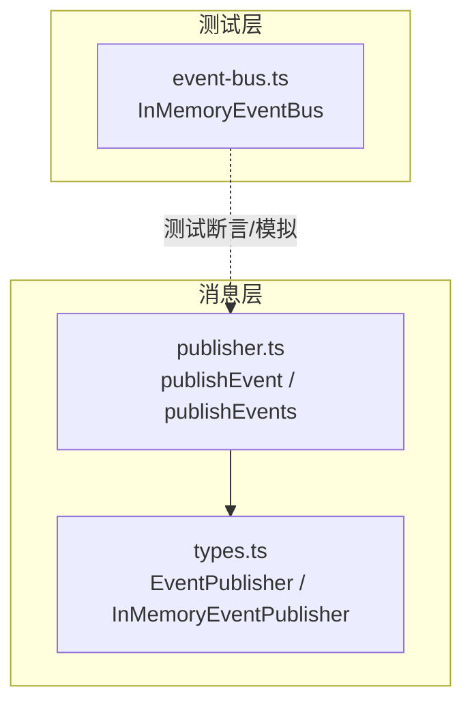
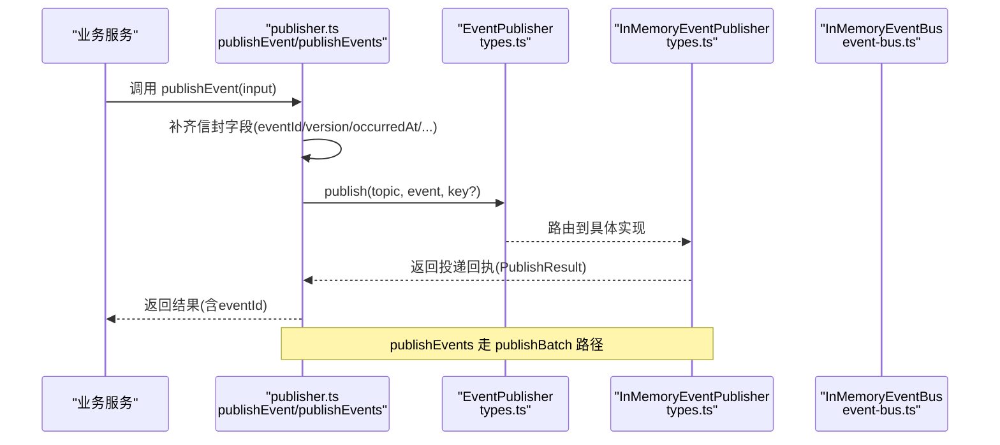
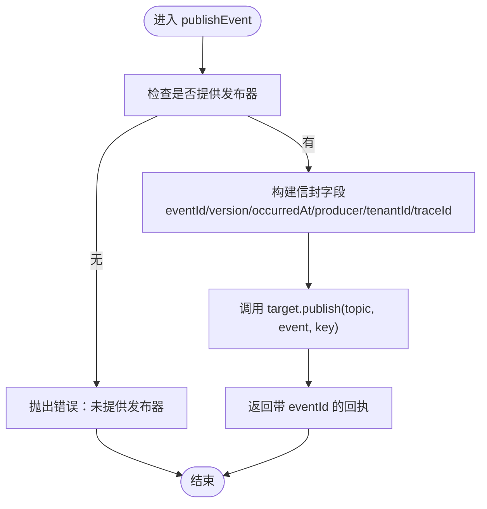
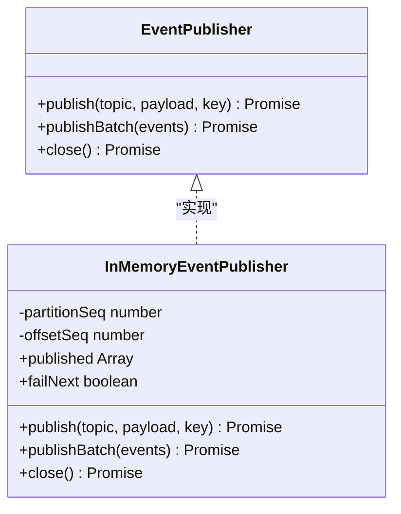
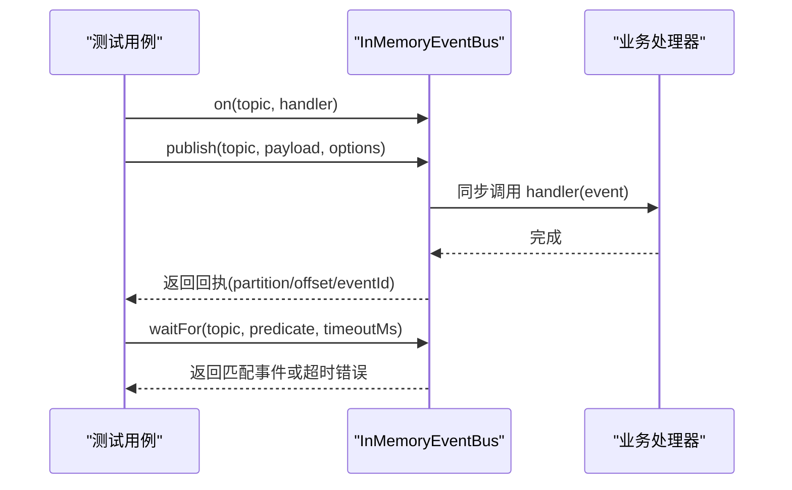

# 事件发布机制

<cite>
**本文引用的文件**   
- [packages/mq/src/publisher.ts](file://packages/mq/src/publisher.ts)
- [packages/mq/src/types.ts](file://packages/mq/src/types.ts)
- [packages/testing/src/event-bus.ts](file://packages/testing/src/event-bus.ts)
</cite>

## 目录
1. [简介](#简介)
2. [项目结构](#项目结构)
3. [核心组件](#核心组件)
4. [架构总览](#架构总览)
5. [详细组件分析](#详细组件分析)
6. [依赖关系分析](#依赖关系分析)
7. [性能与吞吐](#性能与吞吐)
8. [重试策略与默认策略](#重试策略与默认策略)
9. [序列化与反序列化、类型安全与版本兼容](#序列化与反序列化类型安全与版本兼容)
10. [最佳实践与错误处理模式](#最佳实践与错误处理模式)
11. [故障排查指南](#故障排查指南)
12. [结论](#结论)

## 简介
本文件面向“事件发布机制”，聚焦以下目标：
- 解释 publishEvent 与 publishEvents 的实现原理与调用流程。
- 说明 PublishEventInput 参数结构与信封字段补齐逻辑。
- 梳理 EventPublisher 接口抽象与 InMemoryEventPublisher 的工作流程。
- 文档化事件序列化/反序列化、类型安全与版本兼容性策略。
- 说明重试策略配置与 DEFAULT_RETRY_POLICY 的使用方式（当前仓库未提供默认实现，给出扩展建议）。
- 提供在业务服务中发布不同类型事件的实践，包括批量发布与异步处理。

## 项目结构
围绕事件发布的代码主要分布在三个位置：
- packages/mq/src/types.ts：定义事件发布契约、回执、处理器与订阅器接口，以及内存发布器实现。
- packages/mq/src/publisher.ts：提供便捷发布函数 publishEvent 与 publishEvents，负责自动补齐信封字段。
- packages/testing/src/event-bus.ts：测试用内存事件总线，用于单元测试与集成测试中的断言与等待。

图表来源
- [packages/mq/src/types.ts:1-72](file://packages/mq/src/types.ts#L1-L72)
- [packages/mq/src/publisher.ts:1-74](file://packages/mq/src/publisher.ts#L1-L74)
- [packages/testing/src/event-bus.ts:1-157](file://packages/testing/src/event-bus.ts#L1-L157)

章节来源
- [packages/mq/src/types.ts:1-72](file://packages/mq/src/types.ts#L1-L72)
- [packages/mq/src/publisher.ts:1-74](file://packages/mq/src/publisher.ts#L1-L74)
- [packages/testing/src/event-bus.ts:1-157](file://packages/testing/src/event-bus.ts#L1-L157)

## 核心组件
- EventPublisher 接口：统一发布能力，包含单条发布、批量发布与关闭。
- InMemoryEventPublisher：内存实现，记录已发布事件，便于断言；模拟分区与位点递增。
- publishEvent：便捷函数，自动补齐 eventId、version、occurredAt、producer、tenantId、traceId 等信封字段，再委托具体发布器。
- publishEvents：批量发布入口，内部按主题聚合后交由发布器的批量接口。
- InMemoryEventBus：测试用内存事件总线，支持 on/off、publish/publishBatch、deliver、waitFor、reset 等能力，便于验证事件流。

章节来源
- [packages/mq/src/types.ts:14-71](file://packages/mq/src/types.ts#L14-L71)
- [packages/mq/src/publisher.ts:15-73](file://packages/mq/src/publisher.ts#L15-L73)
- [packages/testing/src/event-bus.ts:36-156](file://packages/testing/src/event-bus.ts#L36-L156)

## 架构总览
下图展示从业务侧到发布器的调用链，以及信封字段的生成与分发过程。

图表来源
- [packages/mq/src/publisher.ts:40-73](file://packages/mq/src/publisher.ts#L40-L73)
- [packages/mq/src/types.ts:14-71](file://packages/mq/src/types.ts#L14-L71)

## 详细组件分析

### 便捷发布函数：publishEvent 与 publishEvents
- publishEvent
  - 入参为 PublishEventInput<T>，包含 topic、payload、tenantId、traceId，可选 producer 与 key。
  - 自动补齐信封字段：eventId 使用 ulid()，version=1，occurredAt 为 ISO 时间字符串，producer 缺省为 unknown，tenantId 与 traceId 透传。
  - 将完整事件对象交给 EventPublisher.publish，并返回包含 eventId 的投递回执。
- publishEvents
  - 接收 events 数组，直接调用 EventPublisher.publishBatch，适合批量场景。
  - 若未注册默认发布器或未传入 publisher，会抛出错误提示。

图表来源
- [packages/mq/src/publisher.ts:40-57](file://packages/mq/src/publisher.ts#L40-L57)

章节来源
- [packages/mq/src/publisher.ts:15-73](file://packages/mq/src/publisher.ts#L15-L73)

### EventPublisher 接口与 InMemoryEventPublisher
- EventPublisher
  - publish(topic, payload, key?)：单条发布，返回 PublishResult（topic/partition/offset/eventId）。
  - publishBatch(events)：批量发布。
  - close()：释放资源。
- InMemoryEventPublisher
  - 维护 published 列表，供测试断言。
  - 模拟分区号循环递增与 offset 自增。
  - failNext 标志可模拟一次失败，便于重试或异常路径测试。

图表来源
- [packages/mq/src/types.ts:14-71](file://packages/mq/src/types.ts#L14-L71)

章节来源
- [packages/mq/src/types.ts:14-71](file://packages/mq/src/types.ts#L14-L71)

### 测试用内存事件总线：InMemoryEventBus
- 作用：在单元测试中替代真实消息中间件，保持与真实发布订阅契约一致。
- 关键能力：
  - on/off：订阅与取消订阅。
  - publish/publishBatch：发布事件，自动补齐信封字段，记录历史。
  - deliver：直接投递已构造事件，用于重复投递模拟。
  - waitFor：等待满足条件的事件出现，超时抛错。
  - reset/close：清理状态。

图表来源
- [packages/testing/src/event-bus.ts:64-144](file://packages/testing/src/event-bus.ts#L64-L144)

章节来源
- [packages/testing/src/event-bus.ts:1-157](file://packages/testing/src/event-bus.ts#L1-L157)

## 依赖关系分析
- publisher.ts 依赖 types.ts 中的 EventPublisher 与 PublishResult。
- InMemoryEventPublisher 实现 EventPublisher，提供内存行为。
- InMemoryEventBus 独立于 mq 包，用于测试，不耦合具体发布器实现。

图表来源
- [packages/mq/src/publisher.ts:1-74](file://packages/mq/src/publisher.ts#L1-L74)
- [packages/mq/src/types.ts:1-72](file://packages/mq/src/types.ts#L1-L72)
- [packages/testing/src/event-bus.ts:1-157](file://packages/testing/src/event-bus.ts#L1-L157)

章节来源
- [packages/mq/src/publisher.ts:1-74](file://packages/mq/src/publisher.ts#L1-L74)
- [packages/mq/src/types.ts:1-72](file://packages/mq/src/types.ts#L1-L72)
- [packages/testing/src/event-bus.ts:1-157](file://packages/testing/src/event-bus.ts#L1-L157)

## 性能与吞吐
- 分区键(key)选择影响顺序与热点：
  - 与同一地块或设备相关的事件，建议使用该对象标识作为 key，保证同对象事件有序。
  - 无关事件尽量散列，避免热点分区。
- 批量发布：
  - publishEvents 通过 publishBatch 减少往返开销，提高吞吐。
- 内存实现：
  - InMemoryEventPublisher 以简单循环模拟分区与偏移，适合测试与本地开发。

章节来源
- [packages/mq/src/publisher.ts:6-13](file://packages/mq/src/publisher.ts#L6-L13)
- [packages/mq/src/types.ts:35-71](file://packages/mq/src/types.ts#L35-L71)

## 重试策略与默认策略
- 当前仓库未提供 DEFAULT_RETRY_POLICY 的具体实现。
- 建议在业务服务或基础设施层封装重试逻辑，结合 EventPublisher.publish 的返回值与异常进行指数退避、最大重试次数控制。
- 可使用 InMemoryEventPublisher.failNext 模拟失败，验证重试与补偿逻辑。

章节来源
- [packages/mq/src/types.ts:35-71](file://packages/mq/src/types.ts#L35-L71)

## 序列化与反序列化、类型安全与版本兼容
- 序列化：
  - publishEvent 将业务载荷与信封字段组合成事件对象，随后由具体发布器序列化为传输格式。
- 反序列化：
  - 消费者根据 topic 与 version 选择对应处理器与数据模型。
- 类型安全：
  - TypeScript 泛型约束 payload 类型，确保编译期类型安全。
- 版本兼容：
  - 信封中包含 version 字段，当前固定为 1；未来演进时可通过版本分支实现向后兼容。

章节来源
- [packages/mq/src/publisher.ts:40-57](file://packages/mq/src/publisher.ts#L40-L57)
- [packages/mq/src/types.ts:14-22](file://packages/mq/src/types.ts#L14-L22)

## 最佳实践与错误处理模式
- 发布前校验：
  - 校验 tenantId、traceId、topic 合法性。
- 分区键约定：
  - 与业务实体强相关的事件使用实体标识作为 key，保证顺序性。
- 批量发布：
  - 对高吞吐场景优先使用 publishEvents。
- 错误处理：
  - 捕获发布异常，记录日志与指标，必要时触发重试或降级。
  - 使用 InMemoryEventBus.failNext 或 InMemoryEventPublisher.failNext 模拟失败路径。
- 可观测性：
  - 利用 traceId 贯穿链路，配合 partition/offset/eventId 定位问题。

章节来源
- [packages/mq/src/publisher.ts:40-73](file://packages/mq/src/publisher.ts#L40-L73)
- [packages/testing/src/event-bus.ts:83-119](file://packages/testing/src/event-bus.ts#L83-L119)
- [packages/mq/src/types.ts:46-66](file://packages/mq/src/types.ts#L46-L66)

## 故障排查指南
- 常见问题
  - 未注册发布器：调用 publishEvent 或 publishEvents 时报错提示未提供发布器。
  - 事件未到达：检查订阅是否正确注册，或使用 waitFor 断言。
  - 顺序不一致：确认 key 是否符合“同对象同分区”的约定。
- 诊断手段
  - 使用 InMemoryEventBus.published 查看历史事件。
  - 使用 InMemoryEventPublisher.published 查看实际投递内容。
  - 借助 traceId、partition、offset、eventId 进行追踪。

章节来源
- [packages/mq/src/publisher.ts:40-73](file://packages/mq/src/publisher.ts#L40-L73)
- [packages/testing/src/event-bus.ts:56-62](file://packages/testing/src/event-bus.ts#L56-L62)
- [packages/mq/src/types.ts:40-41](file://packages/mq/src/types.ts#L40-L41)

## 结论
本机制通过 EventPublisher 抽象与便捷发布函数，将业务侧与底层消息系统解耦；InMemoryEventPublisher 与 InMemoryEventBus 提供了轻量、可测试的实现。通过信封字段、分区键约定与批量发布接口，系统在类型安全、顺序性与吞吐方面具备良好基础。后续可在基础设施层补充重试策略与更完善的监控告警，进一步提升可靠性与可观测性。