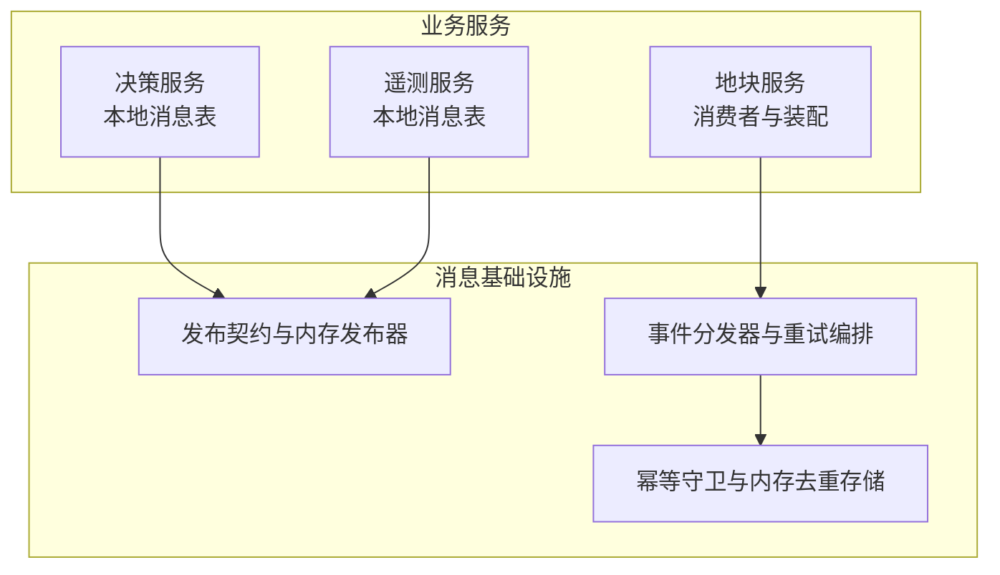
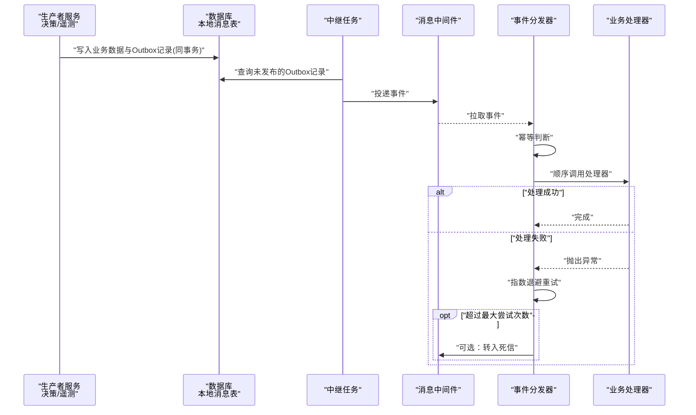
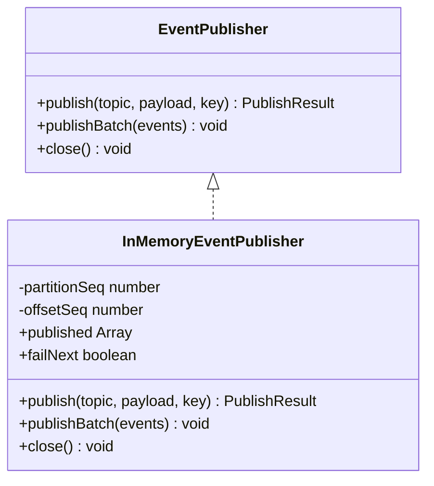
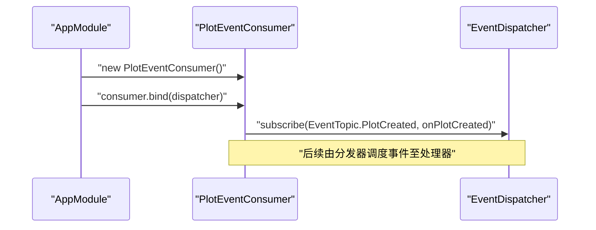
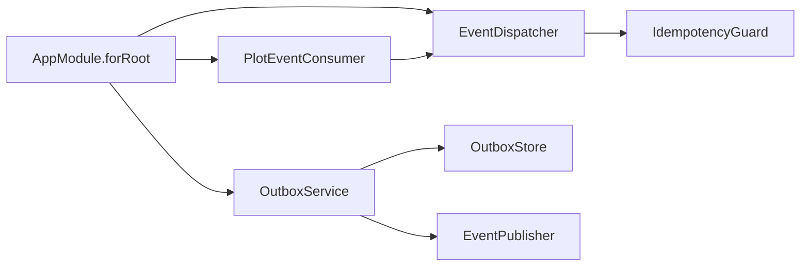
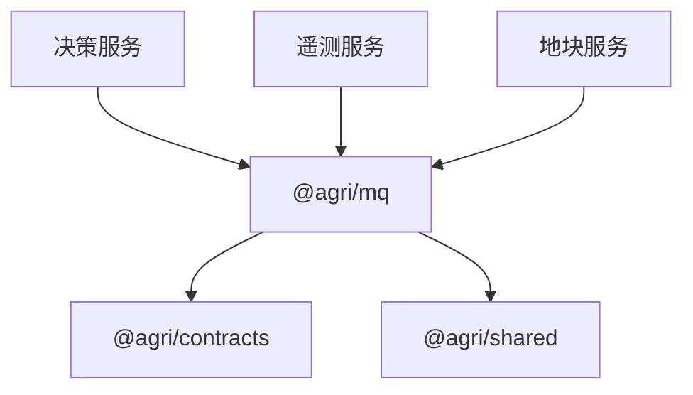
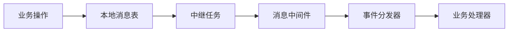
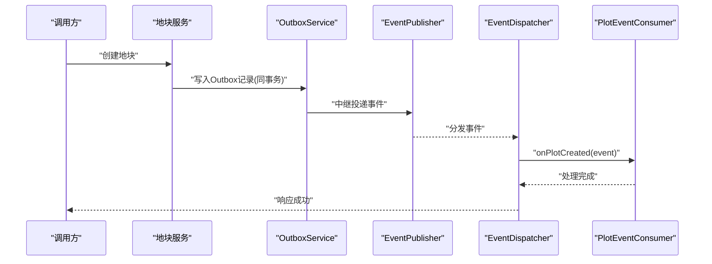

# 事件驱动架构

<cite>
**本文引用的文件**   
- [apps/decision-service/src/outbox.repository.ts](file://apps/decision-service/src/outbox.repository.ts)
- [apps/telemetry-service/src/outbox.repository.ts](file://apps/telemetry-service/src/outbox.repository.ts)
- [apps/plot-service/src/plot.consumer.ts](file://apps/plot-service/src/plot.consumer.ts)
- [apps/plot-service/src/app.module.ts](file://apps/plot-service/src/app.module.ts)
- [packages/mq/src/types.ts](file://packages/mq/src/types.ts)
- [packages/mq/src/idempotency.ts](file://packages/mq/src/idempotency.ts)
- [packages/mq/src/subscriber.ts](file://packages/mq/src/subscriber.ts)
</cite>

## 目录
1. [引言](#引言)
2. [项目结构](#项目结构)
3. [核心组件](#核心组件)
4. [架构总览](#架构总览)
5. [详细组件分析](#详细组件分析)
6. [依赖关系分析](#依赖关系分析)
7. [性能与可靠性考虑](#性能与可靠性考虑)
8. [故障排查指南](#故障排查指南)
9. [结论](#结论)
10. [附录：事件流与时序图](#附录事件流与时序图)

## 引言
本文件面向智慧农业平台的事件驱动架构，重点说明以下能力：
- 本地消息表（Outbox Pattern）的设计原理与“不丢不重”的实现机制。
- 事件发布订阅模式，包括 InMemoryEventPublisher 的用途与使用场景。
- 事件分发器 EventDispatcher 的工作流程，包含幂等保护 IdempotencyGuard 与重试策略。
- 消费者 Consumer 的绑定与处理逻辑。
- 事件序列化、版本管理与兼容性建议。
- 通过事件流图与时序图展示数据流转过程。

该文档以仓库中实际代码为依据，聚焦决策服务、遥测服务的 Outbox 实现，以及地块服务中的事件消费与分发编排。

## 项目结构
围绕事件驱动的关键位置如下：
- 业务服务侧的本地消息表存储实现：
  - 决策服务：[apps/decision-service/src/outbox.repository.ts](file://apps/decision-service/src/outbox.repository.ts)
  - 遥测服务：[apps/telemetry-service/src/outbox.repository.ts](file://apps/telemetry-service/src/outbox.repository.ts)
- 事件基础设施包：
  - 发布契约与内存发布器：[packages/mq/src/types.ts](file://packages/mq/src/types.ts)
  - 幂等守卫与内存去重存储：[packages/mq/src/idempotency.ts](file://packages/mq/src/idempotency.ts)
  - 事件分发器与重试编排：[packages/mq/src/subscriber.ts](file://packages/mq/src/subscriber.ts)
- 消费者与模块装配：
  - 地块事件消费者：[apps/plot-service/src/plot.consumer.ts](file://apps/plot-service/src/plot.consumer.ts)
  - 地块服务模块装配（OutboxService、EventDispatcher、IdempotencyGuard、InMemoryOutboxStore 等）：[apps/plot-service/src/app.module.ts](file://apps/plot-service/src/app.module.ts)

**图表来源**
- [apps/decision-service/src/outbox.repository.ts:1-64](file://apps/decision-service/src/outbox.repository.ts#L1-L64)
- [apps/telemetry-service/src/outbox.repository.ts:1-64](file://apps/telemetry-service/src/outbox.repository.ts#L1-L64)
- [packages/mq/src/types.ts:1-72](file://packages/mq/src/types.ts#L1-L72)
- [packages/mq/src/idempotency.ts:1-84](file://packages/mq/src/idempotency.ts#L1-L84)
- [packages/mq/src/subscriber.ts:1-103](file://packages/mq/src/subscriber.ts#L1-L103)
- [apps/plot-service/src/app.module.ts:1-196](file://apps/plot-service/src/app.module.ts#L1-L196)

**章节来源**
- [apps/decision-service/src/outbox.repository.ts:1-64](file://apps/decision-service/src/outbox.repository.ts#L1-L64)
- [apps/telemetry-service/src/outbox.repository.ts:1-64](file://apps/telemetry-service/src/outbox.repository.ts#L1-L64)
- [packages/mq/src/types.ts:1-72](file://packages/mq/src/types.ts#L1-L72)
- [packages/mq/src/idempotency.ts:1-84](file://packages/mq/src/idempotency.ts#L1-L84)
- [packages/mq/src/subscriber.ts:1-103](file://packages/mq/src/subscriber.ts#L1-L103)
- [apps/plot-service/src/app.module.ts:1-196](file://apps/plot-service/src/app.module.ts#L1-L196)

## 核心组件
- 本地消息表存储（OutboxStore）
  - 决策服务与遥测服务分别提供 SQL 实现，将领域数据变更与事件写入同一数据库事务，确保一致性。
- 事件发布契约与内存发布器（EventPublisher / InMemoryEventPublisher）
  - 定义统一发布接口；InMemoryEventPublisher 用于测试与本地开发，支持模拟失败与断言已发布事件。
- 幂等守卫（IdempotencyGuard）
  - 基于 IdempotencyStore 对 eventId 进行去重，避免重复消费。
- 事件分发器（EventDispatcher）
  - 负责按主题注册处理器、串行执行、幂等判断、指数退避重试与死信处理。
- 消费者（Consumer）
  - 地块服务中的 PlotEventConsumer 仅关注业务语义，通过装饰器注册处理器并绑定到分发器。

**章节来源**
- [apps/decision-service/src/outbox.repository.ts:1-64](file://apps/decision-service/src/outbox.repository.ts#L1-L64)
- [apps/telemetry-service/src/outbox.repository.ts:1-64](file://apps/telemetry-service/src/outbox.repository.ts#L1-L64)
- [packages/mq/src/types.ts:1-72](file://packages/mq/src/types.ts#L1-L72)
- [packages/mq/src/idempotency.ts:1-84](file://packages/mq/src/idempotency.ts#L1-L84)
- [packages/mq/src/subscriber.ts:1-103](file://packages/mq/src/subscriber.ts#L1-L103)
- [apps/plot-service/src/plot.consumer.ts:1-40](file://apps/plot-service/src/plot.consumer.ts#L1-L40)

## 架构总览
事件驱动架构在平台中的关键路径：
- 生产者侧：业务操作与 Outbox 记录在同一事务内提交，随后由中继任务扫描未发布记录并投递到消息中间件。
- 消费者侧：EventDispatcher 从消息中间件拉取事件，先做幂等判断，再顺序调用已注册的处理器；失败时按策略重试，最终可转入死信。
- 基础设施：InMemoryEventPublisher 用于本地与测试；生产环境替换为真实中间件客户端。IdempotencyStore 在测试中使用内存实现，生产环境通常由缓存中间件实现。

**图表来源**
- [apps/decision-service/src/outbox.repository.ts:18-62](file://apps/decision-service/src/outbox.repository.ts#L18-L62)
- [apps/telemetry-service/src/outbox.repository.ts:18-62](file://apps/telemetry-service/src/outbox.repository.ts#L18-L62)
- [packages/mq/src/types.ts:14-19](file://packages/mq/src/types.ts#L14-L19)
- [packages/mq/src/subscriber.ts:70-101](file://packages/mq/src/subscriber.ts#L70-L101)

## 详细组件分析

### 本地消息表（Outbox Pattern）
设计要点：
- 事务一致性：业务数据与 Outbox 记录在同一数据库事务中写入，保证“要么都成功，要么都回滚”。
- 持久化字段：包含事件标识、主题、负载 JSON、租户 ID、追踪 ID、生产者、创建时间、重试计数等。
- 中继投递：由后台任务扫描 published_at 为空的记录，按 created_at 排序分批投递，成功后标记 published_at，失败则累加 retry_count 并记录 last_error。

两个服务的 SQL 实现均遵循相同模式：
- enqueue：在同事务中插入 Outbox 记录。
- listPending：读取未发布记录，映射为 OutboxRecord。
- markPublished：标记已发布。
- markFailed：增加重试次数并记录错误信息。

**图表来源**
- [apps/decision-service/src/outbox.repository.ts:18-31](file://apps/decision-service/src/outbox.repository.ts#L18-L31)
- [apps/telemetry-service/src/outbox.repository.ts:18-31](file://apps/telemetry-service/src/outbox.repository.ts#L18-L31)

**章节来源**
- [apps/decision-service/src/outbox.repository.ts:1-64](file://apps/decision-service/src/outbox.repository.ts#L1-L64)
- [apps/telemetry-service/src/outbox.repository.ts:1-64](file://apps/telemetry-service/src/outbox.repository.ts#L1-L64)

### 事件发布与内存发布器（EventPublisher / InMemoryEventPublisher）
职责与特性：
- EventPublisher 定义 publish、publishBatch、close 三个方法，屏蔽底层中间件差异。
- InMemoryEventPublisher 用于测试与本地开发：
  - 维护已发布事件列表，便于断言。
  - 支持 failNext 模拟投递失败。
  - 生成分区号与偏移量，辅助定位问题。

典型使用场景：
- 单元测试中注入 InMemoryEventPublisher，验证业务是否按预期发布事件。
- 本地开发无需启动真实消息中间件即可运行完整链路。

**图表来源**
- [packages/mq/src/types.ts:14-19](file://packages/mq/src/types.ts#L14-L19)
- [packages/mq/src/types.ts:34-71](file://packages/mq/src/types.ts#L34-L71)

**章节来源**
- [packages/mq/src/types.ts:14-71](file://packages/mq/src/types.ts#L14-L71)

### 幂等保护（IdempotencyGuard）
目标：
- 由于至少一次投递与消费者重试，重复消费是正常现象。幂等层统一承担去重，避免每个消费者自行实现。

实现要点：
- IdempotencyStore 抽象键值存储，has/set 接口。
- IdempotencyGuard 默认 TTL 为七天，覆盖大多数重试与人工补发场景。
- isDuplicate 先查后写，避免并发重复处理；mark 用于处理成功后补记。

**图表来源**
- [packages/mq/src/idempotency.ts:9-15](file://packages/mq/src/idempotency.ts#L9-L15)
- [packages/mq/src/idempotency.ts:21-52](file://packages/mq/src/idempotency.ts#L21-L52)

**章节来源**
- [packages/mq/src/idempotency.ts:1-84](file://packages/mq/src/idempotency.ts#L1-L84)

### 事件分发器（EventDispatcher）与重试机制
职责：
- 管理主题到处理器的映射。
- 对每个事件执行幂等判断。
- 按注册顺序串行调用处理器。
- 失败时按 RetryPolicy 指数退避重试，达到最大尝试次数后可转入死信。

关键行为：
- subscribe：注册处理器。
- dispatch：幂等判断 -> 循环尝试 -> 成功返回或转死信。
- onError：可选回调，输出 topic/eventId/error/attempt 日志。

**图表来源**
- [packages/mq/src/subscriber.ts:25-44](file://packages/mq/src/subscriber.ts#L25-L44)
- [packages/mq/src/subscriber.ts:51-60](file://packages/mq/src/subscriber.ts#L51-L60)
- [packages/mq/src/subscriber.ts:70-101](file://packages/mq/src/subscriber.ts#L70-L101)

**章节来源**
- [packages/mq/src/subscriber.ts:1-103](file://packages/mq/src/subscriber.ts#L1-L103)

### 消费者（Consumer）绑定与处理逻辑
地块服务中的 PlotEventConsumer：
- 使用 @registerHandler 装饰器声明处理器，仅关注业务语义（如地块建档后的网格初始化）。
- bind(dispatcher) 通过 buildHandlers 自动构建处理器注册信息，并订阅到 EventDispatcher。
- 消费者内部不出现重复消费判断与重试逻辑，这些由分发器统一承担。

**图表来源**
- [apps/plot-service/src/plot.consumer.ts:6-39](file://apps/plot-service/src/plot.consumer.ts#L6-L39)
- [apps/plot-service/src/app.module.ts:135-143](file://apps/plot-service/src/app.module.ts#L135-L143)

**章节来源**
- [apps/plot-service/src/plot.consumer.ts:1-40](file://apps/plot-service/src/plot.consumer.ts#L1-L40)
- [apps/plot-service/src/app.module.ts:112-143](file://apps/plot-service/src/app.module.ts#L112-L143)

### 模块装配与依赖注入
地块服务模块装配展示了 OutboxService、EventDispatcher、IdempotencyGuard 的装配方式：
- OUTBOX_STORE：默认使用 InMemoryOutboxStore，也可注入 SQL 实现。
- IDEMPOTENCY_STORE：默认使用 IdempotencyGuardStore（内存），生产替换为缓存中间件。
- OutboxService：结合 OutboxStore 与 EventPublisher，封装 Outbox 的中继投递能力。
- EventDispatcher：注入 IdempotencyGuard 与 DEFAULT_RETRY_POLICY。
- PlotEventConsumer：构造后调用 bind(dispatcher) 完成处理器注册。

**图表来源**
- [apps/plot-service/src/app.module.ts:112-143](file://apps/plot-service/src/app.module.ts#L112-L143)

**章节来源**
- [apps/plot-service/src/app.module.ts:1-196](file://apps/plot-service/src/app.module.ts#L1-L196)

## 依赖关系分析
- 业务服务依赖消息基础设施的对外契约（EventPublisher、OutboxStore、EventSubscriber）。
- 基础设施包解耦具体中间件实现，允许在测试与本地环境中使用内存实现。
- 幂等与重试逻辑集中在分发器层，业务处理器保持简洁。

**图表来源**
- [apps/decision-service/src/outbox.repository.ts:1-3](file://apps/decision-service/src/outbox.repository.ts#L1-L3)
- [apps/telemetry-service/src/outbox.repository.ts:1-3](file://apps/telemetry-service/src/outbox.repository.ts#L1-L3)
- [packages/mq/src/subscriber.ts:1-7](file://packages/mq/src/subscriber.ts#L1-L7)

**章节来源**
- [apps/decision-service/src/outbox.repository.ts:1-64](file://apps/decision-service/src/outbox.repository.ts#L1-L64)
- [apps/telemetry-service/src/outbox.repository.ts:1-64](file://apps/telemetry-service/src/outbox.repository.ts#L1-L64)
- [packages/mq/src/subscriber.ts:1-103](file://packages/mq/src/subscriber.ts#L1-L103)

## 性能与可靠性考虑
- 本地消息表批量拉取：listPending 使用 LIMIT 分页，避免一次性加载过多记录。
- 幂等 TTL：默认七天，平衡重试窗口与存储占用。
- 指数退避重试：避免雪崩与资源争用，提升系统稳定性。
- 死信通道：超限事件转入死信，防止阻塞主流程，便于人工干预与补偿。
- 内存发布器与内存去重存储：适用于测试与本地开发，降低环境复杂度。

[本节为通用指导，不直接分析具体文件]

## 故障排查指南
常见问题与建议：
- Outbox 记录长期未发布：
  - 检查中继任务是否正常运行。
  - 查看 last_error 与 retry_count，确认是否存在持续失败。
- 事件重复消费：
  - 确认 IdempotencyStore 是否可用且 TTL 合理。
  - 校验 eventId 是否稳定唯一。
- 处理器异常导致重试风暴：
  - 检查 onError 回调日志，定位具体错误。
  - 调整 RetryPolicy 的最大尝试次数与退避间隔。
- 死信堆积：
  - 分析 deadLetter 处理结果，必要时进行人工修复与补偿。

**章节来源**
- [apps/decision-service/src/outbox.repository.ts:33-62](file://apps/decision-service/src/outbox.repository.ts#L33-L62)
- [apps/telemetry-service/src/outbox.repository.ts:33-62](file://apps/telemetry-service/src/outbox.repository.ts#L33-L62)
- [packages/mq/src/subscriber.ts:70-101](file://packages/mq/src/subscriber.ts#L70-L101)

## 结论
本事件驱动架构通过本地消息表保障“不丢不重”，以幂等守卫与重试机制确保“至少一次”投递下的正确性，并通过事件分发器统一编排消费者处理流程。InMemoryEventPublisher 与内存去重存储降低了开发与测试成本，而清晰的契约与装配方式使生产环境可平滑替换为真实中间件与缓存组件。

[本节为总结性内容，不直接分析具体文件]

## 附录：事件流与时序图

### 事件流图（Outbox 到消费者）

**图表来源**
- [apps/decision-service/src/outbox.repository.ts:18-62](file://apps/decision-service/src/outbox.repository.ts#L18-L62)
- [apps/telemetry-service/src/outbox.repository.ts:18-62](file://apps/telemetry-service/src/outbox.repository.ts#L18-L62)
- [packages/mq/src/subscriber.ts:70-101](file://packages/mq/src/subscriber.ts#L70-L101)

### 时序图（地块建档事件）

**图表来源**
- [apps/plot-service/src/plot.consumer.ts:20-28](file://apps/plot-service/src/plot.consumer.ts#L20-L28)
- [apps/plot-service/src/app.module.ts:119-143](file://apps/plot-service/src/app.module.ts#L119-L143)
- [packages/mq/src/types.ts:14-19](file://packages/mq/src/types.ts#L14-L19)