# 事件驱动架构

<cite>
**本文引用的文件**   
- [apps/plot-service/src/outbox.repository.ts](file://apps/plot-service/src/outbox.repository.ts)
- [apps/plot-service/src/plot.consumer.ts](file://apps/plot-service/src/plot.consumer.ts)
- [apps/plot-service/src/app.module.ts](file://apps/plot-service/src/app.module.ts)
- [apps/plot-service/src/plot.service.ts](file://apps/plot-service/src/plot.service.ts)
- [apps/control-service/src/command-finished.ts](file://apps/control-service/src/command-finished.ts)
- [apps/control-service/src/outbox.repository.ts](file://apps/control-service/src/outbox.repository.ts)
- [apps/control-service/src/http.ts](file://apps/control-service/src/http.ts)
- [apps/trace-service/src/consumer.ts](file://apps/trace-service/src/consumer.ts)
- [apps/message-service/src/consumer.ts](file://apps/message-service/src/consumer.ts)
- [apps/decision-service/src/consumer.ts](file://apps/decision-service/src/consumer.ts)
- [infra/postgres/migrations/028_plot_outbox.sql](file://infra/postgres/migrations/028_plot_outbox.sql)
- [infra/postgres/migrations/033_control_outbox.sql](file://infra/postgres/migrations/033_control_outbox.sql)
- [apps/plot-service/test/sql-plot-outbox.spec.ts](file://apps/plot-service/test/sql-plot-outbox.spec.ts)
- [packages/mq/src/types.ts](file://packages/mq/src/types.ts)
- [packages/mq/src/idempotency.ts](file://packages/mq/src/idempotency.ts)
- [packages/mq/src/subscriber.ts](file://packages/mq/src/subscriber.ts)
- [packages/mq/src/outbox.ts](file://packages/mq/src/outbox.ts)
</cite>

## 更新摘要
**所做更改**   
- 增强了命令完成事件系统，现在通过统一的 command-finished.ts 支持灌溉和施肥操作
- 替换了之前的仅灌溉实现，提供全面的多种操作支持
- 新增了决策服务对灌溉和施肥完成事件的消费者处理
- 完善了控制服务的统一事件构建逻辑，支持不同类型的指令类型
- 扩展了事件类型支持，包括 ControlIrrigationFinished 和 ControlFertilizationFinished 事件

## 目录
1. [引言](#引言)
2. [项目结构](#项目结构)
3. [核心组件](#核心组件)
4. [架构总览](#架构总览)
5. [详细组件分析](#详细组件分析)
6. [依赖关系分析](#依赖关系分析)
7. [性能与可靠性考虑](#性能与可靠性考虑)
8. [故障排查指南](#故障排查指南)
9. [结论](#结论)
10. [附录：事件流与时序图](#附录事件流与时序图)

## 引言
本文件面向智慧农业平台的事件驱动架构，重点说明以下能力：
- 本地消息表（Outbox Pattern）的设计原理与"不丢不重"的实现机制。
- 事件发布订阅模式，包括 InMemoryEventPublisher 的用途与使用场景。
- 事件分发器 EventDispatcher 的工作流程，包含幂等保护 IdempotencyGuard 与重试策略。
- 消费者 Consumer 的绑定与处理逻辑。
- 事件序列化、版本管理与兼容性建议。
- 通过事件流图与时序图展示数据流转过程。

该文档以仓库中实际代码为依据，聚焦决策服务、遥测服务、地块服务、控制服务的 Outbox 实现，以及事件消费与分发编排。**增强的命令完成事件系统**进一步丰富了平台的业务闭环能力，现在同时支持灌溉和施肥操作的统一事件处理。

## 项目结构
围绕事件驱动的关键位置如下：
- 业务服务侧的本地消息表存储实现：
  - 决策服务：[apps/decision-service/src/outbox.repository.ts](file://apps/decision-service/src/outbox.repository.ts)
  - 遥测服务：[apps/telemetry-service/src/outbox.repository.ts](file://apps/telemetry-service/src/outbox.repository.ts)
  - **增强** 控制服务：[apps/control-service/src/outbox.repository.ts](file://apps/control-service/src/outbox.repository.ts)
  - 地块服务：[apps/plot-service/src/outbox.repository.ts](file://apps/plot-service/src/outbox.repository.ts)
- 事件基础设施包：
  - 发布契约与内存发布器：[packages/mq/src/types.ts](file://packages/mq/src/types.ts)
  - 幂等守卫与内存去重存储：[packages/mq/src/idempotency.ts](file://packages/mq/src/idempotency.ts)
  - 事件分发器与重试编排：[packages/mq/src/subscriber.ts](file://packages/mq/src/subscriber.ts)
  - 本地消息表服务：[packages/mq/src/outbox.ts](file://packages/mq/src/outbox.ts)
- 消费者与模块装配：
  - 地块事件消费者：[apps/plot-service/src/plot.consumer.ts](file://apps/plot-service/src/plot.consumer.ts)
  - **增强** 追溯事件消费者：[apps/trace-service/src/consumer.ts](file://apps/trace-service/src/consumer.ts)
  - **增强** 消息事件消费者：[apps/message-service/src/consumer.ts](file://apps/message-service/src/consumer.ts)
  - **新增** 决策事件消费者：[apps/decision-service/src/consumer.ts](file://apps/decision-service/src/consumer.ts)
  - 地块服务模块装配：[apps/plot-service/src/app.module.ts](file://apps/plot-service/src/app.module.ts)
  - 地块业务服务：[apps/plot-service/src/plot.service.ts](file://apps/plot-service/src/plot.service.ts)
- 数据库迁移：
  - 地块Outbox表结构：[infra/postgres/migrations/028_plot_outbox.sql](file://infra/postgres/migrations/028_plot_outbox.sql)
  - **增强** 控制Outbox表结构：[infra/postgres/migrations/033_control_outbox.sql](file://infra/postgres/migrations/033_control_outbox.sql)

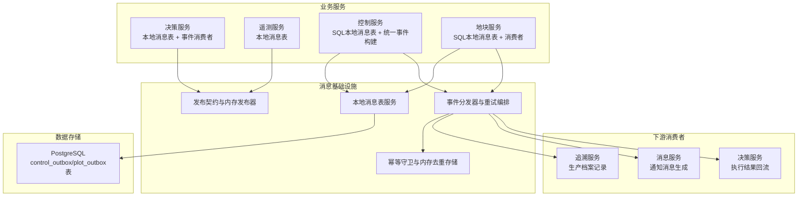

**图表来源**
- [apps/control-service/src/command-finished.ts:21-29](file://apps/control-service/src/command-finished.ts#L21-L29)
- [apps/decision-service/src/consumer.ts:68-77](file://apps/decision-service/src/consumer.ts#L68-L77)
- [apps/trace-service/src/consumer.ts:71-89](file://apps/trace-service/src/consumer.ts#L71-L89)
- [apps/message-service/src/consumer.ts:65-69](file://apps/message-service/src/consumer.ts#L65-L69)
- [infra/postgres/migrations/033_control_outbox.sql:1-20](file://infra/postgres/migrations/033_control_outbox.sql#L1-L20)

## 核心组件
- 本地消息表存储（OutboxStore）
  - 决策服务与遥测服务分别提供 SQL 实现，将领域数据变更与事件写入同一数据库事务，确保一致性。
  - **增强** 控制服务提供 SqlControlOutboxStore，专门处理灌溉完成和施肥完成事件的持久化存储。
  - 地块服务提供 SqlPlotOutboxStore，专门处理 PlotCreated 事件的持久化存储。
- 事件发布契约与内存发布器（EventPublisher / InMemoryEventPublisher）
  - 定义统一发布接口；InMemoryEventPublisher 用于测试与本地开发，支持模拟失败与断言已发布事件。
- 幂等守卫（IdempotencyGuard）
  - 基于 IdempotencyStore 对 eventId 进行去重，避免重复消费。
- 事件分发器（EventDispatcher）
  - 负责按主题注册处理器、串行执行、幂等判断、指数退避重试与死信处理。
- 本地消息表服务（OutboxService）
  - 封装 OutboxStore 与 EventPublisher，提供 enqueue、relayOnce、stop 等方法。
- 消费者（Consumer）
  - 地块服务中的 PlotEventConsumer 仅关注业务语义，通过装饰器注册处理器并绑定到分发器。
  - **增强** 追溯服务中的 TraceEventConsumer 处理灌溉完成事件，生成生产档案记录。
  - **增强** 消息服务中的 MessageEventConsumer 处理灌溉完成事件，生成用户通知消息。
  - **新增** 决策服务中的 DecisionEventConsumer 处理灌溉和施肥完成事件，执行结果回流。

**章节来源**
- [apps/control-service/src/command-finished.ts:1-136](file://apps/control-service/src/command-finished.ts#L1-L136)
- [apps/decision-service/src/consumer.ts:61-115](file://apps/decision-service/src/consumer.ts#L61-L115)
- [apps/trace-service/src/consumer.ts:42-114](file://apps/trace-service/src/consumer.ts#L42-L114)
- [apps/message-service/src/consumer.ts:29-109](file://apps/message-service/src/consumer.ts#L29-L109)

## 架构总览
事件驱动架构在平台中的关键路径：
- 生产者侧：业务操作与 Outbox 记录在同一事务内提交，随后由中继任务扫描未发布记录并投递到消息中间件。
- 消费者侧：EventDispatcher 从消息中间件拉取事件，先做幂等判断，再顺序调用已注册的处理器；失败时按策略重试，最终可转入死信。
- 基础设施：InMemoryEventPublisher 用于本地与测试；生产环境替换为真实中间件客户端。IdempotencyStore 在测试中使用内存实现，生产环境通常由缓存中间件实现。

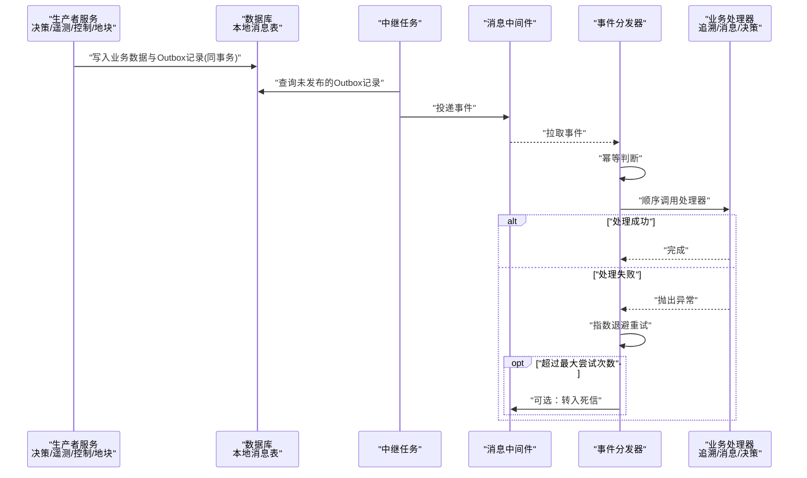

**图表来源**
- [apps/control-service/src/http.ts:310-327](file://apps/control-service/src/http.ts#L310-L327)
- [apps/control-service/src/outbox.repository.ts:23-36](file://apps/control-service/src/outbox.repository.ts#L23-L36)
- [packages/mq/src/outbox.ts:74-91](file://packages/mq/src/outbox.ts#L74-L91)

## 详细组件分析

### 本地消息表（Outbox Pattern）
设计要点：
- 事务一致性：业务数据与 Outbox 记录在同一数据库事务中写入，保证"要么都成功，要么都回滚"。
- 持久化字段：包含事件标识、主题、负载 JSON、租户 ID、追踪 ID、生产者、创建时间、重试计数等。
- 中继投递：由后台任务扫描 published_at 为空的记录，按 created_at 排序分批投递，成功后标记 published_at，失败则累加 retry_count 并记录 last_error。

四个服务的 SQL 实现均遵循相同模式：
- enqueue：在同事务中插入 Outbox 记录。
- listPending：读取未发布记录，映射为 OutboxRecord。
- markPublished：标记已发布。
- markFailed：增加重试次数并记录错误信息。

**增强** 控制服务的 SqlControlOutboxStore 专门处理灌溉完成和施肥完成事件，确保指令状态变更与事件发布的原子性。

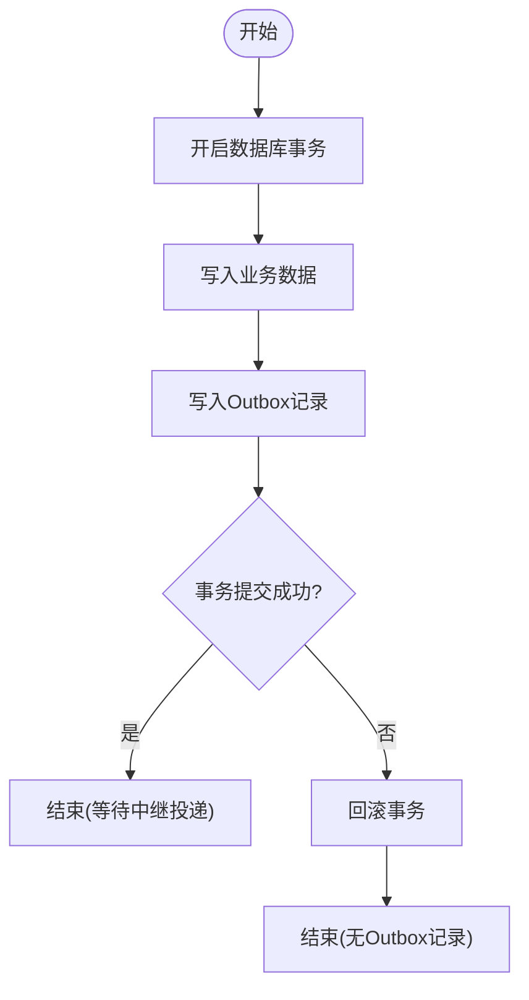

**图表来源**
- [apps/control-service/src/outbox.repository.ts:23-36](file://apps/control-service/src/outbox.repository.ts#L23-L36)

**章节来源**
- [apps/control-service/src/outbox.repository.ts:1-69](file://apps/control-service/src/outbox.repository.ts#L1-L69)
- [infra/postgres/migrations/033_control_outbox.sql:1-20](file://infra/postgres/migrations/033_control_outbox.sql#L1-L20)

### 增强的命令完成事件系统
**重大更新** 控制服务中的命令完成事件系统现在通过统一的 command-finished.ts 文件支持灌溉和施肥操作：

#### 统一事件构建逻辑
- `buildFinishedEvent` 函数根据指令类型构建相应的事件载荷
- 支持两种主要指令类型：IRRIGATION（灌溉）和 FERTILIZATION（施肥）
- 智能解析用水量、投肥量和作业时长，优先使用设备实测值
- 通过 FINISHED_TOPIC_BY_TYPE 映射表统一管理不同指令类型对应的事件主题

#### 多类型指令支持
- **灌溉指令**：构建 `ControlIrrigationFinished` 事件，包含用水量信息
- **施肥指令**：构建 `ControlFertilizationFinished` 事件，包含投肥量信息
- **其他指令**：播种、除草、急停等不产生计量数据的指令不会发送完成事件

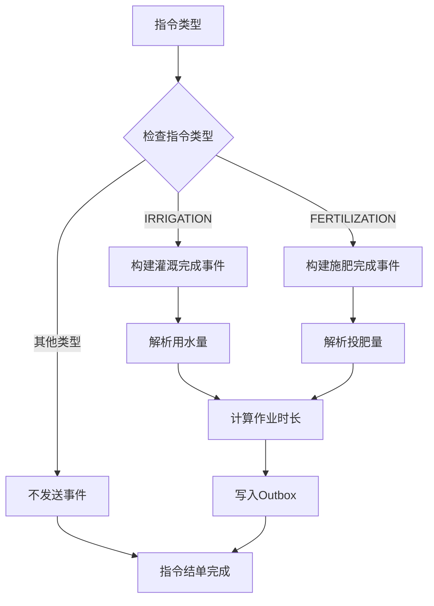

**图表来源**
- [apps/control-service/src/command-finished.ts:26-29](file://apps/control-service/src/command-finished.ts#L26-L29)
- [apps/control-service/src/command-finished.ts:117-135](file://apps/control-service/src/command-finished.ts#L117-L135)

**章节来源**
- [apps/control-service/src/command-finished.ts:1-136](file://apps/control-service/src/command-finished.ts#L1-L136)

### 决策服务事件消费者
**新增** 决策服务中的 DecisionEventConsumer 专门处理灌溉和施肥完成事件：

- **双主题监听**：通过 `@registerHandler(EventTopic.ControlIrrigationFinished)` 和 `@registerHandler(EventTopic.ControlFertilizationFinished)` 装饰器注册处理器
- **执行结果回流**：将完成事件转换为处方执行记录，包含用水量、投肥量、作业时长等信息
- **处方关联**：通过 prescriptionId 字段关联到原始处方，支持自动下发的指令
- **数据验证**：严格的载荷验证确保数据完整性，非法数据会触发重试而非静默丢弃

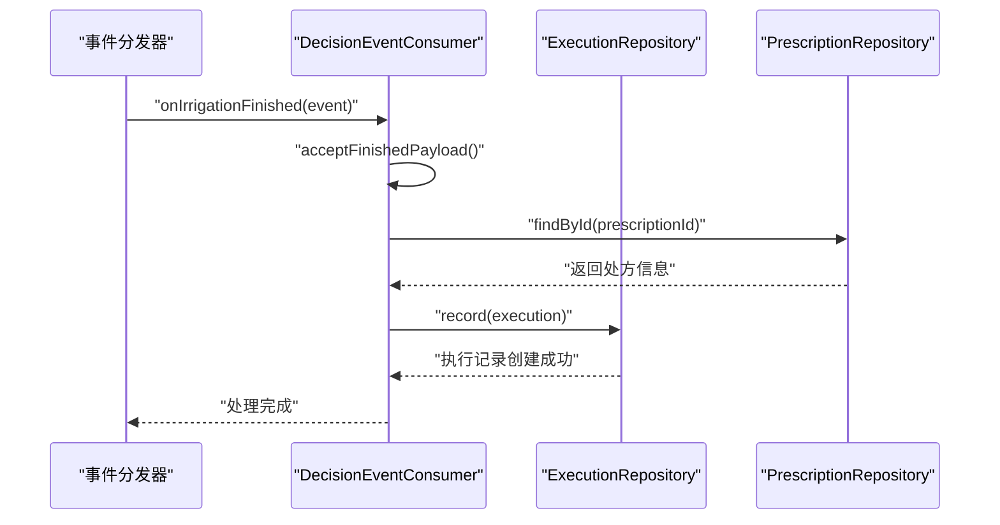

**图表来源**
- [apps/decision-service/src/consumer.ts:68-77](file://apps/decision-service/src/consumer.ts#L68-L77)
- [apps/decision-service/src/consumer.ts:84-114](file://apps/decision-service/src/consumer.ts#L84-L114)

**章节来源**
- [apps/decision-service/src/consumer.ts:1-159](file://apps/decision-service/src/consumer.ts#L1-L159)

### 追溯服务事件消费者
**增强** 追溯服务中的 TraceEventConsumer 专门处理灌溉完成事件：

- **事件监听**：通过 `@registerHandler(EventTopic.ControlIrrigationFinished)` 装饰器注册处理器
- **档案记录**：将灌溉完成事件转换为生产档案记录，包含用水量、设备信息等
- **幂等保护**：使用相同的 traceCode 确保重复事件不会创建重复档案
- **时间处理**：优先使用设备结单时间，否则使用事件发生时间

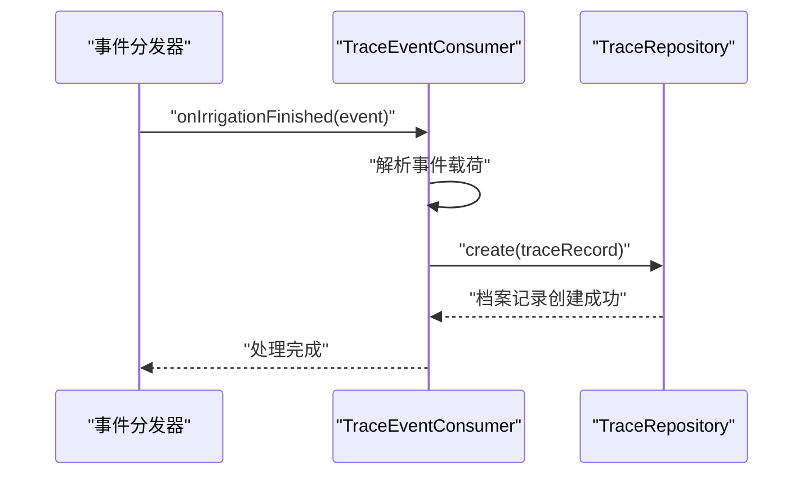

**图表来源**
- [apps/trace-service/src/consumer.ts:71-89](file://apps/trace-service/src/consumer.ts#L71-L89)

**章节来源**
- [apps/trace-service/src/consumer.ts:42-114](file://apps/trace-service/src/consumer.ts#L42-L114)

### 消息服务事件消费者
**增强** 消息服务中的 MessageEventConsumer 处理灌溉完成事件：

- **事件监听**：通过 `@registerHandler(EventTopic.ControlIrrigationFinished)` 装饰器注册处理器
- **消息生成**：使用 `buildMessageDraft` 生成用户友好的通知消息
- **偏好过滤**：根据租户的消息偏好设置决定是否生成通知
- **级别控制**：支持不同级别的消息（告警、通知、提醒）

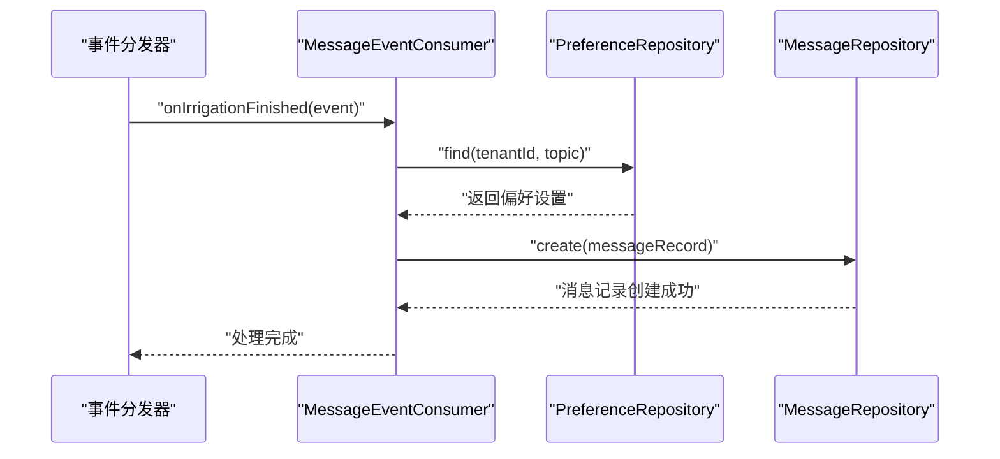

**图表来源**
- [apps/message-service/src/consumer.ts:65-69](file://apps/message-service/src/consumer.ts#L65-L69)
- [apps/message-service/src/consumer.ts:81-108](file://apps/message-service/src/consumer.ts#L81-L108)

**章节来源**
- [apps/message-service/src/consumer.ts:29-109](file://apps/message-service/src/consumer.ts#L29-L109)

### 控制服务HTTP集成
**增强** 控制服务的HTTP层集成了统一的命令完成事件处理：

- **统一回调**：在指令状态变为 DONE 时调用 `buildFinishedEvent` 构建事件
- **Outbox集成**：通过 `outbox.enqueue` 方法将事件写入本地消息表
- **事务安全**：确保指令状态变更与事件发布的原子性
- **条件处理**：只有配置了Outbox时才发送事件，避免不必要的依赖

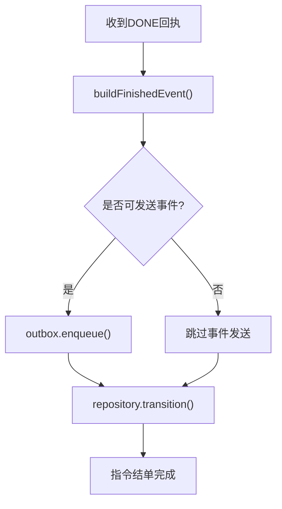

**图表来源**
- [apps/control-service/src/http.ts:308-327](file://apps/control-service/src/http.ts#L308-L327)

**章节来源**
- [apps/control-service/src/http.ts:300-361](file://apps/control-service/src/http.ts#L300-L361)

### 事件发布与内存发布器（EventPublisher / InMemoryEventPublisher）
职责与特性：
- EventPublisher 定义 publish、publishBatch、close 三个方法，屏蔽底层中间件差异。
- InMemoryEventPublisher 用于测试与本地开发：
  - 维护已发布事件列表，便于断言。
  - 支持 failNext 模拟投递失败。
  - 生成分区号与偏移量，辅助定位问题。

典型使用场景：
- 单元测试中注入 InMemoryEventPublisher，验证业务是否按预期发布事件。
- 本地开发无需启动真实消息中间件即可运行完整链路。

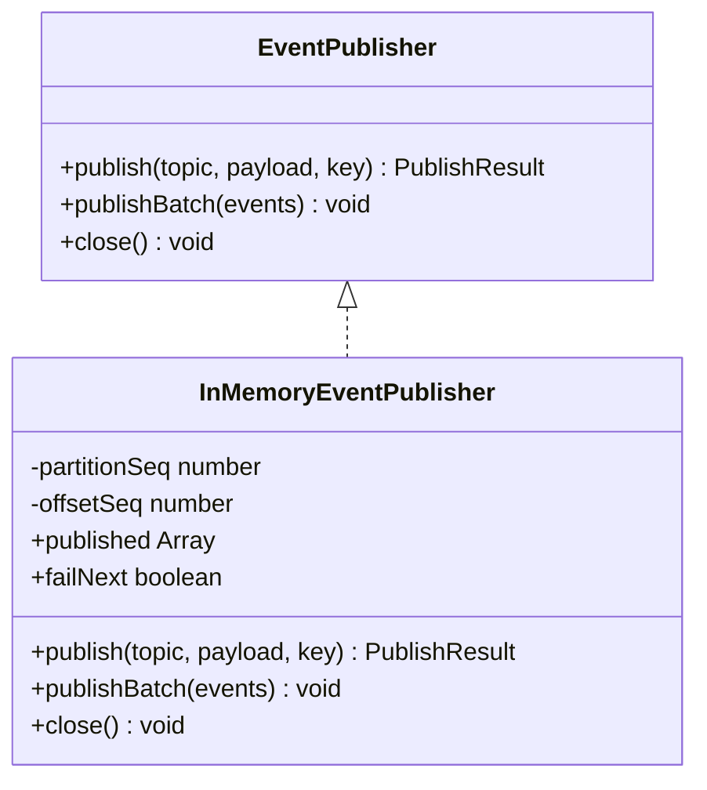

**图表来源**
- [packages/mq/src/types.ts:14-19](file://packages/mq/src/types.ts#L14-L19)
- [packages/mq/src/types.ts:34-71](file://packages/mq/src/types.ts#L34-L71)

**章节来源**
- [packages/mq/src/types.ts:14-71](file://packages/mq/src/types.ts#L14-L71)

### 幂等保护（IdempotencyGuard）
目标：
- 由于至少一次投递与消费者重试，重复消费是正常现象。幂等层统一承担去重，避免每个消费者自行实现。

实现要点：
- IdempotencyStore 抽象键值存储，has/set 接口。
- IdempotencyGuard 默认 TTL 为七天，覆盖大多数重试与人工补发场景。
- isDuplicate 先查后写，避免并发重复处理；mark 用于处理成功后补记。

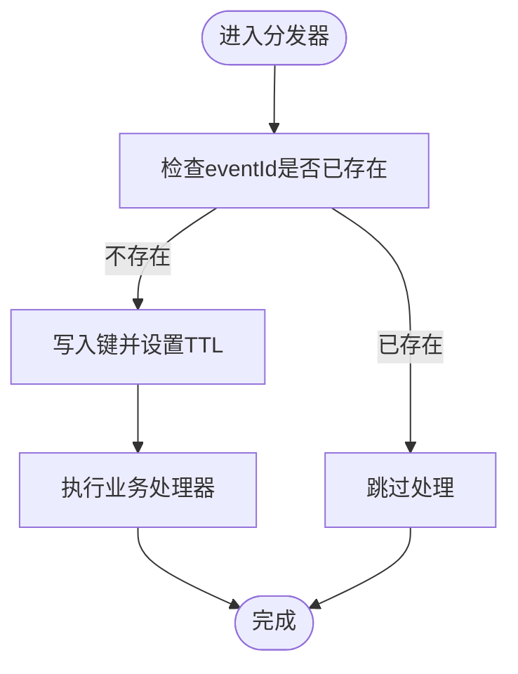

**图表来源**
- [packages/mq/src/idempotency.ts:9-15](file://packages/mq/src/idempotency.ts#L9-L15)
- [packages/mq/src/idempotency.ts:21-52](file://packages/mq/src/idempotency.ts#L21-L52)

**章节来源**
- [packages/mq/src/idempotency.ts:1-84](file://packages/mq/src/idempotency.ts#L1-L84)

### 事件分发器（EventDispatcher）与重试机制
职责：
- 管理主题到处理器的映射。
- 对每个事件执行幂等判断。
- 按注册顺序串行调用处理器。
- 失败时按 RetryPolicy 指数退避重试，达到最大尝试次数后可转入死信。

关键行为：
- subscribe：注册处理器。
- dispatch：幂等判断 -> 循环尝试 -> 成功返回或转死信。
- onError：可选回调，输出 topic/eventId/error/attempt 日志。

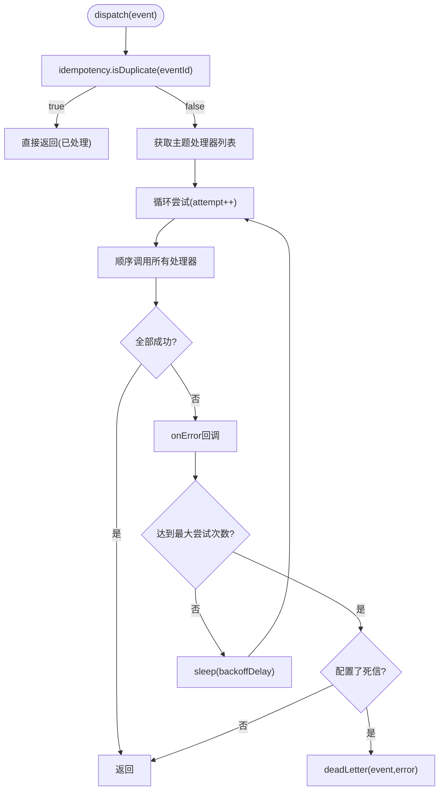

**图表来源**
- [packages/mq/src/subscriber.ts:25-44](file://packages/mq/src/subscriber.ts#L25-L44)
- [packages/mq/src/subscriber.ts:51-60](file://packages/mq/src/subscriber.ts#L51-L60)
- [packages/mq/src/subscriber.ts:70-101](file://packages/mq/src/subscriber.ts#L70-L101)

**章节来源**
- [packages/mq/src/subscriber.ts:1-103](file://packages/mq/src/subscriber.ts#L1-L103)

### 本地消息表服务（OutboxService）
职责：
- 封装 OutboxStore 与 EventPublisher，提供统一的 Outbox 操作接口。
- 管理 Outbox 的中继投递生命周期。
- 提供 enqueue、relayOnce、stop 等核心方法。

关键特性：
- **事务安全**：enqueue 方法接收事务客户端，确保与业务数据同事务写入。
- **上下文管理**：维护 tenantId、traceId、producer 等上下文信息。
- **中继控制**：支持手动触发 relayOnce 和停止中继任务。

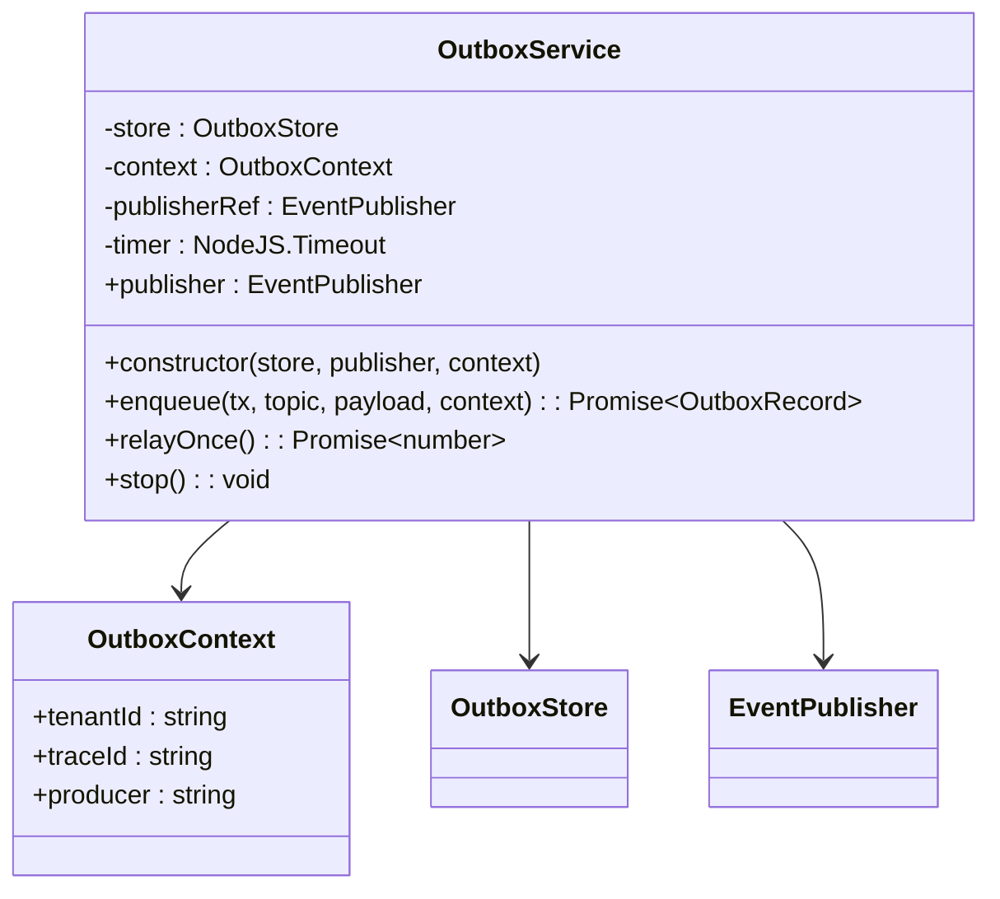

**图表来源**
- [packages/mq/src/outbox.ts:50-152](file://packages/mq/src/outbox.ts#L50-L152)

**章节来源**
- [packages/mq/src/outbox.ts:50-152](file://packages/mq/src/outbox.ts#L50-L152)

### 消费者（Consumer）绑定与处理逻辑
地块服务中的 PlotEventConsumer：
- 使用 @registerHandler 装饰器声明处理器，仅关注业务语义（如地块建档后的网格初始化）。
- bind(dispatcher) 通过 buildHandlers 自动构建处理器注册信息，并订阅到 EventDispatcher。
- 消费者内部不出现重复消费判断与重试逻辑，这些由分发器统一承担。

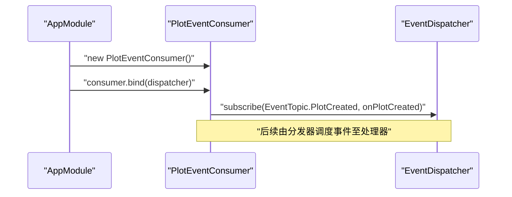

**图表来源**
- [apps/plot-service/src/plot.consumer.ts:6-39](file://apps/plot-service/src/plot.consumer.ts#L6-L39)
- [apps/plot-service/src/app.module.ts:135-143](file://apps/plot-service/src/app.module.ts#L135-L143)

**章节来源**
- [apps/plot-service/src/plot.consumer.ts:1-40](file://apps/plot-service/src/plot.consumer.ts#L1-L40)
- [apps/plot-service/src/app.module.ts:112-143](file://apps/plot-service/src/app.module.ts#L112-L143)

### 模块装配与依赖注入
地块服务模块装配展示了 OutboxService、EventDispatcher、IdempotencyGuard 的装配方式：
- OUTBOX_STORE：默认使用 InMemoryOutboxStore，也可注入 SqlPlotOutboxStore。
- IDEMPOTENCY_STORE：默认使用 IdempotencyGuardStore（内存），生产替换为缓存中间件。
- OutboxService：结合 OutboxStore 与 EventPublisher，封装 Outbox 的中继投递能力。
- EventDispatcher：注入 IdempotencyGuard 与 DEFAULT_RETRY_POLICY。
- PlotEventConsumer：构造后调用 bind(dispatcher) 完成处理器注册。

**更新** 现在支持通过 options.outboxStore 参数注入 SQL 实现，实现生产环境的可靠事件传递。

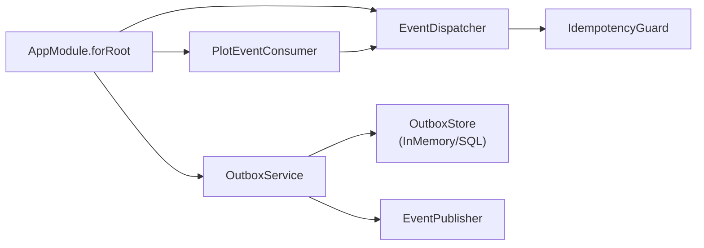

**图表来源**
- [apps/plot-service/src/app.module.ts:112-143](file://apps/plot-service/src/app.module.ts#L112-L143)

**章节来源**
- [apps/plot-service/src/app.module.ts:1-196](file://apps/plot-service/src/app.module.ts#L1-L196)

### 地块业务服务中的事件发布
地块业务服务 PlotService 在多个关键操作中集成了事件发布：

- **registerPlot**：地块建档时发布 PlotCreated 事件
- **mergePlots**：地块合并时发布 PlotCreated 事件  
- **splitPlot**：地块拆分时为新地块发布 PlotCreated 事件

所有事件发布都在数据库事务中执行，确保业务数据与事件记录的原子性。

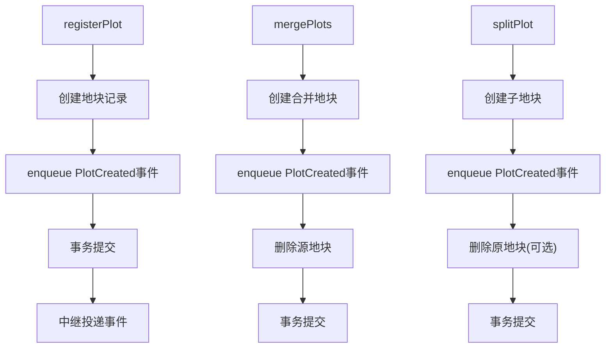

**图表来源**
- [apps/plot-service/src/plot.service.ts:122-186](file://apps/plot-service/src/plot.service.ts#L122-L186)
- [apps/plot-service/src/plot.service.ts:276-335](file://apps/plot-service/src/plot.service.ts#L276-L335)
- [apps/plot-service/src/plot.service.ts:345-411](file://apps/plot-service/src/plot.service.ts#L345-L411)

**章节来源**
- [apps/plot-service/src/plot.service.ts:122-186](file://apps/plot-service/src/plot.service.ts#L122-L186)
- [apps/plot-service/src/plot.service.ts:276-335](file://apps/plot-service/src/plot.service.ts#L276-L335)
- [apps/plot-service/src/plot.service.ts:345-411](file://apps/plot-service/src/plot.service.ts#L345-L411)

## 依赖关系分析
- 业务服务依赖消息基础设施的对外契约（EventPublisher、OutboxStore、EventSubscriber）。
- 基础设施包解耦具体中间件实现，允许在测试与本地环境中使用内存实现。
- 幂等与重试逻辑集中在分发器层，业务处理器保持简洁。
- **增强** 控制服务通过 SqlControlOutboxStore 依赖 PostgreSQL 数据库，提供生产级别的可靠事件存储。
- **增强** 下游消费者（trace-service、message-service、decision-service）通过 EventDispatcher 消费上游服务发布的事件。

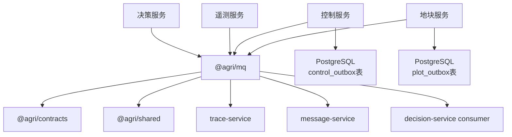

**图表来源**
- [apps/control-service/src/command-finished.ts:1-6](file://apps/control-service/src/command-finished.ts#L1-L6)
- [apps/decision-service/src/consumer.ts:1-13](file://apps/decision-service/src/consumer.ts#L1-L13)
- [infra/postgres/migrations/033_control_outbox.sql:6-18](file://infra/postgres/migrations/033_control_outbox.sql#L6-L18)

**章节来源**
- [apps/control-service/src/command-finished.ts:1-136](file://apps/control-service/src/command-finished.ts#L1-L136)
- [apps/decision-service/src/consumer.ts:1-159](file://apps/decision-service/src/consumer.ts#L1-L159)
- [infra/postgres/migrations/033_control_outbox.sql:1-20](file://infra/postgres/migrations/033_control_outbox.sql#L1-L20)

## 性能与可靠性考虑
- 本地消息表批量拉取：listPending 使用 LIMIT 分页，避免一次性加载过多记录。
- 幂等 TTL：默认七天，平衡重试窗口与存储占用。
- 指数退避重试：避免雪崩与资源争用，提升系统稳定性。
- 死信通道：超限事件转入死信，防止阻塞主流程，便于人工干预与补偿。
- 内存发布器与内存去重存储：适用于测试与本地开发，降低环境复杂度。
- **增强** SQL索引优化：control_outbox 和 plot_outbox 表针对 pending 查询创建了 created_at 的部分索引，提升中继任务查询性能。
- **增强** JSONB存储：payload 字段使用 PostgreSQL JSONB 类型，支持高效的JSON查询和操作。
- **增强** 多服务消费者：trace-service、message-service 和 decision-service 并行消费事件，提升整体处理能力。
- **增强** 统一事件构建：减少代码重复，提高维护性和一致性。

## 故障排查指南
常见问题与建议：
- Outbox 记录长期未发布：
  - 检查中继任务是否正常运行。
  - 查看 last_error 与 retry_count，确认是否存在持续失败。
- 事件重复消费：
  - 确认 IdempotencyStore 是否可用且 TTL 合理。
  - 校验 eventId 是否稳定唯一。
- 处理器异常导致重试风暴：
  - 检查 onError 回调日志，定位具体错误。
  - 调整 RetryPolicy 的最大尝试次数与退避间隔。
- 死信堆积：
  - 分析 deadLetter 处理结果，必要时进行人工修复与补偿。
- **增强** SQL Outbox相关问题：
  - 检查 control_outbox 和 plot_outbox 表是否存在及索引是否正常。
  - 验证时间字段是否正确映射为 ISO 字符串格式。
  - 确认 enqueue 操作是否在事务上下文中执行。
- **增强** 下游消费者问题：
  - 检查 trace-service、message-service 和 decision-service 的消费者是否正常运行。
  - 验证事件主题是否正确注册和处理。
  - 确认消费者组的位点同步是否正常。
- **新增** 命令完成事件问题：
  - 检查 buildFinishedEvent 是否正确识别指令类型。
  - 验证 FINISHED_TOPIC_BY_TYPE 映射是否完整。
  - 确认不同类型指令的事件载荷是否正确构建。

**章节来源**
- [apps/control-service/src/command-finished.ts:26-29](file://apps/control-service/src/command-finished.ts#L26-L29)
- [apps/control-service/src/outbox.repository.ts:38-67](file://apps/control-service/src/outbox.repository.ts#L38-L67)
- [apps/plot-service/test/sql-plot-outbox.spec.ts:44-98](file://apps/plot-service/test/sql-plot-outbox.spec.ts#L44-L98)

## 结论
本事件驱动架构通过本地消息表保障"不丢不重"，以幂等守卫与重试机制确保"至少一次"投递下的正确性，并通过事件分发器统一编排消费者处理流程。**增强的命令完成事件系统**进一步增强了系统的业务闭环能力，现在通过统一的 command-finished.ts 文件同时支持灌溉和施肥操作的完整事件链。**新增的决策服务消费者**提供了从设备控制到处方执行结果回流的完整数据处理链路。**新增的地块服务和控制服务 SQL Outbox 实现**进一步增强了系统的可靠性，提供了生产级别的事件持久化能力。InMemoryEventPublisher 与内存去重存储降低了开发与测试成本，而清晰的契约与装配方式使生产环境可平滑替换为真实中间件与缓存组件。

## 附录：事件流与时序图

### 事件流图（Outbox 到消费者）
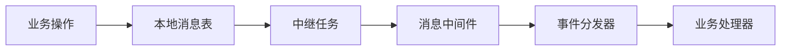

**图表来源**
- [apps/control-service/src/http.ts:310-327](file://apps/control-service/src/http.ts#L310-L327)
- [packages/mq/src/outbox.ts:74-91](file://packages/mq/src/outbox.ts#L74-L91)

### 时序图（增强的命令完成事件完整流程）
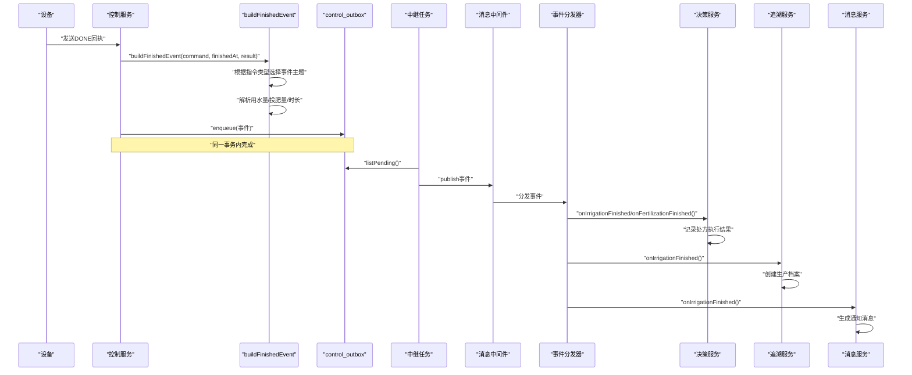

**图表来源**
- [apps/control-service/src/http.ts:310-327](file://apps/control-service/src/http.ts#L310-L327)
- [apps/control-service/src/command-finished.ts:117-135](file://apps/control-service/src/command-finished.ts#L117-L135)
- [apps/decision-service/src/consumer.ts:68-77](file://apps/decision-service/src/consumer.ts#L68-L77)
- [apps/trace-service/src/consumer.ts:71-89](file://apps/trace-service/src/consumer.ts#L71-L89)
- [apps/message-service/src/consumer.ts:65-69](file://apps/message-service/src/consumer.ts#L65-L69)

### 时序图（SQL Outbox事务流程）
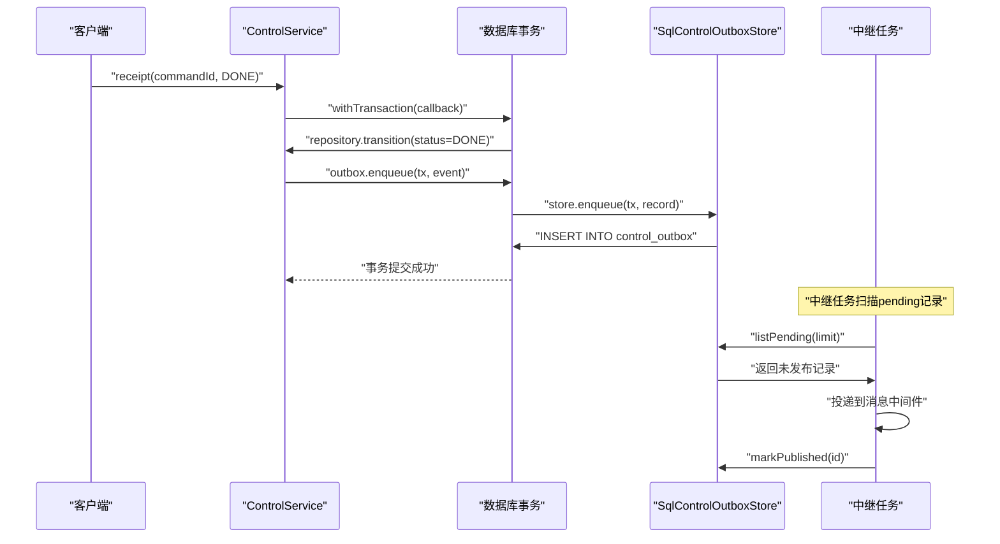

**图表来源**
- [apps/control-service/src/http.ts:310-327](file://apps/control-service/src/http.ts#L310-L327)
- [apps/control-service/src/outbox.repository.ts:23-36](file://apps/control-service/src/outbox.repository.ts#L23-L36)

### 时序图（决策服务执行结果回流）
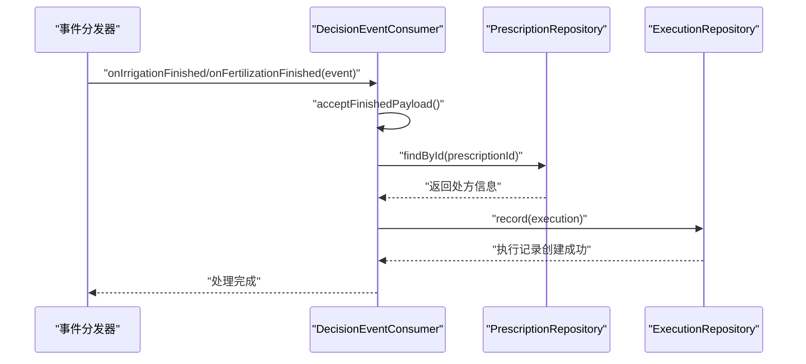

**图表来源**
- [apps/decision-service/src/consumer.ts:84-114](file://apps/decision-service/src/consumer.ts#L84-L114)