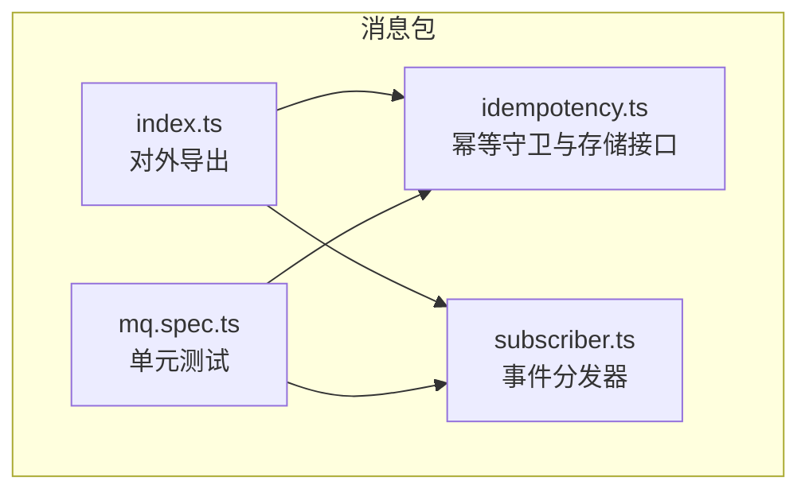
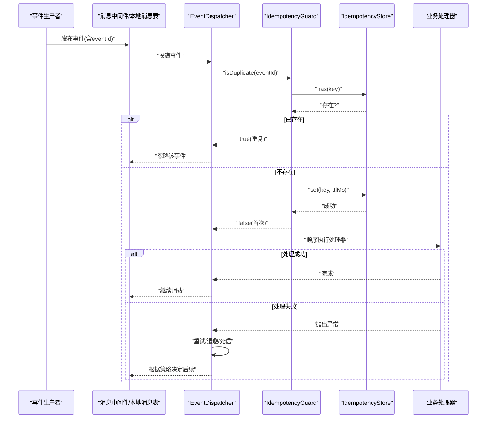
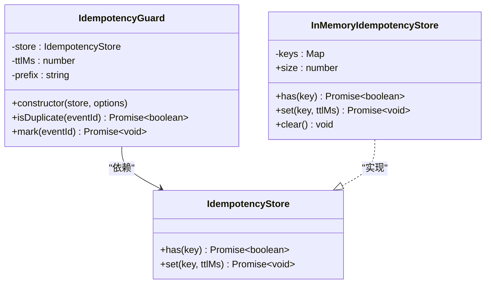
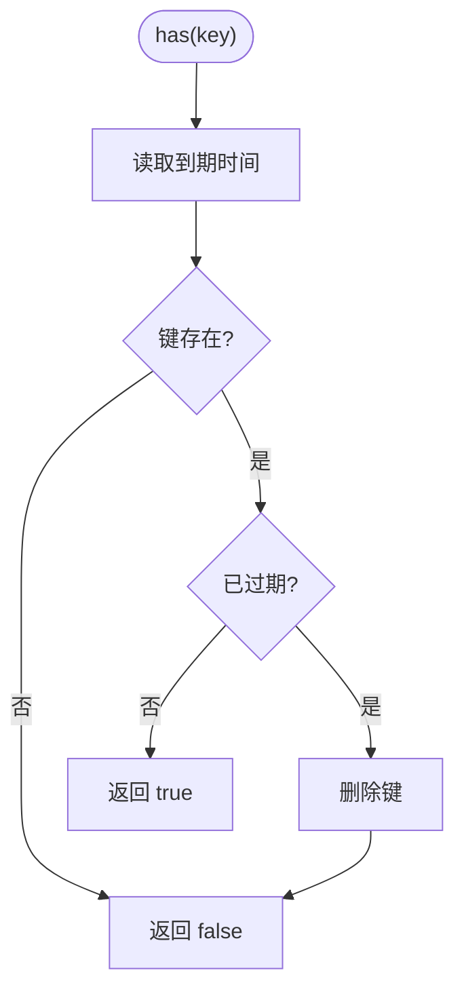
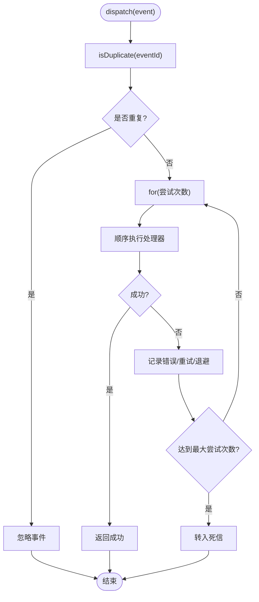
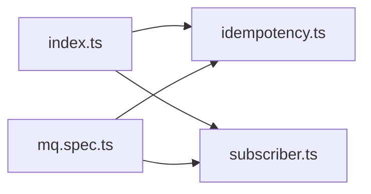

# 幂等性保护

<cite>
**本文引用的文件**   
- [idempotency.ts](file://packages/mq/src/idempotency.ts)
- [subscriber.ts](file://packages/mq/src/subscriber.ts)
- [index.ts](file://packages/mq/src/index.ts)
- [mq.spec.ts](file://packages/mq/test/mq.spec.ts)
</cite>

## 目录
1. [引言](#引言)
2. [项目结构](#项目结构)
3. [核心组件](#核心组件)
4. [架构总览](#架构总览)
5. [详细组件分析](#详细组件分析)
6. [依赖关系分析](#依赖关系分析)
7. [性能与内存管理](#性能与内存管理)
8. [配置选项与最佳实践](#配置选项与最佳实践)
9. [分布式环境下的幂等方案](#分布式环境下的幂等方案)
10. [故障排查指南](#故障排查指南)
11. [结论](#结论)

## 引言
本文件聚焦于消息中间件层的幂等性保护机制，解释 IdempotencyGuard 的工作原理、InMemoryIdempotencyStore 的实现细节、DEFAULT_IDEMPOTENCY_TTL_MS 的默认保留期策略，以及事件 ID 去重如何防止重复处理。文档还涵盖 TTL 过期策略、内存管理、幂等检查的执行时机、异常处理流程，并给出生产环境的扩展方案和分布式场景下的幂等保障建议。

## 项目结构
幂等性能力集中在消息包中，对外通过统一入口导出：
- 幂等核心定义与实现：packages/mq/src/idempotency.ts
- 消费者编排与幂等检查执行点：packages/mq/src/subscriber.ts
- 对外导出聚合：packages/mq/src/index.ts
- 行为验证测试：packages/mq/test/mq.spec.ts

**图表来源**
- [idempotency.ts:1-84](file://packages/mq/src/idempotency.ts#L1-L84)
- [subscriber.ts:1-103](file://packages/mq/src/subscriber.ts#L1-L103)
- [index.ts:1-41](file://packages/mq/src/index.ts#L1-L41)
- [mq.spec.ts:1-135](file://packages/mq/test/mq.spec.ts#L1-L135)

**章节来源**
- [idempotency.ts:1-84](file://packages/mq/src/idempotency.ts#L1-L84)
- [subscriber.ts:1-103](file://packages/mq/src/subscriber.ts#L1-L103)
- [index.ts:1-41](file://packages/mq/src/index.ts#L1-L41)
- [mq.spec.ts:1-135](file://packages/mq/test/mq.spec.ts#L1-L135)

## 核心组件
- IdempotencyStore：幂等存储契约，提供 has/set 两个原子操作，用于判断键是否存在和写入键及过期时间。
- DEFAULT_IDEMPOTENCY_TTL_MS：默认保留期为七天，覆盖大多数重试与人工补发场景。
- IdempotencyGuard：幂等守卫，封装键前缀、TTL 与存储访问，提供 isDuplicate/mark 方法。
- InMemoryIdempotencyStore：内存实现，使用 Map 保存键到到期时间的映射，支持 size/clear 辅助能力。
- EventDispatcher：事件分发器，在 dispatch 中先进行幂等判断，再顺序执行处理器，失败按策略重试，超限转死信。

**章节来源**
- [idempotency.ts:9-84](file://packages/mq/src/idempotency.ts#L9-L84)
- [subscriber.ts:16-103](file://packages/mq/src/subscriber.ts#L16-L103)

## 架构总览
幂等性保护位于消费侧入口处，确保“至少一次”投递带来的重复消费不会导致业务副作用。整体流程如下：

**图表来源**
- [subscriber.ts:70-101](file://packages/mq/src/subscriber.ts#L70-L101)
- [idempotency.ts:20-52](file://packages/mq/src/idempotency.ts#L20-L52)

## 详细组件分析

### IdempotencyGuard 工作原理
- 职责：对 eventId 进行去重判断；若未处理过则写入标记，避免并发重复处理；提供仅写入标记的方法 mark，用于处理成功后补记。
- 关键参数：
  - store：幂等存储实现（可替换为 Redis、数据库等）。
  - ttlMs：键保留时长，默认使用 DEFAULT_IDEMPOTENCY_TTL_MS。
  - prefix：键前缀，默认 mq:idem:，便于多租户或多服务隔离。
- 主要方法：
  - isDuplicate(eventId)：先查后写，返回是否重复。
  - mark(eventId)：仅写入标记，不判断重复。

**图表来源**
- [idempotency.ts:9-84](file://packages/mq/src/idempotency.ts#L9-L84)

**章节来源**
- [idempotency.ts:20-52](file://packages/mq/src/idempotency.ts#L20-L52)

### InMemoryIdempotencyStore 实现与内存管理
- 数据结构：Map<键, 到期时间戳>。
- has(key)：读取到期时间，若不存在或已过期则删除并返回 false；否则返回 true。
- set(key, ttlMs)：写入键并设置绝对到期时间（当前时间+TTL）。
- 清理策略：惰性清理，仅在 has 时检测并删除过期项；提供 clear() 清空全部键；size 属性可用于断言。
- 适用场景：测试与本地开发；生产环境应替换为具备原子性与持久化的存储（如 Redis）。

**图表来源**
- [idempotency.ts:54-83](file://packages/mq/src/idempotency.ts#L54-L83)

**章节来源**
- [idempotency.ts:54-83](file://packages/mq/src/idempotency.ts#L54-L83)

### 幂等检查执行时机与异常处理
- 执行时机：EventDispatcher.dispatch 在处理事件前先调用 idempotency.isDuplicate(event.eventId)。若返回 true，直接忽略该事件，不再执行业务处理器。
- 异常处理：
  - 处理器抛错时，记录错误日志（可选 onError），并按重试策略 backoffDelay 进行指数退避重试。
  - 超过最大尝试次数且开启 deadLetterAfterMaxAttempts 时，转入死信队列，不抛出异常，避免阻塞后续事件。
- 幂等与重试的关系：幂等判断发生在重试之前，因此同一事件即使多次投递，也只会进入一次业务处理循环；但每次重试仍会重新执行处理器，直到成功或进入死信。

**图表来源**
- [subscriber.ts:70-101](file://packages/mq/src/subscriber.ts#L70-L101)

**章节来源**
- [subscriber.ts:70-101](file://packages/mq/src/subscriber.ts#L70-L101)

### 对外导出与集成点
- packages/mq/src/index.ts 将 IdempotencyGuard、InMemoryIdempotencyStore、DEFAULT_IDEMPOTENCY_TTL_MS 暴露给上层模块，便于在各微服务中注入并使用。
- EventDispatcher 通过构造参数接收 IdempotencyGuard，并在内部统一执行幂等逻辑，业务代码无需自行判断重复。

**章节来源**
- [index.ts:20-25](file://packages/mq/src/index.ts#L20-L25)
- [subscriber.ts:16-44](file://packages/mq/src/subscriber.ts#L16-L44)

## 依赖关系分析
- IdempotencyGuard 依赖 IdempotencyStore 抽象，解耦具体存储实现。
- EventDispatcher 依赖 IdempotencyGuard，负责编排幂等、重试与死信。
- 测试用例验证了幂等拦截、重试与死信路径。

**图表来源**
- [index.ts:1-41](file://packages/mq/src/index.ts#L1-L41)
- [idempotency.ts:1-84](file://packages/mq/src/idempotency.ts#L1-L84)
- [subscriber.ts:1-103](file://packages/mq/src/subscriber.ts#L1-L103)
- [mq.spec.ts:1-135](file://packages/mq/test/mq.spec.ts#L1-L135)

**章节来源**
- [index.ts:1-41](file://packages/mq/src/index.ts#L1-L41)
- [mq.spec.ts:70-114](file://packages/mq/test/mq.spec.ts#L70-L114)

## 性能与内存管理
- 时间复杂度：
  - InMemoryIdempotencyStore.has/set：O(1) 哈希表操作。
  - IdempotencyGuard.isDuplicate：一次 has + 一次 set，O(1)。
- 空间复杂度：
  - InMemoryIdempotencyStore：O(n)，n 为活跃键数量。
- 过期策略：
  - 默认 TTL 为七天，适合覆盖常见重试与人工补发窗口。
  - 惰性清理：仅在 has 时检测并删除过期项，减少后台清理开销。
- 内存优化建议：
  - 生产环境建议使用具备原生过期能力的缓存（如 Redis），避免进程重启丢失状态。
  - 合理设置键前缀与命名空间，避免键冲突。
  - 定期监控存储大小与命中率，必要时扩容或调整 TTL。

**章节来源**
- [idempotency.ts:17-18](file://packages/mq/src/idempotency.ts#L17-L18)
- [idempotency.ts:54-83](file://packages/mq/src/idempotency.ts#L54-L83)

## 配置选项与最佳实践
- 配置项
  - DEFAULT_IDEMPOTENCY_TTL_MS：默认保留期（毫秒），默认值为七天。
  - IdempotencyGuard.options.ttlMs：覆盖默认 TTL。
  - IdempotencyGuard.options.prefix：键前缀，默认 mq:idem:。
- 使用建议
  - 始终使用稳定的 eventId 作为去重键，例如上游生成的唯一标识。
  - 在生产环境中替换 InMemoryIdempotencyStore 为分布式缓存（如 Redis）以实现跨实例一致性。
  - 结合 Outbox 模式保证事件“至少一次”投递，配合消费侧幂等保证“恰好一次”语义。
  - 为不同服务/租户设置独立前缀，避免键冲突。
  - 监控幂等命中率和 TTL 命中率，评估是否需要调整 TTL 或存储容量。

**章节来源**
- [idempotency.ts:17-32](file://packages/mq/src/idempotency.ts#L17-L32)
- [index.ts:20-25](file://packages/mq/src/index.ts#L20-L25)

## 分布式环境下的幂等方案
- 存储选型
  - 使用具备原子操作的分布式键值存储（如 Redis SETNX/SET with EX），保证 has/set 的原子性与过期能力。
  - 若使用数据库，需保证幂等写入与过期清理在同一事务内，并提供定时任务清理过期键。
- 键设计
  - 键格式：{prefix}:{tenantId}:{eventId}，避免多租户/多服务冲突。
  - 前缀隔离：不同服务使用不同前缀，便于观察与治理。
- 一致性与时钟
  - 使用服务器时间或可靠时钟源计算到期时间，避免客户端时间偏差。
  - 在高并发下，优先使用具备原子性的存储命令，避免竞态条件。
- 可观测性
  - 统计幂等命中数、去重率、TTL 命中率、存储延迟与错误率。
  - 告警阈值：当去重率异常升高或存储延迟突增时触发告警。

[本节为概念性指导，不直接分析具体文件]

## 故障排查指南
- 现象：同一事件被重复处理
  - 检查 eventId 是否稳定且全局唯一。
  - 确认 IdempotencyGuard 是否正确注入并启用。
  - 检查存储层是否可用，has/set 是否成功。
- 现象：事件长时间未过期
  - 检查 TTL 配置是否过小或过大。
  - 检查存储是否支持过期能力，或惰性清理是否正常。
- 现象：处理器反复重试
  - 查看 onError 日志，定位业务异常原因。
  - 确认重试策略 maxAttempts 与退避间隔是否合理。
  - 若确认为永久失败，检查死信处理逻辑是否生效。

**章节来源**
- [subscriber.ts:88-99](file://packages/mq/src/subscriber.ts#L88-L99)
- [mq.spec.ts:77-114](file://packages/mq/test/mq.spec.ts#L77-L114)

## 结论
该幂等性保护机制通过 IdempotencyGuard 与 IdempotencyStore 抽象，将“至少一次”投递的重复消费问题收敛在消息层，业务代码无需重复实现去重逻辑。默认七天的 TTL 覆盖大多数重试与补发场景；InMemoryIdempotencyStore 适用于测试与本地开发，生产环境应替换为具备原子性与过期能力的分布式存储。EventDispatcher 在消费入口统一执行幂等判断，并结合重试与死信机制，形成稳健的事件处理流水线。通过合理的键设计与可观测性建设，可在分布式环境中有效保证事件处理的幂等性与可靠性。