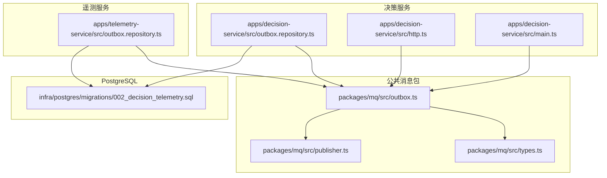
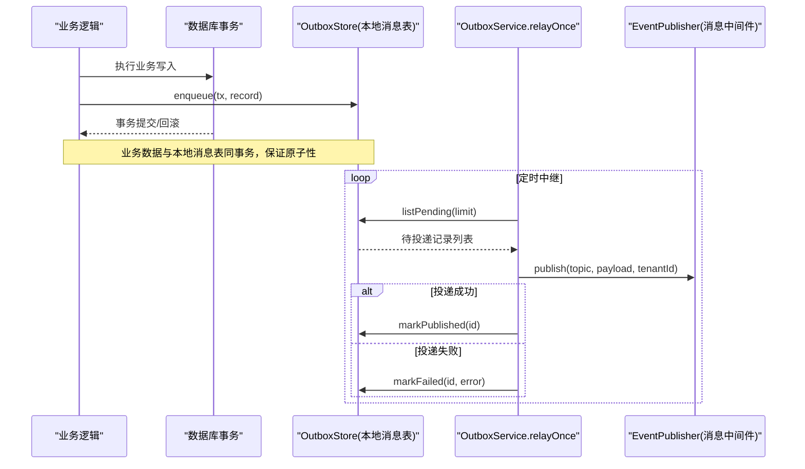
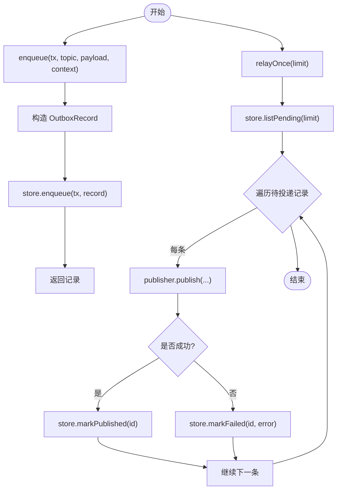
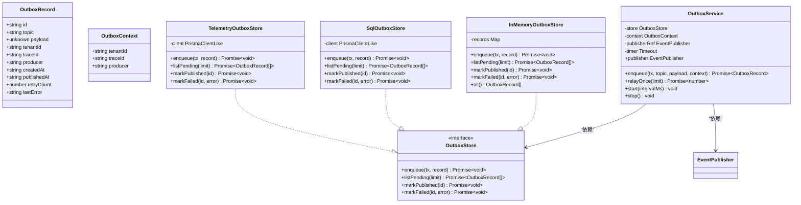
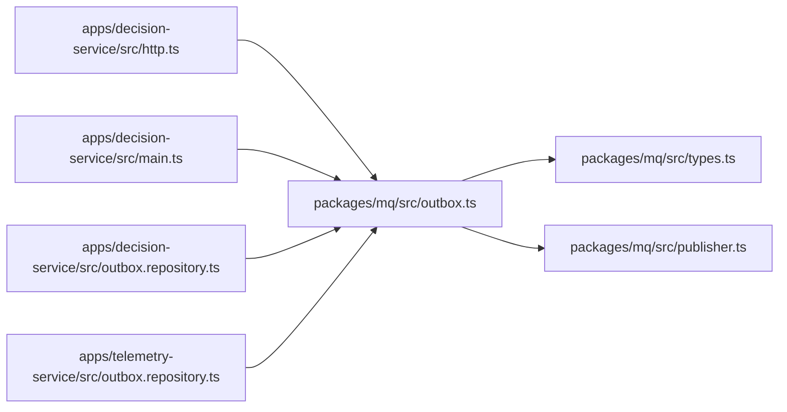

# 本地消息表模式

<cite>
**本文引用的文件**   
- [packages/mq/src/outbox.ts](file://packages/mq/src/outbox.ts)
- [packages/mq/src/types.ts](file://packages/mq/src/types.ts)
- [packages/mq/src/publisher.ts](file://packages/mq/src/publisher.ts)
- [apps/decision-service/src/outbox.repository.ts](file://apps/decision-service/src/outbox.repository.ts)
- [apps/telemetry-service/src/outbox.repository.ts](file://apps/telemetry-service/src/outbox.repository.ts)
- [infra/postgres/migrations/002_decision_telemetry.sql](file://infra/postgres/migrations/002_decision_telemetry.sql)
- [apps/decision-service/src/http.ts](file://apps/decision-service/src/http.ts)
- [apps/decision-service/src/main.ts](file://apps/decision-service/src/main.ts)
</cite>

## 目录
1. [简介](#简介)
2. [项目结构](#项目结构)
3. [核心组件](#核心组件)
4. [架构总览](#架构总览)
5. [详细组件分析](#详细组件分析)
6. [依赖关系分析](#依赖关系分析)
7. [性能与可扩展性](#性能与可扩展性)
8. [故障排查指南](#故障排查指南)
9. [结论](#结论)
10. [附录：使用示例与最佳实践](#附录使用示例与最佳实践)

## 简介
本文件面向“本地消息表（Outbox Pattern）”在平台中的实现，重点解释以下目标：
- OutboxService 的工作原理与中继流程
- OutboxRecord 数据结构与 InMemoryOutboxStore 内存实现
- 事件先落库、再异步投递到消息队列的机制
- OutboxContext 的使用方式与事务边界管理
- 事件持久化的 SQL 操作与错误处理策略
- 本地消息表的表结构设计、索引优化与清理策略
- 典型使用场景与代码示例路径，确保最终一致性

该方案在不引入分布式事务的前提下，通过“业务数据与本地消息表同事务写入 + 后台任务异步投递”，保证“业务数据与事件同时成功或同时失败”。由于可能重复投递，消费端必须幂等。

## 项目结构
本地消息表能力由公共包 mq 提供核心抽象与通用服务，各业务服务按需实现 OutboxStore 接口，并通过数据库迁移创建对应 outbox 表。

图表来源
- [packages/mq/src/outbox.ts:1-171](file://packages/mq/src/outbox.ts#L1-L171)
- [packages/mq/src/types.ts:1-72](file://packages/mq/src/types.ts#L1-L72)
- [packages/mq/src/publisher.ts:1-74](file://packages/mq/src/publisher.ts#L1-L74)
- [apps/decision-service/src/outbox.repository.ts:1-64](file://apps/decision-service/src/outbox.repository.ts#L1-L64)
- [apps/telemetry-service/src/outbox.repository.ts:1-64](file://apps/telemetry-service/src/outbox.repository.ts#L1-L64)
- [infra/postgres/migrations/002_decision_telemetry.sql:61-87](file://infra/postgres/migrations/002_decision_telemetry.sql#L61-L87)

章节来源
- [packages/mq/src/outbox.ts:1-171](file://packages/mq/src/outbox.ts#L1-L171)
- [apps/decision-service/src/outbox.repository.ts:1-64](file://apps/decision-service/src/outbox.repository.ts#L1-L64)
- [apps/telemetry-service/src/outbox.repository.ts:1-64](file://apps/telemetry-service/src/outbox.repository.ts#L1-L64)
- [infra/postgres/migrations/002_decision_telemetry.sql:61-87](file://infra/postgres/migrations/002_decision_telemetry.sql#L61-L87)

## 核心组件
- OutboxRecord：本地消息表记录的数据模型，包含事件标识、主题、载荷、租户、追踪、生产者、时间戳、已投递时间、重试次数与最近失败原因。
- OutboxStore：本地消息表存储契约，定义 enqueue、listPending、markPublished、markFailed 四个方法，供各服务按自身数据库实现。
- OutboxContext：入队上下文，携带 tenantId、traceId、producer，用于填充 OutboxRecord 元信息。
- OutboxService：本地消息表服务，负责在事务中写入 OutboxRecord，并提供中继 relayOnce、周期性 start/stop 以及直接访问底层 EventPublisher 的能力。
- InMemoryOutboxStore：基于内存 Map 的实现，用于测试与本地开发，不依赖真实数据库。
- SqlOutboxStore（决策服务）：基于 PostgreSQL 的 SQL 实现，将事件写入 decision_outbox 表。
- TelemetryOutboxStore（遥测服务）：基于 PostgreSQL 的 SQL 实现，将事件写入 telemetry_outbox 表。
- EventPublisher / InMemoryEventPublisher：事件发布契约与内存实现，OutboxService 通过它完成实际的消息投递。

章节来源
- [packages/mq/src/outbox.ts:14-137](file://packages/mq/src/outbox.ts#L14-L137)
- [packages/mq/src/types.ts:1-72](file://packages/mq/src/types.ts#L1-L72)
- [apps/decision-service/src/outbox.repository.ts:1-64](file://apps/decision-service/src/outbox.repository.ts#L1-L64)
- [apps/telemetry-service/src/outbox.repository.ts:1-64](file://apps/telemetry-service/src/outbox.repository.ts#L1-L64)

## 架构总览
OutboxPattern 的核心思想是：业务事务内只写本地消息表；提交后由后台任务轮询待投递记录并发送到消息中间件；发送成功后标记 publishedAt，失败则累计 retryCount 与 lastError。

图表来源
- [packages/mq/src/outbox.ts:74-137](file://packages/mq/src/outbox.ts#L74-L137)
- [packages/mq/src/types.ts:14-19](file://packages/mq/src/types.ts#L14-L19)

## 详细组件分析

### OutboxService 工作原理
- enqueue：生成 OutboxRecord（id、topic、payload、tenantId、traceId、producer、createdAt、retryCount），调用 store.enqueue 写入本地消息表，返回记录。
- relayOnce：读取待投递记录，逐条调用 publisher.publish；成功则 markPublished，失败则 markFailed。
- start/stop：启动/停止周期性中继任务，默认间隔可配置。
- publisher：暴露底层 EventPublisher，供未启用本地消息表时直接进程内发布。

图表来源
- [packages/mq/src/outbox.ts:74-137](file://packages/mq/src/outbox.ts#L74-L137)

章节来源
- [packages/mq/src/outbox.ts:50-137](file://packages/mq/src/outbox.ts#L50-L137)

### OutboxRecord 数据结构
- id：ULID 生成的唯一标识
- topic：事件主题（来自 contracts）
- payload：事件载荷（任意类型）
- tenantId：租户标识
- traceId：链路追踪 ID
- producer：生产者服务名
- createdAt：创建时间
- publishedAt：已投递时间（为空表示待投递）
- retryCount：已尝试次数
- lastError：最近一次失败原因

章节来源
- [packages/mq/src/outbox.ts:14-29](file://packages/mq/src/outbox.ts#L14-L29)

### InMemoryOutboxStore 内存实现
- 使用 Map 存储记录，支持 enqueue、listPending、markPublished、markFailed。
- all() 暴露全部记录，便于测试断言。
- 适合单元测试与本地开发，无需真实数据库。

章节来源
- [packages/mq/src/outbox.ts:139-171](file://packages/mq/src/outbox.ts#L139-L171)

### 决策服务 SQL 实现（SqlOutboxStore）
- 表名：decision_outbox
- enqueue：INSERT INTO decision_outbox，字段包括 id、topic、payload_json、tenant_id、trace_id、producer、created_at、retry_count
- listPending：SELECT ... WHERE published_at IS NULL ORDER BY created_at LIMIT $1
- markPublished：UPDATE decision_outbox SET published_at = now() WHERE id = $1
- markFailed：UPDATE decision_outbox SET retry_count = retry_count + 1, last_error = $2 WHERE id = $1

章节来源
- [apps/decision-service/src/outbox.repository.ts:18-62](file://apps/decision-service/src/outbox.repository.ts#L18-L62)

### 遥测服务 SQL 实现（TelemetryOutboxStore）
- 表名：telemetry_outbox
- 结构与决策服务类似，字段语义一致
- 同样使用 published_at IS NULL 筛选待投递记录

章节来源
- [apps/telemetry-service/src/outbox.repository.ts:18-62](file://apps/telemetry-service/src/outbox.repository.ts#L18-L62)

### 表结构与索引设计
- decision_outbox：主键 id，JSONB 载荷 payload_json，索引 idx_decision_outbox_pending(created_at) WHERE published_at IS NULL
- telemetry_outbox：主键 id，JSONB 载荷 payload_json，索引 idx_telemetry_outbox_pending(created_at) WHERE published_at IS NULL
- 索引为部分索引，仅对未投递记录生效，提升中继查询性能

章节来源
- [infra/postgres/migrations/002_decision_telemetry.sql:61-87](file://infra/postgres/migrations/002_decision_telemetry.sql#L61-L87)

### OutboxContext 与事务边界
- OutboxContext 提供 tenantId、traceId、producer，用于统一填充 OutboxRecord 元信息。
- enqueue 接收 tx 参数，允许与业务数据在同一事务中写入本地消息表。
- 在 HTTP 层或业务服务中，应确保业务数据与 OutboxStore.enqueue 在同一事务中执行，避免“业务成功但消息未落库”的不一致。

章节来源
- [packages/mq/src/outbox.ts:43-92](file://packages/mq/src/outbox.ts#L43-L92)
- [apps/decision-service/src/http.ts:101-101](file://apps/decision-service/src/http.ts#L101-L101)

### 事件持久化 SQL 与错误处理
- 持久化：通过 $executeRawUnsafe 执行 INSERT/UPDATE 语句，payload 以 JSONB 存储。
- 错误处理：publish 失败时，记录 lastError 并递增 retryCount；中继任务继续重试，直到成功或达到预期上限（由上层调度控制）。
- 幂等性：消费端需根据 eventId 或业务键做幂等处理，防止重复投递影响结果。

章节来源
- [apps/decision-service/src/outbox.repository.ts:18-62](file://apps/decision-service/src/outbox.repository.ts#L18-L62)
- [apps/telemetry-service/src/outbox.repository.ts:18-62](file://apps/telemetry-service/src/outbox.repository.ts#L18-L62)
- [packages/mq/src/outbox.ts:99-112](file://packages/mq/src/outbox.ts#L99-L112)

### 类图（Outbox 相关）

图表来源
- [packages/mq/src/outbox.ts:14-171](file://packages/mq/src/outbox.ts#L14-L171)
- [apps/decision-service/src/outbox.repository.ts:11-62](file://apps/decision-service/src/outbox.repository.ts#L11-L62)
- [apps/telemetry-service/src/outbox.repository.ts:11-62](file://apps/telemetry-service/src/outbox.repository.ts#L11-L62)
- [packages/mq/src/types.ts:14-19](file://packages/mq/src/types.ts#L14-L19)

## 依赖关系分析
- OutboxService 依赖 OutboxStore 与 EventPublisher，屏蔽具体存储与消息中间件差异。
- 决策服务与遥测服务各自实现 OutboxStore，分别映射到 decision_outbox 与 telemetry_outbox。
- 在决策服务中，HTTP 层与主进程均使用 OutboxService：HTTP 层用于业务请求内入队，主进程用于启动中继任务。

图表来源
- [apps/decision-service/src/http.ts:101-101](file://apps/decision-service/src/http.ts#L101-L101)
- [apps/decision-service/src/main.ts:35-42](file://apps/decision-service/src/main.ts#L35-L42)
- [packages/mq/src/outbox.ts:1-171](file://packages/mq/src/outbox.ts#L1-L171)
- [packages/mq/src/types.ts:1-72](file://packages/mq/src/types.ts#L1-L72)
- [packages/mq/src/publisher.ts:1-74](file://packages/mq/src/publisher.ts#L1-L74)

章节来源
- [apps/decision-service/src/http.ts:101-101](file://apps/decision-service/src/http.ts#L101-L101)
- [apps/decision-service/src/main.ts:35-42](file://apps/decision-service/src/main.ts#L35-L42)
- [packages/mq/src/outbox.ts:1-171](file://packages/mq/src/outbox.ts#L1-L171)

## 性能与可扩展性
- 中继批量：relayOnce 支持 limit 参数，单轮限制处理条数，避免一次性拉取过多导致延迟。
- 索引优化：使用部分索引 idx_*_pending(created_at) WHERE published_at IS NULL，仅扫描待投递记录，减少 IO。
- 分区键：事件发布时使用 key（如地块或设备标识）作为分区键，保证同一对象的事件顺序处理，避免热点分区。
- 扩展建议：
  - 增加最大重试次数与退避策略（指数退避）
  - 增加死信队列或告警机制，长期失败记录人工介入
  - 分库分表：按租户或时间范围拆分 outbox 表，降低单表规模
  - 监控指标：待投递数量、平均投递耗时、失败率、重试次数分布

[本节为通用指导，不涉及具体文件]

## 故障排查指南
- 检查 OutboxRecord 的 retryCount 与 lastError，定位最近失败原因
- 确认中继任务是否启动（start）且定时器正常运行
- 校验 EventPublisher 是否正常注册与可用
- 查看数据库索引是否存在且有效，确认 pending 查询性能
- 消费端幂等性：确保 eventId 或业务键去重，避免重复投递造成副作用

章节来源
- [packages/mq/src/outbox.ts:99-112](file://packages/mq/src/outbox.ts#L99-L112)
- [apps/decision-service/src/outbox.repository.ts:56-62](file://apps/decision-service/src/outbox.repository.ts#L56-L62)
- [apps/telemetry-service/src/outbox.repository.ts:56-62](file://apps/telemetry-service/src/outbox.repository.ts#L56-L62)

## 结论
通过本地消息表模式，平台在不引入分布式事务的情况下实现了业务数据与事件发布的最终一致性。OutboxService 封装了入队与中继逻辑，OutboxStore 由各服务按自身数据库实现，配合部分索引与合理的分区键策略，既保证了可靠性也兼顾了性能。消费端幂等性是确保最终一致性的关键。

[本节为总结，不涉及具体文件]

## 附录：使用示例与最佳实践

### 在 HTTP 层使用 OutboxService 入队
- 在业务请求中构造 OutboxContext（tenantId、traceId、producer），调用 OutboxService.enqueue 将事件写入本地消息表，并与业务数据同事务提交。
- 参考路径：apps/decision-service/src/http.ts

章节来源
- [apps/decision-service/src/http.ts:101-101](file://apps/decision-service/src/http.ts#L101-L101)

### 启动中继任务
- 在主进程中创建 OutboxService 实例，注入 OutboxStore 与 EventPublisher，调用 start 启动周期性中继。
- 参考路径：apps/decision-service/src/main.ts

章节来源
- [apps/decision-service/src/main.ts:35-42](file://apps/decision-service/src/main.ts#L35-L42)

### 确保最终一致性的要点
- 业务数据与 OutboxRecord 同事务写入
- 中继任务稳定运行，定期拉取待投递记录
- 消费端幂等处理（基于 eventId 或业务键）
- 监控与告警：关注待投递积压、失败率与重试次数

[本节为通用指导，不涉及具体文件]