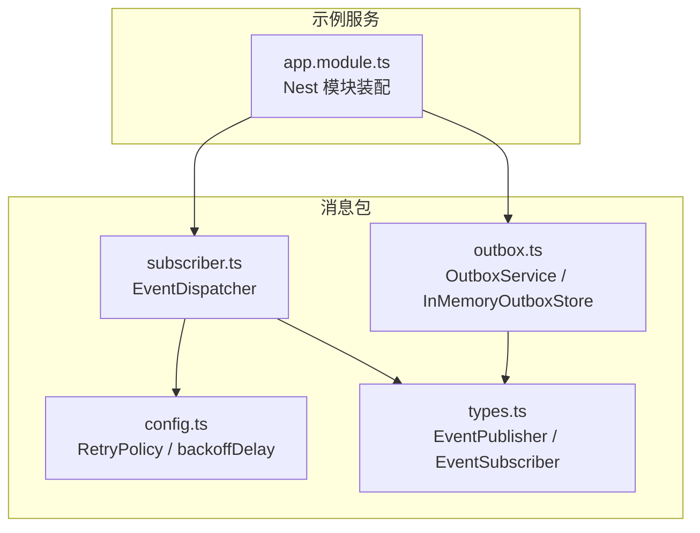
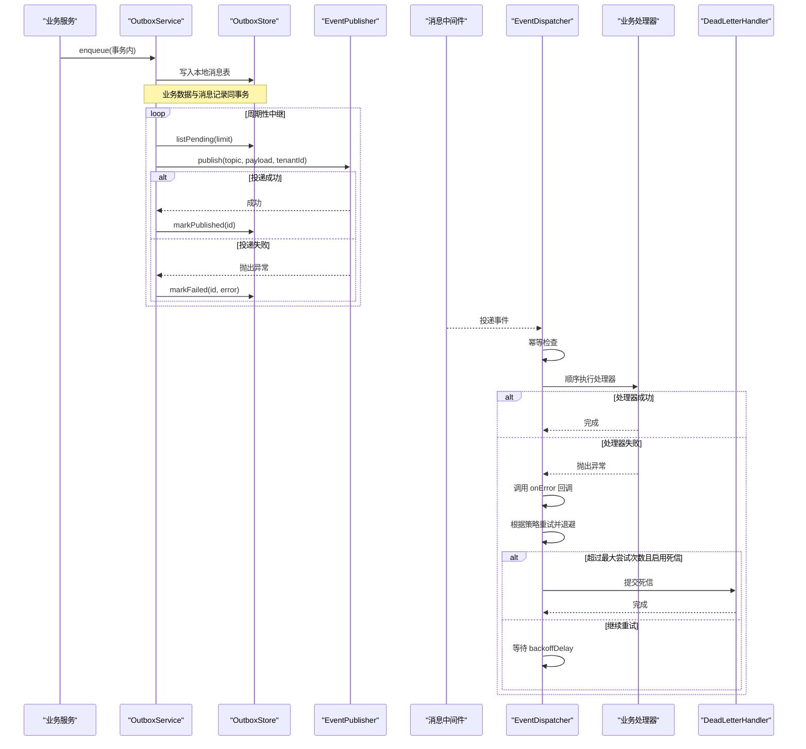
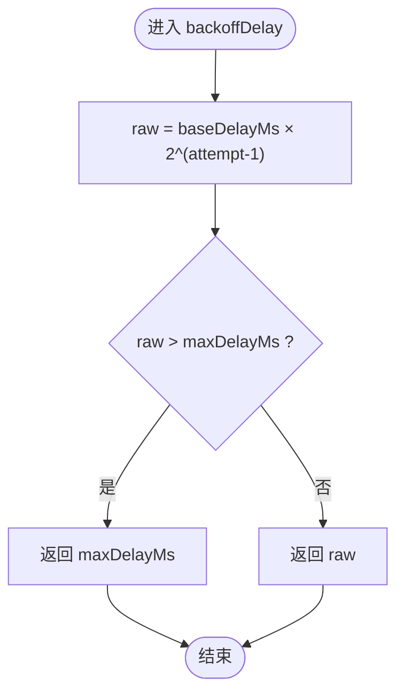
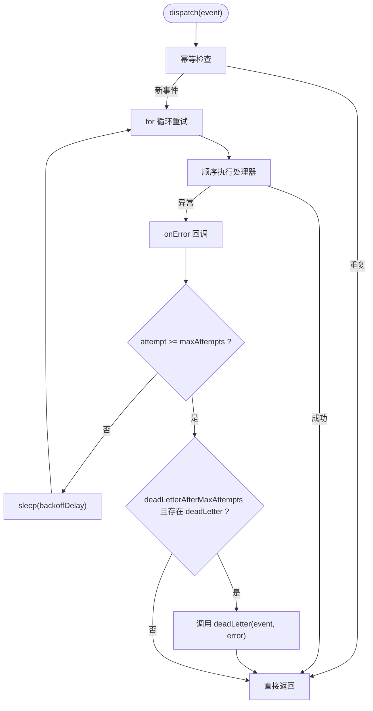
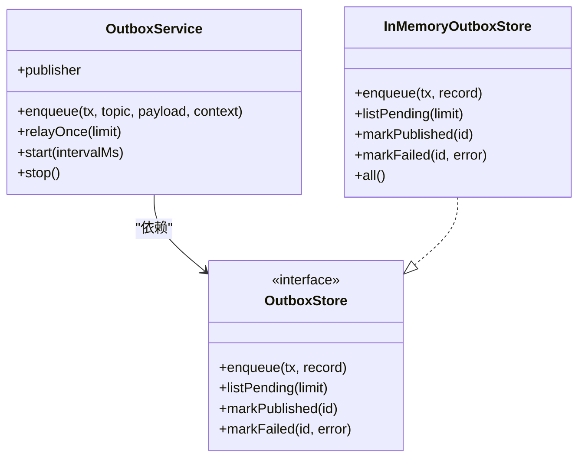
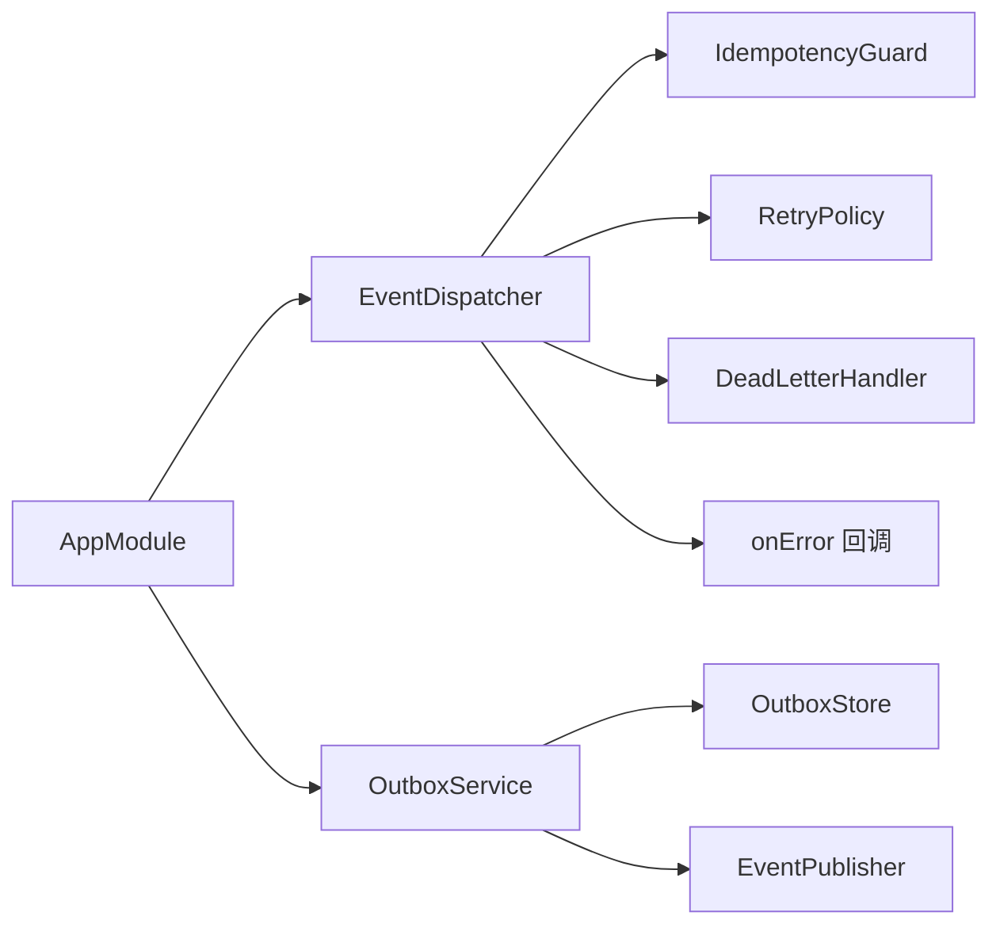

# 重试与死信处理

<cite>
**本文引用的文件**   
- [packages/mq/src/config.ts](file://packages/mq/src/config.ts)
- [packages/mq/src/subscriber.ts](file://packages/mq/src/subscriber.ts)
- [packages/mq/src/outbox.ts](file://packages/mq/src/outbox.ts)
- [packages/mq/src/types.ts](file://packages/mq/src/types.ts)
- [apps/plot-service/src/app.module.ts](file://apps/plot-service/src/app.module.ts)
- [packages/mq/test/mq.spec.ts](file://packages/mq/test/mq.spec.ts)
</cite>

## 目录
1. [引言](#引言)
2. [项目结构](#项目结构)
3. [核心组件](#核心组件)
4. [架构总览](#架构总览)
5. [详细组件分析](#详细组件分析)
6. [依赖关系分析](#依赖关系分析)
7. [性能与可观测性](#性能与可观测性)
8. [故障排查指南](#故障排查指南)
9. [结论](#结论)
10. [附录：配置与调优建议](#附录配置与调优建议)

## 引言
本文件面向“重试与死信处理机制”，聚焦以下目标：
- 解释 RetryPolicy 接口设计与 backoffDelay 指数退避算法。
- 说明 DeadLetterHandler 的处理逻辑与死信消息管理。
- 文档化重试次数限制、失败回调、幂等保护与本地消息表最终一致性。
- 给出不同重试策略的适用场景、性能影响、监控指标与调优建议。
- 提供不可恢复错误的处理流程与人工干预方案，并附完整错误处理流程图。

## 项目结构
重试与死信能力集中在消息包 packages/mq 中，并在示例服务 apps/plot-service 中进行装配与使用：
- packages/mq/src/config.ts：定义重试策略、默认策略、死信处理器类型与退避计算函数。
- packages/mq/src/subscriber.ts：实现事件分发器 EventDispatcher，封装幂等、重试、超时（通过 sleep）与死信。
- packages/mq/src/outbox.ts：实现 OutboxService 与 InMemoryOutboxStore，保障本地消息表与最终一致投递。
- packages/mq/src/types.ts：定义发布/订阅契约与内存发布器实现。
- apps/plot-service/src/app.module.ts：在 NestJS 模块中装配 EventDispatcher、OutboxService 与默认重试策略。
- packages/mq/test/mq.spec.ts：覆盖本地消息表、幂等、重试与死信的契约测试。

图表来源
- [packages/mq/src/config.ts:11-52](file://packages/mq/src/config.ts#L11-L52)
- [packages/mq/src/subscriber.ts:16-44](file://packages/mq/src/subscriber.ts#L16-L44)
- [packages/mq/src/outbox.ts:50-137](file://packages/mq/src/outbox.ts#L50-L137)
- [packages/mq/src/types.ts:14-71](file://packages/mq/src/types.ts#L14-L71)
- [apps/plot-service/src/app.module.ts:119-134](file://apps/plot-service/src/app.module.ts#L119-L134)

章节来源
- [packages/mq/src/config.ts:11-52](file://packages/mq/src/config.ts#L11-L52)
- [packages/mq/src/subscriber.ts:16-44](file://packages/mq/src/subscriber.ts#L16-L44)
- [packages/mq/src/outbox.ts:50-137](file://packages/mq/src/outbox.ts#L50-L137)
- [packages/mq/src/types.ts:14-71](file://packages/mq/src/types.ts#L14-L71)
- [apps/plot-service/src/app.module.ts:119-134](file://apps/plot-service/src/app.module.ts#L119-L134)

## 核心组件
- RetryPolicy：重试策略配置，包含最大尝试次数、基础退避时长、退避上限以及达到最大尝试次数后是否转入死信。
- backoffDelay(attempt, policy)：按尝试次数计算下一次退避时长，采用指数增长并受 maxDelayMs 上限约束。
- DeadLetterHandler(event, error)：死信处理器契约，用于业务补偿或持久化不可恢复的错误事件。
- EventDispatcher：事件分发器，负责幂等判断、顺序执行处理器、失败重试、退避等待、失败回调与死信转交。
- OutboxService：本地消息表中继服务，事务内入队、周期性中继投递、失败累计与记录最近错误。
- InMemoryOutboxStore：内存版消息表存储，便于测试与本地开发。

章节来源
- [packages/mq/src/config.ts:11-52](file://packages/mq/src/config.ts#L11-L52)
- [packages/mq/src/subscriber.ts:16-44](file://packages/mq/src/subscriber.ts#L16-L44)
- [packages/mq/src/outbox.ts:50-137](file://packages/mq/src/outbox.ts#L50-L137)

## 架构总览
下图展示从业务写入到消费处理的端到端可靠性链路：业务事务写入本地消息表；中继任务周期性将待投递事件发送到消息中间件；消费者侧由 EventDispatcher 统一编排幂等、重试、失败回调与死信。

图表来源
- [packages/mq/src/outbox.ts:74-137](file://packages/mq/src/outbox.ts#L74-L137)
- [packages/mq/src/subscriber.ts:70-101](file://packages/mq/src/subscriber.ts#L70-L101)
- [packages/mq/src/config.ts:48-52](file://packages/mq/src/config.ts#L48-L52)

## 详细组件分析

### RetryPolicy 与 backoffDelay 指数退避
- RetryPolicy 字段含义：
  - maxAttempts：最大尝试次数，含首次。
  - baseDelayMs：基础退避时长（毫秒），按尝试次数指数增长。
  - maxDelayMs：退避上限（毫秒）。
  - deadLetterAfterMaxAttempts：达到最大尝试次数后是否转入死信。
- DEFAULT_RETRY_POLICY：默认五次尝试，基础退避 200ms，上限 30s，达到最大尝试次数后转入死信。
- backoffDelay(attempt, policy)：计算公式为 baseDelayMs × 2^(attempt-1)，并以 maxDelayMs 封顶。

图表来源
- [packages/mq/src/config.ts:48-52](file://packages/mq/src/config.ts#L48-L52)

章节来源
- [packages/mq/src/config.ts:11-52](file://packages/mq/src/config.ts#L11-L52)

### EventDispatcher 重试、失败回调与死信
- 幂等保护：先通过 IdempotencyGuard 判断 eventId 是否重复，避免重复处理。
- 处理器顺序执行：同一主题下注册的处理器按声明顺序串行执行。
- 失败处理：
  - 捕获异常并转换为 Error。
  - 调用可选 onError(topic, eventId, error, attempt) 回调进行日志或指标上报。
  - 若 attempt >= maxAttempts：
    - 当 deadLetterAfterMaxAttempts 为真且提供了 deadLetter 时，调用死信处理器。
    - 转入死信后不再抛出异常，避免阻塞后续事件。
  - 否则，调用 sleep(backoffDelay(attempt, retry)) 进行指数退避等待后重试。

图表来源
- [packages/mq/src/subscriber.ts:70-101](file://packages/mq/src/subscriber.ts#L70-L101)
- [packages/mq/src/config.ts:48-52](file://packages/mq/src/config.ts#L48-L52)

章节来源
- [packages/mq/src/subscriber.ts:16-44](file://packages/mq/src/subscriber.ts#L16-L44)
- [packages/mq/src/subscriber.ts:70-101](file://packages/mq/src/subscriber.ts#L70-L101)

### OutboxService 本地消息表与中继
- 事务内入队：enqueue 生成唯一 id、填充上下文信息并写入 OutboxStore。
- 中继投递：relayOnce 读取待投递记录，调用 publisher.publish，成功则 markPublished，失败则 markFailed 累计 retryCount 并记录 lastError。
- 周期中继：start 启动定时器周期性执行 relayOnce，stop 停止定时器。
- InMemoryOutboxStore：内存实现，支持 all() 供测试断言。

图表来源
- [packages/mq/src/outbox.ts:50-137](file://packages/mq/src/outbox.ts#L50-L137)
- [packages/mq/src/outbox.ts:139-170](file://packages/mq/src/outbox.ts#L139-L170)

章节来源
- [packages/mq/src/outbox.ts:50-137](file://packages/mq/src/outbox.ts#L50-L137)
- [packages/mq/src/outbox.ts:139-170](file://packages/mq/src/outbox.ts#L139-L170)

### 模块装配与默认策略
- 在 Nest 模块中，OutboxService 与 EventDispatcher 被注入并装配。
- EventDispatcher 默认使用 DEFAULT_RETRY_POLICY。
- OutboxService 使用 InMemoryOutboxStore 作为默认实现，便于演示与测试。

章节来源
- [apps/plot-service/src/app.module.ts:119-134](file://apps/plot-service/src/app.module.ts#L119-L134)
- [apps/plot-service/src/app.module.ts:180-195](file://apps/plot-service/src/app.module.ts#L180-L195)

### 契约测试覆盖的关键行为
- 本地消息表：事务内入队、中继后标记已投递、失败时记录原因与次数、下一轮补投成功。
- 消费侧幂等与重试：重复事件被幂等拦截；处理器失败按策略重试；超过最大尝试次数后转入死信且不阻塞后续事件。
- 装饰器注册处理器并组装订阅。

章节来源
- [packages/mq/test/mq.spec.ts:36-68](file://packages/mq/test/mq.spec.ts#L36-L68)
- [packages/mq/test/mq.spec.ts:70-114](file://packages/mq/test/mq.spec.ts#L70-L114)

## 依赖关系分析
- EventDispatcher 依赖：
  - IdempotencyGuard：幂等判断。
  - RetryPolicy：重试策略与退避计算。
  - DeadLetterHandler：死信处理。
  - onError：失败回调。
- OutboxService 依赖：
  - OutboxStore：本地消息表存储抽象。
  - EventPublisher：消息发布器抽象。
- 模块装配层：
  - 示例服务将 EventDispatcher 与 OutboxService 装配进容器，并提供默认重试策略。

图表来源
- [packages/mq/src/subscriber.ts:16-44](file://packages/mq/src/subscriber.ts#L16-L44)
- [packages/mq/src/outbox.ts:50-137](file://packages/mq/src/outbox.ts#L50-L137)
- [apps/plot-service/src/app.module.ts:119-134](file://apps/plot-service/src/app.module.ts#L119-L134)

章节来源
- [packages/mq/src/subscriber.ts:16-44](file://packages/mq/src/subscriber.ts#L16-L44)
- [packages/mq/src/outbox.ts:50-137](file://packages/mq/src/outbox.ts#L50-L137)
- [apps/plot-service/src/app.module.ts:119-134](file://apps/plot-service/src/app.module.ts#L119-L134)

## 性能与可观测性
- 幂等与去重：
  - 通过 IdempotencyGuard 避免重复处理，降低处理器重复执行的开销。
- 重试与退避：
  - 指数退避可有效缓解下游瞬时压力，但过大的 baseDelayMs 或过小 maxDelayMs 会影响整体延迟。
  - maxAttempts 越大，单事件处理时间越长，可能影响吞吐。
- 本地消息表中继：
  - relayOnce 批量拉取 pending 记录，limit 控制单轮处理量，需结合数据库与消息中间件吞吐调整。
  - start 定时器间隔影响最终一致性延迟与资源占用。
- 失败回调与指标：
  - onError 可用于记录失败次数、耗时与错误分类，配合 MetricsService 暴露重试次数、死信数量、退避时长分布等指标。

[本节为通用指导，不直接分析具体文件]

## 故障排查指南
- 事件未消费：
  - 检查 EventDispatcher 是否已 subscribe 对应主题。
  - 确认 isRunning 状态与消费者生命周期。
- 事件重复处理：
  - 确认 IdempotencyGuard 是否正确初始化并持久化键空间。
- 处理器反复失败：
  - 查看 onError 回调输出与 lastError 字段。
  - 检查 RetryPolicy.maxAttempts 与 backoffDelay 配置是否合理。
- 死信堆积：
  - 确认 DeadLetterHandler 是否实现并正确持久化不可恢复事件。
  - 对死信事件进行分类与人工复核，必要时重新投递或修正业务数据。
- 本地消息表积压：
  - 检查 OutboxService.relayOnce 的执行频率与 limit。
  - 观察 OutboxStore.listPending 结果与 markFailed 计数。

章节来源
- [packages/mq/src/subscriber.ts:70-101](file://packages/mq/src/subscriber.ts#L70-L101)
- [packages/mq/src/outbox.ts:99-137](file://packages/mq/src/outbox.ts#L99-L137)
- [packages/mq/test/mq.spec.ts:51-67](file://packages/mq/test/mq.spec.ts#L51-L67)

## 结论
该重试与死信机制以 EventDispatcher 为核心编排点，结合幂等保护、指数退避重试、失败回调与死信处理，形成可靠的消费侧容错体系；OutboxService 通过本地消息表保证业务与事件的最终一致。通过合理的 RetryPolicy 配置与 OutboxService 中继参数调优，可在吞吐、延迟与可靠性之间取得平衡。

[本节为总结性内容，不直接分析具体文件]

## 附录：配置与调优建议
- 重试策略选择
  - 快速失败型：maxAttempts 较小、baseDelayMs 较小、maxDelayMs 较小，适合对外部依赖强依赖且希望尽快失败的场景。
  - 稳健恢复型：maxAttempts 中等、baseDelayMs 适中、maxDelayMs 较大，适合网络抖动或下游短暂不可用。
  - 高可靠型：maxAttempts 较大、启用 deadLetterAfterMaxAttempts，适合关键业务，确保最终落入死信以便人工介入。
- 退避参数
  - baseDelayMs 不宜过小，避免频繁重试造成雪崩；maxDelayMs 应大于典型恢复时间。
- 中继参数
  - relayOnce.limit 与 start 间隔需结合数据库与消息中间件容量评估，避免长时间积压或过度拉取。
- 监控指标
  - 重试次数、死信数量、backoff 时长分布、OnErrorHandler 触发率、Outbox pending 数量与平均延迟。
- 不可恢复错误处理与人工干预
  - 在 DeadLetterHandler 中持久化事件与错误上下文，建立工单系统或看板告警。
  - 对死信事件进行根因分析与修复后，提供手动重放或补偿流程。

[本节为通用指导，不直接分析具体文件]