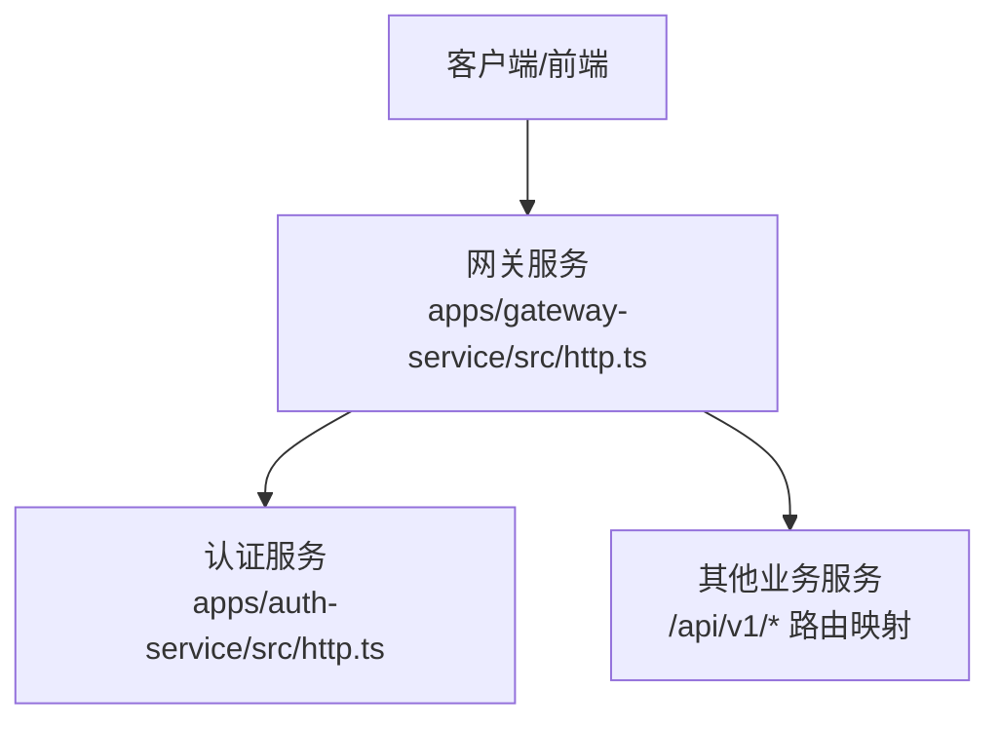
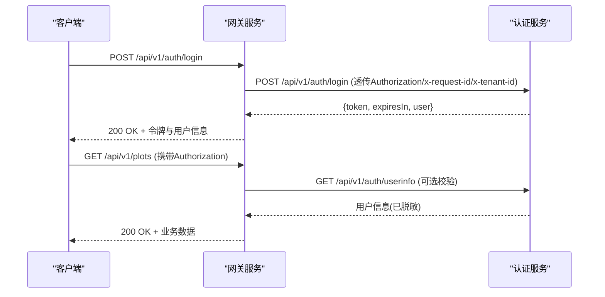
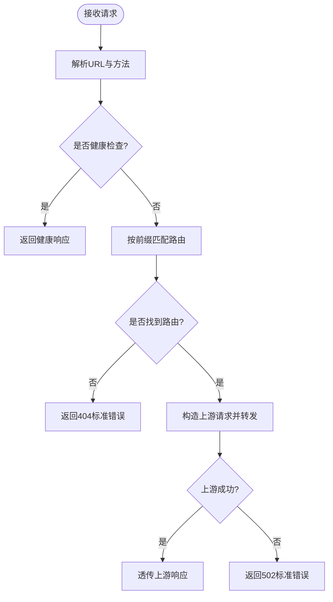
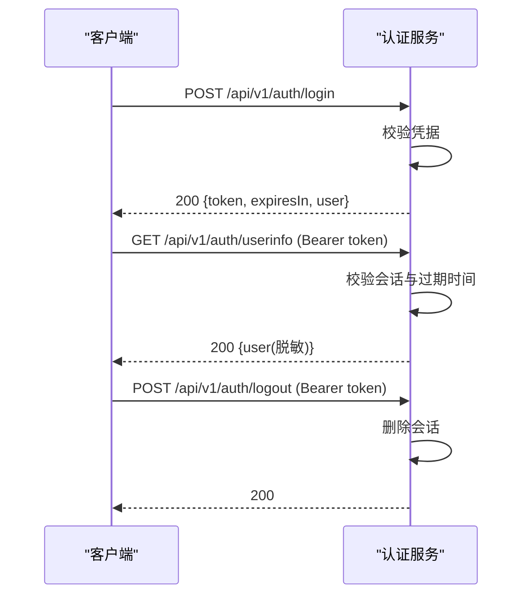
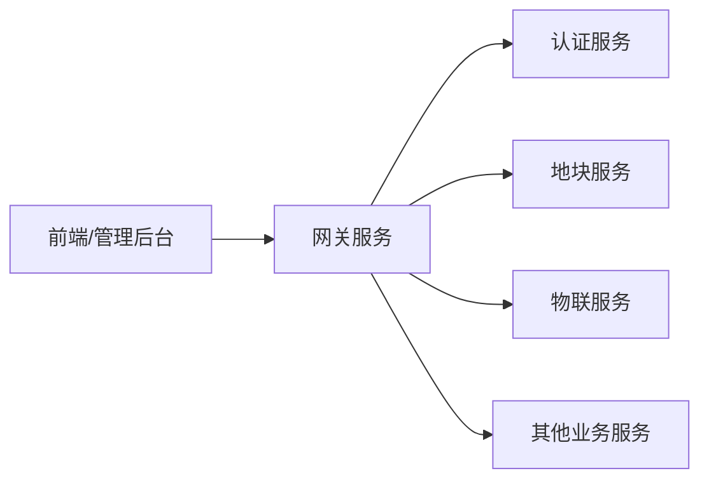

# 安全架构

<cite>
**本文引用的文件**   
- [README.md](file://README.md)
- [gateway-service/src/http.ts](file://apps/gateway-service/src/http.ts)
- [gateway-service/src/main.ts](file://apps/gateway-service/src/main.ts)
- [auth-service/src/http.ts](file://apps/auth-service/src/http.ts)
- [auth-service/src/main.ts](file://apps/auth-service/src/main.ts)
</cite>

## 目录
1. [引言](#引言)
2. [项目结构](#项目结构)
3. [核心组件](#核心组件)
4. [架构总览](#架构总览)
5. [详细组件分析](#详细组件分析)
6. [依赖关系分析](#依赖关系分析)
7. [性能与安全权衡](#性能与安全权衡)
8. [故障排查指南](#故障排查指南)
9. [结论](#结论)
10. [附录：安全配置与加固清单](#附录安全配置与加固清单)

## 引言
本安全架构文档面向智慧农业平台，聚焦身份认证与授权、API 网关安全防护、数据安全保护、多租户隔离与安全边界设计，并给出威胁模型、防护策略与安全配置最佳实践。当前代码库提供了最小可用的网关转发与鉴权服务实现，可作为后续扩展为生产级安全体系的基础。

## 项目结构
- 网关服务 gateway-service：负责请求路由、透传上下文头、健康检查与基础错误封装。
- 认证服务 auth-service：提供登录、用户信息、登出等鉴权能力，使用内存会话存储临时令牌。
- 其他业务服务通过网关统一暴露 /api/v1/* 前缀接口。

图示来源
- [gateway-service/src/http.ts:6-23](file://apps/gateway-service/src/http.ts#L6-L23)
- [auth-service/src/http.ts:14-20](file://apps/auth-service/src/http.ts#L14-L20)

章节来源
- [README.md:1-10](file://README.md#L1-L10)

## 核心组件
- 网关服务
  - 功能：按前缀将请求转发到对应后端服务；透传 Authorization、x-request-id、x-tenant-id、x-user-id、x-confirm-action 等头部；返回标准健康检查与错误响应。
  - 安全职责：入口统一、上下文透传、基础可达性校验（健康端点）、下游不可用时的降级响应。
- 认证服务
  - 功能：登录校验、生成会话令牌、查询用户信息、登出销毁会话。
  - 安全职责：凭据校验、会话生命周期管理、敏感字段脱敏输出。

章节来源
- [gateway-service/src/http.ts:26-40](file://apps/gateway-service/src/http.ts#L26-L40)
- [auth-service/src/http.ts:6-20](file://apps/auth-service/src/http.ts#L6-L20)

## 架构总览
下图展示从客户端到网关再到认证服务的完整调用链，包括鉴权流程与上下文传递。

图示来源
- [gateway-service/src/http.ts:27-39](file://apps/gateway-service/src/http.ts#L27-L39)
- [auth-service/src/http.ts:14-20](file://apps/auth-service/src/http.ts#L14-L20)

## 详细组件分析

### 网关服务安全机制
- 请求过滤与路由匹配
  - 最长前缀优先匹配，避免更具体路径被短前缀抢占。
  - 未匹配路由返回 404 标准错误体。
- 上下文透传
  - 透传 Authorization、x-request-id、x-tenant-id、x-user-id、x-confirm-action 等头部至下游服务，便于审计与多租户隔离。
- 健康检查
  - 提供 /health 端点，返回服务名与状态。
- 错误处理
  - 下游不可用时返回 502 与标准化错误体，避免泄露内部细节。

图示来源
- [gateway-service/src/http.ts:27-39](file://apps/gateway-service/src/http.ts#L27-L39)

章节来源
- [gateway-service/src/http.ts:6-23](file://apps/gateway-service/src/http.ts#L6-L23)
- [gateway-service/src/http.ts:27-40](file://apps/gateway-service/src/http.ts#L27-L40)

### 认证服务安全机制
- 登录流程
  - 校验用户名与密码，成功后在内存中创建会话，返回短期令牌与过期时间。
- 用户信息查询
  - 基于 Authorization Bearer 令牌校验会话有效性，返回脱敏后的用户信息。
- 登出流程
  - 根据令牌删除会话，使令牌失效。
- 敏感信息处理
  - 对外返回对象剔除 password 字段，防止敏感信息泄露。

图示来源
- [auth-service/src/http.ts:14-20](file://apps/auth-service/src/http.ts#L14-L20)

章节来源
- [auth-service/src/http.ts:6-20](file://apps/auth-service/src/http.ts#L6-L20)

### JWT 令牌验证与角色权限控制现状与建议
- 现状
  - 当前认证服务使用内存会话与随机 UUID 作为“令牌”，并非 JWT；也未实现服务端 JWT 签发与验签逻辑。
  - 网关仅透传 Authorization 头，未进行签名校验或权限判断。
- 建议方案
  - 引入 JWT 签发与验签：认证服务签发带 claims（如 userId、roles、permissions、tenantId）的 JWT；网关或服务层验签并注入上下文。
  - 角色与权限控制：在服务层基于 roles/permissions 做细粒度访问控制；网关可做粗粒度白名单（如禁止匿名访问敏感路径）。
  - 令牌刷新与吊销：支持 refresh token 机制与会话黑名单，配合登出与异常场景下的快速吊销。

[本节为概念性建议，不直接分析具体源码]

### API 网关的安全防护策略
- 请求过滤
  - 当前实现为前缀路由转发，未包含内容类型校验、载荷大小限制、参数白名单等。
  - 建议增加：Content-Type 校验、Body Size Limit、JSON Schema 校验、SQL/命令注入防护。
- 速率限制
  - 当前未实现限流。建议按 IP、租户、用户维度设置限流策略，结合 Redis 或内存计数器实现滑动窗口/令牌桶。
- 访问控制
  - 建议在网关层对匿名访问进行拦截，强制携带有效 Authorization；对写操作要求 x-confirm-action 等二次确认头。
  - 结合租户头 x-tenant-id 做跨租户访问拦截。

章节来源
- [gateway-service/src/http.ts:27-39](file://apps/gateway-service/src/http.ts#L27-L39)

### 数据安全保护措施
- 传输加密
  - 当前示例以 HTTP 运行；生产环境应在反向代理或网关层启用 TLS，强制 HTTPS。
- 敏感信息加密
  - 认证服务对外返回用户信息时剔除 password 字段，属于基本脱敏；数据库侧应对敏感字段进行加密存储。
- 日志脱敏
  - 建议在网关与服务层对日志中的 Authorization、手机号、身份证号等敏感信息进行掩码处理。

章节来源
- [auth-service/src/http.ts:12-12](file://apps/auth-service/src/http.ts#L12-L12)

### 多租户隔离机制与安全边界
- 租户标识透传
  - 网关透传 x-tenant-id 至下游服务，便于服务层按租户隔离数据与权限。
- 安全边界
  - 网关作为唯一入口，集中承载鉴权、限流、审计；业务服务专注领域逻辑，避免重复实现安全能力。
- 建议
  - 在服务层对 x-tenant-id 进行强校验，拒绝缺失或非法值；所有查询条件强制附加 tenant_id 过滤。

章节来源
- [gateway-service/src/http.ts:35-35](file://apps/gateway-service/src/http.ts#L35-L35)

## 依赖关系分析
- 网关服务依赖环境变量配置的后端服务地址，并通过 Node.js http 模块转发请求。
- 认证服务独立运行，提供鉴权相关接口，供网关与其他服务间接调用。
- 前端与管理后台通过网关统一访问各业务服务。

图示来源
- [gateway-service/src/http.ts:6-23](file://apps/gateway-service/src/http.ts#L6-L23)

章节来源
- [gateway-service/src/http.ts:6-23](file://apps/gateway-service/src/http.ts#L6-L23)

## 性能与安全权衡
- 会话存储
  - 当前使用内存 Map 存储会话，简单但不可水平扩展；生产应替换为 Redis 等分布式存储。
- 转发开销
  - 网关逐字节读取并转发 Body，存在额外 CPU 与内存开销；可考虑流式处理与连接池优化。
- 鉴权成本
  - 若采用 JWT，网关需验签；建议缓存公钥与最近签名结果，降低验签开销。

[本节为通用指导，不直接分析具体源码]

## 故障排查指南
- 网关 404
  - 检查请求路径是否命中默认路由表；确认目标服务 URL 环境变量是否正确。
- 网关 502
  - 下游服务不可用或网络异常；检查目标服务健康端点与端口连通性。
- 认证失败
  - 检查 Authorization 头格式是否为 Bearer token；确认会话是否过期或未创建。
- 租户隔离问题
  - 检查 x-tenant-id 是否透传且合法；确认下游服务是否强制使用该租户 ID 过滤数据。

章节来源
- [gateway-service/src/http.ts:29-39](file://apps/gateway-service/src/http.ts#L29-L39)
- [auth-service/src/http.ts:14-20](file://apps/auth-service/src/http.ts#L14-L20)

## 结论
当前仓库提供了最小可用的网关转发与鉴权实现，具备上下文透传与健康检查能力。下一步应完善 JWT 签发与验签、细粒度权限控制、速率限制、TLS 传输加密、敏感数据加密与日志脱敏，并将会话存储迁移至分布式存储，以满足生产环境的安全与可用性要求。

## 附录：安全配置与加固清单
- 传输安全
  - 启用 TLS/HTTPS；禁用弱加密套件；证书自动续期。
- 认证与授权
  - 引入 JWT 签发与验签；支持 Refresh Token；实现 RBAC/ABAC 权限模型；网关层强制鉴权。
- 输入与输出
  - 严格校验 Content-Type、Body Size、JSON Schema；输出脱敏；日志脱敏。
- 访问控制
  - 网关层限流（IP/租户/用户）；防重放（nonce/timestamp）；写操作二次确认头。
- 多租户
  - 强制 x-tenant-id；服务层强制租户过滤；跨租户访问告警。
- 密钥与配置
  - 使用密钥管理服务；环境变量最小化暴露；启动期校验必填项。
- 监控与审计
  - 全链路追踪（x-request-id）；关键操作审计日志；异常告警与熔断。

[本节为通用指导，不直接分析具体源码]