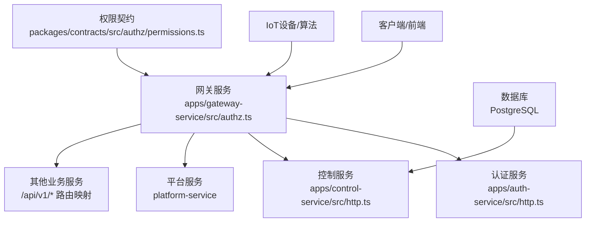
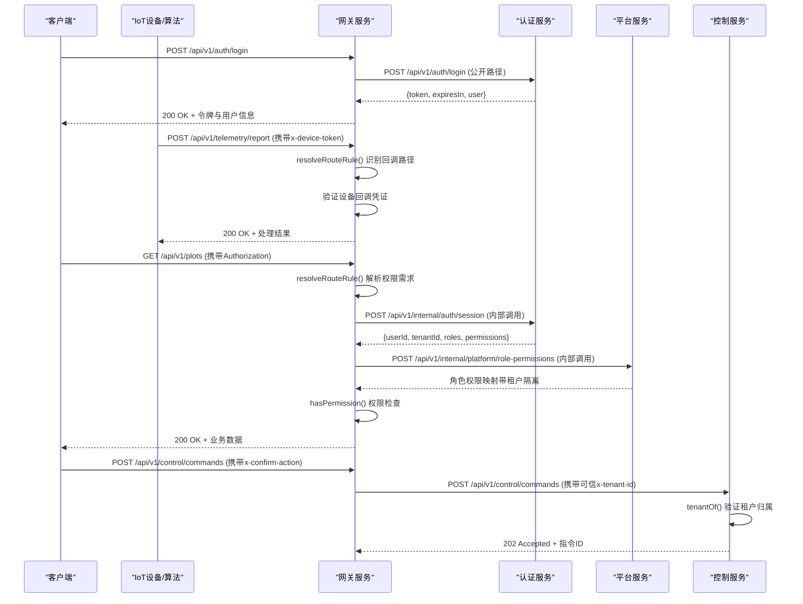
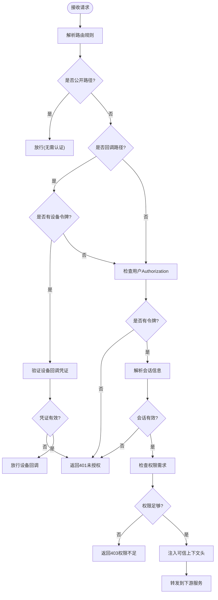
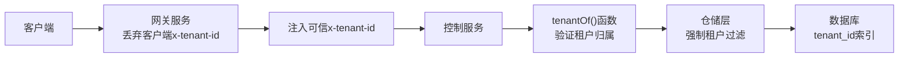
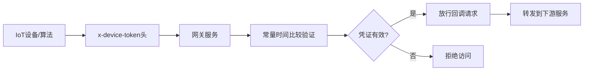
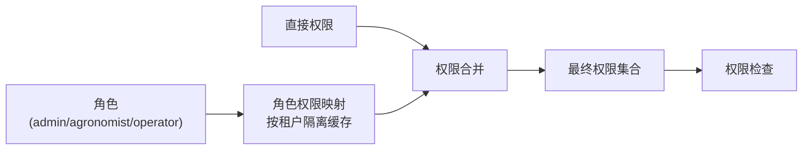
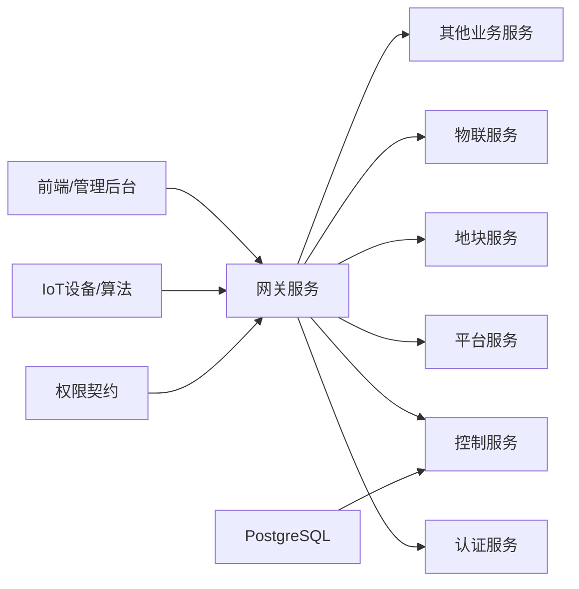

# 安全架构

<cite>
**本文引用的文件**   
- [README.md](file://README.md)
- [gateway-service/src/authz.ts](file://apps/gateway-service/src/authz.ts)
- [gateway-service/src/http.ts](file://apps/gateway-service/src/http.ts)
- [gateway-service/src/main.ts](file://apps/gateway-service/src/main.ts)
- [packages/contracts/src/authz/permissions.ts](file://packages/contracts/src/authz/permissions.ts)
- [auth-service/src/http.ts](file://apps/auth-service/src/http.ts)
- [auth-service/src/main.ts](file://apps/auth-service/src/main.ts)
- [control-service/src/http.ts](file://apps/control-service/src/http.ts)
- [control-service/src/control.repository.ts](file://apps/control-service/src/control.repository.ts)
- [infra/postgres/migrations/032_control_command_tenant.sql](file://infra/postgres/migrations/032_control_command_tenant.sql)
</cite>

## 更新摘要
**变更内容**   
- 实现跨租户安全性增强，支持按租户和角色的缓存隔离机制
- 新增设备回调认证功能，支持通过 x-device-token 头进行设备身份验证
- 改进环境配置管理，支持细粒度的缓存时间控制和回调凭证配置
- 增强多租户隔离和安全边界设计
- **新增控制命令租户隔离机制**，包括 x-tenant-id 头验证、可信网关身份验证和纵深防御策略

## 目录
1. [引言](#引言)
2. [项目结构](#项目结构)
3. [核心组件](#核心组件)
4. [架构总览](#架构总览)
5. [详细组件分析](#详细组件分析)
6. [依赖关系分析](#依赖关系分析)
7. [性能与安全权衡](#性能与安全权衡)
8. [故障排查指南](#故障排查指南)
9. [结论](#结论)
10. [附录：安全配置与加固清单](#附录安全配置与加固清单)

## 引言
本安全架构文档面向智慧农业平台，聚焦身份认证与授权、API 网关安全防护、数据安全保护、多租户隔离与安全边界设计，并给出威胁模型、防护策略与安全配置最佳实践。当前代码库已实现生产级的网关授权框架，具备完整的JWT令牌验证、会话管理、细粒度权限控制、跨租户隔离和设备回调认证能力，可作为企业级安全体系的基础。

## 项目结构
- 网关服务 gateway-service：负责请求路由、复杂鉴权逻辑、上下文头注入、健康检查与错误封装。
- 认证服务 auth-service：提供登录、用户信息、登出等鉴权能力，使用内存会话存储临时令牌。
- 控制服务 control-service：处理控制指令的生命周期管理，实现严格的租户隔离和数据安全。
- 契约包 contracts：定义统一的权限系统、权限编码规范和工具函数。
- 其他业务服务通过网关统一暴露 /api/v1/* 前缀接口。

图示来源
- [gateway-service/src/authz.ts:1-242](file://apps/gateway-service/src/authz.ts#L1-L242)
- [gateway-service/src/http.ts:1-103](file://apps/gateway-service/src/http.ts#L1-L103)
- [packages/contracts/src/authz/permissions.ts:1-119](file://packages/contracts/src/authz/permissions.ts#L1-L119)
- [control-service/src/http.ts:1-321](file://apps/control-service/src/http.ts#L1-L321)

章节来源
- [README.md:1-10](file://README.md#L1-L10)

## 核心组件
- 网关服务
  - 功能：按前缀将请求转发到对应后端服务；执行复杂鉴权逻辑；透传可信身份上下文头；返回标准健康检查与错误响应。
  - 安全职责：唯一公网入口、令牌验证、会话解析、细粒度权限控制、跨租户隔离、设备回调认证、审计追踪。
- 认证服务
  - 功能：登录校验、生成会话令牌、查询用户信息、登出销毁会话。
  - 安全职责：凭据校验、会话生命周期管理、敏感字段脱敏输出。
- 控制服务
  - 功能：控制指令生命周期管理、设备通信协调、租户隔离数据访问。
  - 安全职责：严格的租户边界验证、指令状态机保护、设备回调凭证验证、操作审计追踪。
- 权限契约系统
  - 功能：统一定义权限编码、通配符规则、权限合并与序列化。
  - 安全职责：权限模型标准化、跨服务权限一致性保证。

章节来源
- [gateway-service/src/authz.ts:14-40](file://apps/gateway-service/src/authz.ts#L14-L40)
- [gateway-service/src/http.ts:55-103](file://apps/gateway-service/src/http.ts#L55-L103)
- [control-service/src/http.ts:14-35](file://apps/control-service/src/http.ts#L14-L35)
- [packages/contracts/src/authz/permissions.ts:21-54](file://packages/contracts/src/authz/permissions.ts#L21-L54)

## 架构总览
下图展示从客户端到网关再到认证服务的完整调用链，包括复杂的鉴权流程、会话解析、权限检查和设备回调认证。

图示来源
- [gateway-service/src/authz.ts:81-101](file://apps/gateway-service/src/authz.ts#L81-L101)
- [gateway-service/src/authz.ts:218-240](file://apps/gateway-service/src/authz.ts#L218-L240)
- [gateway-service/src/http.ts:66-74](file://apps/gateway-service/src/http.ts#L66-L74)
- [control-service/src/http.ts:185-227](file://apps/control-service/src/http.ts#L185-L227)

## 详细组件分析

### 网关服务复杂授权框架
**更新** 网关服务现已实现完整的授权框架，支持令牌验证、会话解析、细粒度权限控制和设备回调认证。

- 路由规则解析
  - 公开路径：健康检查、登录接口无需认证。
  - 回调路径：设备上报、虫情事件、视频AI事件支持设备回调凭证认证。
  - 会话路径：用户信息、登出、租户信息等仅需登录状态。
  - 权限路径：业务接口根据HTTP方法映射读写权限。
- 令牌处理
  - 自动剥离Bearer前缀，支持大小写不敏感。
  - 空令牌直接拒绝访问。
- 设备回调认证
  - 支持通过 `x-device-token` 头进行设备身份验证。
  - 使用常量时间比较防止时序攻击。
  - 未配置回调凭证时，设备通道关闭，仅允许用户身份访问。
- 会话解析与缓存
  - 调用认证服务内部接口解析会话信息。
  - 5秒会话缓存，避免频繁网络调用。
- 跨租户角色权限缓存
  - 按租户ID和角色集合排序后缓存角色权限。
  - 10秒角色权限缓存，支持多租户隔离。
- 权限检查
  - 基于hasPermission函数进行精确匹配或通配符匹配。
  - 支持`*`全量通配和`领域:*`领域通配。

图示来源
- [gateway-service/src/authz.ts:81-101](file://apps/gateway-service/src/authz.ts#L81-L101)
- [gateway-service/src/authz.ts:218-240](file://apps/gateway-service/src/authz.ts#L218-L240)

章节来源
- [gateway-service/src/authz.ts:1-242](file://apps/gateway-service/src/authz.ts#L1-L242)

### 控制命令租户隔离机制
**新增** 实现了控制命令的严格租户隔离机制，采用纵深防御策略确保跨租户访问防护。

- 可信租户标识验证
  - 控制服务只接受网关透传的 `x-tenant-id` 头作为可信租户标识。
  - 丢弃客户端提供的租户标识，防止伪造跨租户访问。
  - 设备回调场景下回退到进程配置的 `TENANT_ID` 环境变量。
- 多层租户边界防护
  - HTTP层：所有API端点都通过 `tenantOf()` 函数提取可信租户ID。
  - 仓储层：所有数据库操作都强制包含租户过滤条件。
  - 索引优化：创建复合索引 `(tenant_id, created_at DESC, id DESC)` 提升查询性能。
- 跨租户访问拦截
  - 不同租户的相同指令ID被视为完全不同的资源。
  - 跨租户的find、transition等操作返回null而非报错，避免信息泄露。
  - 测试覆盖跨租户访问场景，确保404响应而非403。
- 默认租户策略
  - 未配置 `TENANT_ID` 且无可信租户头时使用 `DEFAULT_TENANT = "tenant-demo"`。
  - 向后兼容演示数据和单租户部署场景。

图示来源
- [control-service/src/http.ts:64-71](file://apps/control-service/src/http.ts#L64-L71)
- [control-service/src/control.repository.ts:213-275](file://apps/control-service/src/control.repository.ts#L213-L275)
- [infra/postgres/migrations/032_control_command_tenant.sql:10-21](file://infra/postgres/migrations/032_control_command_tenant.sql#L10-L21)

章节来源
- [control-service/src/http.ts:64-71](file://apps/control-service/src/http.ts#L64-L71)
- [control-service/src/control.repository.ts:15-18](file://apps/control-service/src/control.repository.ts#L15-L18)
- [infra/postgres/migrations/032_control_command_tenant.sql:1-22](file://infra/postgres/migrations/032_control_command_tenant.sql#L1-L22)

### 跨租户安全性与缓存隔离
**更新** 实现了跨租户安全性和细粒度的缓存隔离机制。

- 租户标识管理
  - 网关解析会话后注入可信的x-tenant-id。
  - 丢弃客户端提供的租户标识，防止伪造。
- 角色权限缓存隔离
  - 缓存键包含租户ID和排序后的角色列表：`JSON.stringify([tenantId, [...roles].sort()])`。
  - 确保不同租户的角色权限缓存完全隔离。
  - 同一租户内相同角色集合复用缓存，提升性能。
- 会话缓存隔离
  - 基于用户令牌的会话缓存，天然支持多租户隔离。
- 安全边界设计
  - 网关作为唯一公网入口，集中承载鉴权、限流、审计。
  - 业务服务专注领域逻辑，避免重复实现安全能力。

章节来源
- [gateway-service/src/authz.ts:182-196](file://apps/gateway-service/src/authz.ts#L182-L196)
- [gateway-service/src/http.ts:88-92](file://apps/gateway-service/src/http.ts#L88-L92)

### 设备回调认证机制
**新增** 实现了设备回调认证功能，支持IoT设备和算法服务的回调接口。

- 回调路径识别
  - `/api/v1/telemetry/report`：设备遥测数据上报。
  - `/api/v1/telemetry/pest-events`：虫情事件上报。
  - `/api/v1/video/ai-events`：视频AI事件上报。
- 设备凭证验证
  - 通过 `x-device-token` 头传递设备回调凭证。
  - 使用常量时间比较函数 `constantTimeEquals` 防止时序攻击。
  - 凭证无效时直接拒绝，不回退到用户身份验证。
- 双重认证支持
  - 设备回调路径同时支持设备凭证和用户身份两种认证方式。
  - 用户身份需要相应的写权限才能访问回调接口。
- 凭证配置
  - 通过 `DEVICE_CALLBACK_TOKEN` 环境变量配置共享设备凭证。
  - 未配置时设备回调通道关闭，仅允许用户身份访问。

图示来源
- [gateway-service/src/authz.ts:85-88](file://apps/gateway-service/src/authz.ts#L85-L88)
- [gateway-service/src/authz.ts:222-227](file://apps/gateway-service/src/authz.ts#L222-L227)

章节来源
- [gateway-service/src/authz.ts:85-88](file://apps/gateway-service/src/authz.ts#L85-L88)
- [gateway-service/src/authz.ts:222-227](file://apps/gateway-service/src/authz.ts#L222-L227)

### 权限系统与角色控制
**更新** 实现了标准化的权限系统和灵活的权限控制机制，支持跨租户隔离。

- 权限编码规范
  - 采用`领域:动作`命名格式，如`plot:read`、`device:control`。
  - 支持通配符：`*`表示全部权限，`领域:*`表示该领域所有动作。
- 权限目录管理
  - 集中定义所有权限编码，确保跨服务一致性。
  - 按业务领域分组，便于角色页面渲染和管理。
- 权限判定引擎
  - 精确匹配：完全相同的权限码。
  - 全量通配：`*`匹配任何权限。
  - 领域通配：`telemetry:*`匹配`telemetry:read`、`telemetry:write`等。
- 权限合并策略
  - 合并会话直接授予的权限与角色继承的权限。
  - 去重并保持首次出现顺序。

图示来源
- [packages/contracts/src/authz/permissions.ts:21-54](file://packages/contracts/src/authz/permissions.ts#L21-L54)
- [packages/contracts/src/authz/permissions.ts:93-100](file://packages/contracts/src/authz/permissions.ts#L93-L100)

章节来源
- [packages/contracts/src/authz/permissions.ts:1-119](file://packages/contracts/src/authz/permissions.ts#L1-L119)

### API 网关的安全防护策略
**更新** 网关现已具备完整的安全防护能力，包括设备回调认证。

- 请求过滤与鉴权
  - 基于路由规则的动态权限映射。
  - 公开路径白名单机制。
  - 强制认证要求（除公开路径外）。
  - 设备回调凭证认证。
- 上下文安全
  - 丢弃客户端提供的敏感头（x-user-id、x-tenant-id、x-permissions）。
  - 仅注入网关解析的可信身份上下文。
  - 原样转发设备回调凭证供下游二次校验。
- 速率限制
  - 建议结合Redis实现IP/租户/用户维度限流。
- 访问控制
  - 基于HTTP方法的读写权限分离。
  - 细粒度资源级权限控制。

章节来源
- [gateway-service/src/http.ts:81-92](file://apps/gateway-service/src/http.ts#L81-L92)
- [gateway-service/src/authz.ts:42-101](file://apps/gateway-service/src/authz.ts#L42-L101)

### 数据安全保护措施
**更新** 增强了数据传输和存储安全，包括设备回调凭证保护和控制命令租户隔离。

- 传输加密
  - 生产环境应在反向代理或网关层启用TLS，强制HTTPS。
- 敏感信息处理
  - 认证服务对外返回用户信息时剔除password字段。
  - 数据库侧应对敏感字段进行加密存储。
- 日志脱敏
  - 建议在网关与服务层对日志中的Authorization、手机号、身份证号等敏感信息进行掩码处理。
- 内部通信安全
  - 使用INTERNAL_TOKEN验证内部服务间调用。
  - 区分外部API和内部API的安全策略。
- 设备回调凭证保护
  - 使用常量时间比较防止时序攻击。
  - 设备凭证与用户令牌分离处理。
- 控制命令数据安全
  - 严格的租户隔离确保跨租户数据不可访问。
  - 指令状态机防止非法状态转换。
  - 急停指令需要到位确认确保安全。

章节来源
- [auth-service/src/http.ts:12-12](file://apps/auth-service/src/http.ts#L12-L12)
- [gateway-service/src/authz.ts:222-227](file://apps/gateway-service/src/authz.ts#L222-L227)
- [control-service/src/http.ts:267-270](file://apps/control-service/src/http.ts#L267-L270)

### 多租户隔离机制与安全边界
**更新** 强化了多租户隔离和安全边界，支持跨租户缓存隔离和控制命令租户隔离。

- 租户标识管理
  - 网关解析会话后注入可信的x-tenant-id。
  - 丢弃客户端提供的租户标识，防止伪造。
- 跨租户缓存隔离
  - 角色权限缓存键包含租户ID，确保不同租户数据隔离。
  - 会话缓存基于用户令牌，天然支持多租户隔离。
- 控制命令租户隔离
  - 所有控制指令操作都强制租户过滤。
  - 数据库索引优化支持高效的租户级别查询。
  - 跨租户访问返回404而非403，避免信息泄露。
- 安全边界设计
  - 网关作为唯一公网入口，集中承载鉴权、限流、审计。
  - 业务服务专注领域逻辑，避免重复实现安全能力。
- 权限隔离
  - 基于租户ID的数据隔离。
  - 跨租户访问拦截和审计。

章节来源
- [gateway-service/src/http.ts:88-92](file://apps/gateway-service/src/http.ts#L88-L92)
- [gateway-service/src/authz.ts:182-196](file://apps/gateway-service/src/authz.ts#L182-L196)
- [control-service/src/control.repository.ts:213-275](file://apps/control-service/src/control.repository.ts#L213-L275)

## 依赖关系分析
**更新** 网关服务现在依赖多个内部服务和权限契约，支持设备回调认证和控制命令租户隔离。

- 网关服务依赖环境变量配置的后端服务地址，并通过Node.js http模块转发请求。
- 认证服务独立运行，提供鉴权相关接口，供网关与其他服务间接调用。
- 平台服务提供角色权限映射，供网关解析用户权限。
- 控制服务提供控制指令管理，实现严格的租户隔离。
- 权限契约包提供统一的权限定义和工具函数。
- 前端与管理后台通过网关统一访问各业务服务。
- IoT设备和算法服务通过设备回调凭证访问特定接口。

图示来源
- [gateway-service/src/http.ts:22-41](file://apps/gateway-service/src/http.ts#L22-L41)
- [gateway-service/src/authz.ts:163-180](file://apps/gateway-service/src/authz.ts#L163-L180)
- [control-service/src/control.repository.ts:184-211](file://apps/control-service/src/control.repository.ts#L184-L211)

章节来源
- [gateway-service/src/http.ts:22-41](file://apps/gateway-service/src/http.ts#L22-L41)

## 性能与安全权衡
**更新** 考虑了新的授权框架、设备回调认证和控制命令租户隔离的性能影响。

- 会话存储
  - 当前使用内存Map存储会话，简单但不可水平扩展；生产应替换为Redis等分布式存储。
- 转发开销
  - 网关逐字节读取并转发Body，存在额外CPU与内存开销；可考虑流式处理与连接池优化。
- 鉴权成本
  - 网关需调用认证服务和平台服务进行会话和权限解析。
  - 通过5秒会话缓存和10秒角色权限缓存降低网络开销。
- 跨租户缓存优化
  - 按租户和角色组合缓存角色权限，减少重复计算。
  - 同一租户内相同角色集合复用缓存，提升性能。
- 设备回调认证
  - 常量时间比较增加少量CPU开销，但显著提升安全性。
  - 设备凭证验证快速失败，避免不必要的会话解析。
- 控制命令租户隔离
  - 租户过滤条件增加数据库查询复杂度，但通过索引优化保持性能。
  - 跨租户访问的快速失败机制减少不必要的数据库操作。
- 权限计算
  - 权限合并和通配符匹配在内存中进行，性能开销较小。

[本节为通用指导，不直接分析具体源码]

## 故障排查指南
**更新** 增加了新授权框架、设备回调认证和控制命令租户隔离相关的故障排查。

- 网关404
  - 检查请求路径是否命中默认路由表；确认目标服务URL环境变量是否正确。
- 网关502
  - 下游服务不可用或网络异常；检查目标服务健康端点与端口连通性。
- 认证失败401
  - 检查Authorization头格式是否为Bearer token；确认会话是否过期或未创建。
  - 检查认证服务内部接口是否正常响应。
- 设备回调认证失败401
  - 检查x-device-token头是否正确传递。
  - 确认DEVICE_CALLBACK_TOKEN环境变量配置正确。
  - 检查设备回调凭证是否与网关配置一致。
- 权限不足403
  - 检查用户角色和权限配置；确认所需权限是否在权限目录中定义。
  - 检查权限通配符配置是否正确。
- 控制命令租户隔离问题
  - 检查x-tenant-id是否由网关正确注入且合法。
  - 确认控制服务是否正确解析可信租户标识。
  - 检查跨租户访问是否被正确拦截（应返回404而非403）。
  - 验证数据库索引是否正常工作。
- 跨租户数据问题
  - 检查x-tenant-id是否由网关正确注入且合法。
  - 确认角色权限缓存是否按租户隔离。
  - 检查下游服务是否强制使用该租户ID过滤数据。
- 性能问题
  - 检查会话缓存和角色权限缓存是否正常工作。
  - 监控认证服务和平台服务的响应时间。
  - 检查跨租户缓存隔离是否生效。
  - 验证控制命令租户隔离索引是否优化查询性能。

章节来源
- [gateway-service/src/http.ts:76-100](file://apps/gateway-service/src/http.ts#L76-L100)
- [gateway-service/src/authz.ts:218-240](file://apps/gateway-service/src/authz.ts#L218-L240)
- [control-service/src/http.ts:185-227](file://apps/control-service/src/http.ts#L185-L227)

## 结论
当前仓库已实现生产级的网关授权框架，具备完整的令牌验证、会话管理、细粒度权限控制、跨租户隔离、设备回调认证和安全边界设计能力。新增的控制命令租户隔离机制进一步提升了系统的安全性和可扩展性，通过纵深防御策略确保跨租户访问防护。下一步应完善JWT签发与验签、速率限制、TLS传输加密、敏感数据加密与日志脱敏，并将会话存储迁移至分布式存储，以满足生产环境的安全与可用性要求。

## 附录：安全配置与加固清单
**更新** 包含了新的授权框架配置项、设备回调认证配置和控制命令租户隔离配置。

- 传输安全
  - 启用TLS/HTTPS；禁用弱加密套件；证书自动续期。
- 认证与授权
  - 实现JWT签发与验签；支持Refresh Token；实现RBAC/ABAC权限模型；网关层强制鉴权。
  - 配置GATEWAY_AUTH_ENABLED开启或关闭鉴权。
  - 设置GATEWAY_AUTH_CACHE_MS和GATEWAY_ROLE_CACHE_MS调整缓存时间。
  - 配置DEVICE_CALLBACK_TOKEN用于设备回调认证。
- 输入与输出
  - 严格校验Content-Type、Body Size、JSON Schema；输出脱敏；日志脱敏。
- 访问控制
  - 网关层限流（IP/租户/用户）；防重放（nonce/timestamp）；写操作二次确认头。
- 多租户
  - 强制x-tenant-id；服务层强制租户过滤；跨租户访问告警。
  - 使用跨租户缓存隔离确保数据安全性。
  - 控制命令服务配置TENANT_ID环境变量用于设备回调场景。
- 设备回调
  - 配置DEVICE_CALLBACK_TOKEN环境变量；使用常量时间比较验证设备凭证。
  - 设备回调路径同时支持设备凭证和用户身份两种认证方式。
- 控制命令安全
  - 严格控制x-tenant-id头的可信来源，只接受网关透传值。
  - 实施纵深防御策略，多层租户边界验证。
  - 配置CONTROL_RECEIPT_TIMEOUT_MIN调整回执超时阈值。
- 密钥与配置
  - 使用密钥管理服务；环境变量最小化暴露；启动期校验必填项。
  - 配置INTERNAL_TOKEN用于内部服务间认证。
- 监控与审计
  - 全链路追踪（x-request-id）；关键操作审计日志；异常告警与熔断。
- 权限管理
  - 维护PERMISSION_CATALOG权限目录；定期审查角色权限配置；监控权限使用情况。

[本节为通用指导，不直接分析具体源码]