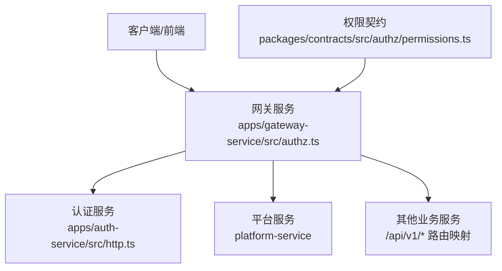
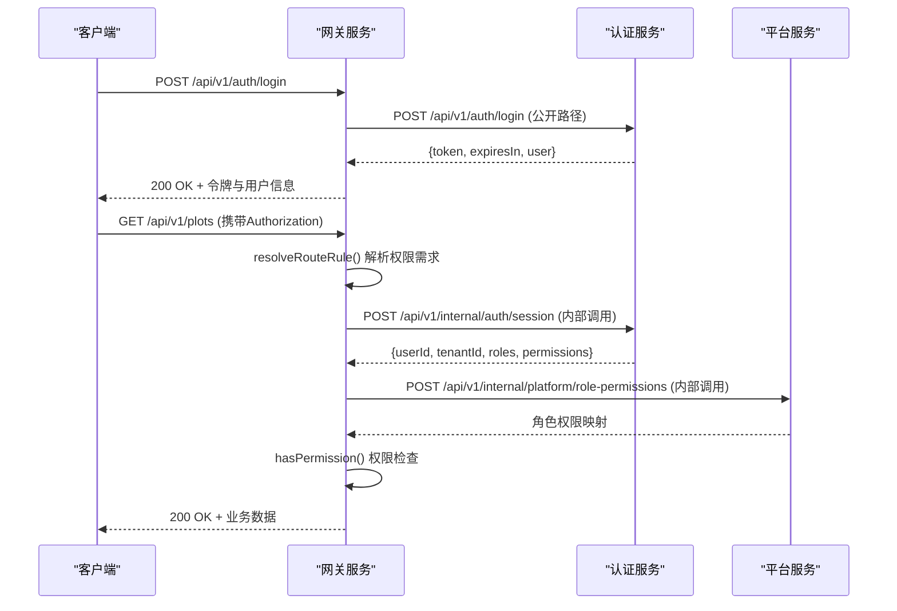
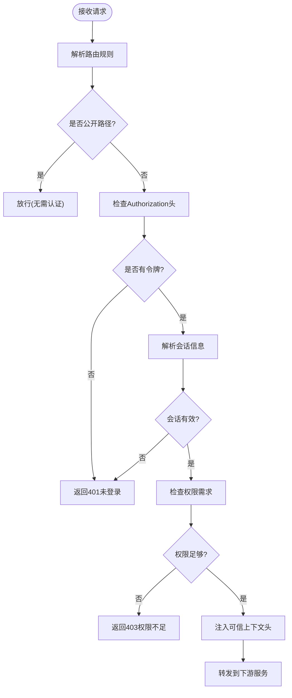
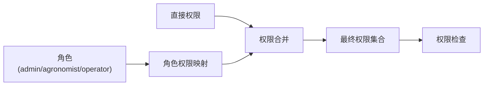
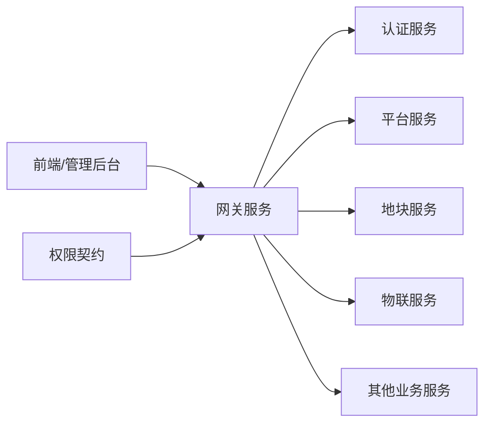

# 安全架构

<cite>
**本文引用的文件**   
- [README.md](file://README.md)
- [gateway-service/src/authz.ts](file://apps/gateway-service/src/authz.ts)
- [gateway-service/src/http.ts](file://apps/gateway-service/src/http.ts)
- [gateway-service/src/main.ts](file://apps/gateway-service/src/main.ts)
- [packages/contracts/src/authz/permissions.ts](file://packages/contracts/src/authz/permissions.ts)
- [auth-service/src/http.ts](file://apps/auth-service/src/http.ts)
- [auth-service/src/main.ts](file://apps/auth-service/src/main.ts)
</cite>

## 更新摘要
**变更内容**   
- 新增网关服务复杂授权框架，支持令牌验证、会话解析和细粒度权限控制
- 实现基于HTTP方法和URL路径的动态权限映射机制
- 集成角色权限合并与会话缓存优化
- 增强多租户隔离和安全边界设计

## 目录
1. [引言](#引言)
2. [项目结构](#项目结构)
3. [核心组件](#核心组件)
4. [架构总览](#架构总览)
5. [详细组件分析](#详细组件分析)
6. [依赖关系分析](#依赖关系分析)
7. [性能与安全权衡](#性能与安全权衡)
8. [故障排查指南](#故障排查指南)
9. [结论](#结论)
10. [附录：安全配置与加固清单](#附录安全配置与加固清单)

## 引言
本安全架构文档面向智慧农业平台，聚焦身份认证与授权、API 网关安全防护、数据安全保护、多租户隔离与安全边界设计，并给出威胁模型、防护策略与安全配置最佳实践。当前代码库已实现生产级的网关授权框架，具备完整的JWT令牌验证、会话管理、细粒度权限控制和多租户隔离能力，可作为企业级安全体系的基础。

## 项目结构
- 网关服务 gateway-service：负责请求路由、复杂鉴权逻辑、上下文头注入、健康检查与错误封装。
- 认证服务 auth-service：提供登录、用户信息、登出等鉴权能力，使用内存会话存储临时令牌。
- 契约包 contracts：定义统一的权限系统、权限编码规范和工具函数。
- 其他业务服务通过网关统一暴露 /api/v1/* 前缀接口。

图示来源
- [gateway-service/src/authz.ts:1-220](file://apps/gateway-service/src/authz.ts#L1-L220)
- [gateway-service/src/http.ts:1-98](file://apps/gateway-service/src/http.ts#L1-L98)
- [packages/contracts/src/authz/permissions.ts:1-117](file://packages/contracts/src/authz/permissions.ts#L1-L117)

章节来源
- [README.md:1-10](file://README.md#L1-L10)

## 核心组件
- 网关服务
  - 功能：按前缀将请求转发到对应后端服务；执行复杂鉴权逻辑；透传可信身份上下文头；返回标准健康检查与错误响应。
  - 安全职责：唯一公网入口、令牌验证、会话解析、细粒度权限控制、多租户隔离、审计追踪。
- 认证服务
  - 功能：登录校验、生成会话令牌、查询用户信息、登出销毁会话。
  - 安全职责：凭据校验、会话生命周期管理、敏感字段脱敏输出。
- 权限契约系统
  - 功能：统一定义权限编码、通配符规则、权限合并与序列化。
  - 安全职责：权限模型标准化、跨服务权限一致性保证。

章节来源
- [gateway-service/src/authz.ts:14-37](file://apps/gateway-service/src/authz.ts#L14-L37)
- [gateway-service/src/http.ts:53-97](file://apps/gateway-service/src/http.ts#L53-L97)
- [packages/contracts/src/authz/permissions.ts:21-53](file://packages/contracts/src/authz/permissions.ts#L21-L53)

## 架构总览
下图展示从客户端到网关再到认证服务的完整调用链，包括复杂的鉴权流程、会话解析和权限检查。

图示来源
- [gateway-service/src/authz.ts:75-90](file://apps/gateway-service/src/authz.ts#L75-L90)
- [gateway-service/src/authz.ts:183-201](file://apps/gateway-service/src/authz.ts#L183-L201)
- [gateway-service/src/authz.ts:203-218](file://apps/gateway-service/src/authz.ts#L203-L218)

## 详细组件分析

### 网关服务复杂授权框架
**新增** 网关服务现已实现完整的授权框架，支持令牌验证、会话解析和细粒度权限控制。

- 路由规则解析
  - 公开路径：健康检查、登录接口、设备上报无需认证。
  - 会话路径：用户信息、登出、租户信息等仅需登录状态。
  - 权限路径：业务接口根据HTTP方法映射读写权限。
- 令牌处理
  - 自动剥离Bearer前缀，支持大小写不敏感。
  - 空令牌直接拒绝访问。
- 会话解析与缓存
  - 调用认证服务内部接口解析会话信息。
  - 5秒会话缓存，避免频繁网络调用。
- 角色权限合并
  - 调用平台服务获取角色权限映射。
  - 合并会话权限与角色权限，去重后保留顺序。
  - 10秒角色权限缓存。
- 权限检查
  - 基于hasPermission函数进行精确匹配或通配符匹配。
  - 支持`*`全量通配和`领域:*`领域通配。

图示来源
- [gateway-service/src/authz.ts:75-90](file://apps/gateway-service/src/authz.ts#L75-L90)
- [gateway-service/src/authz.ts:203-218](file://apps/gateway-service/src/authz.ts#L203-L218)

章节来源
- [gateway-service/src/authz.ts:1-220](file://apps/gateway-service/src/authz.ts#L1-L220)

### 权限系统与角色控制
**新增** 实现了标准化的权限系统和灵活的权限控制机制。

- 权限编码规范
  - 采用`领域:动作`命名格式，如`plot:read`、`device:control`。
  - 支持通配符：`*`表示全部权限，`领域:*`表示该领域所有动作。
- 权限目录管理
  - 集中定义所有权限编码，确保跨服务一致性。
  - 按业务领域分组，便于角色页面渲染和管理。
- 权限判定引擎
  - 精确匹配：完全相同的权限码。
  - 全量通配：`*`匹配任何权限。
  - 领域通配：`telemetry:*`匹配`telemetry:read`、`telemetry:write`等。
- 权限合并策略
  - 合并会话直接授予的权限与角色继承的权限。
  - 去重并保持首次出现顺序。

图示来源
- [packages/contracts/src/authz/permissions.ts:21-53](file://packages/contracts/src/authz/permissions.ts#L21-L53)
- [packages/contracts/src/authz/permissions.ts:91-98](file://packages/contracts/src/authz/permissions.ts#L91-L98)

章节来源
- [packages/contracts/src/authz/permissions.ts:1-117](file://packages/contracts/src/authz/permissions.ts#L1-L117)

### API 网关的安全防护策略
**更新** 网关现已具备完整的安全防护能力。

- 请求过滤与鉴权
  - 基于路由规则的动态权限映射。
  - 公开路径白名单机制。
  - 强制认证要求（除公开路径外）。
- 上下文安全
  - 丢弃客户端提供的敏感头（x-user-id、x-tenant-id、x-permissions）。
  - 仅注入网关解析的可信身份上下文。
- 速率限制
  - 建议结合Redis实现IP/租户/用户维度限流。
- 访问控制
  - 基于HTTP方法的读写权限分离。
  - 细粒度资源级权限控制。

章节来源
- [gateway-service/src/http.ts:78-87](file://apps/gateway-service/src/http.ts#L78-L87)
- [gateway-service/src/authz.ts:42-57](file://apps/gateway-service/src/authz.ts#L42-L57)

### 数据安全保护措施
**更新** 增强了数据传输和存储安全。

- 传输加密
  - 生产环境应在反向代理或网关层启用TLS，强制HTTPS。
- 敏感信息处理
  - 认证服务对外返回用户信息时剔除password字段。
  - 数据库侧应对敏感字段进行加密存储。
- 日志脱敏
  - 建议在网关与服务层对日志中的Authorization、手机号、身份证号等敏感信息进行掩码处理。
- 内部通信安全
  - 使用INTERNAL_TOKEN验证内部服务间调用。
  - 区分外部API和内部API的安全策略。

章节来源
- [auth-service/src/http.ts:12-12](file://apps/auth-service/src/http.ts#L12-L12)
- [gateway-service/src/authz.ts:158-166](file://apps/gateway-service/src/authz.ts#L158-L166)

### 多租户隔离机制与安全边界
**更新** 强化了多租户隔离和安全边界。

- 租户标识管理
  - 网关解析会话后注入可信的x-tenant-id。
  - 丢弃客户端提供的租户标识，防止伪造。
- 安全边界设计
  - 网关作为唯一公网入口，集中承载鉴权、限流、审计。
  - 业务服务专注领域逻辑，避免重复实现安全能力。
- 权限隔离
  - 基于租户ID的数据隔离。
  - 跨租户访问拦截和审计。

章节来源
- [gateway-service/src/http.ts:84-86](file://apps/gateway-service/src/http.ts#L84-L86)
- [gateway-service/src/authz.ts:15-22](file://apps/gateway-service/src/authz.ts#L15-L22)

## 依赖关系分析
**更新** 网关服务现在依赖多个内部服务和权限契约。

- 网关服务依赖环境变量配置的后端服务地址，并通过Node.js http模块转发请求。
- 认证服务独立运行，提供鉴权相关接口，供网关与其他服务间接调用。
- 平台服务提供角色权限映射，供网关解析用户权限。
- 权限契约包提供统一的权限定义和工具函数。
- 前端与管理后台通过网关统一访问各业务服务。

图示来源
- [gateway-service/src/http.ts:22-39](file://apps/gateway-service/src/http.ts#L22-L39)
- [gateway-service/src/authz.ts:150-181](file://apps/gateway-service/src/authz.ts#L150-L181)

章节来源
- [gateway-service/src/http.ts:22-39](file://apps/gateway-service/src/http.ts#L22-L39)

## 性能与安全权衡
**更新** 考虑了新的授权框架的性能影响。

- 会话存储
  - 当前使用内存Map存储会话，简单但不可水平扩展；生产应替换为Redis等分布式存储。
- 转发开销
  - 网关逐字节读取并转发Body，存在额外CPU与内存开销；可考虑流式处理与连接池优化。
- 鉴权成本
  - 网关需调用认证服务和平台服务进行会话和权限解析。
  - 通过5秒会话缓存和10秒角色权限缓存降低网络开销。
- 权限计算
  - 权限合并和通配符匹配在内存中进行，性能开销较小。

[本节为通用指导，不直接分析具体源码]

## 故障排查指南
**更新** 增加了新授权框架相关的故障排查。

- 网关404
  - 检查请求路径是否命中默认路由表；确认目标服务URL环境变量是否正确。
- 网关502
  - 下游服务不可用或网络异常；检查目标服务健康端点与端口连通性。
- 认证失败401
  - 检查Authorization头格式是否为Bearer token；确认会话是否过期或未创建。
  - 检查认证服务内部接口是否正常响应。
- 权限不足403
  - 检查用户角色和权限配置；确认所需权限是否在权限目录中定义。
  - 检查权限通配符配置是否正确。
- 租户隔离问题
  - 检查x-tenant-id是否由网关正确注入且合法；确认下游服务是否强制使用该租户ID过滤数据。
- 性能问题
  - 检查会话缓存和角色权限缓存是否正常工作。
  - 监控认证服务和平台服务的响应时间。

章节来源
- [gateway-service/src/http.ts:76-95](file://apps/gateway-service/src/http.ts#L76-L95)
- [gateway-service/src/authz.ts:203-218](file://apps/gateway-service/src/authz.ts#L203-L218)

## 结论
当前仓库已实现生产级的网关授权框架，具备完整的令牌验证、会话管理、细粒度权限控制、多租户隔离和安全边界设计能力。下一步应完善JWT签发与验签、速率限制、TLS传输加密、敏感数据加密与日志脱敏，并将会话存储迁移至分布式存储，以满足生产环境的安全与可用性要求。

## 附录：安全配置与加固清单
**更新** 包含了新的授权框架配置项。

- 传输安全
  - 启用TLS/HTTPS；禁用弱加密套件；证书自动续期。
- 认证与授权
  - 实现JWT签发与验签；支持Refresh Token；实现RBAC/ABAC权限模型；网关层强制鉴权。
  - 配置GATEWAY_AUTH_ENABLED开启或关闭鉴权。
  - 设置GATEWAY_AUTH_CACHE_MS和GATEWAY_ROLE_CACHE_MS调整缓存时间。
- 输入与输出
  - 严格校验Content-Type、Body Size、JSON Schema；输出脱敏；日志脱敏。
- 访问控制
  - 网关层限流（IP/租户/用户）；防重放（nonce/timestamp）；写操作二次确认头。
- 多租户
  - 强制x-tenant-id；服务层强制租户过滤；跨租户访问告警。
- 密钥与配置
  - 使用密钥管理服务；环境变量最小化暴露；启动期校验必填项。
  - 配置INTERNAL_TOKEN用于内部服务间认证。
- 监控与审计
  - 全链路追踪（x-request-id）；关键操作审计日志；异常告警与熔断。
- 权限管理
  - 维护PERMISSION_CATALOG权限目录；定期审查角色权限配置；监控权限使用情况。

[本节为通用指导，不直接分析具体源码]