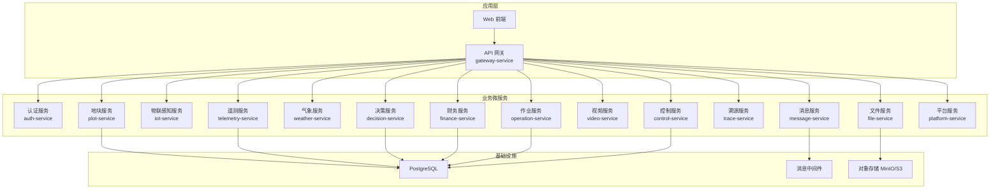
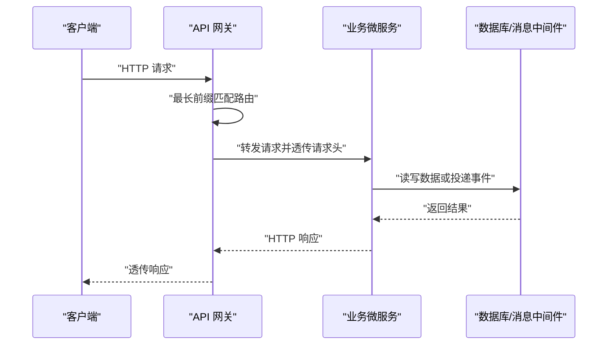
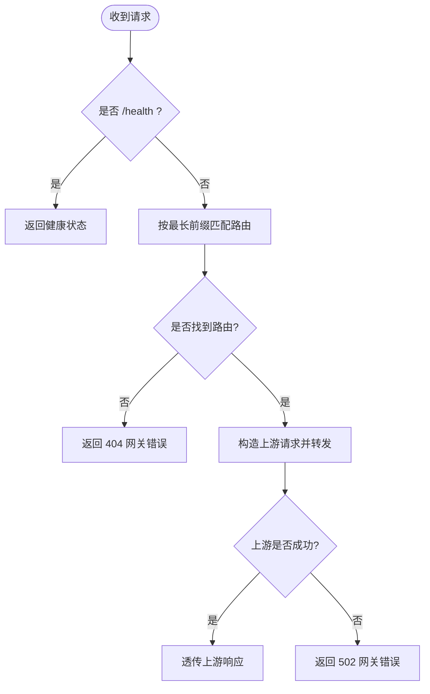
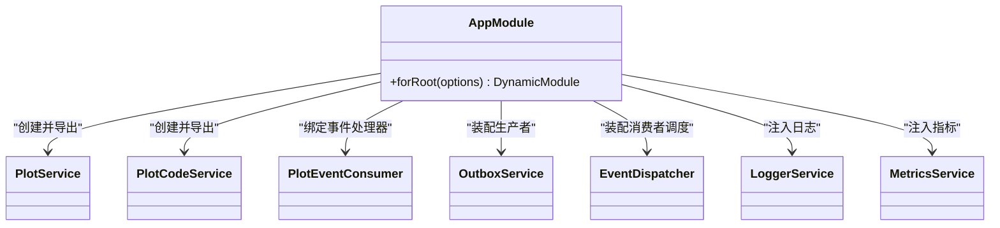
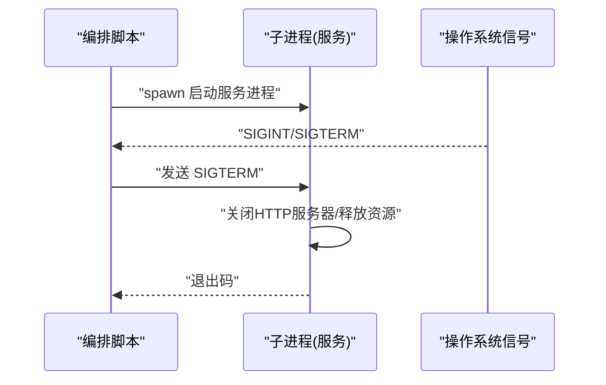
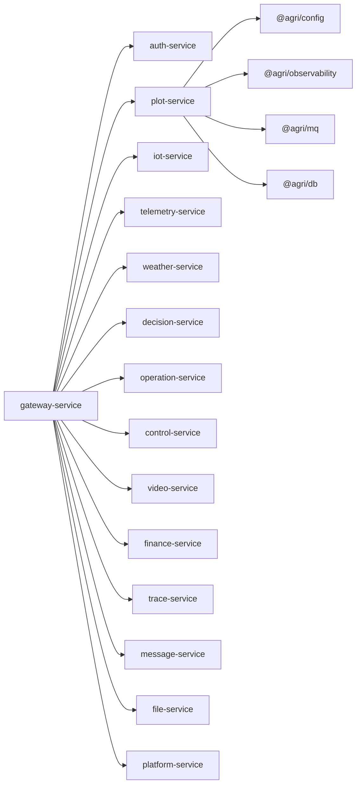

# 微服务架构

<cite>
**本文引用的文件**   
- [README.md](file://README.md)
- [package.json](file://package.json)
- [apps/gateway-service/src/main.ts](file://apps/gateway-service/src/main.ts)
- [apps/gateway-service/src/http.ts](file://apps/gateway-service/src/http.ts)
- [scripts/start-services.mjs](file://scripts/start-services.mjs)
- [scripts/service-registry.mjs](file://scripts/service-registry.mjs)
- [apps/plot-service/src/main.ts](file://apps/plot-service/src/main.ts)
- [apps/plot-service/src/app.module.ts](file://apps/plot-service/src/app.module.ts)
- [apps/plot-service/src/http.ts](file://apps/plot-service/src/http.ts)
- [packages/config/src/index.ts](file://packages/config/src/index.ts)
- [packages/observability/src/index.ts](file://packages/observability/src/index.ts)
</cite>

## 目录
1. [引言](#引言)
2. [项目结构](#项目结构)
3. [核心组件](#核心组件)
4. [架构总览](#架构总览)
5. [详细组件分析](#详细组件分析)
6. [依赖关系分析](#依赖关系分析)
7. [性能与可观测性](#性能与可观测性)
8. [故障排查指南](#故障排查指南)
9. [结论](#结论)
10. [附录：服务清单与端口映射](#附录服务清单与端口映射)

## 引言
本仓库以“地块”为最小管理单元，构建了 Node.js + NestJS 的微服务工程骨架。根工程通过 pnpm workspace、Turborepo 与 TypeScript 工程引用组织公共包与 15 个 HTTP 微服务，并提供 Vue 管理后台。平台采用统一 API 网关对外暴露接口，内部服务之间通过 HTTP 通信；同时提供本地消息表、事件分发与幂等机制，保证事件不丢不重。配置加载、结构化日志、链路追踪与指标采集由公共能力包统一提供，便于各服务复用。

## 项目结构
仓库采用“公共包 + 应用服务”的分层组织方式：
- packages/*：公共能力包（配置、契约、数据库、消息、可观测性等）
- apps/*：15 个独立微服务与前端 Web 应用
- scripts/*：服务编排、健康检查、基础设施初始化脚本
- infra/*：PostgreSQL 迁移与 Docker Compose 基础设施定义

图表来源
- [scripts/service-registry.mjs:1-22](file://scripts/service-registry.mjs#L1-L22)
- [apps/gateway-service/src/http.ts:6-24](file://apps/gateway-service/src/http.ts#L6-L24)

章节来源
- [README.md:1-167](file://README.md#L1-L167)
- [package.json:1-45](file://package.json#L1-L45)

## 核心组件
- API 网关：集中路由转发、跨域透传请求头、统一健康检查与错误响应。
- 业务微服务：围绕地块、设备、遥测、气象、决策、作业、控制、视频、财务、溯源、消息、文件、平台等能力拆分。
- 公共能力包：配置加载与校验、结构化日志/链路/指标、数据库客户端封装、消息与事件总线、领域契约与工具。
- 编排脚本：一次性启动全部服务、注入服务地址、优雅停机。

章节来源
- [apps/gateway-service/src/http.ts:1-41](file://apps/gateway-service/src/http.ts#L1-L41)
- [scripts/start-services.mjs:1-28](file://scripts/start-services.mjs#L1-L28)
- [scripts/service-registry.mjs:1-22](file://scripts/service-registry.mjs#L1-L22)
- [packages/config/src/index.ts:1-9](file://packages/config/src/index.ts#L1-L9)
- [packages/observability/src/index.ts:1-10](file://packages/observability/src/index.ts#L1-L10)

## 架构总览
整体采用“网关 + 微服务”的 HTTP 调用模式。外部请求进入网关后按前缀匹配目标服务，网关将原始请求方法、路径、查询参数与关键请求头透传到下游服务。服务内部通过 NestJS 模块装配依赖，使用公共包提供的配置、数据库、消息与可观测能力。

图表来源
- [apps/gateway-service/src/http.ts:26-40](file://apps/gateway-service/src/http.ts#L26-L40)

## 详细组件分析

### API 网关
职责边界
- 对外暴露统一入口，按 URL 前缀路由到各业务服务。
- 提供 /health 健康检查端点。
- 透传授权、租户、用户与请求 ID 等关键请求头。
- 对不可用下游返回统一 502 错误信封。

路由策略
- 默认路由表包含认证、地块、平台、设备、遥测、气象、消息、作业、控制、决策、财务、溯源、文件、视频等前缀。
- 支持通过环境变量覆盖目标服务地址，便于多环境部署。

图表来源
- [apps/gateway-service/src/http.ts:6-24](file://apps/gateway-service/src/http.ts#L6-L24)
- [apps/gateway-service/src/http.ts:26-40](file://apps/gateway-service/src/http.ts#L26-L40)

章节来源
- [apps/gateway-service/src/main.ts:1-15](file://apps/gateway-service/src/main.ts#L1-L15)
- [apps/gateway-service/src/http.ts:1-41](file://apps/gateway-service/src/http.ts#L1-L41)

### 地块服务（示例服务）
职责边界
- 地块建档、查询、统计、边界获取、更新与删除。
- 通过本地消息表与事件分发器实现事件生产与消费，具备幂等与重试能力。
- 提供 HTTP 适配器，也可作为非 HTTP 进程运行以验证装配关系。

NestJS 模块装配与依赖注入
- 通过 AppModule.forRoot 动态装配配置、数据库、消息、可观测性与业务服务。
- 仓储、消息表、幂等存储通过注入令牌替换，便于测试与不同环境切换。
- 可观测性组件（日志、指标、链路）在模块中统一创建并注册装饰器上下文。

图表来源
- [apps/plot-service/src/app.module.ts:80-164](file://apps/plot-service/src/app.module.ts#L80-L164)

章节来源
- [apps/plot-service/src/app.module.ts:1-196](file://apps/plot-service/src/app.module.ts#L1-L196)
- [apps/plot-service/src/main.ts:1-179](file://apps/plot-service/src/main.ts#L1-L179)

### 服务间 HTTP 通信模式
- 网关负责路由转发，业务服务之间不直接互相发现，而是通过网关统一出口访问。
- 每个服务暴露 /health 健康检查端点，供编排脚本与健康检查工具探测。
- 服务地址通过环境变量注入，避免硬编码，便于容器化与多实例部署。

章节来源
- [apps/gateway-service/src/http.ts:6-24](file://apps/gateway-service/src/http.ts#L6-L24)
- [apps/plot-service/src/http.ts:40-105](file://apps/plot-service/src/http.ts#L40-L105)

### 服务配置管理
- 配置加载与校验集中在 @agri/config，启动期即暴露缺失或非法配置。
- 各服务通过 AppConfig 读取数据库、消息中间件、日志级别等信息。
- 可观测性通过 @agri/observability 提供结构化日志、链路追踪与指标采集，并在装饰器中共享上下文标识。

章节来源
- [packages/config/src/index.ts:1-9](file://packages/config/src/index.ts#L1-L9)
- [packages/observability/src/index.ts:1-10](file://packages/observability/src/index.ts#L1-L10)
- [apps/plot-service/src/main.ts:48-61](file://apps/plot-service/src/main.ts#L48-L61)

### 日志聚合与错误处理
- 网关对不可用下游统一返回 502 错误信封，包含错误码与时间戳。
- 业务服务返回统一的 ApiResponse 信封，包含 code、message、data、traceId、timestamp。
- 可观测性包提供 LoggerService 与 TraceService，贯穿请求生命周期。

章节来源
- [apps/gateway-service/src/http.ts:26-40](file://apps/gateway-service/src/http.ts#L26-L40)
- [apps/plot-service/src/http.ts:16-20](file://apps/plot-service/src/http.ts#L16-L20)
- [packages/observability/src/index.ts:1-10](file://packages/observability/src/index.ts#L1-L10)

### 服务启动流程、生命周期管理与优雅停机
- 根脚本 start-services.mjs 根据 service-registry.mjs 中的服务清单，依次 spawn 子进程启动所有服务。
- 为非网关服务注入 SERVICE_MODE=http 与 PORT，并为网关注入其他服务的目标地址环境变量。
- 监听 SIGINT/SIGTERM，反向向子进程发送 SIGTERM 进行优雅停机。
- 单个服务（如 plot-service）在 HTTP 模式下注册 SIGINT/SIGTERM 钩子，关闭 HTTP 服务器、停止事件分发器并释放数据库连接。

图表来源
- [scripts/start-services.mjs:14-27](file://scripts/start-services.mjs#L14-L27)
- [apps/plot-service/src/main.ts:101-113](file://apps/plot-service/src/main.ts#L101-L113)

章节来源
- [scripts/start-services.mjs:1-28](file://scripts/start-services.mjs#L1-L28)
- [scripts/service-registry.mjs:1-22](file://scripts/service-registry.mjs#L1-L22)
- [apps/plot-service/src/main.ts:101-113](file://apps/plot-service/src/main.ts#L101-L113)

## 依赖关系分析
- 网关依赖所有业务服务的前缀路由与目标地址环境变量。
- 业务服务依赖公共包：config、db、mq、observability、contracts。
- 编排脚本依赖服务注册表，集中管理服务名称、端口与入口文件。

图表来源
- [apps/gateway-service/src/http.ts:6-24](file://apps/gateway-service/src/http.ts#L6-L24)
- [scripts/service-registry.mjs:1-22](file://scripts/service-registry.mjs#L1-L22)

章节来源
- [apps/gateway-service/src/http.ts:6-24](file://apps/gateway-service/src/http.ts#L6-L24)
- [scripts/service-registry.mjs:1-22](file://scripts/service-registry.mjs#L1-L22)

## 性能与可观测性
- 网关路由采用最长前缀优先匹配，减少误匹配开销。
- 业务服务通过分页上限 200、服务端排序白名单与软删除字段约束，避免大查询与全表扫描。
- 可观测性包提供事件循环延迟收集与处理器耗时收集，便于定位热点与慢操作。
- 建议在高并发场景使用 Fastify 适配器以提升吞吐。

章节来源
- [apps/gateway-service/src/http.ts:26-40](file://apps/gateway-service/src/http.ts#L26-L40)
- [apps/plot-service/src/http.ts:31-38](file://apps/plot-service/src/http.ts#L31-L38)
- [apps/plot-service/src/app.module.ts:91-110](file://apps/plot-service/src/app.module.ts#L91-L110)
- [README.md:147-155](file://README.md#L147-L155)

## 故障排查指南
- 网关 404：检查请求路径是否匹配默认路由表，确认目标服务环境变量是否正确。
- 网关 502：下游服务不可用或超时，检查服务端口、健康检查端点与网络连通性。
- 业务服务 404/400：检查请求体是否为 JSON 对象、路径参数是否解码正确、租户与用户头是否传递。
- 事件未消费或重复消费：检查本地消息表中继是否执行、事件分发器是否启动、幂等键是否一致。
- 优雅停机失败：确认进程是否捕获 SIGTERM，服务是否在钩子中关闭 HTTP 服务器与释放资源。

章节来源
- [apps/gateway-service/src/http.ts:26-40](file://apps/gateway-service/src/http.ts#L26-L40)
- [apps/plot-service/src/http.ts:100-105](file://apps/plot-service/src/http.ts#L100-L105)
- [apps/plot-service/src/main.ts:101-113](file://apps/plot-service/src/main.ts#L101-L113)

## 结论
该智慧农业平台以网关为中心、以微服务为边界的架构清晰稳定。通过公共包抽象配置、数据库、消息与可观测性，降低了服务间的耦合度与重复建设成本。事件本地消息表与幂等机制保障了可靠性，编排脚本提供了便捷的本地联调与演示能力。建议在后续演进中逐步引入服务注册与负载均衡、链路追踪上报与指标可视化，进一步提升可运维性与可观测性。

## 附录：服务清单与端口映射
以下为脚本中定义的默认服务清单与端口映射，可通过环境变量覆盖端口与服务地址。

| 服务名 | 默认端口 | 入口文件 |
| --- | --- | --- |
| auth | 3001 | apps/auth-service/dist/main.js |
| plot | 3002 | apps/plot-service/dist/main.js |
| iot | 3003 | apps/iot-service/dist/main.js |
| telemetry | 3004 | apps/telemetry-service/dist/main.js |
| weather | 3005 | apps/weather-service/dist/main.js |
| decision | 3006 | apps/decision-service/dist/main.js |
| operation | 3007 | apps/operation-service/dist/main.js |
| control | 3008 | apps/control-service/dist/main.js |
| video | 3009 | apps/video-service/dist/main.js |
| finance | 3010 | apps/finance-service/dist/main.js |
| trace | 3011 | apps/trace-service/dist/main.js |
| message | 3012 | apps/message-service/dist/main.js |
| file | 3013 | apps/file-service/dist/main.js |
| platform | 3014 | apps/platform-service/dist/main.js |
| gateway | 8080 | apps/gateway-service/dist/main.js |

章节来源
- [scripts/service-registry.mjs:1-22](file://scripts/service-registry.mjs#L1-L22)