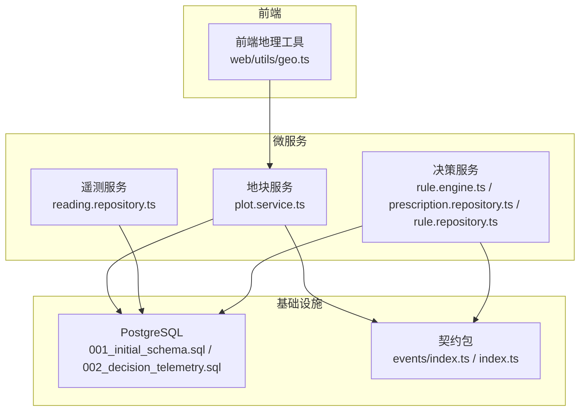
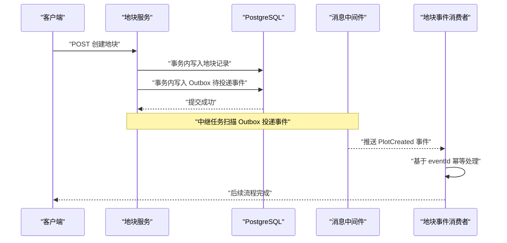
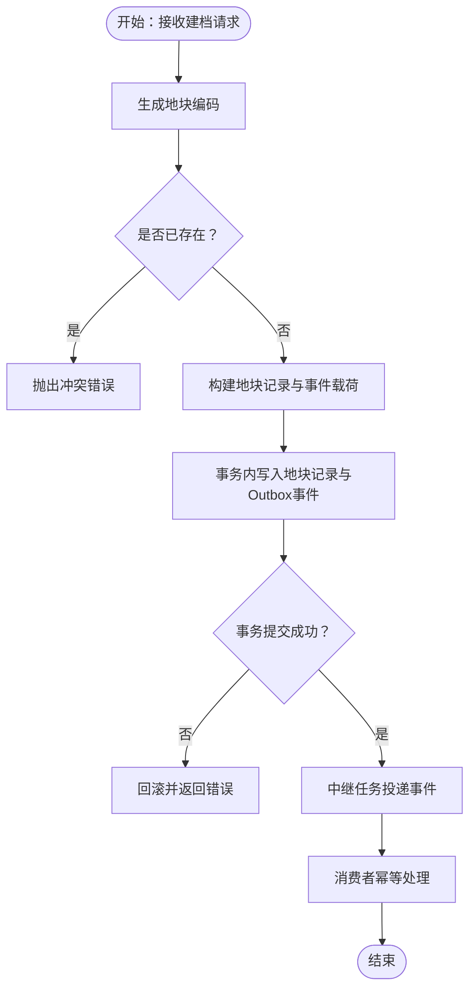
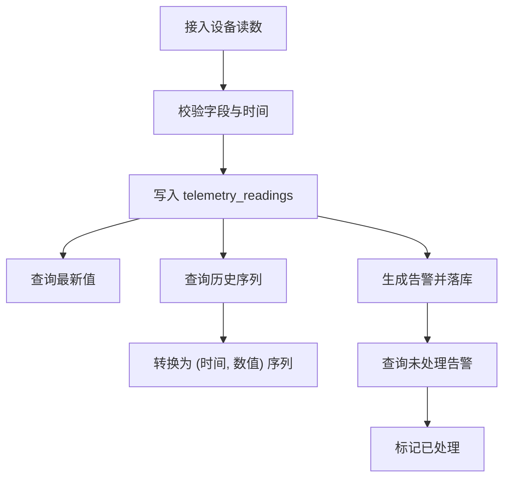
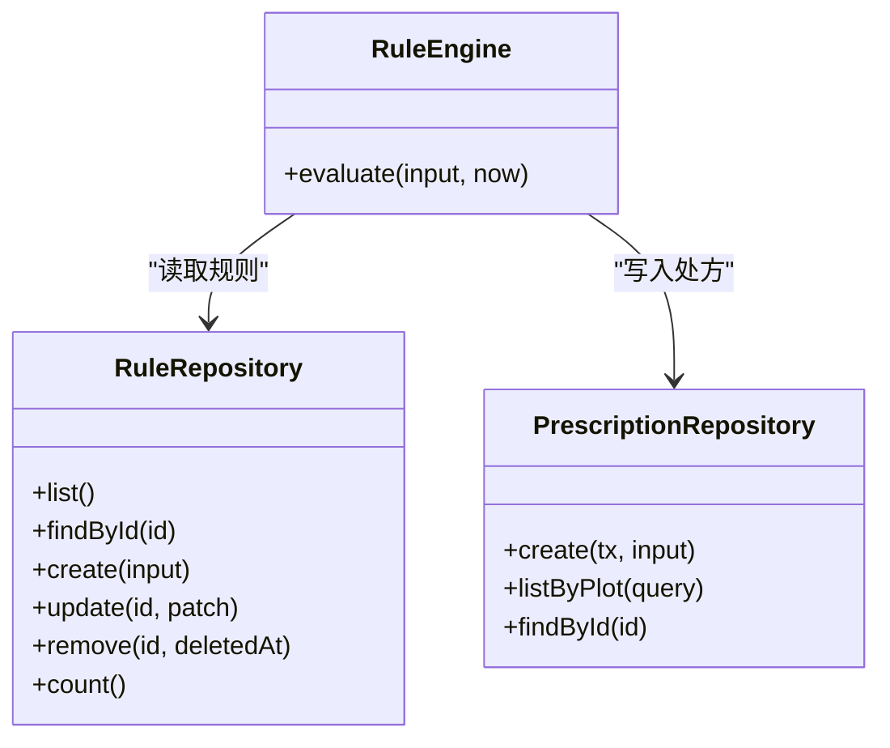
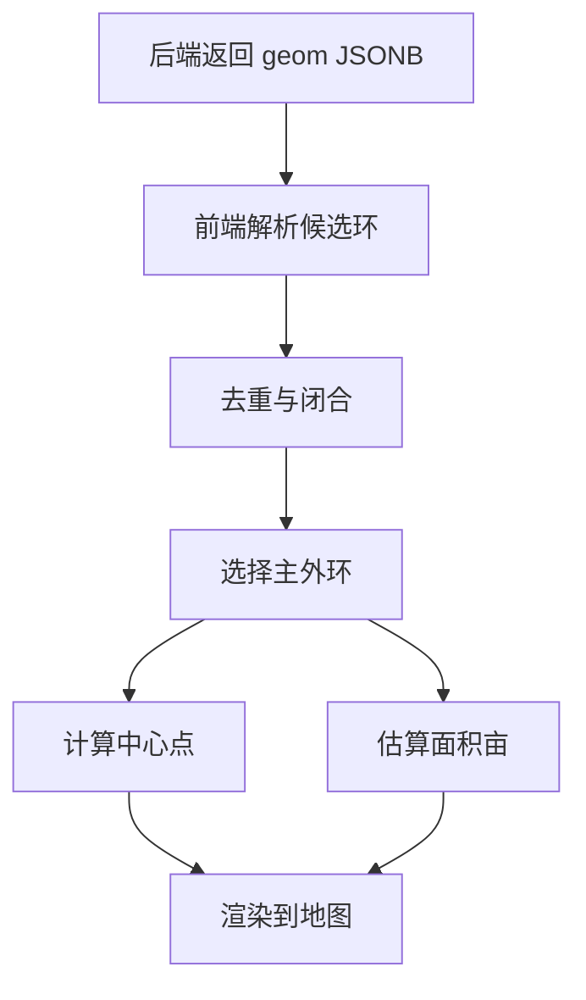
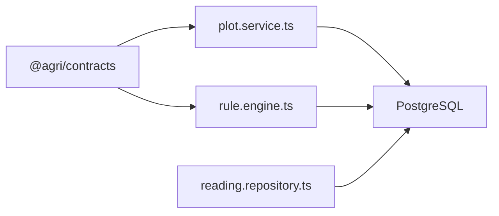
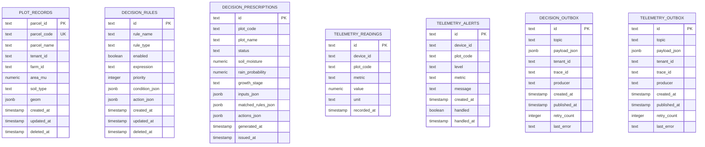
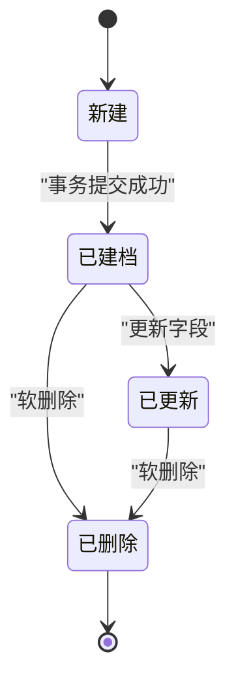
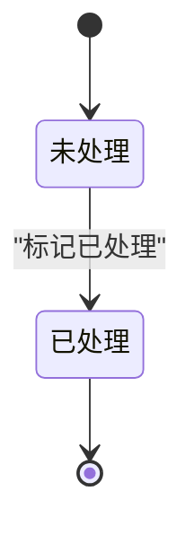

# 数据流设计

<cite>
**本文引用的文件**   
- [README.md](file://README.md)
- [apps/plot-service/src/plot.service.ts](file://apps/plot-service/src/plot.service.ts)
- [apps/plot-service/src/plot.consumer.ts](file://apps/plot-service/src/plot.consumer.ts)
- [apps/plot-service/src/plot.repository.ts](file://apps/plot-service/src/plot.repository.ts)
- [apps/telemetry-service/src/reading.repository.ts](file://apps/telemetry-service/src/reading.repository.ts)
- [apps/decision-service/src/rule.engine.ts](file://apps/decision-service/src/rule.engine.ts)
- [apps/decision-service/src/prescription.repository.ts](file://apps/decision-service/src/prescription.repository.ts)
- [apps/decision-service/src/rule.repository.ts](file://apps/decision-service/src/rule.repository.ts)
- [infra/postgres/migrations/001_initial_schema.sql](file://infra/postgres/migrations/001_initial_schema.sql)
- [infra/postgres/migrations/002_decision_telemetry.sql](file://infra/postgres/migrations/002_decision_telemetry.sql)
- [packages/contracts/src/index.ts](file://packages/contracts/src/index.ts)
- [packages/contracts/src/events/index.ts](file://packages/contracts/src/events/index.ts)
- [apps/web/src/utils/geo.ts](file://apps/web/src/utils/geo.ts)
</cite>

## 目录
1. [引言](#引言)
2. [项目结构](#项目结构)
3. [核心组件](#核心组件)
4. [架构总览](#架构总览)
5. [详细组件分析](#详细组件分析)
6. [依赖关系分析](#依赖关系分析)
7. [性能与瓶颈分析](#性能与瓶颈分析)
8. [故障排查指南](#故障排查指南)
9. [结论](#结论)
10. [附录：数据模型与状态转换](#附录数据模型与状态转换)

## 引言
本文件面向智慧农业平台的数据流设计，聚焦以下业务场景：
- 地块创建：以“区划码-农场码-片区号-地块序号-网格号-校验位”为锚点，完成建档、边界入库与事件发布。
- 遥测数据采集：设备读数写入时序表，支持最新值、历史查询与告警处理。
- 智能决策执行：规则热更新、条件求值、处方生成与留痕。

数据流转采用同步 HTTP 调用与异步事件（本地消息表 + 中继投递）混合模式；空间计算下沉 PostGIS，坐标统一 CGCS2000（EPSG:4490），前端展示时再换算为 Leaflet 的经纬度顺序。一致性通过事务内写业务数据与待投递事件保证，消费侧基于 eventId 幂等去重，重试按指数退避并转死信。

## 项目结构
仓库采用 pnpm workspace + Turborepo + tsc -b 的工程化组织方式，包含公共包与多个 NestJS 微服务。与数据流直接相关的服务包括：
- 地块服务：地块建档、编码生成、事件发布与消费者装配。
- 遥测服务：读数与告警持久化、历史查询。
- 决策服务：规则存储、规则求值引擎、处方留痕。
- 基础设施：PostgreSQL 迁移脚本定义业务表与消息出队表。
- 契约包：事件主题、载荷与错误码等跨服务契约。
- 前端工具：地理边界解析与面积估算。

图表来源
- [apps/plot-service/src/plot.service.ts:1-139](file://apps/plot-service/src/plot.service.ts#L1-L139)
- [apps/telemetry-service/src/reading.repository.ts:1-283](file://apps/telemetry-service/src/reading.repository.ts#L1-L283)
- [apps/decision-service/src/rule.engine.ts:1-97](file://apps/decision-service/src/rule.engine.ts#L1-L97)
- [apps/decision-service/src/prescription.repository.ts:1-196](file://apps/decision-service/src/prescription.repository.ts#L1-L196)
- [apps/decision-service/src/rule.repository.ts:1-297](file://apps/decision-service/src/rule.repository.ts#L1-L297)
- [infra/postgres/migrations/001_initial_schema.sql:1-41](file://infra/postgres/migrations/001_initial_schema.sql#L1-L41)
- [infra/postgres/migrations/002_decision_telemetry.sql:1-88](file://infra/postgres/migrations/002_decision_telemetry.sql#L1-L88)
- [packages/contracts/src/index.ts:1-12](file://packages/contracts/src/index.ts#L1-L12)
- [packages/contracts/src/events/index.ts:1-4](file://packages/contracts/src/events/index.ts#L1-L4)
- [apps/web/src/utils/geo.ts:1-131](file://apps/web/src/utils/geo.ts#L1-L131)

章节来源
- [README.md:1-167](file://README.md#L1-L167)

## 核心组件
- 地块服务
  - 负责地块编码生成、冲突检测、记录写入与事件入队。
  - 使用事务将业务记录与待投递事件写入同一数据库事务，确保“业务数据与事件同事务”。
- 遥测服务
  - 提供读数写入、最新值查询、历史查询与告警管理。
  - 使用 ULID 作为读数标识，按时间与指标维度建立索引。
- 决策服务
  - 规则仓储支持热更新；规则引擎每次求值从仓储读取最新规则集。
  - 处方记录保留输入快照、命中规则与动作明细，满足决策留痕。
- 契约与事件
  - 事件主题与载荷在契约包中集中定义，避免跨服务耦合。
- 前端地理工具
  - 解析 GeoJSON Polygon/MultiPolygon 与历史数组格式，剔除退化边界，输出 Leaflet 可用的环与中心点。

章节来源
- [apps/plot-service/src/plot.service.ts:1-139](file://apps/plot-service/src/plot.service.ts#L1-L139)
- [apps/telemetry-service/src/reading.repository.ts:1-283](file://apps/telemetry-service/src/reading.repository.ts#L1-L283)
- [apps/decision-service/src/rule.engine.ts:1-97](file://apps/decision-service/src/rule.engine.ts#L1-L97)
- [apps/decision-service/src/prescription.repository.ts:1-196](file://apps/decision-service/src/prescription.repository.ts#L1-L196)
- [apps/decision-service/src/rule.repository.ts:1-297](file://apps/decision-service/src/rule.repository.ts#L1-L297)
- [packages/contracts/src/index.ts:1-12](file://packages/contracts/src/index.ts#L1-L12)
- [packages/contracts/src/events/index.ts:1-4](file://packages/contracts/src/events/index.ts#L1-L4)
- [apps/web/src/utils/geo.ts:1-131](file://apps/web/src/utils/geo.ts#L1-L131)

## 架构总览
整体数据流由三类路径组成：
- 同步 HTTP 路径：客户端调用各服务接口，服务内部访问数据库或缓存。
- 异步事件路径：生产者在同一事务中写入业务数据与 Outbox 待投递事件，中继任务投递后消费者幂等处理。
- 空间数据处理路径：后端统一 CGCS2000 坐标入库，前端解析并转换为 Leaflet 坐标显示。

图表来源
- [apps/plot-service/src/plot.service.ts:53-104](file://apps/plot-service/src/plot.service.ts#L53-L104)
- [apps/plot-service/src/plot.consumer.ts:20-28](file://apps/plot-service/src/plot.consumer.ts#L20-L28)
- [infra/postgres/migrations/002_decision_telemetry.sql:61-87](file://infra/postgres/migrations/002_decision_telemetry.sql#L61-L87)

## 详细组件分析

### 地块创建数据流
- 输入参数包含租户、农场、区域、地块编号、名称、面积、土壤类型、边界几何与链路追踪 ID。
- 生成六段式地块编码，检查重复编码，构造地块记录与事件载荷。
- 在事务中同时写入地块记录与 Outbox 事件，确保“业务数据与事件同事务”。
- 消费者订阅 PlotCreated 事件，进行后续初始化工作（如网格与地力档案）。

图表来源
- [apps/plot-service/src/plot.service.ts:53-104](file://apps/plot-service/src/plot.service.ts#L53-L104)
- [apps/plot-service/src/plot.consumer.ts:20-28](file://apps/plot-service/src/plot.consumer.ts#L20-L28)

章节来源
- [apps/plot-service/src/plot.service.ts:1-139](file://apps/plot-service/src/plot.service.ts#L1-L139)
- [apps/plot-service/src/plot.consumer.ts:1-40](file://apps/plot-service/src/plot.consumer.ts#L1-L40)
- [infra/postgres/migrations/001_initial_schema.sql:1-41](file://infra/postgres/migrations/001_initial_schema.sql#L1-L41)

### 遥测数据采集与查询
- 读数写入：使用 ULID 生成 id，写入 telemetry_readings 表，包含设备、地块、指标、数值、单位与时间戳。
- 最新值查询：按设备与指标取最近一次读数，支持全量或单设备。
- 历史查询：支持按设备、指标、时间范围过滤，限制最大返回条数，避免大结果集拖慢查询。
- 告警处理：未处理告警列表与标记已处理操作，便于运维闭环。

图表来源
- [apps/telemetry-service/src/reading.repository.ts:104-161](file://apps/telemetry-service/src/reading.repository.ts#L104-L161)
- [apps/telemetry-service/src/reading.repository.ts:171-201](file://apps/telemetry-service/src/reading.repository.ts#L171-L201)
- [infra/postgres/migrations/002_decision_telemetry.sql:36-59](file://infra/postgres/migrations/002_decision_telemetry.sql#L36-L59)

章节来源
- [apps/telemetry-service/src/reading.repository.ts:1-283](file://apps/telemetry-service/src/reading.repository.ts#L1-L283)
- [infra/postgres/migrations/002_decision_telemetry.sql:36-59](file://infra/postgres/migrations/002_decision_telemetry.sql#L36-L59)

### 智能决策执行
- 规则热更新：规则以数据形式存储，服务每次求值从仓储读取最新规则集，无需重启。
- 条件求值：对土壤含水率、降雨概率、作物生育期进行匹配，命中规则累计动作。
- 处方留痕：保存输入快照、命中规则与动作明细，支持按地块查询历史处方。

图表来源
- [apps/decision-service/src/rule.repository.ts:76-84](file://apps/decision-service/src/rule.repository.ts#L76-L84)
- [apps/decision-service/src/rule.engine.ts:81-95](file://apps/decision-service/src/rule.engine.ts#L81-L95)
- [apps/decision-service/src/prescription.repository.ts:55-59](file://apps/decision-service/src/prescription.repository.ts#L55-L59)

章节来源
- [apps/decision-service/src/rule.engine.ts:1-97](file://apps/decision-service/src/rule.engine.ts#L1-L97)
- [apps/decision-service/src/rule.repository.ts:1-297](file://apps/decision-service/src/rule.repository.ts#L1-L297)
- [apps/decision-service/src/prescription.repository.ts:1-196](file://apps/decision-service/src/prescription.repository.ts#L1-L196)
- [infra/postgres/migrations/002_decision_telemetry.sql:5-34](file://infra/postgres/migrations/002_decision_telemetry.sql#L5-L34)

### 地理空间数据处理
- 后端统一 CGCS2000（EPSG:4490）坐标入库，空间运算下沉 PostGIS。
- 前端解析多种边界格式（GeoJSON Polygon/MultiPolygon、历史数组），剔除退化边界，选择主外环，计算中心点与面积。
- 坐标顺序转换：原始数据为 [经度, 纬度]，Leaflet 使用 [纬度, 经度]。

图表来源
- [apps/web/src/utils/geo.ts:17-108](file://apps/web/src/utils/geo.ts#L17-L108)
- [apps/web/src/utils/geo.ts:116-128](file://apps/web/src/utils/geo.ts#L116-L128)
- [apps/plot-service/src/plot.repository.ts:129-145](file://apps/plot-service/src/plot.repository.ts#L129-L145)

章节来源
- [apps/web/src/utils/geo.ts:1-131](file://apps/web/src/utils/geo.ts#L1-L131)
- [apps/plot-service/src/plot.repository.ts:94-187](file://apps/plot-service/src/plot.repository.ts#L94-L187)
- [infra/postgres/migrations/001_initial_schema.sql:1-15](file://infra/postgres/migrations/001_initial_schema.sql#L1-L15)

## 依赖关系分析
- 契约包作为唯一接口真相来源，仅导出类型与常量，不依赖能力包，降低耦合。
- 服务之间通过事件解耦：生产者写 Outbox，消费者订阅主题，避免强同步依赖。
- 数据库层通过迁移脚本统一管理表结构与索引，仓储实现封装 SQL 与对象映射。

图表来源
- [packages/contracts/src/index.ts:1-12](file://packages/contracts/src/index.ts#L1-L12)
- [apps/plot-service/src/plot.service.ts:1-139](file://apps/plot-service/src/plot.service.ts#L1-L139)
- [apps/decision-service/src/rule.engine.ts:1-97](file://apps/decision-service/src/rule.engine.ts#L1-L97)
- [apps/telemetry-service/src/reading.repository.ts:1-283](file://apps/telemetry-service/src/reading.repository.ts#L1-L283)

章节来源
- [packages/contracts/src/index.ts:1-12](file://packages/contracts/src/index.ts#L1-L12)
- [packages/contracts/src/events/index.ts:1-4](file://packages/contracts/src/events/index.ts#L1-L4)

## 性能与瓶颈分析
- 遥测历史查询
  - 限制最大返回条数（默认 200，上限 2000），避免大结果集导致网络与渲染压力。
  - 建议对高频查询增加缓存层（如 Redis），并按设备+指标维度缓存最新值。
- 决策规则求值
  - 每次求值从仓储读取全部规则，规则数量增长时需考虑分页或热点规则缓存。
  - 建议在规则变更频繁场景下引入规则版本与增量加载机制。
- 空间计算
  - 复杂叠加、缓冲区与面积计算应下沉 PostGIS，避免在服务端内存中进行昂贵计算。
  - 前端仅做轻量解析与展示，减少重复计算。
- 事件投递
  - Outbox 表需定期清理已发布事件，避免堆积影响查询性能。
  - 重试策略采用指数退避，避免雪崩；死信队列用于异常事件人工介入。

[本节为通用指导，不直接分析具体文件]

## 故障排查指南
- 地块编码冲突
  - 现象：建档时报冲突错误。
  - 排查：检查编码生成逻辑与重复键约束；确认上游是否重复调用。
- 事件未消费或重复消费
  - 现象：消费者未处理或处理多次。
  - 排查：确认 Outbox 投递状态与消费者 eventId 幂等逻辑；检查重试次数与死信。
- 遥测历史为空或数据缺失
  - 现象：查询无结果或时间范围不符。
  - 排查：检查 recorded_at 字段与时序索引；确认设备与指标过滤条件。
- 决策处方未生成
  - 现象：评估结果为 NO_ACTION。
  - 排查：检查规则 enabled 与优先级；核对输入字段（土壤含水率、降雨概率、生育期）。

章节来源
- [apps/plot-service/src/plot.service.ts:61-64](file://apps/plot-service/src/plot.service.ts#L61-L64)
- [apps/plot-service/src/plot.consumer.ts:20-28](file://apps/plot-service/src/plot.consumer.ts#L20-L28)
- [apps/telemetry-service/src/reading.repository.ts:135-156](file://apps/telemetry-service/src/reading.repository.ts#L135-L156)
- [apps/decision-service/src/rule.engine.ts:47-66](file://apps/decision-service/src/rule.engine.ts#L47-L66)

## 结论
本平台以“地块编码”为数据锚点，结合同步 HTTP 与异步事件双通道，实现了地块建档、遥测采集与智能决策的完整数据流。通过事务内写业务数据与 Outbox 事件，保障最终一致性；通过契约包与仓储抽象，降低服务间耦合；通过 PostGIS 与前端轻量解析，兼顾空间计算的准确性与展示性能。未来可在规则热更新、遥测缓存与事件投递吞吐方面进一步优化。

[本节为总结性内容，不直接分析具体文件]

## 附录：数据模型与状态转换

### 数据模型概览

图表来源
- [infra/postgres/migrations/001_initial_schema.sql:1-41](file://infra/postgres/migrations/001_initial_schema.sql#L1-L41)
- [infra/postgres/migrations/002_decision_telemetry.sql:5-87](file://infra/postgres/migrations/002_decision_telemetry.sql#L5-L87)

### 数据状态转换图（地块）

图表来源
- [apps/plot-service/src/plot.service.ts:124-137](file://apps/plot-service/src/plot.service.ts#L124-L137)
- [apps/plot-service/src/plot.repository.ts:148-175](file://apps/plot-service/src/plot.repository.ts#L148-L175)

### 数据状态转换图（遥测告警）

图表来源
- [apps/telemetry-service/src/reading.repository.ts:194-201](file://apps/telemetry-service/src/reading.repository.ts#L194-L201)