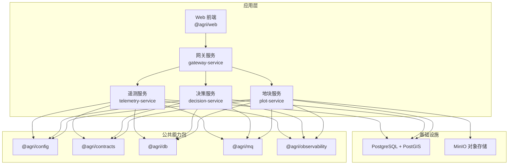
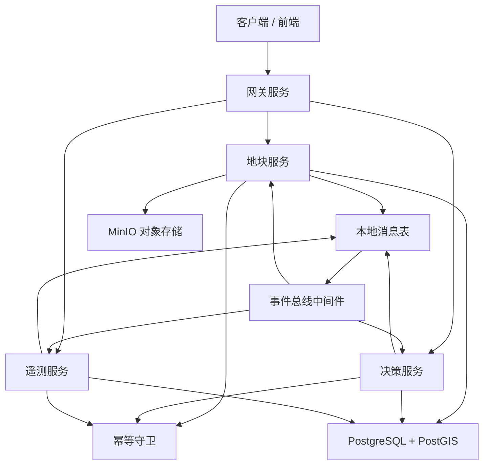
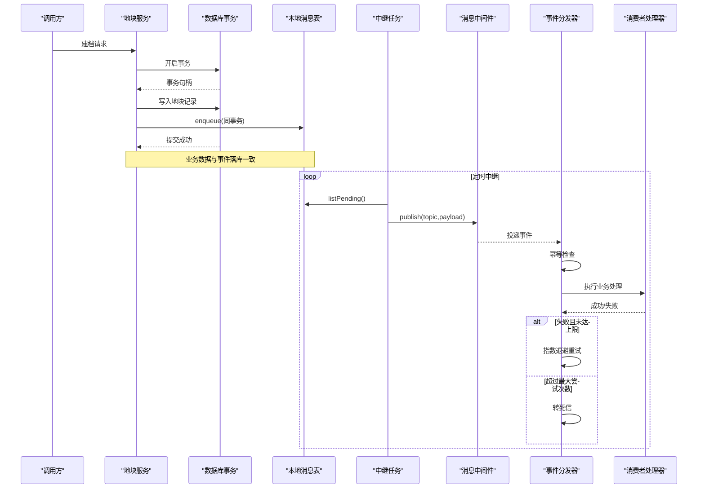
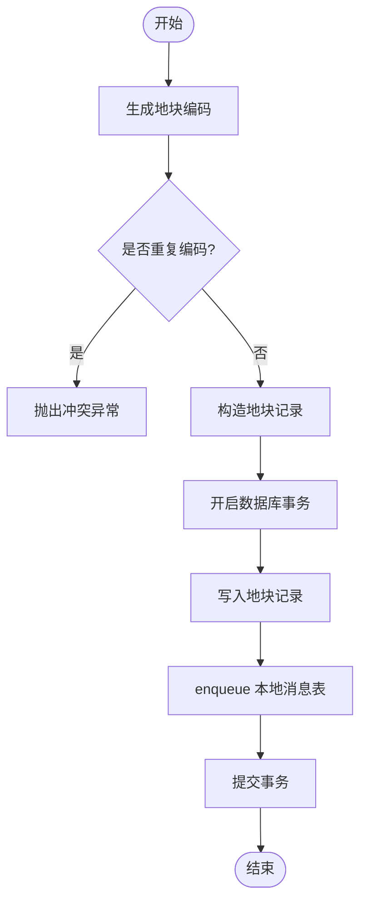
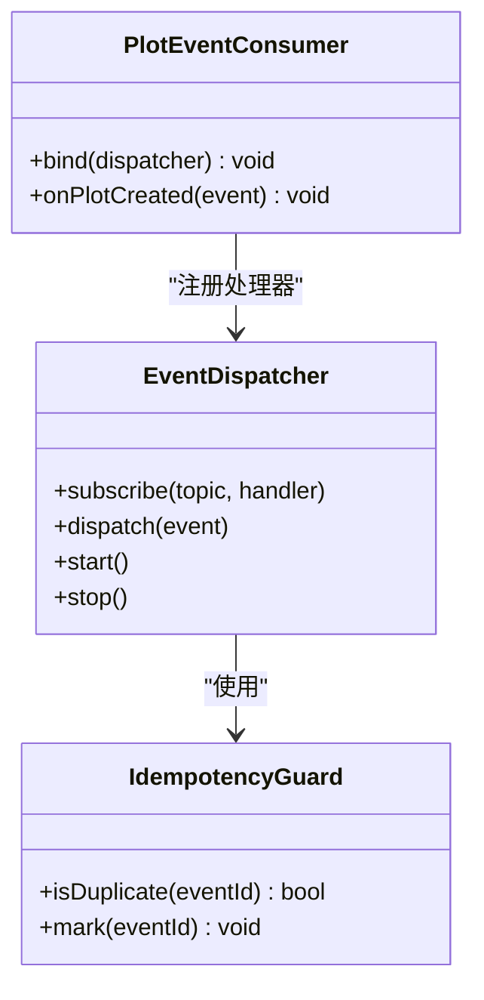
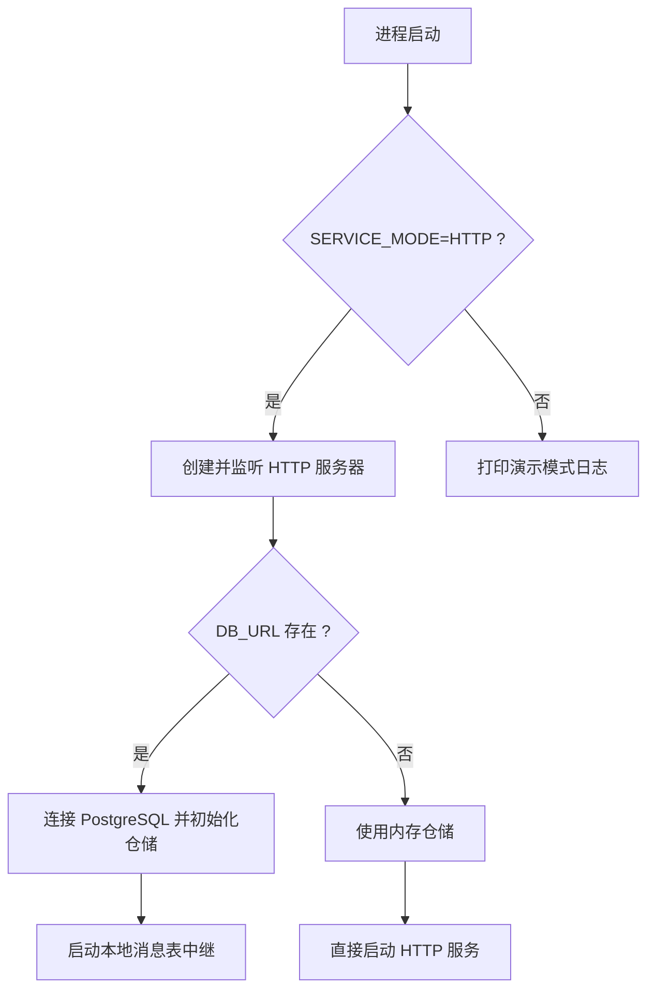
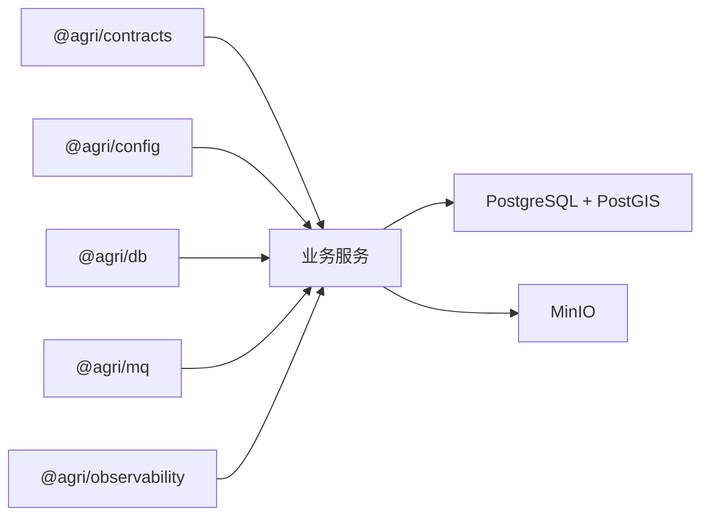
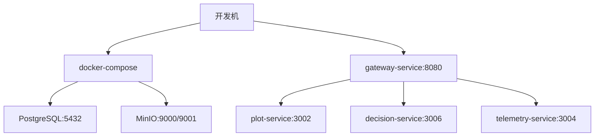

# 架构设计

<cite>
**本文引用的文件**   
- [README.md](file://README.md)
- [package.json](file://package.json)
- [apps/gateway-service/src/main.ts](file://apps/gateway-service/src/main.ts)
- [apps/decision-service/src/main.ts](file://apps/decision-service/src/main.ts)
- [apps/telemetry-service/src/main.ts](file://apps/telemetry-service/src/main.ts)
- [apps/plot-service/src/main.ts](file://apps/plot-service/src/main.ts)
- [apps/plot-service/src/plot.service.ts](file://apps/plot-service/src/plot.service.ts)
- [apps/plot-service/src/plot.consumer.ts](file://apps/plot-service/src/plot.consumer.ts)
- [packages/mq/src/index.ts](file://packages/mq/src/index.ts)
- [packages/mq/src/outbox.ts](file://packages/mq/src/outbox.ts)
- [packages/mq/src/idempotency.ts](file://packages/mq/src/idempotency.ts)
- [packages/mq/src/subscriber.ts](file://packages/mq/src/subscriber.ts)
- [packages/db/src/index.ts](file://packages/db/src/index.ts)
- [packages/observability/src/index.ts](file://packages/observability/src/index.ts)
- [packages/config/src/index.ts](file://packages/config/src/index.ts)
- [packages/contracts/src/index.ts](file://packages/contracts/src/index.ts)
- [infra/docker-compose.yml](file://infra/docker-compose.yml)
- [infra/postgres/migrations/001_initial_schema.sql](file://infra/postgres/migrations/001_initial_schema.sql)
</cite>

## 目录
1. [引言](#引言)
2. [项目结构](#项目结构)
3. [核心组件](#核心组件)
4. [架构总览](#架构总览)
5. [详细组件分析](#详细组件分析)
6. [依赖关系分析](#依赖关系分析)
7. [性能与可扩展性](#性能与可扩展性)
8. [横切关注点：安全、监控与灾难恢复](#横切关注点安全监控与灾难恢复)
9. [部署拓扑与基础设施](#部署拓扑与基础设施)
10. [故障排查指南](#故障排查指南)
11. [结论](#结论)

## 引言
本架构设计文档面向智慧农业平台，围绕以“地块”为最小管理单元的 Node.js 微服务工程骨架进行说明。系统采用 NestJS + TypeScript 的微服务架构，通过公共包沉淀配置、契约、数据库访问、消息与事件总线、可观测性等横切能力；业务侧由多个 HTTP 微服务组成，并通过本地消息表实现事件驱动的最终一致性，确保事件“不丢不重”。前端管理后台基于 Vue 生态，统一通过网关或后端 API 访问各服务。

## 项目结构
仓库采用 pnpm workspace 组织公共包与应用程序，Turborepo 编排构建任务，TypeScript 工程引用串联编译链。应用层位于 apps，公共能力位于 packages，基础设施定义在 infra，脚本与工具位于 scripts。

图表来源
- [README.md:58-84](file://README.md#L58-L84)
- [package.json:10-13](file://package.json#L10-L13)

章节来源
- [README.md:1-10](file://README.md#L1-L10)
- [README.md:58-103](file://README.md#L58-L103)
- [package.json:1-45](file://package.json#L1-L45)

## 核心组件
- 配置中心：@agri/config 负责环境变量校验、启动期加载与密钥读取，错误在启动期暴露。
- 契约包：@agri/contracts 是平台级接口真相来源，只定义类型、事件、错误码与 DTO，不依赖能力包。
- 数据访问：@agri/db 封装客户端生命周期、事务、分片路由、分页与软删除，不含业务模型。
- 消息与事件：@agri/mq 提供发布订阅、本地消息表、重试死信与幂等去重。
- 可观测性：@agri/observability 提供结构化日志、链路追踪与指标采集，共享上下文标识贯穿请求。

章节来源
- [packages/config/src/index.ts:1-9](file://packages/config/src/index.ts#L1-L9)
- [packages/contracts/src/index.ts:1-12](file://packages/contracts/src/index.ts#L1-L12)
- [packages/db/src/index.ts:1-15](file://packages/db/src/index.ts#L1-L15)
- [packages/mq/src/index.ts:1-41](file://packages/mq/src/index.ts#L1-L41)
- [packages/observability/src/index.ts:1-10](file://packages/observability/src/index.ts#L1-L10)

## 架构总览
平台采用分层与领域边界清晰的微服务架构：
- 接入层：网关服务统一入口，HTTP 模式监听端口并转发到下游服务。
- 业务服务层：地块、决策、遥测等服务各自维护领域数据与流程，通过本地消息表与事件总线与其他服务解耦。
- 能力支撑层：公共包提供配置、契约、数据库、消息与可观测性能力。
- 数据存储层：PostgreSQL + PostGIS 承载业务与空间数据，MinIO 承载文件与媒体资源。

图表来源
- [apps/gateway-service/src/main.ts:1-15](file://apps/gateway-service/src/main.ts#L1-L15)
- [apps/plot-service/src/main.ts:48-113](file://apps/plot-service/src/main.ts#L48-L113)
- [apps/decision-service/src/main.ts:18-55](file://apps/decision-service/src/main.ts#L18-L55)
- [apps/telemetry-service/src/main.ts:17-57](file://apps/telemetry-service/src/main.ts#L17-L57)
- [packages/mq/src/outbox.ts:50-137](file://packages/mq/src/outbox.ts#L50-L137)
- [packages/mq/src/subscriber.ts:25-102](file://packages/mq/src/subscriber.ts#L25-L102)
- [packages/mq/src/idempotency.ts:20-52](file://packages/mq/src/idempotency.ts#L20-L52)

## 详细组件分析

### 事件驱动与本地消息表
本地消息表保证业务数据与待投递事件在同一事务内写入，随后由中继任务周期性投递到消息中间件。消费端通过事件分发器执行处理器，先做幂等判断，再按策略重试，超限转入死信。

图表来源
- [apps/plot-service/src/plot.service.ts:53-104](file://apps/plot-service/src/plot.service.ts#L53-L104)
- [packages/mq/src/outbox.ts:50-137](file://packages/mq/src/outbox.ts#L50-L137)
- [packages/mq/src/subscriber.ts:70-102](file://packages/mq/src/subscriber.ts#L70-L102)
- [packages/mq/src/idempotency.ts:20-52](file://packages/mq/src/idempotency.ts#L20-L52)

章节来源
- [packages/mq/src/outbox.ts:6-12](file://packages/mq/src/outbox.ts#L6-L12)
- [packages/mq/src/outbox.ts:74-137](file://packages/mq/src/outbox.ts#L74-L137)
- [packages/mq/src/subscriber.ts:9-14](file://packages/mq/src/subscriber.ts#L9-L14)
- [packages/mq/src/subscriber.ts:70-102](file://packages/mq/src/subscriber.ts#L70-L102)
- [packages/mq/src/idempotency.ts:1-7](file://packages/mq/src/idempotency.ts#L1-L7)

### 地块服务：建模、编码与事件
地块服务负责地块建档、查询、更新与删除，并在建档时生成六段式地块编码，同时通过本地消息表发出“地块已创建”事件。

图表来源
- [apps/plot-service/src/plot.service.ts:53-104](file://apps/plot-service/src/plot.service.ts#L53-L104)

章节来源
- [apps/plot-service/src/plot.service.ts:13-19](file://apps/plot-service/src/plot.service.ts#L13-L19)
- [apps/plot-service/src/plot.service.ts:53-104](file://apps/plot-service/src/plot.service.ts#L53-L104)

### 事件消费者：职责与编排
消费者仅声明对特定主题的处理逻辑，反序列化、幂等、重试与死信由事件分发器统一承担。

图表来源
- [packages/mq/src/subscriber.ts:25-102](file://packages/mq/src/subscriber.ts#L25-L102)
- [packages/mq/src/idempotency.ts:20-52](file://packages/mq/src/idempotency.ts#L20-L52)
- [apps/plot-service/src/plot.consumer.ts:12-39](file://apps/plot-service/src/plot.consumer.ts#L12-L39)

章节来源
- [apps/plot-service/src/plot.consumer.ts:6-11](file://apps/plot-service/src/plot.consumer.ts#L6-L11)
- [apps/plot-service/src/plot.consumer.ts:20-39](file://apps/plot-service/src/plot.consumer.ts#L20-L39)

### 网关与服务启动模式
网关服务支持 HTTP 模式与非 HTTP 演示模式；其他服务如决策与遥测也根据环境变量切换 SQL 持久化与内存实现，便于本地演示与测试。

图表来源
- [apps/gateway-service/src/main.ts:4-12](file://apps/gateway-service/src/main.ts#L4-L12)
- [apps/decision-service/src/main.ts:18-55](file://apps/decision-service/src/main.ts#L18-L55)
- [apps/telemetry-service/src/main.ts:17-57](file://apps/telemetry-service/src/main.ts#L17-L57)

章节来源
- [apps/gateway-service/src/main.ts:1-15](file://apps/gateway-service/src/main.ts#L1-L15)
- [apps/decision-service/src/main.ts:18-55](file://apps/decision-service/src/main.ts#L18-L55)
- [apps/telemetry-service/src/main.ts:17-57](file://apps/telemetry-service/src/main.ts#L17-L57)

## 依赖关系分析
- 契约包 @agri/contracts 作为唯一接口真相来源，被所有服务与公共包引用，但不反向依赖任何能力包。
- 能力包之间禁止循环引用；@agri/mq 依赖 @agri/contracts、@agri/shared 与 @nestjs/common。
- 服务层依赖 @agri/config、@agri/db、@agri/mq、@agri/observability 与 @agri/contracts。
- 基础设施依赖 PostgreSQL + PostGIS 与 MinIO。

图表来源
- [packages/contracts/src/index.ts:1-12](file://packages/contracts/src/index.ts#L1-L12)
- [packages/mq/src/index.ts:1-41](file://packages/mq/src/index.ts#L1-L41)
- [infra/docker-compose.yml:1-39](file://infra/docker-compose.yml#L1-L39)

章节来源
- [README.md:105-118](file://README.md#L105-L118)
- [packages/mq/src/index.ts:1-41](file://packages/mq/src/index.ts#L1-L41)

## 性能与可扩展性
- 水平扩展：每个微服务无状态，可通过多实例扩容；事件消费侧通过消费者组与分区提升吞吐。
- 异步解耦：本地消息表与事件总线削峰填谷，避免同步调用链路的雪崩风险。
- 幂等与重试：幂等守卫与指数退避重试保障高负载下的稳定性；死信通道隔离异常事件。
- 数据库优化：PostGIS 承载空间运算，索引覆盖租户与时间维度；分页每页上限 200，排序字段服务端白名单校验。
- 缓存与中间件：缓存由各服务自行引入中间件，时序数据由物联感知服务直连时序库，不在通用数据库包范围内。

[本节为通用指导，不直接分析具体文件]

## 横切关注点：安全、监控与灾难恢复
- 安全性
  - 配置与密钥：通过 @agri/config 的密钥读取与环境变量校验，避免运行期泄露。
  - 鉴权与授权：网关或服务层应集成认证与权限控制，结合租户 ID 进行数据隔离。
  - 输入校验：契约包与 zod 校验确保载荷合法，减少注入与越权风险。
- 监控与可观测性
  - 结构化日志、链路追踪与指标采集共享上下文标识，贯穿一次请求。
  - 建议在生产环境接入集中式日志与指标平台，设置告警阈值。
- 灾难恢复
  - 本地消息表与幂等机制保障事件最终一致性与可重放。
  - 数据库备份与快照策略；MinIO 版本化与跨区域复制。
  - 死信队列用于人工干预与补偿作业。

章节来源
- [packages/observability/src/index.ts:1-10](file://packages/observability/src/index.ts#L1-L10)
- [packages/config/src/index.ts:1-9](file://packages/config/src/index.ts#L1-L9)
- [packages/mq/src/subscriber.ts:70-102](file://packages/mq/src/subscriber.ts#L70-L102)

## 部署拓扑与基础设施
- 运行时与框架
  - Node.js 24 LTS，NestJS 11 + TypeScript 5.9，pnpm workspace + Turborepo。
- 基础设施
  - PostgreSQL + PostGIS：业务与空间数据，含初始迁移。
  - MinIO：对象存储，控制台端口 9001。
- 服务端口与环境
  - 网关默认 8080，地块服务默认 3002，决策服务默认 3006，遥测服务默认 3004。
  - SERVICE_MODE=http 启用 HTTP 监听；DB_URL 决定 SQL 或内存仓储。
- 健康检查与冒烟测试
  - health:services 检查全部 HTTP 服务健康端点；smoke:services 启动并验证服务连通性。

图表来源
- [infra/docker-compose.yml:1-39](file://infra/docker-compose.yml#L1-L39)
- [apps/gateway-service/src/main.ts:4-12](file://apps/gateway-service/src/main.ts#L4-L12)
- [apps/plot-service/src/main.ts:101-113](file://apps/plot-service/src/main.ts#L101-L113)
- [apps/decision-service/src/main.ts:18-55](file://apps/decision-service/src/main.ts#L18-L55)
- [apps/telemetry-service/src/main.ts:17-57](file://apps/telemetry-service/src/main.ts#L17-L57)

章节来源
- [README.md:1-10](file://README.md#L1-L10)
- [README.md:12-54](file://README.md#L12-L54)
- [infra/docker-compose.yml:1-39](file://infra/docker-compose.yml#L1-L39)

## 故障排查指南
- 事件未消费或重复消费
  - 检查幂等守卫是否生效，确认 eventId 是否一致；查看分发器的 onError 回调与重试策略。
  - 核查本地消息表中继是否启动，OutboxService.start 是否被调用。
- 事件丢失
  - 确认业务事务中是否调用了 outbox.enqueue；检查 markPublished 与 markFailed 的状态流转。
- 数据库连接与迁移
  - 检查 DB_URL 与 pg 客户端连接；确认迁移脚本已执行。
- 健康检查失败
  - 使用 health:services 检查各服务端口与响应；确认 SERVICE_MODE 与 PORT 配置。

章节来源
- [packages/mq/src/subscriber.ts:70-102](file://packages/mq/src/subscriber.ts#L70-L102)
- [packages/mq/src/outbox.ts:94-137](file://packages/mq/src/outbox.ts#L94-L137)
- [infra/postgres/migrations/001_initial_schema.sql:1-41](file://infra/postgres/migrations/001_initial_schema.sql#L1-L41)
- [README.md:27-54](file://README.md#L27-L54)

## 结论
该智慧农业平台以微服务与事件驱动为核心，通过本地消息表与幂等机制实现“不丢不重”的最终一致性。公共包沉淀了跨服务的横切能力，契约包确保接口稳定与演进可控。PostgreSQL + PostGIS 与 MinIO 构成可靠的数据与存储底座。建议在生产环境中完善鉴权、审计、集中监控与备份策略，并按需扩展消费者组与中间件分区以提升吞吐与弹性。