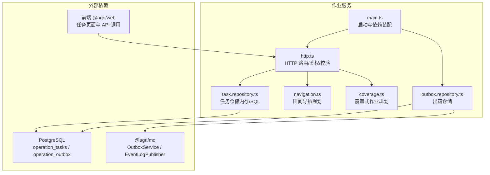
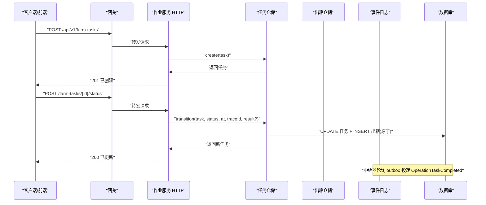
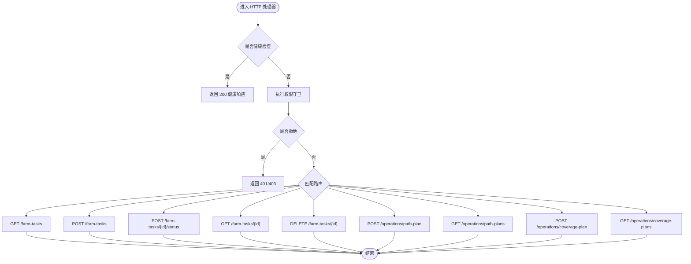
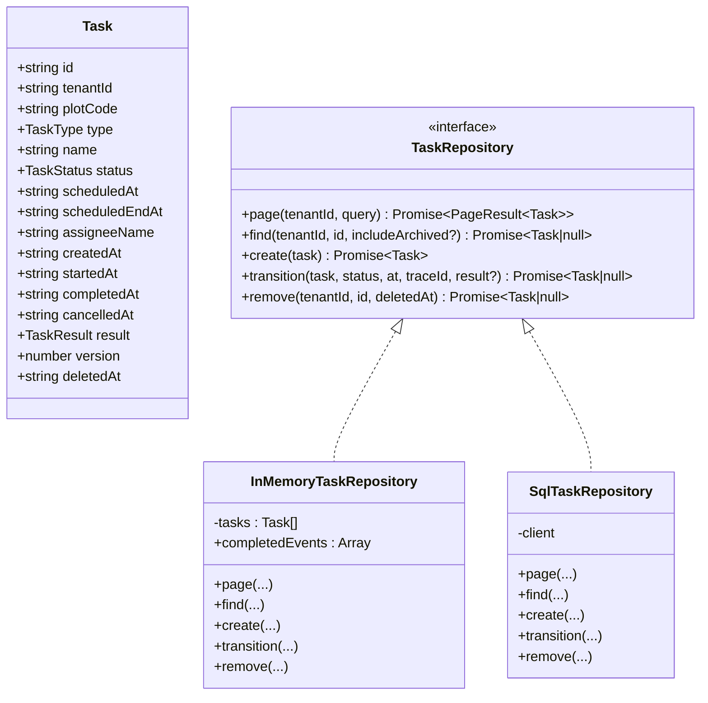
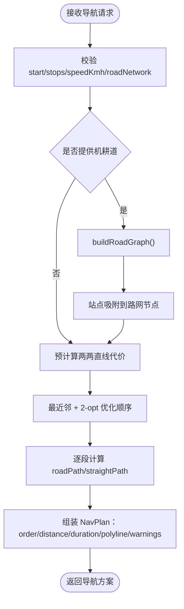
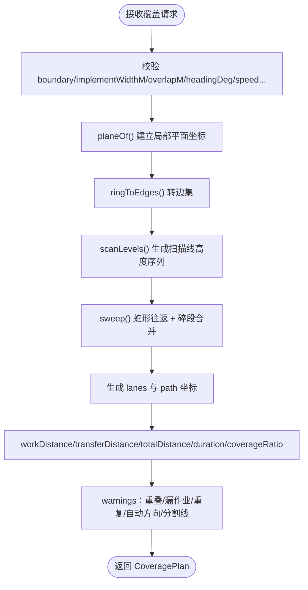
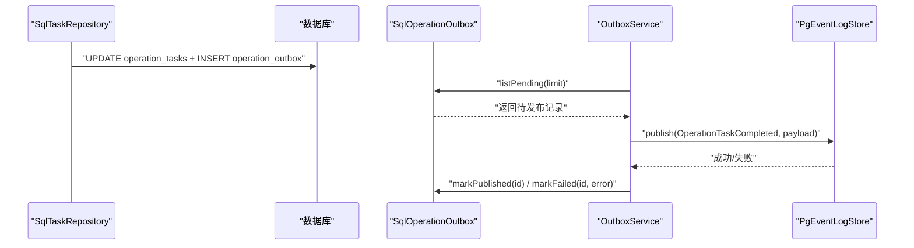
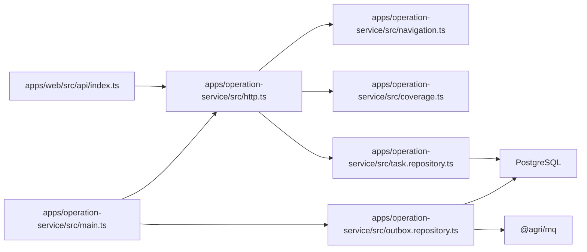
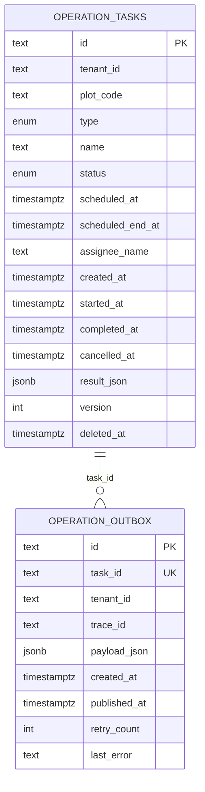

# 作业服务

<cite>
**本文引用的文件**   
- [README.md](file://README.md)
- [apps/operation-service/src/main.ts](file://apps/operation-service/src/main.ts)
- [apps/operation-service/src/http.ts](file://apps/operation-service/src/http.ts)
- [apps/operation-service/src/task.repository.ts](file://apps/operation-service/src/task.repository.ts)
- [apps/operation-service/src/navigation.ts](file://apps/operation-service/src/navigation.ts)
- [apps/operation-service/src/coverage.ts](file://apps/operation-service/src/coverage.ts)
- [apps/operation-service/src/outbox.repository.ts](file://apps/operation-service/src/outbox.repository.ts)
- [apps/operation-service/test/http.spec.ts](file://apps/operation-service/test/http.spec.ts)
- [apps/operation-service/test/navigation.spec.ts](file://apps/operation-service/test/navigation.spec.ts)
- [apps/operation-service/test/coverage.spec.ts](file://apps/operation-service/test/coverage.spec.ts)
- [apps/web/src/api/index.ts](file://apps/web/src/api/index.ts)
- [apps/web/src/views/farm/Task.vue](file://apps/web/src/views/farm/Task.vue)
- [infra/postgres/migrations/016_operation_tasks.sql](file://infra/postgres/migrations/016_operation_tasks.sql)
- [infra/postgres/migrations/037_operation_task_soft_delete.sql](file://infra/postgres/migrations/037_operation_task_soft_delete.sql)
</cite>

## 更新摘要
**变更内容**   
- 实现了作业任务从硬删除到软删除的迁移，新增 `deleted_at` 字段支持
- 统一了任务关键词搜索逻辑，修复了之前 name 和 plot_code 字段拼接导致的误匹配问题
- 新增了删除任务的 API 端点，支持 DELETE 操作进行软删除归档
- 增强了数据库索引优化，为活跃任务查询提供性能提升
- **新增了任务归档系统和三态过滤功能**，包括 TASK_ARCHIVE_FILTERS 常量、TaskArchiveFilter 类型、page() 方法的归档状态过滤、find() 方法的 includeArchived 参数
- **前端增强**，在 Task.vue 中增加了归档状态下拉框和已归档标签显示

## 目录
1. [简介](#简介)
2. [项目结构](#项目结构)
3. [核心组件](#核心组件)
4. [架构总览](#架构总览)
5. [详细组件分析](#详细组件分析)
6. [依赖关系分析](#依赖关系分析)
7. [性能与容量特性](#性能与容量特性)
8. [故障排查指南](#故障排查指南)
9. [结论](#结论)
10. [附录：接口与数据模型](#附录接口与数据模型)

## 简介
作业服务负责农事任务的全生命周期管理、田间导航规划与地块覆盖式作业规划，并提供事件出队能力，把"任务完成"事件原子写入本地消息表后投递到事件日志。它同时为前端提供统一的查询、创建、状态流转、路径/覆盖方案留痕与**软删除归档**接口，支持租户隔离、分页筛选、时间区间过滤、**三态归档过滤**与并发版本控制。

## 项目结构
作业服务位于 `apps/operation-service`，采用 Node.js 原生 HTTP + TypeScript 实现，入口通过环境变量切换演示模式与 HTTP 服务模式；HTTP 层集中处理路由、鉴权、参数校验与业务编排；仓储层提供内存与 SQL 两套实现；导航与覆盖算法独立成模块；出箱仓储对接数据库并配合消息中间件封装进行可靠投递。

**图表来源**
- [apps/operation-service/src/main.ts:8-18](file://apps/operation-service/src/main.ts#L8-L18)
- [apps/operation-service/src/http.ts:82-147](file://apps/operation-service/src/http.ts#L82-L147)
- [apps/operation-service/src/task.repository.ts:60-152](file://apps/operation-service/src/task.repository.ts#L60-L152)
- [apps/operation-service/src/navigation.ts:318-382](file://apps/operation-service/src/navigation.ts#L318-L382)
- [apps/operation-service/src/coverage.ts:266-356](file://apps/operation-service/src/coverage.ts#L266-L356)
- [apps/operation-service/src/outbox.repository.ts:6-15](file://apps/operation-service/src/outbox.repository.ts#L6-L15)

**章节来源**
- [README.md:160-191](file://README.md#L160-L191)
- [apps/operation-service/src/main.ts:8-18](file://apps/operation-service/src/main.ts#L8-L18)

## 核心组件
- HTTP 服务：统一健康检查、权限守卫、请求体解析、分页与时间区间校验、任务 CRUD、**软删除归档**、状态流转、导航与覆盖方案留痕。
- 任务仓储：内存实现用于测试与演示；SQL 实现使用原始 SQL 完成分页、条件筛选、**软删除无关的更新**与事务内原子写任务与出箱记录。**新增三态归档过滤支持**。
- 导航规划：最近邻排站 + 2-opt 优化，机耕道图 Dijkstra 沿路里程，站点吸附与直线回退策略，闭环作业支持。
- 覆盖规划：等距圆柱局部平面坐标 + 扫描线奇偶规则切多边形，蛇形往返布带，自动选方向，入场转移里程统计，覆盖倍数评估，增强的多边形边界验证与退化多边形检测。
- 出箱仓储：只读待发布队列，禁止重复 enqueue；与 OutboxService 配合完成重试、失败记录与成功标记。

**章节来源**
- [apps/operation-service/src/http.ts:82-147](file://apps/operation-service/src/http.ts#L82-L147)
- [apps/operation-service/src/task.repository.ts:60-152](file://apps/operation-service/src/task.repository.ts#L60-L152)
- [apps/operation-service/src/navigation.ts:318-382](file://apps/operation-service/src/navigation.ts#L318-L382)
- [apps/operation-service/src/coverage.ts:266-356](file://apps/operation-service/src/coverage.ts#L266-L356)
- [apps/operation-service/src/outbox.repository.ts:6-15](file://apps/operation-service/src/outbox.repository.ts#L6-L15)

## 架构总览
作业服务在 HTTP 模式下启动数据库连接，注入 SQL 任务仓储与出箱仓储，并启动中继器周期性读取未发布事件投递到事件日志；在非 HTTP 模式下仅输出演示信息。前端通过网关访问 `/api/v1/farm-tasks`、`/api/v1/operations/path-plan`、`/api/v1/operations/coverage-plan` 等接口。

**图表来源**
- [apps/operation-service/src/main.ts:8-18](file://apps/operation-service/src/main.ts#L8-L18)
- [apps/operation-service/src/http.ts:94-120](file://apps/operation-service/src/http.ts#L94-L120)
- [apps/operation-service/src/task.repository.ts:133-151](file://apps/operation-service/src/task.repository.ts#L133-L151)
- [apps/operation-service/src/outbox.repository.ts:9-14](file://apps/operation-service/src/outbox.repository.ts#L9-L14)

## 详细组件分析

### HTTP 路由与请求处理
- 健康端点：`GET /health` 返回服务名与健康状态。
- 权限守卫：基于 `@agri/shared` 的 `authorizeRequest`，按 `operation:read` / `operation:write` 校验。
- 任务接口：
  - `GET /api/v1/farm-tasks`：分页、关键词、类型、状态、地块编码、计划时间区间筛选，**新增归档状态过滤**。
  - `POST /api/v1/farm-tasks`：创建任务，默认类型为灌溉，校验计划窗口与负责人。
  - `POST /api/v1/farm-tasks/{id}/status`：状态流转，携带当前 version 防并发覆盖；完成时必须附带作业结果。
  - `GET /api/v1/farm-tasks/{id}`：任务详情，**支持 includeArchived 参数访问归档任务**。
  - **`DELETE /api/v1/farm-tasks/{id}`**：**新增**：软删除归档，设置 `deleted_at` 字段但不改变任务状态或版本号。
- 导航与覆盖方案留痕：
  - `POST /api/v1/operations/path-plan`：生成导航方案并保留最近 20 条。
  - `GET /api/v1/operations/path-plans`：按租户查看历史导航方案。
  - `POST /api/v1/operations/coverage-plan`：生成覆盖方案并保留最近 20 条。
  - `GET /api/v1/operations/coverage-plans`：按租户查看历史覆盖方案。
- 错误处理：输入非法返回 400，并发冲突返回 409，未知接口返回 404，内部异常返回 500。

**图表来源**
- [apps/operation-service/src/http.ts:86-147](file://apps/operation-service/src/http.ts#L86-L147)

**章节来源**
- [apps/operation-service/src/http.ts:82-147](file://apps/operation-service/src/http.ts#L82-L147)

### 任务仓储与状态机
- 枚举与类型：任务类型包含翻耕、播种、灌溉、除草、植保、施肥；状态包含待执行、进行中、已完成、已取消。
- **归档筛选**：**新增** `TASK_ARCHIVE_FILTERS = ["NONE", "ONLY", "ALL"]` 和三态过滤机制：
  - `NONE`（缺省）：只看在册任务（`deleted_at IS NULL`）
  - `ONLY`：只看已归档任务（`deleted_at IS NOT NULL`）
  - `ALL`：两者都看
- 状态机：
  - PENDING → RUNNING / CANCELLED
  - RUNNING → COMPLETED / CANCELLED
  - COMPLETED / CANCELLED 为终态，不可再迁移。
- 并发控制：通过 `version` 字段与 `canTransition` 判定，过期提交返回 409。
- 完成语义：完成必须附带作业结果，包括结果等级、实际作业面积与可选说明；完成时记录完成时间与结果 JSON。
- **软删除机制**：
  - 新增 `remove` 方法，仅设置 `deleted_at` 字段而不修改任务状态或版本号
  - 所有查询都增加 `deleted_at IS NULL` 条件，确保已归档任务不出现在列表中
  - 软删除后的任务无法再进行状态流转，但历史记录保持完整
- 内存仓储：适合测试与演示，维护 `completedEvents` 便于断言事件产出。
- SQL 仓储：
  - 分页查询使用动态 WHERE 拼接，支持关键词、枚举、地块编码与时间区间。
  - **归档过滤同时应用于 count 和分页查询**，确保总数与页内行数一致。
  - 状态转换使用单条 SQL 语句完成 UPDATE 与 INSERT 出箱记录，保证原子性。
  - 时间列统一经 `toIsoTimestamp` 转换，避免 pg 驱动 Date 映射问题。

**图表来源**
- [apps/operation-service/src/task.repository.ts:6-47](file://apps/operation-service/src/task.repository.ts#L6-L47)
- [apps/operation-service/src/task.repository.ts:60-95](file://apps/operation-service/src/task.repository.ts#L60-L95)
- [apps/operation-service/src/task.repository.ts:106-152](file://apps/operation-service/src/task.repository.ts#L106-L152)

**章节来源**
- [apps/operation-service/src/task.repository.ts:6-152](file://apps/operation-service/src/task.repository.ts#L6-L152)

### 田间导航规划
- 目标：给定起点与若干站点，输出访问顺序、分段里程与耗时、可叠加地图的折线。
- 顺序优化：最近邻启发式 + 2-opt 反向片段优化，减少回头路。
- 里程口径：
  - 无路网：经纬度等距圆柱近似距离。
  - 有路网：构建无向图，Dijkstra 最短路径；站点离路超过阈值退回直线并提示。
- 闭环作业：支持返回起点，增加最后一段回程。
- 入参校验：起点、站点列表、速度、路网格式与数量限制一次报错。

**图表来源**
- [apps/operation-service/src/navigation.ts:318-382](file://apps/operation-service/src/navigation.ts#L318-L382)
- [apps/operation-service/src/navigation.ts:400-447](file://apps/operation-service/src/navigation.ts#L400-L447)

**章节来源**
- [apps/operation-service/src/navigation.ts:318-382](file://apps/operation-service/src/navigation.ts#L318-L382)
- [apps/operation-service/src/navigation.ts:400-447](file://apps/operation-service/src/navigation.ts#L400-L447)

### 覆盖式作业规划
- 目标：对单个地块边界几何按农具幅宽等距布带，输出连续路径、作业与转移里程、覆盖倍数与警告。
- 坐标系：以环重心为原点建立等距圆柱局部平面坐标，旋转至作业方向轴系。
- 扫描线：按垂直作业带方向逐条扫描，奇偶规则求交区间，自动跳过内环（池塘/房屋缺口）。
- 蛇形往返：偶数条正向、奇数条反向，同一条线多段沿用同一行进方向；碎段小于半幅宽合并。
- 自动选方向：每 15° 试算候选，取总里程最小者；也可手工指定。
- 入场里程：可选起点，计入转移里程。
- 覆盖倍数：按台账亩数或外环几何现算，提示漏作业或重复覆盖。
- 增强的多边形边界验证：
  - 顶点不足检测：直接拒绝顶点少于 3 个的环，避免拖拉机从塘里开过去
  - 退化多边形检测：使用 `polygonAreaMu` 函数检测面积为 0 的退化几何
  - 边界完整性检查：确保外环和内环都满足闭合要求
  - 坐标范围验证：经纬度必须在合法范围内 (-180~180, -90~90)

**图表来源**
- [apps/operation-service/src/coverage.ts:266-356](file://apps/operation-service/src/coverage.ts#L266-L356)
- [apps/operation-service/src/coverage.ts:370-447](file://apps/operation-service/src/coverage.ts#L370-L447)

**章节来源**
- [apps/operation-service/src/coverage.ts:266-356](file://apps/operation-service/src/coverage.ts#L266-L356)
- [apps/operation-service/src/coverage.ts:370-447](file://apps/operation-service/src/coverage.ts#L370-L447)

### 出箱与事件投递
- 设计约束：任务完成事件必须与状态转换原子写入，因此出箱仓储不提供通用 `enqueue`，仅在 SQL 仓储的单条 SQL 中插入出箱记录。
- 中继流程：`OutboxService` 周期调用 `listPending` 拉取未发布记录，通过 `EventLogPublisher` 投递到事件日志；成功标记 `published_at`，失败递增 `retry_count` 并记录错误。
- 主题：固定为 `OperationTaskCompleted`，负载包含任务 ID、地块编码、任务类型、结果与完成时间。

**图表来源**
- [apps/operation-service/src/task.repository.ts:133-151](file://apps/operation-service/src/task.repository.ts#L133-L151)
- [apps/operation-service/src/outbox.repository.ts:6-15](file://apps/operation-service/src/outbox.repository.ts#L6-L15)
- [apps/operation-service/src/main.ts:14-16](file://apps/operation-service/src/main.ts#L14-L16)

**章节来源**
- [apps/operation-service/src/outbox.repository.ts:6-15](file://apps/operation-service/src/outbox.repository.ts#L6-L15)
- [apps/operation-service/src/main.ts:14-16](file://apps/operation-service/src/main.ts#L14-L16)

## 依赖关系分析
- 对外暴露：
  - HTTP 接口由 `createOperationHttpServer` 导出，供主进程监听端口。
  - 前端通过 `apps/web/src/api/index.ts` 中的 `operationApi` 调用任务与导航/覆盖接口。
- 内部依赖：
  - `http.ts` 依赖 `navigation.ts`、`coverage.ts`、`task.repository.ts`。
  - `main.ts` 依赖 `@agri/db`、`@agri/mq`、仓储与出箱实现。
  - 仓储依赖 `@agri/contracts` 的类型与 `@agri/shared` 的时间工具。
- 外部依赖：
  - PostgreSQL：任务表与出箱表。
  - 事件日志：通过 `@agri/mq` 的 `EventLogPublisher` 与 `PgEventLogStore`。

**图表来源**
- [apps/web/src/api/index.ts:678-696](file://apps/web/src/api/index.ts#L678-L696)
- [apps/operation-service/src/http.ts:82-147](file://apps/operation-service/src/http.ts#L82-L147)
- [apps/operation-service/src/main.ts:8-18](file://apps/operation-service/src/main.ts#L8-L18)

**章节来源**
- [apps/web/src/api/index.ts:678-696](file://apps/web/src/api/index.ts#L678-L696)
- [apps/operation-service/src/http.ts:82-147](file://apps/operation-service/src/http.ts#L82-L147)
- [apps/operation-service/src/main.ts:8-18](file://apps/operation-service/src/main.ts#L8-L18)

## 性能与容量特性
- 导航规划：
  - 站点上限 20，最近邻 + 2-opt 复杂度较低；路网节点量级几十到几百时使用线性取最小值的最短路实现。
  - 站点离机耕道超过 300 米退回直线，避免编造路网。
- 覆盖规划：
  - 作业带上限 2000，防止幅宽过小导致扫描线爆炸。
  - 自动选方向步长 15°，最多 12 个候选，取总里程最小。
  - 碎段合并半径为间距的一半，减少无效掉头。
  - 增强的边界验证：提前检测退化多边形和顶点不足的环，避免后续计算浪费。
- 任务查询：
  - SQL 分页使用动态 WHERE 与 ORDER BY created_at DESC, id DESC，避免全表排序。
  - **关键词搜索优化**：使用 `keywordHits` 函数对 name 和 plot_code 字段分别进行 ILIKE 匹配，避免了之前的字段拼接导致的误匹配问题。
  - **归档过滤优化**：归档条件同时应用于 count 和分页查询，确保总数与页内行数一致。
  - **软删除优化**：新增 `idx_operation_tasks_tenant_active` 索引，专门针对活跃任务查询进行优化。
- 并发控制：
  - 状态变更使用 `version` 乐观锁，过期提交直接拒绝。
  - SQL 状态转换单条语句完成更新与出箱插入，保证原子性。

[本节为通用性能讨论，不直接分析具体代码行]

## 故障排查指南
- 400 输入错误：
  - 任务创建缺少必填字段、计划结束早于开始、分页参数越界、时间格式非法。
  - 导航请求缺少站点、站点坐标非法、速度范围越界、路网格式不正确。
  - 覆盖请求边界退化、幅宽或重叠非法、方向或速度范围越界。
  - 多边形边界含顶点不足 3 个的环、边界退化成一条线（面积为 0）、边界外环顶点少于 3 个。
  - **归档筛选非法**：archived 参数必须是 NONE、ONLY 或 ALL。
- 404 资源不存在：
  - 任务详情不存在或跨租户访问。
  - **软删除任务**：已归档的任务无法通过详情接口获取，除非使用 `includeArchived=true`。
- 409 并发冲突：
  - 状态不允许迁移、版本过期、终态再次迁移。
- 500 内部异常：
  - 非输入类异常统一返回 500，建议结合链路追踪 ID 排查。
- 事件未投递：
  - 检查 `operation_outbox` 是否有未发布记录，确认中继器是否运行，核对 `last_error` 与 `retry_count`。
- **软删除相关问题**：
  - 删除后任务仍存在于数据库中，只是设置了 `deleted_at` 时间戳
  - 已删除任务不会出现在列表中，也无法进行状态流转
  - 删除操作不影响已完成的事件记录和历史数据
  - **归档任务可通过「归档状态=已归档」筛选重新找到**

**章节来源**
- [apps/operation-service/src/http.ts:143-146](file://apps/operation-service/src/http.ts#L143-L146)
- [apps/operation-service/test/http.spec.ts:161-183](file://apps/operation-service/test/http.spec.ts#L161-L183)
- [apps/operation-service/test/navigation.spec.ts:89-97](file://apps/operation-service/test/navigation.spec.ts#L89-L97)
- [apps/operation-service/test/coverage.spec.ts:149-162](file://apps/operation-service/test/coverage.spec.ts#L149-L162)
- [apps/operation-service/src/outbox.repository.ts:9-14](file://apps/operation-service/src/outbox.repository.ts#L9-L14)

## 结论
作业服务以简洁的 HTTP 层聚合任务管理与空间规划算法，通过内存与 SQL 双仓储适配不同场景，并以出箱机制保证任务完成事件的可靠投递。导航与覆盖算法兼顾实用性与鲁棒性，提供清晰的警告与回退策略；覆盖规划的边界验证得到显著增强，能够更早地识别和处理退化多边形和无效几何；**新增了完整的软删除机制和三态归档过滤功能，使任务删除语义与平台其他实体保持一致，同时保持了数据的完整性和可追溯性**；前端集成良好，支持完整的任务调度与作业规划体验，包括直观的归档状态筛选和已归档任务标识。

## 附录：接口与数据模型

### 前端 API 调用
- 任务查询与创建：
  - `getTasks(params)`：分页、关键词、状态、类型、地块编码、时间区间，**新增 archived 参数支持三态过滤**。
  - `createTask(data)`：创建任务，含计划时间窗口与负责人。
  - `updateStatus(id, status, options)`：状态流转，携带 version 与完成结果。
  - `getTask(id, includeArchived)`：任务详情，**支持 includeArchived 参数访问归档任务**。
  - **`deleteTask(id)`**：**新增**：软删除归档，设置 `deleted_at` 字段。
- 导航与覆盖方案：
  - `planNavigation(data)`：生成导航方案。
  - 其他覆盖相关接口由服务侧定义。

**章节来源**
- [apps/web/src/api/index.ts:678-696](file://apps/web/src/api/index.ts#L678-L696)
- [apps/web/src/views/farm/Task.vue:226-271](file://apps/web/src/views/farm/Task.vue#L226-L271)

### 数据库表结构
- `operation_tasks`：任务主表，包含租户、地块编码、类型、名称、状态、计划时间、负责人、创建/开始/完成/取消时间、结果 JSON 与版本号。**新增 `deleted_at` 字段用于软删除**。
- `operation_outbox`：出箱表，唯一关联任务 ID，记录租户、追踪 ID、负载 JSON、创建时间、发布时间、重试次数与错误信息。

**图表来源**
- [infra/postgres/migrations/016_operation_tasks.sql:25-35](file://infra/postgres/migrations/016_operation_tasks.sql#L25-L35)
- [infra/postgres/migrations/037_operation_task_soft_delete.sql:18-25](file://infra/postgres/migrations/037_operation_task_soft_delete.sql#L18-L25)

**章节来源**
- [infra/postgres/migrations/016_operation_tasks.sql:25-35](file://infra/postgres/migrations/016_operation_tasks.sql#L25-L35)
- [infra/postgres/migrations/037_operation_task_soft_delete.sql:1-26](file://infra/postgres/migrations/037_operation_task_soft_delete.sql#L1-L26)