现在我已经收集了足够的信息来更新作业服务文档。基于我的分析，新增的变量率规划功能包括：

1. **变量率规划算法** (`variable-rate.ts`) - 实现了网格级变量播种/施肥规划
2. **变量率规划仓储层** (`variable-rate.repository.ts`) - 提供内存和SQL两种实现
3. **数据库迁移** (`055_variable_rate_plans.sql`) - 创建变量率方案表
4. **HTTP API端点** - 在 `http.ts` 中添加了变量率规划的API接口
5. **前端集成** - 在前端API中添加了相关接口定义

让我更新现有的作业服务文档：

# 作业服务

<cite>
**本文引用的文件**   
- [README.md](file://README.md)
- [apps/operation-service/src/main.ts](file://apps/operation-service/src/main.ts)
- [apps/operation-service/src/http.ts](file://apps/operation-service/src/http.ts)
- [apps/operation-service/src/task.repository.ts](file://apps/operation-service/src/task.repository.ts)
- [apps/operation-service/src/task-change-log.repository.ts](file://apps/operation-service/src/task-change-log.repository.ts)
- [apps/operation-service/src/navigation.ts](file://apps/operation-service/src/navigation.ts)
- [apps/operation-service/src/coverage.ts](file://apps/operation-service/src/coverage.ts)
- [apps/operation-service/src/outbox.repository.ts](file://apps/operation-service/src/outbox.repository.ts)
- [apps/operation-service/src/variable-rate.ts](file://apps/operation-service/src/variable-rate.ts)
- [apps/operation-service/src/variable-rate.repository.ts](file://apps/operation-service/src/variable-rate.repository.ts)
- [apps/operation-service/test/http.spec.ts](file://apps/operation-service/test/http.spec.ts)
- [apps/operation-service/test/sql-task-repository.spec.ts](file://apps/operation-service/test/sql-task-repository.spec.ts)
- [apps/operation-service/test/variable-rate.spec.ts](file://apps/operation-service/test/variable-rate.spec.ts)
- [apps/web/src/api/index.ts](file://apps/web/src/api/index.ts)
- [infra/postgres/migrations/016_operation_tasks.sql](file://infra/postgres/migrations/016_operation_tasks.sql)
- [infra/postgres/migrations/037_operation_task_soft_delete.sql](file://infra/postgres/migrations/037_operation_task_soft_delete.sql)
- [infra/postgres/migrations/039_operation_task_change_logs.sql](file://infra/postgres/migrations/039_operation_task_change_logs.sql)
- [infra/postgres/migrations/042_operation_task_priority.sql](file://infra/postgres/migrations/042_operation_task_priority.sql)
- [infra/postgres/migrations/055_variable_rate_plans.sql](file://infra/postgres/migrations/055_variable_rate_plans.sql)
</cite>

## 更新摘要
**变更内容**   
- 实现了作业任务从硬删除到软删除的迁移，新增 `deleted_at` 字段支持
- 统一了任务关键词搜索逻辑，修复了之前 name 和 plot_code 字段拼接导致的误匹配问题
- 新增了删除任务的 API 端点，支持 DELETE 操作进行软删除归档
- 增强了数据库索引优化，为活跃任务查询提供性能提升
- **新增了任务归档系统和三态过滤功能**，包括 TASK_ARCHIVE_FILTERS 常量、TaskArchiveFilter 类型、page() 方法的归档状态过滤、find() 方法的 includeArchived 参数
- **新增了完整的审计追踪系统**，包括 operation_task_change_logs 表、TaskChangeLogRepository 实现、任务变更日志记录机制
- **新增了任务优先级系统**，支持 HIGH（紧急）、NORMAL（常规）、LOW（可延后）三档优先级，与数据库迁移 042 保持一致
- **新增了冲突检测系统**，基于地块重叠或共享负责人的计划时间冲突检测，提供冲突提示但不阻断创建
- **新增了网格级变量播种/施肥规划功能**，支持基于长势网格的逐带速率映射，包含完整的算法实现、仓储层和数据持久化
- **前端增强**，在 Task.vue 中增加了归档状态下拉框、已归档标签显示和操作历史展示功能，以及优先级和冲突检测支持

## 目录
1. [简介](#简介)
2. [项目结构](#项目结构)
3. [核心组件](#核心组件)
4. [架构总览](#架构总览)
5. [详细组件分析](#详细组件分析)
6. [依赖关系分析](#依赖关系分析)
7. [性能与容量特性](#性能与容量特性)
8. [故障排查指南](#故障排查指南)
9. [结论](#结论)
10. [附录：接口与数据模型](#附录接口与数据模型)

## 简介
作业服务负责农事任务的全生命周期管理、田间导航规划与地块覆盖式作业规划，并提供事件出队能力，把"任务完成"事件原子写入本地消息表后投递到事件日志。它同时为前端提供统一的查询、创建、状态流转、路径/覆盖方案留痕、**软删除归档**、**完整审计追踪**、**任务优先级管理**和**冲突检测**接口，支持租户隔离、分页筛选、时间区间过滤、**三态归档过滤**与并发版本控制。**新增网格级变量播种/施肥规划功能**，支持基于长势网格的逐带速率映射，为精准农业提供智能决策支持。

## 项目结构
作业服务位于 `apps/operation-service`，采用 Node.js 原生 HTTP + TypeScript 实现，入口通过环境变量切换演示模式与 HTTP 服务模式；HTTP 层集中处理路由、鉴权、参数校验与业务编排；仓储层提供内存与 SQL 两套实现；导航与覆盖算法独立成模块；出箱仓储对接数据库并配合消息中间件封装进行可靠投递；**新增变量率规划算法和仓储层用于精准农业作业**。

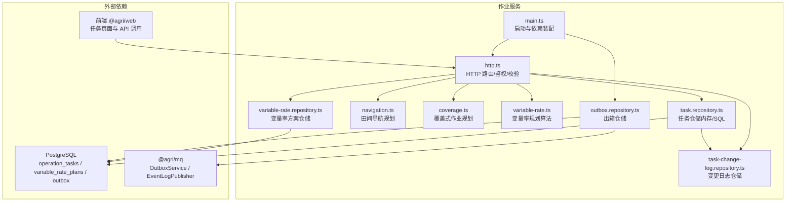

**图表来源**
- [apps/operation-service/src/main.ts:8-18](file://apps/operation-service/src/main.ts#L8-L18)
- [apps/operation-service/src/http.ts:82-147](file://apps/operation-service/src/http.ts#L82-L147)
- [apps/operation-service/src/task.repository.ts:60-152](file://apps/operation-service/src/task.repository.ts#L60-L152)
- [apps/operation-service/src/task-change-log.repository.ts:35-85](file://apps/operation-service/src/task-change-log.repository.ts#L35-L85)
- [apps/operation-service/src/navigation.ts:318-382](file://apps/operation-service/src/navigation.ts#L318-L382)
- [apps/operation-service/src/coverage.ts:266-356](file://apps/operation-service/src/coverage.ts#L266-L356)
- [apps/operation-service/src/variable-rate.ts:167-259](file://apps/operation-service/src/variable-rate.ts#L167-L259)
- [apps/operation-service/src/variable-rate.repository.ts:29-71](file://apps/operation-service/src/variable-rate.repository.ts#L29-L71)
- [apps/operation-service/src/outbox.repository.ts:6-15](file://apps/operation-service/src/outbox.repository.ts#L6-L15)

**章节来源**
- [README.md:160-191](file://README.md#L160-L191)
- [apps/operation-service/src/main.ts:8-18](file://apps/operation-service/src/main.ts#L8-L18)

## 核心组件
- HTTP 服务：统一健康检查、权限守卫、请求体解析、分页与时间区间校验、任务 CRUD、**软删除归档**、状态流转、导航与覆盖方案留痕、**操作历史查询**、**优先级验证**和**冲突检测**，**新增变量率规划接口**。
- 任务仓储：内存实现用于测试与演示；SQL 实现使用原始 SQL 完成分页、条件筛选、**软删除无关的更新**与事务内原子写任务与出箱记录。**新增三态归档过滤支持、优先级字段处理和冲突检测集成**。
- **变更日志仓储**：**新增**专门用于审计追踪的仓储层，提供 append 和 listByTask 方法，支持内存和 SQL 两种实现。
- **冲突检测引擎**：**新增**纯函数实现的冲突判定逻辑，支持同地块和同负责人计划时间重叠检测，提供冲突提示但不阻断任务创建。
- **变量率规划引擎**：**新增**网格级变量播种/施肥规划算法，基于长势网格进行逐带速率映射，支持弱苗补肥等精准农业场景。
- 导航规划：最近邻排站 + 2-opt 优化，机耕道图 Dijkstra 沿路里程，站点吸附与直线回退策略，闭环作业支持。
- 覆盖规划：等距圆柱局部平面坐标 + 扫描线奇偶规则切多边形，蛇形往返布带，自动选方向，入场转移里程统计，覆盖倍数评估，增强的多边形边界验证与退化多边形检测。
- **变量率方案仓储**：**新增**提供内存和 SQL 两种实现，支持变量播种/施肥方案的持久化和查询。
- 出箱仓储：只读待发布队列，禁止重复 enqueue；与 OutboxService 配合完成重试、失败记录与成功标记。

**章节来源**
- [apps/operation-service/src/http.ts:82-147](file://apps/operation-service/src/http.ts#L82-L147)
- [apps/operation-service/src/task.repository.ts:60-152](file://apps/operation-service/src/task.repository.ts#L60-L152)
- [apps/operation-service/src/task-change-log.repository.ts:35-85](file://apps/operation-service/src/task-change-log.repository.ts#L35-L85)
- [apps/operation-service/src/variable-rate.ts:167-259](file://apps/operation-service/src/variable-rate.ts#L167-L259)
- [apps/operation-service/src/variable-rate.repository.ts:29-71](file://apps/operation-service/src/variable-rate.repository.ts#L29-L71)
- [apps/operation-service/src/navigation.ts:318-382](file://apps/operation-service/src/navigation.ts#L318-L382)
- [apps/operation-service/src/coverage.ts:266-356](file://apps/operation-service/src/coverage.ts#L266-L356)
- [apps/operation-service/src/outbox.repository.ts:6-15](file://apps/operation-service/src/outbox.repository.ts#L6-L15)

## 架构总览
作业服务在 HTTP 模式下启动数据库连接，注入 SQL 任务仓储与出箱仓储，并启动中继器周期性读取未发布事件投递到事件日志；在非 HTTP 模式下仅输出演示信息。前端通过网关访问 `/api/v1/farm-tasks`、`/api/v1/operations/path-plan`、`/api/v1/operations/coverage-plan`、**`/api/v1/operations/variable-rate-plan`** 等接口。

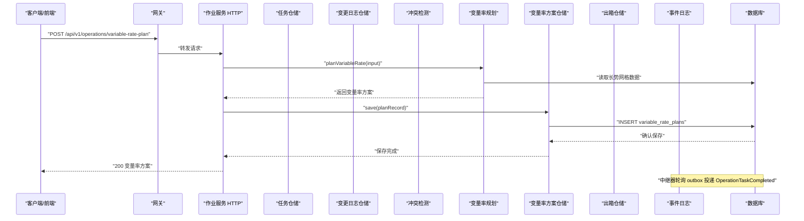

**图表来源**
- [apps/operation-service/src/main.ts:8-18](file://apps/operation-service/src/main.ts#L8-L18)
- [apps/operation-service/src/http.ts:200-207](file://apps/operation-service/src/http.ts#L200-L207)
- [apps/operation-service/src/variable-rate.ts:167-259](file://apps/operation-service/src/variable-rate.ts#L167-L259)
- [apps/operation-service/src/variable-rate.repository.ts:55-71](file://apps/operation-service/src/variable-rate.repository.ts#L55-L71)

## 详细组件分析

### HTTP 路由与请求处理
- 健康端点：`GET /health` 返回服务名与健康状态。
- 权限守卫：基于 `@agri/shared` 的 `authorizeRequest`，按 `operation:read` / `operation:write` 校验。
- 任务接口：
  - `GET /api/v1/farm-tasks`：分页、关键词、类型、状态、**优先级**、地块编码、计划时间区间筛选，**新增归档状态过滤**。
  - `POST /api/v1/farm-tasks`：创建任务，默认类型为灌溉，校验计划窗口与负责人，**新增优先级验证**，**返回冲突检测结果**。
  - `POST /api/v1/farm-tasks/{id}/status`：状态流转，携带当前 version 防并发覆盖；完成时必须附带作业结果。
  - `GET /api/v1/farm-tasks/{id}`：任务详情，**支持 includeArchived 参数访问归档任务**。
  - **`DELETE /api/v1/farm-tasks/{id}`**：**新增**：软删除归档，设置 `deleted_at` 字段但不改变任务状态或版本号。
  - **`GET /api/v1/farm-tasks/{id}/history`**：**新增**：获取任务变更历史，包含建档、状态流转、归档等操作记录。
  - **`GET /api/v1/farm-tasks/{id}/conflicts`**：**新增**：重新计算指定任务的排程冲突，供改期或负责人调整后复核。
- 导航与覆盖方案留痕：
  - `POST /api/v1/operations/path-plan`：生成导航方案并保留最近 20 条。
  - `GET /api/v1/operations/path-plans`：按租户查看历史导航方案。
  - `POST /api/v1/operations/coverage-plan`：生成覆盖方案并保留最近 20 条。
  - `GET /api/v1/operations/coverage-plans`：按租户查看历史覆盖方案。
- **变量率规划接口**：**新增**：
  - **`POST /api/v1/operations/variable-rate-plan`**：生成变量播种/施肥方案，基于长势网格进行逐带速率映射，方案落库留痕。
  - **`GET /api/v1/operations/variable-rate-plans`**：按租户查看最近的变量率方案历史，支持生产档案复盘。
- 错误处理：输入非法返回 400，并发冲突返回 409，未知接口返回 404，内部异常返回 500。

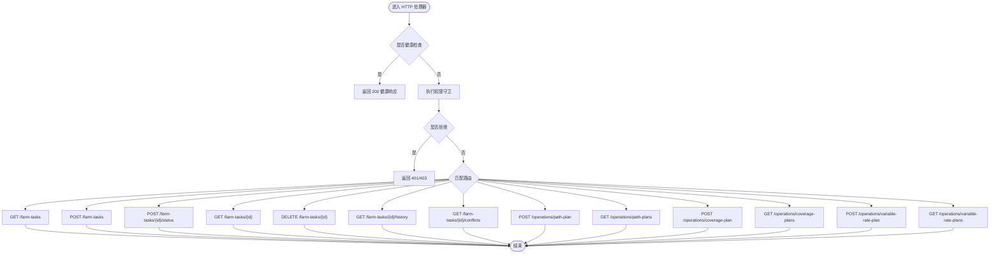

**图表来源**
- [apps/operation-service/src/http.ts:86-147](file://apps/operation-service/src/http.ts#L86-L147)
- [apps/operation-service/src/http.ts:200-207](file://apps/operation-service/src/http.ts#L200-L207)

**章节来源**
- [apps/operation-service/src/http.ts:82-147](file://apps/operation-service/src/http.ts#L82-L147)
- [apps/operation-service/src/http.ts:200-207](file://apps/operation-service/src/http.ts#L200-L207)

### 任务仓储与状态机
- 枚举与类型：任务类型包含翻耕、播种、灌溉、除草、植保、施肥；状态包含待执行、进行中、已完成、已取消；**优先级包含 HIGH（紧急）、NORMAL（常规）、LOW（可延后）**。
- **归档筛选**：**新增** `TASK_ARCHIVE_FILTERS = ["NONE", "ONLY", "ALL"]` 和三态过滤机制：
  - `NONE`（缺省）：只看在册任务（`deleted_at IS NULL`）
  - `ONLY`：只看已归档任务（`deleted_at IS NOT NULL`）
  - `ALL`：两者都看
- 状态机：
  - PENDING → RUNNING / CANCELLED
  - RUNNING → COMPLETED / CANCELLED
  - COMPLETED / CANCELLED 为终态，不可再迁移。
- 并发控制：通过 `version` 字段与 `canTransition` 判定，过期提交返回 409。
- 完成语义：完成必须附带作业结果，包括结果等级、实际作业面积与可选说明；完成时记录完成时间与结果 JSON。
- **软删除机制**：
  - 新增 `remove` 方法，仅设置 `deleted_at` 字段而不修改任务状态或版本号
  - 所有查询都增加 `deleted_at IS NULL` 条件，确保已归档任务不出现在列表中
  - 软删除后的任务无法再进行状态流转，但历史记录保持完整
- **变更日志集成**：
  - 所有任务操作（创建、状态流转、归档）都会自动生成变更日志
  - 变更日志与主操作在同一事务中完成，保证一致性
  - 支持按任务 ID 查询完整操作历史
- **冲突检测集成**：
  - 新增 `conflicts` 方法，支持内存和 SQL 两种实现
  - 基于 `ConflictProbe` 接口描述待检查的排程，支持地块编码、负责人、计划时间等条件
  - 使用 `conflictsOf` 纯函数进行冲突判定，避免业务逻辑分散
  - 返回 `TaskConflict[]` 数组，包含命中的任务和冲突原因（同地块/同负责人）
- 内存仓储：适合测试与演示，维护 `completedEvents` 便于断言事件产出。
- SQL 仓储：
  - 分页查询使用动态 WHERE 拼接，支持关键词、枚举、地块编码与时间区间。
  - **归档过滤同时应用于 count 和分页查询**，确保总数与页内行数一致。
  - 状态转换使用单条 SQL 语句完成 UPDATE 与 INSERT 出箱记录，保证原子性。
  - 时间列统一经 `toIsoTimestamp` 转换，避免 pg 驱动 Date 映射问题。
  - **优先级字段支持**：插入、查询和排序时正确处理 priority 字段。

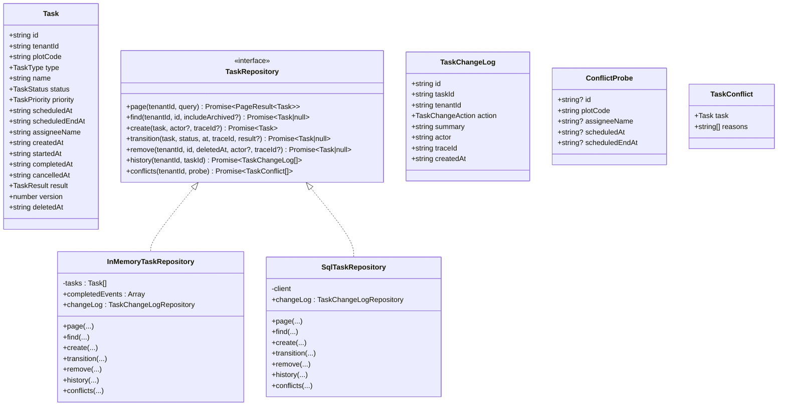

**图表来源**
- [apps/operation-service/src/task.repository.ts:6-47](file://apps/operation-service/src/task.repository.ts#L6-L47)
- [apps/operation-service/src/task.repository.ts:60-95](file://apps/operation-service/src/task.repository.ts#L60-L95)
- [apps/operation-service/src/task.repository.ts:106-152](file://apps/operation-service/src/task.repository.ts#L106-L152)
- [apps/operation-service/src/task-change-log.repository.ts:20-39](file://apps/operation-service/src/task-change-log.repository.ts#L20-L39)

**章节来源**
- [apps/operation-service/src/task.repository.ts:6-152](file://apps/operation-service/src/task.repository.ts#L6-L152)

### 冲突检测引擎
- **设计目标**：提供灵活的排程冲突检测能力，基于地块重叠或共享负责人进行计划时间冲突判断，提供冲突提示但不阻断任务创建。
- **核心特性**：
  - 双维度冲突检测：同地块计划时间重叠、同负责人计划时间重叠
  - 时间窗闭区间比较：双方都给了计划开始时间才进行比较，时间窗按 `[开始, 结束 ?? 开始]` 闭区间判重叠
  - 状态过滤：只检测在册且未结束（PENDING/RUNNING）的任务
  - 排除自身：支持传入任务 ID 以排除自身参与冲突检测
  - 负责人空值处理：负责人为空不参与「同人」判定
  - 纯函数实现：`conflictsOf` 函数不依赖外部状态，便于测试和复用
- **SQL 实现**：
  - 预筛选可能命中的行：同地块或同负责人、在册未结束、排过时间
  - 使用 `conflictsOf` 纯函数进行最终冲突判定
  - 返回 `TaskConflict[]` 数组，每条包含命中的任务和冲突原因列表
- **内存实现**：
  - 直接过滤内存中的任务数组
  - 深拷贝返回结果，防止外部修改影响内部状态
  - 与 SQL 实现保持完全一致的冲突判定逻辑

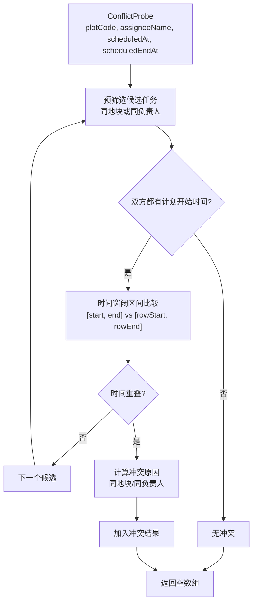

**图表来源**
- [apps/operation-service/src/task.repository.ts:84-110](file://apps/operation-service/src/task.repository.ts#L84-L110)
- [apps/operation-service/src/task.repository.ts:206-210](file://apps/operation-service/src/task.repository.ts#L206-L210)
- [apps/operation-service/src/task.repository.ts:300-309](file://apps/operation-service/src/task.repository.ts#L300-L309)

**章节来源**
- [apps/operation-service/src/task.repository.ts:84-110](file://apps/operation-service/src/task.repository.ts#L84-L110)
- [apps/operation-service/src/task.repository.ts:206-210](file://apps/operation-service/src/task.repository.ts#L206-L210)
- [apps/operation-service/src/task.repository.ts:300-309](file://apps/operation-service/src/task.repository.ts#L300-L309)

### 变更日志仓储
- **设计目标**：提供追加式的审计追踪能力，记录谁在什么时候对哪个任务做了什么操作。
- **核心特性**：
  - 只追加不更新：日志本身是审计对象，修改日志需要再次留痕
  - 三种动作类型：CREATE（建档）、TRANSITION（状态跃迁）、ARCHIVE（归档删除）
  - 操作人追踪：actor 字段记录操作者，系统内部操作记为 "system"
  - 追踪号关联：traceId 字段关联原始请求，便于链路追踪
  - 人类可读摘要：summary 字段提供操作描述
- **SQL 实现**：
  - 使用 `operation_task_change_logs` 表存储变更记录
  - 按 task_id 和 created_at DESC 排序，最新记录在前
  - 支持租户隔离，按 tenant_id 过滤
- **内存实现**：
  - 用于测试和本地演示
  - 深拷贝返回结果，防止外部修改影响内部状态
  - 排序逻辑与 SQL 实现保持一致

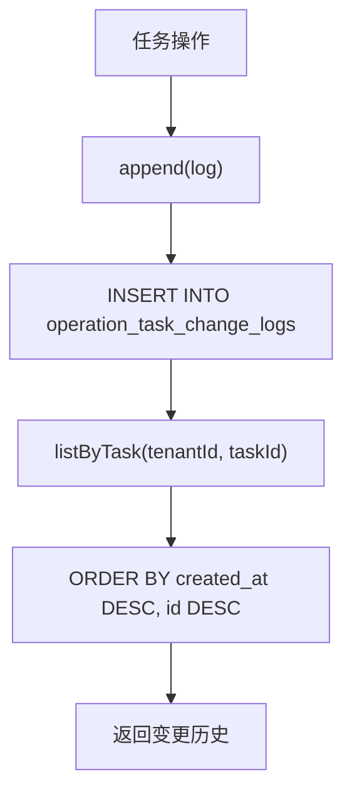

**图表来源**
- [apps/operation-service/src/task-change-log.repository.ts:61-84](file://apps/operation-service/src/task-change-log.repository.ts#L61-L84)

**章节来源**
- [apps/operation-service/src/task-change-log.repository.ts:1-109](file://apps/operation-service/src/task-change-log.repository.ts#L1-L109)

### 网格级变量率规划引擎
- **设计目标**：实现 A15 开发方案中的网格级变量播种/施肥规划，基于长势网格进行逐带速率映射，为精准农业提供智能决策支持。
- **核心特性**：
  - **覆盖路径复用**：完全复用 coverage 的作业带规划，不另算一套路径，确保路径里程口径一致
  - **网格采样优化**：使用分桶哈希技术，采样点只查 3×3 邻桶取最近格心，避免带数×格数全量比
  - **速率映射算法**：格值归一后线性映射到 [minRate, maxRate]，支持 invert 反转（弱苗补肥）
  - **用量计算**：速率 × 该带扫过面积（带长 × 幅宽），汇总给总用量与面积加权平均速率
  - **空网格降级**：全部作业带按基础速率均一作业并给警告，不编造格值
  - **性能优化**：网格上限 4000 格，避免计算爆炸
- **数据结构**：
  - `RateGridCell`：网格单元格，包含中心坐标和值
  - `RateGrid`：网格配置，包含格尺寸、最小最大值和单元格数组
  - `VariableRateInput`：输入参数，包含覆盖规划、作业类型、速率范围和网格数据
  - `VariableLane`：变量作业带，包含速率、面积、用量和网格值均值
  - `VariableRatePlan`：变量率方案，包含覆盖率、逐带速率和用量汇总
- **算法流程**：
  1. 验证输入参数，调用 coverage 生成作业带
  2. 构建网格分桶索引，优化查找性能
  3. 沿每条作业带按网格分辨率等距采样
  4. 对采样点进行格值查找和速率映射
  5. 计算每条带的速率、面积、用量
  6. 汇总总用量和加权平均速率
  7. 生成警告信息（空网格、未命中等）

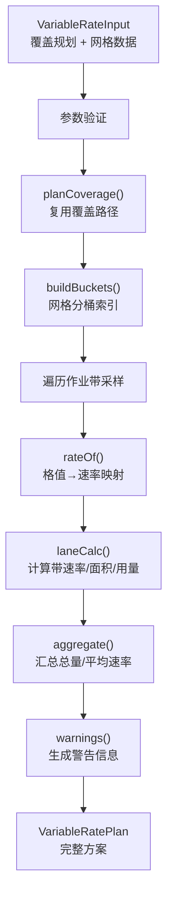

**图表来源**
- [apps/operation-service/src/variable-rate.ts:167-259](file://apps/operation-service/src/variable-rate.ts#L167-L259)
- [apps/operation-service/src/variable-rate.ts:134-165](file://apps/operation-service/src/variable-rate.ts#L134-L165)

**章节来源**
- [apps/operation-service/src/variable-rate.ts:1-332](file://apps/operation-service/src/variable-rate.ts#L1-L332)

### 变量率方案仓储层
- **设计目标**：提供变量播种/施肥方案的持久化存储，支持生产档案复盘需求。
- **核心特性**：
  - **双实现模式**：内存模式保留最近 20 条供演示，SQL 模式永久存储供生产使用
  - **租户隔离**：按 tenantId 隔离不同租户的方案数据
  - **JSONB 存储**：完整保存 VariableRatePlan 对象，支持复杂结构查询
  - **时间排序**：按 created_at DESC 排序，最新方案优先
  - **类型安全**：完整的 TypeScript 类型定义和运行时验证
- **SQL 实现**：
  - 使用 `variable_rate_plans` 表存储方案数据
  - JSONB 字段存储完整的 VariableRatePlan 对象
  - 复合索引优化租户和时间查询
  - 自动时间戳管理
- **内存实现**：
  - 使用 Map 存储租户到方案数组的映射
  - 自动限制每个租户最多 20 条记录
  - 深拷贝返回结果，防止外部修改

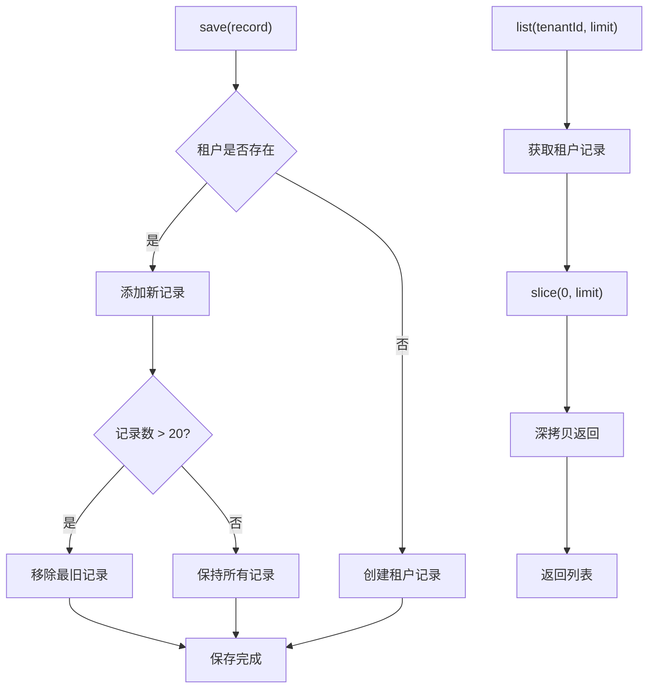

**图表来源**
- [apps/operation-service/src/variable-rate.repository.ts:29-71](file://apps/operation-service/src/variable-rate.repository.ts#L29-L71)

**章节来源**
- [apps/operation-service/src/variable-rate.repository.ts:1-71](file://apps/operation-service/src/variable-rate.repository.ts#L1-L71)

### 田间导航规划
- 目标：给定起点与若干站点，输出访问顺序、分段里程与耗时、可叠加地图的折线。
- 顺序优化：最近邻启发式 + 2-opt 反向片段优化，减少回头路。
- 里程口径：
  - 无路网：经纬度等距圆柱近似距离。
  - 有路网：构建无向图，Dijkstra 最短路径；站点离路超过阈值退回直线并提示。
- 闭环作业：支持返回起点，增加最后一段回程。
- 入参校验：起点、站点列表、速度、路网格式与数量限制一次报错。

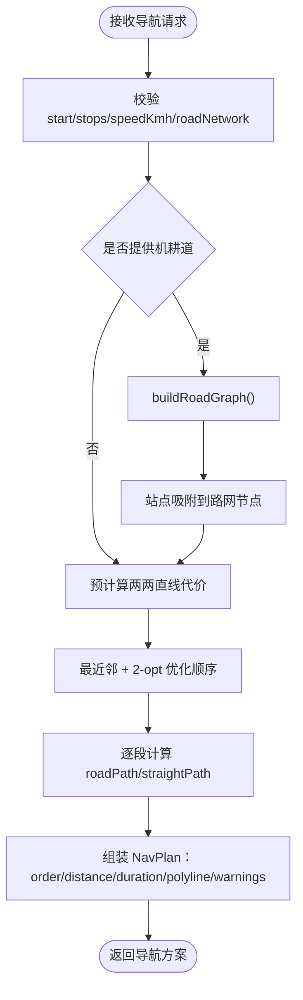

**图表来源**
- [apps/operation-service/src/navigation.ts:318-382](file://apps/operation-service/src/navigation.ts#L318-L382)
- [apps/operation-service/src/navigation.ts:400-447](file://apps/operation-service/src/navigation.ts#L400-L447)

**章节来源**
- [apps/operation-service/src/navigation.ts:318-382](file://apps/operation-service/src/navigation.ts#L318-L382)
- [apps/operation-service/src/navigation.ts:400-447](file://apps/operation-service/src/navigation.ts#L400-L447)

### 覆盖式作业规划
- 目标：对单个地块边界几何按农具幅宽等距布带，输出连续路径、作业与转移里程、覆盖倍数与警告。
- 坐标系：以环重心为原点建立等距圆柱局部平面坐标，旋转至作业方向轴系。
- 扫描线：按垂直作业带方向逐条扫描，奇偶规则求交区间，自动跳过内环（池塘/房屋缺口）。
- 蛇形往返：偶数条正向、奇数条反向，同一条线多段沿用同一行进方向；碎段小于半幅宽合并。
- 自动选方向：每 15° 试算候选，取总里程最小者；也可手工指定。
- 入场里程：可选起点，计入转移里程。
- 覆盖倍数：按台账亩数或外环几何现算，提示漏作业或重复覆盖。
- 增强的多边形边界验证：
  - 顶点不足检测：直接拒绝顶点少于 3 个的环，避免拖拉机从塘里开过去
  - 退化多边形检测：使用 `polygonAreaMu` 函数检测面积为 0 的退化几何
  - 边界完整性检查：确保外环和内环都满足闭合要求
  - 坐标范围验证：经纬度必须在合法范围内 (-180~180, -90~90)

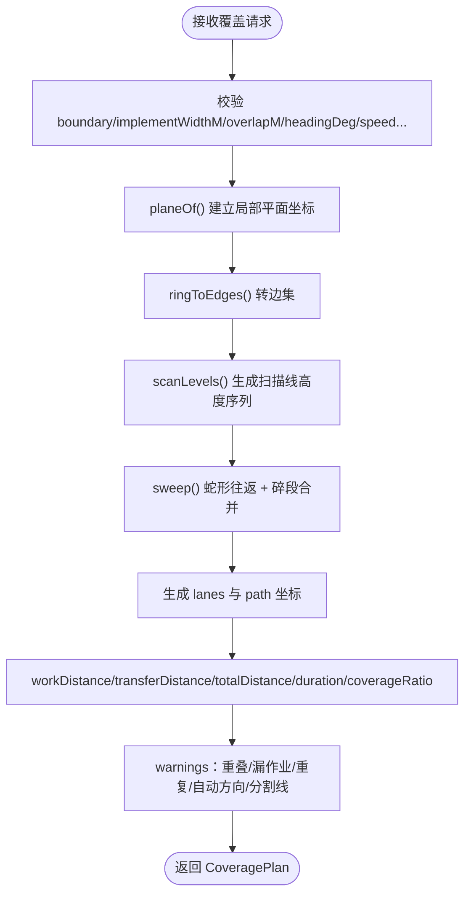

**图表来源**
- [apps/operation-service/src/coverage.ts:266-356](file://apps/operation-service/src/coverage.ts#L266-L356)
- [apps/operation-service/src/coverage.ts:370-447](file://apps/operation-service/src/coverage.ts#L370-L447)

**章节来源**
- [apps/operation-service/src/coverage.ts:266-356](file://apps/operation-service/src/coverage.ts#L266-L356)
- [apps/operation-service/src/coverage.ts:370-447](file://apps/operation-service/src/coverage.ts#L370-L447)

### 出箱与事件投递
- 设计约束：任务完成事件必须与状态转换原子写入，因此出箱仓储不提供通用 `enqueue`，仅在 SQL 仓储的单条 SQL 中插入出箱记录。
- 中继流程：`OutboxService` 周期调用 `listPending` 拉取未发布记录，通过 `EventLogPublisher` 投递到事件日志；成功标记 `published_at`，失败递增 `retry_count` 并记录错误。
- 主题：固定为 `OperationTaskCompleted`，负载包含任务 ID、地块编码、任务类型、结果与完成时间。

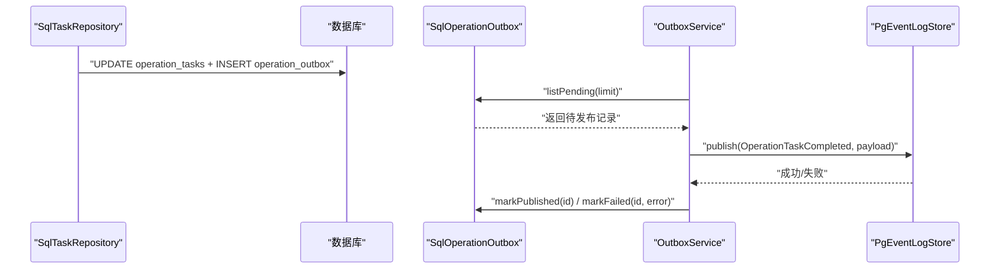

**图表来源**
- [apps/operation-service/src/task.repository.ts:133-151](file://apps/operation-service/src/task.repository.ts#L133-L151)
- [apps/operation-service/src/outbox.repository.ts:6-15](file://apps/operation-service/src/outbox.repository.ts#L6-L15)
- [apps/operation-service/src/main.ts:14-16](file://apps/operation-service/src/main.ts#L14-L16)

**章节来源**
- [apps/operation-service/src/outbox.repository.ts:6-15](file://apps/operation-service/src/outbox.repository.ts#L6-L15)
- [apps/operation-service/src/main.ts:14-16](file://apps/operation-service/src/main.ts#L14-L16)

## 依赖关系分析
- 对外暴露：
  - HTTP 接口由 `createOperationHttpServer` 导出，供主进程监听端口。
  - 前端通过 `apps/web/src/api/index.ts` 中的 `operationApi` 调用任务与导航/覆盖/变量率接口。
- 内部依赖：
  - `http.ts` 依赖 `navigation.ts`、`coverage.ts`、`task.repository.ts`、**`task-change-log.repository.ts`**、**`variable-rate.ts`**、**`variable-rate.repository.ts`**。
  - `main.ts` 依赖 `@agri/db`、`@agri/mq`、仓储与出箱实现。
  - 仓储依赖 `@agri/contracts` 的类型与 `@agri/shared` 的时间工具。
- 外部依赖：
  - PostgreSQL：任务表、出箱表、**变更日志表**、**变量率方案表**。
  - 事件日志：通过 `@agri/mq` 的 `EventLogPublisher` 与 `PgEventLogStore`。

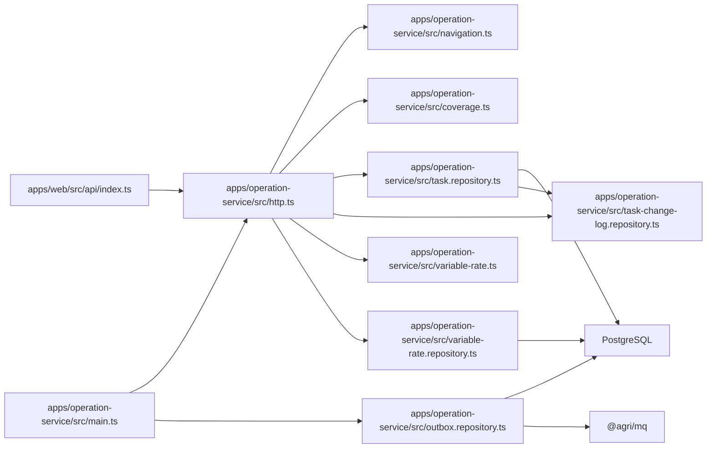

**图表来源**
- [apps/web/src/api/index.ts:850-864](file://apps/web/src/api/index.ts#L850-L864)
- [apps/operation-service/src/http.ts:82-147](file://apps/operation-service/src/http.ts#L82-L147)
- [apps/operation-service/src/main.ts:8-18](file://apps/operation-service/src/main.ts#L8-L18)

**章节来源**
- [apps/web/src/api/index.ts:850-864](file://apps/web/src/api/index.ts#L850-L864)
- [apps/operation-service/src/http.ts:82-147](file://apps/operation-service/src/http.ts#L82-L147)
- [apps/operation-service/src/main.ts:8-18](file://apps/operation-service/src/main.ts#L8-L18)

## 性能与容量特性
- 导航规划：
  - 站点上限 20，最近邻 + 2-opt 复杂度较低；路网节点量级几十到几百时使用线性取最小值的最短路实现。
  - 站点离机耕道超过 300 米退回直线，避免编造路网。
- 覆盖规划：
  - 作业带上限 2000，防止幅宽过小导致扫描线爆炸。
  - 自动选方向步长 15°，最多 12 个候选，取总里程最小。
  - 碎段合并半径为间距的一半，减少无效掉头。
  - 增强的边界验证：提前检测退化多边形和顶点不足的环，避免后续计算浪费。
- **变量率规划**：
  - **网格上限 4000 格**，避免计算爆炸，通过 cellSizeM 控制网格密度
  - **分桶哈希优化**：使用 3×3 邻桶查找，避免带数×格数的全量比较
  - **采样步长优化**：按网格分辨率等距采样，至少首尾两点
  - **速率映射优化**：格值归一化后线性映射，支持反转模式
  - **用量计算优化**：逐带累加，面积加权平均速率
- 任务查询：
  - SQL 分页使用动态 WHERE 与 ORDER BY created_at DESC, id DESC，避免全表排序。
  - **关键词搜索优化**：使用 `keywordHits` 函数对 name 和 plot_code 字段分别进行 ILIKE 匹配，避免了之前的字段拼接导致的误匹配问题。
  - **归档过滤优化**：归档条件同时应用于 count 和分页查询，确保总数与页内行数一致。
  - **软删除优化**：新增 `idx_operation_tasks_tenant_active` 索引，专门针对活跃任务查询进行优化。
  - **优先级过滤优化**：priority 字段支持索引查找，提高优先级筛选性能。
- **冲突检测优化**：
  - 预筛选阶段只查询可能命中的任务：同地块或同负责人、在册未结束、排过时间
  - 使用纯函数 `conflictsOf` 进行最终冲突判定，避免重复计算
  - 时间比较使用 JavaScript Date.parse，避免数据库时区转换开销
- **变更日志查询优化**：
  - 变更日志表按 task_id 和 created_at DESC 建立复合索引，优化历史查询性能。
  - 变更日志与主操作在同一事务中完成，避免额外的网络往返。
- **变量率方案查询优化**：
  - 变量率方案表按 tenant_id 和 created_at DESC 建立复合索引，优化租户历史查询
  - JSONB 字段存储完整方案对象，支持复杂结构查询
  - 内存模式限制每个租户最多 20 条记录，避免内存溢出
- 并发控制：
  - 状态变更使用 `version` 乐观锁，过期提交直接拒绝。
  - SQL 状态转换单条语句完成更新与出箱插入，保证原子性。

## 故障排查指南
- 400 输入错误：
  - 任务创建缺少必填字段、计划结束早于开始、分页参数越界、时间格式非法。
  - 导航请求缺少站点、站点坐标非法、速度范围越界、路网格式不正确。
  - 覆盖请求边界退化、幅宽或重叠非法、方向或速度范围越界。
  - 多边形边界含顶点不足 3 个的环、边界退化成一条线（面积为 0）、边界外环顶点少于 3 个。
  - **归档筛选非法**：archived 参数必须是 NONE、ONLY 或 ALL。
  - **优先级非法**：priority 参数必须是 HIGH、NORMAL 或 LOW。
  - **变量率规划参数非法**：baseRateKgMu/minRateKgMu/maxRateKgMu 必须为非负数，cellSizeM 需在 0~100 米之间，网格单元格格式不正确等。
- 404 资源不存在：
  - 任务详情不存在或跨租户访问。
  - **软删除任务**：已归档的任务无法通过详情接口获取，除非使用 `includeArchived=true`。
- 409 并发冲突：
  - 状态不允许迁移、版本过期、终态再次迁移。
- 500 内部异常：
  - 非输入类异常统一返回 500，建议结合链路追踪 ID 排查。
- 事件未投递：
  - 检查 `operation_outbox` 是否有未发布记录，确认中继器是否运行，核对 `last_error` 与 `retry_count`。
- **软删除相关问题**：
  - 删除后任务仍存在于数据库中，只是设置了 `deleted_at` 时间戳
  - 已删除任务不会出现在列表中，也无法进行状态流转
  - 删除操作不影响已完成的事件记录和历史数据
  - **归档任务可通过「归档状态=已归档」筛选重新找到**
- **变更日志相关问题**：
  - 变更日志表 `operation_task_change_logs` 应包含任务的所有操作记录
  - 历史查询按 created_at DESC 排序，最新记录在前
  - 归档任务的操作历史仍可查询，不受 deleted_at 影响
  - 如果历史为空，检查任务是否在迁移 039 之后创建
- **冲突检测相关问题**：
  - 冲突检测只提示不阻断，创建任务时返回 conflicts 数组
  - 冲突原因包括「同地块计划时间重叠」和「同负责人计划时间重叠」
  - 只有双方都有计划开始时间时才进行冲突检测
  - 负责人为空的任务不参与「同人」冲突检测
  - 已归档或已结束的任务不参与冲突检测
- **变量率规划相关问题**：
  - 网格数据缺失时，所有作业带按基础速率均一作业，并产生警告
  - 作业带未命中网格时，按基础速率兜底，并记录未命中数量
  - 速率上下限相同时，退化为均一速率作业
  - 网格超过 4000 格限制时，需增大 cellSizeM 降低网格密度
  - 变量率方案按租户隔离，不同租户的数据互不可见

**章节来源**
- [apps/operation-service/src/http.ts:143-146](file://apps/operation-service/src/http.ts#L143-L146)
- [apps/operation-service/test/http.spec.ts:161-183](file://apps/operation-service/test/http.spec.ts#L161-L183)
- [apps/operation-service/test/navigation.spec.ts:89-97](file://apps/operation-service/test/navigation.spec.ts#L89-L97)
- [apps/operation-service/test/coverage.spec.ts:149-162](file://apps/operation-service/test/coverage.spec.ts#L149-L162)
- [apps/operation-service/src/outbox.repository.ts:9-14](file://apps/operation-service/src/outbox.repository.ts#L9-L14)
- [apps/operation-service/test/variable-rate.spec.ts:129-143](file://apps/operation-service/test/variable-rate.spec.ts#L129-L143)

## 结论
作业服务以简洁的 HTTP 层聚合任务管理与空间规划算法，通过内存与 SQL 双仓储适配不同场景，并以出箱机制保证任务完成事件的可靠投递。导航与覆盖算法兼顾实用性与鲁棒性，提供清晰的警告与回退策略；覆盖规划的边界验证得到显著增强，能够更早地识别和处理退化多边形和无效几何；**新增了完整的软删除机制、三态归档过滤功能和全面的审计追踪系统，使任务删除语义与平台其他实体保持一致，同时提供了完整的操作历史追溯能力**；**新增了任务优先级系统和冲突检测系统，支持 HIGH/NORMAL/LOW 三档优先级和基于地块重叠或共享负责人的计划时间冲突检测，为智能排程和资源调度提供了坚实基础**；**新增了网格级变量播种/施肥规划功能，基于长势网格进行逐带速率映射，支持弱苗补肥等精准农业场景，为农业生产智能化提供了重要支撑**；前端集成良好，支持完整的任务调度与作业规划体验，包括直观的归档状态筛选、已归档任务标识、操作历史展示、优先级管理和冲突提示，**以及变量率规划的完整前端接口支持**。

## 附录：接口与数据模型

### 前端 API 调用
- 任务查询与创建：
  - `getTasks(params)`：分页、关键词、状态、类型、**优先级**、地块编码、时间区间，**新增 archived 参数支持三态过滤**。
  - `createTask(data)`：创建任务，含计划时间窗口与负责人，**支持优先级设置**，**返回冲突检测结果**。
  - `updateStatus(id, status, options)`：状态流转，携带 version 与完成结果。
  - `getTask(id, includeArchived)`：任务详情，**支持 includeArchived 参数访问归档任务**。
  - **`deleteTask(id)`**：**新增**：软删除归档，设置 `deleted_at` 字段。
  - **`getTaskHistory(id)`**：**新增**：获取任务变更历史，包含建档、状态流转、归档等操作记录。
  - **`getTaskConflicts(id)`**：**新增**：重新计算指定任务的排程冲突，返回冲突任务列表和原因。
- **变量率规划接口**：**新增**：
  - **`planVariableRate(data)`**：生成变量播种/施肥方案，包含覆盖规划、速率范围和网格数据。
  - **`getVariableRatePlans()`**：获取最近的变量率方案历史，支持生产档案复盘。
- 导航与覆盖方案：
  - `planNavigation(data)`：生成导航方案。
  - 其他覆盖相关接口由服务侧定义。

**章节来源**
- [apps/web/src/api/index.ts:850-864](file://apps/web/src/api/index.ts#L850-L864)
- [apps/web/src/views/farm/Task.vue:226-271](file://apps/web/src/views/farm/Task.vue#L226-L271)

### 数据库表结构
- `operation_tasks`：任务主表，包含租户、地块编码、类型、名称、状态、**优先级**、计划时间、负责人、创建/开始/完成/取消时间、结果 JSON 与版本号。**新增 `deleted_at` 字段用于软删除**。
- `operation_outbox`：出箱表，唯一关联任务 ID，记录租户、追踪 ID、负载 JSON、创建时间、发布时间、重试次数与错误信息。
- **`operation_task_change_logs`**：**新增**：变更日志表，记录任务的所有操作历史，包含操作类型、摘要、操作人、追踪号和创建时间。
- **`variable_rate_plans`**：**新增**：变量率方案表，记录变量播种/施肥方案，包含租户、地块编码、作业类型、指标、完整方案和创建时间。

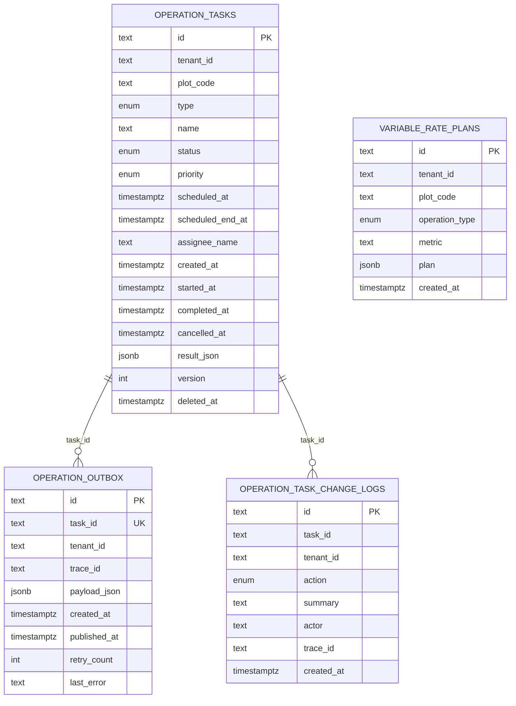

**图表来源**
- [infra/postgres/migrations/016_operation_tasks.sql:25-35](file://infra/postgres/migrations/016_operation_tasks.sql#L25-L35)
- [infra/postgres/migrations/037_operation_task_soft_delete.sql:18-25](file://infra/postgres/migrations/037_operation_task_soft_delete.sql#L18-L25)
- [infra/postgres/migrations/039_operation_task_change_logs.sql:16-25](file://infra/postgres/migrations/039_operation_task_change_logs.sql#L16-L25)
- [infra/postgres/migrations/042_operation_task_priority.sql:6-10](file://infra/postgres/migrations/042_operation_task_priority.sql#L6-L10)
- [infra/postgres/migrations/055_variable_rate_plans.sql:10-18](file://infra/postgres/migrations/055_variable_rate_plans.sql#L10-L18)

**章节来源**
- [infra/postgres/migrations/016_operation_tasks.sql:25-35](file://infra/postgres/migrations/016_operation_tasks.sql#L25-L35)
- [infra/postgres/migrations/037_operation_task_soft_delete.sql:1-26](file://infra/postgres/migrations/037_operation_task_soft_delete.sql#L1-L26)
- [infra/postgres/migrations/039_operation_task_change_logs.sql:1-30](file://infra/postgres/migrations/039_operation_task_change_logs.sql#L1-L30)
- [infra/postgres/migrations/042_operation_task_priority.sql:1-10](file://infra/postgres/migrations/042_operation_task_priority.sql#L1-L10)
- [infra/postgres/migrations/055_variable_rate_plans.sql:1-21](file://infra/postgres/migrations/055_variable_rate_plans.sql#L1-L21)