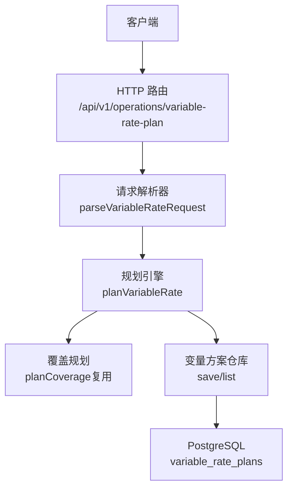
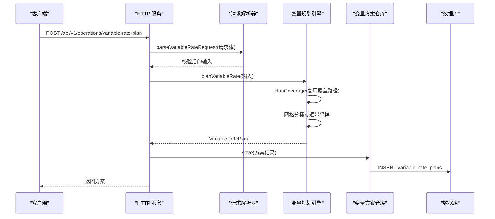
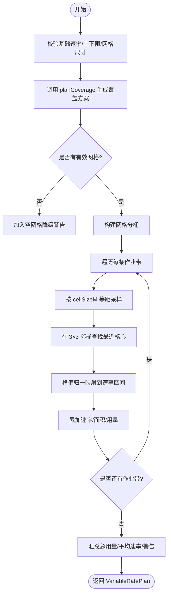
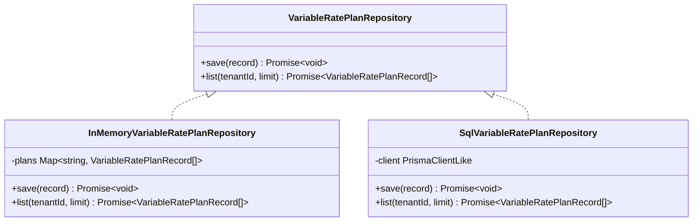
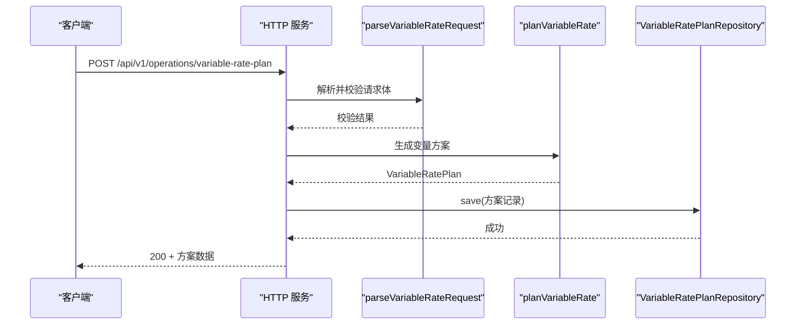
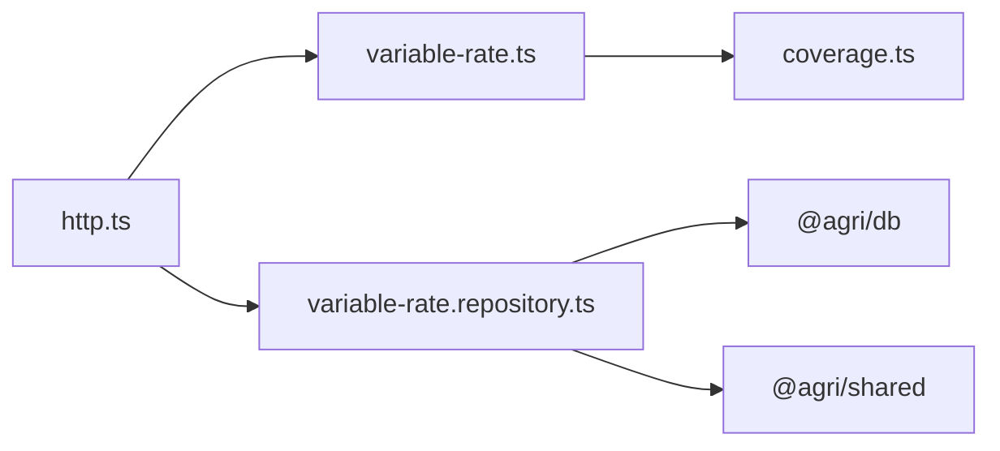

# 变量施肥播种规划

<cite>
**本文引用的文件**   
- [apps/operation-service/src/variable-rate.ts](file://apps/operation-service/src/variable-rate.ts)
- [apps/operation-service/src/variable-rate.repository.ts](file://apps/operation-service/src/variable-rate.repository.ts)
- [apps/operation-service/src/http.ts](file://apps/operation-service/src/http.ts)
- [apps/operation-service/test/variable-rate.spec.ts](file://apps/operation-service/test/variable-rate.spec.ts)
- [infra/postgres/migrations/055_variable_rate_plans.sql](file://infra/postgres/migrations/055_variable_rate_plans.sql)
</cite>

## 目录
1. [引言](#引言)
2. [项目结构定位](#项目结构定位)
3. [核心组件](#核心组件)
4. [架构总览](#架构总览)
5. [详细组件分析](#详细组件分析)
6. [依赖关系分析](#依赖关系分析)
7. [性能与复杂度](#性能与复杂度)
8. [故障排查指南](#故障排查指南)
9. [结论](#结论)

## 引言
本文件聚焦“变量施肥播种规划”能力，即在同一地块覆盖路径基础上，按长势网格为每条作业带计算差异化的播种或施肥速率，并汇总用量、平均速率与作业里程。该能力属于操作服务中的 A15 功能：覆盖方案负责“怎么走”，变量速率方案负责“每走一带下多少量”。

## 项目结构定位
变量施肥播种规划位于 `apps/operation-service` 中，由 HTTP 层接收请求、调用解析器校验参数、调用规划算法生成方案，并通过仓库接口将方案落库留痕。

**图表来源**
- [apps/operation-service/src/http.ts:199-207](file://apps/operation-service/src/http.ts#L199-L207)
- [apps/operation-service/src/variable-rate.ts:167-259](file://apps/operation-service/src/variable-rate.ts#L167-L259)
- [apps/operation-service/src/variable-rate.repository.ts:55-70](file://apps/operation-service/src/variable-rate.repository.ts#L55-L70)
- [infra/postgres/migrations/055_variable_rate_plans.sql:10-18](file://infra/postgres/migrations/055_variable_rate_plans.sql#L10-L18)

**章节来源**
- [apps/operation-service/src/http.ts:199-207](file://apps/operation-service/src/http.ts#L199-L207)
- [apps/operation-service/src/variable-rate.ts:1-21](file://apps/operation-service/src/variable-rate.ts#L1-L21)

## 核心组件
- 变量速率规划引擎：负责输入校验、覆盖路径复用、网格采样、速率映射、用量汇总与警告收集。
- 变量方案仓库：提供内存实现与 SQL 实现，用于保存和查询变量方案记录。
- HTTP 路由：暴露变量方案创建与历史查询接口，并将结果持久化。
- 数据库迁移：定义变量方案表结构与索引。

**章节来源**
- [apps/operation-service/src/variable-rate.ts:23-89](file://apps/operation-service/src/variable-rate.ts#L23-L89)
- [apps/operation-service/src/variable-rate.repository.ts:11-25](file://apps/operation-service/src/variable-rate.repository.ts#L11-L25)
- [apps/operation-service/src/http.ts:199-207](file://apps/operation-service/src/http.ts#L199-L207)
- [infra/postgres/migrations/055_variable_rate_plans.sql:1-8](file://infra/postgres/migrations/055_variable_rate_plans.sql#L1-L8)

## 架构总览
变量施肥播种规划的整体流程如下：

**图表来源**
- [apps/operation-service/src/http.ts:199-207](file://apps/operation-service/src/http.ts#L199-L207)
- [apps/operation-service/src/variable-rate.ts:167-259](file://apps/operation-service/src/variable-rate.ts#L167-L259)
- [apps/operation-service/src/variable-rate.repository.ts:55-70](file://apps/operation-service/src/variable-rate.repository.ts#L55-L70)

## 详细组件分析

### 变量速率规划引擎
变量速率规划引擎是核心算法模块，承担以下职责：
- 复用覆盖方案的路径、作业带、里程与耗时，不另算一套路径。
- 对长势网格进行等距圆柱平面转换与分桶哈希，加速最近格心查找。
- 沿每条作业带按网格分辨率采样，未命中点使用基础速率兜底。
- 将格值归一后线性映射到[minRate, maxRate]区间，支持 invert 反转以适配弱苗补肥场景。
- 汇总每条带的面积、用量，以及全田总用量与面积加权平均速率。
- 输出 warnings，包括空网格降级、速率上下限相同退化、部分作业带未命中网格等。

关键数据结构与方法：
- RateGridCell、RateGrid：描述长势网格单元与网格元信息。
- VariableRateInput、VariableLane、VariableRatePlan：描述输入、逐带结果与完整方案。
- planeOf、toPlane：经纬度到局部平面的换算。
- buildBuckets、nearestValue：网格分桶与邻桶最近格心查找。
- planVariableRate：主规划函数。
- parseVariableRateRequest：HTTP 入参解析与校验。

**图表来源**
- [apps/operation-service/src/variable-rate.ts:167-259](file://apps/operation-service/src/variable-rate.ts#L167-L259)
- [apps/operation-service/src/variable-rate.ts:133-165](file://apps/operation-service/src/variable-rate.ts#L133-L165)

**章节来源**
- [apps/operation-service/src/variable-rate.ts:23-89](file://apps/operation-service/src/variable-rate.ts#L23-L89)
- [apps/operation-service/src/variable-rate.ts:167-259](file://apps/operation-service/src/variable-rate.ts#L167-L259)
- [apps/operation-service/src/variable-rate.ts:272-332](file://apps/operation-service/src/variable-rate.ts#L272-L332)

### 变量方案仓库
仓库抽象了变量方案的存储方式，提供两种实现：
- InMemoryVariableRatePlanRepository：进程内内存实现，保留最近 20 条，便于演示与测试。
- SqlVariableRatePlanRepository：SQL 实现，写入 PostgreSQL 的 variable_rate_plans 表，并按租户隔离查询。

主要接口：
- save(record)：保存一条变量方案记录。
- list(tenantId, limit)：按租户倒序查询最近若干条记录。

**图表来源**
- [apps/operation-service/src/variable-rate.repository.ts:21-25](file://apps/operation-service/src/variable-rate.repository.ts#L21-L25)
- [apps/operation-service/src/variable-rate.repository.ts:29-40](file://apps/operation-service/src/variable-rate.repository.ts#L29-L40)
- [apps/operation-service/src/variable-rate.repository.ts:55-70](file://apps/operation-service/src/variable-rate.repository.ts#L55-L70)

**章节来源**
- [apps/operation-service/src/variable-rate.repository.ts:1-71](file://apps/operation-service/src/variable-rate.repository.ts#L1-L71)

### HTTP 路由与集成
HTTP 层暴露两个接口：
- POST /api/v1/operations/variable-rate-plan：创建变量方案，返回方案并落库。
- GET /api/v1/operations/variable-rate-plans：查询变量方案历史，按租户隔离。

处理流程：
- 解析请求体，调用 parseVariableRateRequest 做参数校验。
- 调用 planVariableRate 生成方案。
- 通过 variablePlans.save 持久化方案。
- 返回响应；非法输入返回 400。

**图表来源**
- [apps/operation-service/src/http.ts:199-207](file://apps/operation-service/src/http.ts#L199-L207)
- [apps/operation-service/src/variable-rate.ts:272-332](file://apps/operation-service/src/variable-rate.ts#L272-L332)

**章节来源**
- [apps/operation-service/src/http.ts:199-207](file://apps/operation-service/src/http.ts#L199-L207)

### 数据库模型
变量方案表 variable_rate_plans 用于生产档案复盘，字段包括：
- id：方案唯一标识。
- tenant_id：租户标识。
- plot_code：地块编码。
- operation_type：SEEDING 或 FERTILIZATION。
- metric：遥测指标编码。
- plan：JSONB 存储完整方案对象。
- created_at：建档时间。

并提供按租户与创建时间倒序的索引，便于列表查询。

**章节来源**
- [infra/postgres/migrations/055_variable_rate_plans.sql:1-21](file://infra/postgres/migrations/055_variable_rate_plans.sql#L1-L21)

## 依赖关系分析
变量施肥播种规划依赖以下组件：
- coverage.ts：提供覆盖路径与作业带，变量方案直接复用其 lane 序列与里程口径。
- shared 工具：如 toIsoTimestamp 等通用工具。
- @agri/db：Prisma 客户端类型，供 SQL 仓库使用。
- contracts：统一 API 响应结构。

**图表来源**
- [apps/operation-service/src/http.ts:1-12](file://apps/operation-service/src/http.ts#L1-L12)
- [apps/operation-service/src/variable-rate.ts:1-4](file://apps/operation-service/src/variable-rate.ts#L1-L4)
- [apps/operation-service/src/variable-rate.repository.ts:1-3](file://apps/operation-service/src/variable-rate.repository.ts#L1-L3)

**章节来源**
- [apps/operation-service/src/http.ts:1-12](file://apps/operation-service/src/http.ts#L1-L12)
- [apps/operation-service/src/variable-rate.ts:1-4](file://apps/operation-service/src/variable-rate.ts#L1-L4)
- [apps/operation-service/src/variable-rate.repository.ts:1-3](file://apps/operation-service/src/variable-rate.repository.ts#L1-L3)

## 性能与复杂度
- 网格分桶与最近格心查找：
  - 分桶键基于 cellSizeM 的整数坐标，避免全量两两比较。
  - nearestValue 仅检查 3×3 邻桶，显著降低 O(n^2) 风险。
- 采样步长：
  - 沿作业带按 cellSizeM 等距采样，步数约等于 lane.lengthM / cellSizeM。
- 上限保护：
  - MAX_GRID_CELLS = 4000，防止过大网格导致性能问题。
- 空间复杂度：
  - buckets 存储所有网格单元，空间与网格数量成正比。
- 时间复杂度：
  - 构建分桶 O(C)，其中 C 为网格单元格数。
  - 每条带采样 O(S)，S 为采样点数；总时间 O(L*S + C)，L 为作业带数量。

优化建议：
- 当网格密度很高时，适当增大 cellSizeM 以降低采样与分桶开销。
- 若网格分布稀疏，可考虑更精细的分桶策略或空间索引。

**章节来源**
- [apps/operation-service/src/variable-rate.ts:91-96](file://apps/operation-service/src/variable-rate.ts#L91-L96)
- [apps/operation-service/src/variable-rate.ts:133-165](file://apps/operation-service/src/variable-rate.ts#L133-L165)
- [apps/operation-service/src/variable-rate.ts:208-237](file://apps/operation-service/src/variable-rate.ts#L208-L237)

## 故障排查指南
常见问题与处理建议：
- 参数校验失败：
  - baseRateKgMu/minRateKgMu/maxRateKgMu 非负且 min ≤ max。
  - rateGrid.cellSizeM 需在合理范围，cells 格式需正确。
  - operationType 必须为 SEEDING 或 FERTILIZATION。
- 空网格降级：
  - 无长势网格样本时，全部作业带按基础速率均一作业，并给出警告。
- 速率上下限相同：
  - 变量方案退化为均一速率作业，会加入警告。
- 部分作业带未命中网格：
  - 未命中带按基础速率兜底，并统计未命中带数量加入警告。
- HTTP 错误码：
  - 400：参数非法或语法错误。
  - 500：服务端内部错误。

排查步骤：
- 检查请求体字段是否符合 parseVariableRateRequest 的要求。
- 确认 rateGrid.cells 的 center 与 value 是否为合法数字。
- 查看返回的 warnings 数组，定位空网格或未命中带情况。
- 使用变量方案历史接口查询已保存的方案，核对 totalAmountKg 与 avgRateKgMu。

**章节来源**
- [apps/operation-service/src/variable-rate.ts:167-194](file://apps/operation-service/src/variable-rate.ts#L167-L194)
- [apps/operation-service/src/variable-rate.ts:272-332](file://apps/operation-service/src/variable-rate.ts#L272-L332)
- [apps/operation-service/src/http.ts:209-212](file://apps/operation-service/src/http.ts#L209-L212)

## 结论
变量施肥播种规划在覆盖路径的基础上，通过网格采样与速率映射实现了地块内差异化播种/施肥。其设计强调：
- 路径与覆盖方案完全一致，避免重复计算。
- 网格分桶与邻桶查找提升性能。
- 空网格与未命中带的安全降级策略。
- 方案落库留痕，支持生产档案复盘与租户隔离。

该能力为无人农场的精准农业提供了关键支撑，既保证了作业效率，又提升了投入品使用的精细化水平。