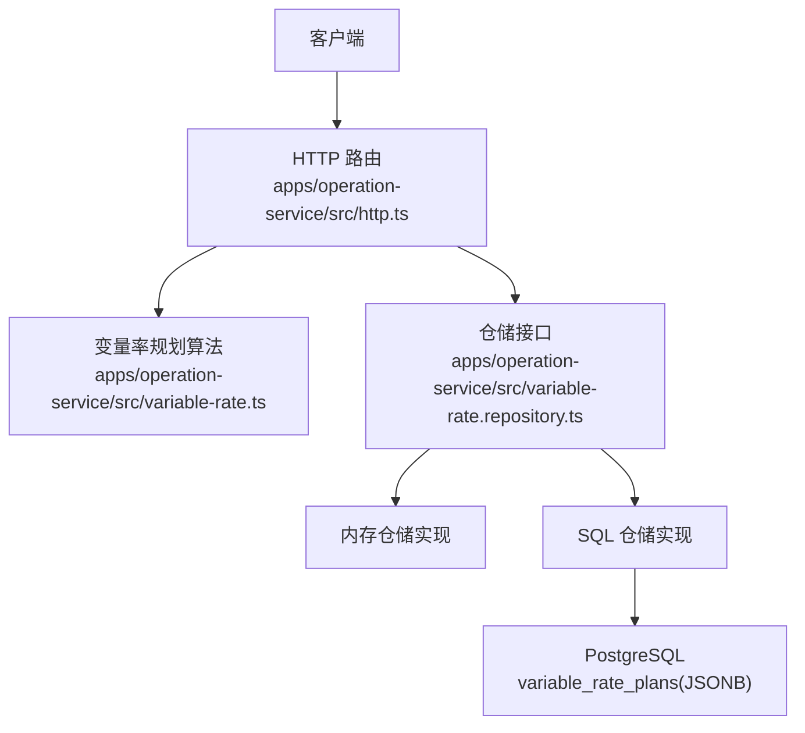
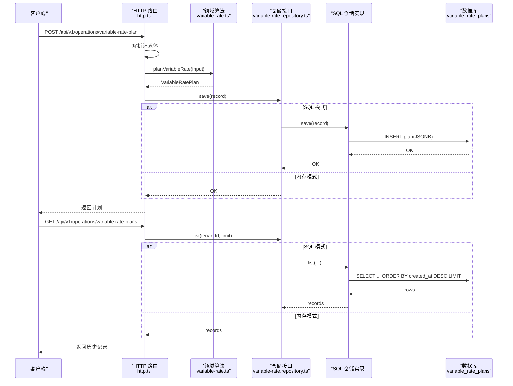
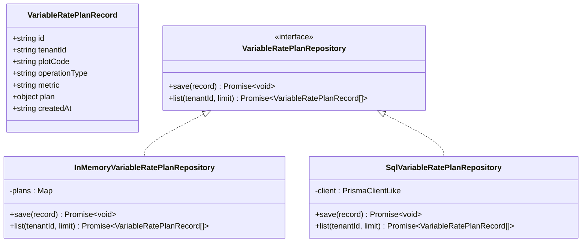
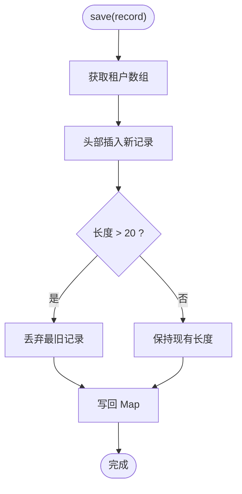
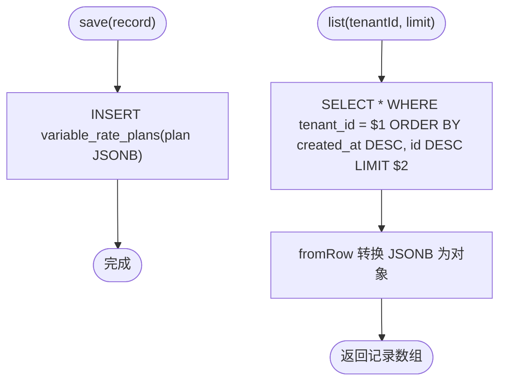
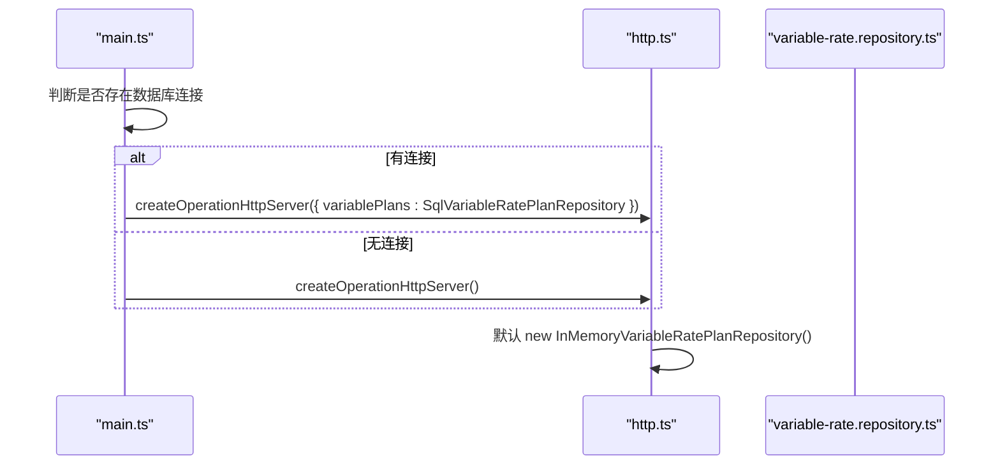
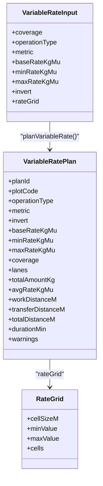
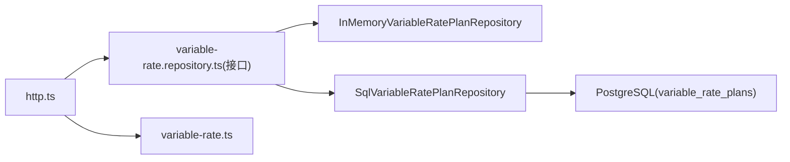

# 变量率计划仓储层

<cite>
**本文引用的文件**   
- [apps/operation-service/src/http.ts](file://apps/operation-service/src/http.ts)
- [apps/operation-service/src/main.ts](file://apps/operation-service/src/main.ts)
- [apps/operation-service/src/variable-rate.ts](file://apps/operation-service/src/variable-rate.ts)
- [apps/operation-service/src/variable-rate.repository.ts](file://apps/operation-service/src/variable-rate.repository.ts)
- [infra/postgres/migrations/055_variable_rate_plans.sql](file://infra/postgres/migrations/055_variable_rate_plans.sql)
- [apps/operation-service/test/variable-rate.spec.ts](file://apps/operation-service/test/variable-rate.spec.ts)
</cite>

## 目录
1. [引言](#引言)
2. [项目结构定位](#项目结构定位)
3. [核心组件](#核心组件)
4. [架构总览](#架构总览)
5. [详细组件分析](#详细组件分析)
6. [依赖关系分析](#依赖关系分析)
7. [性能与复杂度](#性能与复杂度)
8. [故障排查指南](#故障排查指南)
9. [结论](#结论)

## 引言
本文件聚焦“变量率计划仓储层”，即作业服务中负责生成、持久化与查询“变量播种/施肥方案”的仓储实现。该能力基于覆盖路径规划与地块长势网格，为每条作业带计算公斤/亩速率并汇总用量，同时提供进程内内存仓储与 PostgreSQL JSONB 落库两种实现，用于演示与生产档案复盘。

## 项目结构定位
变量率计划仓储层位于 operation-service 应用内，由三层组成：
- HTTP 接口层：接收变量率计划创建与历史查询请求，调用领域算法生成计划，并通过仓储接口保存。
- 领域算法层：复用覆盖路径规划，按长势网格逐带采样映射速率，输出逐带速率表与用量汇总。
- 仓储层：定义统一仓储接口，并提供内存实现与 SQL 实现；SQL 实现将完整计划以 JSONB 落库，供审计与复盘。

**图表来源**
- [apps/operation-service/src/http.ts:100-207](file://apps/operation-service/src/http.ts#L100-L207)
- [apps/operation-service/src/variable-rate.ts:167-259](file://apps/operation-service/src/variable-rate.ts#L167-L259)
- [apps/operation-service/src/variable-rate.repository.ts:21-71](file://apps/operation-service/src/variable-rate.repository.ts#L21-L71)
- [infra/postgres/migrations/055_variable_rate_plans.sql:10-21](file://infra/postgres/migrations/055_variable_rate_plans.sql#L10-L21)

**章节来源**
- [apps/operation-service/src/http.ts:100-207](file://apps/operation-service/src/http.ts#L100-L207)
- [apps/operation-service/src/variable-rate.repository.ts:21-71](file://apps/operation-service/src/variable-rate.repository.ts#L21-L71)
- [infra/postgres/migrations/055_variable_rate_plans.sql:10-21](file://infra/postgres/migrations/055_variable_rate_plans.sql#L10-L21)

## 核心组件
- 仓储接口与记录模型：定义 VariableRatePlanRepository 接口与 VariableRatePlanRecord 记录类型，约定 save 与 list 两个方法。
- 内存仓储实现：按租户隔离，保留最近 20 条方案，适合演示与测试。
- SQL 仓储实现：使用 PrismaClientLike 执行原生 SQL，将 plan 字段以 JSONB 存储，并按 tenant_id + created_at 倒序分页查询。
- 领域算法：planVariableRate 基于覆盖路径与长势网格计算逐带速率与用量，返回 VariableRatePlan。
- HTTP 路由：POST /api/v1/operations/variable-rate-plan 创建计划并落库；GET /api/v1/operations/variable-rate-plans 查询历史。

**章节来源**
- [apps/operation-service/src/variable-rate.repository.ts:11-71](file://apps/operation-service/src/variable-rate.repository.ts#L11-L71)
- [apps/operation-service/src/variable-rate.ts:167-259](file://apps/operation-service/src/variable-rate.ts#L167-L259)
- [apps/operation-service/src/http.ts:200-207](file://apps/operation-service/src/http.ts#L200-L207)

## 架构总览
变量率计划从 HTTP 入口进入，经参数解析与校验后调用领域算法生成计划，再通过仓储接口持久化。查询时通过仓储接口拉取最近 N 条方案。

**图表来源**
- [apps/operation-service/src/http.ts:200-207](file://apps/operation-service/src/http.ts#L200-L207)
- [apps/operation-service/src/variable-rate.ts:167-259](file://apps/operation-service/src/variable-rate.ts#L167-L259)
- [apps/operation-service/src/variable-rate.repository.ts:29-71](file://apps/operation-service/src/variable-rate.repository.ts#L29-L71)
- [infra/postgres/migrations/055_variable_rate_plans.sql:10-21](file://infra/postgres/migrations/055_variable_rate_plans.sql#L10-L21)

## 详细组件分析

### 仓储接口与记录模型
- 记录模型包含方案 ID、租户、地块编码、作业类型、遥测指标、完整计划对象与建档时间。
- 仓储接口仅暴露 save 与 list，list 默认返回最近 20 条，支持传入 limit。
- 设计意图：将“是否落库”与“如何落库”解耦，HTTP 层只依赖接口。

**图表来源**
- [apps/operation-service/src/variable-rate.repository.ts:11-71](file://apps/operation-service/src/variable-rate.repository.ts#L11-L71)

**章节来源**
- [apps/operation-service/src/variable-rate.repository.ts:11-71](file://apps/operation-service/src/variable-rate.repository.ts#L11-L71)

### 内存仓储实现
- 使用 Map<tenantId, records[]> 按租户隔离。
- 每次 save 插入到数组头部，超过 20 条则丢弃最旧一条，保证演示场景下列表稳定。
- list 直接返回前 limit 条，未命中租户返回空数组。

**图表来源**
- [apps/operation-service/src/variable-rate.repository.ts:29-40](file://apps/operation-service/src/variable-rate.repository.ts#L29-L40)

**章节来源**
- [apps/operation-service/src/variable-rate.repository.ts:29-40](file://apps/operation-service/src/variable-rate.repository.ts#L29-L40)

### SQL 仓储实现
- 使用 $queryRawUnsafe 执行原生 SQL，避免 ORM 对 JSONB 字段的额外处理。
- INSERT 时将 plan 序列化为 JSONB，created_at 转为 timestamptz。
- SELECT 按 tenant_id 过滤，ORDER BY created_at DESC, id DESC，LIMIT 默认 20。
- fromRow 兼容驱动返回字符串或对象两种 plan 格式。

**图表来源**
- [apps/operation-service/src/variable-rate.repository.ts:42-71](file://apps/operation-service/src/variable-rate.repository.ts#L42-L71)
- [infra/postgres/migrations/055_variable_rate_plans.sql:10-21](file://infra/postgres/migrations/055_variable_rate_plans.sql#L10-L21)

**章节来源**
- [apps/operation-service/src/variable-rate.repository.ts:42-71](file://apps/operation-service/src/variable-rate.repository.ts#L42-L71)
- [infra/postgres/migrations/055_variable_rate_plans.sql:10-21](file://infra/postgres/migrations/055_variable_rate_plans.sql#L10-L21)

### HTTP 路由与装配
- POST /api/v1/operations/variable-rate-plan：解析请求 → 调用 planVariableRate → 通过仓储接口保存 → 返回计划。
- GET /api/v1/operations/variable-rate-plans：按当前 x-tenant-id 查询最近方案。
- 默认注入内存仓储；当存在数据库连接时，main.ts 注入 SQL 仓储。

**图表来源**
- [apps/operation-service/src/main.ts:8-15](file://apps/operation-service/src/main.ts#L8-L15)
- [apps/operation-service/src/http.ts:100-102](file://apps/operation-service/src/http.ts#L100-L102)

**章节来源**
- [apps/operation-service/src/http.ts:200-207](file://apps/operation-service/src/http.ts#L200-L207)
- [apps/operation-service/src/main.ts:8-15](file://apps/operation-service/src/main.ts#L8-L15)

### 领域算法与数据模型（关联仓储）
- 输入：覆盖规划入参 + 遥测长势网格 + 速率上下限 + 基础速率 + 可选反转策略。
- 输出：VariableRatePlan，包含 coverage、lanes、totalAmountKg、avgRateKgMu 等。
- 仓储层将 VariableRatePlan 作为 plan 字段整体落库，便于生产档案复盘。

**图表来源**
- [apps/operation-service/src/variable-rate.ts:40-89](file://apps/operation-service/src/variable-rate.ts#L40-L89)
- [apps/operation-service/src/variable-rate.ts:167-259](file://apps/operation-service/src/variable-rate.ts#L167-L259)

**章节来源**
- [apps/operation-service/src/variable-rate.ts:40-89](file://apps/operation-service/src/variable-rate.ts#L40-L89)
- [apps/operation-service/src/variable-rate.ts:167-259](file://apps/operation-service/src/variable-rate.ts#L167-L259)

## 依赖关系分析
- HTTP 层依赖仓储接口，不感知具体实现，便于在内存与 SQL 之间切换。
- SQL 仓储依赖 PrismaClientLike 与 PostgreSQL 迁移表结构。
- 领域算法依赖覆盖路径规划与几何换算常量，但与仓储无关，保持纯函数特性。

**图表来源**
- [apps/operation-service/src/http.ts:100-207](file://apps/operation-service/src/http.ts#L100-L207)
- [apps/operation-service/src/variable-rate.repository.ts:21-71](file://apps/operation-service/src/variable-rate.repository.ts#L21-L71)
- [infra/postgres/migrations/055_variable_rate_plans.sql:10-21](file://infra/postgres/migrations/055_variable_rate_plans.sql#L10-L21)

**章节来源**
- [apps/operation-service/src/http.ts:100-207](file://apps/operation-service/src/http.ts#L100-L207)
- [apps/operation-service/src/variable-rate.repository.ts:21-71](file://apps/operation-service/src/variable-rate.repository.ts#L21-L71)

## 性能与复杂度
- 内存仓储：save 为 O(1) 插入 + 可能 O(1) 删除尾部；list 为 O(limit)。空间按租户隔离，最多保留 20 条。
- SQL 仓储：INSERT 一次写入 JSONB；SELECT 使用索引 (tenant_id, created_at DESC)，LIMIT 控制返回量。
- 领域算法：网格分桶哈希 + 3×3 邻桶最近格心查找，避免全量两两比较；单方案网格上限 4000 格，防止过大输入。
- 建议：
  - 生产环境优先使用 SQL 仓储，确保方案可审计与复盘。
  - 若网格规模增长，应增大 cellSizeM 以降低格子数量，避免触发上限校验。
  - 对高频查询可按业务维度增加索引（如 plot_code、operation_type），但需评估写入成本。

[本节为通用性能讨论，不直接分析具体文件]

## 故障排查指南
- 请求体过大或非法 JSON：HTTP 层会抛出输入错误，返回 400。
- 参数校验失败：例如 baseRateKgMu/minRateKgMu/maxRateKgMu 非负且 min ≤ max；rateGrid.cellSizeM 范围与 cells 结构校验失败，均返回 400。
- 网格为空或越界：算法会降级为均一速率并加入 warnings；若网格数超过 4000 格，抛出错误。
- 仓储写入失败：SQL 模式下检查 PostgreSQL 连接、权限与 variable_rate_plans 表结构是否与迁移一致。
- 查询结果为空：确认 x-tenant-id 是否正确；内存模式下不同租户隔离，跨租户查不到数据属正常。

**章节来源**
- [apps/operation-service/src/http.ts:209-212](file://apps/operation-service/src/http.ts#L209-L212)
- [apps/operation-service/src/variable-rate.ts:167-177](file://apps/operation-service/src/variable-rate.ts#L167-L177)
- [apps/operation-service/src/variable-rate.ts:272-332](file://apps/operation-service/src/variable-rate.ts#L272-L332)
- [apps/operation-service/test/variable-rate.spec.ts:166-180](file://apps/operation-service/test/variable-rate.spec.ts#L166-L180)

## 结论
变量率计划仓储层通过统一的仓储接口屏蔽了内存与 SQL 实现的差异，既满足演示场景的快速迭代，又为生产环境提供了可审计的方案留痕能力。结合领域算法的网格分桶与就近取值策略，系统在精度与性能之间取得平衡。建议在正式环境中启用 SQL 仓储，并根据业务规模调整网格分辨率与索引策略。