# 其他业务服务

<cite>
**本文引用的文件**   
- [apps/control-service/src/app.module.ts](file://apps/control-service/src/app.module.ts)
- [apps/file-service/src/app.module.ts](file://apps/file-service/src/app.module.ts)
- [apps/file-service/src/storage.ts](file://apps/file-service/src/storage.ts)
- [apps/iot-service/src/app.module.ts](file://apps/iot-service/src/app.module.ts)
- [apps/message-service/src/app.module.ts](file://apps/message-service/src/app.module.ts)
- [apps/operation-service/src/app.module.ts](file://apps/operation-service/src/app.module.ts)
- [apps/platform-service/src/app.module.ts](file://apps/platform-service/src/app.module.ts)
- [apps/trace-service/src/app.module.ts](file://apps/trace-service/src/app.module.ts)
- [apps/trace-service/src/repository.ts](file://apps/trace-service/src/repository.ts)
- [apps/video-service/src/app.module.ts](file://apps/video-service/src/app.module.ts)
- [apps/weather-service/src/app.module.ts](file://apps/weather-service/src/app.module.ts)
- [apps/weather-service/src/qweather.ts](file://apps/weather-service/src/qweather.ts)
- [apps/weather-service/src/forecast.repository.ts](file://apps/weather-service/src/forecast.repository.ts)
- [apps/weather-service/src/alert.repository.ts](file://apps/weather-service/src/alert.repository.ts)
- [apps/weather-service/src/sync.ts](file://apps/weather-service/src/sync.ts)
- [apps/weather-service/src/weather.ts](file://apps/weather-service/src/weather.ts)
- [apps/weather-service/src/http.ts](file://apps/weather-service/src/http.ts)
- [apps/weather-service/src/main.ts](file://apps/weather-service/src/main.ts)
- [infra/postgres/migrations/012_weather_forecast.sql](file://infra/postgres/migrations/012_weather_forecast.sql)
</cite>

## 更新摘要
**变更内容**   
- 大幅增强了天气服务实现，包含完整的天气预报、预警系统和QWeather API集成
- 新增了详细的数据持久化架构，支持PostgreSQL存储
- 添加了气象站实时数据监测和农事作业建议功能
- 完善了API接口设计，支持多种数据源模式（演示、SQL、QWeather）
- 增加了详细的配置管理和错误处理机制

## 目录
1. [简介](#简介)
2. [项目结构](#项目结构)
3. [核心组件](#核心组件)
4. [架构总览](#架构总览)
5. [详细组件分析](#详细组件分析)
6. [依赖关系分析](#依赖关系分析)
7. [性能考虑](#性能考虑)
8. [故障排查指南](#故障排查指南)
9. [结论](#结论)

## 简介
本章节面向"其他业务服务"的跨域能力，覆盖以下服务群：设备控制、文件存储、物联网接入、消息通知、运营作业、平台管理、溯源、视频与天气。文档从系统架构、组件职责、数据流与集成点等维度进行说明，帮助读者快速理解各服务的边界与协作方式，并为二次开发与集成提供指引。

**更新** 天气服务已实现完整的气象数据聚合、预报预测、灾害预警和农事作业建议功能，支持与外部气象API的深度集成。

## 项目结构
仓库采用多应用（apps）微服务组织方式，每个业务服务以 NestJS 应用为入口，包含模块定义、HTTP 适配层与主程序启动逻辑。其中部分服务具备更丰富的内部实现（如 file-service 的对象存储封装、trace-service 的数据访问层）。

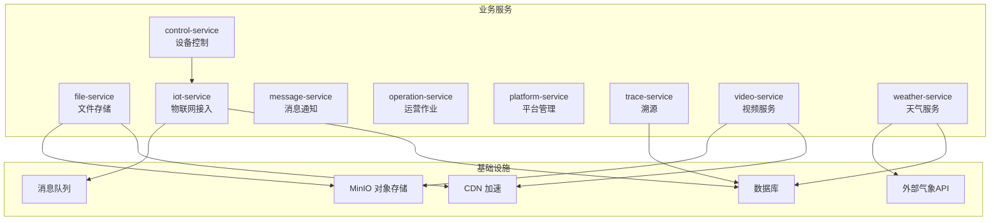

图示来源
- [apps/file-service/src/app.module.ts:1-2](file://apps/file-service/src/app.module.ts#L1-L2)
- [apps/file-service/src/storage.ts:1-200](file://apps/file-service/src/storage.ts#L1-L200)
- [apps/iot-service/src/app.module.ts:1-2](file://apps/iot-service/src/app.module.ts#L1-L2)
- [apps/trace-service/src/app.module.ts:1-2](file://apps/trace-service/src/app.module.ts#L1-L2)
- [apps/trace-service/src/repository.ts:1-200](file://apps/trace-service/src/repository.ts#L1-L200)
- [apps/weather-service/src/main.ts:35-161](file://apps/weather-service/src/main.ts#L35-L161)

章节来源
- [apps/control-service/src/app.module.ts:1-2](file://apps/control-service/src/app.module.ts#L1-L2)
- [apps/file-service/src/app.module.ts:1-2](file://apps/file-service/src/app.module.ts#L1-L2)
- [apps/iot-service/src/app.module.ts:1-2](file://apps/iot-service/src/app.module.ts#L1-L2)
- [apps/message-service/src/app.module.ts:1-2](file://apps/message-service/src/app.module.ts#L1-L2)
- [apps/operation-service/src/app.module.ts:1-2](file://apps/operation-service/src/app.module.ts#L1-L2)
- [apps/platform-service/src/app.module.ts:1-2](file://apps/platform-service/src/app.module.ts#L1-L2)
- [apps/trace-service/src/app.module.ts:1-2](file://apps/trace-service/src/app.module.ts#L1-L2)
- [apps/video-service/src/app.module.ts:1-2](file://apps/video-service/src/app.module.ts#L1-L2)
- [apps/weather-service/src/app.module.ts:1-2](file://apps/weather-service/src/app.module.ts#L1-L2)

## 核心组件
本节概述各服务的职责与对外能力，便于跨团队对齐接口与协作契约。

- 设备控制服务（control-service）
  - 职责：设备生命周期管理、远程控制指令下发、设备状态监控与告警联动。
  - 关键能力：设备注册/发现、指令编排与重试、遥测聚合与阈值告警。
  - 集成点：与物联网服务协同完成协议适配与指令路由；与消息服务联动触发告警。

- 文件存储服务（file-service）
  - 职责：基于 MinIO 的对象存储封装，提供统一上传下载、分片处理与 CDN 加速能力。
  - 关键能力：分片上传/合并、断点续传、预签名 URL、CDN 回源与缓存策略。
  - 集成点：对接 MinIO SDK；通过 CDN 域名暴露静态资源；与溯源/视频服务共享媒体资产。

- 物联网服务（iot-service）
  - 职责：设备接入协议适配、数据转发与设备生命周期管理。
  - 关键能力：多协议适配（MQTT/CoAP/HTTP）、消息路由、设备影子与在线状态维护。
  - 集成点：与设备控制服务交互执行指令；将遥测数据写入消息队列或时序存储。

- 消息通知服务（message-service）
  - 职责：多渠道通知分发（短信、邮件、站内信）。
  - 关键能力：模板渲染、渠道选择与重试、送达回执与审计。
  - 集成点：接收来自各业务服务的通知事件；对接第三方通道网关。

- 运营服务（operation-service）
  - 职责：农事作业管理、任务调度与进度跟踪。
  - 关键能力：作业计划编排、工单流转、人员与设备排班、进度统计。
  - 集成点：与设备控制服务联动执行自动化作业；与消息服务发送提醒。

- 平台管理服务（platform-service）
  - 职责：系统配置、租户管理与资源配额控制。
  - 关键能力：多租户隔离、功能开关、配额与用量计量、审计日志。
  - 集成点：为其他服务提供鉴权与上下文信息；与网关服务配合做路由与限流。

- 溯源服务（trace-service）
  - 职责：农产品全链条追溯，记录种植、加工、流通各环节信息。
  - 关键能力：批次/批次链追踪、环节事件归档、二维码/批次码生成与查询。
  - 集成点：与文件服务关联图片/报告；与物联网/遥测数据关联环境因子。

- 视频服务（video-service）
  - 职责：实时监控、录像回放与智能分析。
  - 关键能力：RTSP/GB28181 接入、转码与切片、回放拉流、AI 分析结果归档。
  - 集成点：与文件服务存储媒体；与消息服务推送告警；与 CDN 加速播放。

- 天气服务（weather-service）
  - 职责：集成气象数据，提供天气预报、灾害预警和农事作业建议。
  - 关键能力：多源数据聚合（QWeather API）、区域预报、阈值预警、实时气象站数据、作业适宜性判定。
  - 集成点：调用外部气象 API；向运营/设备控制服务推送预警；与遥测服务联动获取田间数据。

章节来源
- [apps/control-service/src/app.module.ts:1-2](file://apps/control-service/src/app.module.ts#L1-L2)
- [apps/file-service/src/app.module.ts:1-2](file://apps/file-service/src/app.module.ts#L1-L2)
- [apps/iot-service/src/app.module.ts:1-2](file://apps/iot-service/src/app.module.ts#L1-L2)
- [apps/message-service/src/app.module.ts:1-2](file://apps/message-service/src/app.module.ts#L1-L2)
- [apps/operation-service/src/app.module.ts:1-2](file://apps/operation-service/src/app.module.ts#L1-L2)
- [apps/platform-service/src/app.module.ts:1-2](file://apps/platform-service/src/app.module.ts#L1-L2)
- [apps/trace-service/src/app.module.ts:1-2](file://apps/trace-service/src/app.module.ts#L1-L2)
- [apps/video-service/src/app.module.ts:1-2](file://apps/video-service/src/app.module.ts#L1-L2)
- [apps/weather-service/src/app.module.ts:1-2](file://apps/weather-service/src/app.module.ts#L1-L2)

## 架构总览
下图展示"其他业务服务"的整体交互关系，突出设备控制、文件存储、物联网、消息、运营、平台、溯源、视频与天气之间的协作路径。

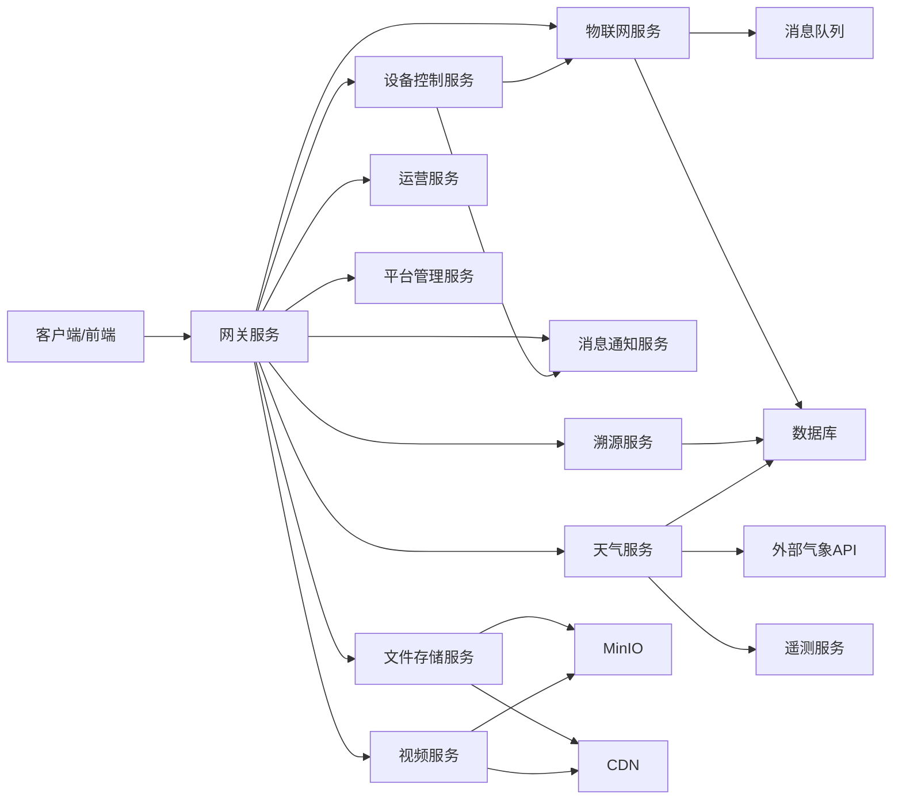

图示来源
- [apps/file-service/src/storage.ts:1-200](file://apps/file-service/src/storage.ts#L1-L200)
- [apps/trace-service/src/repository.ts:1-200](file://apps/trace-service/src/repository.ts#L1-L200)
- [apps/weather-service/src/http.ts:104-327](file://apps/weather-service/src/http.ts#L104-L327)

## 详细组件分析

### 设备控制服务（control-service）
- 职责边界
  - 设备注册与元数据管理
  - 远程控制指令下发（含重试、幂等、超时控制）
  - 设备状态监控与告警联动
- 关键流程（指令下发）
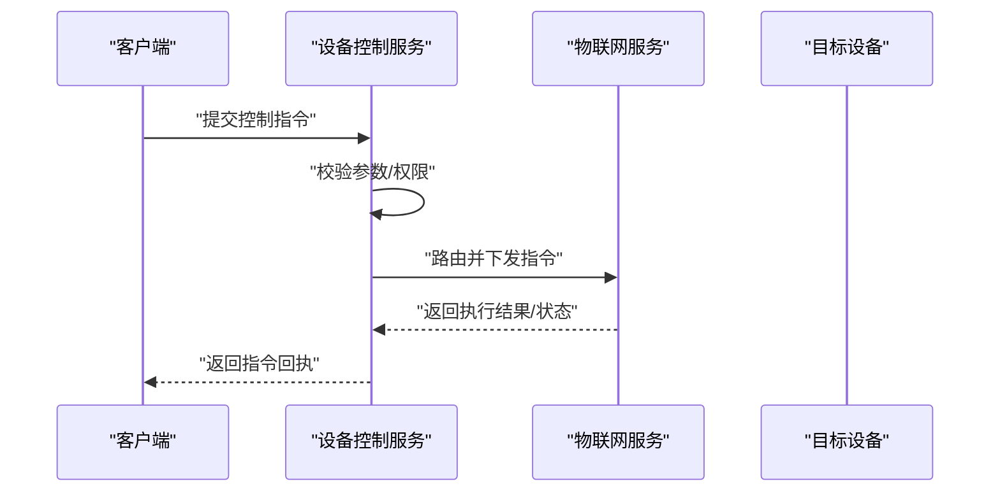

- 异常与容错
  - 指令重试与退避策略
  - 设备离线/超时的降级处理
  - 与消息服务联动告警

章节来源
- [apps/control-service/src/app.module.ts:1-2](file://apps/control-service/src/app.module.ts#L1-L2)

### 文件存储服务（file-service）
- 职责边界
  - 基于 MinIO 的统一对象存储封装
  - 文件上传下载、分片处理、断点续传
  - 预签名 URL 与 CDN 加速
- 核心类与方法（概念示意）
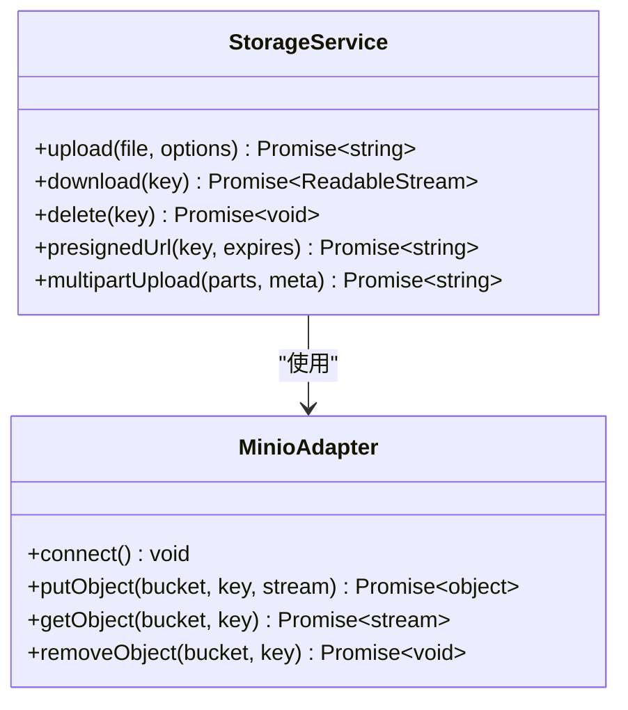

- 分片上传流程图
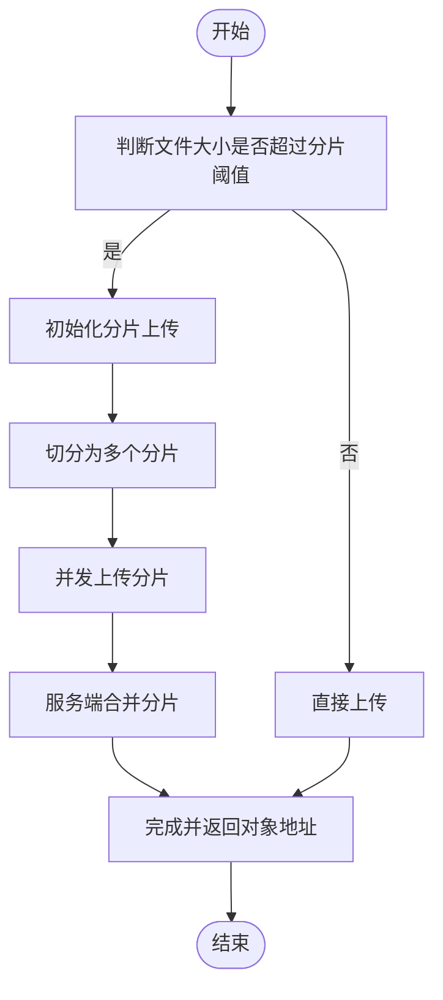

- 与 CDN 的集成要点
  - 静态资源走 CDN 域名，动态上传仍经 MinIO
  - 预签名 URL 可设置过期时间与访问白名单
  - 缓存命中与回源策略由 CDN 侧配置

章节来源
- [apps/file-service/src/app.module.ts:1-2](file://apps/file-service/src/app.module.ts#L1-L2)
- [apps/file-service/src/storage.ts:1-200](file://apps/file-service/src/storage.ts#L1-L200)

### 物联网服务（iot-service）
- 职责边界
  - 设备接入协议适配（MQTT/CoAP/HTTP）
  - 数据转发（遥测/事件）与设备影子维护
  - 设备生命周期管理（上线/下线/注销）
- 典型数据流
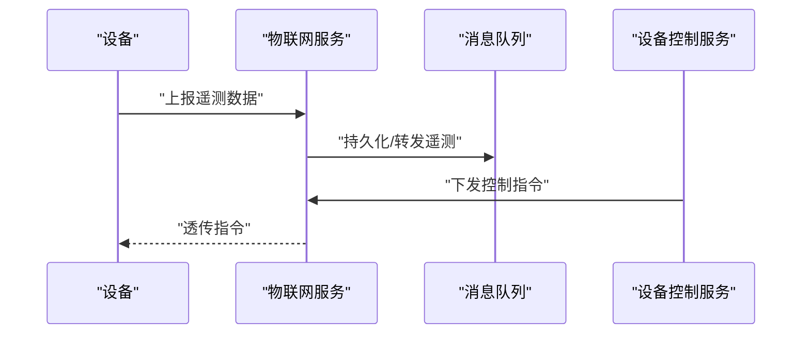

章节来源
- [apps/iot-service/src/app.module.ts:1-2](file://apps/iot-service/src/app.module.ts#L1-L2)

### 消息通知服务（message-service）
- 职责边界
  - 多渠道通知（短信、邮件、站内信）
  - 模板渲染、渠道选择、重试与回执
- 典型流程
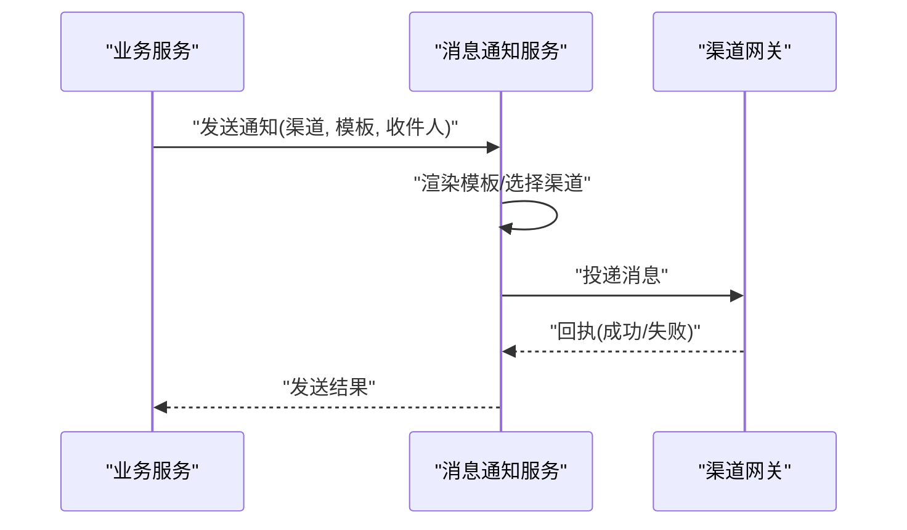

章节来源
- [apps/message-service/src/app.module.ts:1-2](file://apps/message-service/src/app.module.ts#L1-L2)

### 运营服务（operation-service）
- 职责边界
  - 农事作业管理（计划、工单、排班）
  - 任务调度与进度跟踪
  - 与设备控制服务联动执行自动化作业
- 关键流程（作业执行）
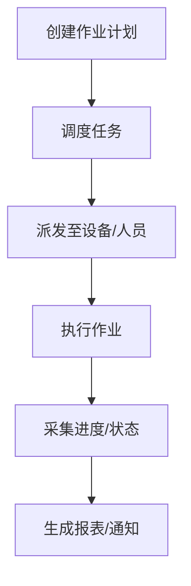

章节来源
- [apps/operation-service/src/app.module.ts:1-2](file://apps/operation-service/src/app.module.ts#L1-L2)

### 平台管理服务（platform-service）
- 职责边界
  - 系统配置、租户管理、资源配额控制
  - 鉴权上下文与功能开关
- 关键能力
  - 多租户隔离策略（数据/配置/配额）
  - 用量计量与限额拦截
  - 审计日志与合规性输出

章节来源
- [apps/platform-service/src/app.module.ts:1-2](file://apps/platform-service/src/app.module.ts#L1-L2)

### 溯源服务（trace-service）
- 职责边界
  - 农产品全链条追溯（种植、加工、流通）
  - 批次/批次链管理、环节事件归档
- 数据访问层（概念示意）
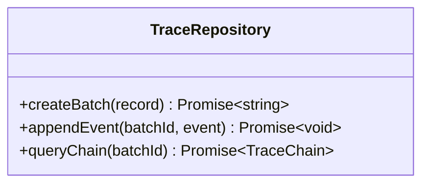

- 与文件/物联网数据的关联
  - 关联图片/检测报告（文件服务）
  - 关联环境因子/遥测数据（物联网/遥测）

章节来源
- [apps/trace-service/src/app.module.ts:1-2](file://apps/trace-service/src/app.module.ts#L1-L2)
- [apps/trace-service/src/repository.ts:1-200](file://apps/trace-service/src/repository.ts#L1-L200)

### 视频服务（video-service）
- 职责边界
  - 实时监控、录像回放、智能分析
  - 媒体转码、切片与拉流
- 典型流程（回放）
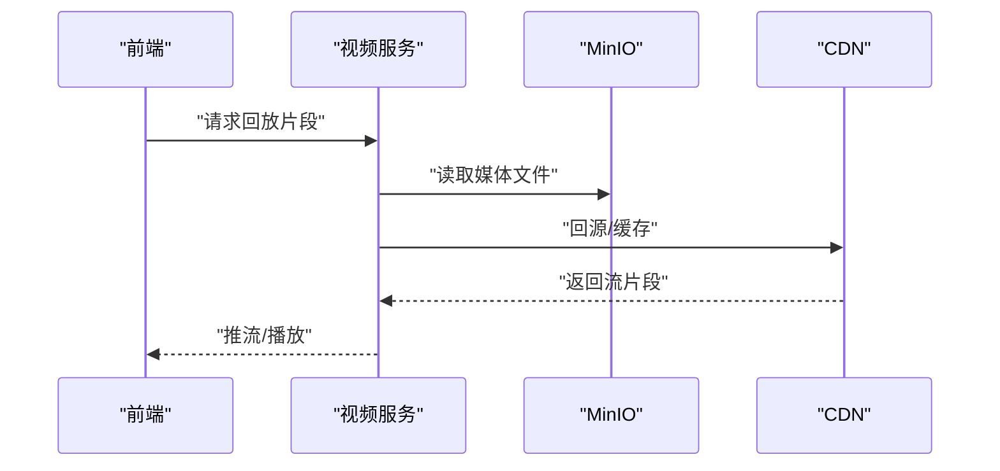

章节来源
- [apps/video-service/src/app.module.ts:1-2](file://apps/video-service/src/app.module.ts#L1-L2)

### 天气服务（weather-service）
**更新** 天气服务已实现完整的气象数据聚合、预报预测、灾害预警和农事作业建议功能。

- 职责边界
  - 集成外部气象数据（QWeather API），提供预报与预警
  - 区域化数据聚合与订阅推送
  - 田间气象站实时数据监测
  - 农事作业适宜性判定与建议
- 核心架构
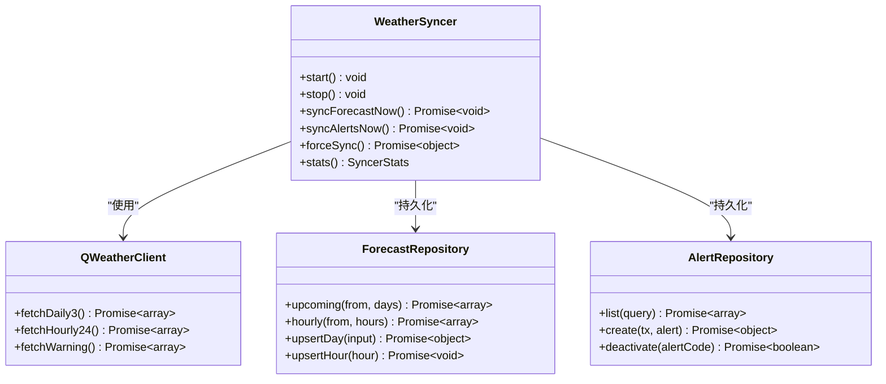

- 数据持久化架构
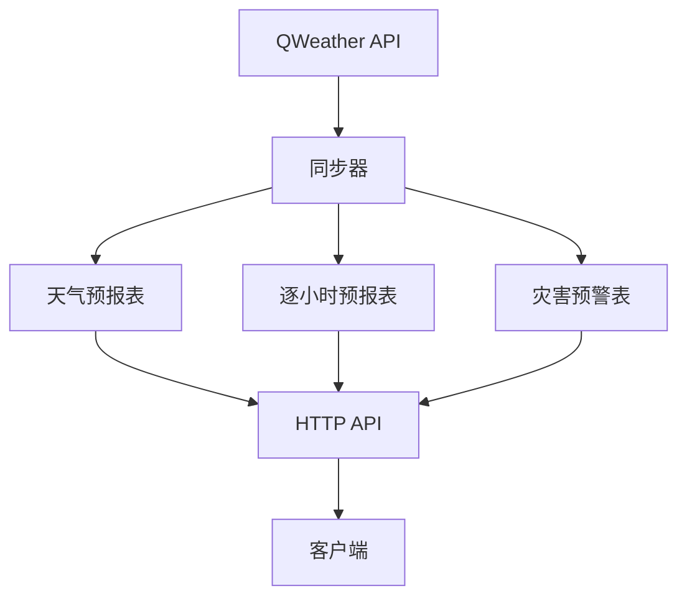

- 典型流程（预警）
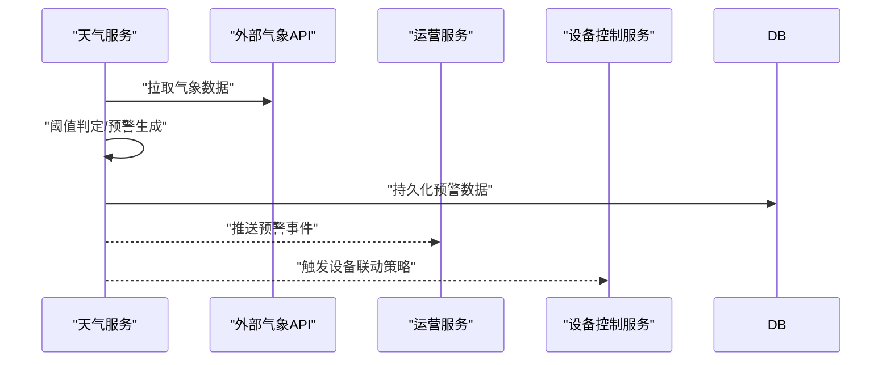

- 农事作业建议算法
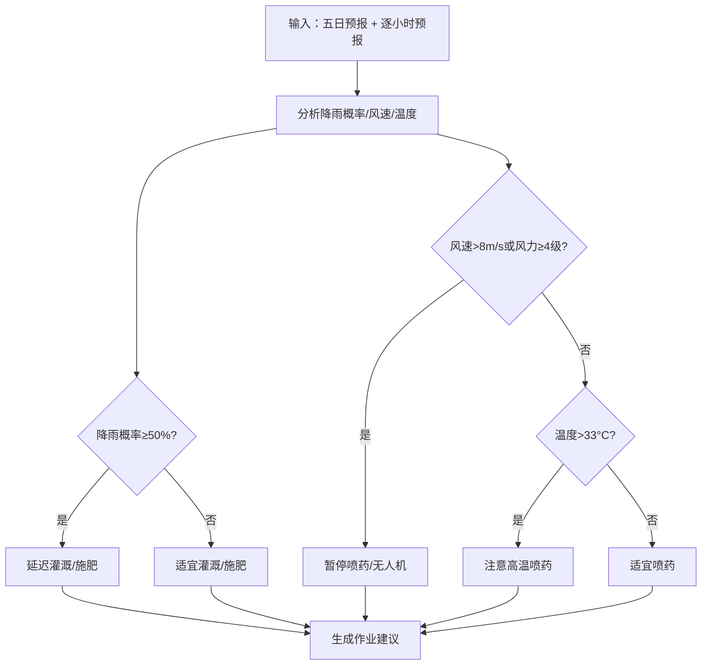

**章节来源**
- [apps/weather-service/src/app.module.ts:1-2](file://apps/weather-service/src/app.module.ts#L1-L2)
- [apps/weather-service/src/qweather.ts:1-674](file://apps/weather-service/src/qweather.ts#L1-L674)
- [apps/weather-service/src/forecast.repository.ts:1-314](file://apps/weather-service/src/forecast.repository.ts#L1-L314)
- [apps/weather-service/src/alert.repository.ts:1-161](file://apps/weather-service/src/alert.repository.ts#L1-L161)
- [apps/weather-service/src/sync.ts:1-425](file://apps/weather-service/src/sync.ts#L1-L425)
- [apps/weather-service/src/weather.ts:1-159](file://apps/weather-service/src/weather.ts#L1-L159)
- [apps/weather-service/src/http.ts:1-327](file://apps/weather-service/src/http.ts#L1-L327)
- [apps/weather-service/src/main.ts:1-161](file://apps/weather-service/src/main.ts#L1-L161)
- [infra/postgres/migrations/012_weather_forecast.sql:1-110](file://infra/postgres/migrations/012_weather_forecast.sql#L1-L110)

## 依赖关系分析
- 组件耦合
  - 设备控制服务与物联网服务强耦合（指令路由）
  - 文件存储服务与 MinIO/CDN 解耦良好（适配器模式）
  - 溯源服务对数据库与文件服务存在引用
  - 视频服务依赖 MinIO/CDN 与消息服务
  - **新增** 天气服务与QWeather API、数据库、遥测服务存在依赖关系
- 外部依赖
  - MinIO 对象存储
  - CDN 加速网络
  - 外部气象 API（QWeather）
  - 消息队列（用于遥测与事件）
  - **新增** PostgreSQL 数据库（天气数据持久化）

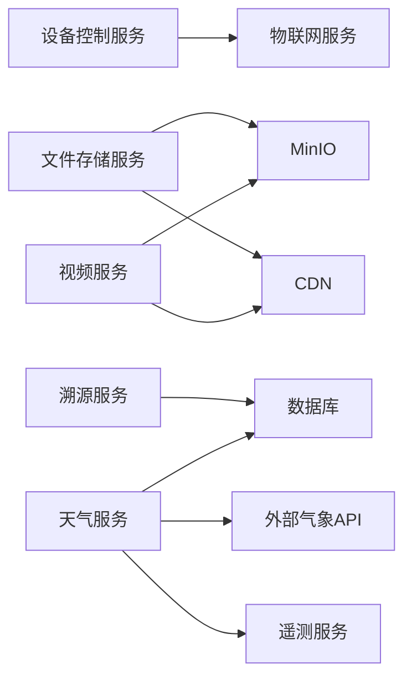

图示来源
- [apps/file-service/src/storage.ts:1-200](file://apps/file-service/src/storage.ts#L1-L200)
- [apps/trace-service/src/repository.ts:1-200](file://apps/trace-service/src/repository.ts#L1-L200)
- [apps/weather-service/src/main.ts:35-161](file://apps/weather-service/src/main.ts#L35-L161)

## 性能考虑
- 文件服务
  - 大文件优先分片上传，提升吞吐与稳定性
  - 启用 CDN 缓存热点资源，降低回源压力
  - 预签名 URL 减少鉴权开销
- 物联网服务
  - 遥测数据批量写入与压缩
  - 设备影子本地缓存，降低远端查询延迟
- 视频服务
  - 按需转码与自适应码率
  - 切片缓存与边缘节点就近分发
- 天气服务
  - **新增** 定时拉取+增量更新，避免频繁调用外部 API
  - **新增** 预警规则本地化计算，减少网络往返
  - **新增** 数据分页查询优化，支持大数据集处理
  - **新增** 内存模式与SQL模式切换，适应不同部署场景

## 故障排查指南
- 设备控制服务
  - 现象：指令下发无回执
  - 排查：检查物联网服务连通性、设备在线状态、重试与超时配置
- 文件存储服务
  - 现象：上传失败或速度慢
  - 排查：确认 MinIO 连接与桶权限；检查分片大小与并发数；验证 CDN 缓存命中
- 物联网服务
  - 现象：遥测数据丢失
  - 排查：检查消息队列堆积与消费者消费速率；核对协议适配与字段映射
- 消息通知服务
  - 现象：通知未送达
  - 排查：查看渠道回执与重试次数；核对模板与收件人有效性
- 溯源服务
  - 现象：批次链不完整
  - 排查：核对环节事件写入顺序与事务一致性；检查关联文件/遥测数据完整性
- 视频服务
  - 现象：回放卡顿或黑屏
  - 排查：检查转码任务状态、CDN 回源与带宽；确认切片时间戳连续性
- 天气服务
  - 现象：预警不及时或数据不准确
  - 排查：**新增** 核对外部 API 可用性、拉取周期与阈值配置；检查下游服务订阅状态
  - 现象：预报数据不更新
  - 排查：**新增** 检查QWeather API密钥配置、Host域名设置、JWT令牌有效性
  - 现象：农事建议不合理
  - 排查：**新增** 检查阈值配置、数据源质量、作业建议算法参数

## 结论
"其他业务服务"围绕设备控制、文件存储、物联网接入、消息通知、运营作业、平台管理、溯源、视频与天气形成完整闭环。通过清晰的职责边界与解耦的集成点，平台具备良好的可扩展性与可维护性。**更新** 天气服务的增强实现显著提升了平台的气象数据处理能力，为农业生产提供了更加精准和及时的气象信息服务。建议在后续迭代中持续完善适配器与中间件能力，强化可观测性与容错机制，以提升整体稳定性与用户体验。