# 其他业务服务

<cite>
**本文引用的文件**   
- [apps/control-service/src/http.ts](file://apps/control-service/src/http.ts)
- [apps/control-service/src/command-finished.ts](file://apps/control-service/src/command-finished.ts)
- [apps/control-service/src/receipt-sweeper.ts](file://apps/control-service/src/receipt-sweeper.ts)
- [apps/control-service/src/command-spec.ts](file://apps/control-service/src/command-spec.ts)
- [apps/control-service/src/control.repository.ts](file://apps/control-service/src/control.repository.ts)
- [apps/control-service/src/consumer.ts](file://apps/control-service/src/consumer.ts)
- [apps/control-service/src/authorization.repository.ts](file://apps/control-service/src/authorization.repository.ts)
- [apps/control-service/src/main.ts](file://apps/control-service/src/main.ts)
- [apps/iot-service/src/field-gateway.ts](file://apps/iot-service/src/field-gateway.ts)
- [apps/message-service/src/consumer.ts](file://apps/message-service/src/consumer.ts)
- [apps/message-service/src/http.ts](file://apps/message-service/src/http.ts)
- [apps/message-service/src/message.repository.ts](file://apps/message-service/src/message.repository.ts)
- [packages/contracts/src/messages/message-template.ts](file://packages/contracts/src/messages/message-template.ts)
- [packages/contracts/src/enums/domain.enum.ts](file://packages/contracts/src/enums/domain.enum.ts)
- [apps/file-service/src/app.module.ts](file://apps/file-service/src/app.module.ts)
- [apps/file-service/src/storage.ts](file://apps/file-service/src/storage.ts)
- [apps/file-service/src/file.repository.ts](file://apps/file-service/src/file.repository.ts)
- [apps/file-service/src/http.ts](file://apps/file-service/src/http.ts)
- [apps/iot-service/src/app.module.ts](file://apps/iot-service/src/app.module.ts)
- [apps/message-service/src/app.module.ts](file://apps/message-service/src/app.module.ts)
- [apps/operation-service/src/app.module.ts](file://apps/operation-service/src/app.module.ts)
- [apps/operation-service/src/task.repository.ts](file://apps/operation-service/src/task.repository.ts)
- [apps/operation-service/src/http.ts](file://apps/operation-service/src/http.ts)
- [apps/platform-service/src/app.module.ts](file://apps/platform-service/src/app.module.ts)
- [apps/trace-service/src/app.module.ts](file://apps/trace-service/src/app.module.ts)
- [apps/trace-service/src/repository.ts](file://apps/trace-service/src/repository.ts)
- [apps/video-service/src/app.module.ts](file://apps/video-service/src/app.module.ts)
- [apps/video-service/src/ai-event.ts](file://apps/video-service/src/ai-event.ts)
- [apps/video-service/src/ai-event.repository.ts](file://apps/video-service/src/ai-event.repository.ts)
- [apps/video-service/src/ptz-channel.ts](file://apps/video-service/src/ptz-channel.ts)
- [apps/video-service/src/ptz.repository.ts](file://apps/video-service/src/ptz.repository.ts)
- [apps/video-service/src/recording-archive.repository.ts](file://apps/video-service/src/recording-archive.repository.ts)
- [apps/video-service/src/http.ts](file://apps/video-service/src/http.ts)
- [apps/video-service/src/main.ts](file://apps/video-service/src/main.ts)
- [apps/weather-service/src/app.module.ts](file://apps/weather-service/src/app.module.ts)
- [apps/weather-service/src/qweather.ts](file://apps/weather-service/src/qweather.ts)
- [apps/weather-service/src/forecast.repository.ts](file://apps/weather-service/src/forecast.repository.ts)
- [apps/weather-service/src/alert.repository.ts](file://apps/weather-service/src/alert.repository.ts)
- [apps/weather-service/src/sync.ts](file://apps/weather-service/src/sync.ts)
- [apps/weather-service/src/weather.ts](file://apps/weather-service/src/weather.ts)
- [apps/weather-service/src/http.ts](file://apps/weather-service/src/http.ts)
- [apps/weather-service/src/main.ts](file://apps/weather-service/src/main.ts)
- [apps/weather-service/src/farm-time.ts](file://apps/weather-service/src/farm-time.ts)
- [apps/weather-service/test/weather.spec.ts](file://apps/weather-service/test/weather.spec.ts)
- [infra/postgres/migrations/033_control_outbox.sql](file://infra/postgres/migrations/033_control_outbox.sql)
- [infra/postgres/migrations/005_control_commands.sql](file://infra/postgres/migrations/005_control_commands.sql)
- [infra/postgres/migrations/031_control_command_receipt.sql](file://infra/postgres/migrations/031_control_command_receipt.sql)
- [infra/postgres/migrations/032_control_command_tenant.sql](file://infra/postgres/migrations/032_control_command_tenant.sql)
- [infra/postgres/migrations/040_control_command_cancelled.sql](file://infra/postgres/migrations/040_control_command_cancelled.sql)
- [infra/postgres/migrations/008_agro_monitoring.sql](file://infra/postgres/migrations/008_agro_monitoring.sql)
- [infra/postgres/migrations/016_operation_tasks.sql](file://infra/postgres/migrations/016_operation_tasks.sql)
- [infra/postgres/migrations/017_file_metadata.sql](file://infra/postgres/migrations/017_file_metadata.sql)
- [infra/postgres/migrations/018_video_events.sql](file://infra/postgres/migrations/018_video_events.sql)
- [infra/postgres/migrations/048_ai_event_types_message_dispatch.sql](file://infra/postgres/migrations/048_ai_event_types_message_dispatch.sql)
- [infra/postgres/migrations/051_control_authorizations.sql](file://infra/postgres/migrations/051_control_authorizations.sql)
- [infra/postgres/migrations/057_video_recording_archives.sql](file://infra/postgres/migrations/057_video_recording_archives.sql)
</cite>

## 更新摘要
**变更内容**   
- **视频服务增强**：新增完整的录像留档档案子系统实现，支持告警时刻前后窗口片段自动留档
- **双仓库架构**：实现 InMemoryRecordingArchiveRepository（测试用）和 SqlRecordingArchiveRepository（生产用）
- **窗口化录制**：支持 preSeconds/postSeconds 参数配置，默认前置30秒、后置60秒的录制窗口
- **状态管理**：完善的归档状态管理（PENDING、ARCHIVED、FAILED），支持流媒体服务切片回填
- **数据库架构**：新增 video_recording_archives 表和相关索引优化

## 目录
1. [简介](#简介)
2. [项目结构](#项目结构)
3. [核心组件](#核心组件)
4. [架构总览](#架构总览)
5. [详细组件分析](#详细组件分析)
6. [依赖关系分析](#依赖关系分析)
7. [性能考虑](#性能考虑)
8. [故障排查指南](#故障排查指南)
9. [结论](#结论)

## 简介
本章节面向"其他业务服务"的跨域能力，覆盖以下服务群：设备控制、文件存储、物联网接入、消息通知、运营作业、平台管理、溯源、视频与天气。文档从系统架构、组件职责、数据流与集成点等维度进行说明，帮助读者快速理解各服务的边界与协作方式，并为二次开发与集成提供指引。

**重大更新** 本次更新重点增强了控制服务的命令处理能力，新增了6种新的指令类型（PAUSE、RESUME、RETURN_HOME、POWER_OFF、TOOL_SWITCH、TILLAGE），实现了完整的暂停/恢复功能和授权范围管理系统。**重要增强** 控制服务现已实现全面的超时命令关闭系统，通过 ControlReceiptSweeper 定时任务自动处理超时指令，结合本地出站模式确保事件可靠性，同时增强了多租户隔离机制，通过可信身份头解析、数据库架构变更和仓储层安全增强，确保不同农场之间的数据完全隔离。**新增功能** 控制服务增强了待处理命令查询端点 `/api/v1/control/device/pending`，支持设备轮询获取待处理指令，实现QUEUED、SENT、ACKED、PAUSED四态跟踪，有效解决网关崩溃时的命令丢失问题，并通过正序排序确保指令按下发先后顺序执行。**最新增强** 控制服务实现了土壤湿度自动灌溉控制，包括墒情高于上限时的自动停灌功能和CANCELLED命令状态，完善了双向控制循环机制。**视频服务重大增强** 新增完整的录像留档档案子系统，支持告警时刻前后窗口片段自动留档，实现双仓库架构（内存用于测试，SQL用于生产）和全面的归档状态管理。**最新增强** 天气服务增强了预警过期处理逻辑，改进了数据一致性和自动停用机制，确保已过期但未解除的预警不会进入生效列表。

## 项目结构
仓库采用多应用（apps）微服务组织方式，每个业务服务以 NestJS 应用为入口，包含模块定义、HTTP 适配层与主程序启动逻辑。其中部分服务具备更丰富的内部实现（如 file-service 的对象存储封装、trace-service 的数据访问层）。

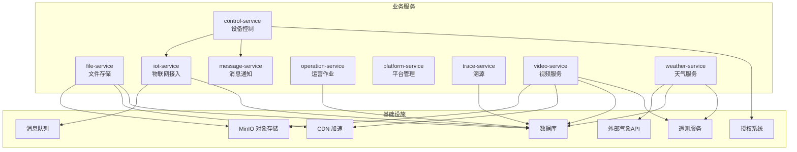

图示来源
- [apps/file-service/src/app.module.ts:1-2](file://apps/file-service/src/app.module.ts#L1-L2)
- [apps/file-service/src/storage.ts:1-43](file://apps/file-service/src/storage.ts#L1-L43)
- [apps/file-service/src/file.repository.ts:1-146](file://apps/file-service/src/file.repository.ts#L1-L146)
- [apps/video-service/src/app.module.ts:1-2](file://apps/video-service/src/app.module.ts#L1-L2)
- [apps/video-service/src/ai-event.repository.ts:1-182](file://apps/video-service/src/ai-event.repository.ts#L1-L182)
- [apps/video-service/src/ptz.repository.ts:1-120](file://apps/video-service/src/ptz.repository.ts#L1-L120)
- [apps/video-service/src/recording-archive.repository.ts:1-164](file://apps/video-service/src/recording-archive.repository.ts#L1-L164)
- [apps/operation-service/src/task.repository.ts:1-153](file://apps/operation-service/src/task.repository.ts#L1-L153)

章节来源
- [apps/control-service/src/app.module.ts:1-2](file://apps/control-service/src/app.module.ts#L1-L2)
- [apps/file-service/src/app.module.ts:1-2](file://apps/file-service/src/app.module.ts#L1-L2)
- [apps/iot-service/src/app.module.ts:1-2](file://apps/iot-service/src/app.module.ts#L1-L2)
- [apps/message-service/src/app.module.ts:1-2](file://apps/message-service/src/app.module.ts#L1-L2)
- [apps/operation-service/src/app.module.ts:1-2](file://apps/operation-service/src/app.module.ts#L1-L2)
- [apps/platform-service/src/app.module.ts:1-2](file://apps/platform-service/src/app.module.ts#L1-L2)
- [apps/trace-service/src/app.module.ts:1-2](file://apps/trace-service/src/app.module.ts#L1-L2)
- [apps/video-service/src/app.module.ts:1-2](file://apps/video-service/src/app.module.ts#L1-L2)
- [apps/weather-service/src/app.module.ts:1-2](file://apps/weather-service/src/app.module.ts#L1-L2)

## 核心组件
本节概述各服务的职责与对外能力，便于跨团队对齐接口与协作契约。

- **设备控制服务（control-service）**
  - 职责：设备生命周期管理、远程控制指令下发、设备状态监控与告警联动。
  - 关键能力：设备注册/发现、指令编排与重试、遥测聚合与阈值告警。
  - **重大更新**：实现完整的指令生命周期状态机（QUEUED → SENT → ACKED → DONE），新增设备通信端点（/dispatch, /receipt），支持ESTOP急停命令，增强监控能力包括超时跟踪和回执管理。
  - **重大更新**：实现全面的多租户隔离机制，通过可信身份头（x-tenant-id）进行租户解析，所有数据操作都带租户ID过滤，防止跨农场紧急停止记录访问。
  - **新增**：统一的命令完成系统，支持灌溉和施肥等多种作业类型的完成事件处理，通过统一的FinishedEvent类型和FINISHED_TOPIC_BY_TYPE映射表简化多操作类型处理。
  - **新增**：超时命令关闭系统，通过 ControlReceiptSweeper 定时任务自动将超时未回执的指令收口为 FAILED 状态。
  - **新增**：本地出站模式实现，通过 SqlControlOutboxStore 确保指令状态跃迁与超时事件同事务写入。
  - **增强**：待处理命令查询端点 `/api/v1/control/device/pending`，支持设备轮询获取待处理指令，实现四态跟踪（QUEUED、SENT、ACKED、PAUSED），通过正序排序确保指令按下发先后顺序执行。
  - **新增**：土壤湿度自动灌溉控制，包括墒情高于上限时的自动停灌功能，通过stopIrrigation方法实现智能灌溉控制。
  - **新增**：CANCELLED命令状态，支持指令的取消和撤回操作，完善双向控制循环机制。
  - **重大更新**：新增6种命令类型（PAUSE、RESUME、RETURN_HOME、POWER_OFF、TOOL_SWITCH、TILLAGE），支持作业暂停/恢复、设备回位、远程断电、工具切换和农事耕作等场景。
  - **重大更新**：实现授权范围管理系统，支持设备与地块的作业授权管控，通过时间窗口控制和通配符匹配确保作业安全。
  - **新增**：定时执行支持，通过scheduledAt字段实现指令的定时调度，设备网关只领取已到期的指令。
  - **HTTP端点验证增强**：改进了HTTP端点的参数验证机制，包括请求体类型检查、字段验证和时间戳格式验证。
  - **收据处理错误处理优化**：完善了设备回执处理的错误处理逻辑，包括状态机校验、数据完整性检查和时序验证。
  - 集成点：与物联网服务协同完成协议适配与指令路由；与消息服务联动触发告警；与授权系统协作进行作业范围管控。

- 文件存储服务（file-service）
  - 职责：基于 MinIO 的对象存储封装，提供统一上传下载、分片处理与 CDN 加速能力。
  - 关键能力：分片上传/合并、断点续传、预签名 URL、CDN 回源与缓存策略。
  - **新增**：文件元数据持久化存储，支持租户隔离、分页查询和删除补偿机制。
  - 集成点：对接 MinIO SDK；通过 CDN 域名暴露静态资源；与溯源/视频服务共享媒体资产。

- 物联网服务（iot-service）
  - 职责：设备接入协议适配、数据转发与设备生命周期管理。
  - 关键能力：多协议适配（MQTT/CoAP/HTTP）、消息路由、设备影子与在线状态维护。
  - **增强**：字段网关通过 `/api/v1/control/device/pending` 端点轮询待处理指令，提升现场协议设备的可靠性，支持四态跟踪（QUEUED、SENT、ACKED、PAUSED）。
  - 集成点：与设备控制服务交互执行指令；将遥测数据写入消息队列或时序存储。

- 消息通知服务（message-service）
  - 职责：多渠道通知分发（短信、邮件、站内信）。
  - 关键能力：模板渲染、渠道选择与重试、送达回执与审计。
  - **新增**：支持 control.command.timeout、control.irrigation.finished 和 control.fertilization.finished 事件处理，自动生成告警通知，支持按指令聚合去重。
  - **新增**：灌溉和施肥完成事件的专用消息模板，区分设备实测与方案推算的数据来源显示。
  - **重大更新**：新增工作流分发功能，支持告警消息的正式移交和离线处理流程，通过派单处置字段和API接口实现消息的线下流转管理。
  - 集成点：接收来自各业务服务的通知事件；对接第三方通道网关。

- 运营服务（operation-service）
  - 职责：农事作业管理、任务调度与进度跟踪。
  - 关键能力：作业计划编排、工单流转、人员与设备排班、进度统计。
  - **新增**：任务持久化存储，支持完整生命周期管理和乐观锁并发控制。
  - 集成点：与设备控制服务联动执行自动化作业；与消息服务发送提醒。

- 平台管理服务（platform-service）
  - 职责：系统配置、租户管理与资源配额控制。
  - 关键能力：多租户隔离、功能开关、配额与用量计量、审计日志。
  - 集成点：为其他服务提供鉴权与上下文信息；与网关服务配合做路由与限流。

- 溯源服务（trace-service）
  - 职责：农产品全链条追溯，记录种植、加工、流通各环节信息。
  - 关键能力：批次/批次链追踪、环节事件归档、二维码/批次码生成与查询。
  - **新增**：灌溉和施肥完成事件处理，自动记录用水量和投肥量等关键信息到生产档案。
  - 集成点：与文件服务关联图片/报告；与物联网/遥测数据关联环境因子。

- 视频服务（video-service）
  - 职责：实时监控、录像回放与智能分析。
  - 关键能力：RTSP/GB28181 接入、转码与切片、回放拉流、AI 分析结果归档。
  - **重大更新**：AI事件类型大幅扩展，从单一虫害检测扩展到7种事件类型（PEST、PERSON_INTRUSION、MACHINE_STATUS、FLOOD、LODGING、FIRE、SMOKE），支持人员闯入、农机状态、涝情、倒伏、火情、烟雾等多种场景。
  - **新增**：持久化AI事件处理，支持虫情识别结果落库、重试补投和状态追踪。
  - **新增**：PTZ云台控制通道，支持摄像机远程控制指令的持久化与投递状态管理。
  - **重大更新**：新增完整的录像留档档案子系统，支持告警时刻前后窗口片段自动留档，实现双仓库架构（InMemoryRecordingArchiveRepository用于测试，SqlRecordingArchiveRepository用于生产），提供全面的归档状态管理（PENDING、ARCHIVED、FAILED）和窗口化录制功能（preSeconds/postSeconds参数）。
  - 集成点：与文件服务存储媒体；与消息服务推送告警；与 CDN 加速播放；与遥测服务联动。

- 天气服务（weather-service）
  - 职责：集成气象数据，提供天气预报、灾害预警和农事作业建议。
  - 关键能力：多源数据聚合（QWeather API）、区域预报、阈值预警、实时气象站数据、作业适宜性判定。
  - **最新增强**：增强了预警过期处理逻辑，改进了数据一致性和自动停用机制，确保已过期但未解除的预警不会进入生效列表。
  - 集成点：调用外部气象 API；向运营/设备控制服务推送预警；与遥测服务联动获取田间数据。

章节来源
- [apps/control-service/src/app.module.ts:1-2](file://apps/control-service/src/app.module.ts#L1-L2)
- [apps/file-service/src/app.module.ts:1-2](file://apps/file-service/src/app.module.ts#L1-L2)
- [apps/iot-service/src/app.module.ts:1-2](file://apps/iot-service/src/app.module.ts#L1-L2)
- [apps/message-service/src/app.module.ts:1-2](file://apps/message-service/src/app.module.ts#L1-L2)
- [apps/operation-service/src/app.module.ts:1-2](file://apps/operation-service/src/app.module.ts#L1-L2)
- [apps/platform-service/src/app.module.ts:1-2](file://apps/platform-service/src/app.module.ts#L1-L2)
- [apps/trace-service/src/app.module.ts:1-2](file://apps/trace-service/src/app.module.ts#L1-L2)
- [apps/video-service/src/app.module.ts:1-2](file://apps/video-service/src/app.module.ts#L1-L2)
- [apps/weather-service/src/app.module.ts:1-2](file://apps/weather-service/src/app.module.ts#L1-L2)

## 架构总览
下图展示"其他业务服务"的整体交互关系，突出设备控制、文件存储、物联网、消息、运营、平台、溯源、视频与天气之间的协作路径。

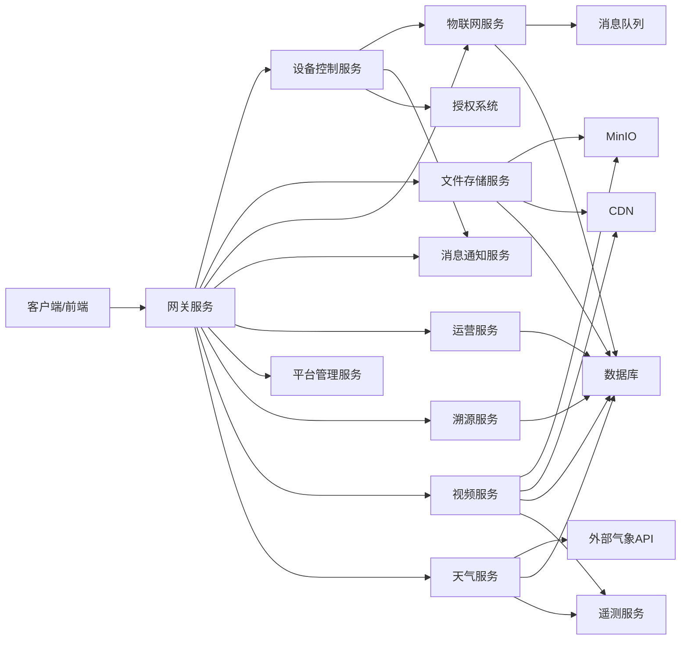

图示来源
- [apps/file-service/src/storage.ts:1-43](file://apps/file-service/src/storage.ts#L1-L43)
- [apps/file-service/src/file.repository.ts:1-146](file://apps/file-service/src/file.repository.ts#L1-L146)
- [apps/video-service/src/ai-event.repository.ts:1-182](file://apps/video-service/src/ai-event.repository.ts#L1-L182)
- [apps/video-service/src/ptz.repository.ts:1-120](file://apps/video-service/src/ptz.repository.ts#L1-L120)
- [apps/video-service/src/recording-archive.repository.ts:1-164](file://apps/video-service/src/recording-archive.repository.ts#L1-L164)
- [apps/operation-service/src/task.repository.ts:1-153](file://apps/operation-service/src/task.repository.ts#L1-L153)

## 详细组件分析

### 设备控制服务（control-service）
**重大更新** 控制服务现已实现统一的命令完成系统，支持灌溉和施肥等多种作业类型的完成事件处理，通过统一的FinishedEvent类型和FINISHED_TOPIC_BY_TYPE映射表简化多操作类型处理。**新增** 灌溉完成事件管道和超时命令关闭系统，通过 ControlReceiptSweeper 定时任务自动处理超时指令。**增强** 待处理命令查询端点 `/api/v1/control/device/pending`，支持设备轮询获取待处理指令，实现四态跟踪（QUEUED、SENT、ACKED、PAUSED），通过正序排序确保指令按下发先后顺序执行。**新增** 土壤湿度自动灌溉控制功能，包括墒情高于上限时的自动停灌机制和CANCELLED命令状态，完善了双向控制循环。**HTTP端点验证增强** 改进了HTTP端点的参数验证机制，包括请求体类型检查、字段验证和时间戳格式验证。

- 职责边界
  - 设备注册与元数据管理
  - 远程控制指令下发（含重试、幂等、超时控制）
  - 设备状态监控与告警联动
  - **新增**：统一的命令完成系统，支持IRRIGATION和FERTILIZATION等多种作业类型
  - **新增**：设备通信端点（/dispatch, /receipt）
  - **新增**：ESTOP急停命令支持与到位确认机制
  - **新增**：超时跟踪与回执管理功能
  - **增强**：待处理命令查询端点 `/api/v1/control/device/pending`，支持设备轮询和四态跟踪（QUEUED、SENT、ACKED、PAUSED）
  - **新增**：土壤湿度自动灌溉控制，包括墒情高于上限时的自动停灌功能
  - **新增**：CANCELLED命令状态，支持指令的取消和撤回操作
  - **重大更新**：全面的多租户隔离机制，通过可信身份头（x-tenant-id）进行租户解析
  - **新增**：统一的FinishedEvent类型，支持多种作业类型的完成事件处理
  - **新增**：FINISHED_TOPIC_BY_TYPE映射表，简化多操作类型的主题选择逻辑
  - **新增**：超时命令关闭系统，自动将超时未回执的指令收口为 FAILED 状态
  - **重大更新**：新增6种命令类型（PAUSE、RESUME、RETURN_HOME、POWER_OFF、TOOL_SWITCH、TILLAGE）
  - **重大更新**：实现授权范围管理系统，支持设备与地块的作业授权管控
  - **新增**：定时执行支持，通过scheduledAt字段实现指令的定时调度
  - **HTTP端点验证增强**：改进了HTTP端点的参数验证机制，包括请求体类型检查、字段验证和时间戳格式验证
  - **收据处理错误处理优化**：完善了设备回执处理的错误处理逻辑，包括状态机校验、数据完整性检查和时序验证

- **新增** 新命令类型架构
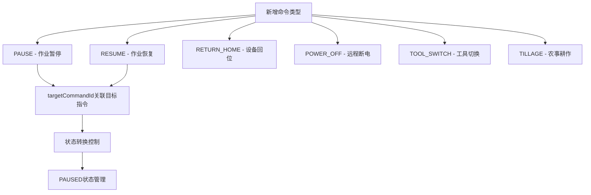

- **新增** 授权范围管理系统架构
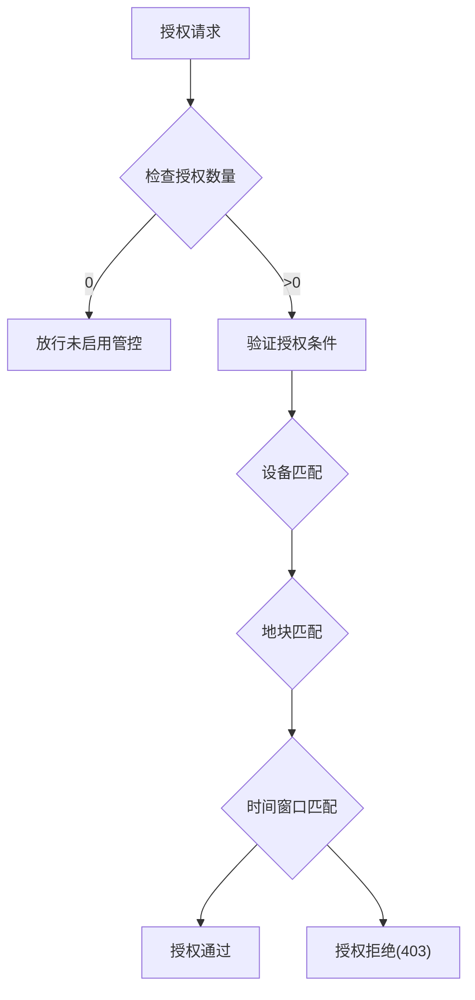

- **新增** 定时执行流程
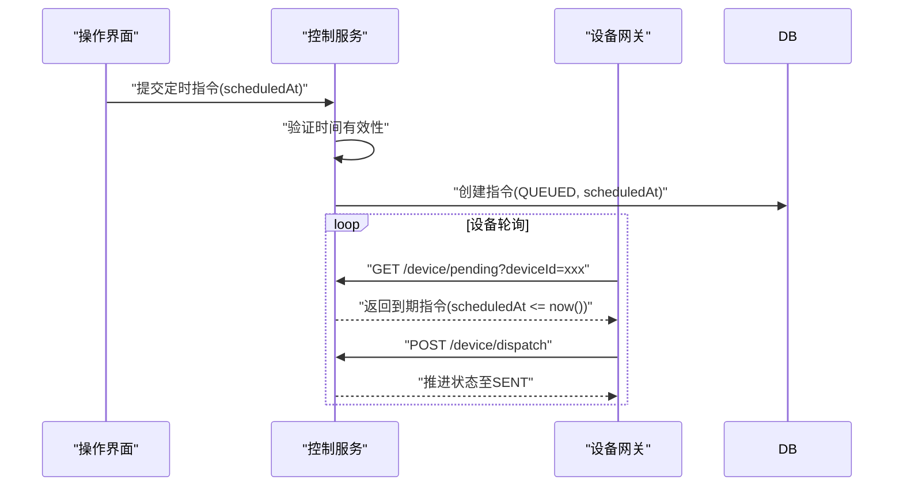

- **更新** HTTP端点验证增强架构
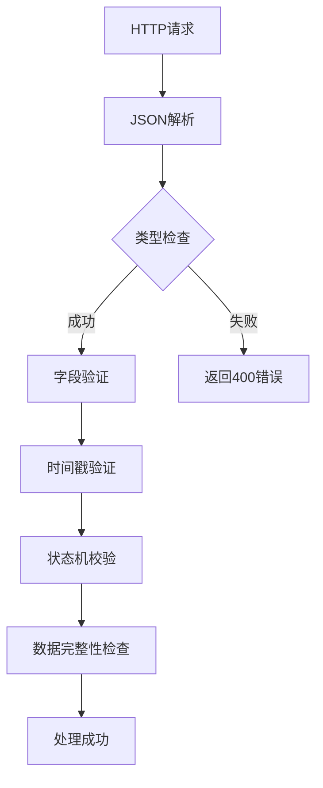

- **更新** 统一命令完成系统架构
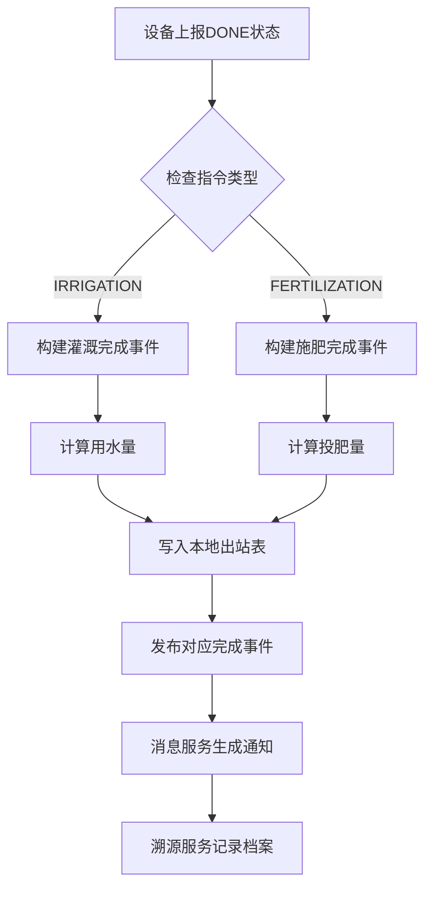

- **更新** 多租户隔离架构
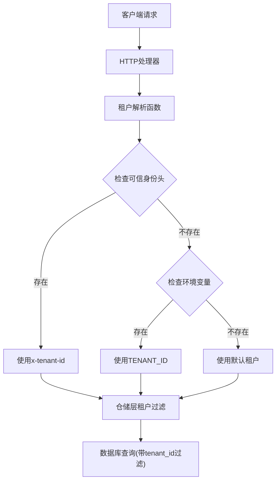

- **更新** 指令生命周期状态机
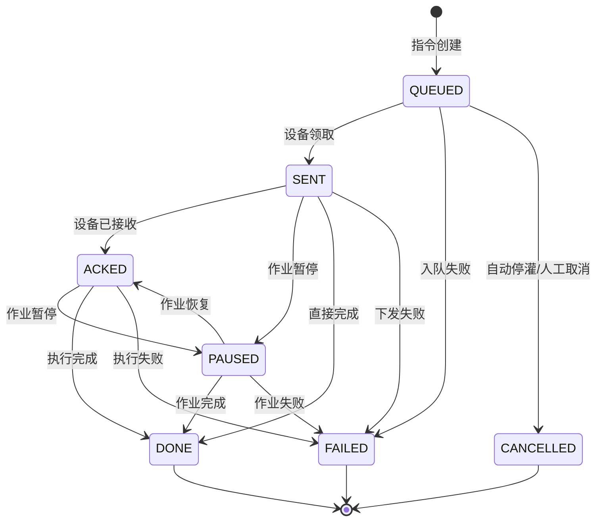

- **更新** 设备通信流程图
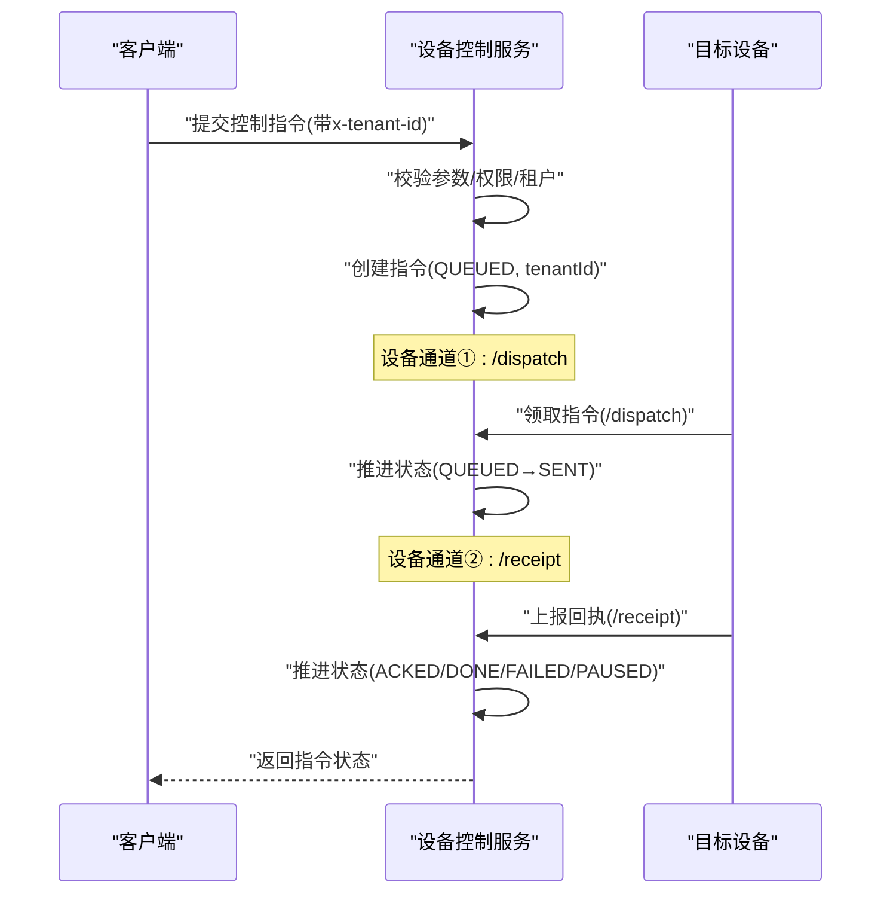

- **更新** ESTOP急停命令流程
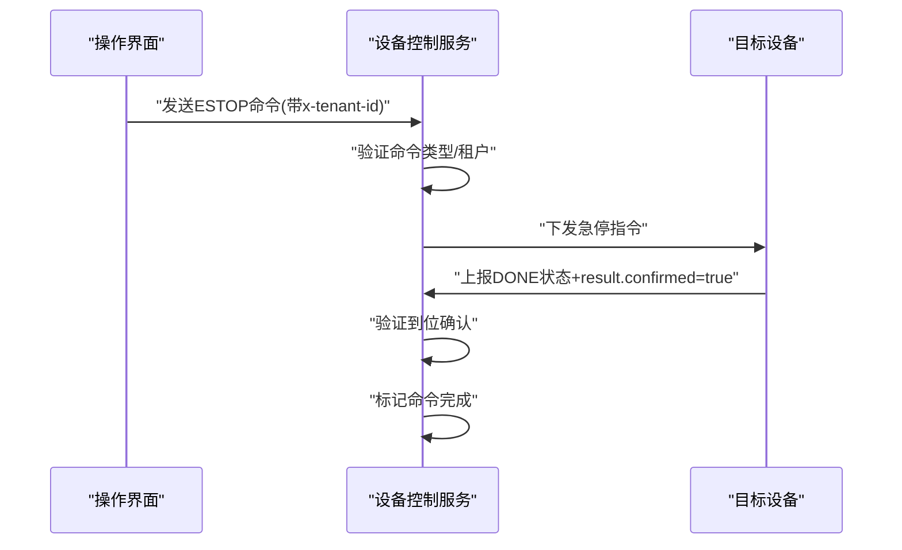

- **更新** 租户解析与安全机制
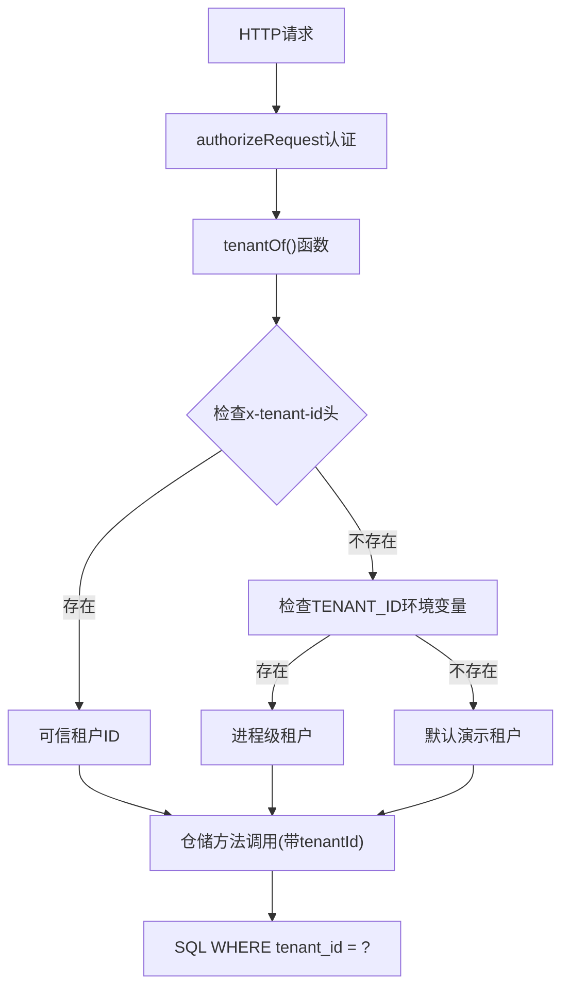

- **更新** 统一命令完成事件处理流程
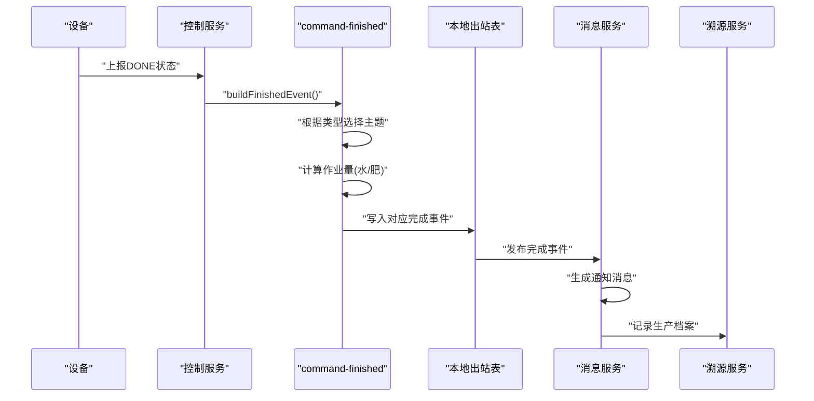

- **更新** 超时命令关闭系统流程
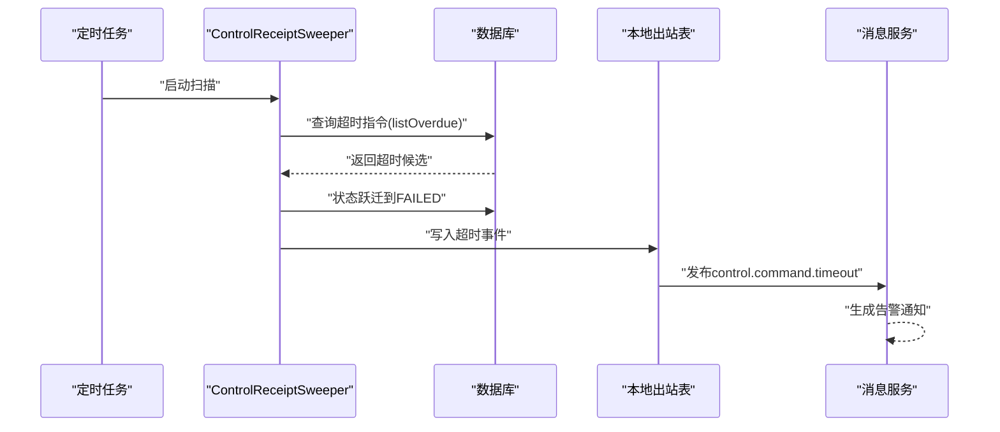

- **更新** 收据处理错误处理流程
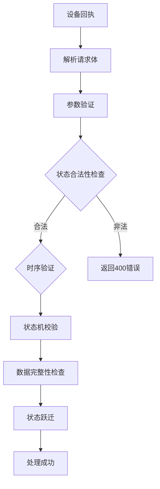

- 异常与容错
  - 指令重试与退避策略
  - 设备离线/超时的降级处理
  - 与消息服务联动告警
  - **新增**：乐观锁版本控制防止并发冲突
  - **新增**：超时检测与自动告警机制
  - **新增**：跨租户访问拦截，返回404而非403确保安全
  - **新增**：超时命令关闭系统的错误回调处理
  - **新增**：统一命令完成系统的数据验证，宁缺不造估算值
  - **新增**：HTTP端点验证的错误处理，统一返回400错误码
  - **新增**：收据处理的时序验证，确保时间戳顺序正确
  - **新增**：土壤湿度自动灌溉控制的数值验证，确保墒情数据有效性
  - **新增**：CANCELLED状态的并发控制，确保只撤回收取前的指令
  - **增强**：待处理命令查询的参数验证，确保deviceId必填，支持分页和正序排序
  - **新增**：新命令类型的参数验证，确保targetCommandId等字段的正确性
  - **新增**：授权范围检查的错误处理，返回403禁止访问错误
  - **新增**：定时执行的时间验证，确保scheduledAt晚于当前时间

章节来源
- [apps/control-service/src/http.ts:277-290](file://apps/control-service/src/http.ts#L277-L290)
- [apps/control-service/src/command-finished.ts:1-136](file://apps/control-service/src/command-finished.ts#L1-L136)
- [apps/control-service/src/receipt-sweeper.ts:1-142](file://apps/control-service/src/receipt-sweeper.ts#L1-L142)
- [apps/control-service/src/command-spec.ts:1-187](file://apps/control-service/src/command-spec.ts#L1-L187)
- [apps/control-service/src/control.repository.ts:1-449](file://apps/control-service/src/control.repository.ts#L1-L449)
- [apps/control-service/src/consumer.ts:1-266](file://apps/control-service/src/consumer.ts#L1-L266)
- [apps/control-service/src/authorization.repository.ts:1-169](file://apps/control-service/src/authorization.repository.ts#L1-L169)
- [apps/control-service/src/main.ts:1-111](file://apps/control-service/src/main.ts#L1-L111)
- [apps/control-service/test/receipt.spec.ts:343-401](file://apps/control-service/test/receipt.spec.ts#L343-L401)
- [apps/control-service/test/http.spec.ts:1-44](file://apps/control-service/test/http.spec.ts#L1-L44)
- [apps/control-service/test/consumer.spec.ts:1-91](file://apps/control-service/test/consumer.spec.ts#L1-L91)

### 物联网服务（iot-service）
**增强** 物联网服务新增了字段网关通过 `/api/v1/control/device/pending` 端点轮询待处理指令的功能，显著提升现场协议设备的可靠性和指令执行的确定性，支持四态跟踪（QUEUED、SENT、ACKED、PAUSED）。

- 职责边界
  - 设备接入协议适配（MQTT/CoAP/HTTP）
  - 数据转发（遥测/事件）与设备影子维护
  - 设备生命周期管理（上线/下线/注销）
  - **增强**：字段网关通过待处理命令查询端点轮询指令，支持现场协议设备（Modbus TCP）和四态跟踪
- **增强** 字段网关指令轮询流程
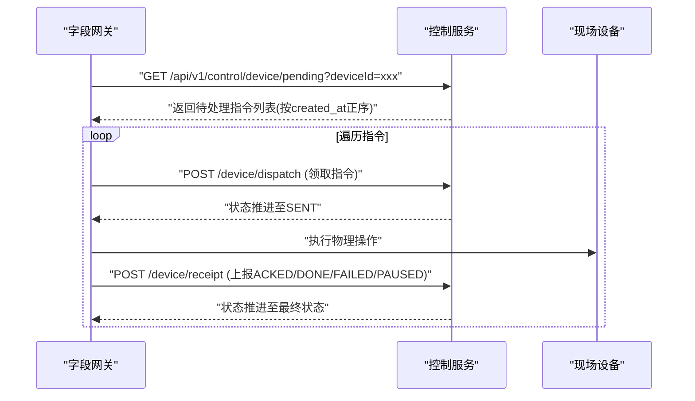

- 典型数据流
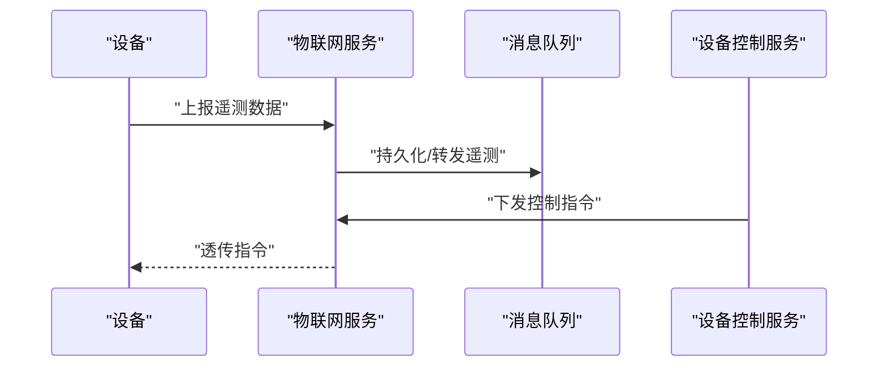

章节来源
- [apps/iot-service/src/field-gateway.ts:129-132](file://apps/iot-service/src/field-gateway.ts#L129-L132)
- [apps/iot-service/src/field-gateway.ts:233-257](file://apps/iot-service/src/field-gateway.ts#L233-L257)

### 文件存储服务（file-service）
**更新** 文件服务新增了完整的元数据持久化能力和租户隔离机制，显著提升了文件管理的可靠性和安全性。

- 职责边界
  - 基于 MinIO 的统一对象存储封装
  - 文件上传下载、分片处理、断点续传
  - 预签名 URL 与 CDN 加速
  - **新增**：文件元数据持久化存储，支持租户隔离、分页查询和删除补偿机制
- 核心类与方法（概念示意）
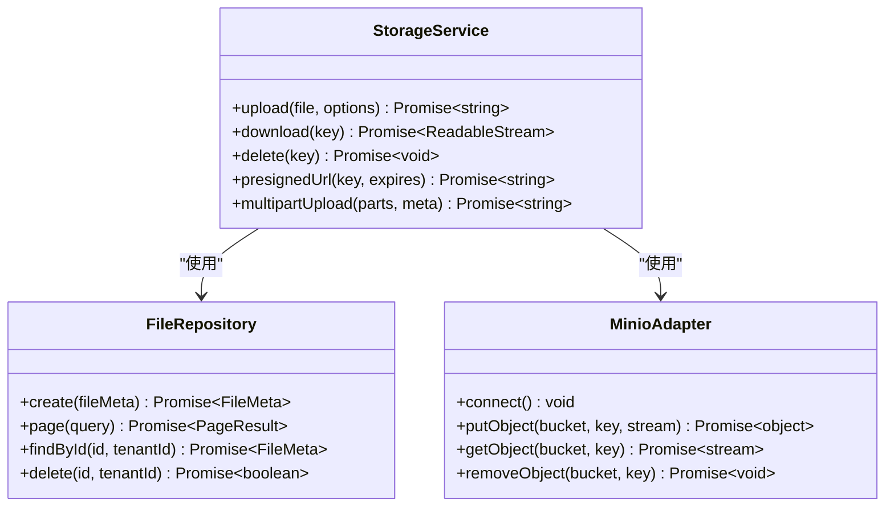

- 分片上传流程图
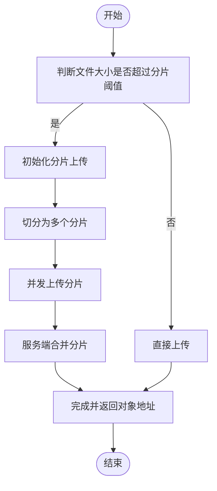

- **新增** 文件元数据持久化架构
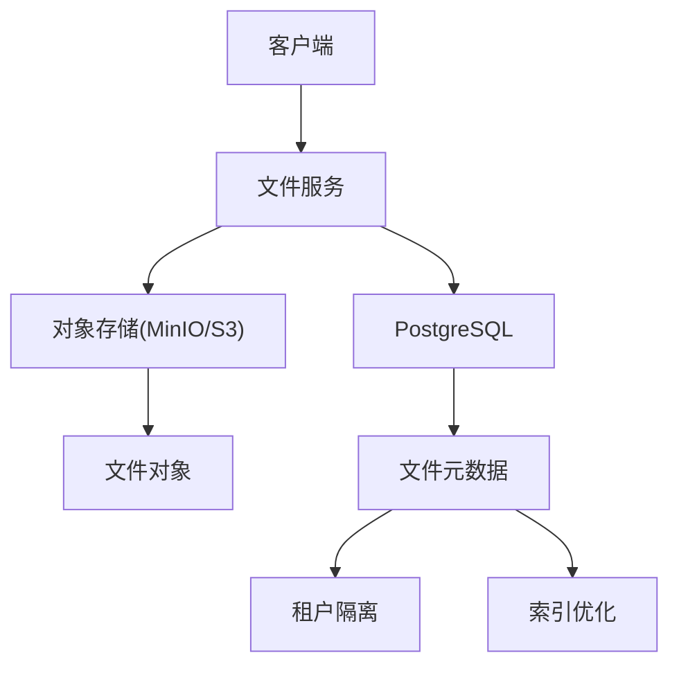

- 与 CDN 的集成要点
  - 静态资源走 CDN 域名，动态上传仍经 MinIO
  - 预签名 URL 可设置过期时间与访问白名单
  - 缓存命中与回源策略由 CDN 侧配置

章节来源
- [apps/file-service/src/app.module.ts:1-2](file://apps/file-service/src/app.module.ts#L1-L2)
- [apps/file-service/src/storage.ts:1-43](file://apps/file-service/src/storage.ts#L1-L43)
- [apps/file-service/src/file.repository.ts:1-146](file://apps/file-service/src/file.repository.ts#L1-L146)
- [apps/file-service/src/http.ts:1-195](file://apps/file-service/src/http.ts#L1-L195)

### 消息通知服务（message-service）
**更新** 消息通知服务新增了对 control.command.timeout、control.irrigation.finished 和 control.fertilization.finished 事件的处理能力，能够自动生成告警通知和作业完成通知，支持按指令聚合去重。**重大更新** 新增工作流分发功能，支持告警消息的正式移交和离线处理流程，通过派单处置字段和API接口实现消息的线下流转管理。

- 职责边界
  - 多渠道通知（短信、邮件、站内信）
  - 模板渲染、渠道选择、重试与回执
  - **新增**：支持 control.command.timeout、control.irrigation.finished 和 control.fertilization.finished 事件处理，自动生成告警通知
  - **新增**：灌溉和施肥完成事件的专用消息模板，区分设备实测与方案推算的数据来源显示
  - **重大更新**：新增工作流分发功能，支持告警消息的正式移交和离线处理流程
- **更新** 统一命令完成事件处理流程
```mermaid
sequenceDiagram
participant CS as "控制服务"
participant OUTBOX as "本地出站表"
participant MQ as "消息队列"
participant MS as "消息服务"
CS->>OUTBOX : "写入完成事件(灌溉/施肥)"
OUTBOX->>MQ : "发布对应完成事件"
MQ->>MS : "消费完成事件"
MS->>MS : "渲染专用消息模板"
MS->>MS : "生成通知消息"
MS-->>MS : "按commandId去重"
```

- **更新** 灌溉和施肥完成事件消息模板
```mermaid
flowchart TD
PAYLOAD["完成事件载荷"] --> TYPE_CHECK{"检查事件类型"}
TYPE_CHECK --> |IRRIGATION| IRR_TEMPLATE["灌溉完成模板"]
TYPE_CHECK --> |FERTILIZATION| FERT_TEMPLATE["施肥完成模板"]
IRR_TEMPLATE --> WATER["计算用水量显示"]
WATER --> DEVICE["设备实测：xxx立方米设备实测"]
WATER --> PLAN["方案推算：xxx立方米按分区方案推算"]
WATER --> NONE["未上报：用水量未上报"]
FERT_TEMPLATE --> AMOUNT["计算投肥量显示"]
AMOUNT --> DEVICE_AMT["设备实测：xxx千克设备实测"]
AMOUNT --> PLAN_AMT["方案推算：xxx千克按配方与面积推算"]
AMOUNT --> NONE_AMT["未上报：施肥量未上报"]
```

- **新增** 工作流分发功能架构
```mermaid
flowchart TD
ALERT["告警消息"] --> DISPATCH_API["派单处置API"]
DISPATCH_API --> VALIDATE["验证消息类型和状态"]
VALIDATE --> |仅ALERT| SET_DISPATCHED["设置dispatched=true"]
SET_DISPATCHED --> MARK_READ["标记已读"]
MARK_READ --> RECORD_INFO["记录派单人、说明、时间"]
RECORD_INFO --> WORKFLOW["进入线下处理流程"]
VALIDATE --> |NOTICE| ERROR_400["返回400错误"]
```

- **新增** 派单处置工作流程
```mermaid
sequenceDiagram
participant UI as "操作界面"
participant MS as "消息服务"
participant DB as "数据库"
participant WORKFLOW as "线下工作流"
UI->>MS : "POST /messages/{id}/dispatch"
MS->>DB : "查询消息并验证状态"
DB-->>MS : "返回消息信息"
MS->>MS : "验证是否为ALERT且未忽略"
MS->>DB : "更新dispatched状态"
DB-->>MS : "返回更新后的消息"
MS-->>UI : "返回派单成功响应"
MS->>WORKFLOW : "触发线下处理流程"
```

章节来源
- [apps/message-service/src/consumer.ts:60-75](file://apps/message-service/src/consumer.ts#L60-L75)
- [apps/message-service/src/http.ts:210-245](file://apps/message-service/src/http.ts#L210-L245)
- [apps/message-service/src/message.repository.ts:236-251](file://apps/message-service/src/message.repository.ts#L236-L251)
- [packages/contracts/src/messages/message-template.ts:245-292](file://packages/contracts/src/messages/message-template.ts#L245-L292)

### 运营服务（operation-service）
**更新** 运营服务新增了完整的任务持久化存储和生命周期管理机制，支持乐观锁并发控制和Outbox模式事件发布。

- 职责边界
  - 农事作业管理（计划、工单、排班）
  - 任务调度与进度跟踪
  - 与设备控制服务联动执行自动化作业
  - **新增**：任务持久化存储，支持完整生命周期管理和乐观锁并发控制
- 关键流程（作业执行）
```mermaid
flowchart TD
Plan["创建作业计划"] --> Schedule["调度任务"]
Schedule --> Dispatch["派发至设备/人员"]
Dispatch --> Execute["执行作业"]
Execute --> Track["采集进度/状态"]
Track --> Report["生成报表/通知"]
```

- **新增** 任务生命周期状态机
```mermaid
stateDiagram-v2
[*] --> PENDING
PENDING --> RUNNING : 开始执行
PENDING --> CANCELLED : 取消任务
RUNNING --> COMPLETED : 完成任务
RUNNING --> CANCELLED : 取消任务
COMPLETED --> [*]
CANCELLED --> [*]
```

- **新增** 任务持久化架构
```mermaid
flowchart TD
Client["客户端"] --> OPS["运营服务"]
OPS --> DB["PostgreSQL"]
DB --> TASKS["任务表(operation_tasks)"]
DB --> OUTBOX["出站消息表(operation_outbox)"]
TASKS --> VERSION["乐观锁版本控制"]
OUTBOX --> EVENT["事件发布"]
```

章节来源
- [apps/operation-service/src/app.module.ts:1-2](file://apps/operation-service/src/app.module.ts#L1-L2)
- [apps/operation-service/src/task.repository.ts:1-153](file://apps/operation-service/src/task.repository.ts#L1-L153)
- [apps/operation-service/src/http.ts:1-138](file://apps/operation-service/src/http.ts#L1-L138)

### 平台管理服务（platform-service）
- 职责边界
  - 系统配置、租户管理、资源配额控制
  - 鉴权上下文与功能开关
- 关键能力
  - 多租户隔离策略（数据/配置/配额）
  - 用量计量与限额拦截
  - 审计日志与合规性输出

章节来源
- [apps/platform-service/src/app.module.ts:1-2](file://apps/platform-service/src/app.module.ts#L1-L2)

### 溯源服务（trace-service）
**更新** 溯源服务新增了灌溉和施肥完成事件处理能力，自动记录作业的关键信息到生产档案中。

- 职责边界
  - 农产品全链条追溯（种植、加工、流通）
  - 批次/批次链管理、环节事件归档
  - **新增**：灌溉和施肥完成事件处理，记录用水量、投肥量、时长和设备信息
- **更新** 统一命令完成事件处理流程
```mermaid
sequenceDiagram
participant MQ as "消息队列"
participant TRC as "溯源服务"
participant DB as "数据库"
MQ->>TRC : "消费control.*.finished事件"
TRC->>TRC : "根据事件类型生成traceCode"
TRC->>DB : "写入生产档案"
DB->>DB : "ON CONFLICT DO NOTHING"
```

- 数据访问层（概念示意）
```mermaid
classDiagram
class TraceRepository {
+createBatch(record) Promise~string~
+appendEvent(batchId, event) Promise~void~
+queryChain(batchId) Promise~TraceChain~
}
```

- 与文件/物联网数据的关联
  - 关联图片/检测报告（文件服务）
  - 关联环境因子/遥测数据（物联网/遥测）

章节来源
- [apps/trace-service/src/app.module.ts:1-2](file://apps/trace-service/src/app.module.ts#L1-L2)
- [apps/trace-service/src/repository.ts:1-200](file://apps/trace-service/src/repository.ts#L1-L200)

### 视频服务（video-service）
**重大更新** 视频服务AI事件类型大幅扩展，从单一虫害检测扩展到7种事件类型，同时新增了强大的AI事件处理和PTZ云台控制功能，显著提升了智能监控和远程管理能力。**重大更新** 新增完整的录像留档档案子系统，支持告警时刻前后窗口片段自动留档，实现双仓库架构（InMemoryRecordingArchiveRepository用于测试，SqlRecordingArchiveRepository用于生产），提供全面的归档状态管理（PENDING、ARCHIVED、FAILED）和窗口化录制功能（preSeconds/postSeconds参数）。

- 职责边界
  - 实时监控、录像回放、智能分析
  - 媒体转码、切片与拉流
  - **重大更新**：AI事件类型扩展为7种（PEST、PERSON_INTRUSION、MACHINE_STATUS、FLOOD、LODGING、FIRE、SMOKE），支持人员闯入、农机状态、涝情、倒伏、火情、烟雾等多种场景
  - **新增**：持久化AI事件处理，支持虫情识别结果落库、重试补投和状态追踪
  - **新增**：PTZ云台控制通道，支持摄像机远程控制指令的持久化与投递状态管理
  - **重大更新**：新增完整的录像留档档案子系统，支持告警时刻前后窗口片段自动留档，实现双仓库架构和全面的归档状态管理
- 典型流程（回放）
```mermaid
sequenceDiagram
participant UI as "前端"
participant VID as "视频服务"
participant MINIO as "MinIO"
participant CDN as "CDN"
UI->>VID : "请求回放片段"
VID->>MINIO : "读取媒体文件"
VID->>CDN : "回源/缓存"
CDN-->>VID : "返回流片段"
VID-->>UI : "推流/播放"
```

- **重大更新** AI事件类型扩展架构
```mermaid
flowchart TD
AI_EVENT["AI识别事件"] --> TYPE_CHECK{"检查事件类型"}
TYPE_CHECK --> |PEST| PEST_FLOW["虫情处理流程"]
TYPE_CHECK --> |PERSON_INTRUSION| SECURITY_FLOW["安防处理流程"]
TYPE_CHECK --> |MACHINE_STATUS| MACHINE_FLOW["农机状态流程"]
TYPE_CHECK --> |FLOOD| FLOOD_FLOW["涝情处理流程"]
TYPE_CHECK --> |LODGING| LODGING_FLOW["倒伏处理流程"]
TYPE_CHECK --> |FIRE| FIRE_FLOW["火情处理流程"]
TYPE_CHECK --> |SMOKE| SMOKE_FLOW["烟雾处理流程"]
PEST_FLOW --> LEVEL_CHECK["等级判定"]
SECURITY_FLOW --> LEVEL_CHECK
MACHINE_FLOW --> LEVEL_CHECK
FLOOD_FLOW --> LEVEL_CHECK
LODGING_FLOW --> LEVEL_CHECK
FIRE_FLOW --> CRITICAL_LEVEL["严重级别"]
SMOKE_FLOW --> CRITICAL_LEVEL
LEVEL_CHECK --> TEMPLATE["消息模板渲染"]
CRITICAL_LEVEL --> TEMPLATE
TEMPLATE --> NOTIFICATION["生成通知"]
```

- **新增** 录像留档档案子系统架构
```mermaid
flowchart TD
AI_EVENT["AI识别事件"] --> ARCHIVE_CREATE["创建留档记录"]
MANUAL["人工补登"] --> ARCHIVE_CREATE
ARCHIVE_CREATE --> WINDOW_CALC["计算录制窗口(preSeconds/postSeconds)"]
WINDOW_CALC --> STORE["存储到数据库"]
STORE --> STREAMING["流媒体服务切片"]
STREAMING --> SETTLE["回填storageKey/playbackUrl"]
SETTLE --> ARCHIVED["状态更新为ARCHIVED"]
STORE --> PENDING["保持PENDING状态"]
```

- **新增** 录像留档窗口计算流程
```mermaid
sequenceDiagram
participant EVENT as "事件时间"
participant WIN as "archiveWindow函数"
participant RESULT as "录制窗口"
EVENT->>WIN : "eventAt + preSeconds + postSeconds"
WIN->>WIN : "计算startedAt = eventAt - preSeconds"
WIN->>WIN : "计算endedAt = eventAt + postSeconds"
WIN->>RESULT : "返回{startedAt, endedAt}"
```

- **新增** 双仓库架构设计
```mermaid
flowchart TD
APP["应用层"] --> REPO_INTERFACE["RecordingArchiveRepository接口"]
REPO_INTERFACE --> IN_MEMORY["InMemoryRecordingArchiveRepository<br/>(测试用)"]
REPO_INTERFACE --> SQL_REPO["SqlRecordingArchiveRepository<br/>(生产用)"]
IN_MEMORY --> MAP["内存Map存储"]
SQL_REPO --> DB["PostgreSQL数据库"]
DB --> TABLE["video_recording_archives表"]
```

- **新增** 留档状态管理流程
```mermaid
stateDiagram-v2
[*] --> PENDING : 创建留档记录
PENDING --> ARCHIVED : 流媒体切片完成
PENDING --> FAILED : 切片失败
ARCHIVED --> [*]
FAILED --> [*]
```

- **新增** 内部回填接口流程
```mermaid
sequenceDiagram
participant STREAMING as "流媒体服务"
participant VID as "视频服务"
participant DB as "数据库"
STREAMING->>VID : "POST /internal/video/recording-archives/{id}/settle"
VID->>VID : "验证INTERNAL_TOKEN"
VID->>DB : "查找留档记录"
DB-->>VID : "返回记录信息"
VID->>DB : "更新status/storageKey/playbackUrl"
DB-->>VID : "返回更新后的记录"
VID-->>STREAMING : "返回200成功响应"
```

- **重大更新** 7种AI事件类型详解
  - **PEST（虫情）**：沿用原有虫情链路，pestType必填，支持虫害字典匹配
  - **PERSON_INTRUSION（人员闯入）**：安防场景，中等以上按告警处理
  - **MACHINE_STATUS（农机状态）**：运行提醒，仅发通知，INFO级别
  - **FLOOD（涝情）**：农业灾害，中等以上按告警处理
  - **LODGING（倒伏）**：作物倒伏，中等以上按告警处理
  - **FIRE（火情）**：火灾预警，严重级别直接拉到CRITICAL
  - **SMOKE（烟雾）**：烟雾检测，严重级别直接拉到CRITICAL

章节来源
- [apps/video-service/src/app.module.ts:1-2](file://apps/video-service/src/app.module.ts#L1-L2)
- [apps/video-service/src/ai-event.ts:1-106](file://apps/video-service/src/ai-event.ts#L1-L106)
- [apps/video-service/src/ai-event.repository.ts:133-144](file://apps/video-service/src/ai-event.repository.ts#L133-L144)
- [apps/video-service/src/ptz-channel.ts:1-41](file://apps/video-service/src/ptz-channel.ts#L1-L41)
- [apps/video-service/src/ptz.repository.ts:1-120](file://apps/video-service/src/ptz.repository.ts#L1-L120)
- [apps/video-service/src/recording-archive.repository.ts:1-164](file://apps/video-service/src/recording-archive.repository.ts#L1-L164)
- [apps/video-service/src/http.ts:150-236](file://apps/video-service/src/http.ts#L150-L236)
- [apps/video-service/src/main.ts:1-47](file://apps/video-service/src/main.ts#L1-L47)

### 天气服务（weather-service）
**更新** 天气服务已实现完整的气象数据聚合、预报预测、灾害预警和农事作业建议功能，并增强了7天天气预报默认值、Asia/Shanghai时区处理、服务间身份验证头传播和遥测数据获取时的身份验证修复。**最新增强** 天气服务增强了预警过期处理逻辑，改进了数据一致性和自动停用机制，确保已过期但未解除的预警不会进入生效列表。

- 职责边界
  - 集成外部气象数据（QWeather API），提供预报与预警
  - 区域化数据聚合与订阅推送
  - 田间气象站实时数据监测
  - 农事作业适宜性判定与建议
  - **新增** 支持7天天气预报默认值、Asia/Shanghai时区处理、服务间身份验证头传播、遥测数据获取时的身份验证修复
  - **最新增强** 预警过期处理逻辑增强，改进数据一致性和自动停用机制
- 核心架构
```mermaid
classDiagram
class WeatherSyncer {
+start() void
+stop() void
+syncForecastNow() Promise~void~
+syncAlertsNow() Promise~void~
+forceSync() Promise~object~
+stats() SyncerStats
}
class QWeatherClient {
+fetchDaily(days) Promise~array~
+fetchHourly24() Promise~array~
+fetchWarning() Promise~array~
}
class ForecastRepository {
+upcoming(from, days) Promise~array~
+hourly(from, hours) Promise~array~
+upsertDay(input) Promise~object~
+upsertHour(hour) Promise~void~
}
class AlertRepository {
+list(query) Promise~array~
+create(tx, alert) Promise~object~
+deactivate(alertCode) Promise~boolean~
}
WeatherSyncer --> QWeatherClient : "使用"
WeatherSyncer --> ForecastRepository : "持久化"
WeatherSyncer --> AlertRepository : "持久化"
```

- 数据持久化架构
```mermaid
flowchart TD
QW["QWeather API"] --> SYNC["同步器"]
SYNC --> FORECAST["天气预报表"]
SYNC --> HOURLY["逐小时预报表"]
SYNC --> ALERTS["灾害预警表"]
FORECAST --> HTTP["HTTP API"]
HOURLY --> HTTP
ALERTS --> HTTP
HTTP --> CLIENT["客户端"]
```

- 典型流程（预警）
```mermaid
sequenceDiagram
participant WTH as "天气服务"
participant EXT as "外部气象API"
participant OPS as "运营服务"
participant CS as "设备控制服务"
WTH->>EXT : "拉取气象数据"
WTH->>WTH : "阈值判定/预警生成"
WTH->>DB : "持久化预警数据"
WTH-->>OPS : "推送预警事件"
WTH-->>CS : "触发设备联动策略"
```

- 农事作业建议算法
```mermaid
flowchart TD
INPUT["输入：七日预报 + 逐小时预报"] --> ANALYZE["分析降雨概率/风速/温度"]
ANALYZE --> RAIN_CHECK{"降雨概率≥50%?"}
RAIN_CHECK --> |是| DELAY_IRR["延迟灌溉/施肥"]
RAIN_CHECK --> |否| OK_IRR["适宜灌溉/施肥"]
ANALYZE --> WIND_CHECK{"风速>8m/s或风力≥4级?"}
WIND_CHECK --> |是| SUSPEND_SPRAY["暂停喷药/无人机"]
WIND_CHECK --> |否| TEMP_CHECK{"温度>33°C?"}
TEMP_CHECK --> |是| ATTENTION_SPRAY["注意高温喷药"]
TEMP_CHECK --> |否| OK_SPRAY["适宜喷药"]
DELAY_IRR --> OUTPUT["生成作业建议"]
OK_IRR --> OUTPUT
SUSPEND_SPRAY --> OUTPUT
ATTENTION_SPRAY --> OUTPUT
OK_SPRAY --> OUTPUT
```

- **新增** 7天天气预报默认值与时区处理
  - v1 API默认获取7天预报，覆盖"今天起一周"的业务需求
  - 使用Asia/Shanghai时区（UTC+8）处理农场日历日，确保日期计算准确
  - 通过 `farmDate()` 和 `farmToday()` 函数处理时区转换

- **新增** 服务间身份验证头传播
  - 使用 `identityHeaders(req)` 函数自动传播身份验证头
  - 确保遥测服务调用时的认证信息正确传递
  - 支持JWT令牌、API Key等多种认证方式

- **新增** 遥测数据获取时的身份验证修复
  - 在 `readTelemetry` 函数中正确传递身份验证头
  - 避免遥测服务返回401未授权错误
  - 提升实时气象站数据和历史曲线的可用性

- **最新增强** 预警过期处理逻辑增强
  - 实现了统一的 `isExpired` 函数，确保SQL与内存两套仓储的预警状态判断一致
  - 增强了 `isAlertActive` 函数，用于接口默认过滤已过期预警
  - 改进了预警的自动停用机制，支持基于失效时间的自动状态管理
  - 优化了查询过滤逻辑，确保已过期但未解除的预警不会进入生效列表

**章节来源**
- [apps/weather-service/src/app.module.ts:1-2](file://apps/weather-service/src/app.module.ts#L1-L2)
- [apps/weather-service/src/qweather.ts:1-665](file://apps/weather-service/src/qweather.ts#L1-L665)
- [apps/weather-service/src/forecast.repository.ts:1-314](file://apps/weather-service/src/forecast.repository.ts#L1-L314)
- [apps/weather-service/src/alert.repository.ts:1-161](file://apps/weather-service/src/alert.repository.ts#L1-L161)
- [apps/weather-service/src/sync.ts:1-433](file://apps/weather-service/src/sync.ts#L1-L433)
- [apps/weather-service/src/weather.ts:1-159](file://apps/weather-service/src/weather.ts#L1-L159)
- [apps/weather-service/src/http.ts:1-331](file://apps/weather-service/src/http.ts#L1-L331)
- [apps/weather-service/src/main.ts:1-161](file://apps/weather-service/src/main.ts#L1-L161)
- [apps/weather-service/src/farm-time.ts:1-23](file://apps/weather-service/src/farm-time.ts#L1-L23)
- [apps/weather-service/test/weather.spec.ts:154-166](file://apps/weather-service/test/weather.spec.ts#L154-L166)

## 依赖关系分析
**更新** 依赖关系分析反映了新增的统一命令完成系统、灌溉和施肥完成事件处理、超时命令关闭系统、本地出站模式和待处理命令查询端点的依赖关系。

- 组件耦合
  - 设备控制服务与物联网服务强耦合（指令路由）
  - 文件存储服务与 MinIO/CDN 解耦良好（适配器模式）
  - 溯源服务对数据库与文件服务存在引用
  - 视频服务依赖 MinIO/CDN 与消息服务
  - **新增** 控制服务新增对数据库的依赖（指令状态机与回执管理）
  - **新增** 控制服务新增对本地出站表的依赖（control_outbox）
  - **新增** 消息服务新增对 control.command.timeout、control.irrigation.finished 和 control.fertilization.finished 事件的依赖
  - **新增** 视频服务新增对数据库的依赖（AI事件和PTZ命令持久化）
  - **新增** 文件服务新增对数据库的依赖（文件元数据持久化）
  - **新增** 运营服务新增对数据库的依赖（任务持久化）
  - **新增** 天气服务与QWeather API、数据库、遥测服务存在依赖关系
  - **增强** 物联网服务新增对控制服务待处理命令查询端点的依赖，支持四态跟踪
  - **最新增强** 天气服务增强了预警过期处理逻辑的内部依赖关系
  - **新增** 控制服务新增对遥测阈值的依赖，支持土壤湿度自动灌溉控制
  - **重大更新** 视频服务新增对AI事件类型的依赖，支持7种事件类型的差异化处理
  - **新增** 消息服务新增对工作流分发的依赖，支持派单处置功能
  - **新增** 控制服务新增对授权系统的依赖，支持作业范围管控
  - **新增** 视频服务新增对录像留档档案子系统的依赖，支持告警时刻前后窗口片段自动留档
- 外部依赖
  - MinIO 对象存储
  - CDN 加速网络
  - 外部气象 API（QWeather）
  - 消息队列（用于遥测与事件）
  - **新增** PostgreSQL 数据库（控制指令状态机、天气数据、文件元数据、AI事件、PTZ命令、任务持久化、本地出站表、录像留档档案）
  - **新增** 遥测服务（田间气象站数据）
  - **新增** 授权系统（设备与地块作业授权管控）

```mermaid
graph LR
CS["设备控制服务"] --> IoT["物联网服务"]
CS --> DB["数据库"]
CS --> OUTBOX["本地出站表"]
CS --> MS["消息服务"]
CS --> TELEMETRY["遥测服务"]
CS --> AUTHZ["授权系统"]
IoT --> CS
FS["文件存储服务"] --> MINIO["MinIO"]
FS --> CDN["CDN"]
FS --> DB
VID["视频服务"] --> MINIO
VID --> CDN
VID --> DB
VID --> TELEMETRY
VID --> AI_TYPES["AI事件类型"]
VID --> ARCHIVES["录像留档档案"]
TRC["溯源服务"] --> DB
WTH["天气服务"] --> EXT["外部气象API"]
WTH --> DB
WTH --> TELEMETRY
OPS["运营服务"] --> DB
MS --> DB
MS --> WORKFLOW["工作流分发"]
```

图示来源
- [apps/control-service/src/command-finished.ts:1-136](file://apps/control-service/src/command-finished.ts#L1-L136)
- [apps/control-service/test/command-finished.spec.ts:1-329](file://apps/control-service/test/command-finished.spec.ts#L1-L329)
- [apps/control-service/src/http.ts:274-328](file://apps/control-service/src/http.ts#L274-L328)
- [apps/control-service/src/outbox.repository.ts:1-69](file://apps/control-service/src/outbox.repository.ts#L1-L69)
- [apps/control-service/src/receipt-sweeper.ts:1-142](file://apps/control-service/src/receipt-sweeper.ts#L1-L142)
- [apps/control-service/src/consumer.ts:134-185](file://apps/control-service/src/consumer.ts#L134-L185)
- [apps/control-service/src/authorization.repository.ts:1-169](file://apps/control-service/src/authorization.repository.ts#L1-L169)
- [apps/iot-service/src/field-gateway.ts:129-132](file://apps/iot-service/src/field-gateway.ts#L129-L132)
- [apps/message-service/src/consumer.ts:60-75](file://apps/message-service/src/consumer.ts#L60-L75)
- [apps/message-service/src/http.ts:210-245](file://apps/message-service/src/http.ts#L210-L245)
- [packages/contracts/src/messages/message-template.ts:245-292](file://packages/contracts/src/messages/message-template.ts#L245-L292)
- [apps/file-service/src/storage.ts:1-43](file://apps/file-service/src/storage.ts#L1-L43)
- [apps/file-service/src/file.repository.ts:1-146](file://apps/file-service/src/file.repository.ts#L1-L146)
- [apps/video-service/src/ai-event.ts:1-106](file://apps/video-service/src/ai-event.ts#L1-L106)
- [apps/video-service/src/ai-event.repository.ts:133-144](file://apps/video-service/src/ai-event.repository.ts#L133-L144)
- [apps/video-service/src/ptz.repository.ts:1-120](file://apps/video-service/src/ptz.repository.ts#L1-L120)
- [apps/video-service/src/recording-archive.repository.ts:1-164](file://apps/video-service/src/recording-archive.repository.ts#L1-L164)
- [apps/operation-service/src/task.repository.ts:1-153](file://apps/operation-service/src/task.repository.ts#L1-L153)

## 性能考虑
**更新** 性能考虑部分增加了新增功能的性能优化措施。

- 控制服务
  - **新增** 指令状态机使用乐观锁版本控制，避免并发冲突
  - **新增** 超时检测与自动告警机制，支持可配置的超时阈值
  - **新增** 回执管理优化，减少重复状态检查开销
  - **新增** 数据库索引优化，支持按状态、时间范围的高效查询
  - **新增** 租户隔离查询优化，使用复合索引（tenant_id, created_at DESC, id DESC）提升查询性能
  - **新增** 内存模式与SQL模式切换，适应不同部署场景
  - **新增** 超时命令关闭系统的批量处理能力，支持可配置的批次大小
  - **新增** 本地出站模式的异步处理，避免阻塞主流程
  - **新增** 统一命令完成系统的数据计算优化，优先使用设备实测值，避免复杂的方案计算
  - **新增** 多操作类型的主题选择优化，通过FINISHED_TOPIC_BY_TYPE映射表快速匹配
  - **新增** HTTP端点验证的性能优化，减少不必要的类型检查和字段验证
  - **新增** 收据处理的错误处理优化，提前返回错误避免后续无效处理
  - **新增** 土壤湿度自动灌溉控制的数值验证优化，避免无效的数据库查询
  - **新增** CANCELLED状态的并发控制优化，使用乐观锁确保只撤回收取前的指令
  - **增强** 待处理命令查询端点的性能优化，支持分页查询和正序排序，最大50条限制，通过created_at正序确保指令按下发先后顺序执行
  - **新增** 新命令类型的参数验证优化，减少不必要的数据库查询
  - **新增** 授权范围检查的索引优化，使用复合索引（tenant_id, valid_from, valid_to）提升查询性能
  - **新增** 定时执行的时间比较优化，避免频繁的时间计算
- 物联网服务
  - **增强** 字段网关轮询优化，支持可配置的轮询间隔（默认5秒），通过待处理命令查询端点获取指令
  - **新增** 指令执行状态机优化，避免重复执行和状态冲突
  - 遥测数据批量写入与压缩
  - 设备影子本地缓存，降低远端查询延迟
- 文件服务
  - 大文件优先分片上传，提升吞吐与稳定性
  - 启用 CDN 缓存热点资源，降低回源压力
  - 预签名 URL 减少鉴权开销
  - **新增** 文件元数据分页查询优化，支持大数据集处理
  - **新增** 租户隔离查询优化，使用复合索引提升查询性能
- 视频服务
  - 按需转码与自适应码率
  - 切片缓存与边缘节点就近分发
  - **新增** AI事件批量处理与重试机制，避免重复处理
  - **新增** PTZ命令异步处理，提升响应速度
  - **新增** 数据库连接池优化，支持高并发场景
  - **重大更新** AI事件类型扩展的性能优化，通过eventType字段索引提升查询效率
  - **新增** 录像留档档案子系统的性能优化，支持窗口化录制计算和双仓库架构切换
  - **新增** 留档状态管理的索引优化，使用复合索引（tenant_id, created_at DESC）和（camera_id, started_at DESC）提升查询性能
- 运营服务
  - **新增** 任务状态变更的乐观锁机制，避免并发冲突
  - **新增** Outbox模式事件发布，保证事务一致性
  - **新增** 任务查询的多条件索引优化
- 天气服务
  - **新增** 定时拉取+增量更新，避免频繁调用外部 API
  - **新增** 预警规则本地化计算，减少网络往返
  - **新增** 数据分页查询优化，支持大数据集处理
  - **新增** 内存模式与SQL模式切换，适应不同部署场景
  - **新增** 7天预报默认值优化，减少不必要的API调用
  - **新增** Asia/Shanghai时区处理，避免日期计算错误导致的重复请求
  - **最新增强** 预警过期处理逻辑优化，通过统一的过期判断函数减少重复计算
- 消息服务
  - **新增** 工作流分发功能的性能优化，通过前置校验避免无效数据库操作
  - **新增** 派单处置的并发控制，防止重复派单
  - **新增** 消息去重机制优化，提升大规模事件处理能力

## 故障排查指南
**更新** 故障排查指南增加了新增功能的故障排查方法。

- 控制服务
  - 现象：指令下发无回执
  - 排查：检查物联网服务连通性、设备在线状态、重试与超时配置
  - **增强** 现象：待处理命令查询返回空结果
  - 排查：**增强** 检查deviceId参数是否正确、设备是否存在、租户ID是否匹配、指令状态是否为QUEUED/SENT/ACKED/PAUSED
  - **增强** 现象：待处理命令查询返回过多指令
  - 排查：**增强** 检查分页参数size是否合理、是否使用了正确的租户ID、ascending参数是否正确
  - **增强** 现象：指令顺序不正确
  - 排查：**增强** 检查ascending参数是否正确设置、created_at时间戳是否准确、数据库索引是否正常
  - **增强** 现象：指令卡在QUEUED状态
  - 排查：**增强** 检查设备通信端点/dispatch是否正常、设备是否成功领取指令、状态跃迁是否成功
  - **增强** 现象：指令状态异常或无法推进
  - 排查：**增强** 检查乐观锁版本号是否正确、状态跃迁是否符合状态机规则、四态跟踪（QUEUED→SENT→ACKED→PAUSED）是否正常
  - **增强** 现象：ESTOP急停命令无响应
  - 排查：**增强** 检查result.confirmed字段是否正确设置、设备是否真正执行了急停、四态跟踪是否完整
  - **增强** 现象：指令超时告警频繁
  - 排查：**增强** 检查CONTROL_RECEIPT_TIMEOUT_MIN配置、设备响应时间、网络连接质量、四态跟踪状态
  - **增强** 现象：跨租户访问被拒绝
  - 排查：**增强** 检查x-tenant-id头是否正确设置、租户ID是否有效、数据库连接配置
  - **增强** 现象：租户数据查询结果为空
  - 排查：**增强** 检查租户解析逻辑、环境变量TENANT_ID配置、默认租户设置
  - **增强** 现象：超时指令未被自动关闭
  - 排查：**增强** 检查ControlReceiptSweeper是否启动、扫描间隔配置、超时阈值设置
  - **增强** 现象：本地出站表数据堆积
  - 排查：**增强** 检查中继服务状态、消息队列连通性、事件日志存储状态
  - **增强** 现象：统一命令完成事件未生成
  - 排查：**增强** 检查指令类型是否在FINISHED_TOPIC_BY_TYPE中登记、设备是否上报DONE状态、outbox配置是否正确
  - **增强** 现象：灌溉或施肥数据计算异常
  - 排查：**增强** 检查设备result字段、指令parameters配置、数据验证逻辑
  - **增强** 现象：多操作类型事件混淆
  - 排查：**增强** 检查FINISHED_TOPIC_BY_TYPE映射配置、事件主题选择逻辑
  - **增强** 现象：HTTP端点验证失败
  - 排查：**增强** 检查请求体格式、字段类型、时间戳格式、参数范围
  - **增强** 现象：收据处理错误
  - 排查：**增强** 检查状态机跳转、时序验证、数据完整性、错误处理逻辑
  - **新增** 现象：土壤湿度自动停灌未触发
  - 排查：**新增** 检查遥测阈值规则配置、soilMoisture指标是否正确、墒情数据是否高于上限阈值
  - **新增** 现象：自动停灌后指令仍被执行
  - 排查：**新增** 检查指令状态是否为QUEUED、CANCELLED状态是否正确设置、设备是否已经领取指令
  - **新增** 现象：CANCELLED状态指令无法恢复
  - 排查：**新增** 检查CANCELLED是终态不可恢复、需要重新创建新指令、查看指令缘由中的停灌原因
  - **新增** 现象：自动补灌指令未生成
  - 排查：**新增** 检查遥测阈值规则配置、soilMoisture指标是否正确、墒情数据是否低于下限阈值
  - **新增** 现象：墒情数据验证失败
  - 排查：**新增** 检查value和threshold是否为非负数、value与threshold的比较逻辑是否正确
  - **新增** 现象：新命令类型执行失败
  - 排查：**新增** 检查命令类型参数是否正确、targetCommandId是否有效、设备是否支持该命令类型
  - **新增** 现象：授权范围检查失败
  - 排查：**新增** 检查授权记录是否存在、设备ID和地块代码是否匹配、时间窗口是否包含当前时刻
  - **新增** 现象：定时指令无法执行
  - 排查：**新增** 检查scheduledAt时间是否正确、是否晚于当前时间、设备网关是否正确轮询到期指令
  - **新增** 现象：PAUSE/RESUME指令关联失败
  - 排查：**新增** 检查targetCommandId是否指向有效的目标指令、目标指令是否属于同一设备、目标指令状态是否符合要求
- 物联网服务
  - **增强** 现象：字段网关无法获取待处理指令
  - 排查：**增强** 检查控制服务URL配置、设备Token配置、网络连接状态、待处理命令查询端点可用性
  - **增强** 现象：指令执行状态不一致
  - 排查：**增强** 检查dispatch和receipt调用的幂等性、状态机跳转逻辑、四态跟踪（QUEUED→SENT→ACKED→PAUSED）是否正常
  - **增强** 现象：轮询间隔过短导致性能问题
  - 排查：**增强** 检查FIELD_GATEWAY_INTERVAL_MS配置、设备数量、网络延迟、待处理命令查询端点响应时间
  - 现象：遥测数据丢失
  - 排查：检查消息队列堆积与消费者消费速率；核对协议适配与字段映射
- 消息通知服务
  - 现象：通知未送达
  - 排查：查看渠道回执与重试次数；核对模板与收件人有效性
  - **增强** 现象：control.command.timeout 事件未生成告警
  - 排查：**增强** 检查事件主题是否正确、消息模板配置、指令聚合去重逻辑
  - **增强** 现象：同一指令重复生成多条告警
  - 排查：**增强** 检查dedupeKey生成逻辑、事件标识唯一性、消息去重窗口配置
  - **增强** 现象：灌溉或施肥完成通知未生成
  - 排查：**增强** 检查对应的完成事件主题、专用消息模板配置、commandId去重逻辑
  - **增强** 现象：作业数据显示不正确
  - 排查：**增强** 检查数据来源字段（waterVolumeSource/fertilizerSource）、durationSource字段
  - **新增** 现象：派单处置功能异常
  - 排查：**新增** 检查消息类型是否为ALERT、消息状态是否为未忽略、派单说明是否为空
  - **新增** 现象：重复派单被拒绝
  - 排查：**新增** 检查消息是否已经派单、ignored状态是否正确、并发控制是否生效
  - **新增** 现象：派单后消息仍显示未读
  - 排查：**新增** 检查markDispatched方法是否正确标记已读、数据库更新是否成功
- 溯源服务
  - 现象：批次链不完整
  - 排查：核对环节事件写入顺序与事务一致性；检查关联文件/遥测数据完整性
  - **增强** 现象：灌溉或施肥完成记录未写入
  - 排查：**增强** 检查trace_records.trace_code唯一约束、对应的完成事件处理逻辑
- 视频服务
  - 现象：回放卡顿或黑屏
  - 排查：检查转码任务状态、CDN 回源与带宽；确认切片时间戳连续性
  - **增强** 现象：AI识别事件未转发或丢失
  - 排查：**增强** 检查AI事件数据库表、重试机制配置、遥测服务连通性
  - **增强** 现象：PTZ云台控制指令无响应
  - 排查：**增强** 检查PTZ命令状态、摄像机网关配置、Webhook URL可达性
  - **增强** 现象：AI事件查询结果不准确
  - 排查：**增强** 检查租户隔离、分页参数、筛选条件是否正确
  - **重大更新** 现象：AI事件类型不被接受
  - 排查：**重大更新** 检查eventType是否在白名单内（PEST、PERSON_INTRUSION、MACHINE_STATUS、FLOOD、LODGING、FIRE、SMOKE）、pestType条件必填逻辑是否正确
  - **重大更新** 现象：非虫情AI事件处理异常
  - 排查：**重大更新** 检查eventType字段是否正确设置、消息模板是否正确渲染、事件级别判定逻辑
  - **重大更新** 现象：虫情事件与其他AI事件混淆
  - 排查：**重大更新** 检查PEST类型是否走虫情入口、其他类型是否走AI入口、pestType字段是否为空
  - **新增** 现象：录像留档记录未创建
  - 排查：**新增** 检查AI事件处理逻辑、archiveWindow函数调用、数据库连接状态
  - **新增** 现象：留档窗口计算错误
  - 排查：**新增** 检查preSeconds/postSeconds参数范围（0-600秒）、eventAt时间格式、archiveWindow函数逻辑
  - **新增** 现象：留档状态无法更新
  - 排查：**新增** 检查INTERNAL_TOKEN配置、settle接口调用、状态值是否为ARCHIVED/FAILED
  - **新增** 现象：留档查询结果不准确
  - 排查：**新增** 检查租户隔离、分页参数、筛选条件（source/status/cameraId/plotCode/from/to）是否正确
  - **新增** 现象：流媒体服务切片回填失败
  - 排查：**新增** 检查storageKey/playbackUrl必填验证、内部接口凭证配置、数据库更新状态
- 运营服务
  - **增强** 现象：任务状态无法更新
  - 排查：**增强** 检查乐观锁版本号、任务状态转换规则、并发操作冲突
  - **增强** 现象：任务完成后事件未发布
  - 排查：**增强** 检查Outbox表状态、消息队列连通性、事件处理器状态
  - **增强** 现象：任务查询结果不完整
  - 排查：**增强** 检查分页参数、筛选条件、数据库索引状态
- 天气服务
  - 现象：预警不及时或数据不准确
  - 排查：**增强** 核对外部 API 可用性、拉取周期与阈值配置；检查下游服务订阅状态
  - 现象：预报数据不更新
  - 排查：**增强** 检查QWeather API密钥配置、Host域名设置、JWT令牌有效性
  - 现象：农事建议不合理
  - 排查：**增强** 检查阈值配置、数据源质量、作业建议算法参数
  - **增强** 现象：7天预报数据缺失或日期错误
  - 排查：**增强** 检查Asia/Shanghai时区配置、farmDate函数调用、QWeather API返回的日期格式
  - **增强** 现象：遥测数据无法获取或显示为空
  - 排查：**增强** 检查身份验证头传播是否正确、遥测服务URL配置、telemetryUrl环境变量设置
  - **最新增强** 现象：已过期预警仍显示为活跃状态
  - 排查：**最新增强** 检查expiresAt字段是否正确设置、isExpired函数逻辑、预警自动停用机制是否正常工作
  - **最新增强** 现象：预警数据不一致
  - 排查：**最新增强** 检查SQL与内存仓储的过期判断逻辑是否一致、isAlertActive函数调用是否正确

## 结论
"其他业务服务"围绕设备控制、文件存储、物联网接入、消息通知、运营作业、平台管理、溯源、视频与天气形成完整闭环。通过清晰的职责边界与解耦的集成点，平台具备良好的可扩展性与可维护性。**重大更新** 本次更新显著增强了平台的核心业务能力：控制服务实现了统一的命令完成系统，支持灌溉和施肥等多种作业类型的完成事件处理，通过统一的FinishedEvent类型和FINISHED_TOPIC_BY_TYPE映射表简化了多操作类型的处理逻辑，提供了从QUEUED到DONE的全链路状态追踪，新增的设备通信端点和ESTOP急停命令大幅提升了设备控制的可靠性和安全性；**更重要的是，控制服务现已实现全面的超时命令关闭系统和统一的命令完成管道，通过 ControlReceiptSweeper 定时任务自动处理超时指令，结合本地出站模式确保事件可靠性，同时增强了多租户隔离机制，通过可信身份头解析、数据库架构变更和仓储层安全增强，确保不同农场之间的数据完全隔离，有效防止跨农场紧急停止记录访问，满足多租户环境下的数据安全要求**。此外，**HTTP端点验证的增强和收据处理错误处理的优化进一步提升了系统的稳定性和健壮性，确保了请求数据的准确性和处理流程的可靠性**。**增强的待处理命令查询端点 `/api/v1/control/device/pending` 解决了网关崩溃时的命令丢失问题，通过QUEUED、SENT、ACKED、PAUSED四态跟踪和物联网服务字段网关的轮询机制，显著提升了现场协议设备的指令执行可靠性，并通过正序排序确保指令按下发先后顺序执行，避免了指令饿死问题**。**最新增强** 控制服务实现了土壤湿度自动灌溉控制，包括墒情高于上限时的自动停灌功能和CANCELLED命令状态，完善了双向控制循环机制，通过stopIrrigation方法实现了智能化的灌溉控制，确保只在安全的状态下撤回未执行的灌溉指令。**新增的6种命令类型（PAUSE、RESUME、RETURN_HOME、POWER_OFF、TOOL_SWITCH、TILLAGE）大幅扩展了设备控制能力，支持作业暂停/恢复、设备回位、远程断电、工具切换和农事耕作等复杂场景**。**新增的授权范围管理系统为设备与地块提供了精细化的作业管控，通过时间窗口控制和通配符匹配确保作业安全，防止未经授权的作业操作**。**新增的定时执行支持通过scheduledAt字段实现了指令的定时调度，设备网关只领取已到期的指令，避免了频繁的轮询开销**。**视频服务AI事件类型的大幅扩展从单一虫害检测扩展到7种事件类型，同时消息中心新增的工作流分发功能支持告警消息的正式移交和离线处理流程，这些增强不仅提升了系统的稳定性和可追溯性，也为未来的功能扩展奠定了坚实基础**。**视频服务新增的完整录像留档档案子系统实现了告警时刻前后窗口片段自动留档，通过双仓库架构（InMemoryRecordingArchiveRepository用于测试，SqlRecordingArchiveRepository用于生产）和全面的归档状态管理（PENDING、ARCHIVED、FAILED），为视频监控和事件回溯提供了强有力的支撑**。**最新增强** 天气服务增强了预警过期处理逻辑，改进了数据一致性和自动停用机制，确保已过期但未解除的预警不会进入生效列表。建议在后续迭代中持续完善适配器与中间件能力，强化可观测性与容错机制，以提升整体稳定性与用户体验。

**章节来源**
- [apps/control-service/src/http.ts:277-290](file://apps/control-service/src/http.ts#L277-L290)
- [apps/control-service/src/command-finished.ts:1-136](file://apps/control-service/src/command-finished.ts#L1-L136)
- [apps/control-service/src/receipt-sweeper.ts:1-142](file://apps/control-service/src/receipt-sweeper.ts#L1-L142)
- [apps/control-service/src/command-spec.ts:1-187](file://apps/control-service/src/command-spec.ts#L1-L187)
- [apps/control-service/src/control.repository.ts:1-449](file://apps/control-service/src/control.repository.ts#L1-L449)
- [apps/control-service/src/consumer.ts:1-266](file://apps/control-service/src/consumer.ts#L1-L266)
- [apps/control-service/src/authorization.repository.ts:1-169](file://apps/control-service/src/authorization.repository.ts#L1-L169)
- [apps/control-service/src/main.ts:1-111](file://apps/control-service/src/main.ts#L1-L111)
- [apps/control-service/test/receipt.spec.ts:343-401](file://apps/control-service/test/receipt.spec.ts#L343-L401)
- [apps/control-service/test/http.spec.ts:1-44](file://apps/control-service/test/http.spec.ts#L1-L44)
- [apps/control-service/test/consumer.spec.ts:1-91](file://apps/control-service/test/consumer.spec.ts#L1-L91)
- [apps/iot-service/src/field-gateway.ts:129-132](file://apps/iot-service/src/field-gateway.ts#L129-L132)
- [apps/iot-service/src/field-gateway.ts:233-257](file://apps/iot-service/src/field-gateway.ts#L233-L257)
- [apps/message-service/src/consumer.ts:60-75](file://apps/message-service/src/consumer.ts#L60-L75)
- [apps/message-service/src/http.ts:210-245](file://apps/message-service/src/http.ts#L210-L245)
- [apps/message-service/src/message.repository.ts:236-251](file://apps/message-service/src/message.repository.ts#L236-L251)
- [packages/contracts/src/messages/message-template.ts:245-292](file://packages/contracts/src/messages/message-template.ts#L245-L292)
- [packages/contracts/src/enums/domain.enum.ts:60-68](file://packages/contracts/src/enums/domain.enum.ts#L60-L68)
- [apps/video-service/src/ai-event.ts:1-106](file://apps/video-service/src/ai-event.ts#L1-L106)
- [apps/video-service/src/ai-event.repository.ts:133-144](file://apps/video-service/src/ai-event.repository.ts#L133-L144)
- [apps/video-service/src/recording-archive.repository.ts:1-164](file://apps/video-service/src/recording-archive.repository.ts#L1-L164)
- [apps/video-service/src/http.ts:150-236](file://apps/video-service/src/http.ts#L150-L236)
- [apps/video-service/src/main.ts:1-47](file://apps/video-service/src/main.ts#L1-L47)
- [apps/weather-service/src/weather.ts:154-158](file://apps/weather-service/src/weather.ts#L154-L158)
- [apps/weather-service/test/weather.spec.ts:154-166](file://apps/weather-service/test/weather.spec.ts#L154-L166)
- [infra/postgres/migrations/033_control_outbox.sql:1-20](file://infra/postgres/migrations/033_control_outbox.sql#L1-L20)
- [infra/postgres/migrations/005_control_commands.sql:1-24](file://infra/postgres/migrations/005_control_commands.sql#L1-L24)
- [infra/postgres/migrations/031_control_command_receipt.sql:1-38](file://infra/postgres/migrations/031_control_command_receipt.sql#L1-L38)
- [infra/postgres/migrations/032_control_command_tenant.sql:1-22](file://infra/postgres/migrations/032_control_command_tenant.sql#L1-L22)
- [infra/postgres/migrations/040_control_command_cancelled.sql:1-10](file://infra/postgres/migrations/040_control_command_cancelled.sql#L1-L10)
- [infra/postgres/migrations/008_agro_monitoring.sql:25-33](file://infra/postgres/migrations/008_agro_monitoring.sql#L25-L33)
- [infra/postgres/migrations/048_ai_event_types_message_dispatch.sql:1-27](file://infra/postgres/migrations/048_ai_event_types_message_dispatch.sql#L1-L27)
- [infra/postgres/migrations/051_control_authorizations.sql:1-31](file://infra/postgres/migrations/051_control_authorizations.sql#L1-L31)
- [infra/postgres/migrations/057_video_recording_archives.sql:1-36](file://infra/postgres/migrations/057_video_recording_archives.sql#L1-L36)