# 其他业务服务

<cite>
**本文引用的文件**   
- [apps/control-service/src/receipt-sweeper.ts](file://apps/control-service/src/receipt-sweeper.ts)
- [apps/control-service/src/outbox.repository.ts](file://apps/control-service/src/outbox.repository.ts)
- [apps/control-service/src/control.repository.ts](file://apps/control-service/src/control.repository.ts)
- [apps/control-service/src/http.ts](file://apps/control-service/src/http.ts)
- [apps/control-service/src/main.ts](file://apps/control-service/src/main.ts)
- [infra/postgres/migrations/033_control_outbox.sql](file://infra/postgres/migrations/033_control_outbox.sql)
- [packages/contracts/src/events/payload.ts](file://packages/contracts/src/events/payload.ts)
- [packages/contracts/src/messages/message-template.ts](file://packages/contracts/src/messages/message-template.ts)
- [apps/message-service/test/command-timeout-closure.spec.ts](file://apps/message-service/test/command-timeout-closure.spec.ts)
- [apps/file-service/src/app.module.ts](file://apps/file-service/src/app.module.ts)
- [apps/file-service/src/storage.ts](file://apps/file-service/src/storage.ts)
- [apps/file-service/src/file.repository.ts](file://apps/file-service/src/file.repository.ts)
- [apps/file-service/src/http.ts](file://apps/file-service/src/http.ts)
- [apps/iot-service/src/app.module.ts](file://apps/iot-service/src/app.module.ts)
- [apps/message-service/src/app.module.ts](file://apps/message-service/src/app.module.ts)
- [apps/operation-service/src/app.module.ts](file://apps/operation-service/src/app.module.ts)
- [apps/operation-service/src/task.repository.ts](file://apps/operation-service/src/task.repository.ts)
- [apps/operation-service/src/http.ts](file://apps/operation-service/src/http.ts)
- [apps/platform-service/src/app.module.ts](file://apps/platform-service/src/app.module.ts)
- [apps/trace-service/src/app.module.ts](file://apps/trace-service/src/app.module.ts)
- [apps/trace-service/src/repository.ts](file://apps/trace-service/src/repository.ts)
- [apps/video-service/src/app.module.ts](file://apps/video-service/src/app.module.ts)
- [apps/video-service/src/ai-event.ts](file://apps/video-service/src/ai-event.ts)
- [apps/video-service/src/ai-event.repository.ts](file://apps/video-service/src/ai-event.repository.ts)
- [apps/video-service/src/ptz-channel.ts](file://apps/video-service/src/ptz-channel.ts)
- [apps/video-service/src/ptz.repository.ts](file://apps/video-service/src/ptz.repository.ts)
- [apps/video-service/src/http.ts](file://apps/video-service/src/http.ts)
- [apps/weather-service/src/app.module.ts](file://apps/weather-service/src/app.module.ts)
- [apps/weather-service/src/qweather.ts](file://apps/weather-service/src/qweather.ts)
- [apps/weather-service/src/forecast.repository.ts](file://apps/weather-service/src/forecast.repository.ts)
- [apps/weather-service/src/alert.repository.ts](file://apps/weather-service/src/alert.repository.ts)
- [apps/weather-service/src/sync.ts](file://apps/weather-service/src/sync.ts)
- [apps/weather-service/src/weather.ts](file://apps/weather-service/src/weather.ts)
- [apps/weather-service/src/http.ts](file://apps/weather-service/src/http.ts)
- [apps/weather-service/src/main.ts](file://apps/weather-service/src/main.ts)
- [apps/weather-service/src/farm-time.ts](file://apps/weather-service/src/farm-time.ts)
- [infra/postgres/migrations/005_control_commands.sql](file://infra/postgres/migrations/005_control_commands.sql)
- [infra/postgres/migrations/031_control_command_receipt.sql](file://infra/postgres/migrations/031_control_command_receipt.sql)
- [infra/postgres/migrations/032_control_command_tenant.sql](file://infra/postgres/migrations/032_control_command_tenant.sql)
- [infra/postgres/migrations/016_operation_tasks.sql](file://infra/postgres/migrations/016_operation_tasks.sql)
- [infra/postgres/migrations/017_file_metadata.sql](file://infra/postgres/migrations/017_file_metadata.sql)
- [infra/postgres/migrations/018_video_events.sql](file://infra/postgres/migrations/018_video_events.sql)
</cite>

## 更新摘要
**变更内容**   
- **控制服务超时命令关闭系统**：新增 ControlReceiptSweeper 定时任务，自动将超时未回执的指令收口为 FAILED 状态，并推送 control.command.timeout 事件到消息中心
- **本地出站模式实现**：通过 SqlControlOutboxStore 实现控制服务的本地消息表，确保指令状态跃迁与超时事件同事务写入 control_outbox 表
- **CommandTimeoutPayload 事件契约扩展**：新增 CommandTimeoutPayload 接口定义，包含指令ID、地块ID、设备ID、指令类型、等待时长、超时阈值等字段
- **跨租户超时检测增强**：listOverdue 方法支持跨租户查询，使用统一的超时判定逻辑（pendingMinutesOf + isOverdue）确保列表标红与后台收口口径一致
- **消息服务超时处理闭环**：消息服务消费 control.command.timeout 事件，生成告警通知，支持按指令聚合去重和急停命令优先级提升

## 目录
1. [简介](#简介)
2. [项目结构](#项目结构)
3. [核心组件](#核心组件)
4. [架构总览](#架构总览)
5. [详细组件分析](#详细组件分析)
6. [依赖关系分析](#依赖关系分析)
7. [性能考虑](#性能考虑)
8. [故障排查指南](#故障排查指南)
9. [结论](#结论)

## 简介
本章节面向"其他业务服务"的跨域能力，覆盖以下服务群：设备控制、文件存储、物联网接入、消息通知、运营作业、平台管理、溯源、视频与天气。文档从系统架构、组件职责、数据流与集成点等维度进行说明，帮助读者快速理解各服务的边界与协作方式，并为二次开发与集成提供指引。

**更新** 本次更新重点增强了控制服务的指令生命周期管理能力，实现了完整的状态机驱动的命令执行流程，新增了设备通信端点和ESTOP急停命令支持。**重大更新** 控制服务现已实现全面的超时命令关闭系统，通过 ControlReceiptSweeper 定时任务自动处理超时指令，结合本地出站模式确保事件可靠性，同时增强了多租户隔离机制，通过可信身份头解析、数据库架构变更和仓储层安全增强，确保不同农场之间的数据完全隔离。

## 项目结构
仓库采用多应用（apps）微服务组织方式，每个业务服务以 NestJS 应用为入口，包含模块定义、HTTP 适配层与主程序启动逻辑。其中部分服务具备更丰富的内部实现（如 file-service 的对象存储封装、trace-service 的数据访问层）。

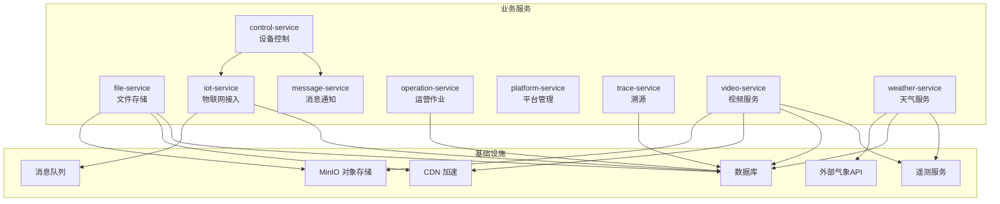

图示来源
- [apps/file-service/src/app.module.ts:1-2](file://apps/file-service/src/app.module.ts#L1-L2)
- [apps/file-service/src/storage.ts:1-43](file://apps/file-service/src/storage.ts#L1-L43)
- [apps/file-service/src/file.repository.ts:1-146](file://apps/file-service/src/file.repository.ts#L1-L146)
- [apps/video-service/src/app.module.ts:1-2](file://apps/video-service/src/app.module.ts#L1-L2)
- [apps/video-service/src/ai-event.repository.ts:1-182](file://apps/video-service/src/ai-event.repository.ts#L1-L182)
- [apps/video-service/src/ptz.repository.ts:1-120](file://apps/video-service/src/ptz.repository.ts#L1-L120)
- [apps/operation-service/src/task.repository.ts:1-153](file://apps/operation-service/src/task.repository.ts#L1-L153)

章节来源
- [apps/control-service/src/app.module.ts:1-2](file://apps/control-service/src/app.module.ts#L1-L2)
- [apps/file-service/src/app.module.ts:1-2](file://apps/file-service/src/app.module.ts#L1-L2)
- [apps/iot-service/src/app.module.ts:1-2](file://apps/iot-service/src/app.module.ts#L1-L2)
- [apps/message-service/src/app.module.ts:1-2](file://apps/message-service/src/app.module.ts#L1-L2)
- [apps/operation-service/src/app.module.ts:1-2](file://apps/operation-service/src/app.module.ts#L1-L2)
- [apps/platform-service/src/app.module.ts:1-2](file://apps/platform-service/src/app.module.ts#L1-L2)
- [apps/trace-service/src/app.module.ts:1-2](file://apps/trace-service/src/app.module.ts#L1-L2)
- [apps/video-service/src/app.module.ts:1-2](file://apps/video-service/src/app.module.ts#L1-L2)
- [apps/weather-service/src/app.module.ts:1-2](file://apps/weather-service/src/app.module.ts#L1-L2)

## 核心组件
本节概述各服务的职责与对外能力，便于跨团队对齐接口与协作契约。

- **设备控制服务（control-service）**
  - 职责：设备生命周期管理、远程控制指令下发、设备状态监控与告警联动。
  - 关键能力：设备注册/发现、指令编排与重试、遥测聚合与阈值告警。
  - **重大更新**：实现完整的指令生命周期状态机（QUEUED → SENT → ACKED → DONE），新增设备通信端点（/dispatch, /receipt），支持ESTOP急停命令，增强监控能力包括超时跟踪和回执管理。
  - **重大更新**：实现全面的多租户隔离机制，通过可信身份头（x-tenant-id）进行租户解析，所有数据操作都带租户ID过滤，防止跨农场紧急停止记录访问。
  - **新增**：超时命令关闭系统，通过 ControlReceiptSweeper 定时任务自动将超时未回执的指令收口为 FAILED 状态。
  - **新增**：本地出站模式实现，通过 SqlControlOutboxStore 确保指令状态跃迁与超时事件同事务写入。
  - 集成点：与物联网服务协同完成协议适配与指令路由；与消息服务联动触发告警。

- 文件存储服务（file-service）
  - 职责：基于 MinIO 的对象存储封装，提供统一上传下载、分片处理与 CDN 加速能力。
  - 关键能力：分片上传/合并、断点续传、预签名 URL、CDN 回源与缓存策略。
  - **新增**：文件元数据持久化存储，支持租户隔离、分页查询和删除补偿机制。
  - 集成点：对接 MinIO SDK；通过 CDN 域名暴露静态资源；与溯源/视频服务共享媒体资产。

- 物联网服务（iot-service）
  - 职责：设备接入协议适配、数据转发与设备生命周期管理。
  - 关键能力：多协议适配（MQTT/CoAP/HTTP）、消息路由、设备影子与在线状态维护。
  - 集成点：与设备控制服务交互执行指令；将遥测数据写入消息队列或时序存储。

- 消息通知服务（message-service）
  - 职责：多渠道通知分发（短信、邮件、站内信）。
  - 关键能力：模板渲染、渠道选择与重试、送达回执与审计。
  - **新增**：支持 control.command.timeout 事件处理，自动生成告警通知，支持按指令聚合去重。
  - 集成点：接收来自各业务服务的通知事件；对接第三方通道网关。

- 运营服务（operation-service）
  - 职责：农事作业管理、任务调度与进度跟踪。
  - 关键能力：作业计划编排、工单流转、人员与设备排班、进度统计。
  - **新增**：任务持久化存储，支持完整生命周期管理和乐观锁并发控制。
  - 集成点：与设备控制服务联动执行自动化作业；与消息服务发送提醒。

- 平台管理服务（platform-service）
  - 职责：系统配置、租户管理与资源配额控制。
  - 关键能力：多租户隔离、功能开关、配额与用量计量、审计日志。
  - 集成点：为其他服务提供鉴权与上下文信息；与网关服务配合做路由与限流。

- 溯源服务（trace-service）
  - 职责：农产品全链条追溯，记录种植、加工、流通各环节信息。
  - 关键能力：批次/批次链追踪、环节事件归档、二维码/批次码生成与查询。
  - 集成点：与文件服务关联图片/报告；与物联网/遥测数据关联环境因子。

- 视频服务（video-service）
  - 职责：实时监控、录像回放与智能分析。
  - 关键能力：RTSP/GB28181 接入、转码与切片、回放拉流、AI 分析结果归档。
  - **新增**：持久化AI事件处理，支持虫情识别结果落库、重试补投和状态追踪。
  - **新增**：PTZ云台控制通道，支持摄像机远程控制指令的持久化与投递状态管理。
  - 集成点：与文件服务存储媒体；与消息服务推送告警；与 CDN 加速播放；与遥测服务联动。

- 天气服务（weather-service）
  - 职责：集成气象数据，提供天气预报、灾害预警和农事作业建议。
  - 关键能力：多源数据聚合（QWeather API）、区域预报、阈值预警、实时气象站数据、作业适宜性判定。
  - 集成点：调用外部气象 API；向运营/设备控制服务推送预警；与遥测服务联动获取田间数据。

章节来源
- [apps/control-service/src/app.module.ts:1-2](file://apps/control-service/src/app.module.ts#L1-L2)
- [apps/file-service/src/app.module.ts:1-2](file://apps/file-service/src/app.module.ts#L1-L2)
- [apps/iot-service/src/app.module.ts:1-2](file://apps/iot-service/src/app.module.ts#L1-L2)
- [apps/message-service/src/app.module.ts:1-2](file://apps/message-service/src/app.module.ts#L1-L2)
- [apps/operation-service/src/app.module.ts:1-2](file://apps/operation-service/src/app.module.ts#L1-L2)
- [apps/platform-service/src/app.module.ts:1-2](file://apps/platform-service/src/app.module.ts#L1-L2)
- [apps/trace-service/src/app.module.ts:1-2](file://apps/trace-service/src/app.module.ts#L1-L2)
- [apps/video-service/src/app.module.ts:1-2](file://apps/video-service/src/app.module.ts#L1-L2)
- [apps/weather-service/src/app.module.ts:1-2](file://apps/weather-service/src/app.module.ts#L1-L2)

## 架构总览
下图展示"其他业务服务"的整体交互关系，突出设备控制、文件存储、物联网、消息、运营、平台、溯源、视频与天气之间的协作路径。

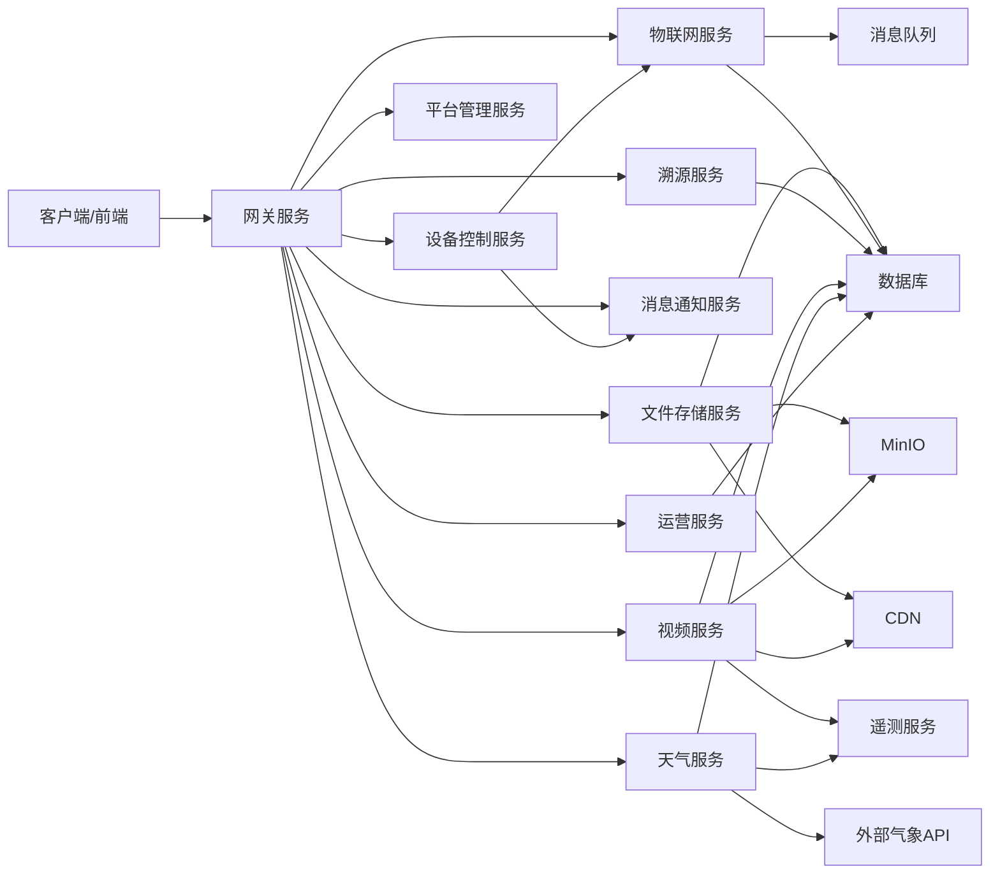

图示来源
- [apps/file-service/src/storage.ts:1-43](file://apps/file-service/src/storage.ts#L1-L43)
- [apps/file-service/src/file.repository.ts:1-146](file://apps/file-service/src/file.repository.ts#L1-L146)
- [apps/video-service/src/ai-event.repository.ts:1-182](file://apps/video-service/src/ai-event.repository.ts#L1-L182)
- [apps/video-service/src/ptz.repository.ts:1-120](file://apps/video-service/src/ptz.repository.ts#L1-L120)
- [apps/operation-service/src/task.repository.ts:1-153](file://apps/operation-service/src/task.repository.ts#L1-L153)

## 详细组件分析

### 设备控制服务（control-service）
**重大更新** 控制服务现已实现完整的指令生命周期状态机和全面的多租户隔离机制，支持从入队到完成的精细化状态追踪，新增设备通信端点和ESTOP急停命令支持。**新增** 超时命令关闭系统，通过 ControlReceiptSweeper 定时任务自动处理超时指令。

- 职责边界
  - 设备注册与元数据管理
  - 远程控制指令下发（含重试、幂等、超时控制）
  - 设备状态监控与告警联动
  - **新增**：完整的指令生命周期状态机管理（QUEUED → SENT → ACKED → DONE）
  - **新增**：设备通信端点（/dispatch, /receipt）
  - **新增**：ESTOP急停命令支持与到位确认机制
  - **新增**：超时跟踪与回执管理功能
  - **重大更新**：全面的多租户隔离机制，通过可信身份头（x-tenant-id）进行租户解析
  - **新增**：超时命令关闭系统，自动将超时未回执的指令收口为 FAILED 状态

- **更新** 超时命令关闭系统架构
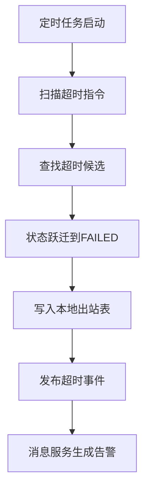

- **更新** 多租户隔离架构
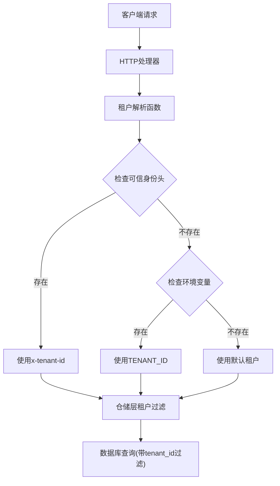

- **更新** 指令生命周期状态机
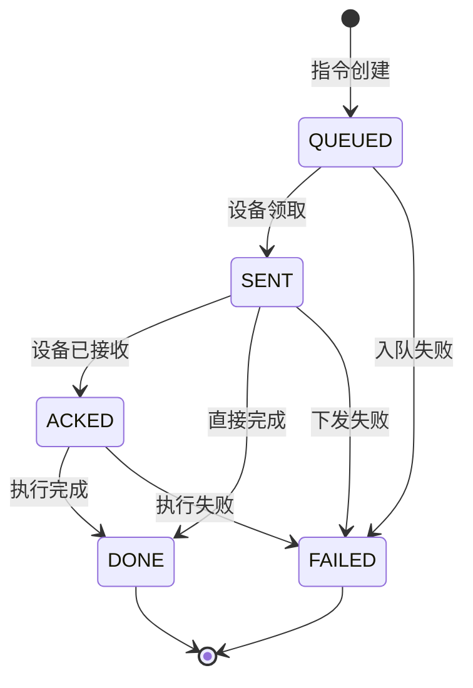

- **更新** 设备通信流程图
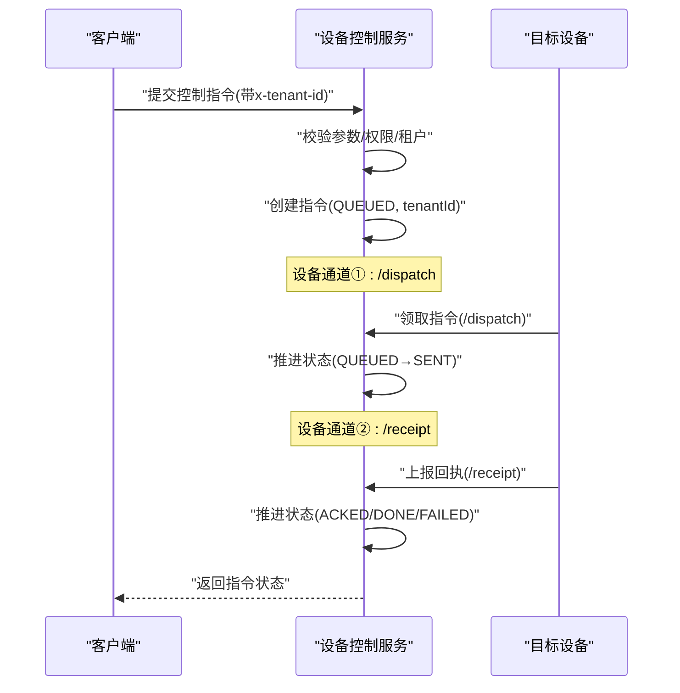

- **更新** ESTOP急停命令流程
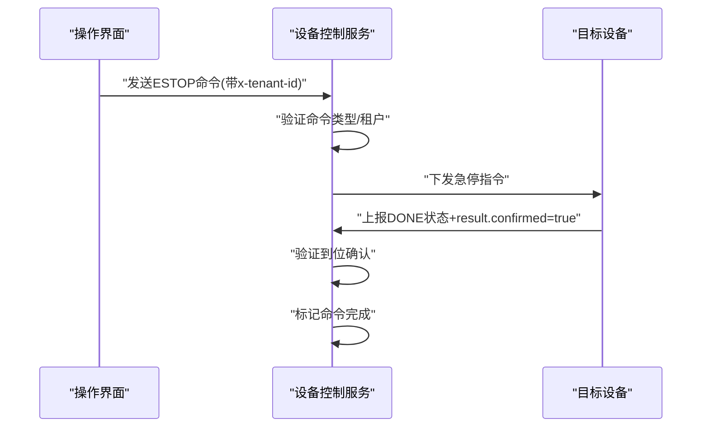

- **更新** 租户解析与安全机制
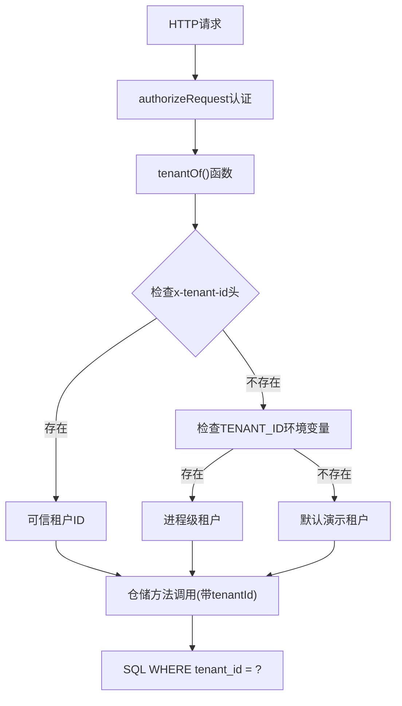

- **新增** 超时命令关闭系统流程
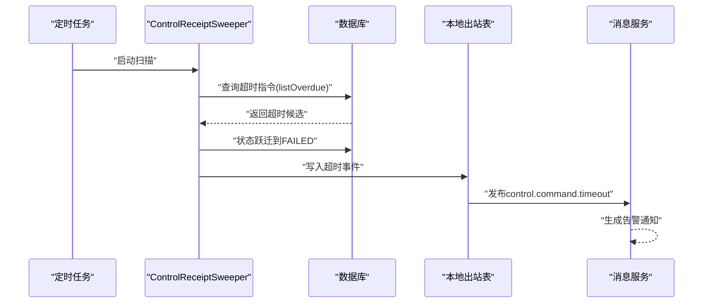

- 异常与容错
  - 指令重试与退避策略
  - 设备离线/超时的降级处理
  - 与消息服务联动告警
  - **新增**：乐观锁版本控制防止并发冲突
  - **新增**：超时检测与自动告警机制
  - **新增**：跨租户访问拦截，返回404而非403确保安全
  - **新增**：超时命令关闭系统的错误回调处理

章节来源
- [apps/control-service/src/receipt-sweeper.ts:1-142](file://apps/control-service/src/receipt-sweeper.ts#L1-L142)
- [apps/control-service/src/outbox.repository.ts:1-69](file://apps/control-service/src/outbox.repository.ts#L1-L69)
- [apps/control-service/src/control.repository.ts:1-401](file://apps/control-service/src/control.repository.ts#L1-L401)
- [apps/control-service/src/http.ts:1-321](file://apps/control-service/src/http.ts#L1-L321)
- [apps/control-service/src/main.ts:30-66](file://apps/control-service/src/main.ts#L30-L66)

### 文件存储服务（file-service）
**更新** 文件服务新增了完整的元数据持久化能力和租户隔离机制，显著提升了文件管理的可靠性和安全性。

- 职责边界
  - 基于 MinIO 的统一对象存储封装
  - 文件上传下载、分片处理、断点续传
  - 预签名 URL 与 CDN 加速
  - **新增**：文件元数据持久化存储，支持租户隔离、分页查询和删除补偿机制
- 核心类与方法（概念示意）
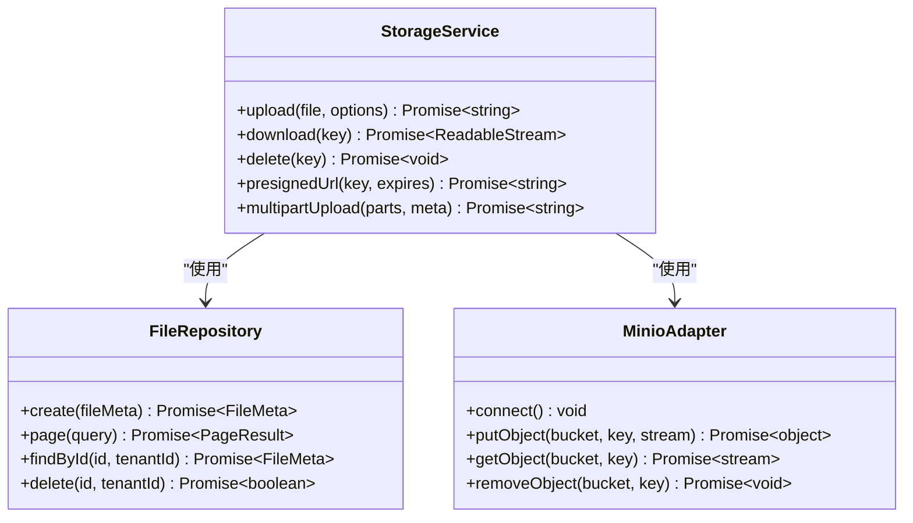

- 分片上传流程图


- **新增** 文件元数据持久化架构
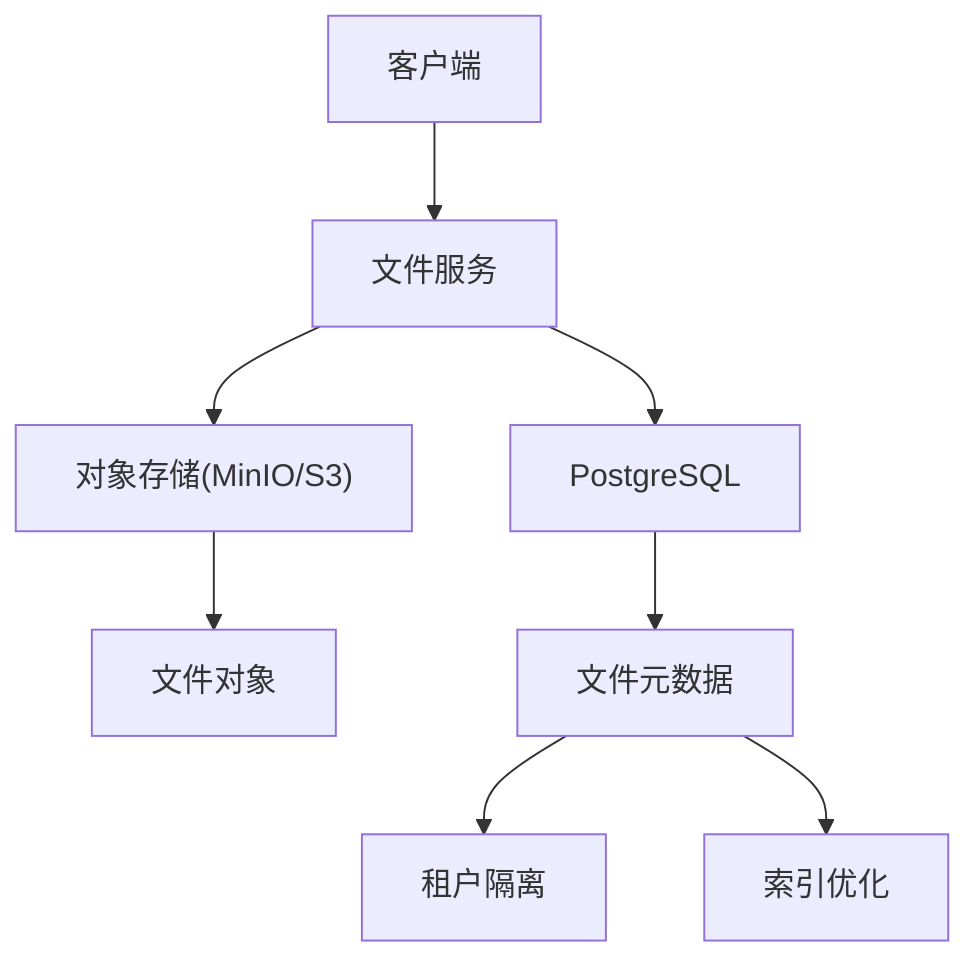

- 与 CDN 的集成要点
  - 静态资源走 CDN 域名，动态上传仍经 MinIO
  - 预签名 URL 可设置过期时间与访问白名单
  - 缓存命中与回源策略由 CDN 侧配置

章节来源
- [apps/file-service/src/app.module.ts:1-2](file://apps/file-service/src/app.module.ts#L1-L2)
- [apps/file-service/src/storage.ts:1-43](file://apps/file-service/src/storage.ts#L1-L43)
- [apps/file-service/src/file.repository.ts:1-146](file://apps/file-service/src/file.repository.ts#L1-L146)
- [apps/file-service/src/http.ts:1-195](file://apps/file-service/src/http.ts#L1-L195)

### 物联网服务（iot-service）
- 职责边界
  - 设备接入协议适配（MQTT/CoAP/HTTP）
  - 数据转发（遥测/事件）与设备影子维护
  - 设备生命周期管理（上线/下线/注销）
- 典型数据流
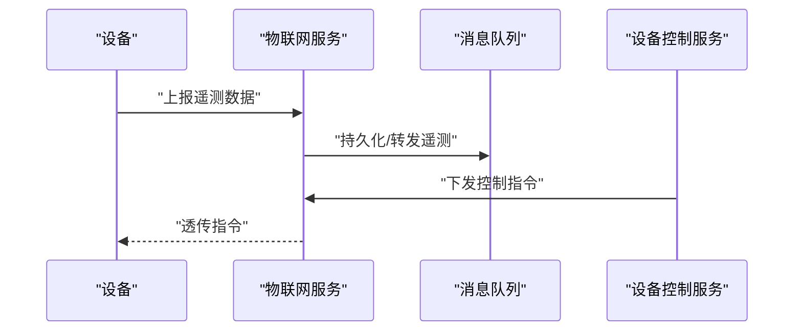

章节来源
- [apps/iot-service/src/app.module.ts:1-2](file://apps/iot-service/src/app.module.ts#L1-L2)

### 消息通知服务（message-service）
**更新** 消息通知服务新增了对 control.command.timeout 事件的处理能力，能够自动生成告警通知并支持按指令聚合去重。

- 职责边界
  - 多渠道通知（短信、邮件、站内信）
  - 模板渲染、渠道选择、重试与回执
  - **新增**：支持 control.command.timeout 事件处理，自动生成告警通知
- **新增** 超时事件处理流程
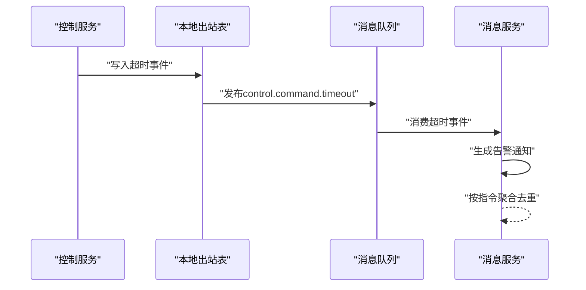

- **新增** 超时事件消息模板
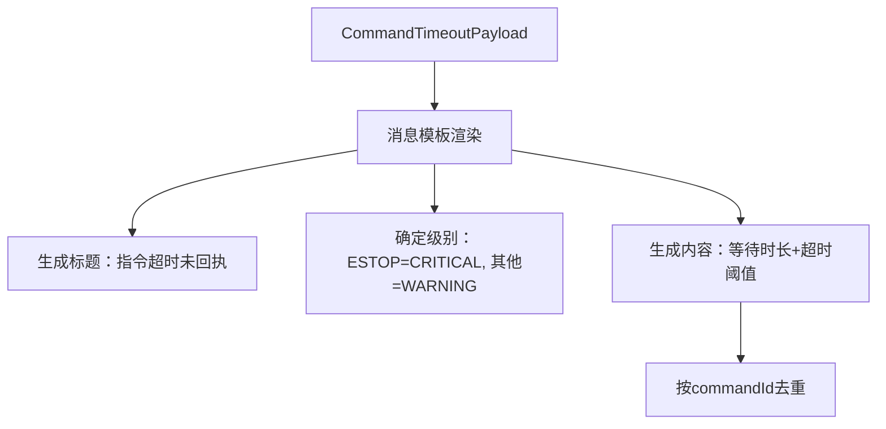

章节来源
- [apps/message-service/src/app.module.ts:1-2](file://apps/message-service/src/app.module.ts#L1-L2)
- [apps/message-service/test/command-timeout-closure.spec.ts:1-89](file://apps/message-service/test/command-timeout-closure.spec.ts#L1-L89)
- [packages/contracts/src/messages/message-template.ts:190-225](file://packages/contracts/src/messages/message-template.ts#L190-L225)

### 运营服务（operation-service）
**更新** 运营服务新增了完整的任务持久化存储和生命周期管理机制，支持乐观锁并发控制和Outbox模式事件发布。

- 职责边界
  - 农事作业管理（计划、工单、排班）
  - 任务调度与进度跟踪
  - 与设备控制服务联动执行自动化作业
  - **新增**：任务持久化存储，支持完整生命周期管理和乐观锁并发控制
- 关键流程（作业执行）
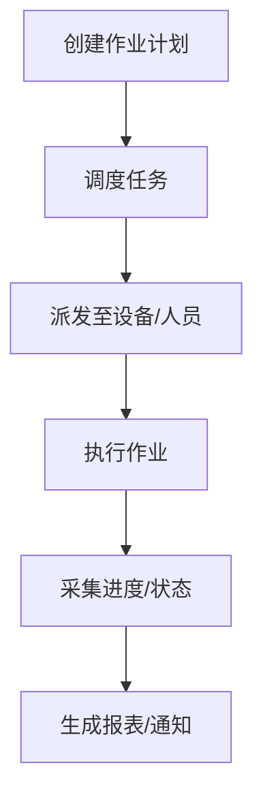

- **新增** 任务生命周期状态机
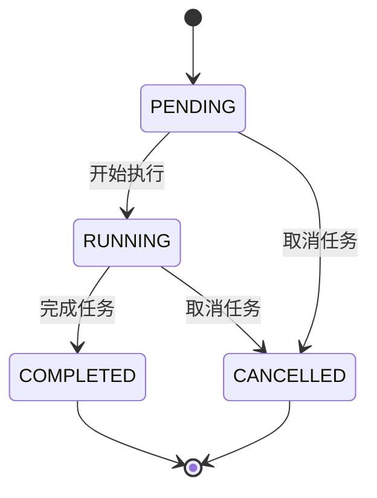

- **新增** 任务持久化架构
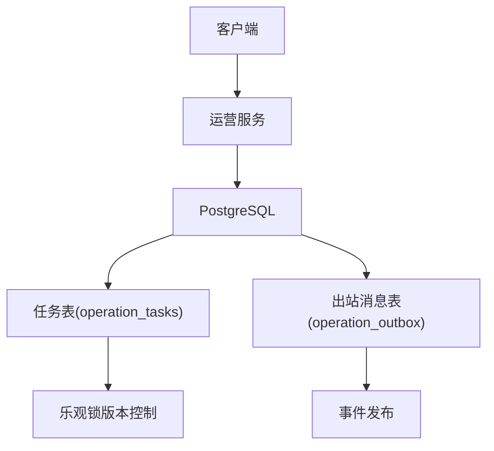

章节来源
- [apps/operation-service/src/app.module.ts:1-2](file://apps/operation-service/src/app.module.ts#L1-L2)
- [apps/operation-service/src/task.repository.ts:1-153](file://apps/operation-service/src/task.repository.ts#L1-L153)
- [apps/operation-service/src/http.ts:1-138](file://apps/operation-service/src/http.ts#L1-L138)

### 平台管理服务（platform-service）
- 职责边界
  - 系统配置、租户管理、资源配额控制
  - 鉴权上下文与功能开关
- 关键能力
  - 多租户隔离策略（数据/配置/配额）
  - 用量计量与限额拦截
  - 审计日志与合规性输出

章节来源
- [apps/platform-service/src/app.module.ts:1-2](file://apps/platform-service/src/app.module.ts#L1-L2)

### 溯源服务（trace-service）
- 职责边界
  - 农产品全链条追溯（种植、加工、流通）
  - 批次/批次链管理、环节事件归档
- 数据访问层（概念示意）
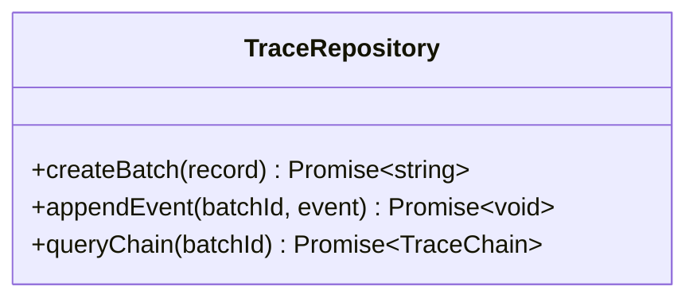

- 与文件/物联网数据的关联
  - 关联图片/检测报告（文件服务）
  - 关联环境因子/遥测数据（物联网/遥测）

章节来源
- [apps/trace-service/src/app.module.ts:1-2](file://apps/trace-service/src/app.module.ts#L1-L2)
- [apps/trace-service/src/repository.ts:1-200](file://apps/trace-service/src/repository.ts#L1-L200)

### 视频服务（video-service）
**更新** 视频服务新增了强大的AI事件处理和PTZ云台控制功能，显著提升了智能监控和远程管理能力。

- 职责边界
  - 实时监控、录像回放、智能分析
  - 媒体转码、切片与拉流
  - **新增**：持久化AI事件处理，支持虫情识别结果落库、重试补投和状态追踪
  - **新增**：PTZ云台控制通道，支持摄像机远程控制指令的持久化与投递状态管理
- 典型流程（回放）
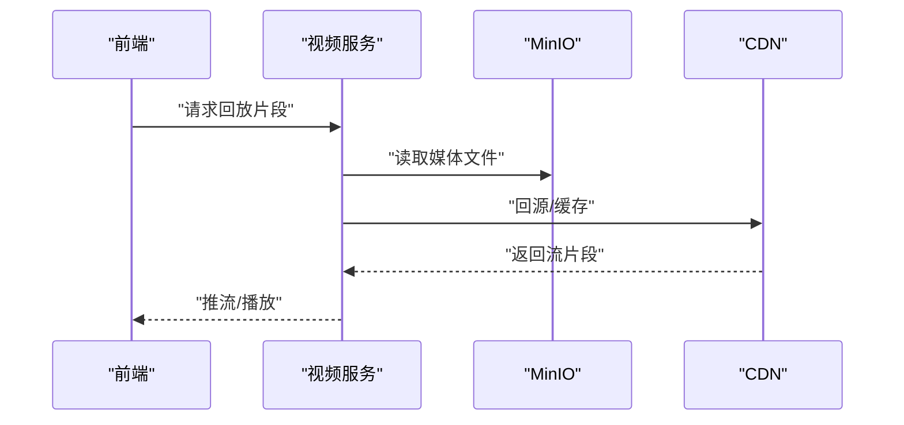

- **新增** AI事件处理流程
```mermaid
sequenceDiagram
participant CAM as "摄像头"
participant VID as "视频服务"
participant DB as "数据库"
participant TEL as "遥测服务"
CAM->>VID : "AI识别结果上报"
VID->>DB : "持久化识别事件"
VID->>TEL : "转发虫情告警"
TEL-->>VID : "处理结果"
VID->>DB : "更新转发状态"
```

- **新增** PTZ云台控制流程
```mermaid
sequenceDiagram
participant UI as "前端"
participant VID as "视频服务"
participant DB as "数据库"
participant GATEWAY as "摄像机网关"
UI->>VID : "发送PTZ控制指令"
VID->>DB : "记录控制命令(Queued)"
VID->>GATEWAY : "投递控制指令"
GATEWAY-->>VID : "返回执行结果"
VID->>DB : "更新命令状态(Sent/Failed)"
```

- **新增** AI事件持久化架构
```mermaid
flowchart TD
AI["AI识别事件"] --> STORE["持久化存储"]
STORE --> RETRY["重试机制"]
STORE --> QUERY["查询接口"]
RETRY --> FORWARD["转发遥测服务"]
FORWARD --> STATUS["状态更新"]
QUERY --> ADMIN["管理界面"]
```

章节来源
- [apps/video-service/src/app.module.ts:1-2](file://apps/video-service/src/app.module.ts#L1-L2)
- [apps/video-service/src/ai-event.ts:1-90](file://apps/video-service/src/ai-event.ts#L1-L90)
- [apps/video-service/src/ai-event.repository.ts:1-182](file://apps/video-service/src/ai-event.repository.ts#L1-L182)
- [apps/video-service/src/ptz-channel.ts:1-41](file://apps/video-service/src/ptz-channel.ts#L1-L41)
- [apps/video-service/src/ptz.repository.ts:1-120](file://apps/video-service/src/ptz.repository.ts#L1-L120)
- [apps/video-service/src/http.ts:1-156](file://apps/video-service/src/http.ts#L1-L156)

### 天气服务（weather-service）
**更新** 天气服务已实现完整的气象数据聚合、预报预测、灾害预警和农事作业建议功能，并增强了7天天气预报默认值、Asia/Shanghai时区处理、服务间身份验证头传播和遥测数据获取时的身份验证修复。

- 职责边界
  - 集成外部气象数据（QWeather API），提供预报与预警
  - 区域化数据聚合与订阅推送
  - 田间气象站实时数据监测
  - 农事作业适宜性判定与建议
  - **新增** 支持7天天气预报默认值、Asia/Shanghai时区处理、服务间身份验证头传播、遥测数据获取时的身份验证修复
- 核心架构
```mermaid
classDiagram
class WeatherSyncer {
+start() void
+stop() void
+syncForecastNow() Promise~void~
+syncAlertsNow() Promise~void~
+forceSync() Promise~object~
+stats() SyncerStats
}
class QWeatherClient {
+fetchDaily(days) Promise~array~
+fetchHourly24() Promise~array~
+fetchWarning() Promise~array~
}
class ForecastRepository {
+upcoming(from, days) Promise~array~
+hourly(from, hours) Promise~array~
+upsertDay(input) Promise~object~
+upsertHour(hour) Promise~void~
}
class AlertRepository {
+list(query) Promise~array~
+create(tx, alert) Promise~object~
+deactivate(alertCode) Promise~boolean~
}
WeatherSyncer --> QWeatherClient : "使用"
WeatherSyncer --> ForecastRepository : "持久化"
WeatherSyncer --> AlertRepository : "持久化"
```

- 数据持久化架构
```mermaid
flowchart TD
QW["QWeather API"] --> SYNC["同步器"]
SYNC --> FORECAST["天气预报表"]
SYNC --> HOURLY["逐小时预报表"]
SYNC --> ALERTS["灾害预警表"]
FORECAST --> HTTP["HTTP API"]
HOURLY --> HTTP
ALERTS --> HTTP
HTTP --> CLIENT["客户端"]
```

- 典型流程（预警）
```mermaid
sequenceDiagram
participant WTH as "天气服务"
participant EXT as "外部气象API"
participant OPS as "运营服务"
participant CS as "设备控制服务"
WTH->>EXT : "拉取气象数据"
WTH->>WTH : "阈值判定/预警生成"
WTH->>DB : "持久化预警数据"
WTH-->>OPS : "推送预警事件"
WTH-->>CS : "触发设备联动策略"
```

- 农事作业建议算法
```mermaid
flowchart TD
INPUT["输入：七日预报 + 逐小时预报"] --> ANALYZE["分析降雨概率/风速/温度"]
ANALYZE --> RAIN_CHECK{"降雨概率≥50%?"}
RAIN_CHECK --> |是| DELAY_IRR["延迟灌溉/施肥"]
RAIN_CHECK --> |否| OK_IRR["适宜灌溉/施肥"]
ANALYZE --> WIND_CHECK{"风速>8m/s或风力≥4级?"}
WIND_CHECK --> |是| SUSPEND_SPRAY["暂停喷药/无人机"]
WIND_CHECK --> |否| TEMP_CHECK{"温度>33°C?"}
TEMP_CHECK --> |是| ATTENTION_SPRAY["注意高温喷药"]
TEMP_CHECK --> |否| OK_SPRAY["适宜喷药"]
DELAY_IRR --> OUTPUT["生成作业建议"]
OK_IRR --> OUTPUT
SUSPEND_SPRAY --> OUTPUT
ATTENTION_SPRAY --> OUTPUT
OK_SPRAY --> OUTPUT
```

- **新增** 7天天气预报默认值与时区处理
  - v1 API默认获取7天预报，覆盖"今天起一周"的业务需求
  - 使用Asia/Shanghai时区（UTC+8）处理农场日历日，确保日期计算准确
  - 通过 `farmDate()` 和 `farmToday()` 函数处理时区转换

- **新增** 服务间身份验证头传播
  - 使用 `identityHeaders(req)` 函数自动传播身份验证头
  - 确保遥测服务调用时的认证信息正确传递
  - 支持JWT令牌、API Key等多种认证方式

- **新增** 遥测数据获取时的身份验证修复
  - 在 `readTelemetry` 函数中正确传递身份验证头
  - 避免遥测服务返回401未授权错误
  - 提升实时气象站数据和历史曲线的可用性

**章节来源**
- [apps/weather-service/src/app.module.ts:1-2](file://apps/weather-service/src/app.module.ts#L1-L2)
- [apps/weather-service/src/qweather.ts:1-665](file://apps/weather-service/src/qweather.ts#L1-L665)
- [apps/weather-service/src/forecast.repository.ts:1-314](file://apps/weather-service/src/forecast.repository.ts#L1-L314)
- [apps/weather-service/src/alert.repository.ts:1-161](file://apps/weather-service/src/alert.repository.ts#L1-L161)
- [apps/weather-service/src/sync.ts:1-433](file://apps/weather-service/src/sync.ts#L1-L433)
- [apps/weather-service/src/weather.ts:1-159](file://apps/weather-service/src/weather.ts#L1-L159)
- [apps/weather-service/src/http.ts:1-331](file://apps/weather-service/src/http.ts#L1-L331)
- [apps/weather-service/src/main.ts:1-161](file://apps/weather-service/src/main.ts#L1-L161)
- [apps/weather-service/src/farm-time.ts:1-23](file://apps/weather-service/src/farm-time.ts#L1-L23)

## 依赖关系分析
**更新** 依赖关系分析反映了新增的控制服务超时命令关闭系统、本地出站模式、消息服务超时处理的依赖关系。

- 组件耦合
  - 设备控制服务与物联网服务强耦合（指令路由）
  - 文件存储服务与 MinIO/CDN 解耦良好（适配器模式）
  - 溯源服务对数据库与文件服务存在引用
  - 视频服务依赖 MinIO/CDN 与消息服务
  - **新增** 控制服务新增对数据库的依赖（指令状态机与回执管理）
  - **新增** 控制服务新增对本地出站表的依赖（control_outbox）
  - **新增** 消息服务新增对 control.command.timeout 事件的依赖
  - **新增** 视频服务新增对数据库的依赖（AI事件和PTZ命令持久化）
  - **新增** 文件服务新增对数据库的依赖（文件元数据持久化）
  - **新增** 运营服务新增对数据库的依赖（任务持久化）
  - **新增** 天气服务与QWeather API、数据库、遥测服务存在依赖关系
- 外部依赖
  - MinIO 对象存储
  - CDN 加速网络
  - 外部气象 API（QWeather）
  - 消息队列（用于遥测与事件）
  - **新增** PostgreSQL 数据库（控制指令状态机、天气数据、文件元数据、AI事件、PTZ命令、任务持久化、本地出站表）
  - **新增** 遥测服务（田间气象站数据）

```mermaid
graph LR
CS["设备控制服务"] --> IoT["物联网服务"]
CS --> DB["数据库"]
CS --> OUTBOX["本地出站表"]
CS --> MS["消息服务"]
FS["文件存储服务"] --> MINIO["MinIO"]
FS --> CDN["CDN"]
FS --> DB
VID["视频服务"] --> MINIO
VID --> CDN
VID --> DB
VID --> TELEMETRY["遥测服务"]
TRC["溯源服务"] --> DB
WTH["天气服务"] --> EXT["外部气象API"]
WTH --> DB
WTH --> TELEMETRY
OPS["运营服务"] --> DB
MS --> DB
```

图示来源
- [apps/control-service/src/receipt-sweeper.ts:1-142](file://apps/control-service/src/receipt-sweeper.ts#L1-L142)
- [apps/control-service/src/outbox.repository.ts:1-69](file://apps/control-service/src/outbox.repository.ts#L1-L69)
- [apps/control-service/src/control.repository.ts:1-401](file://apps/control-service/src/control.repository.ts#L1-L401)
- [apps/file-service/src/storage.ts:1-43](file://apps/file-service/src/storage.ts#L1-L43)
- [apps/file-service/src/file.repository.ts:1-146](file://apps/file-service/src/file.repository.ts#L1-L146)
- [apps/video-service/src/ai-event.repository.ts:1-182](file://apps/video-service/src/ai-event.repository.ts#L1-L182)
- [apps/video-service/src/ptz.repository.ts:1-120](file://apps/video-service/src/ptz.repository.ts#L1-L120)
- [apps/operation-service/src/task.repository.ts:1-153](file://apps/operation-service/src/task.repository.ts#L1-L153)

## 性能考虑
**更新** 性能考虑部分增加了新增功能的性能优化措施。

- 控制服务
  - **新增** 指令状态机使用乐观锁版本控制，避免并发冲突
  - **新增** 超时检测与自动告警机制，支持可配置的超时阈值
  - **新增** 回执管理优化，减少重复状态检查开销
  - **新增** 数据库索引优化，支持按状态、时间范围的高效查询
  - **新增** 租户隔离查询优化，使用复合索引（tenant_id, created_at DESC, id DESC）提升查询性能
  - **新增** 内存模式与SQL模式切换，适应不同部署场景
  - **新增** 超时命令关闭系统的批量处理能力，支持可配置的批次大小
  - **新增** 本地出站模式的异步处理，避免阻塞主流程
- 文件服务
  - 大文件优先分片上传，提升吞吐与稳定性
  - 启用 CDN 缓存热点资源，降低回源压力
  - 预签名 URL 减少鉴权开销
  - **新增** 文件元数据分页查询优化，支持大数据集处理
  - **新增** 租户隔离查询优化，使用复合索引提升查询性能
- 物联网服务
  - 遥测数据批量写入与压缩
  - 设备影子本地缓存，降低远端查询延迟
- 视频服务
  - 按需转码与自适应码率
  - 切片缓存与边缘节点就近分发
  - **新增** AI事件批量处理与重试机制，避免重复处理
  - **新增** PTZ命令异步处理，提升响应速度
  - **新增** 数据库连接池优化，支持高并发场景
- 运营服务
  - **新增** 任务状态变更的乐观锁机制，避免并发冲突
  - **新增** Outbox模式事件发布，保证事务一致性
  - **新增** 任务查询的多条件索引优化
- 天气服务
  - **新增** 定时拉取+增量更新，避免频繁调用外部 API
  - **新增** 预警规则本地化计算，减少网络往返
  - **新增** 数据分页查询优化，支持大数据集处理
  - **新增** 内存模式与SQL模式切换，适应不同部署场景
  - **新增** 7天预报默认值优化，减少不必要的API调用
  - **新增** Asia/Shanghai时区处理，避免日期计算错误导致的重复请求

## 故障排查指南
**更新** 故障排查指南增加了新增功能的故障排查方法。

- 控制服务
  - 现象：指令下发无回执
  - 排查：检查物联网服务连通性、设备在线状态、重试与超时配置
  - **新增** 现象：指令卡在QUEUED状态
  - 排查：**新增** 检查设备通信端点/dispatch是否正常、设备是否成功领取指令
  - **新增** 现象：指令状态异常或无法推进
  - 排查：**新增** 检查乐观锁版本号是否正确、状态跃迁是否符合状态机规则
  - **新增** 现象：ESTOP急停命令无响应
  - 排查：**新增** 检查result.confirmed字段是否正确设置、设备是否真正执行了急停
  - **新增** 现象：指令超时告警频繁
  - 排查：**新增** 检查CONTROL_RECEIPT_TIMEOUT_MIN配置、设备响应时间、网络连接质量
  - **新增** 现象：跨租户访问被拒绝
  - 排查：**新增** 检查x-tenant-id头是否正确设置、租户ID是否有效、数据库连接配置
  - **新增** 现象：租户数据查询结果为空
  - 排查：**新增** 检查租户解析逻辑、环境变量TENANT_ID配置、默认租户设置
  - **新增** 现象：超时指令未被自动关闭
  - 排查：**新增** 检查ControlReceiptSweeper是否启动、扫描间隔配置、超时阈值设置
  - **新增** 现象：本地出站表数据堆积
  - 排查：**新增** 检查中继服务状态、消息队列连通性、事件日志存储状态
- 文件存储服务
  - 现象：上传失败或速度慢
  - 排查：确认 MinIO 连接与桶权限；检查分片大小与并发数；验证 CDN 缓存命中
  - **新增** 现象：文件元数据查询缓慢
  - 排查：**新增** 检查数据库索引是否正常、租户ID是否正确、分页参数是否合理
  - **新增** 现象：文件删除后元数据仍存在
  - 排查：**新增** 检查删除补偿机制、数据库事务一致性、对象存储删除状态
- 物联网服务
  - 现象：遥测数据丢失
  - 排查：检查消息队列堆积与消费者消费速率；核对协议适配与字段映射
- 消息通知服务
  - 现象：通知未送达
  - 排查：查看渠道回执与重试次数；核对模板与收件人有效性
  - **新增** 现象：control.command.timeout 事件未生成告警
  - 排查：**新增** 检查事件主题是否正确、消息模板配置、指令聚合去重逻辑
  - **新增** 现象：同一指令重复生成多条告警
  - 排查：**新增** 检查dedupeKey生成逻辑、事件标识唯一性、消息去重窗口配置
- 溯源服务
  - 现象：批次链不完整
  - 排查：核对环节事件写入顺序与事务一致性；检查关联文件/遥测数据完整性
- 视频服务
  - 现象：回放卡顿或黑屏
  - 排查：检查转码任务状态、CDN 回源与带宽；确认切片时间戳连续性
  - **新增** 现象：AI识别事件未转发或丢失
  - 排查：**新增** 检查AI事件数据库表、重试机制配置、遥测服务连通性
  - **新增** 现象：PTZ云台控制指令无响应
  - 排查：**新增** 检查PTZ命令状态、摄像机网关配置、Webhook URL可达性
  - **新增** 现象：AI事件查询结果不准确
  - 排查：**新增** 检查租户隔离、分页参数、筛选条件是否正确
- 运营服务
  - **新增** 现象：任务状态无法更新
  - 排查：**新增** 检查乐观锁版本号、任务状态转换规则、并发操作冲突
  - **新增** 现象：任务完成后事件未发布
  - 排查：**新增** 检查Outbox表状态、消息队列连通性、事件处理器状态
  - **新增** 现象：任务查询结果不完整
  - 排查：**新增** 检查分页参数、筛选条件、数据库索引状态
- 天气服务
  - 现象：预警不及时或数据不准确
  - 排查：**新增** 核对外部 API 可用性、拉取周期与阈值配置；检查下游服务订阅状态
  - 现象：预报数据不更新
  - 排查：**新增** 检查QWeather API密钥配置、Host域名设置、JWT令牌有效性
  - 现象：农事建议不合理
  - 排查：**新增** 检查阈值配置、数据源质量、作业建议算法参数
  - **新增** 现象：7天预报数据缺失或日期错误
  - 排查：**新增** 检查Asia/Shanghai时区配置、farmDate函数调用、QWeather API返回的日期格式
  - **新增** 现象：遥测数据无法获取或显示为空
  - 排查：**新增** 检查身份验证头传播是否正确、遥测服务URL配置、telemetryUrl环境变量设置

## 结论
"其他业务服务"围绕设备控制、文件存储、物联网接入、消息通知、运营作业、平台管理、溯源、视频与天气形成完整闭环。通过清晰的职责边界与解耦的集成点，平台具备良好的可扩展性与可维护性。**重大更新** 本次更新显著增强了平台的核心业务能力：控制服务实现了完整的指令生命周期状态机，提供了从QUEUED到DONE的全链路状态追踪，新增的设备通信端点和ESTOP急停命令大幅提升了设备控制的可靠性和安全性；**更重要的是，控制服务现已实现全面的超时命令关闭系统，通过 ControlReceiptSweeper 定时任务自动处理超时指令，结合本地出站模式确保事件可靠性，同时增强了多租户隔离机制，通过可信身份头解析、数据库架构变更和仓储层安全增强，确保不同农场之间的数据完全隔离，有效防止跨农场紧急停止记录访问，满足多租户环境下的数据安全要求**。消息服务新增的 control.command.timeout 事件处理能力形成了完整的超时告警闭环，支持按指令聚合去重和急停命令优先级提升。视频服务的AI事件处理和PTZ云台控制功能提供了更强大的智能监控能力；文件服务的元数据持久化和租户隔离机制提升了文件管理的安全性和可靠性；运营服务的任务持久化和生命周期管理为农业生产提供了更完善的作业管控能力。这些增强不仅提升了系统的稳定性和可追溯性，也为未来的功能扩展奠定了坚实基础。建议在后续迭代中持续完善适配器与中间件能力，强化可观测性与容错机制，以提升整体稳定性与用户体验。

**章节来源**
- [apps/control-service/src/receipt-sweeper.ts:1-142](file://apps/control-service/src/receipt-sweeper.ts#L1-L142)
- [apps/control-service/src/outbox.repository.ts:1-69](file://apps/control-service/src/outbox.repository.ts#L1-L69)
- [apps/control-service/src/control.repository.ts:1-401](file://apps/control-service/src/control.repository.ts#L1-L401)
- [apps/control-service/src/http.ts:1-321](file://apps/control-service/src/http.ts#L1-L321)
- [apps/control-service/src/main.ts:30-66](file://apps/control-service/src/main.ts#L30-L66)
- [infra/postgres/migrations/033_control_outbox.sql:1-20](file://infra/postgres/migrations/033_control_outbox.sql#L1-L20)
- [packages/contracts/src/events/payload.ts:126-139](file://packages/contracts/src/events/payload.ts#L126-L139)
- [packages/contracts/src/messages/message-template.ts:190-225](file://packages/contracts/src/messages/message-template.ts#L190-L225)
- [apps/message-service/test/command-timeout-closure.spec.ts:1-89](file://apps/message-service/test/command-timeout-closure.spec.ts#L1-L89)
- [infra/postgres/migrations/005_control_commands.sql:1-24](file://infra/postgres/migrations/005_control_commands.sql#L1-L24)
- [infra/postgres/migrations/031_control_command_receipt.sql:1-38](file://infra/postgres/migrations/031_control_command_receipt.sql#L1-L38)
- [infra/postgres/migrations/032_control_command_tenant.sql:1-22](file://infra/postgres/migrations/032_control_command_tenant.sql#L1-L22)