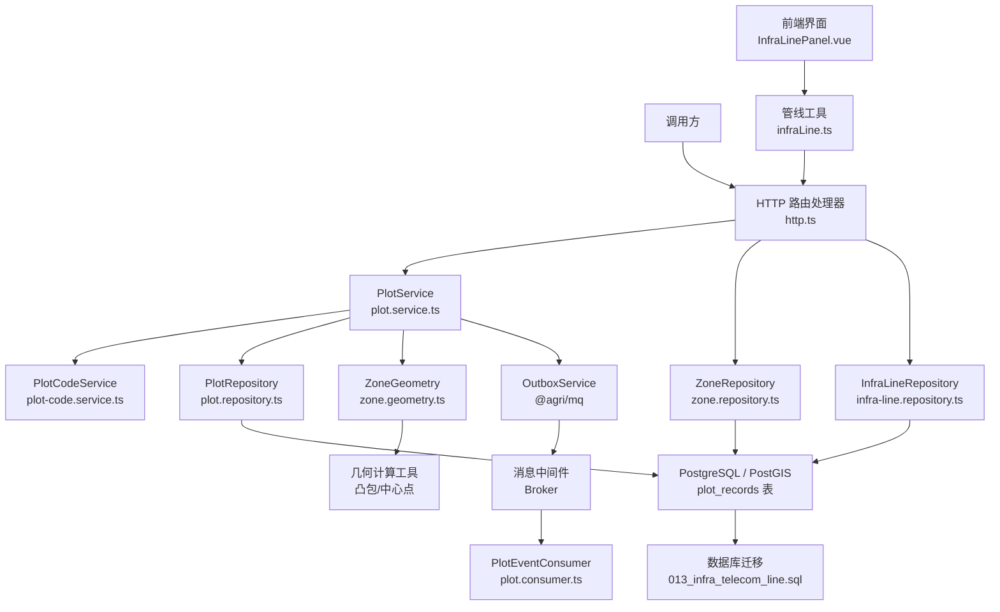
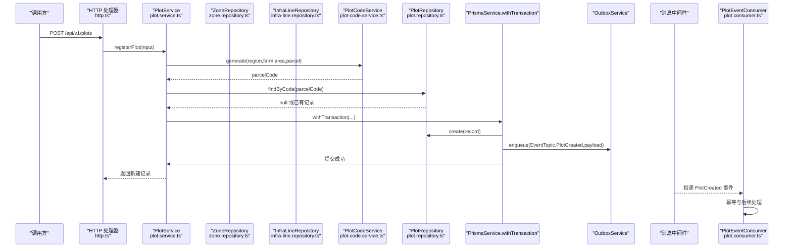
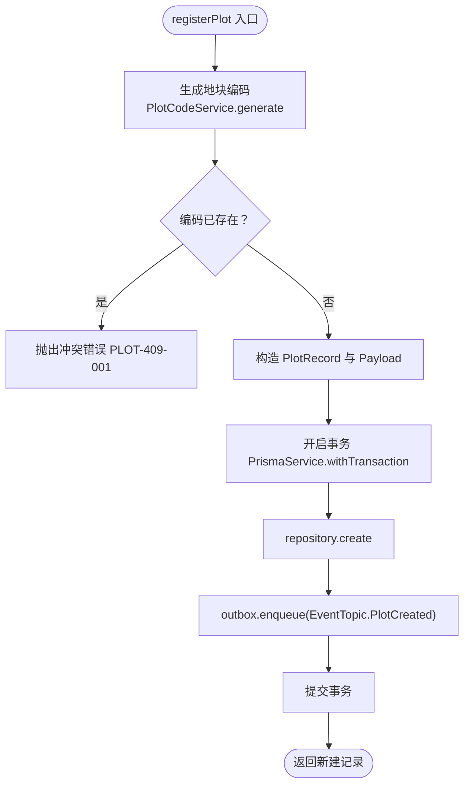
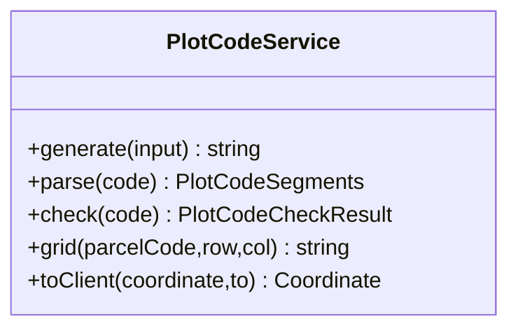
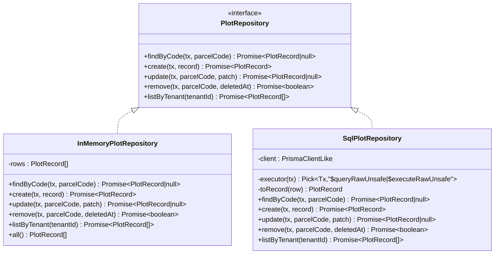
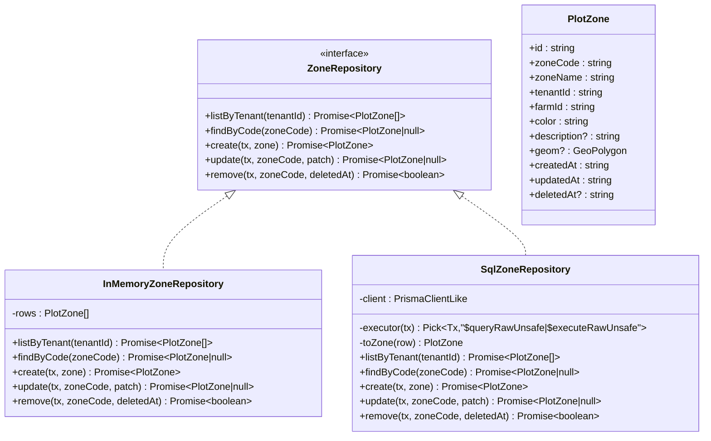
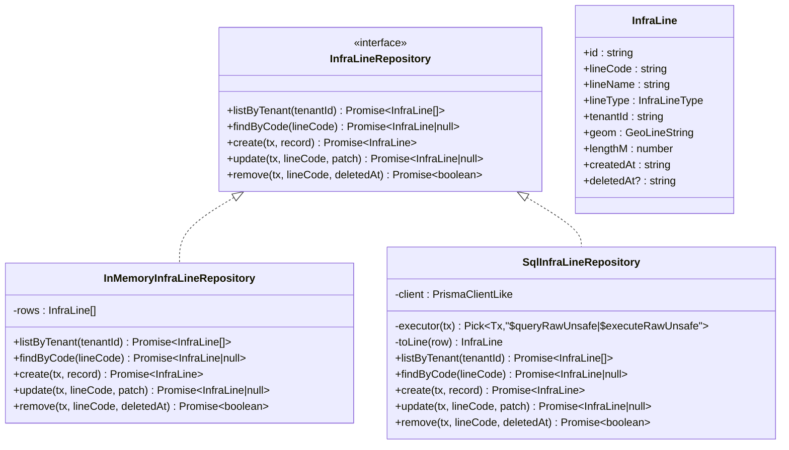
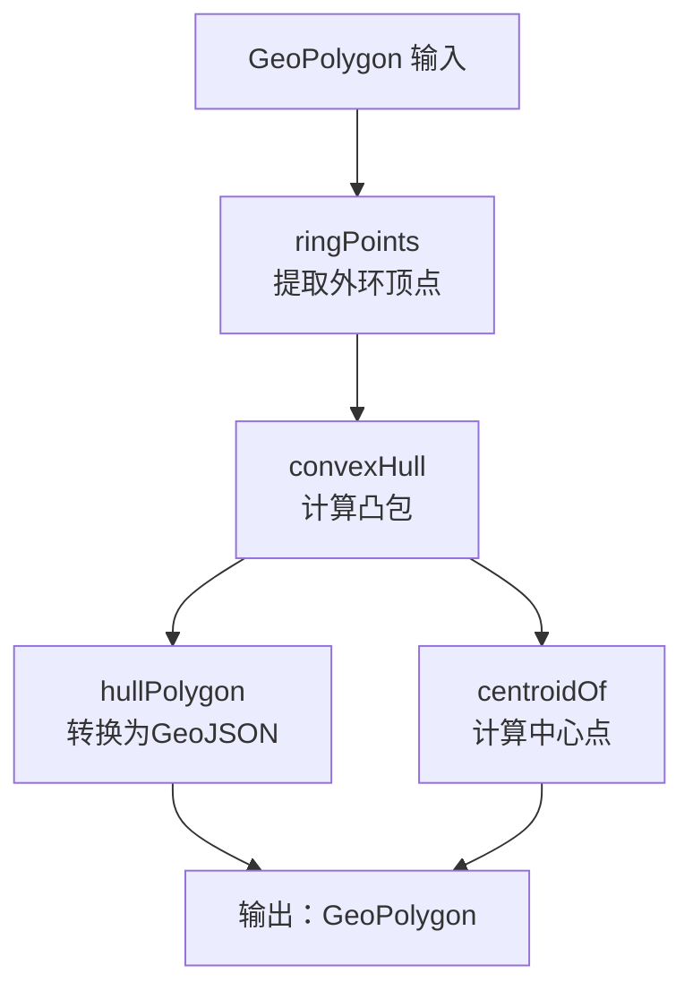
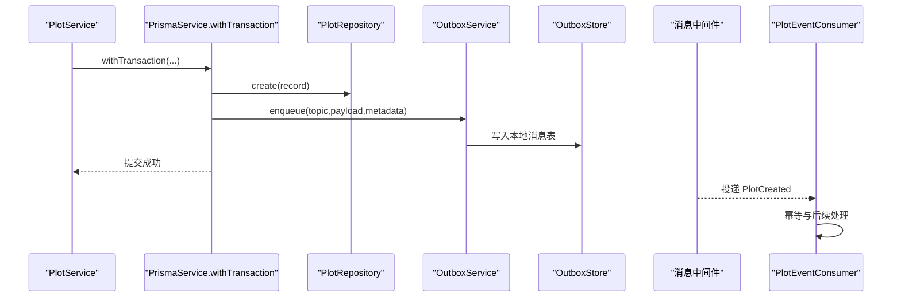
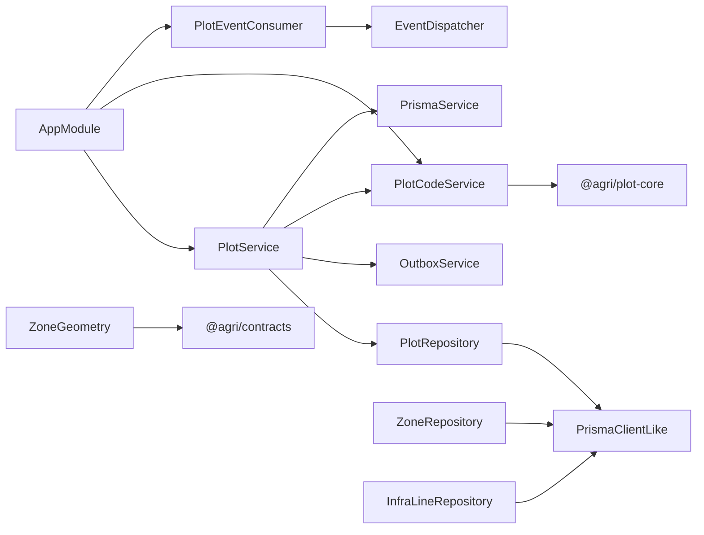

# 地块管理服务

<cite>
**本文引用的文件**   
- [plot.service.ts](file://apps/plot-service/src/plot.service.ts)
- [plot-code.service.ts](file://apps/plot-service/src/plot-code.service.ts)
- [plot.repository.ts](file://apps/plot-service/src/plot.repository.ts)
- [plot.consumer.ts](file://apps/plot-service/src/plot.consumer.ts)
- [app.module.ts](file://apps/plot-service/src/app.module.ts)
- [http.ts](file://apps/plot-service/src/http.ts)
- [zone.repository.ts](file://apps/plot-service/src/zone.repository.ts)
- [infra-line.repository.ts](file://apps/plot-service/src/infra-line.repository.ts)
- [zone.geometry.ts](file://apps/plot-service/src/zone.geometry.ts)
- [013_infra_telecom_line.sql](file://infra/postgres/migrations/013_infra_telecom_line.sql)
- [InfraLinePanel.vue](file://apps/web/src/components/InfraLinePanel.vue)
- [infraLine.ts](file://apps/web/src/utils/infraLine.ts)
</cite>

## 更新摘要
**变更内容**   
- 基础设施线类型扩展，新增TELECOM（通信网线）类型支持
- 数据库迁移013_infra_telecom_line.sql添加TELECOM类型约束和示范数据
- 管线类型枚举从4种扩展到5种：IRRIGATION_PIPE、FERTILIZATION_PIPE、ELECTRIC_LINE、ROAD、TELECOM
- HTTP接口自动支持新的TELECOM管线类型过滤和创建
- 前端InfraLinePanel组件支持通信网线的显示和管理
- 几何长度自动计算功能完善，支持所有管线类型的长度估算

## 目录
1. [简介](#简介)
2. [项目结构](#项目结构)
3. [核心组件](#核心组件)
4. [架构总览](#架构总览)
5. [详细组件分析](#详细组件分析)
6. [依赖关系分析](#依赖关系分析)
7. [性能与可靠性考虑](#性能与可靠性考虑)
8. [API 接口文档](#api-接口文档)
9. [故障排查指南](#故障排查指南)
10. [结论](#结论)

## 简介
本文件为"地块管理服务"的完整技术文档，聚焦以下目标：
- 地块建档的核心业务流程，包括六段式地块编码生成、业务数据与事件同事务处理机制、本地消息表的事件发布模式。
- PlotService 的业务逻辑设计，包括 registerPlot 完整流程、事件消费处理、地块查询与更新操作。
- PlotCodeService 的编码算法封装，包括区域码、农场码、面积码、田块码等分段规则与校验位生成。
- PlotRepository 的数据访问层设计，包括空间几何数据的 PostGIS 存储、事务处理和软删除机制。
- 地块分区系统（Zone System），支持片区管理、地块归属、面积统计和可视化轮廓计算。
- **基础设施线管理系统**，统一管理田间管线、道路等线性设施，**现已完整支持通信网线类型**。
- 几何工具库，提供凸包算法、中心点计算等空间几何处理能力。
- 完整的 API 接口文档，包含请求参数、响应格式和错误码定义。

该服务采用 NestJS 模块装配，结合 Prisma 数据库客户端、本地消息表 Outbox 与事件分发器，实现"业务写入与事件投递同事务"的最终一致性方案。

## 项目结构
地块管理相关代码集中在 apps/plot-service 下，关键文件如下：
- plot.service.ts：地块业务编排，负责建档、查询、更新、删除以及事件发布。
- plot-code.service.ts：地块编码生成、解析、校验与坐标转换。
- plot.repository.ts：仓储契约与内存/SQL 两种实现，封装增删改查与软删除。
- plot.consumer.ts：地块事件消费者，订阅 PlotCreated 事件并执行业务后续动作。
- zone.repository.ts：片区仓储，管理片区台账和地块归属关系。
- **infra-line.repository.ts**：基础设施线仓储，管理田间管线和道路等线性设施，**已完整支持通信网线类型**。
- zone.geometry.ts：几何工具库，实现凸包算法、中心点计算等空间几何处理。
- app.module.ts：NestJS 模块装配，注入仓储、Outbox、事件分发器等基础设施。
- http.ts：轻量 HTTP 服务器，暴露 REST 风格接口。
- **InfraLinePanel.vue**：前端管线列表面板，支持管线查询、定位、编辑和删除操作。
- **infraLine.ts**：前端管线工具函数，提供管线分类、颜色映射和类型标签等功能。

**图表来源**
- [http.ts:95-365](file://apps/plot-service/src/http.ts#L95-L365)
- [plot.service.ts:48-137](file://apps/plot-service/src/plot.service.ts#L48-L137)
- [zone.repository.ts:49-192](file://apps/plot-service/src/zone.repository.ts#L49-L192)
- [infra-line.repository.ts:41-171](file://apps/plot-service/src/infra-line.repository.ts#L41-L171)
- [zone.geometry.ts:17-74](file://apps/plot-service/src/zone.geometry.ts#L17-L74)
- [013_infra_telecom_line.sql:1-20](file://infra/postgres/migrations/013_infra_telecom_line.sql#L1-L20)
- [InfraLinePanel.vue:1-123](file://apps/web/src/components/InfraLinePanel.vue#L1-L123)
- [infraLine.ts:1-70](file://apps/web/src/utils/infraLine.ts#L1-L70)

**章节来源**
- [plot.service.ts:1-139](file://apps/plot-service/src/plot.service.ts#L1-L139)
- [plot-code.service.ts:1-56](file://apps/plot-service/src/plot-code.service.ts#L1-L56)
- [plot.repository.ts:1-187](file://apps/plot-service/src/plot.repository.ts#L1-L187)
- [plot.consumer.ts:1-40](file://apps/plot-service/src/plot.consumer.ts#L1-L40)
- [zone.repository.ts:1-193](file://apps/plot-service/src/zone.repository.ts#L1-L193)
- [infra-line.repository.ts:1-234](file://apps/plot-service/src/infra-line.repository.ts#L1-L234)
- [zone.geometry.ts:1-75](file://apps/plot-service/src/zone.geometry.ts#L1-L75)
- [app.module.ts:79-164](file://apps/plot-service/src/app.module.ts#L79-L164)
- [http.ts:1-370](file://apps/plot-service/src/http.ts#L1-L370)
- [013_infra_telecom_line.sql:1-20](file://infra/postgres/migrations/013_infra_telecom_line.sql#L1-L20)
- [InfraLinePanel.vue:1-123](file://apps/web/src/components/InfraLinePanel.vue#L1-L123)
- [infraLine.ts:1-70](file://apps/web/src/utils/infraLine.ts#L1-L70)

## 核心组件
- PlotService：地块业务编排中心，负责编码生成、查重、记录创建、事件入队、查询、更新与软删除。
- PlotCodeService：统一的地块编码能力，对外暴露 generate、parse、check、grid、toClient 等方法。
- PlotRepository：数据访问抽象，提供 findByCode、create、update、remove、listByTenant 方法；包含 InMemoryPlotRepository 与 SqlPlotRepository 两个实现。
- ZoneRepository：片区数据访问抽象，提供片区台账管理和地块归属关系维护。
- **InfraLineRepository**：基础设施线数据访问抽象，管理田间管线、道路等线性设施，**已完整支持通信网线类型**，包含长度估算和几何数据处理功能。
- ZoneGeometry：几何工具库，提供凸包算法、中心点计算、多边形处理等空间几何功能。
- PlotEventConsumer：事件消费者，订阅 PlotCreated 事件，用于初始化网格、地力档案等下游流程。
- AppModule：模块装配，注入仓储、Outbox、事件分发器、可观测性组件，并提供测试友好的默认实现。
- HTTP 处理器：基于 Node.js http 模块的轻量路由，将外部请求映射到 PlotService 方法。
- **InfraLinePanel**：前端管线列表面板，提供管线的查询、筛选、定位、编辑和删除功能。
- **管线工具函数**：提供管线分类、颜色映射、类型标签等前端辅助功能。

**章节来源**
- [plot.service.ts:13-137](file://apps/plot-service/src/plot.service.ts#L13-L137)
- [plot-code.service.ts:15-54](file://apps/plot-service/src/plot-code.service.ts#L15-L54)
- [plot.repository.ts:11-186](file://apps/plot-service/src/plot.repository.ts#L11-L186)
- [zone.repository.ts:49-192](file://apps/plot-service/src/zone.repository.ts#L49-L192)
- [infra-line.repository.ts:41-171](file://apps/plot-service/src/infra-line.repository.ts#L41-L171)
- [zone.geometry.ts:17-74](file://apps/plot-service/src/zone.geometry.ts#L17-L74)
- [plot.consumer.ts:6-39](file://apps/plot-service/src/plot.consumer.ts#L6-L39)
- [app.module.ts:79-164](file://apps/plot-service/src/app.module.ts#L79-L164)
- [http.ts:40-104](file://apps/plot-service/src/http.ts#L40-L104)
- [InfraLinePanel.vue:54-114](file://apps/web/src/components/InfraLinePanel.vue#L54-L114)
- [infraLine.ts:1-70](file://apps/web/src/utils/infraLine.ts#L1-L70)

## 架构总览
地块建档的关键是"业务数据与事件同事务"。PlotService.registerPlot 在同一个数据库事务中完成：
1. 生成六段式地块编码。
2. 检查编码是否已存在。
3. 构造 PlotRecord。
4. 通过 PrismaService.withTransaction 执行 repository.create 与 outbox.enqueue。
5. 事务提交后，由中继任务把 Outbox 中的事件投递到消息中间件。
6. PlotEventConsumer 消费 PlotCreated 事件，进行幂等处理与后续业务。

地块分区系统通过 ZoneRepository 管理片区台账，支持地块归属关系维护和面积统计。**基础设施线管理系统通过 InfraLineRepository 统一管理田间管线和道路等线性设施，现已完整支持通信网线类型**。几何工具库提供凸包算法和中心点计算，用于片区边界可视化。

**图表来源**
- [http.ts:78-82](file://apps/plot-service/src/http.ts#L78-L82)
- [plot.service.ts:53-104](file://apps/plot-service/src/plot.service.ts#L53-L104)
- [plot-code.service.ts:27-30](file://apps/plot-service/src/plot-code.service.ts#L27-L30)
- [plot.repository.ts:119-146](file://apps/plot-service/src/plot.repository.ts#L119-L146)
- [plot.consumer.ts:20-28](file://apps/plot-service/src/plot.consumer.ts#L20-L28)

## 详细组件分析

### PlotService 业务逻辑设计
职责边界：
- 接收注册输入 RegisterPlotInput，生成地块编码并查重。
- 构造 PlotRecord，组装 PlotCreatedPayload。
- 使用 PrismaService.withTransaction 保证业务数据与 Outbox 事件在同一事务内。
- 提供 getByCode、listByTenant、updatePlot、removePlot 等查询与变更能力。

registerPlot 完整流程要点：
- 调用 PlotCodeService.generate 生成六段式编码。
- 调用 repository.findByCode 查重，冲突抛出 ConflictError。
- 构造记录与负载，包含 parcelId、parcelCode、tenantId、farmId、areaMu、geom 等。
- 在事务中执行 repository.create 与 outbox.enqueue，确保"业务数据与事件同事务"。
- 返回新建记录。

事件消费处理：
- PlotEventConsumer 订阅 EventTopic.PlotCreated。
- 对 areaMu 做合法性校验，记录已处理事件 ID，便于排障。
- 实际后续工作（如网格初始化、地力档案）可在该方法扩展。

查询与更新：
- getByCode 通过 repository.findByCode 查询，未命中抛 NotFoundError。
- listByTenant 直接委托 repository.listByTenant。
- updatePlot 先查询是否存在，再在事务中执行 repository.update，未命中抛 NotFoundError。
- removePlot 在事务中执行 repository.remove，实现软删除，未命中抛 NotFoundError。

**图表来源**
- [plot.service.ts:53-104](file://apps/plot-service/src/plot.service.ts#L53-L104)

**章节来源**
- [plot.service.ts:21-137](file://apps/plot-service/src/plot.service.ts#L21-L137)
- [plot.consumer.ts:12-39](file://apps/plot-service/src/plot.consumer.ts#L12-L39)

### PlotCodeService 编码算法实现
职责边界：
- 集中地块编码的生成、解析、校验与作业网格编码构建。
- 统一坐标口径：库内统一 CGCS2000（EPSG:4490），仅允许出参方向换算为其他坐标系。

核心方法：
- generate：调用 buildPlotCode 生成六段式编码，自动计算校验位。
- parse：调用 parsePlotCode 解析为分段结构。
- check：调用 checkPlotCode 返回校验结果。
- grid：调用 buildGridCode 生成地块内作业网格编码。
- toClient：调用 transformCoordinate 将 CGCS2000 坐标转换为 WGS84 或其他坐标系。

编码分段说明：
- 区域码：来自 input.region。
- 农场码：来自 input.farm。
- 面积码：来自 input.area。
- 田块码：来自 input.parcel。
- 校验位：由底层 @agri/plot-core 自动生成。

**图表来源**
- [plot-code.service.ts:25-54](file://apps/plot-service/src/plot-code.service.ts#L25-L54)

**章节来源**
- [plot-code.service.ts:15-54](file://apps/plot-service/src/plot-code.service.ts#L15-L54)

### PlotRepository 数据访问层设计
职责边界：
- 定义 PlotRepository 契约，明确 findByCode、create、update、remove、listByTenant 方法签名。
- 提供 InMemoryPlotRepository 用于示例与测试。
- 提供 SqlPlotRepository 对接 PostgreSQL，使用 $queryRawUnsafe/$executeRawUnsafe 执行 SQL。

空间几何数据存储：
- geom 字段以 JSONB 形式存储 GeoPolygon，入库时 JSON.stringify，读取时还原为 GeoPolygon。
- 库内统一 CGCS2000（EPSG:4490），坐标口径一致。

事务处理：
- 所有写操作方法接受显式事务对象作为首个参数，避免隐式上下文推断导致事务边界扩大。
- 在 PlotService 中通过 PrismaService.withTransaction 传入事务对象，确保业务数据与 Outbox 事件同事务。

软删除机制：
- 记录包含 deletedAt 字段，为空表示未删除。
- findByCode、update、remove、listByTenant 均过滤 deleted_at IS NULL。
- remove 方法设置 deleted_at 与 updated_at，实现软删除。

**图表来源**
- [plot.repository.ts:11-186](file://apps/plot-service/src/plot.repository.ts#L11-L186)

**章节来源**
- [plot.repository.ts:11-186](file://apps/plot-service/src/plot.repository.ts#L11-L186)

### 地块分区系统（Zone System）
职责边界：
- 管理片区台账，支持片区的增删改查操作。
- 维护地块与片区的归属关系，通过 plot_records.zone_code 字段关联。
- 提供片区面积统计和成员地块管理功能。
- 支持片区边界可视化，包括实测边界和基于成员地块计算的凸包轮廓。

核心数据结构：
- PlotZone：片区记录，包含 zoneCode、zoneName、color、description、geom 等字段。
- ZoneInput：新增/更新片区的输入参数。
- ZonePatch：片区更新的补丁对象。

核心方法：
- listByTenant：按租户查询片区列表。
- findByCode：根据片区编码查询片区详情。
- create：创建新片区，支持自动生成编码。
- update：更新片区信息，支持部分字段更新。
- remove：软删除片区，需先移除所有归属地块。

**图表来源**
- [zone.repository.ts:49-192](file://apps/plot-service/src/zone.repository.ts#L49-L192)

**章节来源**
- [zone.repository.ts:1-193](file://apps/plot-service/src/zone.repository.ts#L1-L193)

### 基础设施线管理系统
职责边界：
- 统一管理田间管线、道路等线性设施。
- 支持多种管线类型：**灌水管、施肥管、电力线、机耕道、通信网线**。
- 提供线路长度估算和几何数据处理功能。
- 支持按类型过滤和软删除操作。

**更新** 管线类型已从原来的4种扩展到5种，新增TELECOM（通信网线）类型支持。

核心数据结构：
- InfraLine：线路记录，包含 lineCode、lineName、lineType、geom、lengthM 等字段。
- InfraLineInput：新增/更新线路的输入参数。
- **InfraLineType**：线路类型枚举，**现已扩展为 IRRIGATION_PIPE、FERTILIZATION_PIPE、ELECTRIC_LINE、ROAD、TELECOM**。

核心方法：
- estimateLengthM：按折点估算线路长度，单位米。
- listByTenant：按租户查询线路列表。
- findByCode：根据线路编码查询线路详情。
- create：创建新线路，支持自动生成编码和长度估算。
- update：更新线路信息，支持部分字段更新。
- remove：软删除线路。

**图表来源**
- [infra-line.repository.ts:41-171](file://apps/plot-service/src/infra-line.repository.ts#L41-L171)

**章节来源**
- [infra-line.repository.ts:1-234](file://apps/plot-service/src/infra-line.repository.ts#L1-L234)

### 几何工具库
职责边界：
- 提供片区边界的几何计算功能。
- 实现凸包算法，用于计算片区外轮廓。
- 提供中心点计算，用于地图定位展示。
- 支持多边形顶点的提取和处理。

核心方法：
- ringPoints：从 GeoPolygon 中提取外环顶点。
- convexHull：实现单调链凸包算法，返回逆时针顶点。
- hullPolygon：将凸包顶点转换为 GeoJSON Polygon 格式。
- centroidOf：计算顶点的算术平均，用于地图定位。

**图表来源**
- [zone.geometry.ts:17-74](file://apps/plot-service/src/zone.geometry.ts#L17-L74)

**章节来源**
- [zone.geometry.ts:1-75](file://apps/plot-service/src/zone.geometry.ts#L1-L75)

### 本地消息表的事件发布模式
- OutboxService 通过 OUTBOX_STORE 持久化待投递事件，支持租户、链路标识与生产者标识。
- PlotService.registerPlot 在事务中调用 outbox.enqueue，将 PlotCreated 事件与业务记录一起落库。
- 中继任务（由 @agri/mq 提供）扫描 OutboxStore 并投递到消息中间件。
- 消费侧 PlotEventConsumer 通过 EventDispatcher 订阅事件，具备重试与幂等保护。

**图表来源**
- [plot.service.ts:95-102](file://apps/plot-service/src/plot.service.ts#L95-L102)
- [app.module.ts:119-143](file://apps/plot-service/src/app.module.ts#L119-L143)

**章节来源**
- [plot.service.ts:95-102](file://apps/plot-service/src/plot.service.ts#L95-L102)
- [app.module.ts:119-143](file://apps/plot-service/src/app.module.ts#L119-L143)

## 依赖关系分析
- PlotService 依赖：
  - PlotRepository：数据访问契约。
  - OutboxService：本地消息表事件发布。
  - PlotCodeService：地块编码生成与校验。
  - PrismaService：事务控制。
- PlotCodeService 依赖：
  - @agri/plot-core：编码生成、解析、校验与坐标转换。
- PlotRepository 依赖：
  - PrismaClientLike：数据库客户端契约。
- PlotEventConsumer 依赖：
  - EventDispatcher：事件分发与幂等、重试。
- ZoneRepository 依赖：
  - PrismaClientLike：数据库客户端契约。
- **InfraLineRepository 依赖**：
  - PrismaClientLike：数据库客户端契约。
- ZoneGeometry 依赖：
  - @agri/contracts：GeoPolygon 类型定义。
- AppModule 装配：
  - 注入仓储、Outbox、事件分发器、可观测性组件。
  - 提供默认 InMemoryPlotRepository、InMemoryOutboxStore、IdempotencyGuardStore。

**图表来源**
- [plot.service.ts:40-46](file://apps/plot-service/src/plot.service.ts#L40-L46)
- [plot-code.service.ts:25-54](file://apps/plot-service/src/plot-code.service.ts#L25-L54)
- [plot.repository.ts:94-186](file://apps/plot-service/src/plot.repository.ts#L94-L186)
- [plot.consumer.ts:12-39](file://apps/plot-service/src/plot.consumer.ts#L12-L39)
- [zone.repository.ts:114-192](file://apps/plot-service/src/zone.repository.ts#L114-L192)
- [infra-line.repository.ts:91-171](file://apps/plot-service/src/infra-line.repository.ts#L91-L171)
- [zone.geometry.ts:1-75](file://apps/plot-service/src/zone.geometry.ts#L1-L75)
- [app.module.ts:112-155](file://apps/plot-service/src/app.module.ts#L112-L155)

**章节来源**
- [plot.service.ts:40-46](file://apps/plot-service/src/plot.service.ts#L40-L46)
- [plot-code.service.ts:25-54](file://apps/plot-service/src/plot-code.service.ts#L25-L54)
- [plot.repository.ts:94-186](file://apps/plot-service/src/plot.repository.ts#L94-L186)
- [plot.consumer.ts:12-39](file://apps/plot-service/src/plot.consumer.ts#L12-L39)
- [zone.repository.ts:114-192](file://apps/plot-service/src/zone.repository.ts#L114-L192)
- [infra-line.repository.ts:91-171](file://apps/plot-service/src/infra-line.repository.ts#L91-L171)
- [zone.geometry.ts:1-75](file://apps/plot-service/src/zone.geometry.ts#L1-L75)
- [app.module.ts:112-155](file://apps/plot-service/src/app.module.ts#L112-L155)

## 性能与可靠性考虑
- 事务边界最小化：仓储方法显式接收事务对象，避免无意扩大事务范围。
- 编码生成与校验集中化：避免业务代码自行拼装编码导致的分隔符、补零与校验位不一致问题。
- 坐标口径统一：库内统一 CGCS2000，仅在出参方向换算，避免多套坐标系混杂。
- 最终一致性：Outbox 本地消息表保证事件不丢失，消费侧需幂等。
- 分页与过滤：HTTP 层对列表接口提供 page、size、keyword 分页与关键词过滤。
- 软删除：避免物理删除带来的历史数据丢失，同时保持查询条件简洁。
- 几何计算优化：凸包算法使用单调链实现，时间复杂度 O(n log n)，适合大规模地块集合。
- 管线长度估算：使用等距圆柱近似算法，在田间尺度误差可忽略。
- 索引优化：为 plot_zones.tenant_id、plot_records.zone_code、infra_lines.tenant_id 建立复合索引。

[本节为通用指导，不直接分析具体文件]

## API 接口文档

### 健康检查
- 方法：GET
- 路径：/health
- 响应体：
  - status：字符串，固定为 ok。
  - service：字符串，固定为 plot。
- 状态码：200

**章节来源**
- [http.ts:45-48](file://apps/plot-service/src/http.ts#L45-L48)

### 统计信息
- 方法：GET
- 路径：/api/v1/plots/stats
- 请求头：
  - x-tenant-id：租户标识，可选，缺省为 tenant-demo。
- 响应体：
  - totalPlots：地块数量。
  - totalAreaMu：总面积（亩）。
  - soilTypes：按土壤类型汇总的面积数组，每项包含 name 与 areaMu。
- 状态码：200

**章节来源**
- [http.ts:49-59](file://apps/plot-service/src/http.ts#L49-L59)

### 边界数据
- 方法：GET
- 路径：/api/v1/plots/bounds
- 请求头：
  - x-tenant-id：租户标识，可选，缺省为 tenant-demo。
- 响应体：地块边界数组，每项包含 parcelCode、parcelName、areaMu、geom。
- 状态码：200

**章节来源**
- [http.ts:61-65](file://apps/plot-service/src/http.ts#L61-L65)

### 地块列表
- 方法：GET
- 路径：/api/v1/plots
- 请求头：
  - x-tenant-id：租户标识，可选，缺省为 tenant-demo。
- 查询参数：
  - page：页码，默认 1。
  - size：每页大小，默认 20，最大 200。
  - keyword：关键词，支持按地块编码或名称模糊匹配。
  - zoneCode：片区编码，支持按片区过滤。
  - plotType：地块类型，受 CHECK 约束。
  - plotStatus：地块状态，受 CHECK 约束。
  - soilType：土壤类型。
  - currentCrop：当前作物。
  - areaMin：最小面积。
  - areaMax：最大面积。
- 响应体：PageResult<PlotRecord>，包含 items、total、page、size、pages。
- 状态码：200

**章节来源**
- [http.ts:66-71](file://apps/plot-service/src/http.ts#L66-L71)

### 查询地块
- 方法：GET
- 路径：/api/v1/plots/{parcelCode}
- 路径参数：
  - parcelCode：URL 编码后的地块编码。
- 响应体：PlotRecord。
- 状态码：200 或 404（不存在）。

**章节来源**
- [http.ts:72-77](file://apps/plot-service/src/http.ts#L72-L77)

### 建档地块
- 方法：POST
- 路径：/api/v1/plots
- 请求头：
  - x-tenant-id：租户标识，可选，缺省为 tenant-demo。
- 请求体：RegisterPlotInput
  - tenantId：租户标识。
  - farmId：农场标识。
  - region：区域码。
  - farm：农场码。
  - area：面积码。
  - parcel：田块码。
  - parcelName：地块名称。
  - areaMu：面积（亩）。
  - soilType：土壤类型编码，可选。
  - geom：GeoPolygon，CGCS2000 坐标。
  - traceId：链路标识。
  - zoneCode：片区编码，可选，用于地块归属。
- 响应体：PlotRecord。
- 状态码：201 或 409（编码重复）。

**章节来源**
- [http.ts:78-83](file://apps/plot-service/src/http.ts#L78-L83)
- [plot.service.ts:21-104](file://apps/plot-service/src/plot.service.ts#L21-L104)

### 更新地块
- 方法：PUT
- 路径：/api/v1/plots/{parcelCode}
- 路径参数：
  - parcelCode：URL 编码后的地块编码。
- 请求体：Patch 字段可选
  - parcelName 或 name：地块名称。
  - areaMu：面积（亩）。
  - soilType：土壤类型编码。
  - geom：GeoPolygon。
  - zoneCode：片区编码，支持设置为 null 解除归属。
  - plotType、plotStatus、currentCrop、ownerName、ownerPhone、remark：档案字段。
- 响应体：PlotRecord。
- 状态码：200 或 404（不存在）。

**章节来源**
- [http.ts:84-93](file://apps/plot-service/src/http.ts#L84-L93)
- [plot.service.ts:124-131](file://apps/plot-service/src/plot.service.ts#L124-L131)

### 删除地块
- 方法：DELETE
- 路径：/api/v1/plots/{parcelCode}
- 路径参数：
  - parcelCode：URL 编码后的地块编码。
- 响应体：null。
- 状态码：200 或 404（不存在）。

**章节来源**
- [http.ts:94-98](file://apps/plot-service/src/http.ts#L94-L98)

### 基础设施线管理

#### 管线列表
- 方法：GET
- 路径：/api/v1/plots/infra-lines
- 请求头：
  - x-tenant-id：租户标识，可选，缺省为 tenant-demo。
- 查询参数：
  - lineType：管线类型，可选，**支持 IRRIGATION_PIPE、FERTILIZATION_PIPE、ELECTRIC_LINE、ROAD、TELECOM**。
- 响应体：InfraLine[] 数组。
- 状态码：200

**章节来源**
- [http.ts:153-158](file://apps/plot-service/src/http.ts#L153-L158)

#### 新增管线
- 方法：POST
- 路径：/api/v1/plots/infra-lines
- 请求头：
  - x-tenant-id：租户标识，可选，缺省为 tenant-demo。
- 请求体：InfraLineInput
  - lineName：管线名称，必填。
  - lineType：管线类型，必填，**必须为预定义类型之一（IRRIGATION_PIPE、FERTILIZATION_PIPE、ELECTRIC_LINE、ROAD、TELECOM）**。
  - geom：GeoLineString，至少包含两个点的坐标数组。
  - lineCode：管线编码，可选，自动生成 LINE-前缀。
  - lengthM：管线长度，可选，自动估算。
- 响应体：InfraLine。
- 状态码：201 或 400（参数验证失败）、409（编码重复）。

**章节来源**
- [http.ts:160-194](file://apps/plot-service/src/http.ts#L160-L194)

#### 更新管线
- 方法：PUT
- 路径：/api/v1/plots/infra-lines/{lineCode}
- 路径参数：
  - lineCode：URL 编码后的管线编码。
- 请求体：InfraLinePatch 字段可选
  - lineName：管线名称，可选。
  - lineType：管线类型，可选，**必须为预定义类型之一（IRRIGATION_PIPE、FERTILIZATION_PIPE、ELECTRIC_LINE、ROAD、TELECOM）**。
  - geom：GeoLineString，至少包含两个点的坐标数组。
  - lengthM：管线长度，可选，非负数。
- 响应体：InfraLine。
- 状态码：200 或 400（参数验证失败）、404（不存在）。

**章节来源**
- [http.ts:197-246](file://apps/plot-service/src/http.ts#L197-L246)

#### 删除管线
- 方法：DELETE
- 路径：/api/v1/plots/infra-lines/{lineCode}
- 路径参数：
  - lineCode：URL 编码后的管线编码。
- 响应体：null。
- 状态码：200 或 404（不存在）。

**章节来源**
- [http.ts:248-256](file://apps/plot-service/src/http.ts#L248-L256)

### 片区管理

#### 片区列表
- 方法：GET
- 路径：/api/v1/zones
- 请求头：
  - x-tenant-id：租户标识，可选，缺省为 tenant-demo。
- 响应体：ZoneSummary[] 数组，包含片区基本信息、成员地块统计、面积汇总。
- 状态码：200

**章节来源**
- [http.ts:258-260](file://apps/plot-service/src/http.ts#L258-L260)

#### 片区地图数据
- 方法：GET
- 路径：/api/v1/zones/map
- 请求头：
  - x-tenant-id：租户标识，可选，缺省为 tenant-demo。
- 响应体：ZoneSummary[] 数组，额外包含 hull（凸包轮廓）和 centroid（中心点）。
- 状态码：200

**章节来源**
- [http.ts:262-264](file://apps/plot-service/src/http.ts#L262-L264)

#### 新增片区
- 方法：POST
- 路径：/api/v1/zones
- 请求头：
  - x-tenant-id：租户标识，可选，缺省为 tenant-demo。
- 请求体：ZoneInput
  - zoneName：片区名称，必填。
  - zoneCode：片区编码，可选，自动生成 ZONE-前缀。
  - color：地图配色，可选，默认 #00d4ff。
  - description：描述信息，可选。
  - geom：GeoPolygon，可选，实测边界。
  - farmId：农场标识，可选，默认 farm-kaijiang-01。
- 响应体：PlotZone。
- 状态码：201 或 400（参数验证失败）、409（编码重复）。

**章节来源**
- [http.ts:266-299](file://apps/plot-service/src/http.ts#L266-L299)

#### 查询片区详情
- 方法：GET
- 路径：/api/v1/zones/{zoneCode}
- 路径参数：
  - zoneCode：URL 编码后的片区编码。
- 响应体：包含片区信息和成员地块列表的对象。
- 状态码：200 或 404（不存在）。

**章节来源**
- [http.ts:330-338](file://apps/plot-service/src/http.ts#L330-L338)

#### 更新片区
- 方法：PUT
- 路径：/api/v1/zones/{zoneCode}
- 路径参数：
  - zoneCode：URL 编码后的片区编码。
- 请求体：ZonePatch
  - zoneName：片区名称，可选。
  - color：地图配色，可选。
  - description：描述信息，可选。
  - geom：GeoPolygon，可选，更新实测边界。
- 响应体：PlotZone。
- 状态码：200 或 404（不存在）。

**章节来源**
- [http.ts:340-349](file://apps/plot-service/src/http.ts#L340-L349)

#### 删除片区
- 方法：DELETE
- 路径：/api/v1/zones/{zoneCode}
- 路径参数：
  - zoneCode：URL 编码后的片区编码。
- 响应体：null。
- 状态码：200 或 404（不存在）、409（仍有地块归属）。

**章节来源**
- [http.ts:309-323](file://apps/plot-service/src/http.ts#L309-L323)

### 地块归属管理

#### 查询片区成员
- 方法：GET
- 路径：/api/v1/zones/{zoneCode}/plots
- 路径参数：
  - zoneCode：URL 编码后的片区编码。
- 响应体：PlotRecord[] 数组，包含该片区下的所有地块。
- 状态码：200。

**章节来源**
- [http.ts:303-307](file://apps/plot-service/src/http.ts#L303-L307)

#### 地块划入片区
- 方法：POST
- 路径：/api/v1/zones/{zoneCode}/plots
- 路径参数：
  - zoneCode：URL 编码后的片区编码。
- 请求体：
  - parcelCode：地块编码，必填。
- 响应体：PlotRecord。
- 状态码：200 或 400（缺少 parcelCode）、404（片区不存在）。

**章节来源**
- [http.ts:308-322](file://apps/plot-service/src/http.ts#L308-L322)

#### 地块移出片区
- 方法：DELETE
- 路径：/api/v1/zones/{zoneCode}/plots/{parcelCode}
- 路径参数：
  - zoneCode：URL 编码后的片区编码。
  - parcelCode：URL 编码后的地块编码。
- 响应体：PlotRecord。
- 状态码：200。

**章节来源**
- [http.ts:323-327](file://apps/plot-service/src/http.ts#L323-L327)

### 错误码定义
- PLOT-409-001：地块编码已存在，禁止重复建档。
- PLOT-404-001：地块不存在。
- PLOT-409-002：片区编码已存在，禁止重复建档。
- PLOT-409-003：管线编码已存在，禁止重复建档。
- PLOT-409-004：片区下仍有地块，请先移出。
- 通用错误：当业务异常不包含"不存在"关键字时，返回 400 与错误消息。

**章节来源**
- [plot.service.ts:62-64](file://apps/plot-service/src/plot.service.ts#L62-L64)
- [plot.service.ts:113-115](file://apps/plot-service/src/plot.service.ts#L113-L115)
- [plot.service.ts:126-130](file://apps/plot-service/src/plot.service.ts#L126-L130)
- [plot.service.ts:135-137](file://apps/plot-service/src/plot.service.ts#L135-L137)
- [http.ts:16-20](file://apps/plot-service/src/http.ts#L16-L20)
- [http.ts:100-103](file://apps/plot-service/src/http.ts#L100-L103)
- [http.ts:224-225](file://apps/plot-service/src/http.ts#L224-L225)
- [http.ts:179-180](file://apps/plot-service/src/http.ts#L179-L180)
- [http.ts:317-319](file://apps/plot-service/src/http.ts#L317-L319)

## 故障排查指南
常见问题与定位建议：
- 建档失败且提示编码重复：
  - 检查 ParcelCode 生成是否正确，确认 region/farm/area/parcel 组合唯一。
  - 参考冲突错误 PLOT-409-001。
- 查询或更新返回不存在：
  - 检查 parcelCode 是否 URL 解码正确。
  - 检查软删除是否已发生（deleted_at 非空）。
  - 参考 PLOT-404-001。
- 事件未消费或重复消费：
  - 确认 OutboxStore 中是否有待投递事件。
  - 检查 EventDispatcher 的幂等与重试策略。
  - 查看 PlotEventConsumer.handledEventIds 是否包含对应 eventId。
- 坐标显示异常：
  - 确认库内坐标为 CGCS2000，前端如需 WGS84 应使用 PlotCodeService.toClient 转换。
- 列表分页与搜索：
  - 检查 page、size、keyword 参数是否符合规范。
  - 注意 keyword 为小写模糊匹配。
- 片区管理问题：
  - 检查 zoneCode 是否为有效的 ZONE-前缀编码。
  - 确认片区名称不为空且边界几何有效。
  - 删除片区前先检查是否有地块归属。
- **管线管理问题**：
  - 检查 lineType 是否为预定义类型之一：**IRRIGATION_PIPE、FERTILIZATION_PIPE、ELECTRIC_LINE、ROAD、TELECOM**。
  - 确认管线几何至少包含两个点。
  - 验证管线长度估算是否合理。
  - **新增**：TELECOM类型需要相应的数据库迁移013_infra_telecom_line.sql已执行。
  - 检查前端InfraLinePanel组件是否正确渲染通信网线。
  - 验证管线工具函数的分类和颜色映射是否正确。
- 几何计算问题：
  - 检查凸包算法输入点数量是否足够（至少3个点）。
  - 确认 GeoPolygon 坐标顺序和闭合性。
  - 验证中心点计算结果是否在预期范围内。

**章节来源**
- [plot.consumer.ts:12-28](file://apps/plot-service/src/plot.consumer.ts#L12-L28)
- [plot.repository.ts:119-186](file://apps/plot-service/src/plot.repository.ts#L119-L186)
- [http.ts:31-38](file://apps/plot-service/src/http.ts#L31-L38)
- [http.ts:100-103](file://apps/plot-service/src/http.ts#L100-L103)
- [http.ts:218-230](file://apps/plot-service/src/http.ts#L218-L230)
- [http.ts:164-175](file://apps/plot-service/src/http.ts#L164-L175)
- [zone.geometry.ts:34-67](file://apps/plot-service/src/zone.geometry.ts#L34-L67)
- [013_infra_telecom_line.sql:1-20](file://infra/postgres/migrations/013_infra_telecom_line.sql#L1-L20)
- [InfraLinePanel.vue:77-114](file://apps/web/src/components/InfraLinePanel.vue#L77-L114)
- [infraLine.ts:26-49](file://apps/web/src/utils/infraLine.ts#L26-L49)

## 结论
地块管理服务通过 PlotService 编排业务、PlotCodeService 统一编码、PlotRepository 抽象数据访问、PlotEventConsumer 消费事件，并结合 Outbox 本地消息表与 Prisma 事务，实现了高可靠的地块建档流程。系统强调：
- 编码生成与校验集中化，避免业务代码自行拼装。
- 业务数据与事件同事务，保证最终一致性。
- 坐标口径统一，避免多套坐标系混杂。
- 软删除与分页过滤，提升数据管理与查询体验。

地块分区系统提供了完整的片区管理能力，支持地块归属关系维护、面积统计和可视化轮廓计算。**基础设施线管理系统现已完整支持通信网线类型**，统一管理田间管线和道路的数字化管理。几何工具库提供了专业的空间几何处理能力。

在实际工程中，可根据需要替换仓储实现、OutboxStore 与 IdempotencyStore，以满足生产环境的性能与可靠性要求。新增的分区系统和管线管理系统可以独立扩展，为农业数字化提供更丰富的地理信息管理功能。**新增的TELECOM管线类型通过数据库迁移013_infra_telecom_line.sql提供支持，使系统能够完整管理通信网络基础设施**。前端InfraLinePanel组件和管线工具函数为通信网线提供了完整的用户界面支持，包括查询、筛选、定位、编辑和删除功能。