# 地块管理服务

<cite>
**本文引用的文件**   
- [plot.service.ts](file://apps/plot-service/src/plot.service.ts)
- [merge.geometry.ts](file://apps/plot-service/src/merge.geometry.ts)
- [zone.geometry.ts](file://apps/plot-service/src/zone.geometry.ts)
- [plot-code.service.ts](file://apps/plot-service/src/plot-code.service.ts)
- [plot.repository.ts](file://apps/plot-service/src/plot.repository.ts)
- [plot.consumer.ts](file://apps/plot-service/src/plot.consumer.ts)
- [app.module.ts](file://apps/plot-service/src/app.module.ts)
- [http.ts](file://apps/plot-service/src/http.ts)
- [zone.repository.ts](file://apps/plot-service/src/zone.repository.ts)
- [infra-line.repository.ts](file://apps/plot-service/src/infra-line.repository.ts)
- [season.repository.ts](file://apps/plot-service/src/season.repository.ts)
- [plot-change-log.repository.ts](file://apps/plot-service/src/plot-change-log.repository.ts)
- [outbox.repository.ts](file://apps/plot-service/src/outbox.repository.ts)
- [merge-split.spec.ts](file://apps/plot-service/test/merge-split.spec.ts)
- [Split.vue](file://apps/web/src/views/plot/Split.vue)
- [013_infra_telecom_line.sql](file://infra/postgres/migrations/013_infra_telecom_line.sql)
- [026_crop_seasons.sql](file://infra/postgres/migrations/026_crop_seasons.sql)
- [027_plot_change_logs.sql](file://infra/postgres/migrations/027_plot_change_logs.sql)
- [028_plot_outbox.sql](file://infra/postgres/migrations/028_plot_outbox.sql)
- [InfraLinePanel.vue](file://apps/web/src/components/InfraLinePanel.vue)
- [infraLine.ts](file://apps/web/src/utils/infraLine.ts)
- [area.ts](file://packages/shared/src/area.ts)
</cite>

## 更新摘要
**变更内容**   
- **新增综合的地块合并邻接验证系统**：通过 merge.geometry.ts 实现几何算法，包括边相交检测、包含检查和可配置的间隙容差测量
- **增强 mergePlots 功能**：使用基于 BFS 的连接性分组确保选定的地块形成单个连通分量
- **新增相邻判定算法**：支持共边、交叉、内含等多种相邻关系判断，支持可配置的间隙容差（默认5米）
- **完善错误处理机制**：新增 PLOT-409-003 错误码用于不相邻地块合并场景
- **扩展配置选项**：支持通过 PLOT_MERGE_ADJACENCY_M 环境变量配置相邻判定的间隙容差

## 目录
1. [简介](#简介)
2. [项目结构](#项目结构)
3. [核心组件](#核心组件)
4. [架构总览](#架构总览)
5. [详细组件分析](#详细组件分析)
6. [依赖关系分析](#依赖关系分析)
7. [性能与可靠性考虑](#性能与可靠性考虑)
8. [API 接口文档](#api-接口文档)
9. [故障排查指南](#故障排查指南)
10. [结论](#结论)

## 简介
本文件为"地块管理服务"的完整技术文档，聚焦以下目标：
- 地块建档的核心业务流程，包括六段式地块编码生成、业务数据与事件同事务处理机制、持久化Outbox模式的事件发布机制。
- PlotService 的业务逻辑设计，包括 registerPlot 完整流程、**增强的地块合并与拆分功能**、事件消费处理、地块查询与更新操作。
- PlotCodeService 的编码算法封装，包括区域码、农场码、面积码、田块码等分段规则与校验位生成。
- PlotRepository 的数据访问层设计，包括空间几何数据的 PostGIS 存储、事务处理和软删除机制。
- 持久化OutboxStore实现，支持跨进程可靠事件处理和事务级事件持久化。
- **增强的地块合并与拆分系统**，支持多块地合并为一块、一块地拆分为多块，包含完整的几何计算、邻接验证和业务验证。
- **新增的综合邻接验证系统**，提供精确的几何算法来验证地块之间的相邻关系，防止非法合并操作。
- 地块分区系统（Zone System），支持片区管理、地块归属、面积统计和可视化轮廓计算。
- 基础设施线管理系统，统一管理田间管线、道路等线性设施，现已完整支持通信网线类型。
- 作物季节管理系统，支持轮作序列管理、茬口排序和连作障碍提示。
- 变更日志系统，提供完整的操作审计追踪，记录所有地块相关变更。
- 几何工具库，提供凸包算法、中心点计算等空间几何处理能力。
- 完整的 API 接口文档，包含请求参数、响应格式和错误码定义。

该服务采用 NestJS 模块装配，结合 Prisma 数据库客户端、持久化OutboxStore与事件分发器，实现"业务写入与事件投递同事务"的最终一致性方案。**新增的综合邻接验证系统和BFS连接性分组功能通过先进的几何算法，确保地块合并操作的准确性和业务逻辑的一致性**。

## 项目结构
地块管理相关代码集中在 apps/plot-service 下，关键文件如下：
- plot.service.ts：地块业务编排，负责建档、**增强的合并、拆分**、查询、更新、删除以及事件发布。
- merge.geometry.ts：**新增的地块合并邻接验证模块**，提供几何算法、边相交检测、包含检查和间隙容差测量。
- zone.geometry.ts：几何工具库，实现凸包算法、中心点计算等空间几何处理。
- plot-code.service.ts：地块编码生成、解析、校验与坐标转换。
- plot.repository.ts：仓储契约与内存/SQL 两种实现，封装增删改查与软删除。
- plot.consumer.ts：地块事件消费者，订阅 PlotCreated 事件并执行业务后续动作。
- outbox.repository.ts：持久化OutboxStore实现，提供数据库级别的事件持久化能力。
- zone.repository.ts：片区仓储，管理片区台账和地块归属关系。
- infra-line.repository.ts：基础设施线仓储，管理田间管线和道路等线性设施，已完整支持通信网线类型。
- season.repository.ts：作物季节仓储，管理种植季档案和轮作序列。
- plot-change-log.repository.ts：变更日志仓储，记录地块操作的审计轨迹。
- app.module.ts：NestJS 模块装配，注入仓储、持久化OutboxStore、事件分发器等基础设施。
- http.ts：轻量 HTTP 服务器，暴露 REST 风格接口，**增强合并拆分路由**。
- Split.vue：前端拆分界面，提供可视化地块编辑和面积校验功能。
- InfraLinePanel：前端管线列表面板，支持管线查询、定位、编辑和删除操作。
- infraLine.ts：前端管线工具函数，提供管线分类、颜色映射和类型标签等功能。

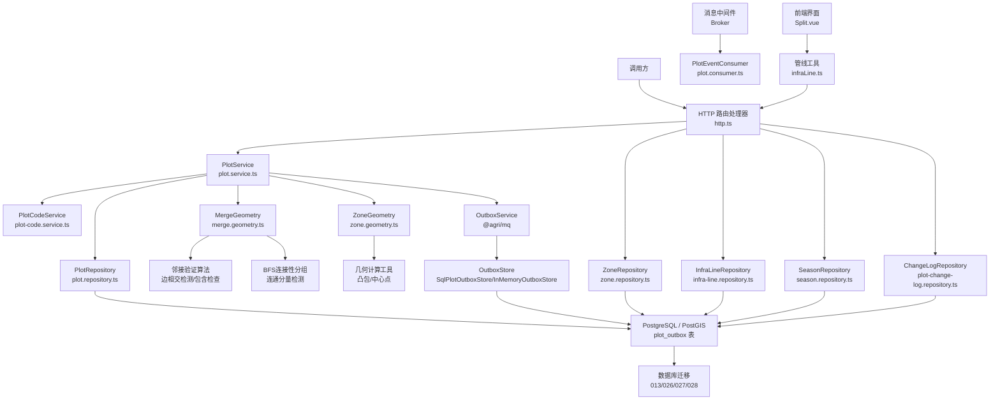

**图表来源**
- [http.ts:620-680](file://apps/plot-service/src/http.ts#L620-L680)
- [plot.service.ts:276-411](file://apps/plot-service/src/plot.service.ts#L276-L411)
- [merge.geometry.ts:1-128](file://apps/plot-service/src/merge.geometry.ts#L1-L128)
- [zone.repository.ts:49-192](file://apps/plot-service/src/zone.repository.ts#L49-L192)
- [infra-line.repository.ts:41-171](file://apps/plot-service/src/infra-line.repository.ts#L41-L171)
- [season.repository.ts:75-83](file://apps/plot-service/src/season.repository.ts#L75-L83)
- [plot-change-log.repository.ts:32-36](file://apps/plot-service/src/plot-change-log.repository.ts#L32-L36)
- [outbox.repository.ts:12-67](file://apps/plot-service/src/outbox.repository.ts#L12-L67)
- [zone.geometry.ts:17-74](file://apps/plot-service/src/zone.geometry.ts#L17-L74)
- [Split.vue:1-278](file://apps/web/src/views/plot/Split.vue#L1-L278)
- [013_infra_telecom_line.sql:1-20](file://infra/postgres/migrations/013_infra_telecom_line.sql#L1-L20)
- [026_crop_seasons.sql:11-33](file://infra/postgres/migrations/026_crop_seasons.sql#L11-L33)
- [027_plot_change_logs.sql:9-21](file://infra/postgres/migrations/027_plot_change_logs.sql#L9-L21)
- [028_plot_outbox.sql:6-18](file://infra/postgres/migrations/028_plot_outbox.sql#L6-L18)

**章节来源**
- [plot.service.ts:1-444](file://apps/plot-service/src/plot.service.ts#L1-L444)
- [merge.geometry.ts:1-128](file://apps/plot-service/src/merge.geometry.ts#L1-L128)
- [plot-code.service.ts:1-56](file://apps/plot-service/src/plot-code.service.ts#L1-L56)
- [plot.repository.ts:1-187](file://apps/plot-service/src/plot.repository.ts#L1-L187)
- [plot.consumer.ts:1-40](file://apps/plot-service/src/plot.consumer.ts#L1-L40)
- [outbox.repository.ts:1-68](file://apps/plot-service/src/outbox.repository.ts#L1-L68)
- [zone.repository.ts:1-193](file://apps/plot-service/src/zone.repository.ts#L1-L193)
- [infra-line.repository.ts:1-234](file://apps/plot-service/src/infra-line.repository.ts#L1-L234)
- [season.repository.ts:1-281](file://apps/plot-service/src/season.repository.ts#L1-L281)
- [plot-change-log.repository.ts:1-104](file://apps/plot-service/src/plot-change-log.repository.ts#L1-L104)
- [zone.geometry.ts:1-75](file://apps/plot-service/src/zone.geometry.ts#L1-L75)
- [app.module.ts:79-164](file://apps/plot-service/src/app.module.ts#L79-L164)
- [http.ts:1-744](file://apps/plot-service/src/http.ts#L1-L744)
- [Split.vue:1-278](file://apps/web/src/views/plot/Split.vue#L1-L278)

## 核心组件
- PlotService：地块业务编排中心，负责编码生成、查重、记录创建、**增强的合并拆分**、事件入队、查询、更新与软删除。
- **MergeGeometry**：**新增的地块合并邻接验证模块**，提供几何算法、边相交检测、包含检查和可配置的间隙容差测量。
- PlotCodeService：统一的地块编码能力，对外暴露 generate、parse、check、grid、toClient 等方法。
- PlotRepository：数据访问抽象，提供 findByCode、create、update、remove、listByTenant 方法；包含 InMemoryPlotRepository 与 SqlPlotRepository 两个实现。
- SqlPlotOutboxStore：持久化OutboxStore实现，提供数据库级别的事件持久化能力，支持事务级事件写入和状态跟踪。
- ZoneRepository：片区数据访问抽象，提供片区台账管理和地块归属关系维护。
- InfraLineRepository：基础设施线数据访问抽象，管理田间管线、道路等线性设施，已完整支持通信网线类型，包含长度估算和几何数据处理功能。
- SeasonRepository：作物季节数据访问抽象，管理种植季档案、轮作序列和茬口排序。
- ChangeLogRepository：变更日志数据访问抽象，记录地块操作的审计轨迹，支持追加式留痕。
- ZoneGeometry：几何工具库，提供凸包算法、中心点计算、多边形处理等空间几何功能。
- PlotEventConsumer：事件消费者，订阅 PlotCreated 事件，用于初始化网格、地力档案等下游流程。
- AppModule：模块装配，注入仓储、持久化OutboxStore、事件分发器、可观测性组件，并提供测试友好的默认实现。
- HTTP 处理器：基于 Node.js http 模块的轻量路由，将外部请求映射到 PlotService 方法，**增强合并拆分路由**。
- Split.vue：前端拆分界面，提供可视化地块编辑、面积校验和提交功能。
- InfraLinePanel：前端管线列表面板，提供管线的查询、筛选、定位、编辑和删除功能。
- 管线工具函数：提供管线分类、颜色映射、类型标签等前端辅助功能。

**章节来源**
- [plot.service.ts:13-444](file://apps/plot-service/src/plot.service.ts#L13-L444)
- [merge.geometry.ts:1-128](file://apps/plot-service/src/merge.geometry.ts#L1-L128)
- [plot-code.service.ts:15-54](file://apps/plot-service/src/plot-code.service.ts#L15-L54)
- [plot.repository.ts:11-186](file://apps/plot-service/src/plot.repository.ts#L11-L186)
- [outbox.repository.ts:12-67](file://apps/plot-service/src/outbox.repository.ts#L12-L67)
- [zone.repository.ts:49-192](file://apps/plot-service/src/zone.repository.ts#L49-L192)
- [infra-line.repository.ts:41-171](file://apps/plot-service/src/infra-line.repository.ts#L41-L171)
- [season.repository.ts:75-83](file://apps/plot-service/src/season.repository.ts#L75-L83)
- [plot-change-log.repository.ts:32-36](file://apps/plot-service/src/plot-change-log.repository.ts#L32-L36)
- [zone.geometry.ts:17-74](file://apps/plot-service/src/zone.geometry.ts#L17-L74)
- [plot.consumer.ts:6-39](file://apps/plot-service/src/plot.consumer.ts#L6-L39)
- [app.module.ts:79-164](file://apps/plot-service/src/app.module.ts#L79-L164)
- [http.ts:40-104](file://apps/plot-service/src/http.ts#L40-L104)
- [Split.vue:65-193](file://apps/web/src/views/plot/Split.vue#L65-L193)

## 架构总览
地块建档的关键是"业务数据与事件同事务"。PlotService.registerPlot 在同一个数据库事务中完成：
1. 生成六段式地块编码。
2. 检查编码是否已存在。
3. 构造 PlotRecord。
4. 通过 PrismaService.withTransaction 执行 repository.create 与 outbox.enqueue。
5. 持久化OutboxStore将事件写入plot_outbox表，确保事件持久化。
6. 事务提交后，由中继任务把 Outbox 中的事件投递到消息中间件。
7. PlotEventConsumer 消费 PlotCreated 事件，进行幂等处理与后续业务。

**增强的地块合并与拆分功能**遵循相同的架构模式，但增加了严格的邻接验证：
- **邻接验证前置**：在合并前使用几何算法验证所选地块是否真正相邻，防止隔着空地的非法合并。
- **BFS连接性分组**：确保选定的地块形成单个连通分量，支持链式相邻（A-B-C）的情况。
- **可配置间隙容差**：支持通过环境变量配置相邻判定的间隙容差（默认5米），适应不同的测绘精度需求。
- 合并功能：取多个源地块的顶点凸包作为新地块边界，按凸包面积现算，源地块整批软删归档。
- 拆分功能：由操作人在地图上逐块绘制子地块边界，每块面积按各自几何现算，原地块可选择保留或归档。
- 两者都通过 OutboxService 发布 PlotCreated 事件，确保下游系统的最终一致性。

地块分区系统通过 ZoneRepository 管理片区台账，支持地块归属关系维护和面积统计。基础设施线管理系统通过 InfraLineRepository 统一管理田间管线和道路等线性设施，现已完整支持通信网线类型。作物季节管理系统通过 SeasonRepository 管理种植季档案，支持轮作序列排序和茬口管理。变更日志系统通过 ChangeLogRepository 记录所有地块相关操作的审计轨迹。几何工具库提供凸包算法和中心点计算，用于片区边界可视化。

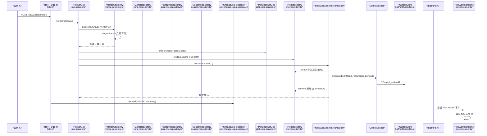

**图表来源**
- [http.ts:620-640](file://apps/plot-service/src/http.ts#L620-L640)
- [plot.service.ts:291-358](file://apps/plot-service/src/plot.service.ts#L291-L358)
- [merge.geometry.ts:105-127](file://apps/plot-service/src/merge.geometry.ts#L105-L127)
- [plot-code.service.ts:27-30](file://apps/plot-service/src/plot-code.service.ts#L27-L30)
- [plot.repository.ts:119-146](file://apps/plot-service/src/plot.repository.ts#L119-L146)
- [outbox.repository.ts:22-35](file://apps/plot-service/src/outbox.repository.ts#L22-L35)
- [plot.consumer.ts:20-28](file://apps/plot-service/src/plot.consumer.ts#L20-L28)
- [http.ts:630](file://apps/plot-service/src/http.ts#L630)

## 详细组件分析

### PlotService 业务逻辑设计
职责边界：
- 接收注册输入 RegisterPlotInput，生成地块编码并查重。
- 构造 PlotRecord，组装 PlotCreatedPayload。
- 使用 PrismaService.withTransaction 保证业务数据与 Outbox 事件在同一事务内。
- **增强的 mergePlots 和 splitPlot 方法，提供地块合并与拆分能力，包含严格的邻接验证**。
- 提供 getByCode、listByTenant、updatePlot、removePlot 等查询与变更能力。

registerPlot 完整流程要点：
- 调用 PlotCodeService.generate 生成六段式编码。
- 调用 repository.findByCode 查重，冲突抛出 ConflictError。
- 构造记录与负载，包含 parcelId、parcelCode、tenantId、farmId、areaMu、geom 等。
- 在事务中执行 repository.create 与 outbox.enqueue，确保"业务数据与事件同事务"。
- OutboxService将事件持久化到OutboxStore（内存或SQL）。
- 返回新建记录。

**增强的地块合并功能 mergePlots**：
- 验证至少选择两个地块才能合并。
- 获取所有源地块信息，任一不存在则抛出 NotFoundError。
- **新增邻接验证**：使用 adjacencyGroups 函数对选定的地块进行BFS连接性分组，确保它们形成单个连通分量。
- **几何算法验证**：通过 ringsAdjacent 函数验证地块之间的相邻关系，支持共边、交叉、包含等多种情况。
- **可配置间隙容差**：支持通过 PLOT_MERGE_ADJACENCY_M 环境变量配置相邻判定的间隙容差（默认5米）。
- 如果检测到多个连通分量，抛出 PLOT-409-003 错误，并返回分组信息供用户参考。
- 使用 hullPolygon 算法计算所有源地块顶点的凸包作为合并边界。
- 按凸包面积现算（polygonAreaMu → roundAreaMu），不是源面积求和。
- 以首个源地块为基础，继承档案字段，支持覆盖部分字段。
- 生成新的唯一地块编码，避免冲突。
- 在事务中创建合并后的地块、发布事件、软删所有源地块。
- 返回合并结果和源地块编码列表。

**增强的地块拆分功能 splitPlot**：
- 验证源地块存在，否则抛出 NotFoundError。
- 验证至少绘制两个子地块才能拆分。
- 对每个子地块进行几何验证：至少3个顶点、面积为正、不超过原地块面积+0.01亩容忍度。
- **新增关键验证**：计算所有子地块总面积（四舍五入到两位小数），允许每块0.01亩的浮点数精度容差，防止重叠子地块超过原地块面积。
- 为每个子地块生成新的唯一地块编码。
- 继承源地块的档案字段，支持覆盖类型和状态。
- 在事务中批量创建子地块、发布 PlotCreated 事件。
- 根据 keepSource 参数决定是否软删原地块。
- 返回拆分结果，包含子地块列表、源地块编码、是否删除原地块、子地块总面积。

事件消费处理：
- PlotEventConsumer 订阅 EventTopic.PlotCreated。
- 对 areaMu 做合法性校验，记录已处理事件 ID，便于排障。
- 实际后续工作（如网格初始化、地力档案）可在该方法扩展。

查询与更新：
- getByCode 通过 repository.findByCode 查询，未命中抛 NotFoundError。
- listByTenant 直接委托 repository.listByTenant。
- updatePlot 先查询是否存在，再在事务中执行 repository.update，未命中抛 NotFoundError。
- removePlot 在事务中执行 repository.remove，实现软删除，未命中抛 NotFoundError。

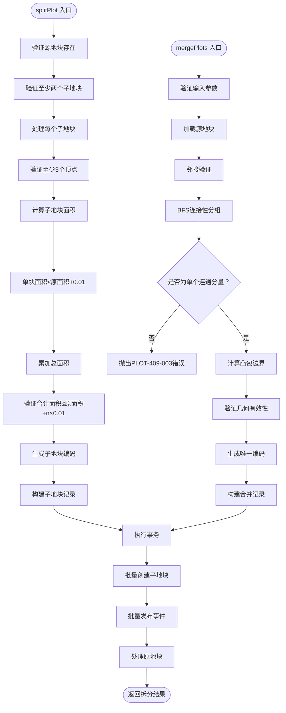

**图表来源**
- [plot.service.ts:291-442](file://apps/plot-service/src/plot.service.ts#L291-L442)
- [merge.geometry.ts:105-127](file://apps/plot-service/src/merge.geometry.ts#L105-L127)
- [outbox.repository.ts:22-35](file://apps/plot-service/src/outbox.repository.ts#L22-L35)

**章节来源**
- [plot.service.ts:21-444](file://apps/plot-service/src/plot.service.ts#L21-L444)
- [plot.consumer.ts:12-39](file://apps/plot-service/src/plot.consumer.ts#L12-L39)

### 增强的地块合并邻接验证系统
职责边界：
- **新增综合的地块合并邻接验证系统**，通过几何算法确保选定的地块真正相邻。
- 提供边相交检测、包含检查和可配置的间隙容差测量功能。
- 使用BFS算法进行连接性分组，确保选定的地块形成单个连通分量。
- 支持多种相邻关系判断：共边、交叉、包含、间隙容差等。

**核心几何算法**：
- **ringsAdjacent函数**：判断两个多边形环是否相邻，支持共边、交叉、包含等多种情况。
- **cross函数**：严格相交检测，判断两段线段是否跨过彼此所在的直线。
- **distanceToSegment函数**：计算点到线段的距离，用于间隙容差测量。
- **containsPoint函数**：点在多边形内的包含检测算法。
- **flatten函数**：将经纬度坐标投影到平面米制坐标，用于精确的距离计算。

**BFS连接性分组**：
- **adjacencyGroups函数**：使用广度优先搜索算法对地块进行连接性分组。
- 支持链式相邻情况（A-B-C），即使A和C不直接相邻也能被分到同一组。
- 返回多个连通分量，如果多于一个则说明选定的地块不能合并。

**可配置间隙容差**：
- 默认容差为5米，适应现场地块边界多为分别测绘的实际情况。
- 支持通过 PLOT_MERGE_ADJACENCY_M 环境变量配置容差值。
- 容差为0时进行严格相邻判定，不允许任何间隙。

```mermaid
classDiagram
class MergeGeometry {
+DEFAULT_ADJACENCY_TOLERANCE_M : number
+ringsAdjacent(a, b, toleranceM) boolean
+adjacencyGroups(items, toleranceM) T[][]
-flatten(a, b) {a : Flat[], b : Flat[]}
-crosses(p1, p2, q1, q2) boolean
-distanceToSegment(point, from, to) number
-edges(ring) [Flat, Flat][]
-containsPoint(ring, point) boolean
}
class LngLat {
+lng : number
+lat : number
}
class Flat {
+x : number
+y : number
}
MergeGeometry --> LngLat
MergeGeometry --> Flat
```

**图表来源**
- [merge.geometry.ts:1-128](file://apps/plot-service/src/merge.geometry.ts#L1-L128)

**章节来源**
- [merge.geometry.ts:1-128](file://apps/plot-service/src/merge.geometry.ts#L1-L128)
- [plot.service.ts:291-358](file://apps/plot-service/src/plot.service.ts#L291-L358)

### PlotCodeService 编码算法实现
职责边界：
- 集中地块编码的生成、解析、校验与作业网格编码构建。
- 统一坐标口径：库内统一 CGCS2000（EPSG:4490），仅允许出参方向换算为其他坐标系。

核心方法：
- generate：调用 buildPlotCode 生成六段式编码，自动计算校验位。
- parse：调用 parsePlotCode 解析为分段结构。
- check：调用 checkPlotCode 返回校验结果。
- grid：调用 buildGridCode 生成地块内作业网格编码。
- toClient：调用 transformCoordinate 将 CGCS2000 坐标转换为 WGS84 或其他坐标系。

编码分段说明：
- 区域码：来自 input.region。
- 农场码：来自 input.farm。
- 面积码：来自 input.area。
- 田块码：来自 input.parcel。
- 校验位：由底层 @agri/plot-core 自动生成。

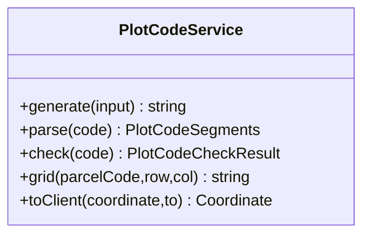

**图表来源**
- [plot-code.service.ts:25-54](file://apps/plot-service/src/plot-code.service.ts#L25-L54)

**章节来源**
- [plot-code.service.ts:15-54](file://apps/plot-service/src/plot-code.service.ts#L15-L54)

### PlotRepository 数据访问层设计
职责边界：
- 定义 PlotRepository 契约，明确 findByCode、create、update、remove、listByTenant 方法签名。
- 提供 InMemoryPlotRepository 用于示例与测试。
- 提供 SqlPlotRepository 对接 PostgreSQL，使用 $queryRawUnsafe/$executeRawUnsafe 执行 SQL。

空间几何数据存储：
- geom 字段以 JSONB 形式存储 GeoPolygon，入库时 JSON.stringify，读取时还原为 GeoPolygon。
- 库内统一 CGCS2000（EPSG:4490），坐标口径一致。

事务处理：
- 所有写操作方法接受显式事务对象作为首个参数，避免隐式上下文推断导致事务边界扩大。
- 在 PlotService 中通过 PrismaService.withTransaction 传入事务对象，确保业务数据与 Outbox 事件同事务。

软删除机制：
- 记录包含 deletedAt 字段，为空表示未删除。
- findByCode、update、remove、listByTenant 均过滤 deleted_at IS NULL。
- remove 方法设置 deleted_at 与 updated_at，实现软删除。

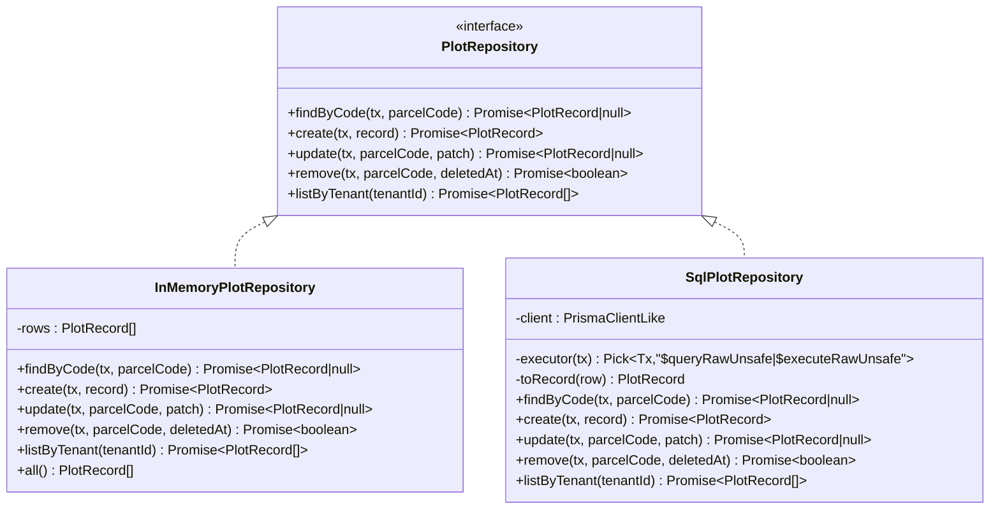

**图表来源**
- [plot.repository.ts:11-186](file://apps/plot-service/src/plot.repository.ts#L11-L186)

**章节来源**
- [plot.repository.ts:11-186](file://apps/plot-service/src/plot.repository.ts#L11-L186)

### 持久化OutboxStore实现
职责边界：
- 实现OutboxStore接口，提供数据库级别的事件持久化能力。
- 支持事务级事件写入，确保业务数据与事件持久化的原子性。
- 提供事件状态跟踪，包括投递时间、重试次数和错误信息。
- 支持待投递事件查询和状态更新操作。

核心数据结构：
- SqlPlotOutboxStore：持久化OutboxStore实现，使用plot_outbox表存储事件。
- OutboxRecord：事件记录结构，包含id、topic、payload、tenantId、traceId、producer、createdAt、retryCount等字段。

核心方法：
- enqueue：在事务中写入事件到plot_outbox表，验证事务上下文。
- listPending：查询待投递事件，按created_at排序，限制数量。
- markPublished：标记事件已成功投递，设置published_at时间戳。
- markFailed：标记事件投递失败，增加retry_count并记录last_error。

事务约束：
- enqueue方法必须在事务上下文中执行，否则抛出错误。
- 确保业务数据与事件持久化的原子性。
- 支持跨进程可靠事件处理。

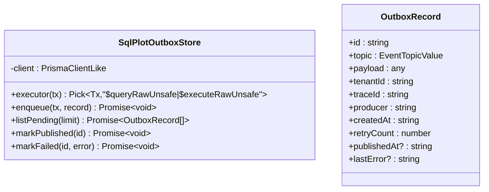

**图表来源**
- [outbox.repository.ts:12-67](file://apps/plot-service/src/outbox.repository.ts#L12-L67)

**章节来源**
- [outbox.repository.ts:1-68](file://apps/plot-service/src/outbox.repository.ts#L1-L68)

### 地块合并与拆分系统
职责边界：
- **增强的地块合并功能**：支持多块地并一块，使用凸包算法生成合并边界，包含严格的邻接验证。
- **增强的地块拆分功能**：支持一块地拆多块，由操作人逐块绘制子地块边界。
- 提供完整的几何计算和业务验证，确保数据一致性。
- 集成变更日志系统，记录合并拆分操作轨迹。
- 与现有地块管理系统无缝集成，保持向后兼容。

**增强的合并功能核心逻辑**：
- 输入：MergePlotsInput，包含至少两个源地块编码和可选的合并后档案字段。
- **邻接验证前置**：使用 adjacencyGroups 进行BFS连接性分组，确保选定的地块形成单个连通分量。
- **几何算法验证**：通过 ringsAdjacent 验证地块之间的相邻关系，支持共边、交叉、包含等情况。
- **可配置间隙容差**：支持通过 PLOT_MERGE_ADJACENCY_M 环境变量配置容差（默认5米）。
- 几何处理：使用 hullPolygon 算法计算所有源地块外环顶点的凸包。
- 面积计算：按合并后几何现算（polygonAreaMu → roundAreaMu），不是源面积求和。
- 编码生成：通过 ensureUniqueParcelCode 生成新的唯一地块编码。
- 档案继承：以首个源地块为基础，继承土壤类型、片区编码、作物信息等。
- 事务处理：在单一事务中创建合并地块、发布事件、软删所有源地块。
- 返回值：MergePlotsResult，包含合并后的地块记录和源地块编码列表。

**增强的拆分功能核心逻辑**：
- 输入：SplitPlotInput，包含源地块编码、子地块边界数组和可选的keepSource标志。
- 几何验证：每个子地块必须至少有3个顶点，面积为正，不超过原地块面积+0.01亩。
- **新增关键验证**：计算所有子地块总面积（四舍五入到两位小数），允许每块0.01亩的浮点数精度容差，防止重叠子地块超过原地块面积。
- 编码生成：为每个子地块生成新的唯一地块编码。
- 档案继承：继承源地块的档案字段，支持覆盖地块类型和状态。
- 事务处理：批量创建子地块、发布 PlotCreated 事件，根据keepSource决定是否删除原地块。
- 返回值：SplitPlotResult，包含子地块列表、源地块编码、是否删除原地块、子地块总面积。

**前端拆分界面 Split.vue**：
- 提供可视化地块编辑器，支持逐块绘制子地块边界。
- 实时显示每个子地块的面积和合计面积。
- 前端预检：验证子地块数量、顶点数、面积合法性。
- 交互设计：支持添加/删除子地块、切换编辑目标、保留原地块选项。
- 用户体验：提供详细的提示信息，包括面积超限警告和操作确认对话框。

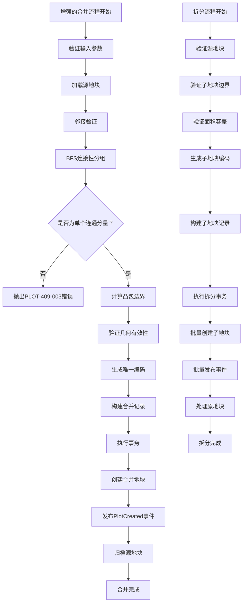

**图表来源**
- [plot.service.ts:291-442](file://apps/plot-service/src/plot.service.ts#L291-L442)
- [merge.geometry.ts:105-127](file://apps/plot-service/src/merge.geometry.ts#L105-L127)
- [Split.vue:151-188](file://apps/web/src/views/plot/Split.vue#L151-L188)

**章节来源**
- [plot.service.ts:291-442](file://apps/plot-service/src/plot.service.ts#L291-L442)
- [merge.geometry.ts:1-128](file://apps/plot-service/src/merge.geometry.ts#L1-L128)
- [Split.vue:1-278](file://apps/web/src/views/plot/Split.vue#L1-L278)
- [merge-split.spec.ts:1-359](file://apps/plot-service/test/merge-split.spec.ts#L1-L359)

### 地块分区系统（Zone System）
职责边界：
- 管理片区台账，支持片区的增删改查操作。
- 维护地块与片区的归属关系，通过 plot_records.zone_code 字段关联。
- 提供片区面积统计和成员地块管理功能。
- 支持片区边界可视化，包括实测边界和基于成员地块计算的凸包轮廓。

核心数据结构：
- PlotZone：片区记录，包含 zoneCode、zoneName、color、description、geom 等字段。
- ZoneInput：新增/更新片区的输入参数。
- ZonePatch：片区更新的补丁对象。

核心方法：
- listByTenant：按租户查询片区列表。
- findByCode：根据片区编码查询片区详情。
- create：创建新片区，支持自动生成编码。
- update：更新片区信息，支持部分字段更新。
- remove：软删除片区，需先移除所有归属地块。

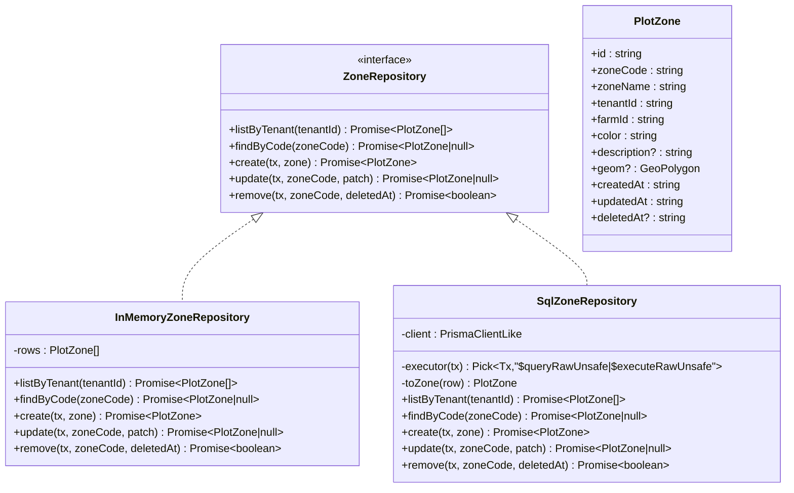

**图表来源**
- [zone.repository.ts:49-192](file://apps/plot-service/src/zone.repository.ts#L49-L192)

**章节来源**
- [zone.repository.ts:1-193](file://apps/plot-service/src/zone.repository.ts#L1-L193)

### 基础设施线管理系统
职责边界：
- 统一管理田间管线、道路等线性设施。
- 支持多种管线类型：灌水管、施肥管、电力线、机耕道、通信网线。
- 提供线路长度估算和几何数据处理功能。
- 支持按类型过滤和软删除操作。
- 支持地块编码归属关系，通过 plotCode 字段关联地块。

**更新** 管线类型已从原来的4种扩展到5种，新增TELECOM（通信网线）类型支持。

核心数据结构：
- InfraLine：线路记录，包含 lineCode、lineName、lineType、geom、lengthM、plotCode 等字段。
- InfraLineInput：新增/更新线路的输入参数。
- InfraLineType：线路类型枚举，现已扩展为 IRRIGATION_PIPE、FERTILIZATION_PIPE、ELECTRIC_LINE、ROAD、TELECOM。

核心方法：
- estimateLengthM：按折点估算线路长度，单位米。
- listByTenant：按租户查询线路列表。
- findByCode：根据线路编码查询线路详情。
- create：创建新线路，支持自动生成编码和长度估算。
- update：更新线路信息，支持部分字段更新。
- remove：软删除线路。

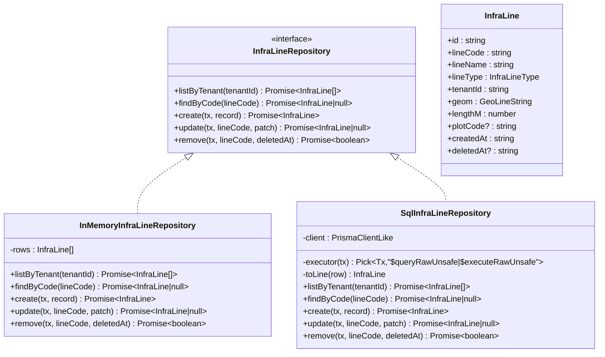

**图表来源**
- [infra-line.repository.ts:41-171](file://apps/plot-service/src/infra-line.repository.ts#L41-L171)

**章节来源**
- [infra-line.repository.ts:1-234](file://apps/plot-service/src/infra-line.repository.ts#L1-L234)

### 作物季节管理系统
职责边界：
- 管理地块的种植季档案，记录每季种植的作物、品种、时间等信息。
- 支持轮作序列排序，按年份→茬次→栽期→建档时间正序排列。
- 提供茬口管理功能，支持连作障碍提示和倒茬决策支持。
- 与苗情生育期不同，这里以"季/茬"为单位，跨年份排一条地块的种植历史。

核心数据结构：
- CropSeason：种植季记录，包含 seasonCode、plotCode、crop、variety、seasonYear、seasonIndex、plantDate、harvestDate、status、yieldKg、note 等字段。
- CropSeasonInput：新增种植季的输入参数。
- CropSeasonPatch：种植季更新的补丁对象。
- CropSeasonStatus：种植季状态枚举，包含 planned（计划中）、growing（种植中）、harvested（已采收）。

核心方法：
- compareRotation：轮作正序比较函数，实现年份→茬次→栽期→建档时间的排序逻辑。
- isValidFarmDate：日期合法性验证，支持 YYYY-MM-DD 格式和日历校验。
- listByTenant：按租户查询种植季列表。
- listByPlot：按地块查询轮作序列，返回正序排列的茬口历史。
- findByCode：根据种植季编码查询详情。
- create：创建新的种植季记录。
- update：更新种植季信息，支持部分字段更新。
- remove：软删除种植季记录。

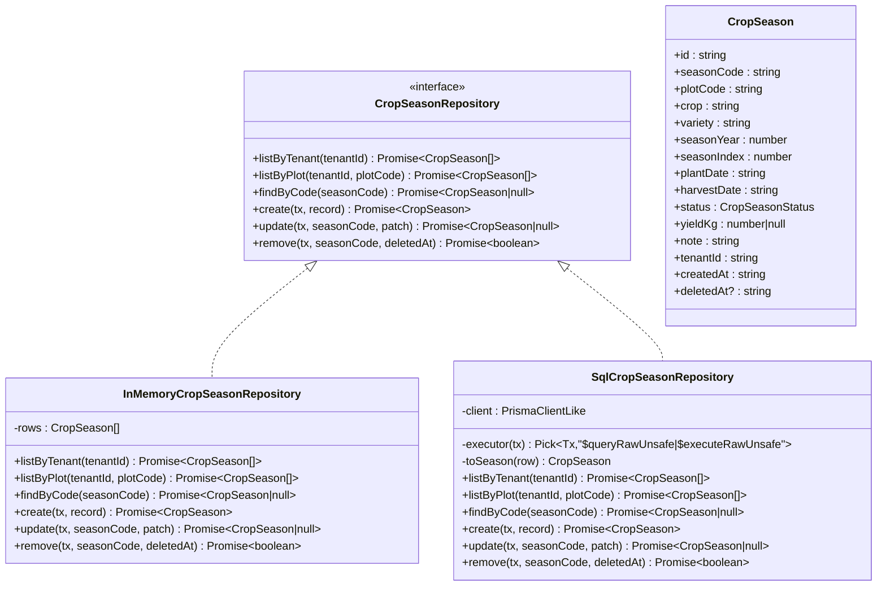

**图表来源**
- [season.repository.ts:75-83](file://apps/plot-service/src/season.repository.ts#L75-L83)

**章节来源**
- [season.repository.ts:1-281](file://apps/plot-service/src/season.repository.ts#L1-L281)

### 变更日志系统
职责边界：
- 记录地块相关的所有操作，包括建档、更新、删除、**增强的合并、拆分**等操作。
- 提供追加式留痕机制，只增不改，确保审计轨迹的完整性。
- 支持按地块查询变更历史，按时间倒序排列。
- 记录操作人信息，支持用户ID和系统操作区分。

**更新** 新增 MERGE（合并）和 SPLIT（拆分）操作类型，支持完整的合并拆分操作审计。

核心数据结构：
- PlotChangeLog：变更日志记录，包含 id、parcelCode、tenantId、action、summary、actor、createdAt 等字段。
- PlotChangeAction：变更动作枚举，包含 CREATE（建档）、UPDATE（更新）、DELETE（删除）、**MERGE（合并）、SPLIT（拆分）**。
- PlotChangeLogRepository：变更日志仓储接口。

核心方法：
- append：追加变更记录，不修改已有日志。
- listByPlot：按地块查询变更历史，返回最近的操作在前。

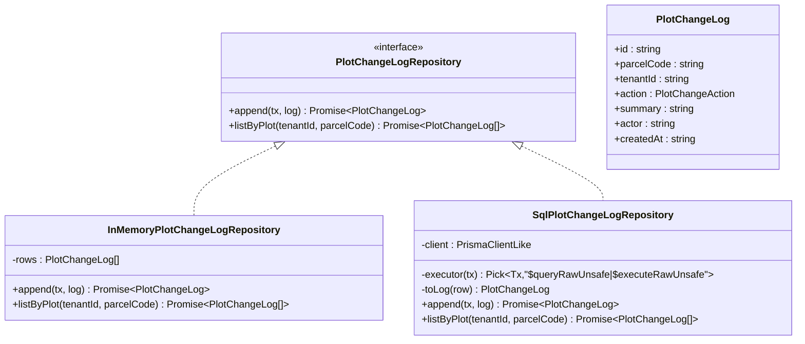

**图表来源**
- [plot-change-log.repository.ts:32-36](file://apps/plot-service/src/plot-change-log.repository.ts#L32-L36)

**章节来源**
- [plot-change-log.repository.ts:1-104](file://apps/plot-service/src/plot-change-log.repository.ts#L1-L104)

### 几何工具库
职责边界：
- 提供片区边界的几何计算功能。
- 实现凸包算法，用于计算片区外轮廓和**地块合并边界**。
- 提供中心点计算，用于地图定位展示。
- 支持多边形顶点的提取和处理。

**更新** 凸包算法现在不仅用于片区边界计算，还用于地块合并功能的边界生成。

核心方法：
- ringPoints：从 GeoPolygon 中提取外环顶点。
- convexHull：实现单调链凸包算法，返回逆时针顶点。
- hullPolygon：将凸包顶点转换为 GeoJSON Polygon 格式。
- centroidOf：计算顶点的算术平均，用于地图定位。

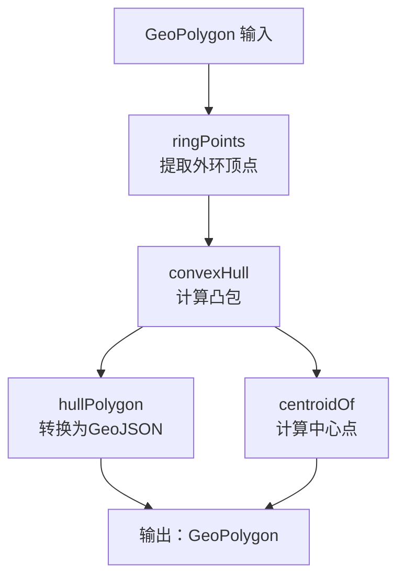

**图表来源**
- [zone.geometry.ts:17-74](file://apps/plot-service/src/zone.geometry.ts#L17-L74)

**章节来源**
- [zone.geometry.ts:1-75](file://apps/plot-service/src/zone.geometry.ts#L1-L75)

### 持久化Outbox模式的事件发布机制
现在支持两种OutboxStore实现：

- InMemoryOutboxStore：内存实现，用于演示和测试环境。
- SqlPlotOutboxStore：持久化实现，用于生产环境，提供跨进程可靠事件处理。

- OutboxService 通过 OUTBOX_STORE 持久化待投递事件，支持租户、链路标识与生产者标识。
- PlotService.registerPlot、mergePlots、splitPlot 在事务中调用 outbox.enqueue，将 PlotCreated 事件与业务记录一起落库。
- SqlPlotOutboxStore将事件写入plot_outbox表，确保事件持久化和状态跟踪。
- 中继任务（由 @agri/mq 提供）扫描 OutboxStore 并投递到消息中间件。
- 消费侧 PlotEventConsumer 通过 EventDispatcher 订阅事件，具备重试与幂等保护。

**双模式配置**：
- 默认使用 InMemoryOutboxStore 进行演示。
- 生产环境可通过 AppModuleOptions.outboxStore 参数注入 SqlPlotOutboxStore。

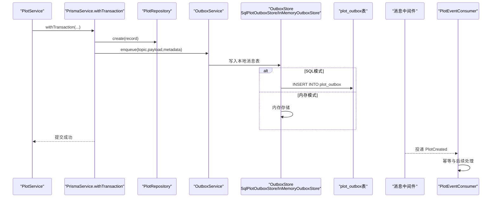

**图表来源**
- [plot.service.ts:190-197](file://apps/plot-service/src/plot.service.ts#L190-L197)
- [app.module.ts:119-143](file://apps/plot-service/src/app.module.ts#L119-L143)
- [outbox.repository.ts:22-35](file://apps/plot-service/src/outbox.repository.ts#L22-L35)

**章节来源**
- [plot.service.ts:190-197](file://apps/plot-service/src/plot.service.ts#L190-L197)
- [app.module.ts:119-143](file://apps/plot-service/src/app.module.ts#L119-L143)
- [outbox.repository.ts:1-68](file://apps/plot-service/src/outbox.repository.ts#L1-L68)

## 依赖关系分析
- PlotService 依赖：
  - PlotRepository：数据访问契约。
  - OutboxService：本地消息表事件发布。
  - PlotCodeService：地块编码生成与校验。
  - **MergeGeometry**：**新增的邻接验证模块**。
  - PrismaService：事务控制。
- **MergeGeometry 依赖**：
  - LngLat：经纬度坐标类型。
  - Flat：平面米制坐标类型。
- PlotCodeService 依赖：
  - @agri/plot-core：编码生成、解析、校验与坐标转换。
- PlotRepository 依赖：
  - PrismaClientLike：数据库客户端契约。
- SqlPlotOutboxStore 依赖：
  - PrismaClientLike：数据库客户端契约。
- PlotEventConsumer 依赖：
  - EventDispatcher：事件分发与幂等、重试。
- ZoneRepository 依赖：
  - PrismaClientLike：数据库客户端契约。
- InfraLineRepository 依赖：
  - PrismaClientLike：数据库客户端契约。
- SeasonRepository 依赖：
  - PrismaClientLike：数据库客户端契约。
- ChangeLogRepository 依赖：
  - PrismaClientLike：数据库客户端契约。
- ZoneGeometry 依赖：
  - @agri/contracts：GeoPolygon 类型定义。
- AppModule 装配：
  - 注入仓储、持久化OutboxStore、事件分发器、可观测性组件。
  - 提供默认 InMemoryPlotRepository、InMemoryOutboxStore、IdempotencyGuardStore。

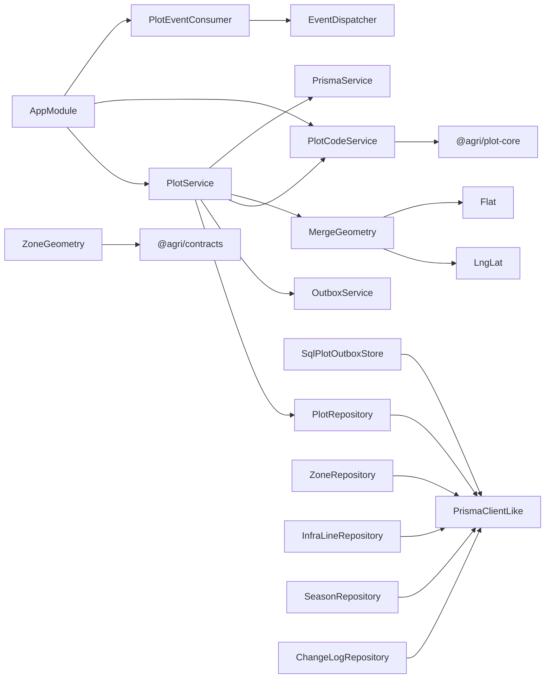

**图表来源**
- [plot.service.ts:116-122](file://apps/plot-service/src/plot.service.ts#L116-L122)
- [merge.geometry.ts:1-24](file://apps/plot-service/src/merge.geometry.ts#L1-L24)
- [plot-code.service.ts:25-54](file://apps/plot-service/src/plot-code.service.ts#L25-L54)
- [plot.repository.ts:94-186](file://apps/plot-service/src/plot.repository.ts#L94-L186)
- [outbox.repository.ts:12-67](file://apps/plot-service/src/outbox.repository.ts#L12-L67)
- [plot.consumer.ts:12-39](file://apps/plot-service/src/plot.consumer.ts#L12-L39)
- [zone.repository.ts:114-192](file://apps/plot-service/src/zone.repository.ts#L114-L192)
- [infra-line.repository.ts:91-171](file://apps/plot-service/src/infra-line.repository.ts#L91-L171)
- [season.repository.ts:131-281](file://apps/plot-service/src/season.repository.ts#L131-L281)
- [plot-change-log.repository.ts:53-104](file://apps/plot-service/src/plot-change-log.repository.ts#L53-L104)
- [zone.geometry.ts:1-75](file://apps/plot-service/src/zone.geometry.ts#L1-L75)
- [app.module.ts:112-155](file://apps/plot-service/src/app.module.ts#L112-L155)

**章节来源**
- [plot.service.ts:116-122](file://apps/plot-service/src/plot.service.ts#L116-L122)
- [merge.geometry.ts:1-24](file://apps/plot-service/src/merge.geometry.ts#L1-L24)
- [plot-code.service.ts:25-54](file://apps/plot-service/src/plot-code.service.ts#L25-L54)
- [plot.repository.ts:94-186](file://apps/plot-service/src/plot.repository.ts#L94-L186)
- [outbox.repository.ts:12-67](file://apps/plot-service/src/outbox.repository.ts#L12-L67)
- [plot.consumer.ts:12-39](file://apps/plot-service/src/plot.consumer.ts#L12-L39)
- [zone.repository.ts:114-192](file://apps/plot-service/src/zone.repository.ts#L114-L192)
- [infra-line.repository.ts:91-171](file://apps/plot-service/src/infra-line.repository.ts#L91-L171)
- [season.repository.ts:131-281](file://apps/plot-service/src/season.repository.ts#L131-L281)
- [plot-change-log.repository.ts:53-104](file://apps/plot-service/src/plot-change-log.repository.ts#L53-L104)
- [zone.geometry.ts:1-75](file://apps/plot-service/src/zone.geometry.ts#L1-L75)
- [app.module.ts:112-155](file://apps/plot-service/src/app.module.ts#L112-L155)

## 性能与可靠性考虑
- 事务边界最小化：仓储方法显式接收事务对象，避免无意扩大事务范围。
- 编码生成与校验集中化：避免业务代码自行拼装编码导致的分隔符、补零与校验位不一致问题。
- 坐标口径统一：库内统一 CGCS2000，仅在出参方向换算，避免多套坐标系混杂。
- 持久化Outbox模式：SqlPlotOutboxStore确保事件持久化，支持跨进程可靠事件处理。
- 双模式操作：支持InMemoryOutboxStore（演示）和SqlPlotOutboxStore（生产）两种模式。
- 事务级事件持久化：确保业务数据与事件持久化的原子性。
- 事件状态跟踪：支持投递时间、重试次数和错误信息的跟踪。
- 最终一致性：Outbox 本地消息表保证事件不丢失，消费侧需幂等。
- 分页与过滤：HTTP 层对列表接口提供 page、size、keyword 分页与关键词过滤。
- 软删除：避免物理删除带来的历史数据丢失，同时保持查询条件简洁。
- 几何计算优化：凸包算法使用单调链实现，时间复杂度 O(n log n)，适合大规模地块集合。
- 管线长度估算：使用等距圆柱近似算法，在田间尺度误差可忽略。
- 索引优化：为 plot_zones.tenant_id、plot_records.zone_code、infra_lines.tenant_id、crop_seasons.plot_code、plot_change_logs.parcel_code、plot_outbox.created_at 建立复合索引。
- 轮作排序优化：compareRotation 函数实现高效的轮作序列排序，支持缺省日期沉底。
- 变更日志追加优化：只增不改的设计确保审计轨迹的完整性和查询性能。
- **增强的合并拆分性能优化**：ensureUniqueParcelCode 方法最多尝试20次生成唯一编码，避免无限循环。
- **邻接验证前置**：在事务前进行几何验证，减少无效事务的执行。
- **BFS连接性分组优化**：使用广度优先搜索算法高效处理连通分量检测，时间复杂度 O(n²)。
- **几何算法优化**：ringsAdjacent函数使用平面投影和向量运算，避免复杂的地理计算。
- **批量操作优化**：拆分功能批量创建子地块和发布事件，提高处理效率。
- **面积精度容差优化**：新增的浮点数精度容差机制（每块0.01亩）有效处理边界计算中的微小误差，提升系统鲁棒性。
- **可配置容差机制**：通过环境变量配置相邻判定容差，适应不同的测绘精度需求。

[本节为通用指导，不直接分析具体文件]

## API 接口文档

### 健康检查
- 方法：GET
- 路径：/health
- 响应体：
  - status：字符串，固定为 ok。
  - service：字符串，固定为 plot。
- 状态码：200

**章节来源**
- [http.ts:45-48](file://apps/plot-service/src/http.ts#L45-L48)

### 统计信息
- 方法：GET
- 路径：/api/v1/plots/stats
- 请求头：
  - x-tenant-id：租户标识，可选，缺省为 tenant-demo。
- 响应体：
  - totalPlots：地块数量。
  - totalAreaMu：总面积（亩）。
  - soilTypes：按土壤类型汇总的面积数组，每项包含 name 与 areaMu。
- 状态码：200

**章节来源**
- [http.ts:49-59](file://apps/plot-service/src/http.ts#L49-L59)

### 边界数据
- 方法：GET
- 路径：/api/v1/plots/bounds
- 请求头：
  - x-tenant-id：租户标识，可选，缺省为 tenant-demo。
- 响应体：地块边界数组，每项包含 parcelCode、parcelName、areaMu、geom。
- 状态码：200

**章节来源**
- [http.ts:61-65](file://apps/plot-service/src/http.ts#L61-L65)

### 地块列表
- 方法：GET
- 路径：/api/v1/plots
- 请求头：
  - x-tenant-id：租户标识，可选，缺省为 tenant-demo。
- 查询参数：
  - page：页码，默认 1。
  - size：每页大小，默认 20，最大 200。
  - keyword：关键词，支持按地块编码或名称模糊匹配。
  - zoneCode：片区编码，支持按片区过滤。
  - plotType：地块类型，受 CHECK 约束。
  - plotStatus：地块状态，受 CHECK 约束。
  - soilType：土壤类型。
  - currentCrop：当前作物。
  - areaMin：最小面积。
  - areaMax：最大面积。
- 响应体：PageResult<PlotRecord>，包含 items、total、page、size、pages。
- 状态码：200

**章节来源**
- [http.ts:66-71](file://apps/plot-service/src/http.ts#L66-L71)

### 查询地块
- 方法：GET
- 路径：/api/v1/plots/{parcelCode}
- 路径参数：
  - parcelCode：URL 编码后的地块编码。
- 响应体：PlotRecord。
- 状态码：200 或 404（不存在）。

**章节来源**
- [http.ts:72-77](file://apps/plot-service/src/http.ts#L72-L77)

### 建档地块
- 方法：POST
- 路径：/api/v1/plots
- 请求头：
  - x-tenant-id：租户标识，可选，缺省为 tenant-demo。
- 请求体：RegisterPlotInput
  - tenantId：租户标识。
  - farmId：农场标识。
  - region：区域码。
  - farm：农场码。
  - area：面积码。
  - parcel：田块码。
  - parcelName：地块名称。
  - areaMu：面积（亩）。
  - soilType：土壤类型编码，可选。
  - geom：GeoPolygon，CGCS2000 坐标。
  - traceId：链路标识。
  - zoneCode：片区编码，可选，用于地块归属。
- 响应体：PlotRecord。
- 状态码：201 或 409（编码重复）。

**章节来源**
- [http.ts:78-83](file://apps/plot-service/src/http.ts#L78-L83)
- [plot.service.ts:136-200](file://apps/plot-service/src/plot.service.ts#L136-L200)

### 更新地块
- 方法：PUT
- 路径：/api/v1/plots/{parcelCode}
- 路径参数：
  - parcelCode：URL 编码后的地块编码。
- 请求体：Patch 字段可选
  - parcelName 或 name：地块名称。
  - areaMu：面积（亩）。
  - soilType：土壤类型编码。
  - geom：GeoPolygon。
  - zoneCode：片区编码，支持设置为 null 解除归属。
  - plotType、plotStatus、currentCrop、ownerName、ownerPhone、remark：档案字段。
- 响应体：PlotRecord。
- 状态码：200 或 404（不存在）。

**章节来源**
- [http.ts:84-93](file://apps/plot-service/src/http.ts#L84-L93)
- [plot.service.ts:224-233](file://apps/plot-service/src/plot.service.ts#L224-L233)

### 删除地块
- 方法：DELETE
- 路径：/api/v1/plots/{parcelCode}
- 路径参数：
  - parcelCode：URL 编码后的地块编码。
- 响应体：null。
- 状态码：200 或 404（不存在）。

**章节来源**
- [http.ts:94-98](file://apps/plot-service/src/http.ts#L94-L98)

### 地块合并

#### 增强的合并地块
- 方法：POST
- 路径：/api/v1/plots/merge
- 请求头：
  - x-tenant-id：租户标识，可选，缺省为 tenant-demo。
- 请求体：MergePlotsInput
  - parcelCodes：地块编码数组，至少需要两个地块。
  - parcelName：合并后地块名称，可选，留空则继承首个源地块名称。
  - soilType：土壤类型编码，可选，覆盖首个源地块的值。
  - zoneCode：片区编码，可选，覆盖首个源地块的值。
  - plotType：地块类型，可选，覆盖首个源地块的值。
  - plotStatus：地块状态，可选，覆盖首个源地块的值。
  - currentCrop：当前作物，可选，覆盖首个源地块的值。
  - ownerName：所有者姓名，可选，覆盖首个源地块的值。
  - ownerPhone：所有者电话，可选，覆盖首个源地块的值。
  - remark：备注，可选，覆盖首个源地块的值。
  - traceId：链路标识。
- 响应体：MergePlotsResult
  - plot：合并后的地块记录。
  - sourceCodes：已归档的源地块编码数组。
- 状态码：201 或 400（参数验证失败）、404（源地块不存在）、**409（地块不相邻，PLOT-409-003）**

**新增** 增强的邻接验证：
- 使用几何算法验证所选地块是否真正相邻。
- 支持共边、交叉、包含等多种相邻关系。
- 可配置间隙容差（默认5米），通过 PLOT_MERGE_ADJACENCY_M 环境变量配置。
- 如果检测到多个连通分量，返回分组信息帮助用户理解为什么合并失败。

**章节来源**
- [http.ts:620-640](file://apps/plot-service/src/http.ts#L620-L640)
- [plot.service.ts:291-358](file://apps/plot-service/src/plot.service.ts#L291-L358)
- [merge.geometry.ts:105-127](file://apps/plot-service/src/merge.geometry.ts#L105-L127)

### 地块拆分

#### 拆分地块
- 方法：POST
- 路径：/api/v1/plots/split
- 请求头：
  - x-tenant-id：租户标识，可选，缺省为 tenant-demo。
- 请求体：SplitPlotInput
  - parcelCode：源地块编码，必填。
  - pieces：子地块边界数组，至少需要两个子地块。
    - parcelName：子地块名称，可选，留空则按「原名称-序号」生成。
    - geom：子地块边界 GeoPolygon，必填。
    - plotType：地块类型，可选，覆盖源地块的值。
    - plotStatus：地块状态，可选，覆盖源地块的值。
  - keepSource：是否保留原地块，可选，默认为 false（归档原地块）。
  - traceId：链路标识。
- 响应体：SplitPlotResult
  - plots：拆分后的子地块记录数组。
  - sourceCode：源地块编码。
  - sourceRemoved：是否已归档原地块。
  - pieceAreaSum：子地块总面积（亩）。
- 状态码：201 或 400（参数验证失败）、404（源地块不存在）

**章节来源**
- [http.ts:642-680](file://apps/plot-service/src/http.ts#L642-L680)
- [plot.service.ts:369-442](file://apps/plot-service/src/plot.service.ts#L369-L442)

### 基础设施线管理

#### 管线列表
- 方法：GET
- 路径：/api/v1/plots/infra-lines
- 请求头：
  - x-tenant-id：租户标识，可选，缺省为 tenant-demo。
- 查询参数：
  - lineType：管线类型，可选，支持 IRRIGATION_PIPE、FERTILIZATION_PIPE、ELECTRIC_LINE、ROAD、TELECOM。
  - plotCode：地块编码，可选，支持按归属地块过滤。
- 响应体：InfraLine[] 数组。
- 状态码：200

**章节来源**
- [http.ts:181-189](file://apps/plot-service/src/http.ts#L181-L189)

#### 新增管线
- 方法：POST
- 路径：/api/v1/plots/infra-lines
- 请求头：
  - x-tenant-id：租户标识，可选，缺省为 tenant-demo。
- 请求体：InfraLineInput
  - lineName：管线名称，必填。
  - lineType：管线类型，必填，必须为预定义类型之一（IRRIGATION_PIPE、FERTILIZATION_PIPE、ELECTRIC_LINE、ROAD、TELECOM）。
  - geom：GeoLineString，至少包含两个点的坐标数组。
  - lineCode：管线编码，可选，自动生成 LINE-前缀。
  - lengthM：管线长度，可选，自动估算。
  - plotCode：归属地块编码，可选，支持关联地块。
- 响应体：InfraLine。
- 状态码：201 或 400（参数验证失败）、409（编码重复）。

**章节来源**
- [http.ts:191-231](file://apps/plot-service/src/http.ts#L191-L231)

#### 更新管线
- 方法：PUT
- 路径：/api/v1/plots/infra-lines/{lineCode}
- 路径参数：
  - lineCode：URL 编码后的管线编码。
- 请求体：InfraLinePatch 字段可选
  - lineName：管线名称，可选。
  - lineType：管线类型，可选，必须为预定义类型之一（IRRIGATION_PIPE、FERTILIZATION_PIPE、ELECTRIC_LINE、ROAD、TELECOM）。
  - geom：GeoLineString，至少包含两个点的坐标数组。
  - lengthM：管线长度，可选，非负数。
  - plotCode：归属地块编码，可选，支持设置为空串解绑地块。
- 响应体：InfraLine。
- 状态码：200 或 400（参数验证失败）、404（不存在）。

**章节来源**
- [http.ts:234-292](file://apps/plot-service/src/http.ts#L234-L292)

#### 删除管线
- 方法：DELETE
- 路径：/api/v1/plots/infra-lines/{lineCode}
- 路径参数：
  - lineCode：URL 编码后的管线编码。
- 响应体：null。
- 状态码：200 或 404（不存在）。

**章节来源**
- [http.ts:294-301](file://apps/plot-service/src/http.ts#L294-L301)

### 作物季节管理

#### 种植季列表
- 方法：GET
- 路径：/api/v1/plots/seasons
- 请求头：
  - x-tenant-id：租户标识，可选，缺省为 tenant-demo。
- 查询参数：
  - plotCode：地块编码，可选，支持按地块查询轮作序列。
  - crop：作物名称，可选，支持模糊匹配。
  - status：种植季状态，可选，支持 planned/growing/harvested。
  - year：种植年份，可选，支持按年份过滤。
- 响应体：CropSeason[] 数组，按轮作正序排列。
- 状态码：200

**章节来源**
- [http.ts:304-322](file://apps/plot-service/src/http.ts#L304-L322)

#### 新增种植季
- 方法：POST
- 路径：/api/v1/plots/seasons
- 请求头：
  - x-tenant-id：租户标识，可选，缺省为 tenant-demo。
- 请求体：CropSeasonInput
  - plotCode：所属地块编码，必填。
  - crop：作物名称，必填。
  - variety：品种，可选。
  - seasonYear：种植年份，必填，1900~2999。
  - seasonIndex：茬次，可选，默认1，不小于1。
  - plantDate：栽插日期，可选，YYYY-MM-DD格式。
  - harvestDate：采收日期，可选，YYYY-MM-DD格式。
  - status：种植季状态，可选，默认planned。
  - yieldKg：产量，可选，非负数。
  - note：备注，可选。
  - seasonCode：种植季编码，可选，自动生成 SEASON-前缀。
- 响应体：CropSeason。
- 状态码：201 或 400（参数验证失败）、409（编码重复）。

**章节来源**
- [http.ts:324-393](file://apps/plot-service/src/http.ts#L324-L393)

#### 更新种植季
- 方法：PUT
- 路径：/api/v1/plots/seasons/{seasonCode}
- 路径参数：
  - seasonCode：URL 编码后的种植季编码。
- 请求体：CropSeasonPatch 字段可选
  - plotCode：所属地块编码，可选，需为有效地块。
  - crop：作物名称，可选，不能为空。
  - variety：品种，可选。
  - seasonYear：种植年份，可选，1900~2999。
  - seasonIndex：茬次，可选，不小于1。
  - plantDate：栽插日期，可选，YYYY-MM-DD或空串。
  - harvestDate：采收日期，可选，YYYY-MM-DD或空串。
  - status：种植季状态，可选，需为预定义值。
  - yieldKg：产量，可选，非负数或null。
  - note：备注，可选。
- 响应体：CropSeason。
- 状态码：200 或 400（参数验证失败）、404（不存在）。

**章节来源**
- [http.ts:395-485](file://apps/plot-service/src/http.ts#L395-L485)

#### 删除种植季
- 方法：DELETE
- 路径：/api/v1/plots/seasons/{seasonCode}
- 路径参数：
  - seasonCode：URL 编码后的种植季编码。
- 响应体：null。
- 状态码：200 或 404（不存在）。

**章节来源**
- [http.ts:487-494](file://apps/plot-service/src/http.ts#L487-L494)

### 地块变更历史

#### 查询变更历史
- 方法：GET
- 路径：/api/v1/plots/{parcelCode}/history
- 路径参数：
  - parcelCode：URL 编码后的地块编码。
- 响应体：PlotChangeLog[] 数组，按时间倒序排列，最近操作在前。
- 状态码：200

**章节来源**
- [http.ts:617-622](file://apps/plot-service/src/http.ts#L617-L622)

### 片区管理

#### 片区列表
- 方法：GET
- 路径：/api/v1/zones
- 请求头：
  - x-tenant-id：租户标识，可选，缺省为 tenant-demo。
- 响应体：ZoneSummary[] 数组，包含片区基本信息、成员地块统计、面积汇总。
- 状态码：200

**章节来源**
- [http.ts:497-499](file://apps/plot-service/src/http.ts#L497-L499)

#### 片区地图数据
- 方法：GET
- 路径：/api/v1/zones/map
- 请求头：
  - x-tenant-id：租户标识，可选，缺省为 tenant-demo。
- 响应体：ZoneSummary[] 数组，额外包含 hull（凸包轮廓）和 centroid（中心点）。
- 状态码：200

**章节来源**
- [http.ts:501-503](file://apps/plot-service/src/http.ts#L501-L503)

#### 新增片区
- 方法：POST
- 路径：/api/v1/zones
- 请求头：
  - x-tenant-id：租户标识，可选，缺省为 tenant-demo。
- 请求体：ZoneInput
  - zoneName：片区名称，必填。
  - zoneCode：片区编码，可选，自动生成 ZONE-前缀。
  - color：地图配色，可选，默认 #00d4ff。
  - description：描述信息，可选。
  - geom：GeoPolygon，可选，实测边界。
  - farmId：农场标识，可选，默认 farm-kaijiang-01。
- 响应体：PlotZone。
- 状态码：201 或 400（参数验证失败）、409（编码重复）。

**章节来源**
- [http.ts:505-537](file://apps/plot-service/src/http.ts#L505-L537)

#### 查询片区详情
- 方法：GET
- 路径：/api/v1/zones/{zoneCode}
- 路径参数：
  - zoneCode：URL 编码后的片区编码。
- 响应体：包含片区信息和成员地块列表的对象。
- 状态码：200 或 404（不存在）。

**章节来源**
- [http.ts:567-575](file://apps/plot-service/src/http.ts#L567-L575)

#### 更新片区
- 方法：PUT
- 路径：/api/v1/zones/{zoneCode}
- 路径参数：
  - zoneCode：URL 编码后的片区编码。
- 请求体：ZonePatch
  - zoneName：片区名称，可选。
  - color：地图配色，可选。
  - description：描述信息，可选。
  - geom：GeoPolygon，可选，更新实测边界。
- 响应体：PlotZone。
- 状态码：200 或 404（不存在）。

**章节来源**
- [http.ts:577-585](file://apps/plot-service/src/http.ts#L577-L585)

#### 删除片区
- 方法：DELETE
- 路径：/api/v1/zones/{zoneCode}
- 路径参数：
  - zoneCode：URL 编码后的片区编码。
- 响应体：null。
- 状态码：200 或 404（不存在）、409（仍有地块归属）。

**章节来源**
- [http.ts:587-595](file://apps/plot-service/src/http.ts#L587-L595)

### 地块归属管理

#### 查询片区成员
- 方法：GET
- 路径：/api/v1/zones/{zoneCode}/plots
- 路径参数：
  - zoneCode：URL 编码后的片区编码。
- 响应体：PlotRecord[] 数组，包含该片区下的所有地块。
- 状态码：200。

**章节来源**
- [http.ts:542-545](file://apps/plot-service/src/http.ts#L542-L545)

#### 地块划入片区
- 方法：POST
- 路径：/api/v1/zones/{zoneCode}/plots
- 路径参数：
  - zoneCode：URL 编码后的片区编码。
- 请求体：
  - parcelCode：地块编码，必填。
- 响应体：PlotRecord。
- 状态码：200 或 400（缺少 parcelCode）、404（片区不存在）。

**章节来源**
- [http.ts:547-560](file://apps/plot-service/src/http.ts#L547-L560)

#### 地块移出片区
- 方法：DELETE
- 路径：/api/v1/zones/{zoneCode}/plots/{parcelCode}
- 路径参数：
  - zoneCode：URL 编码后的片区编码。
  - parcelCode：URL 编码后的地块编码。
- 响应体：PlotRecord。
- 状态码：200。

**章节来源**
- [http.ts:562-565](file://apps/plot-service/src/http.ts#L562-L565)

### 错误码定义
- PLOT-409-001：地块编码已存在，禁止重复建档。
- PLOT-404-001：地块不存在。
- PLOT-409-002：片区编码已存在，禁止重复建档。
- PLOT-409-003：**地块不相邻，合并要求边界首尾相接（间隙不超过指定容差）**（新增）。
- PLOT-409-004：片区下仍有地块，请先移出。
- PLOT-409-005：种植季编码已存在，禁止重复建档。
- **PLOT-409-006：地块编码生成失败，请重试**（合并/拆分场景）。
- **新增错误码**：
  - PLOT-400-001：至少选择两个地块才能合并。
  - PLOT-400-002：至少绘制两个子地块才能拆分。
  - PLOT-400-003：子地块边界至少需要 3 个顶点。
  - PLOT-400-004：子地块面积为 0，请检查边界是否共线。
  - PLOT-400-005：子地块面积超过原地块。
  - **PLOT-400-006：子地块合计面积超过原地块，请检查是否重叠或画出原边界**（新增）。
- 通用错误：当业务异常不包含"不存在"关键字时，返回 400 与错误消息。

**章节来源**
- [plot.service.ts:147-149](file://apps/plot-service/src/plot.service.ts#L147-L149)
- [plot.service.ts:208-210](file://apps/plot-service/src/plot.service.ts#L208-L210)
- [plot.service.ts:228-231](file://apps/plot-service/src/plot.service.ts#L228-L231)
- [plot.service.ts:237-239](file://apps/plot-service/src/plot.service.ts#L237-L239)
- [plot.service.ts:257-258](file://apps/plot-service/src/plot.service.ts#L257-L258)
- [plot.service.ts:293-307](file://apps/plot-service/src/plot.service.ts#L293-L307)
- [plot.service.ts:373-399](file://apps/plot-service/src/plot.service.ts#L373-L399)
- [http.ts:16-20](file://apps/plot-service/src/http.ts#L16-L20)
- [http.ts:100-103](file://apps/plot-service/src/http.ts#L100-L103)
- [http.ts:224-225](file://apps/plot-service/src/http.ts#L224-L225)
- [http.ts:179-180](file://apps/plot-service/src/http.ts#L179-L180)
- [http.ts:317-319](file://apps/plot-service/src/http.ts#L317-L319)
- [http.ts:371-373](file://apps/plot-service/src/http.ts#L371-L373)

## 故障排查指南
常见问题与定位建议：
- 建档失败且提示编码重复：
  - 检查 ParcelCode 生成是否正确，确认 region/farm/area/parcel 组合唯一。
  - 参考冲突错误 PLOT-409-001。
- 查询或更新返回不存在：
  - 检查 parcelCode 是否 URL 解码正确。
  - 检查软删除是否已发生（deleted_at 非空）。
  - 参考 PLOT-404-001。
- 持久化Outbox相关问题：
  - 确认SqlPlotOutboxStore是否正确配置和使用。
  - 检查plot_outbox表是否正确创建和索引。
  - 验证enqueue方法是否在事务上下文中执行。
  - 检查事件持久化是否成功，查看plot_outbox表中的数据。
  - 确认中继任务是否正确扫描和投递事件。
  - 检查事件状态跟踪，包括published_at、retry_count、last_error字段。
- 事件未消费或重复消费：
  - 确认 OutboxStore 中是否有待投递事件。
  - 检查 EventDispatcher 的幂等与重试策略。
  - 查看 PlotEventConsumer.handledEventIds 是否包含对应 eventId。
- 坐标显示异常：
  - 确认库内坐标为 CGCS2000，前端如需 WGS84 应使用 PlotCodeService.toClient 转换。
- 列表分页与搜索：
  - 检查 page、size、keyword 参数是否符合规范。
  - 注意 keyword 为小写模糊匹配。
- 片区管理问题：
  - 检查 zoneCode 是否为有效的 ZONE-前缀编码。
  - 确认片区名称不为空且边界几何有效。
  - 删除片区前先检查是否有地块归属。
- 管线管理问题：
  - 检查 lineType 是否为预定义类型之一：IRRIGATION_PIPE、FERTILIZATION_PIPE、ELECTRIC_LINE、ROAD、TELECOM。
  - 确认管线几何至少包含两个点。
  - 验证管线长度估算是否合理。
  - 新增：TELECOM类型需要相应的数据库迁移013_infra_telecom_line.sql已执行。
  - 检查管线归属地块 plotCode 是否有效。
  - 检查前端InfraLinePanel组件是否正确渲染通信网线。
  - 验证管线工具函数的分类和颜色映射是否正确。
- 作物季节管理问题：
  - 检查 seasonYear 是否在 1900~2999 范围内。
  - 验证 seasonIndex 是否为不小于 1 的整数。
  - 确认 plantDate 和 harvestDate 符合 YYYY-MM-DD 格式。
  - 检查 harvestDate 是否不早于 plantDate。
  - 验证 crop 名称是否非空。
  - 检查 plotCode 是否为有效地块。
  - 确认数据库迁移 026_crop_seasons.sql 已执行。
- 变更日志问题：
  - 检查 actor 字段是否正确记录操作人。
  - 确认 summary 字段包含有意义的操作描述。
  - 验证 action 字段是否为预定义值（CREATE/UPDATE/DELETE/MERGE/SPLIT）。
  - 检查数据库迁移 027_plot_change_logs.sql 已执行。
  - 确认变更日志查询按时间倒序返回。
- 几何计算问题：
  - 检查凸包算法输入点数量是否足够（至少3个点）。
  - 确认 GeoPolygon 坐标顺序和闭合性。
  - 验证中心点计算结果是否在预期范围内。
- **增强的合并拆分问题**：
  - 合并：检查是否选择了至少两个有效的源地块编码。
  - 合并：**新增邻接验证问题**：检查所选地块是否真正相邻，使用几何算法验证共边、交叉、包含关系。
  - 合并：**新增BFS连接性分组问题**：检查选定的地块是否形成单个连通分量，支持链式相邻（A-B-C）情况。
  - 合并：**新增间隙容差配置**：检查 PLOT_MERGE_ADJACENCY_M 环境变量是否正确配置（默认5米）。
  - 合并：验证源地块边界是否能生成有效的凸包几何。
  - 拆分：检查子地块边界是否至少有3个顶点。
  - 拆分：验证子地块面积是否为正且不超原地块面积+0.01亩。
  - **新增**：检查子地块合计面积是否超过原地块面积+n×0.01亩（n为子地块数量），这通常表明子地块存在重叠或画出了原边界。
  - 拆分：确认前端Split.vue组件是否正确传递pieces数组。
  - 检查ensureUniqueParcelCode方法是否遇到编码冲突（最多尝试20次）。
  - 验证合并拆分操作是否正确记录到变更日志中。
  - 检查Outbox事件中是否正确包含了合并拆分后的地块信息。
  - **新增**：检查roundAreaMu函数的精度处理，确保浮点数精度容差机制正常工作。
- 前端拆分界面问题：
  - 确认Split.vue组件是否正确加载源地块信息。
  - 检查子地块编辑器是否正确显示面积计算。
  - 验证keepSource选项是否正确传递给后端。
  - 确认前端验证逻辑与服务端验证逻辑保持一致。
  - **新增**：检查前端是否正确显示合计面积验证结果和重叠检测提示。
- **新增邻接验证调试**：
  - 检查ringsAdjacent函数是否正确识别共边、交叉、包含等相邻关系。
  - 验证adjacencyGroups函数的BFS连接性分组是否正确。
  - 检查平面投影算法是否正确处理经纬度坐标到米制坐标的转换。
  - 验证间隙容差计算是否准确，特别是边缘情况的处理。
  - 检查错误消息是否包含足够的信息帮助用户理解为什么合并失败。

**章节来源**
- [plot.consumer.ts:12-28](file://apps/plot-service/src/plot.consumer.ts#L12-L28)
- [plot.repository.ts:119-186](file://apps/plot-service/src/plot.repository.ts#L119-L186)
- [outbox.repository.ts:15-20](file://apps/plot-service/src/outbox.repository.ts#L15-L20)
- [outbox.repository.ts:22-35](file://apps/plot-service/src/outbox.repository.ts#L22-L35)
- [http.ts:31-38](file://apps/plot-service/src/http.ts#L31-L38)
- [http.ts:100-103](file://apps/plot-service/src/http.ts#L100-L103)
- [http.ts:218-230](file://apps/plot-service/src/http.ts#L218-L230)
- [http.ts:164-175](file://apps/plot-service/src/http.ts#L164-L175)
- [http.ts:310-312](file://apps/plot-service/src/http.ts#L310-L312)
- [http.ts:341-348](file://apps/plot-service/src/http.ts#L341-L348)
- [http.ts:439-442](file://apps/plot-service/src/http.ts#L439-L442)
- [http.ts:457-460](file://apps/plot-service/src/http.ts#L457-L460)
- [http.ts:472-474](file://apps/plot-service/src/http.ts#L472-L474)
- [http.ts:617-622](file://apps/plot-service/src/http.ts#L617-L622)
- [zone.geometry.ts:34-67](file://apps/plot-service/src/zone.geometry.ts#L34-L67)
- [merge.geometry.ts:80-99](file://apps/plot-service/src/merge.geometry.ts#L80-L99)
- [merge.geometry.ts:105-127](file://apps/plot-service/src/merge.geometry.ts#L105-L127)
- [013_infra_telecom_line.sql:1-20](file://infra/postgres/migrations/013_infra_telecom_line.sql#L1-L20)
- [026_crop_seasons.sql:11-33](file://infra/postgres/migrations/026_crop_seasons.sql#L11-L33)
- [027_plot_change_logs.sql:9-21](file://infra/postgres/migrations/027_plot_change_logs.sql#L9-L21)
- [028_plot_outbox.sql:6-18](file://infra/postgres/migrations/028_plot_outbox.sql#L6-L18)
- [InfraLinePanel.vue:77-114](file://apps/web/src/components/InfraLinePanel.vue#L77-L114)
- [infraLine.ts:26-49](file://apps/web/src/utils/infraLine.ts#L26-L49)
- [Split.vue:151-188](file://apps/web/src/views/plot/Split.vue#L151-L188)
- [merge-split.spec.ts:150-208](file://apps/plot-service/test/merge-split.spec.ts#L150-L208)
- [merge-split.spec.ts:330-358](file://apps/plot-service/test/merge-split.spec.ts#L330-L358)
- [area.ts:71-74](file://packages/shared/src/area.ts#L71-L74)

## 结论
地块管理服务通过 PlotService 编排业务、PlotCodeService 统一编码、PlotRepository 抽象数据访问、PlotEventConsumer 消费事件，并结合持久化OutboxStore与 Prisma 事务，实现了高可靠的地块建档流程。系统强调：
- 编码生成与校验集中化，避免业务代码自行拼装。
- 业务数据与事件同事务，保证最终一致性。
- 坐标口径统一，避免多套坐标系混杂。
- 软删除与分页过滤，提升数据管理与查询体验。
- 持久化Outbox模式确保事件不丢失且可重试。
- 双模式操作支持演示和生产环境的灵活部署。

**增强的地块合并与拆分功能**显著增强了地块管理能力：
- **增强的合并功能**通过综合的邻接验证系统确保只有真正相邻的地块才能合并，防止隔着空地的非法合并操作。
- **BFS连接性分组算法**确保选定的地块形成单个连通分量，支持链式相邻（A-B-C）的复杂场景。
- **先进的几何算法**提供精确的边相交检测、包含检查和可配置的间隙容差测量，适应不同的测绘精度需求。
- **拆分功能**提供灵活的可视化编辑界面，支持操作者精确控制子地块边界。
- **新增的关键服务器端验证逻辑**：通过严格的面积容差验证（每块0.01亩浮点数精度容差），有效防止重叠子地块超过原地块面积，确保数据完整性。
- 两者都遵循相同的事务模式和事件发布机制，确保数据一致性和系统可靠性。
- 完善的错误处理和验证机制，防止非法操作和数据损坏。
- 完整的变更日志记录，支持操作审计和历史追溯。

地块分区系统提供了完整的片区管理能力，支持地块归属关系维护、面积统计和可视化轮廓计算。基础设施线管理系统现已完整支持通信网线类型，统一管理田间管线和道路的数字化管理。作物季节管理系统提供了专业的轮作序列管理，支持茬口排序、连作障碍提示和倒茬决策支持。变更日志系统确保了完整的操作审计追踪，记录所有地块相关变更的历史轨迹。几何工具库提供了专业的空间几何处理能力。

在实际工程中，可根据需要替换仓储实现、OutboxStore与 IdempotencyStore，以满足生产环境的性能与可靠性要求。新增的分区系统、管线管理系统、作物季节管理系统和变更日志系统可以独立扩展，为农业数字化提供更丰富的地理信息管理功能。新增的TELECOM管线类型通过数据库迁移013_infra_telecom_line.sql提供支持，使系统能够完整管理通信网络基础设施。作物季节管理通过数据库迁移026_crop_seasons.sql实现，支持完整的轮作序列管理。变更日志系统通过数据库迁移027_plot_change_logs.sql实现，提供完整的操作审计能力。持久化Outbox模式通过数据库迁移028_plot_outbox.sql实现，确保事件的可靠投递和状态跟踪。前端InfraLinePanel组件和管线工具函数为通信网线提供了完整的用户界面支持，包括查询、筛选、定位、编辑和删除功能。**新增的前端拆分界面Split.vue为用户提供了直观的地块拆分操作体验，配合后端强大的几何计算能力和新增的面积容差验证机制，实现了复杂的地块管理需求**。

**新增的综合邻接验证系统**代表了地块管理技术的重大进步：
- **几何算法精确性**：通过平面投影和向量运算实现高精度的相邻关系判断，避免复杂的地理计算开销。
- **可配置容差机制**：通过环境变量配置相邻判定容差，适应不同的测绘精度需求和现场实际情况。
- **BFS连接性分组**：使用广度优先搜索算法高效处理连通分量检测，支持复杂的链式相邻场景。
- **错误信息丰富性**：当合并失败时，提供详细的分组信息帮助用户理解为什么操作被拒绝。
- **性能优化**：邻接验证在事务前执行，减少无效事务的执行，提升整体系统性能。
- **面积容差验证机制**通过roundAreaMu函数实现两位小数精度处理，允许每块子地块0.01亩的浮点数精度容差，有效处理边界计算中的微小误差，提升了系统的鲁棒性和准确性。这一机制确保了即使在地块边界存在微小偏差的情况下，系统仍能正确识别和处理重叠情况，为农业生产管理提供了更加可靠的技术支撑。