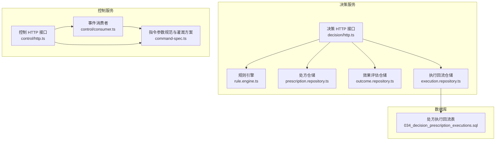
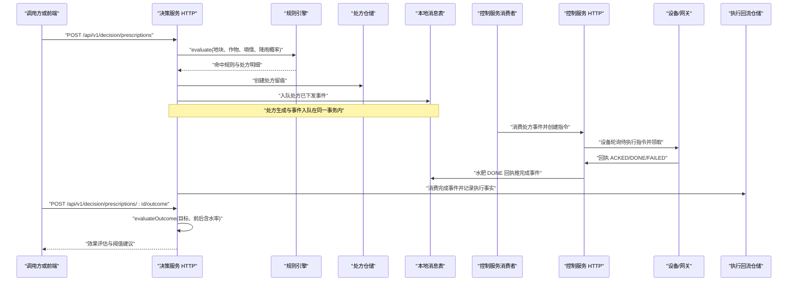
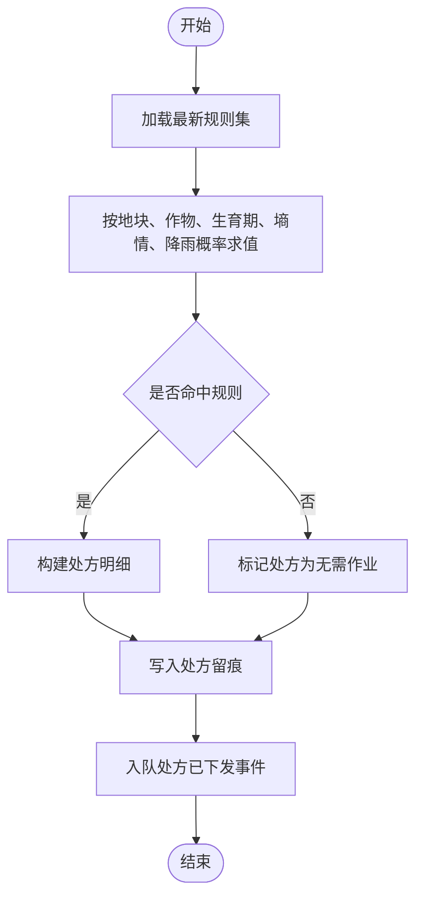
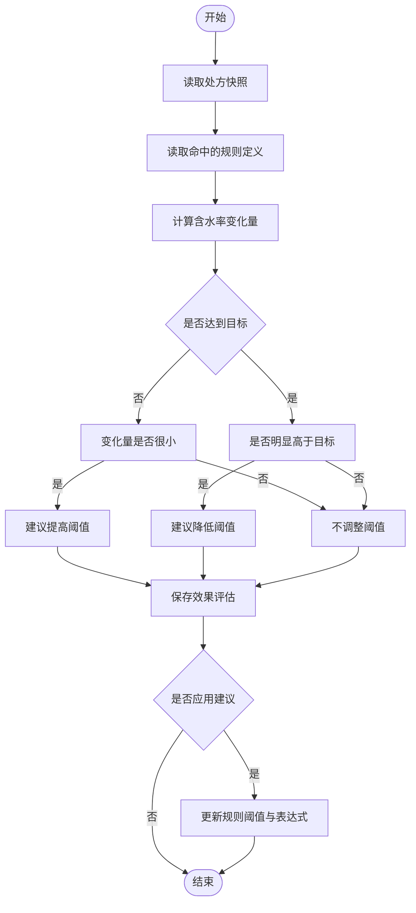
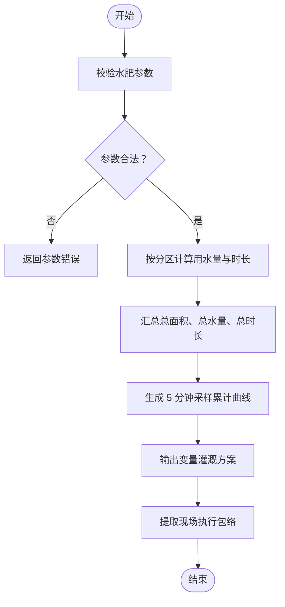
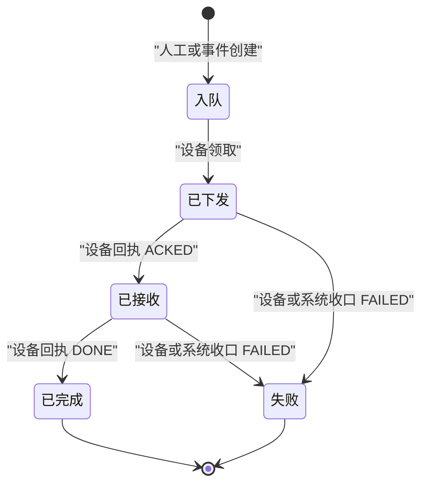
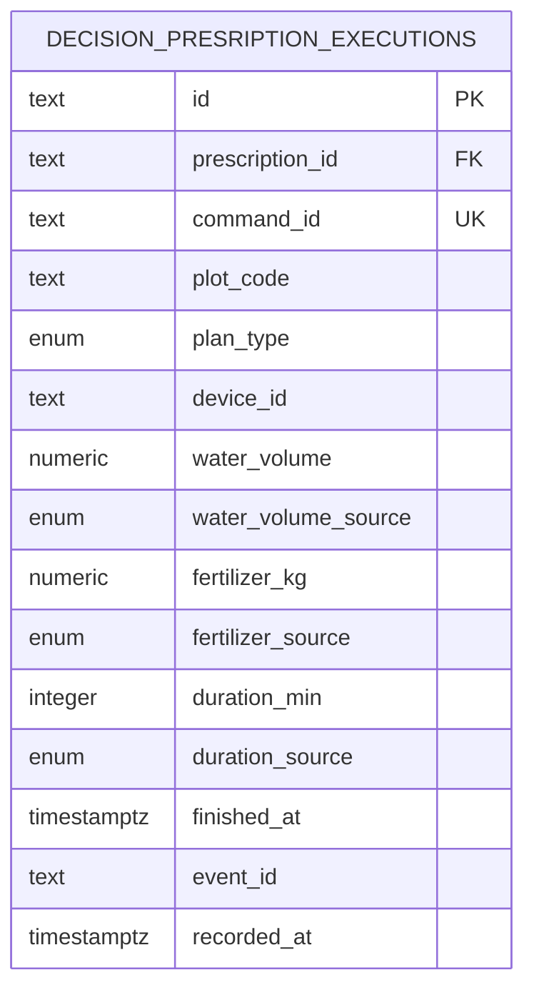
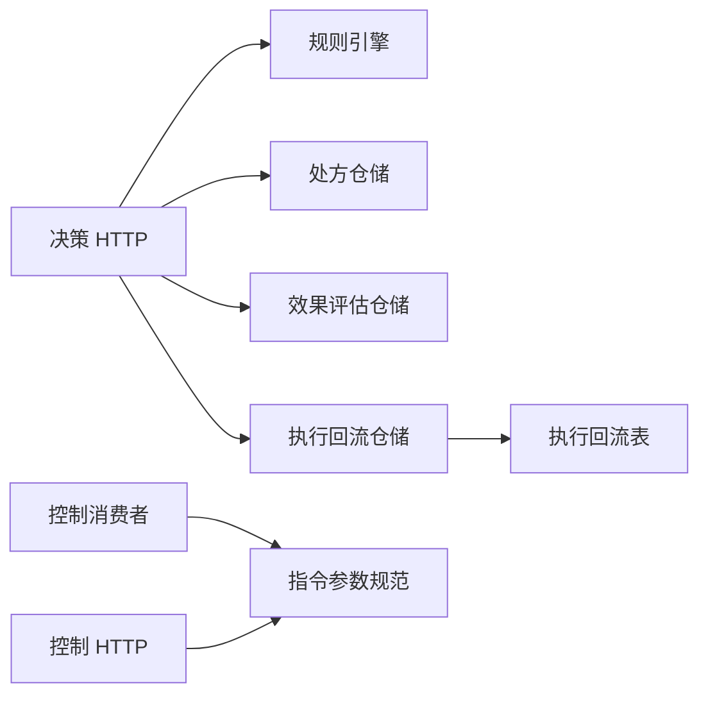

# 执行计划系统

<cite>
**本文引用的文件**   
- [README.md](file://README.md)
- [rule.engine.ts](file://apps/decision-service/src/rule.engine.ts)
- [prescription.repository.ts](file://apps/decision-service/src/prescription.repository.ts)
- [outcome.repository.ts](file://apps/decision-service/src/outcome.repository.ts)
- [execution.repository.ts](file://apps/decision-service/src/execution.repository.ts)
- [http.ts（决策服务）](file://apps/decision-service/src/http.ts)
- [command-spec.ts](file://apps/control-service/src/command-spec.ts)
- [consumer.ts（控制服务消费者）](file://apps/control-service/src/consumer.ts)
- [http.ts（控制服务）](file://apps/control-service/src/http.ts)
- [034_decision_prescription_executions.sql](file://infra/postgres/migrations/034_decision_prescription_executions.sql)
</cite>

## 目录
1. [引言](#引言)
2. [项目结构](#项目结构)
3. [核心组件](#核心组件)
4. [架构总览](#架构总览)
5. [详细组件分析](#详细组件分析)
6. [依赖关系分析](#依赖关系分析)
7. [性能与可靠性特征](#性能与可靠性特征)
8. [故障排查指南](#故障排查指南)
9. [结论](#结论)

## 引言
本仓库是一个以地块为最小管理单元的智慧农业平台，后端由多个 Node.js 微服务组成。围绕“执行计划系统”，代码实现了从规则求值、处方生成、指令下发、设备回执到处方效果回流与阈值建议的完整闭环：

- 决策服务负责读取最新规则并求值，生成可追溯的处方留痕；
- 控制服务把越限事件与处方翻译成水肥指令，计算变量灌溉方案与现场执行包络；
- 设备通过网关轮询领取指令并回执，超时未回执会被自动收口；
- 决策服务消费结单事件，按指令幂等记录实际用水、施肥与作业时长，形成处方执行事实；
- 效果评估根据实测含水率与目标阈值给出是否有效及阈值调整建议，支持写回规则实现热调优。

该体系强调“数据口径一致、事件不丢不重、处方可回溯、执行可核对、阈值可调优”。

**章节来源**
- [README.md:1-10](file://README.md#L1-L10)
- [README.md:243-321](file://README.md#L243-L321)

## 项目结构
执行计划相关逻辑主要分布在两个服务与一个数据库迁移中：

| 位置 | 职责 |
| --- | --- |
| `apps/decision-service` | 规则引擎、处方留痕、效果评估、执行回流查询、处方事件发布 |
| `apps/control-service` | 指令参数校验、变量灌溉方案、现场执行包络、指令生命周期与回执 |
| `infra/postgres/migrations/034_decision_prescription_executions.sql` | 处方执行回流表结构，按指令唯一索引保证幂等 |

**图表来源**
- [rule.engine.ts:1-99](file://apps/decision-service/src/rule.engine.ts#L1-L99)
- [prescription.repository.ts:1-205](file://apps/decision-service/src/prescription.repository.ts#L1-L205)
- [outcome.repository.ts:1-238](file://apps/decision-service/src/outcome.repository.ts#L1-L238)
- [execution.repository.ts:66-161](file://apps/decision-service/src/execution.repository.ts#L66-L161)
- [http.ts（决策服务）:92-338](file://apps/decision-service/src/http.ts#L92-L338)
- [command-spec.ts:1-216](file://apps/control-service/src/command-spec.ts#L1-L216)
- [consumer.ts（控制服务消费者）:1-188](file://apps/control-service/src/consumer.ts#L1-L188)
- [http.ts（控制服务）:1-404](file://apps/control-service/src/http.ts#L1-L404)
- [034_decision_prescription_executions.sql:1-32](file://infra/postgres/migrations/034_decision_prescription_executions.sql#L1-L32)

**章节来源**
- [README.md:161-194](file://README.md#L161-L194)
- [README.md:243-321](file://README.md#L243-L321)

## 核心组件
执行计划系统的核心由以下组件构成：

| 组件 | 关键职责 | 重要行为 |
| --- | --- | --- |
| 规则引擎 | 读取最新规则并按输入求值 | 每次求值拉取最新规则集，实现规则热更新；返回命中规则与处方明细 |
| 处方仓储 | 持久化处方留痕 | 保存输入快照、命中规则、动作明细、生成时间与签发时间 |
| 效果评估仓储 | 记录处方执行后的效果与建议 | 判断是否达到目标含水率，输出阈值调整建议 |
| 执行回流仓储 | 按处方与地块查询执行事实 | 按指令 ID 幂等写入，区分 DEVICE 与 PLAN 数据来源 |
| 指令参数规范 | 校验水肥参数、计算变量灌溉方案 | 分区轮流供水、累计曲线、现场执行包络 |
| 控制消费者 | 把越限事件与处方转成指令 | 自动指令带 sourceEventId，植保处方不下发 |
| 控制 HTTP | 人工指令下发、设备通道、方案预演 | 二次确认、状态机跃迁、超时收口、完成事件落消息表 |

**章节来源**
- [rule.engine.ts:1-99](file://apps/decision-service/src/rule.engine.ts#L1-L99)
- [prescription.repository.ts:1-205](file://apps/decision-service/src/prescription.repository.ts#L1-L205)
- [outcome.repository.ts:1-238](file://apps/decision-service/src/outcome.repository.ts#L1-L238)
- [execution.repository.ts:66-161](file://apps/decision-service/src/execution.repository.ts#L66-L161)
- [command-spec.ts:1-216](file://apps/control-service/src/command-spec.ts#L1-L216)
- [consumer.ts（控制服务消费者）:1-188](file://apps/control-service/src/consumer.ts#L1-L188)
- [http.ts（控制服务）:1-404](file://apps/control-service/src/http.ts#L1-L404)

## 架构总览
执行计划系统的关键流程是“规则 → 处方 → 指令 → 回执 → 执行事实 → 效果评估 → 阈值建议”。

**图表来源**
- [http.ts（决策服务）:184-246](file://apps/decision-service/src/http.ts#L184-L246)
- [consumer.ts（控制服务消费者）:113-146](file://apps/control-service/src/consumer.ts#L113-L146)
- [http.ts（控制服务）:226-270](file://apps/control-service/src/http.ts#L226-L270)
- [http.ts（控制服务）:317-370](file://apps/control-service/src/http.ts#L317-L370)
- [execution.repository.ts:128-161](file://apps/decision-service/src/execution.repository.ts#L128-L161)

**章节来源**
- [README.md:243-321](file://README.md#L243-L321)
- [http.ts（决策服务）:92-338](file://apps/decision-service/src/http.ts#L92-L338)
- [consumer.ts（控制服务消费者）:1-188](file://apps/control-service/src/consumer.ts#L1-L188)
- [http.ts（控制服务）:1-404](file://apps/control-service/src/http.ts#L1-L404)

## 详细组件分析

### 规则引擎与处方生成
规则引擎从规则仓储读取最新规则，对输入中的土壤含水率、降雨概率、生育期进行条件匹配；命中的规则会生成处方明细，包含投入品编码、用量、时间窗等。处方仓储将输入快照、命中规则与动作明细持久化，形成决策留痕。

**图表来源**
- [rule.engine.ts:49-97](file://apps/decision-service/src/rule.engine.ts#L49-L97)
- [prescription.repository.ts:85-154](file://apps/decision-service/src/prescription.repository.ts#L85-L154)
- [http.ts（决策服务）:184-246](file://apps/decision-service/src/http.ts#L184-L246)

**章节来源**
- [rule.engine.ts:1-99](file://apps/decision-service/src/rule.engine.ts#L1-L99)
- [prescription.repository.ts:1-205](file://apps/decision-service/src/prescription.repository.ts#L1-L205)
- [http.ts（决策服务）:184-246](file://apps/decision-service/src/http.ts#L184-L246)

### 处方效果评估与阈值建议
效果评估比较执行前后的土壤含水率与目标阈值，判断是否有效；若未达标且回升不足，建议提高触发阈值；若明显高于目标，建议降低阈值以减少过量灌溉。评估结果可写回规则，同时保持条件表达式与展示表达式一致。

**图表来源**
- [outcome.repository.ts:111-144](file://apps/decision-service/src/outcome.repository.ts#L111-L144)
- [http.ts（决策服务）:258-298](file://apps/decision-service/src/http.ts#L258-L298)

**章节来源**
- [outcome.repository.ts:1-238](file://apps/decision-service/src/outcome.repository.ts#L1-L238)
- [http.ts（决策服务）:258-298](file://apps/decision-service/src/http.ts#L258-L298)

### 指令参数规范与变量灌溉方案
控制服务的指令参数规范定义了水肥场景的最小可校验结构：分区灌溉参数、搅拌参数、肥料配比、变量灌溉方案与现场执行包络。变量灌溉按分区顺序轮流开启，计算每个分区的用水量、时长、起止时间，并生成累计供水曲线；非水肥指令或处方自动指令若无分区参数，则不生成执行包络。

**图表来源**
- [command-spec.ts:113-155](file://apps/control-service/src/command-spec.ts#L113-L155)
- [command-spec.ts:169-215](file://apps/control-service/src/command-spec.ts#L169-L215)
- [command-spec.ts:97-111](file://apps/control-service/src/command-spec.ts#L97-L111)

**章节来源**
- [command-spec.ts:1-216](file://apps/control-service/src/command-spec.ts#L1-L216)
- [http.ts（控制服务）:226-270](file://apps/control-service/src/http.ts#L226-L270)

### 控制指令生命周期与回执
控制指令的生命周期为 QUEUED → SENT → ACKED → DONE，任一在途状态都可被 FAILED 收口；终态不可再改。设备通过网关轮询待执行指令并领取，随后上报回执。急停指令的 DONE 必须带到位确认；超时未回执会被定时任务自动收口，并在同一事务中写入控制消息表，最终投递超时告警事件。

**图表来源**
- [http.ts（控制服务）:293-370](file://apps/control-service/src/http.ts#L293-L370)
- [README.md:263-288](file://README.md#L263-L288)

**章节来源**
- [http.ts（控制服务）:1-404](file://apps/control-service/src/http.ts#L1-L404)
- [README.md:263-288](file://README.md#L263-L288)

### 处方执行回流与幂等
处方执行回流表按处方留痕实际执行情况，字段包括处方 ID、指令 ID、地块编码、计划类型、设备 ID、用水量、施肥量、作业时长、完成时间与事件 ID。指令 ID 是唯一索引，确保中继重试或事件重放只记录一次；用水量与施肥量可空，来源标记为 DEVICE 或 PLAN，避免估算冒充实测。

**图表来源**
- [034_decision_prescription_executions.sql:9-32](file://infra/postgres/migrations/034_decision_prescription_executions.sql#L9-L32)
- [execution.repository.ts:66-91](file://apps/decision-service/src/execution.repository.ts#L66-L91)

**章节来源**
- [execution.repository.ts:66-161](file://apps/decision-service/src/execution.repository.ts#L66-L161)
- [034_decision_prescription_executions.sql:1-32](file://infra/postgres/migrations/034_decision_prescription_executions.sql#L1-L32)

## 依赖关系分析
执行计划系统内部依赖如下：

- 决策服务依赖规则仓储、处方仓储、效果评估仓储、执行回流仓储与消息出表；
- 控制服务依赖指令仓储、指令参数规范与消息出表；
- 执行回流仓储依赖数据库迁移定义的处方执行回流表；
- 控制消费者依赖契约中的事件主题与载荷，并把处方事件翻译为控制指令。

**图表来源**
- [http.ts（决策服务）:92-338](file://apps/decision-service/src/http.ts#L92-L338)
- [consumer.ts（控制服务消费者）:1-188](file://apps/control-service/src/consumer.ts#L1-L188)
- [http.ts（控制服务）:1-404](file://apps/control-service/src/http.ts#L1-L404)
- [execution.repository.ts:128-161](file://apps/decision-service/src/execution.repository.ts#L128-L161)

**章节来源**
- [http.ts（决策服务）:92-338](file://apps/decision-service/src/http.ts#L92-L338)
- [consumer.ts（控制服务消费者）:1-188](file://apps/control-service/src/consumer.ts#L1-L188)
- [http.ts（控制服务）:1-404](file://apps/control-service/src/http.ts#L1-L404)
- [execution.repository.ts:128-161](file://apps/decision-service/src/execution.repository.ts#L128-L161)

## 性能与可靠性特征
- 规则热更新：每次求值从仓储读取最新规则，无需重启服务即可生效；
- 处方留痕：保存输入快照、命中规则与动作明细，便于事后复核；
- 事件可靠投递：业务数据与待投递事件写入同一事务，中继投递后消费侧按 eventId 幂等去重；
- 指令幂等与状态机：指令状态跃迁使用乐观锁，重复回执或并发回执返回冲突；
- 超时收口：在途超时指令被定时任务统一收口，并投递超时告警；
- 执行回流幂等：按指令 ID 唯一索引保证事件重放不重复记账；
- 分页与边界保护：列表与分页参数有上限保护，避免过大查询；
- 租户隔离：指令与设备台账按租户隔离，跨租户 ID 视为不存在。

**章节来源**
- [README.md:243-321](file://README.md#L243-L321)
- [http.ts（决策服务）:184-246](file://apps/decision-service/src/http.ts#L184-L246)
- [http.ts（控制服务）:293-370](file://apps/control-service/src/http.ts#L293-L370)
- [execution.repository.ts:128-161](file://apps/decision-service/src/execution.repository.ts#L128-L161)

## 故障排查指南
- 处方未生成：检查请求体是否包含地块编码、作物生育期与墒情；确认规则是否启用且条件命中；查看决策服务日志中的规则求值与处方入队情况；
- 指令未下发：检查处方事件是否被控制消费者消费；确认处方 items 是否为数组且用量、投入品编码、时间窗合法；
- 设备未领取：检查设备回调令牌与网关轮询路径；确认指令状态仍为 QUEUED；
- 回执冲突：检查是否存在并发回执或版本冲突；确认回执时间顺序是否符合状态机；
- 超时告警过多：检查 CONTROL_RECEIPT_TIMEOUT_MIN 与 CONTROL_RECEIPT_SWEEP_INTERVAL_MS 配置；确认设备是否真实执行；
- 执行回流缺失：检查控制服务 DONE 回执是否推完成事件；确认决策服务是否消费 control.irrigation.finished 或 control.fertilization.finished；
- 阈值建议不生效：检查 evaluateOutcome 是否生成 suggestion；确认 applySuggestion 是否为 true；查看规则表达式是否同步更新。

**章节来源**
- [http.ts（决策服务）:184-298](file://apps/decision-service/src/http.ts#L184-L298)
- [consumer.ts（控制服务消费者）:95-146](file://apps/control-service/src/consumer.ts#L95-L146)
- [http.ts（控制服务）:226-370](file://apps/control-service/src/http.ts#L226-L370)
- [outcome.repository.ts:111-144](file://apps/decision-service/src/outcome.repository.ts#L111-L144)

## 结论
执行计划系统以规则驱动处方、处方驱动指令、回执驱动执行事实、执行事实驱动效果评估与阈值建议，形成可追溯、可核对、可调优的闭环。其设计重点在于：

- 规则热更新与处方留痕，使决策过程透明；
- 指令参数校验与变量灌溉方案，使执行计划可解释；
- 事件可靠投递与指令状态机，使流程不丢不重；
- 执行回流幂等与效果评估，使阈值优化有据可依；
- 租户隔离与权限守卫，使多租户与多角色安全可控。

在实际扩展中，新增规则、处方动作、指令类型或事件主题时，应遵循现有契约与仓储接口，保持数据口径一致，并确保事件生产与消费的幂等性。