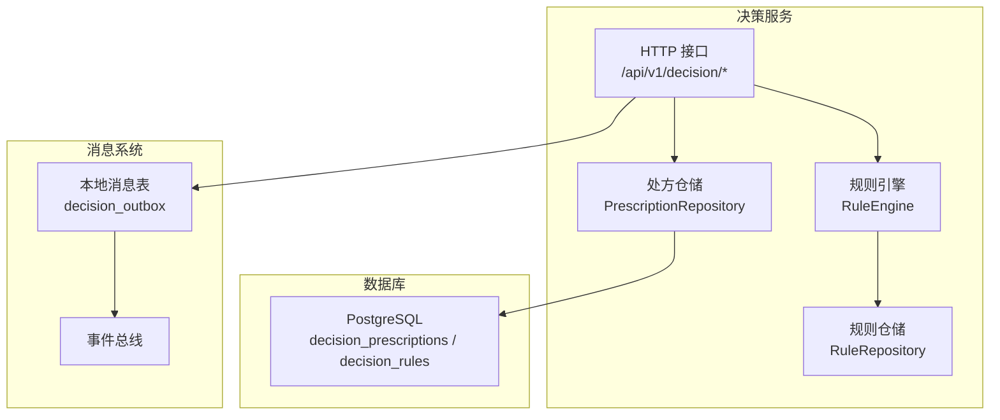
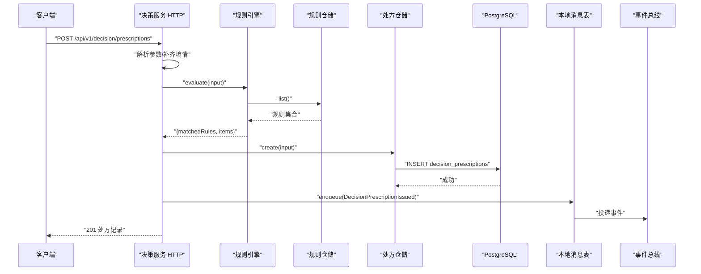
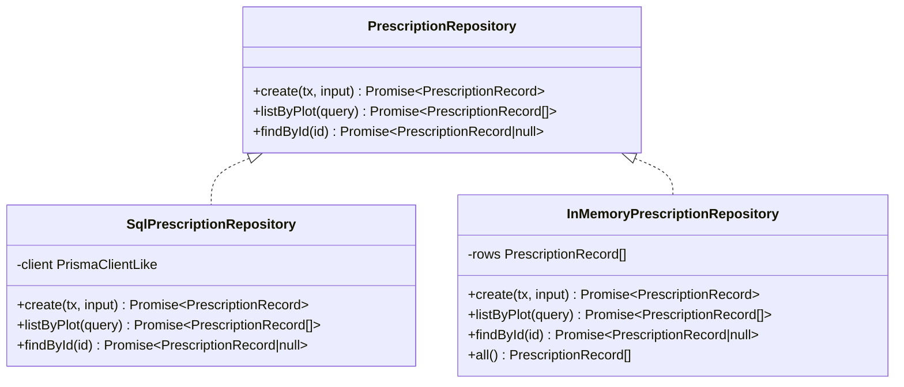
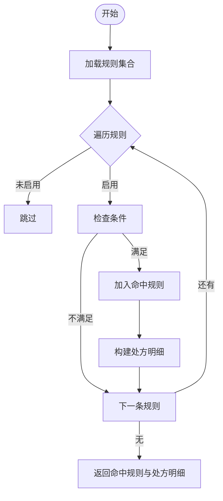
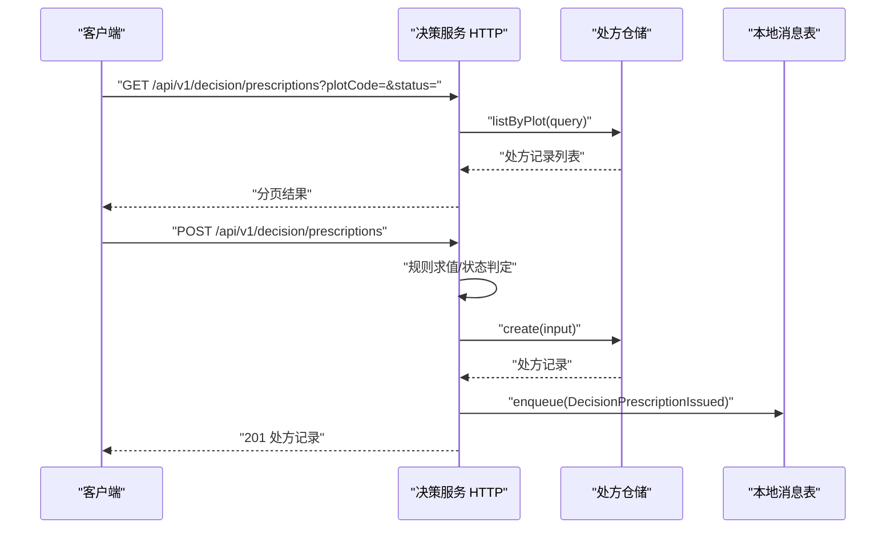
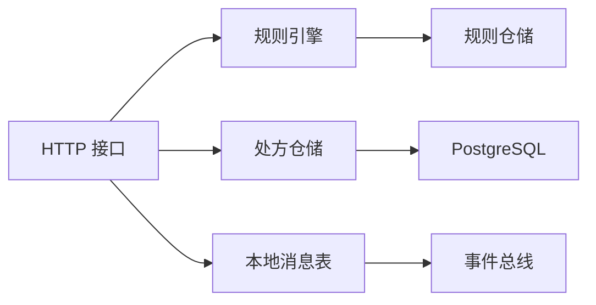
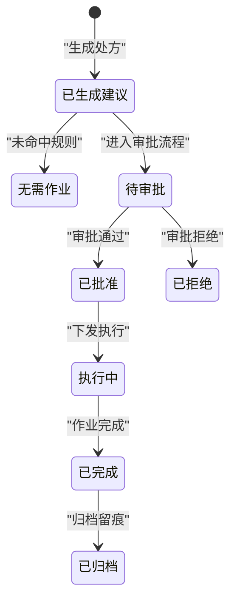

# 处方管理

<cite>
**本文引用的文件**   
- [apps/decision-service/src/prescription.repository.ts](file://apps/decision-service/src/prescription.repository.ts)
- [apps/decision-service/src/rule.engine.ts](file://apps/decision-service/src/rule.engine.ts)
- [apps/decision-service/src/rule.repository.ts](file://apps/decision-service/src/rule.repository.ts)
- [apps/decision-service/src/http.ts](file://apps/decision-service/src/http.ts)
- [infra/postgres/migrations/002_decision_telemetry.sql](file://infra/postgres/migrations/002_decision_telemetry.sql)
</cite>

## 目录
1. [引言](#引言)
2. [项目结构](#项目结构)
3. [核心数据结构](#核心数据结构)
4. [架构总览](#架构总览)
5. [详细组件分析](#详细组件分析)
6. [依赖关系分析](#依赖关系分析)
7. [性能与扩展性](#性能与扩展性)
8. [故障排查指南](#故障排查指南)
9. [结论](#结论)
10. [附录：使用示例与最佳实践](#附录使用示例与最佳实践)

## 引言
本文件围绕“处方管理”展开，重点说明处方数据模型、生命周期、规则引擎集成、存储模式、查询接口以及版本控制机制。处方用于将决策结果转化为可执行作业项，同时保留输入快照、命中规则与时间窗口，以支撑可追溯的农业精准作业。

## 项目结构
处方相关能力集中在决策服务中，包含三类关键模块：
- 处方仓储层：定义处方记录、明细与持久化实现。
- 规则引擎层：读取规则、求值并生成处方明细。
- HTTP 接口层：暴露处方生成、历史查询等接口，并与消息出队机制联动。

**图表来源**
- [apps/decision-service/src/http.ts:92-230](file://apps/decision-service/src/http.ts#L92-L230)
- [apps/decision-service/src/rule.engine.ts:81-95](file://apps/decision-service/src/rule.engine.ts#L81-L95)
- [apps/decision-service/src/prescription.repository.ts:86-154](file://apps/decision-service/src/prescription.repository.ts#L86-L154)
- [infra/postgres/migrations/002_decision_telemetry.sql:5-34](file://infra/postgres/migrations/002_decision_telemetry.sql#L5-L34)

**章节来源**
- [apps/decision-service/src/http.ts:92-230](file://apps/decision-service/src/http.ts#L92-L230)
- [apps/decision-service/src/rule.engine.ts:81-95](file://apps/decision-service/src/rule.engine.ts#L81-L95)
- [apps/decision-service/src/prescription.repository.ts:86-154](file://apps/decision-service/src/prescription.repository.ts#L86-L154)
- [infra/postgres/migrations/002_decision_telemetry.sql:5-34](file://infra/postgres/migrations/002_decision_telemetry.sql#L5-L34)

## 核心数据结构
### PrescriptionItem（处方明细）
- gridCode：网格编码，通常映射到地块编码，用于定位作业范围。
- materialCode：投入品编码，取自农资字典；当前由规则动作类型映射为固定编码。
- dosage：用量，单位随投入品编码而定。
- windowStart：时间窗口开始时间。
- windowEnd：时间窗口结束时间，默认从生成时刻起向后推 24 小时。

该结构在处方记录中以数组形式保存，体现一次决策可能产生多个作业项。

**章节来源**
- [apps/decision-service/src/prescription.repository.ts:8-15](file://apps/decision-service/src/prescription.repository.ts#L8-L15)
- [apps/decision-service/src/rule.engine.ts:68-79](file://apps/decision-service/src/rule.engine.ts#L68-L79)

### PrescriptionRecord（处方记录）
- id：处方唯一标识，采用 ULID，具备时间有序特性。
- plotCode / plotName：地块编码与名称。
- status：处方状态，RECOMMENDED 表示已生成建议，NO_ACTION 表示评估后无需作业。
- soilMoisture / rainProbability：墒情与降雨概率快照。
- growthStage：作物生育期。
- inputs：输入数据快照，便于事后复核。
- matchedRules：命中的规则摘要，含规则 ID、名称、表达式与动作。
- actions：处方明细数组，即 PrescriptionItem 列表。
- generatedAt：生成时间。
- issuedAt：签发时间，当存在处方明细时等于生成时间，否则为空。

**章节来源**
- [apps/decision-service/src/prescription.repository.ts:17-31](file://apps/decision-service/src/prescription.repository.ts#L17-L31)
- [apps/decision-service/src/prescription.repository.ts:192-195](file://apps/decision-service/src/prescription.repository.ts#L192-L195)

### 规则与规则条件
- RuleType：IRRIGATION、FERTILIZATION、PEST_WARNING。
- RuleCondition：soilMoistureBelow、rainProbabilityBelow、growthStage。
- RuleAction：type、amount、unit、reason。
- Rule：id、name、type、enabled、expression、priority、condition、action、createdAt、updatedAt、deletedAt。

**章节来源**
- [apps/decision-service/src/rule.repository.ts:11-48](file://apps/decision-service/src/rule.repository.ts#L11-L48)

## 架构总览
处方生成流程如下：
1. 客户端调用 POST /api/v1/decision/prescriptions，传入地块、墒情、降雨概率、生育期等信息。
2. HTTP 层解析请求，必要时向遥测服务拉取最新墒情。
3. 规则引擎读取最新规则集，按优先级匹配条件，返回命中规则与处方明细。
4. 根据是否命中规则设置处方状态，并写入处方记录。
5. 通过本地消息表发布处方事件，供下游执行与归档。

**图表来源**
- [apps/decision-service/src/http.ts:172-209](file://apps/decision-service/src/http.ts#L172-L209)
- [apps/decision-service/src/rule.engine.ts:84-95](file://apps/decision-service/src/rule.engine.ts#L84-L95)
- [apps/decision-service/src/prescription.repository.ts:93-118](file://apps/decision-service/src/prescription.repository.ts#L93-L118)
- [infra/postgres/migrations/002_decision_telemetry.sql:61-73](file://infra/postgres/migrations/002_decision_telemetry.sql#L61-L73)

## 详细组件分析

### 处方仓储层
职责：
- 定义处方记录、明细、查询条件与仓储接口。
- 提供 PostgreSQL 与内存两种实现，便于生产与测试。
- 将 JSONB 字段映射为结构化对象，统一空值处理。

关键点：
- SqlPrescriptionRepository 直接操作 decision_prescriptions 表，支持按地块与状态分页查询。
- InMemoryPrescriptionRepository 用于本地联调与单元测试。
- newPrescriptionId 使用 ULID 生成时间有序 ID。

**图表来源**
- [apps/decision-service/src/prescription.repository.ts:55-59](file://apps/decision-service/src/prescription.repository.ts#L55-L59)
- [apps/decision-service/src/prescription.repository.ts:86-154](file://apps/decision-service/src/prescription.repository.ts#L86-L154)
- [apps/decision-service/src/prescription.repository.ts:157-190](file://apps/decision-service/src/prescription.repository.ts#L157-L190)

**章节来源**
- [apps/decision-service/src/prescription.repository.ts:8-31](file://apps/decision-service/src/prescription.repository.ts#L8-L31)
- [apps/decision-service/src/prescription.repository.ts:86-190](file://apps/decision-service/src/prescription.repository.ts#L86-L190)

### 规则引擎层
职责：
- 每次求值从仓储读取最新规则，实现热更新。
- 对每条规则进行条件匹配，返回命中规则清单与处方明细。
- 将规则动作映射为处方明细，包括网格编码、投入品编码、用量与时间窗口。

关键点：
- matchesRule 严格校验 enabled 与条件字段，缺省条件视为不命中。
- buildItem 根据规则动作类型选择 materialCode，windowEnd 为 now + 24 小时。
- evaluate 按优先级顺序累计动作，避免遗漏。

**图表来源**
- [apps/decision-service/src/rule.engine.ts:47-66](file://apps/decision-service/src/rule.engine.ts#L47-L66)
- [apps/decision-service/src/rule.engine.ts:68-79](file://apps/decision-service/src/rule.engine.ts#L68-L79)
- [apps/decision-service/src/rule.engine.ts:84-95](file://apps/decision-service/src/rule.engine.ts#L84-L95)

**章节来源**
- [apps/decision-service/src/rule.engine.ts:12-33](file://apps/decision-service/src/rule.engine.ts#L12-L33)
- [apps/decision-service/src/rule.engine.ts:47-95](file://apps/decision-service/src/rule.engine.ts#L47-L95)

### HTTP 接口层
职责：
- 暴露规则与处方的 REST 接口。
- 协调规则引擎与处方仓储，完成处方生成与留痕。
- 通过本地消息表发布处方事件，保证一致性。

关键点：
- GET /api/v1/decision/prescriptions：按地块与状态查询处方历史，支持分页。
- POST /api/v1/decision/prescriptions：生成处方，写入记录并发布事件。
- 智能问答接口结合处方留痕给出可追溯建议。

**图表来源**
- [apps/decision-service/src/http.ts:158-169](file://apps/decision-service/src/http.ts#L158-L169)
- [apps/decision-service/src/http.ts:172-209](file://apps/decision-service/src/http.ts#L172-L209)

**章节来源**
- [apps/decision-service/src/http.ts:92-230](file://apps/decision-service/src/http.ts#L92-L230)

## 依赖关系分析
- HTTP 层依赖规则引擎与处方仓储，并通过可选的遥测服务获取最新墒情。
- 规则引擎依赖规则仓储，每次求值都读取最新规则，实现热更新。
- 处方仓储依赖 PostgreSQL，使用 JSONB 存储输入、命中规则与动作。
- 本地消息表用于异步发布处方事件，保障事务一致性与最终一致性。

**图表来源**
- [apps/decision-service/src/http.ts:92-102](file://apps/decision-service/src/http.ts#L92-L102)
- [apps/decision-service/src/rule.engine.ts:81-95](file://apps/decision-service/src/rule.engine.ts#L81-L95)
- [apps/decision-service/src/prescription.repository.ts:86-154](file://apps/decision-service/src/prescription.repository.ts#L86-L154)
- [infra/postgres/migrations/002_decision_telemetry.sql:61-73](file://infra/postgres/migrations/002_decision_telemetry.sql#L61-L73)

**章节来源**
- [apps/decision-service/src/http.ts:92-230](file://apps/decision-service/src/http.ts#L92-L230)
- [apps/decision-service/src/rule.engine.ts:81-95](file://apps/decision-service/src/rule.engine.ts#L81-L95)
- [apps/decision-service/src/prescription.repository.ts:86-154](file://apps/decision-service/src/prescription.repository.ts#L86-L154)
- [infra/postgres/migrations/002_decision_telemetry.sql:61-73](file://infra/postgres/migrations/002_decision_telemetry.sql#L61-L73)

## 性能与扩展性
- 规则热更新：每次求值读取最新规则，避免重启服务，提升策略迭代效率。
- 查询分页：处方历史查询限制最大 200 条，防止大结果集拖慢接口。
- JSONB 存储：inputs、matchedRules、actions 使用 JSONB，灵活扩展字段而不影响主键索引。
- 时间有序 ID：ULID 便于按时间排序与回放。
- 可扩展点：
  - 投入品编码映射可从配置或农资字典动态加载，替代硬编码。
  - 时间窗口策略可参数化，支持不同作业类型的窗口长度。
  - 处方状态机可扩展审批流，增加 PENDING_APPROVED、APPROVED、EXECUTING、ARCHIVED 等状态。

[本节为通用指导，不直接分析具体文件]

## 故障排查指南
常见问题与定位要点：
- 规则未生效：
  - 检查规则是否启用与条件是否满足；matchesRule 要求所有条件字段同时满足。
  - 确认规则优先级与创建时间排序是否正确。
- 处方状态异常：
  - 若未命中任何规则，状态应为 NO_ACTION；若命中则应为 RECOMMENDED。
- 时间窗口不合理：
  - 默认 windowEnd 为 now + 24 小时，如需调整可在规则引擎中参数化。
- 查询无结果：
  - 确认 plotCode 与 status 参数是否正确；limit 上限为 200。
- 事件未投递：
  - 检查本地消息表是否存在未发布的记录；确认 OutboxService 与事件总线配置。

**章节来源**
- [apps/decision-service/src/rule.engine.ts:47-66](file://apps/decision-service/src/rule.engine.ts#L47-L66)
- [apps/decision-service/src/http.ts:158-209](file://apps/decision-service/src/http.ts#L158-L209)
- [infra/postgres/migrations/002_decision_telemetry.sql:61-73](file://infra/postgres/migrations/002_decision_telemetry.sql#L61-L73)

## 结论
处方管理以规则驱动为核心，通过规则引擎将业务条件转化为可执行的处方明细，并以处方记录保留完整决策留痕。仓储层提供稳定可靠的持久化能力，HTTP 层暴露简洁的接口，配合本地消息表实现事件驱动的跨服务协作。整体设计兼顾可追溯性、可扩展性与高性能。

[本节为总结性内容，不直接分析具体文件]

## 附录：使用示例与最佳实践

### 处方数据建模建议
- 明确网格编码与地块编码的对应关系，确保 gridCode 准确映射作业范围。
- 投入品编码应来自统一的农资字典，避免硬编码导致维护困难。
- 用量单位需与投入品编码约定一致，并在前端展示时做单位换算。
- 时间窗口应根据作业类型设定合理长度，避免过长导致资源浪费或过短导致无法执行。

**章节来源**
- [apps/decision-service/src/prescription.repository.ts:8-15](file://apps/decision-service/src/prescription.repository.ts#L8-L15)
- [apps/decision-service/src/rule.engine.ts:68-79](file://apps/decision-service/src/rule.engine.ts#L68-L79)

### 处方生命周期管理
- 生成：调用 POST /api/v1/decision/prescriptions，传入地块、墒情、降雨概率、生育期。
- 审批：当前实现未内置审批流，可在外部系统中基于处方记录进行审批，并更新状态。
- 执行：下游服务订阅 DecisionPrescriptionIssued 事件，按处方明细调度作业。
- 归档：作业完成后，可将处方记录标记为归档状态，便于审计与回溯。

[此图为概念性流程图，不直接映射具体代码文件]

### 与规则引擎的集成方式
- 规则条件应覆盖土壤含水率、降雨概率与生育期，确保决策依据充分。
- 规则动作需明确类型、用量、单位与原因，便于处方明细生成与解释。
- 规则优先级应合理设置，避免高优先级规则覆盖低优先级但必要的动作。

**章节来源**
- [apps/decision-service/src/rule.repository.ts:11-48](file://apps/decision-service/src/rule.repository.ts#L11-L48)
- [apps/decision-service/src/rule.engine.ts:47-95](file://apps/decision-service/src/rule.engine.ts#L47-L95)

### 存储模式与查询接口
- 存储模式：
  - decision_prescriptions 表保存处方记录，JSONB 字段存储输入、命中规则与动作。
  - decision_rules 表保存规则，支持软删除与热更新。
- 查询接口：
  - GET /api/v1/decision/prescriptions：支持 plotCode、status、size 参数。
  - 分页结果包含 items、total、page、size、pages。

**章节来源**
- [infra/postgres/migrations/002_decision_telemetry.sql:20-34](file://infra/postgres/migrations/002_decision_telemetry.sql#L20-L34)
- [apps/decision-service/src/http.ts:158-169](file://apps/decision-service/src/http.ts#L158-L169)

### 版本控制机制
- 规则版本：
  - 通过 updatedAt 与 deletedAt 实现软删除与版本演进。
  - 规则优先级与创建时间共同决定匹配顺序。
- 处方版本：
  - 每次生成新处方记录，ULID 保证时间有序，便于回放与对比。
  - inputs 与 matchedRules 作为快照，支持事后复核。

**章节来源**
- [apps/decision-service/src/rule.repository.ts:128-130](file://apps/decision-service/src/rule.repository.ts#L128-L130)
- [apps/decision-service/src/prescription.repository.ts:192-195](file://apps/decision-service/src/prescription.repository.ts#L192-L195)

### 实际使用示例
- 生成处方：
  - 请求体包含 plotCode、plotName、soilMoisture、rainProbability、growthStage。
  - 响应返回处方记录，包含状态、输入快照、命中规则与动作。
- 查询处方历史：
  - 查询参数包含 plotCode、status、size。
  - 响应返回分页的处方记录列表。

**章节来源**
- [apps/decision-service/src/http.ts:172-209](file://apps/decision-service/src/http.ts#L172-L209)
- [apps/decision-service/src/http.ts:158-169](file://apps/decision-service/src/http.ts#L158-L169)

### 最佳实践
- 规则设计：
  - 保持条件简洁明确，避免过度复杂导致误判。
  - 定期评审规则优先级与动作合理性。
- 处方管理：
  - 明确网格编码与投入品编码规范，确保数据一致性。
  - 使用时间窗口约束作业时效，避免资源浪费。
- 系统集成：
  - 使用本地消息表保证处方事件的一致性。
  - 在下游执行系统中实现作业状态回写，形成闭环。

[本节为通用指导，不直接分析具体文件]