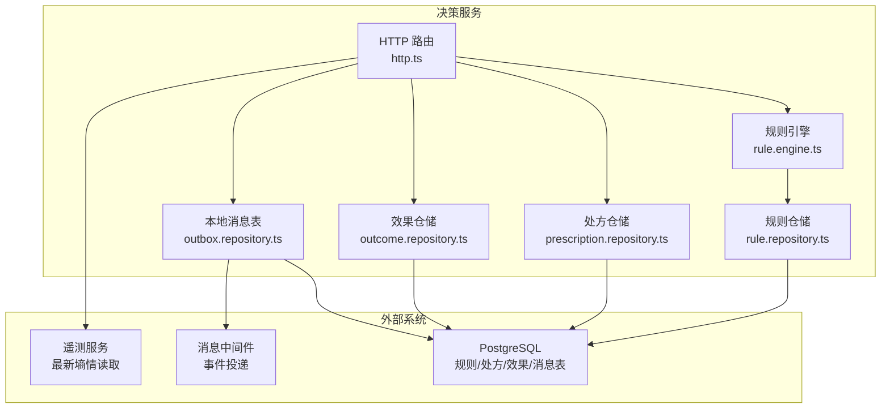
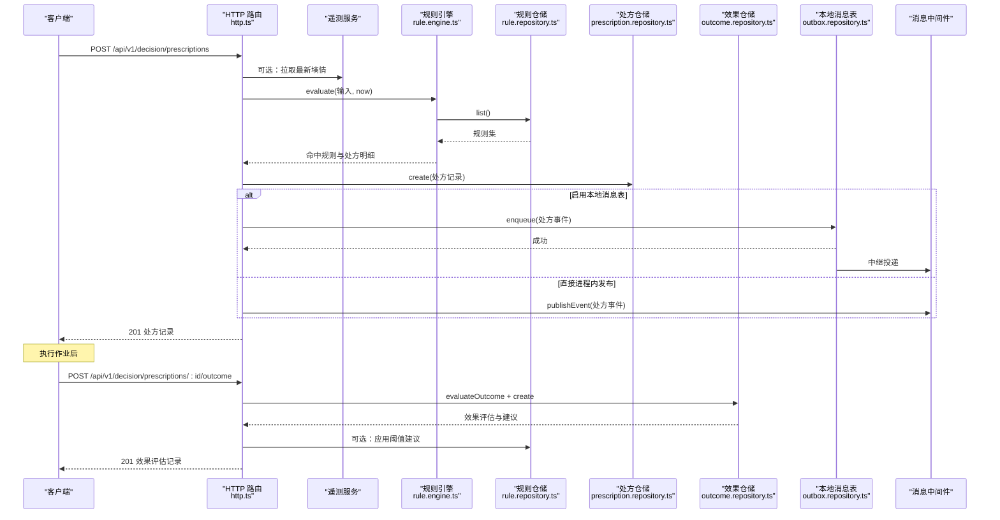
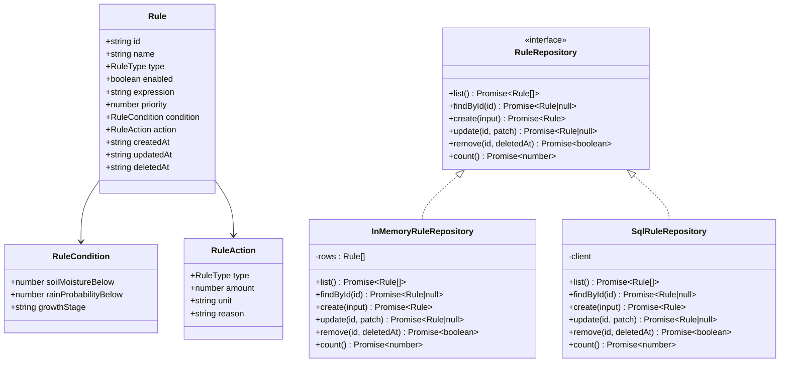
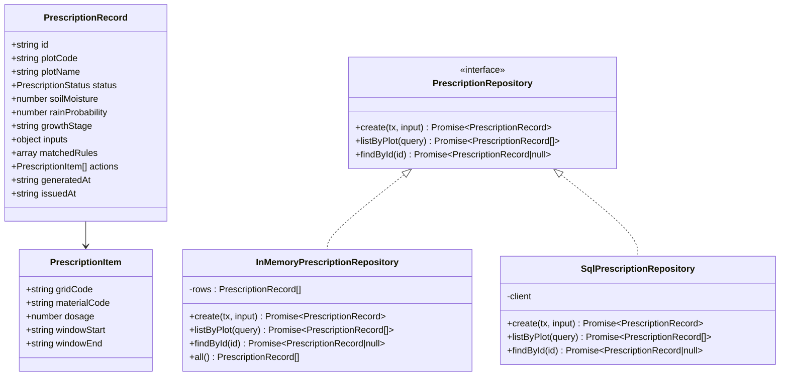
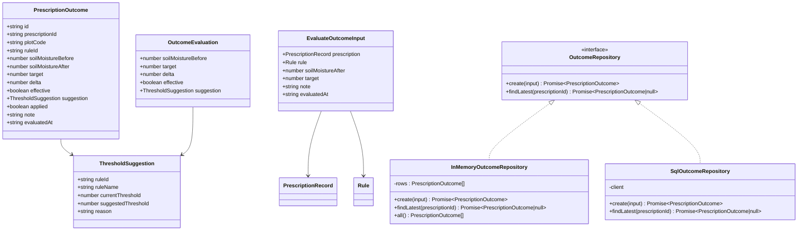
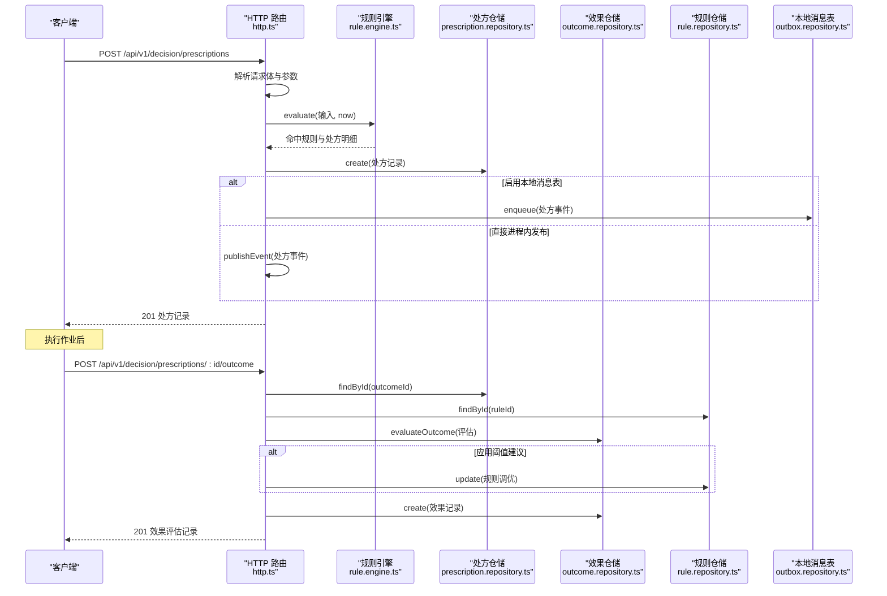
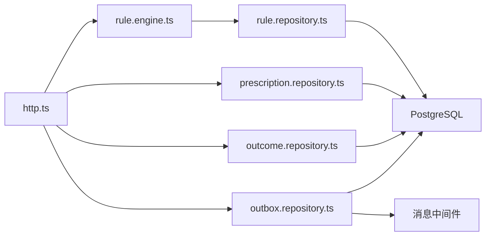
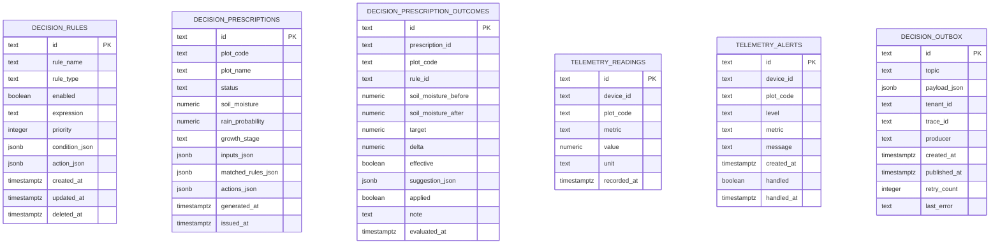
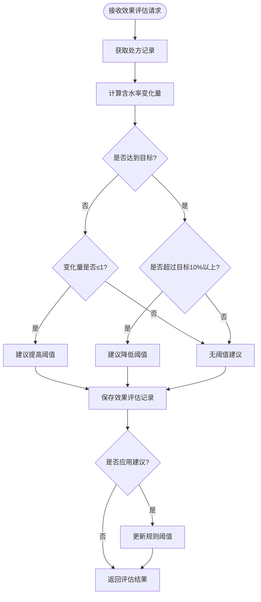

# 智能决策服务

<cite>
**本文引用的文件**   
- [rule.engine.ts](file://apps/decision-service/src/rule.engine.ts)
- [prescription.repository.ts](file://apps/decision-service/src/prescription.repository.ts)
- [rule.repository.ts](file://apps/decision-service/src/rule.repository.ts)
- [http.ts](file://apps/decision-service/src/http.ts)
- [outbox.repository.ts](file://apps/decision-service/src/outbox.repository.ts)
- [outcome.repository.ts](file://apps/decision-service/src/outcome.repository.ts)
- [002_decision_telemetry.sql](file://infra/postgres/migrations/002_decision_telemetry.sql)
- [003_event_bus_messages.sql](file://infra/postgres/migrations/003_event_bus_messages.sql)
</cite>

## 更新摘要
**变更内容**   
- 新增处方效果追踪功能，通过outcome.repository.ts实现评估结果记录与阈值建议
- 增强HTTP处理器，添加效果回流接口 `/api/v1/decision/prescriptions/:id/outcome`
- 新增数据库表 `decision_prescription_outcomes` 用于存储效果评估记录
- 完善测试覆盖，新增outcome.spec.ts验证效果评估与阈值调优流程

## 目录
1. [引言](#引言)
2. [项目结构](#项目结构)
3. [核心组件](#核心组件)
4. [架构总览](#架构总览)
5. [详细组件分析](#详细组件分析)
6. [依赖关系分析](#依赖关系分析)
7. [性能与可扩展性](#性能与可扩展性)
8. [故障排查指南](#故障排查指南)
9. [结论](#结论)
10. [附录：数据模型与接口契约](#附录数据模型与接口契约)

## 引言
本文件面向"智能决策服务"，聚焦规则引擎的设计与实现、处方生成业务流程、RuleEngine 的核心算法、PrescriptionRepository 与 RuleRepository 的数据模型设计，以及服务间通信模式。该服务以"规则即数据"的方式支持热更新，接收遥测相关输入后匹配决策规则，输出可追溯的处方记录，并通过本地消息表保证事件投递的一致性。**新增的效果追踪功能**实现了从处方生成到执行反馈再到规则优化的完整闭环，支持自动阈值调优和可解释的规则演进。

## 项目结构
决策服务位于 apps/decision-service，核心代码集中在 src 目录：
- rule.engine.ts：规则求值引擎，负责条件判断、阈值比较、时间窗口计算与动作聚合。
- prescription.repository.ts：处方仓储，定义处方记录、明细、查询条件，并提供 SQL 与内存两种实现。
- rule.repository.ts：规则仓储，定义规则、条件、动作、校验与归一化工具，并提供 SQL 与内存两种实现。
- outcome.repository.ts：**新增**效果评估仓储，提供处方执行效果记录、阈值建议生成与规则优化支持。
- http.ts：HTTP 路由与服务装配，暴露规则管理、处方生成、历史查询、效果回流与简单问答接口，并集成消息发布。
- outbox.repository.ts：本地消息表存储，用于事务内落库与中继投递。
- infra/postgres/migrations/002_decision_telemetry.sql：数据库迁移，定义规则、处方、遥测读数、告警与消息表结构。
- infra/postgres/migrations/003_event_bus_messages.sql：**新增**事件总线与效果评估表结构。

**图表来源**
- [http.ts:98-296](file://apps/decision-service/src/http.ts#L98-L296)
- [rule.engine.ts:81-95](file://apps/decision-service/src/rule.engine.ts#L81-L95)
- [rule.repository.ts:182-296](file://apps/decision-service/src/rule.repository.ts#L182-L296)
- [prescription.repository.ts:86-154](file://apps/decision-service/src/prescription.repository.ts#L86-L154)
- [outcome.repository.ts:166-226](file://apps/decision-service/src/outcome.repository.ts#L166-L226)
- [outbox.repository.ts:11-63](file://apps/decision-service/src/outbox.repository.ts#L11-L63)

**章节来源**
- [http.ts:98-296](file://apps/decision-service/src/http.ts#L98-L296)
- [002_decision_telemetry.sql:5-87](file://infra/postgres/migrations/002_decision_telemetry.sql#L5-L87)
- [003_event_bus_messages.sql:45-62](file://infra/postgres/migrations/003_event_bus_messages.sql#L45-L62)

## 核心组件
- RuleEngine：从 RuleRepository 读取最新规则集，对输入进行条件匹配，返回命中规则与处方明细项；默认按优先级顺序累计动作。
- RuleRepository：提供规则的增删改查与排序、归一化、默认规则等能力；SQL 实现通过 decision_rules 表持久化。
- PrescriptionRepository：提供处方的创建、按地块查询、按 ID 查询；SQL 实现通过 decision_prescriptions 表持久化，保留输入快照与命中规则。
- **OutcomeRepository（新增）**：提供处方效果评估记录的创建与查询，支持阈值建议生成与规则优化；SQL 实现通过 decision_prescription_outcomes 表持久化。
- OutboxStore（SqlOutboxStore）：将处方事件写入本地消息表，由中继任务异步投递，保证留痕与通知一致性。
- HTTP 层：封装规则管理、处方生成、效果回流、历史查询、简单问答等接口，并处理遥测数据补齐与事件发布。

**章节来源**
- [rule.engine.ts:4-95](file://apps/decision-service/src/rule.engine.ts#L4-L95)
- [rule.repository.ts:11-84](file://apps/decision-service/src/rule.repository.ts#L11-L84)
- [prescription.repository.ts:4-59](file://apps/decision-service/src/prescription.repository.ts#L4-L59)
- [outcome.repository.ts:70-75](file://apps/decision-service/src/outcome.repository.ts#L70-L75)
- [outbox.repository.ts:5-10](file://apps/decision-service/src/outbox.repository.ts#L5-L10)
- [http.ts:98-296](file://apps/decision-service/src/http.ts#L98-L296)

## 架构总览
决策服务的整体流程如下：
- 客户端调用 /api/v1/decision/prescriptions 生成处方。
- HTTP 层解析请求体，必要时向遥测服务拉取最新土壤含水率。
- RuleEngine 从 RuleRepository 获取最新规则集，执行条件匹配。
- 根据命中规则构建处方明细项，写入 PrescriptionRepository。
- 通过 OutboxService 将处方事件写入本地消息表或直接进程内发布。
- **新增**：客户端调用 /api/v1/decision/prescriptions/:id/outcome 提交执行效果。
- **新增**：OutcomeRepository 评估效果并生成阈值建议，可选择写回规则进行自动调优。
- 前端或下游系统订阅 DecisionPrescriptionIssued 事件，消费处方计划。

**图表来源**
- [http.ts:182-271](file://apps/decision-service/src/http.ts#L182-L271)
- [rule.engine.ts:81-95](file://apps/decision-service/src/rule.engine.ts#L81-L95)
- [rule.repository.ts:206-212](file://apps/decision-service/src/rule.repository.ts#L206-L212)
- [prescription.repository.ts:93-118](file://apps/decision-service/src/prescription.repository.ts#L93-L118)
- [outcome.repository.ts:111-144](file://apps/decision-service/src/outcome.repository.ts#L111-L144)
- [outbox.repository.ts:18-31](file://apps/decision-service/src/outbox.repository.ts#L18-L31)

## 详细组件分析

### 规则引擎 RuleEngine
RuleEngine 每次评估都从仓储读取最新规则集，因此新增、修改或停用规则后立即生效，无需重启服务。其核心逻辑包括：
- 条件字段全部满足才算命中；条件为空视为不命中。
- 支持的土壤含水率低于阈值、未来降雨概率低于阈值、作物生育期精确匹配。
- 为每条命中的规则生成处方明细项，包含投入品编码、用量、时间窗口（当前时间到 24 小时后）。
- 同一输入可能命中多条规则，按优先级顺序累计动作。

**图表来源**
- [rule.engine.ts:47-95](file://apps/decision-service/src/rule.engine.ts#L47-L95)

**章节来源**
- [rule.engine.ts:4-95](file://apps/decision-service/src/rule.engine.ts#L4-L95)

### 规则仓储 RuleRepository
RuleRepository 定义了规则的数据结构与操作契约，并提供 SQL 与内存实现：
- 规则类型：灌溉、施肥、病虫害预警。
- 条件：土壤含水率低于阈值、未来降雨概率低于阈值、生育期。
- 动作：类型、用量、单位、原因。
- 工具函数：条件与动作归一化、类型校验、默认排序与默认规则。
- SQL 实现：使用 decision_rules 表，支持软删除（deleted_at）、按 priority 与 created_at 排序。

**图表来源**
- [rule.repository.ts:11-84](file://apps/decision-service/src/rule.repository.ts#L11-L84)
- [rule.repository.ts:132-179](file://apps/decision-service/src/rule.repository.ts#L132-L179)
- [rule.repository.ts:182-296](file://apps/decision-service/src/rule.repository.ts#L182-L296)

**章节来源**
- [rule.repository.ts:11-84](file://apps/decision-service/src/rule.repository.ts#L11-L84)
- [rule.repository.ts:132-179](file://apps/decision-service/src/rule.repository.ts#L132-L179)
- [rule.repository.ts:182-296](file://apps/decision-service/src/rule.repository.ts#L182-L296)

### 处方仓储 PrescriptionRepository
PrescriptionRepository 定义处方记录与明细，并提供 SQL 与内存实现：
- 处方状态：RECOMMENDED（已生成建议）、NO_ACTION（评估后无需作业）。
- 处方明细：网格编码、投入品编码、用量、时间窗口。
- 处方记录：保留输入快照、命中规则、动作列表、生成时间与签发时间。
- SQL 实现：使用 decision_prescriptions 表，JSONB 字段存储 inputs、matchedRules、actions。

**图表来源**
- [prescription.repository.ts:4-59](file://apps/decision-service/src/prescription.repository.ts#L4-L59)
- [prescription.repository.ts:86-154](file://apps/decision-service/src/prescription.repository.ts#L86-L154)
- [prescription.repository.ts:157-190](file://apps/decision-service/src/prescription.repository.ts#L157-L190)

**章节来源**
- [prescription.repository.ts:4-59](file://apps/decision-service/src/prescription.repository.ts#L4-L59)
- [prescription.repository.ts:86-154](file://apps/decision-service/src/prescription.repository.ts#L86-L154)
- [prescription.repository.ts:157-190](file://apps/decision-service/src/prescription.repository.ts#L157-L190)

### 效果评估仓储 OutcomeRepository（新增）
OutcomeRepository 定义处方效果评估记录与评估逻辑，并提供 SQL 与内存实现：
- 效果评估记录：包含处方ID、地块编码、前后含水率、目标值、变化量、有效性、阈值建议等。
- 阈值建议：当执行效果不理想时自动生成阈值调整建议，包含建议阈值、原因说明。
- 评估逻辑：判断执行后是否达到目标，根据偏差程度给出提高或降低阈值的建议。
- 规则优化：支持将阈值建议写回规则，同时更新条件表达式与展示表达式。
- SQL 实现：使用 decision_prescription_outcomes 表，JSONB 字段存储 suggestion。

**图表来源**
- [outcome.repository.ts:15-75](file://apps/decision-service/src/outcome.repository.ts#L15-L75)
- [outcome.repository.ts:166-226](file://apps/decision-service/src/outcome.repository.ts#L166-L226)

**章节来源**
- [outcome.repository.ts:15-75](file://apps/decision-service/src/outcome.repository.ts#L15-L75)
- [outcome.repository.ts:111-144](file://apps/decision-service/src/outcome.repository.ts#L111-L144)
- [outcome.repository.ts:166-226](file://apps/decision-service/src/outcome.repository.ts#L166-L226)

### HTTP 路由与服务装配
HTTP 层提供以下关键接口：
- GET /api/v1/decision/rules：规则列表分页。
- POST /api/v1/decision/rules：新增规则，立即参与下一次求值。
- GET /api/v1/decision/rules/:id：按 ID 查询规则。
- PUT /api/v1/decision/rules/:id：更新规则字段。
- DELETE /api/v1/decision/rules/:id：软删除规则。
- GET /api/v1/decision/prescriptions：处方历史分页查询。
- POST /api/v1/decision/prescriptions：生成处方，触发决策流程。
- **POST /api/v1/decision/prescriptions/:id/outcome：提交处方执行效果，触发效果评估与阈值建议**。
- **GET /api/v1/decision/prescriptions/:id/outcome：查询最近一次效果评估记录**。
- POST /api/v1/decision/ask：简单问答，结合最近处方留痕给出建议。

在处方生成流程中：
- 解析请求体，必要时从遥测服务拉取最新土壤含水率。
- 构造 RuleEvaluationInput，调用 RuleEngine.evaluate。
- 根据命中规则构建 CreatePrescriptionInput，写入处方仓储。
- 通过 OutboxService 写入本地消息表或直接进程内发布事件。

在效果回流流程中：
- 接收处方ID和执行后的土壤含水率。
- 查找原始处方记录和命中规则。
- 调用 evaluateOutcome 进行效果评估。
- 可选地将阈值建议写回规则进行自动调优。
- 保存效果评估记录并返回结果。

**图表来源**
- [http.ts:182-271](file://apps/decision-service/src/http.ts#L182-L271)
- [rule.engine.ts:81-95](file://apps/decision-service/src/rule.engine.ts#L81-L95)
- [prescription.repository.ts:93-118](file://apps/decision-service/src/prescription.repository.ts#L93-L118)
- [outcome.repository.ts:111-144](file://apps/decision-service/src/outcome.repository.ts#L111-L144)
- [outbox.repository.ts:18-31](file://apps/decision-service/src/outbox.repository.ts#L18-L31)

**章节来源**
- [http.ts:98-296](file://apps/decision-service/src/http.ts#L98-L296)

### 本地消息表与事件投递
本地消息表用于保证"处方留痕落库"与"处方事件发布"的一致性：
- 当启用 OutboxStore 时，处方事件先写入 decision_outbox，再由中继任务异步投递。
- 未启用 OutboxStore 时，直接在进程内发布事件，便于本地联调。
- OutboxStore 提供 enqueue、listPending、markPublished、markFailed 等方法。

**图表来源**
- [http.ts:211-216](file://apps/decision-service/src/http.ts#L211-L216)
- [outbox.repository.ts:18-63](file://apps/decision-service/src/outbox.repository.ts#L18-L63)

**章节来源**
- [http.ts:211-216](file://apps/decision-service/src/http.ts#L211-L216)
- [outbox.repository.ts:5-10](file://apps/decision-service/src/outbox.repository.ts#L5-L10)
- [outbox.repository.ts:18-63](file://apps/decision-service/src/outbox.repository.ts#L18-L63)

## 依赖关系分析
- RuleEngine 依赖 RuleRepository 获取规则集。
- HTTP 层依赖 RuleEngine、PrescriptionRepository、OutcomeRepository、OutboxStore，并可注入遥测服务读取器。
- RuleRepository 与 PrescriptionRepository 均依赖 PrismaClientLike 进行 SQL 操作。
- OutcomeRepository 依赖 PrismaClientLike 进行 SQL 操作。
- OutboxStore 依赖消息队列基础设施（InMemoryEventPublisher 或外部中继）。

**图表来源**
- [http.ts:98-296](file://apps/decision-service/src/http.ts#L98-L296)
- [rule.engine.ts:81-95](file://apps/decision-service/src/rule.engine.ts#L81-L95)
- [rule.repository.ts:182-296](file://apps/decision-service/src/rule.repository.ts#L182-L296)
- [prescription.repository.ts:86-154](file://apps/decision-service/src/prescription.repository.ts#L86-L154)
- [outcome.repository.ts:166-226](file://apps/decision-service/src/outcome.repository.ts#L166-L226)
- [outbox.repository.ts:11-63](file://apps/decision-service/src/outbox.repository.ts#L11-L63)

**章节来源**
- [http.ts:98-296](file://apps/decision-service/src/http.ts#L98-L296)
- [rule.engine.ts:81-95](file://apps/decision-service/src/rule.engine.ts#L81-L95)
- [rule.repository.ts:182-296](file://apps/decision-service/src/rule.repository.ts#L182-L296)
- [prescription.repository.ts:86-154](file://apps/decision-service/src/prescription.repository.ts#L86-L154)
- [outcome.repository.ts:166-226](file://apps/decision-service/src/outcome.repository.ts#L166-L226)
- [outbox.repository.ts:11-63](file://apps/decision-service/src/outbox.repository.ts#L11-L63)

## 性能与可扩展性
- 规则热更新：每次评估从仓储读取最新规则集，避免缓存失效问题，但会增加一次规则查询开销。可通过规则集规模控制与索引优化缓解。
- 条件匹配复杂度：线性遍历规则集，时间复杂度 O(n)，n 为规则数量；可通过优先级排序与早期短路优化提升命中率。
- 处方写入：JSONB 字段存储复杂对象，适合灵活扩展；注意 JSONB 索引策略以提升查询性能。
- 效果评估：评估逻辑简单高效，主要涉及数值比较和阈值计算；建议记录表有适当的索引支持查询性能。
- 事件投递：本地消息表保证一致性；中继任务需具备重试与失败记录机制。
- **规则优化**：阈值建议生成算法简单可解释，避免过度复杂的机器学习模型；支持渐进式规则调优。

[本节为通用指导，不涉及具体文件分析]

## 故障排查指南
- 规则不存在：GET/PUT/DELETE /api/v1/decision/rules/:id 返回 404，检查规则 ID 是否存在且未被软删除。
- 规则名称为空：POST /api/v1/decision/rules 返回 400，确保 name 非空。
- 接口不存在：路径或方法不匹配返回 404，检查 API_PREFIX 与路由。
- 请求体格式错误：非 JSON 对象抛出异常，返回 400，检查请求体结构。
- 遥测服务不可用：fetchSoilMoisture 超时或响应异常，回退到请求体数值或默认值，不影响处方生成。
- 本地消息表投递失败：检查 decision_outbox 的 retry_count 与 last_error，确认中继任务运行状态。
- **效果评估失败**：POST /api/v1/decision/prescriptions/:id/outcome 返回 400，检查 soilMoistureAfter 是否为有效数字。
- **处方不存在**：效果评估接口返回 404，检查处方ID是否正确且存在。
- **效果记录缺失**：GET /api/v1/decision/prescriptions/:id/outcome 返回 404，检查是否已提交效果评估。

**章节来源**
- [http.ts:117-156](file://apps/decision-service/src/http.ts#L117-L156)
- [http.ts:226-229](file://apps/decision-service/src/http.ts#L226-L229)
- [http.ts:70-83](file://apps/decision-service/src/http.ts#L70-L83)
- [http.ts:232-235](file://apps/decision-service/src/http.ts#L232-L235)
- [http.ts:224-228](file://apps/decision-service/src/http.ts#L224-L228)
- [outbox.repository.ts:56-63](file://apps/decision-service/src/outbox.repository.ts#L56-L63)

## 结论
智能决策服务以"规则即数据"为核心，实现了高可配置、可追溯的处方生成流程。RuleEngine 提供简洁的条件匹配与动作聚合能力；RuleRepository 与 PrescriptionRepository 分别支撑规则管理与处方留痕；**新增的 OutcomeRepository 实现了处方执行效果的追踪与规则自动调优**；HTTP 层整合遥测数据补齐与事件投递，形成完整的决策链路。通过本地消息表与中继任务，系统在一致性与可靠性方面具备良好基础。**效果追踪功能的引入使得系统具备了自我学习和优化的能力，形成了"处方生成 → 执行反馈 → 效果评估 → 规则优化"的完整闭环**。

[本节为总结性内容，不涉及具体文件分析]

## 附录：数据模型与接口契约

### 数据库表结构
- decision_rules：规则表，包含规则类型、启用状态、表达式、优先级、条件与动作 JSONB 字段、创建/更新时间、软删除时间。
- decision_prescriptions：处方表，包含地块信息、状态、输入指标、输入快照、命中规则、动作列表、生成与签发时间。
- **decision_prescription_outcomes（新增）**：效果评估表，包含处方ID、地块编码、前后含水率、目标值、变化量、有效性、阈值建议、应用状态、备注、评估时间。
- telemetry_readings：遥测读数表，设备、地块、指标、数值、单位、记录时间。
- telemetry_alerts：遥测告警表，设备、地块、级别、指标、消息、创建时间、处理状态。
- decision_outbox：决策本地消息表，主题、载荷、租户、追踪、生产者、创建/发布时间、重试次数、最后错误。

**图表来源**
- [002_decision_telemetry.sql:5-87](file://infra/postgres/migrations/002_decision_telemetry.sql#L5-L87)
- [003_event_bus_messages.sql:45-62](file://infra/postgres/migrations/003_event_bus_messages.sql#L45-L62)

**章节来源**
- [002_decision_telemetry.sql:5-87](file://infra/postgres/migrations/002_decision_telemetry.sql#L5-L87)
- [003_event_bus_messages.sql:45-62](file://infra/postgres/migrations/003_event_bus_messages.sql#L45-L62)

### 接口说明
- 规则管理
  - GET /api/v1/decision/rules：分页返回规则列表。
  - POST /api/v1/decision/rules：新增规则，立即生效。
  - GET /api/v1/decision/rules/:id：按 ID 查询规则。
  - PUT /api/v1/decision/rules/:id：更新规则字段。
  - DELETE /api/v1/decision/rules/:id：软删除规则。
- 处方管理
  - GET /api/v1/decision/prescriptions：按地块与状态分页查询处方历史。
  - POST /api/v1/decision/prescriptions：生成处方，触发决策流程并发布事件。
- **效果评估（新增）**
  - POST /api/v1/decision/prescriptions/:id/outcome：提交处方执行效果，触发效果评估与阈值建议。
  - GET /api/v1/decision/prescriptions/:id/outcome：查询最近一次效果评估记录。
- 智能问答
  - POST /api/v1/decision/ask：结合最近处方留痕给出建议。

**章节来源**
- [http.ts:110-285](file://apps/decision-service/src/http.ts#L110-L285)

### 效果评估算法说明
效果评估算法基于简单的业务规则：
- 如果执行后含水率仍低于目标且变化很小（≤1），建议提高阈值以提前触发。
- 如果执行后含水率远高于目标（超过OVERSHOOT=10），建议降低阈值以避免过量灌溉。
- 阈值调整步长为5%，并在MIN_THRESHOLD=20%到MAX_THRESHOLD=60%范围内限制。
- 建议理由包含具体的数值分析和业务解释，便于人工审核和调整。

**图表来源**
- [outcome.repository.ts:111-144](file://apps/decision-service/src/outcome.repository.ts#L111-L144)
- [http.ts:240-252](file://apps/decision-service/src/http.ts#L240-L252)

**章节来源**
- [outcome.repository.ts:111-144](file://apps/decision-service/src/outcome.repository.ts#L111-L144)
- [http.ts:240-252](file://apps/decision-service/src/http.ts#L240-L252)