# 智能决策服务

<cite>
**本文引用的文件**   
- [rule.engine.ts](file://apps/decision-service/src/rule.engine.ts)
- [prescription.repository.ts](file://apps/decision-service/src/prescription.repository.ts)
- [rule.repository.ts](file://apps/decision-service/src/rule.repository.ts)
- [http.ts](file://apps/decision-service/src/http.ts)
- [outbox.repository.ts](file://apps/decision-service/src/outbox.repository.ts)
- [outcome.repository.ts](file://apps/decision-service/src/outcome.repository.ts)
- [consumer.ts](file://apps/decision-service/src/consumer.ts)
- [execution.repository.ts](file://apps/decision-service/src/execution.repository.ts)
- [002_decision_telemetry.sql](file://infra/postgres/migrations/002_decision_telemetry.sql)
- [003_event_bus_messages.sql](file://infra/postgres/migrations/003_event_bus_messages.sql)
- [034_decision_prescription_executions.sql](file://infra/postgres/migrations/034_decision_prescription_executions.sql)
</cite>

## 更新摘要
**变更内容**   
- 新增处方执行追踪能力，通过DecisionEventConsumer消费控制服务结单事件
- 新增ExecutionRepository用于记录处方执行事实，包括用水量、施肥量、作业时长等
- 添加HTTP接口 `/api/v1/decision/executions` 用于查询处方执行历史
- 新增数据库表 `decision_prescription_executions` 存储执行回流数据
- 完善测试覆盖，新增execution.spec.ts验证执行回流的幂等性和数据一致性

## 目录
1. [引言](#引言)
2. [项目结构](#项目结构)
3. [核心组件](#核心组件)
4. [架构总览](#架构总览)
5. [详细组件分析](#详细组件分析)
6. [依赖关系分析](#依赖关系分析)
7. [性能与可扩展性](#性能与可扩展性)
8. [故障排查指南](#故障排查指南)
9. [结论](#结论)
10. [附录：数据模型与接口契约](#附录数据模型与接口契约)

## 引言
本文件面向"智能决策服务"，聚焦规则引擎的设计与实现、处方生成业务流程、RuleEngine 的核心算法、PrescriptionRepository 与 RuleRepository 的数据模型设计，以及服务间通信模式。该服务以"规则即数据"的方式支持热更新，接收遥测相关输入后匹配决策规则，输出可追溯的处方记录，并通过本地消息表保证事件投递的一致性。**新增的执行追踪功能**实现了从处方生成到指令执行再到效果评估的完整闭环，支持自动阈值调优和可解释的规则演进。

## 项目结构
决策服务位于 apps/decision-service，核心代码集中在 src 目录：
- rule.engine.ts：规则求值引擎，负责条件判断、阈值比较、时间窗口计算与动作聚合。
- prescription.repository.ts：处方仓储，定义处方记录、明细、查询条件，并提供 SQL 与内存两种实现。
- rule.repository.ts：规则仓储，定义规则、条件、动作、校验与归一化工具，并提供 SQL 与内存两种实现。
- outcome.repository.ts：**新增**效果评估仓储，提供处方执行效果记录、阈值建议生成与规则优化支持。
- **consumer.ts：新增**决策事件消费者，处理灌溉和施肥完成事件，将执行事实回流到决策系统。
- **execution.repository.ts：新增**执行仓储，定义执行记录结构与SQL实现，支持按处方或地块查询。
- http.ts：HTTP 路由与服务装配，暴露规则管理、处方生成、历史查询、效果回流、执行查询与简单问答接口，并集成消息发布。
- outbox.repository.ts：本地消息表存储，用于事务内落库与中继投递。
- infra/postgres/migrations/002_decision_telemetry.sql：数据库迁移，定义规则、处方、遥测读数、告警与消息表结构。
- infra/postgres/migrations/003_event_bus_messages.sql：**新增**事件总线与效果评估表结构。
- infra/postgres/migrations/034_decision_prescription_executions.sql：**新增**处方执行回流表结构。

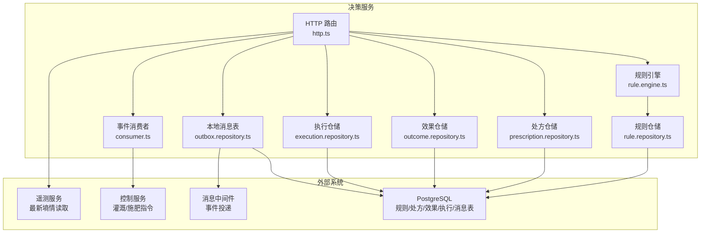

**图表来源**
- [http.ts:92-338](file://apps/decision-service/src/http.ts#L92-L338)
- [consumer.ts:61-159](file://apps/decision-service/src/consumer.ts#L61-L159)
- [rule.engine.ts:81-95](file://apps/decision-service/src/rule.engine.ts#L81-L95)
- [rule.repository.ts:182-296](file://apps/decision-service/src/rule.repository.ts#L182-L296)
- [prescription.repository.ts:86-154](file://apps/decision-service/src/prescription.repository.ts#L86-L154)
- [outcome.repository.ts:166-226](file://apps/decision-service/src/outcome.repository.ts#L166-L226)
- [execution.repository.ts:94-191](file://apps/decision-service/src/execution.repository.ts#L94-L191)
- [outbox.repository.ts:11-63](file://apps/decision-service/src/outbox.repository.ts#L11-L63)

**章节来源**
- [http.ts:92-338](file://apps/decision-service/src/http.ts#L92-L338)
- [002_decision_telemetry.sql:5-87](file://infra/postgres/migrations/002_decision_telemetry.sql#L5-L87)
- [003_event_bus_messages.sql:45-62](file://infra/postgres/migrations/003_event_bus_messages.sql#L45-L62)
- [034_decision_prescription_executions.sql:1-33](file://infra/postgres/migrations/034_decision_prescription_executions.sql#L1-L33)

## 核心组件
- RuleEngine：从 RuleRepository 读取最新规则集，对输入进行条件匹配，返回命中规则与处方明细项；默认按优先级顺序累计动作。
- RuleRepository：提供规则的增删改查与排序、归一化、默认规则等能力；SQL 实现通过 decision_rules 表持久化。
- PrescriptionRepository：提供处方的创建、按地块查询、按 ID 查询；SQL 实现通过 decision_prescriptions 表持久化，保留输入快照与命中规则。
- **OutcomeRepository（新增）**：提供处方效果评估记录的创建与查询，支持阈值建议生成与规则优化；SQL 实现通过 decision_prescription_outcomes 表持久化。
- **DecisionEventConsumer（新增）**：消费控制服务的灌溉和施肥完成事件，将实际执行事实回流到决策系统，确保处方执行的完整可追溯性。
- **ExecutionRepository（新增）**：提供执行记录的创建与查询，支持按处方ID或地块编码查询执行历史；SQL 实现通过 decision_prescription_executions 表持久化。
- OutboxStore（SqlOutboxStore）：将处方事件写入本地消息表，由中继任务异步投递，保证留痕与通知一致性。
- HTTP 层：封装规则管理、处方生成、效果回流、执行查询、历史查询、简单问答等接口，并处理遥测数据补齐与事件发布。

**章节来源**
- [rule.engine.ts:4-95](file://apps/decision-service/src/rule.engine.ts#L4-L95)
- [rule.repository.ts:11-84](file://apps/decision-service/src/rule.repository.ts#L11-L84)
- [prescription.repository.ts:4-59](file://apps/decision-service/src/prescription.repository.ts#L4-L59)
- [outcome.repository.ts:70-75](file://apps/decision-service/src/outcome.repository.ts#L70-L75)
- [consumer.ts:61-159](file://apps/decision-service/src/consumer.ts#L61-L159)
- [execution.repository.ts:48-54](file://apps/decision-service/src/execution.repository.ts#L48-L54)
- [outbox.repository.ts:5-10](file://apps/decision-service/src/outbox.repository.ts#L5-L10)
- [http.ts:92-338](file://apps/decision-service/src/http.ts#L92-L338)

## 架构总览
决策服务的整体流程如下：
- 客户端调用 /api/v1/decision/prescriptions 生成处方。
- HTTP 层解析请求体，必要时向遥测服务拉取最新土壤含水率。
- RuleEngine 从 RuleRepository 获取最新规则集，执行条件匹配。
- 根据命中规则构建处方明细项，写入 PrescriptionRepository。
- 通过 OutboxService 将处方事件写入本地消息表或直接进程内发布。
- **新增**：客户端调用 /api/v1/decision/prescriptions/:id/outcome 提交执行效果。
- **新增**：OutcomeRepository 评估效果并生成阈值建议，可选择写回规则进行自动调优。
- **新增**：DecisionEventConsumer 消费控制服务的灌溉/施肥完成事件，记录实际执行事实。
- **新增**：客户端调用 /api/v1/decision/executions 查询处方执行历史。
- 前端或下游系统订阅 DecisionPrescriptionIssued 事件，消费处方计划。

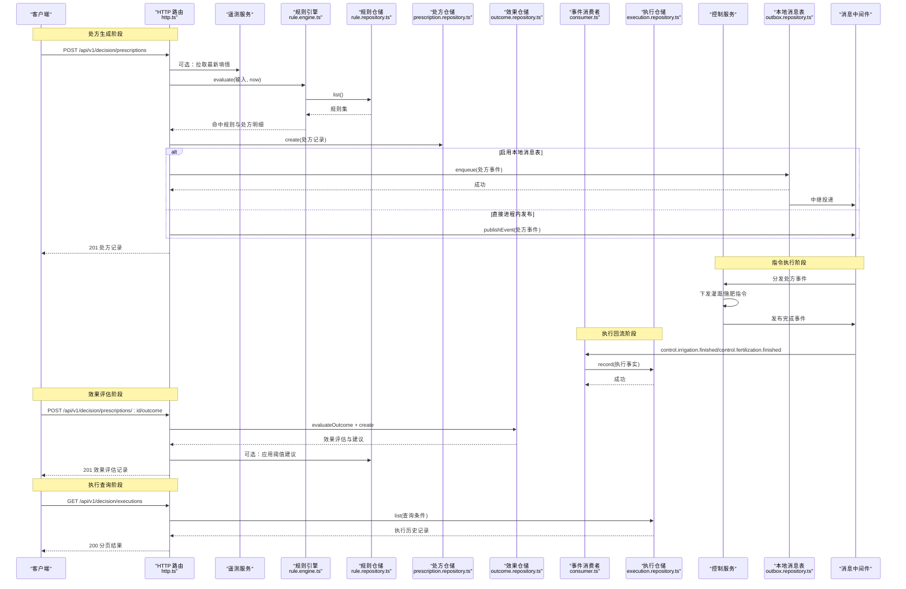

**图表来源**
- [http.ts:184-313](file://apps/decision-service/src/http.ts#L184-L313)
- [consumer.ts:67-115](file://apps/decision-service/src/consumer.ts#L67-L115)
- [rule.engine.ts:81-95](file://apps/decision-service/src/rule.engine.ts#L81-L95)
- [rule.repository.ts:206-212](file://apps/decision-service/src/rule.repository.ts#L206-L212)
- [prescription.repository.ts:93-118](file://apps/decision-service/src/prescription.repository.ts#L93-L118)
- [outcome.repository.ts:111-144](file://apps/decision-service/src/outcome.repository.ts#L111-L144)
- [execution.repository.ts:101-157](file://apps/decision-service/src/execution.repository.ts#L101-L157)
- [outbox.repository.ts:18-31](file://apps/decision-service/src/outbox.repository.ts#L18-L31)

## 详细组件分析

### 规则引擎 RuleEngine
RuleEngine 每次评估都从仓储读取最新规则集，因此新增、修改或停用规则后立即生效，无需重启服务。其核心逻辑包括：
- 条件字段全部满足才算命中；条件为空视为不命中。
- 支持的土壤含水率低于阈值、未来降雨概率低于阈值、作物生育期精确匹配。
- 为每条命中的规则生成处方明细项，包含投入品编码、用量、时间窗口（当前时间到 24 小时后）。
- 同一输入可能命中多条规则，按优先级顺序累计动作。

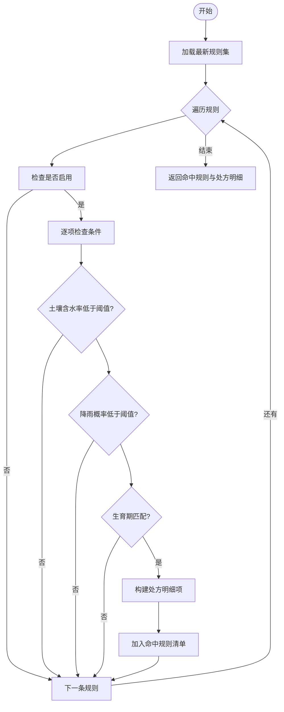

**图表来源**
- [rule.engine.ts:47-95](file://apps/decision-service/src/rule.engine.ts#L47-L95)

**章节来源**
- [rule.engine.ts:4-95](file://apps/decision-service/src/rule.engine.ts#L4-L95)

### 规则仓储 RuleRepository
RuleRepository 定义了规则的数据结构与操作契约，并提供 SQL 与内存实现：
- 规则类型：灌溉、施肥、病虫害预警。
- 条件：土壤含水率低于阈值、未来降雨概率低于阈值、生育期。
- 动作：类型、用量、单位、原因。
- 工具函数：条件与动作归一化、类型校验、默认排序与默认规则。
- SQL 实现：使用 decision_rules 表，支持软删除（deleted_at）、按 priority 与 created_at 排序。

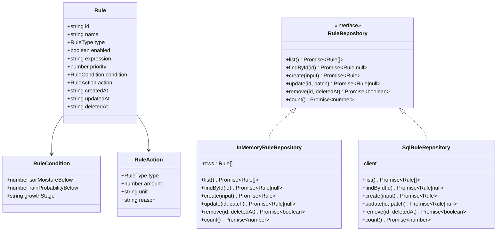

**图表来源**
- [rule.repository.ts:11-84](file://apps/decision-service/src/rule.repository.ts#L11-L84)
- [rule.repository.ts:132-179](file://apps/decision-service/src/rule.repository.ts#L132-L179)
- [rule.repository.ts:182-296](file://apps/decision-service/src/rule.repository.ts#L182-L296)

**章节来源**
- [rule.repository.ts:11-84](file://apps/decision-service/src/rule.repository.ts#L11-L84)
- [rule.repository.ts:132-179](file://apps/decision-service/src/rule.repository.ts#L132-L179)
- [rule.repository.ts:182-296](file://apps/decision-service/src/rule.repository.ts#L182-L296)

### 处方仓储 PrescriptionRepository
PrescriptionRepository 定义处方记录与明细，并提供 SQL 与内存实现：
- 处方状态：RECOMMENDED（已生成建议）、NO_ACTION（评估后无需作业）。
- 处方明细：网格编码、投入品编码、用量、时间窗口。
- 处方记录：保留输入快照、命中规则、动作列表、生成时间与签发时间。
- SQL 实现：使用 decision_prescriptions 表，JSONB 字段存储 inputs、matchedRules、actions。

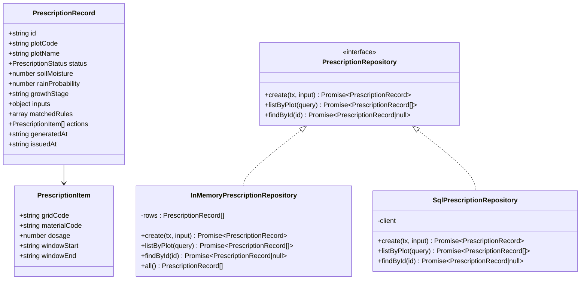

**图表来源**
- [prescription.repository.ts:4-59](file://apps/decision-service/src/prescription.repository.ts#L4-L59)
- [prescription.repository.ts:86-154](file://apps/decision-service/src/prescription.repository.ts#L86-L154)
- [prescription.repository.ts:157-190](file://apps/decision-service/src/prescription.repository.ts#L157-L190)

**章节来源**
- [prescription.repository.ts:4-59](file://apps/decision-service/src/prescription.repository.ts#L4-L59)
- [prescription.repository.ts:86-154](file://apps/decision-service/src/prescription.repository.ts#L86-L154)
- [prescription.repository.ts:157-190](file://apps/decision-service/src/prescription.repository.ts#L157-L190)

### 效果评估仓储 OutcomeRepository（新增）
OutcomeRepository 定义处方效果评估记录与评估逻辑，并提供 SQL 与内存实现：
- 效果评估记录：包含处方ID、地块编码、前后含水率、目标值、变化量、有效性、阈值建议等。
- 阈值建议：当执行效果不理想时自动生成阈值调整建议，包含建议阈值、原因说明。
- 评估逻辑：判断执行后是否达到目标，根据偏差程度给出提高或降低阈值的建议。
- 规则优化：支持将阈值建议写回规则，同时更新条件表达式与展示表达式。
- SQL 实现：使用 decision_prescription_outcomes 表，JSONB 字段存储 suggestion。

**图表来源**
- [outcome.repository.ts:15-75](file://apps/decision-service/src/outcome.repository.ts#L15-L75)
- [outcome.repository.ts:166-226](file://apps/decision-service/src/outcome.repository.ts#L166-L226)

**章节来源**
- [outcome.repository.ts:15-75](file://apps/decision-service/src/outcome.repository.ts#L15-L75)
- [outcome.repository.ts:111-144](file://apps/decision-service/src/outcome.repository.ts#L111-L144)
- [outcome.repository.ts:166-226](file://apps/decision-service/src/outcome.repository.ts#L166-L226)

### 决策事件消费者 DecisionEventConsumer（新增）
DecisionEventConsumer 负责消费控制服务发布的灌溉和施肥完成事件，将实际执行事实回流到决策系统：
- 事件处理：监听 control.irrigation.finished 和 control.fertilization.finished 主题。
- 载荷验证：校验commandId、deviceId、durationMin、finishedAt等必填字段。
- 处方关联：通过prescriptionId关联原始处方记录，确保执行事实的可追溯性。
- 数据映射：将事件载荷映射为PrescriptionExecution记录，包括用水量、施肥量、作业时长等。
- 幂等保证：通过commandId唯一索引确保同一条指令只记录一次执行事实。
- 错误处理：处方不存在或载荷非法时抛出异常，避免脏数据进入系统。

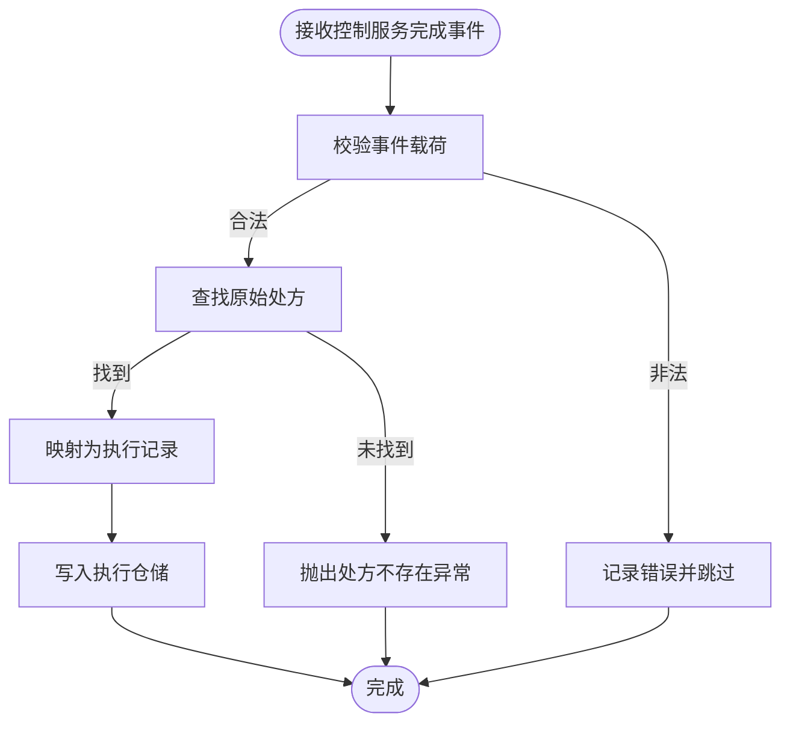

**图表来源**
- [consumer.ts:44-115](file://apps/decision-service/src/consumer.ts#L44-L115)

**章节来源**
- [consumer.ts:19-115](file://apps/decision-service/src/consumer.ts#L19-L115)
- [consumer.ts:133-159](file://apps/decision-service/src/consumer.ts#L133-L159)

### 执行仓储 ExecutionRepository（新增）
ExecutionRepository 定义处方执行回流记录与查询逻辑，并提供 SQL 与内存实现：
- 执行记录：包含处方ID、指令标识、地块编码、计划类型、设备ID、用水量、施肥量、作业时长、完成时间等。
- 数据来源：用水量与施肥量分别标记来源（DEVICE实测或PLAN方案推算），作业时长标记来源（DEVICE设备上报或RUNTIME运行时计算）。
- 查询接口：支持按处方ID、地块编码查询执行历史，限制最大返回数量防止数据过载。
- 幂等写入：通过commandId唯一约束确保同一条指令不会重复记录。
- SQL 实现：使用 decision_prescription_executions 表，包含适当的索引优化查询性能。

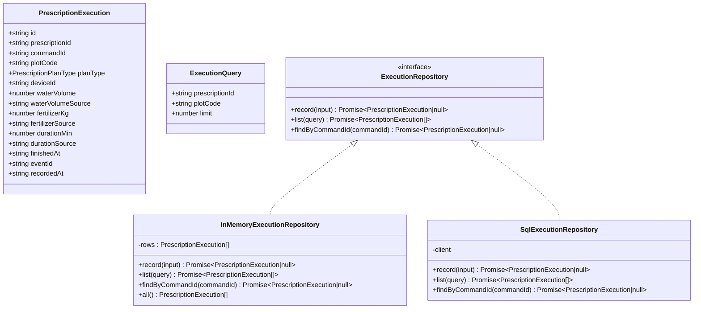

**图表来源**
- [execution.repository.ts:18-54](file://apps/decision-service/src/execution.repository.ts#L18-L54)
- [execution.repository.ts:94-191](file://apps/decision-service/src/execution.repository.ts#L94-L191)

**章节来源**
- [execution.repository.ts:4-54](file://apps/decision-service/src/execution.repository.ts#L4-L54)
- [execution.repository.ts:94-191](file://apps/decision-service/src/execution.repository.ts#L94-L191)

### HTTP 路由与服务装配
HTTP 层提供以下关键接口：
- GET /api/v1/decision/rules：规则列表分页。
- POST /api/v1/decision/rules：新增规则，立即参与下一次求值。
- GET /api/v1/decision/rules/:id：按 ID 查询规则。
- PUT /api/v1/decision/rules/:id：更新规则字段。
- DELETE /api/v1/decision/rules/:id：软删除规则。
- GET /api/v1/decision/prescriptions：处方历史分页查询。
- POST /api/v1/decision/prescriptions：生成处方，触发决策流程。
- **POST /api/v1/decision/prescriptions/:id/outcome：提交处方执行效果，触发效果评估与阈值建议**。
- **GET /api/v1/decision/prescriptions/:id/outcome：查询最近一次效果评估记录**。
- **GET /api/v1/decision/executions：查询处方执行历史，支持按处方ID或地块编码过滤**。
- POST /api/v1/decision/ask：简单问答，结合最近处方留痕给出建议。

在处方生成流程中：
- 解析请求体，必要时从遥测服务拉取最新土壤含水率。
- 构造 RuleEvaluationInput，调用 RuleEngine.evaluate。
- 根据命中规则构建 CreatePrescriptionInput，写入处方仓储。
- 通过 OutboxService 写入本地消息表或直接进程内发布事件。

在效果回流流程中：
- 接收处方ID和执行后的土壤含水率。
- 查找原始处方记录和命中规则。
- 调用 evaluateOutcome 进行效果评估。
- 可选地将阈值建议写回规则进行自动调优。
- 保存效果评估记录并返回结果。

在执行查询流程中：
- 解析查询参数（prescriptionId、plotCode、分页参数）。
- 调用 ExecutionRepository.list 获取执行历史记录。
- 返回分页的执行记录，包含用水量、施肥量、作业时长等详细信息。

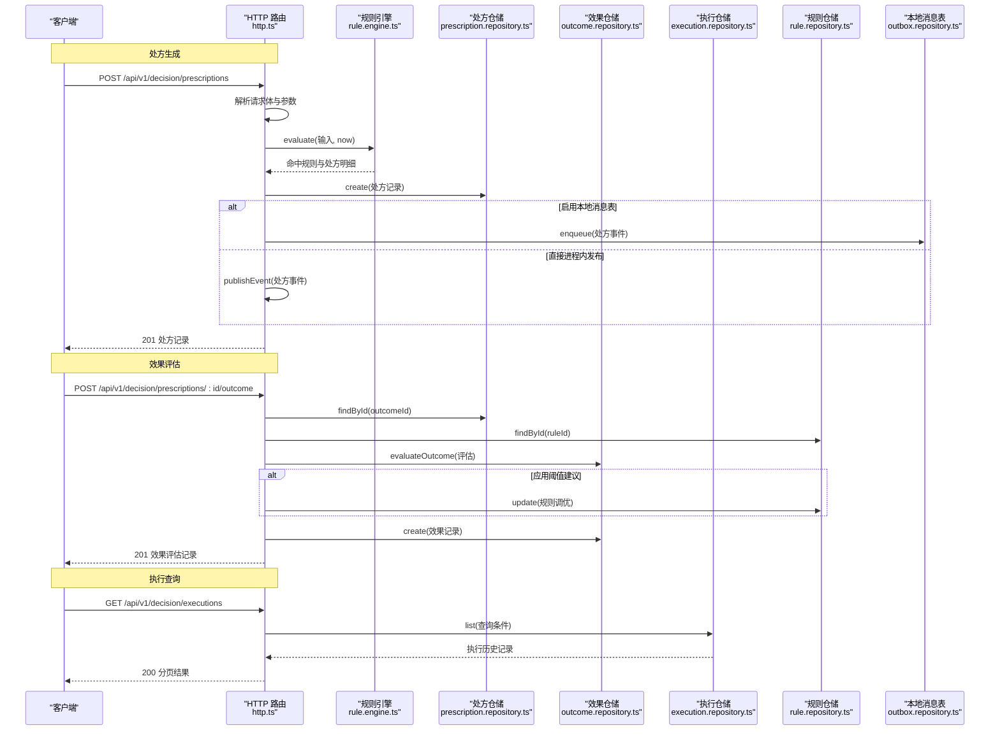

**图表来源**
- [http.ts:184-313](file://apps/decision-service/src/http.ts#L184-L313)
- [rule.engine.ts:81-95](file://apps/decision-service/src/rule.engine.ts#L81-L95)
- [prescription.repository.ts:93-118](file://apps/decision-service/src/prescription.repository.ts#L93-L118)
- [outcome.repository.ts:111-144](file://apps/decision-service/src/outcome.repository.ts#L111-L144)
- [execution.repository.ts:128-157](file://apps/decision-service/src/execution.repository.ts#L128-L157)
- [outbox.repository.ts:18-31](file://apps/decision-service/src/outbox.repository.ts#L18-L31)

**章节来源**
- [http.ts:92-338](file://apps/decision-service/src/http.ts#L92-L338)

### 本地消息表与事件投递
本地消息表用于保证"处方留痕落库"与"处方事件发布"的一致性：
- 当启用 OutboxStore 时，处方事件先写入 decision_outbox，再由中继任务异步投递。
- 未启用 OutboxStore 时，直接在进程内发布事件，便于本地联调。
- OutboxStore 提供 enqueue、listPending、markPublished、markFailed 等方法。

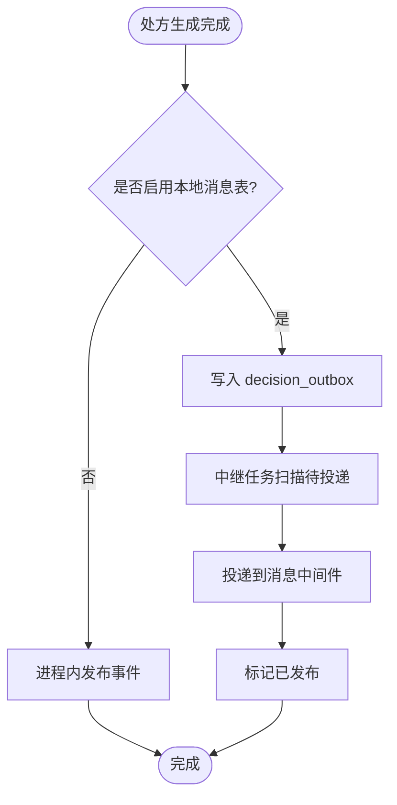

**图表来源**
- [http.ts:231-244](file://apps/decision-service/src/http.ts#L231-L244)
- [outbox.repository.ts:18-63](file://apps/decision-service/src/outbox.repository.ts#L18-L63)

**章节来源**
- [http.ts:231-244](file://apps/decision-service/src/http.ts#L231-L244)
- [outbox.repository.ts:5-10](file://apps/decision-service/src/outbox.repository.ts#L5-L10)
- [outbox.repository.ts:18-63](file://apps/decision-service/src/outbox.repository.ts#L18-L63)

## 依赖关系分析
- RuleEngine 依赖 RuleRepository 获取规则集。
- HTTP 层依赖 RuleEngine、PrescriptionRepository、OutcomeRepository、ExecutionRepository、OutboxStore，并可注入遥测服务读取器。
- RuleRepository 与 PrescriptionRepository 均依赖 PrismaClientLike 进行 SQL 操作。
- OutcomeRepository 依赖 PrismaClientLike 进行 SQL 操作。
- **ExecutionRepository 依赖 PrismaClientLike 进行 SQL 操作**。
- **DecisionEventConsumer 依赖 ExecutionRepository 和 PrescriptionRepository**。
- OutboxStore 依赖消息队列基础设施（InMemoryEventPublisher 或外部中继）。

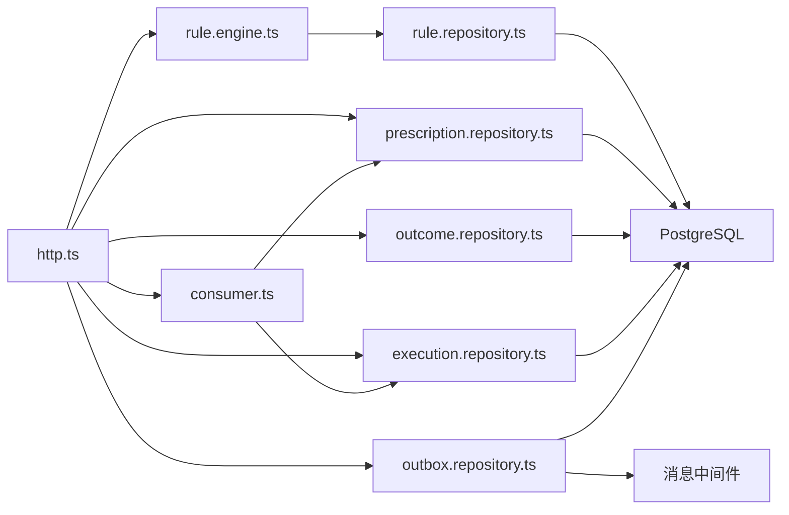

**图表来源**
- [http.ts:92-338](file://apps/decision-service/src/http.ts#L92-L338)
- [consumer.ts:61-159](file://apps/decision-service/src/consumer.ts#L61-L159)
- [rule.engine.ts:81-95](file://apps/decision-service/src/rule.engine.ts#L81-L95)
- [rule.repository.ts:182-296](file://apps/decision-service/src/rule.repository.ts#L182-L296)
- [prescription.repository.ts:86-154](file://apps/decision-service/src/prescription.repository.ts#L86-L154)
- [outcome.repository.ts:166-226](file://apps/decision-service/src/outcome.repository.ts#L166-L226)
- [execution.repository.ts:94-191](file://apps/decision-service/src/execution.repository.ts#L94-L191)
- [outbox.repository.ts:11-63](file://apps/decision-service/src/outbox.repository.ts#L11-L63)

**章节来源**
- [http.ts:92-338](file://apps/decision-service/src/http.ts#L92-L338)
- [consumer.ts:61-159](file://apps/decision-service/src/consumer.ts#L61-L159)
- [rule.engine.ts:81-95](file://apps/decision-service/src/rule.engine.ts#L81-L95)
- [rule.repository.ts:182-296](file://apps/decision-service/src/rule.repository.ts#L182-L296)
- [prescription.repository.ts:86-154](file://apps/decision-service/src/prescription.repository.ts#L86-L154)
- [outcome.repository.ts:166-226](file://apps/decision-service/src/outcome.repository.ts#L166-L226)
- [execution.repository.ts:94-191](file://apps/decision-service/src/execution.repository.ts#L94-L191)
- [outbox.repository.ts:11-63](file://apps/decision-service/src/outbox.repository.ts#L11-L63)

## 性能与可扩展性
- 规则热更新：每次评估从仓储读取最新规则集，避免缓存失效问题，但会增加一次规则查询开销。可通过规则集规模控制与索引优化缓解。
- 条件匹配复杂度：线性遍历规则集，时间复杂度 O(n)，n 为规则数量；可通过优先级排序与早期短路优化提升命中率。
- 处方写入：JSONB 字段存储复杂对象，适合灵活扩展；注意 JSONB 索引策略以提升查询性能。
- 效果评估：评估逻辑简单高效，主要涉及数值比较和阈值计算；建议记录表有适当的索引支持查询性能。
- **执行查询：执行记录表包含适当的索引（prescription_id、plot_code），支持高效的按处方或地块查询**。
- **事件消费：DecisionEventConsumer 使用事件日志存储和去重机制，确保事件处理的可靠性和幂等性**。
- 事件投递：本地消息表保证一致性；中继任务需具备重试与失败记录机制。
- **规则优化**：阈值建议生成算法简单可解释，避免过度复杂的机器学习模型；支持渐进式规则调优。

[本节为通用指导，不涉及具体文件分析]

## 故障排查指南
- 规则不存在：GET/PUT/DELETE /api/v1/decision/rules/:id 返回 404，检查规则 ID 是否存在且未被软删除。
- 规则名称为空：POST /api/v1/decision/rules 返回 400，确保 name 非空。
- 接口不存在：路径或方法不匹配返回 404，检查 API_PREFIX 与路由。
- 请求体格式错误：非 JSON 对象抛出异常，返回 400，检查请求体结构。
- 遥测服务不可用：fetchSoilMoisture 超时或响应异常，回退到请求体数值或默认值，不影响处方生成。
- 本地消息表投递失败：检查 decision_outbox 的 retry_count 与 last_error，确认中继任务运行状态。
- **效果评估失败**：POST /api/v1/decision/prescriptions/:id/outcome 返回 400，检查 soilMoistureAfter 是否为有效数字。
- **处方不存在**：效果评估接口返回 404，检查处方ID是否正确且存在。
- **效果记录缺失**：GET /api/v1/decision/prescriptions/:id/outcome 返回 404，检查是否已提交效果评估。
- **执行查询无数据**：GET /api/v1/decision/executions 返回空结果，检查是否有对应的控制服务完成事件被消费。
- **执行记录重复**：检查 commandId 是否唯一，确认事件消费是否出现重复处理。
- **处方关联失败**：执行回流时处方不存在，检查处方ID是否正确且处方记录存在。

**章节来源**
- [http.ts:123-168](file://apps/decision-service/src/http.ts#L123-L168)
- [http.ts:250-299](file://apps/decision-service/src/http.ts#L250-L299)
- [http.ts:301-313](file://apps/decision-service/src/http.ts#L301-L313)
- [consumer.ts:44-58](file://apps/decision-service/src/consumer.ts#L44-L58)
- [consumer.ts:84-115](file://apps/decision-service/src/consumer.ts#L84-L115)
- [outbox.repository.ts:56-63](file://apps/decision-service/src/outbox.repository.ts#L56-L63)

## 结论
智能决策服务以"规则即数据"为核心，实现了高可配置、可追溯的处方生成流程。RuleEngine 提供简洁的条件匹配与动作聚合能力；RuleRepository 与 PrescriptionRepository 分别支撑规则管理与处方留痕；**新增的 OutcomeRepository 实现了处方执行效果的追踪与规则自动调优**；**新增的 DecisionEventConsumer 和 ExecutionRepository 完善了处方执行事实的回流机制**；HTTP 层整合遥测数据补齐与事件投递，形成完整的决策链路。通过本地消息表与中继任务，系统在一致性与可靠性方面具备良好基础。**执行追踪功能的引入使得系统具备了完整的处方执行可追溯性，形成了"处方生成 → 指令执行 → 执行事实回流 → 效果评估 → 规则优化"的完整闭环**。

[本节为总结性内容，不涉及具体文件分析]

## 附录：数据模型与接口契约

### 数据库表结构
- decision_rules：规则表，包含规则类型、启用状态、表达式、优先级、条件与动作 JSONB 字段、创建/更新时间、软删除时间。
- decision_prescriptions：处方表，包含地块信息、状态、输入指标、输入快照、命中规则、动作列表、生成与签发时间。
- **decision_prescription_outcomes（新增）**：效果评估表，包含处方ID、地块编码、前后含水率、目标值、变化量、有效性、阈值建议、应用状态、备注、评估时间。
- **decision_prescription_executions（新增）**：执行回流表，包含处方ID、指令标识、地块编码、计划类型、设备ID、用水量、施肥量、作业时长、完成时间、事件标识、记录时间。
- telemetry_readings：遥测读数表，设备、地块、指标、数值、单位、记录时间。
- telemetry_alerts：遥测告警表，设备、地块、级别、指标、消息、创建时间、处理状态。
- decision_outbox：决策本地消息表，主题、载荷、租户、追踪、生产者、创建/发布时间、重试次数、最后错误。

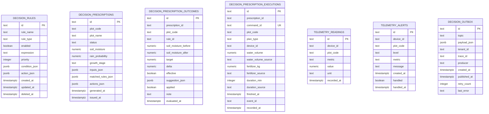

**图表来源**
- [002_decision_telemetry.sql:5-87](file://infra/postgres/migrations/002_decision_telemetry.sql#L5-L87)
- [003_event_bus_messages.sql:45-62](file://infra/postgres/migrations/003_event_bus_messages.sql#L45-L62)
- [034_decision_prescription_executions.sql:9-33](file://infra/postgres/migrations/034_decision_prescription_executions.sql#L9-L33)

**章节来源**
- [002_decision_telemetry.sql:5-87](file://infra/postgres/migrations/002_decision_telemetry.sql#L5-L87)
- [003_event_bus_messages.sql:45-62](file://infra/postgres/migrations/003_event_bus_messages.sql#L45-L62)
- [034_decision_prescription_executions.sql:1-33](file://infra/postgres/migrations/034_decision_prescription_executions.sql#L1-L33)

### 接口说明
- 规则管理
  - GET /api/v1/decision/rules：分页返回规则列表。
  - POST /api/v1/decision/rules：新增规则，立即生效。
  - GET /api/v1/decision/rules/:id：按 ID 查询规则。
  - PUT /api/v1/decision/rules/:id：更新规则字段。
  - DELETE /api/v1/decision/rules/:id：软删除规则。
- 处方管理
  - GET /api/v1/decision/prescriptions：按地块与状态分页查询处方历史。
  - POST /api/v1/decision/prescriptions：生成处方，触发决策流程并发布事件。
- **效果评估（新增）**
  - POST /api/v1/decision/prescriptions/:id/outcome：提交处方执行效果，触发效果评估与阈值建议。
  - GET /api/v1/decision/prescriptions/:id/outcome：查询最近一次效果评估记录。
- **执行查询（新增）**
  - GET /api/v1/decision/executions：查询处方执行历史，支持按处方ID或地块编码过滤。
- 智能问答
  - POST /api/v1/decision/ask：结合最近处方留痕给出建议。

**章节来源**
- [http.ts:123-327](file://apps/decision-service/src/http.ts#L123-L327)

### 效果评估算法说明
效果评估算法基于简单的业务规则：
- 如果执行后含水率仍低于目标且变化很小（≤1），建议提高阈值以提前触发。
- 如果执行后含水率远高于目标（超过OVERSHOOT=10），建议降低阈值以避免过量灌溉。
- 阈值调整步长为5%，并在MIN_THRESHOLD=20%到MAX_THRESHOLD=60%范围内限制。
- 建议理由包含具体的数值分析和业务解释，便于人工审核和调整。

**图表来源**
- [outcome.repository.ts:111-144](file://apps/decision-service/src/outcome.repository.ts#L111-L144)
- [http.ts:268-280](file://apps/decision-service/src/http.ts#L268-L280)

**章节来源**
- [outcome.repository.ts:111-144](file://apps/decision-service/src/outcome.repository.ts#L111-L144)
- [http.ts:268-280](file://apps/decision-service/src/http.ts#L268-L280)

### 执行回流数据处理说明
执行回流数据处理遵循严格的验证和映射规则：
- 载荷验证：校验commandId、deviceId、durationMin、finishedAt等必填字段的类型和范围。
- 处方关联：通过prescriptionId查找原始处方，确保执行事实的可追溯性。
- 数据映射：将事件载荷映射为PrescriptionExecution记录，保持数据来源标记的一致性。
- 幂等保证：通过commandId唯一索引确保同一条指令只记录一次执行事实。
- 错误处理：处方不存在或载荷非法时抛出异常，避免脏数据进入系统。

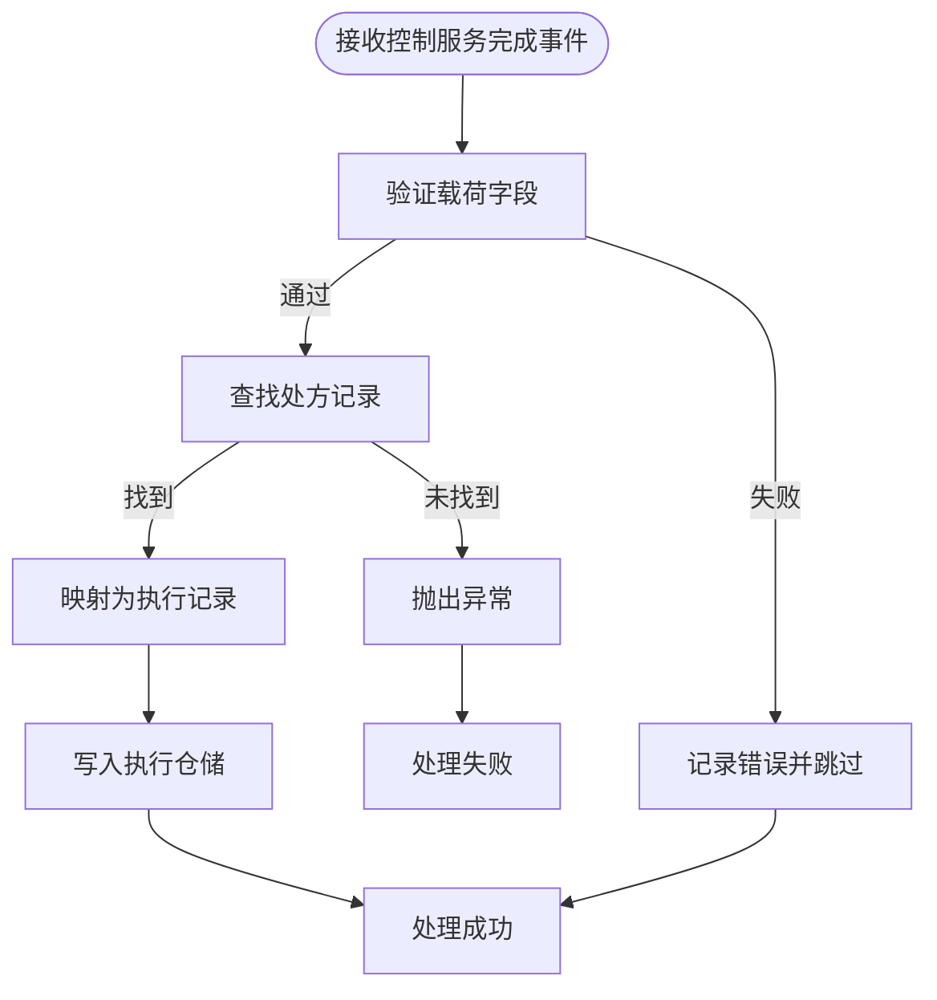

**图表来源**
- [consumer.ts:44-115](file://apps/decision-service/src/consumer.ts#L44-L115)

**章节来源**
- [consumer.ts:44-115](file://apps/decision-service/src/consumer.ts#L44-L115)
- [execution.repository.ts:101-157](file://apps/decision-service/src/execution.repository.ts#L101-L157)