# 规则仓储

<cite>
**本文引用的文件**   
- [rule.repository.ts](file://apps/decision-service/src/rule.repository.ts)
- [rule.engine.ts](file://apps/decision-service/src/rule.engine.ts)
- [002_decision_telemetry.sql](file://infra/postgres/migrations/002_decision_telemetry.sql)
</cite>

## 目录
1. [引言](#引言)
2. [项目结构定位](#项目结构定位)
3. [核心组件总览](#核心组件总览)
4. [架构总览](#架构总览)
5. [详细组件分析](#详细组件分析)
6. [依赖关系分析](#依赖关系分析)
7. [性能与热更新策略](#性能与热更新策略)
8. [故障排查指南](#故障排查指南)
9. [结论](#结论)

## 引言
本文件面向“无人农场智能决策”中的规则仓储子系统，系统性说明规则的数据模型、接口契约、CRUD 操作、条件语法、热更新机制以及性能优化策略。该能力位于决策服务中，通过规则仓储抽象出规则的持久化方式，并通过规则引擎在每次求值时读取最新规则集，实现无需重启服务的规则热更新。

## 项目结构定位
规则仓储相关代码集中在决策服务模块：
- 规则数据模型、仓储接口与两种实现（内存、SQL）位于决策服务的规则仓储文件。
- 规则求值逻辑位于决策服务的规则引擎文件。
- 数据库表结构与索引定义位于基础设施迁移脚本。

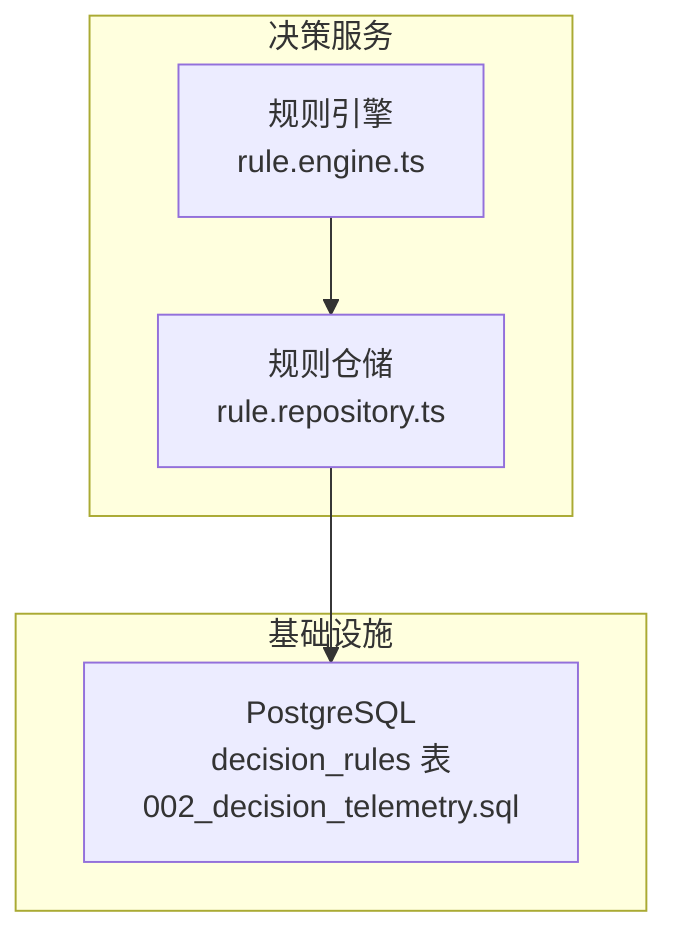

**图表来源**
- [rule.engine.ts:1-97](file://apps/decision-service/src/rule.engine.ts#L1-L97)
- [rule.repository.ts:1-297](file://apps/decision-service/src/rule.repository.ts#L1-L297)
- [002_decision_telemetry.sql:5-18](file://infra/postgres/migrations/002_decision_telemetry.sql#L5-L18)

**章节来源**
- [rule.engine.ts:1-97](file://apps/decision-service/src/rule.engine.ts#L1-L97)
- [rule.repository.ts:1-297](file://apps/decision-service/src/rule.repository.ts#L1-L297)
- [002_decision_telemetry.sql:5-18](file://infra/postgres/migrations/002_decision_telemetry.sql#L5-L18)

## 核心组件总览
- Rule 类型：描述一条规则的核心数据结构，包含 ID、名称、类型、启用状态、表达式、优先级、条件、动作及审计时间戳等字段。
- RuleRepository 接口：定义规则的 CRUD 与列表查询契约。
- InMemoryRuleRepository：基于内存的规则仓储实现，用于测试和本地模式。
- SqlRuleRepository：基于 PostgreSQL 的规则仓储实现，使用 JSONB 存储条件与动作，支持软删除。
- RuleEngine：规则求值引擎，每次评估从仓储读取最新规则集并返回命中规则与处方明细。

**章节来源**
- [rule.repository.ts:11-84](file://apps/decision-service/src/rule.repository.ts#L11-L84)
- [rule.repository.ts:132-179](file://apps/decision-service/src/rule.repository.ts#L132-L179)
- [rule.repository.ts:182-296](file://apps/decision-service/src/rule.repository.ts#L182-L296)
- [rule.engine.ts:12-96](file://apps/decision-service/src/rule.engine.ts#L12-L96)

## 架构总览
规则仓储采用“接口 + 多实现”的设计：上层通过 RuleRepository 接口解耦具体存储；规则引擎通过该接口获取规则，并在每次求值时读取最新数据，从而实现热更新。

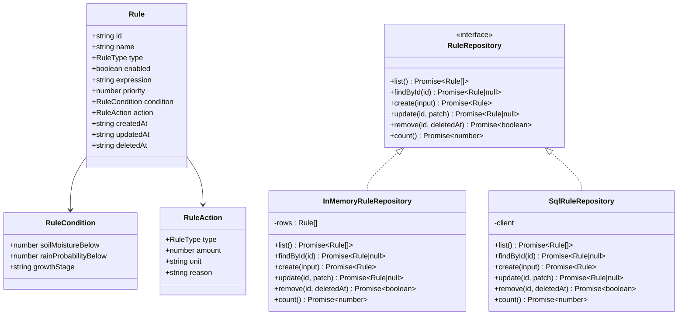

**图表来源**
- [rule.repository.ts:11-84](file://apps/decision-service/src/rule.repository.ts#L11-L84)
- [rule.repository.ts:132-179](file://apps/decision-service/src/rule.repository.ts#L132-L179)
- [rule.repository.ts:182-296](file://apps/decision-service/src/rule.repository.ts#L182-L296)

## 详细组件分析

### 规则数据模型
- 规则类型：灌溉、施肥、病虫害预警。
- 规则条件：
  - 土壤含水率低于阈值：当输入土壤含水率小于该阈值时满足条件。
  - 未来降雨概率低于阈值：当输入降雨概率小于该阈值时满足条件。
  - 生育期：精确匹配作物当前生育期。
- 规则动作：
  - 类型：与规则类型一致，决定投入品编码与业务含义。
  - 用量：灌溉单位为毫米，施肥单位为公斤每亩。
  - 单位与原因：用于展示与留痕。
- 其他字段：
  - ID、名称、表达式（人类可读）、优先级（数值越小越先匹配）。
  - 启用状态：未启用的规则不参与求值。
  - 审计时间戳：创建时间、更新时间、软删除时间。

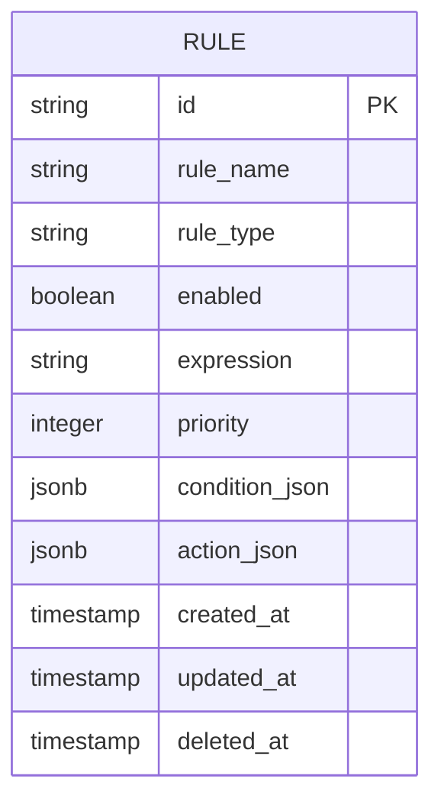

**图表来源**
- [002_decision_telemetry.sql:5-18](file://infra/postgres/migrations/002_decision_telemetry.sql#L5-L18)
- [rule.repository.ts:11-48](file://apps/decision-service/src/rule.repository.ts#L11-L48)

**章节来源**
- [rule.repository.ts:11-48](file://apps/decision-service/src/rule.repository.ts#L11-L48)
- [002_decision_telemetry.sql:5-18](file://infra/postgres/migrations/002_decision_telemetry.sql#L5-L18)

### RuleRepository 接口规范
- list：返回所有未删除且启用的规则，按优先级和创建时间排序。
- findById：按 ID 查询单条未删除规则。
- create：新增规则，写入条件与动作的 JSONB 字段。
- update：部分字段更新，未提供的字段保持原值；更新后返回完整规则对象。
- remove：软删除，设置删除时间与更新时间。
- count：统计未删除规则数量。

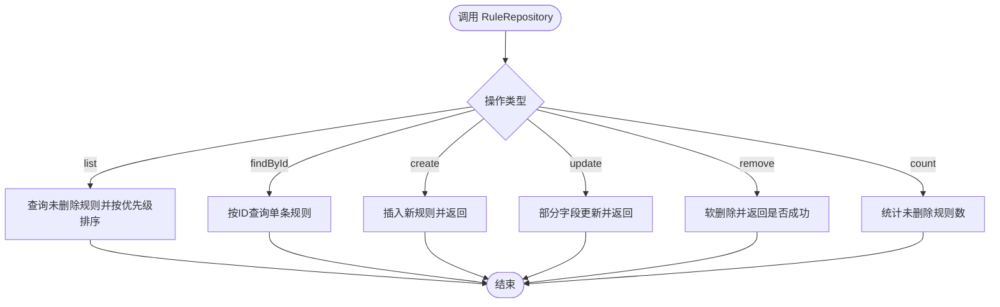

**图表来源**
- [rule.repository.ts:77-84](file://apps/decision-service/src/rule.repository.ts#L77-L84)
- [rule.repository.ts:182-296](file://apps/decision-service/src/rule.repository.ts#L182-L296)

**章节来源**
- [rule.repository.ts:77-84](file://apps/decision-service/src/rule.repository.ts#L77-L84)
- [rule.repository.ts:182-296](file://apps/decision-service/src/rule.repository.ts#L182-L296)

### 规则条件语法定义
- 土壤湿度：soilMoistureBelow 表示“低于该百分比触发”。
- 降雨概率：rainProbabilityBelow 表示“低于该百分比触发”。
- 生育期：growthStage 表示“必须等于该生育期字符串”。
- 组合语义：多个条件同时满足才判定为命中；若条件为空则不命中。

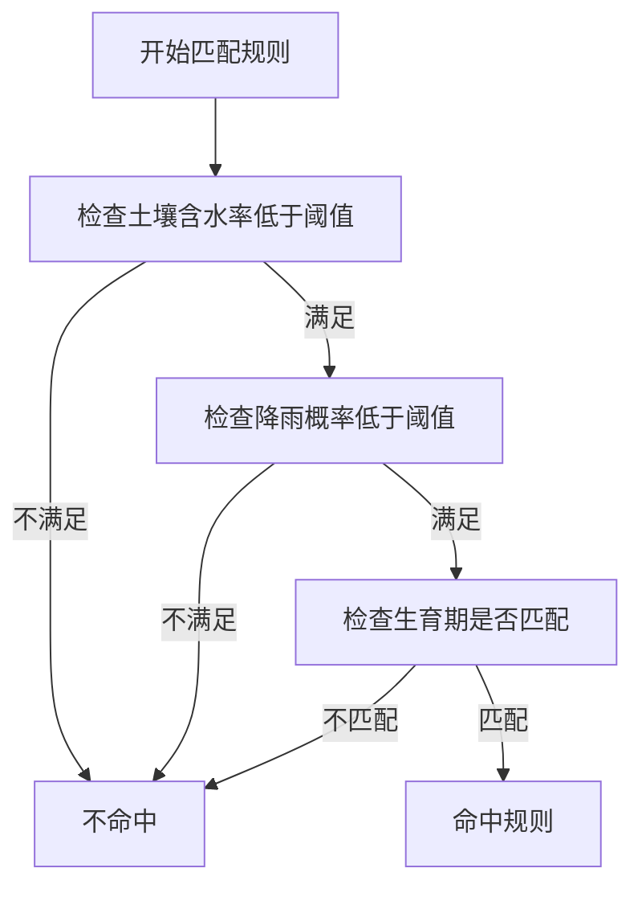

**图表来源**
- [rule.engine.ts:47-66](file://apps/decision-service/src/rule.engine.ts#L47-L66)

**章节来源**
- [rule.engine.ts:47-66](file://apps/decision-service/src/rule.engine.ts#L47-L66)
- [rule.repository.ts:14-22](file://apps/decision-service/src/rule.repository.ts#L14-L22)

### 规则 CRUD 操作流程

#### 创建规则
- 输入参数包括 ID、名称、类型、表达式、优先级、条件、动作、启用状态及时间戳。
- SQL 实现将条件与动作序列化为 JSONB 写入数据库。
- 返回完整的规则对象，供调用方确认。

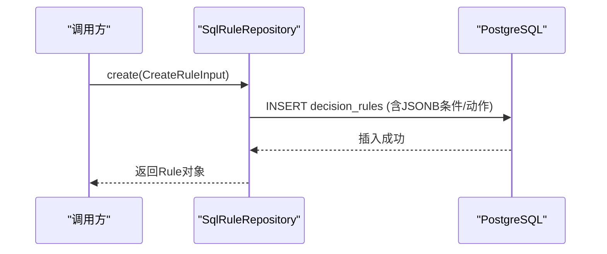

**图表来源**
- [rule.repository.ts:224-240](file://apps/decision-service/src/rule.repository.ts#L224-L240)
- [002_decision_telemetry.sql:5-18](file://infra/postgres/migrations/002_decision_telemetry.sql#L5-L18)

**章节来源**
- [rule.repository.ts:50-62](file://apps/decision-service/src/rule.repository.ts#L50-L62)
- [rule.repository.ts:224-240](file://apps/decision-service/src/rule.repository.ts#L224-L240)

#### 读取规则
- list：返回按优先级与创建时间排序的规则集合。
- findById：按 ID 返回单条规则。

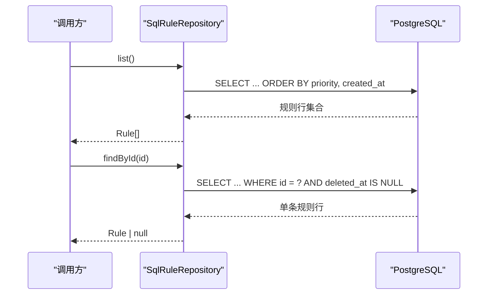

**图表来源**
- [rule.repository.ts:206-222](file://apps/decision-service/src/rule.repository.ts#L206-L222)

**章节来源**
- [rule.repository.ts:206-222](file://apps/decision-service/src/rule.repository.ts#L206-L222)

#### 更新规则
- 支持部分字段更新；未提供的字段保留原值。
- 条件与动作在未提供时使用规范化函数处理，避免脏数据进入求值。
- 更新后返回完整规则对象。

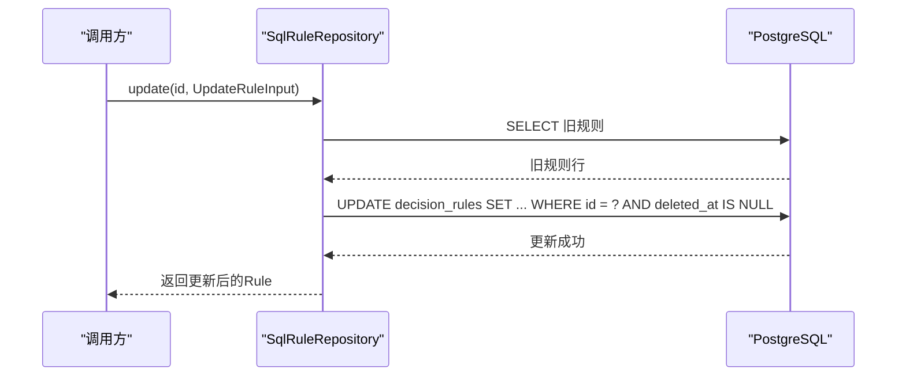

**图表来源**
- [rule.repository.ts:242-280](file://apps/decision-service/src/rule.repository.ts#L242-L280)

**章节来源**
- [rule.repository.ts:64-74](file://apps/decision-service/src/rule.repository.ts#L64-L74)
- [rule.repository.ts:242-280](file://apps/decision-service/src/rule.repository.ts#L242-L280)

#### 删除规则
- 采用软删除：设置 deleted_at 与 updated_at。
- 后续查询均过滤 deleted_at 非空的记录。

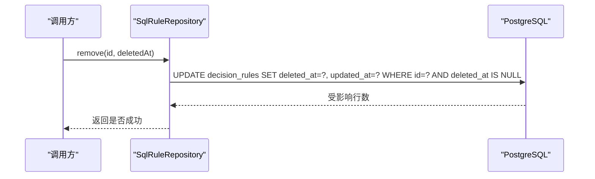

**图表来源**
- [rule.repository.ts:282-290](file://apps/decision-service/src/rule.repository.ts#L282-L290)

**章节来源**
- [rule.repository.ts:282-290](file://apps/decision-service/src/rule.repository.ts#L282-L290)

#### 列表查询
- 列表查询默认按优先级升序、创建时间升序排序，确保规则求值顺序稳定。
- 仅返回未删除的记录。

**章节来源**
- [rule.repository.ts:206-212](file://apps/decision-service/src/rule.repository.ts#L206-L212)

### 规则引擎与热更新机制
- 规则引擎每次 evaluate 都会调用 RuleRepository.list 获取最新规则集，因此新增、修改或停用规则后立即生效，无需重启服务。
- 同一输入可能命中多条规则，按优先级顺序累计生成处方明细项。
- 命中规则摘要包含规则 ID、名称、表达式与动作，便于留痕与复核。

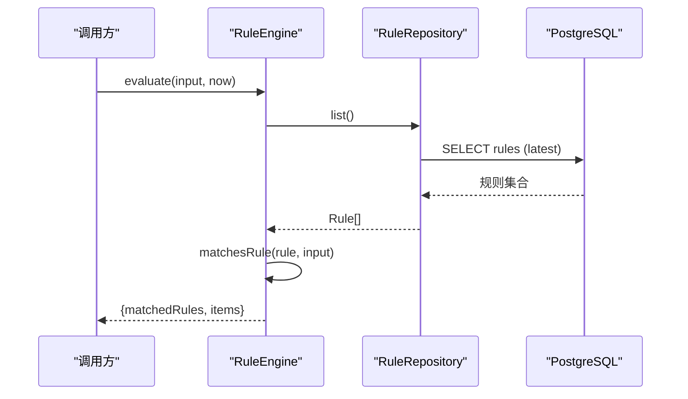

**图表来源**
- [rule.engine.ts:81-96](file://apps/decision-service/src/rule.engine.ts#L81-L96)
- [rule.repository.ts:206-212](file://apps/decision-service/src/rule.repository.ts#L206-L212)

**章节来源**
- [rule.engine.ts:4-10](file://apps/decision-service/src/rule.engine.ts#L4-L10)
- [rule.engine.ts:81-96](file://apps/decision-service/src/rule.engine.ts#L81-L96)

## 依赖关系分析
- RuleEngine 依赖 RuleRepository 接口，不关心具体存储实现。
- SqlRuleRepository 依赖 Prisma 客户端（通过类型约束），执行原生 SQL 查询与更新。
- 数据库层通过 decision_rules 表存储规则，并使用 JSONB 存储条件与动作，提升灵活性。
- 索引设计：
  - 对 enabled、priority 建立条件索引，加速启用规则列表查询。
  - 对处方表、遥测表也建立了常用查询路径的索引，支撑决策留痕与历史查询。

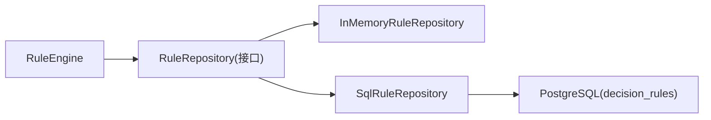

**图表来源**
- [rule.engine.ts:1-97](file://apps/decision-service/src/rule.engine.ts#L1-L97)
- [rule.repository.ts:132-179](file://apps/decision-service/src/rule.repository.ts#L132-L179)
- [rule.repository.ts:182-296](file://apps/decision-service/src/rule.repository.ts#L182-L296)
- [002_decision_telemetry.sql:5-18](file://infra/postgres/migrations/002_decision_telemetry.sql#L5-L18)

**章节来源**
- [rule.engine.ts:1-97](file://apps/decision-service/src/rule.engine.ts#L1-L97)
- [rule.repository.ts:132-296](file://apps/decision-service/src/rule.repository.ts#L132-L296)
- [002_decision_telemetry.sql:5-18](file://infra/postgres/migrations/002_decision_telemetry.sql#L5-L18)

## 性能与热更新策略
- 热更新：
  - 规则以数据形式存储，规则引擎每次求值都从仓储读取最新规则集，新增、修改、停用规则后立即生效，无需重启服务。
- 排序与优先级：
  - 规则按 priority 升序、createdAt 升序排序，保证求值顺序稳定可预期。
- 条件归一化：
  - 条件与动作在入库前进行归一化处理，缺失字段填充默认值，避免脏数据影响求值结果。
- 数据库索引：
  - decision_rules 表针对 enabled 与 priority 建立条件索引，提升启用规则列表查询效率。
- 软删除：
  - 使用 deleted_at 标记删除，避免物理删除导致的历史不一致问题，同时提高查询一致性。
- 内存实现：
  - InMemoryRuleRepository 提供轻量实现，适合测试与本地开发，减少外部依赖。

**章节来源**
- [rule.engine.ts:4-10](file://apps/decision-service/src/rule.engine.ts#L4-L10)
- [rule.repository.ts:92-110](file://apps/decision-service/src/rule.repository.ts#L92-L110)
- [rule.repository.ts:128-130](file://apps/decision-service/src/rule.repository.ts#L128-L130)
- [002_decision_telemetry.sql:5-18](file://infra/postgres/migrations/002_decision_telemetry.sql#L5-L18)

## 故障排查指南
- 规则未生效：
  - 检查规则是否启用（enabled 字段）。
  - 检查条件字段是否正确填写，尤其是 soilMoistureBelow、rainProbabilityBelow、growthStage。
  - 确认优先级是否合理，避免因优先级过高而未被优先匹配。
- 条件不命中：
  - 核对输入数据的土壤含水率与降雨概率是否符合“低于阈值”的条件。
  - 核对生育期是否与规则中的 growthStage 完全一致。
- 更新未保存：
  - 确认 update 传入的 patch 字段是否有效，未提供的字段不会覆盖原值。
  - 检查 SQL 更新语句是否成功执行，关注 affected rows。
- 删除后仍可见：
  - 确认是否为软删除；查询需过滤 deleted_at 非空记录。
- 性能问题：
  - 检查 decision_rules 表的索引是否生效。
  - 评估规则数量与条件复杂度，必要时拆分规则或优化条件表达。

**章节来源**
- [rule.engine.ts:47-66](file://apps/decision-service/src/rule.engine.ts#L47-L66)
- [rule.repository.ts:242-290](file://apps/decision-service/src/rule.repository.ts#L242-L290)
- [002_decision_telemetry.sql:5-18](file://infra/postgres/migrations/002_decision_telemetry.sql#L5-L18)

## 结论
规则仓储通过清晰的接口契约与多实现方案，实现了规则的可插拔存储与热更新能力。规则数据模型涵盖 ID、名称、表达式、条件、动作、启用状态与优先级等关键字段，支持土壤湿度、降雨概率与生育期等条件的灵活组合。CRUD 操作完整覆盖创建、读取、更新、删除与列表查询，配合数据库索引与条件归一化，保障性能与数据质量。规则引擎在每次求值时读取最新规则集，确保规则变更即时生效，为无人农场的智能决策提供了可靠基础。