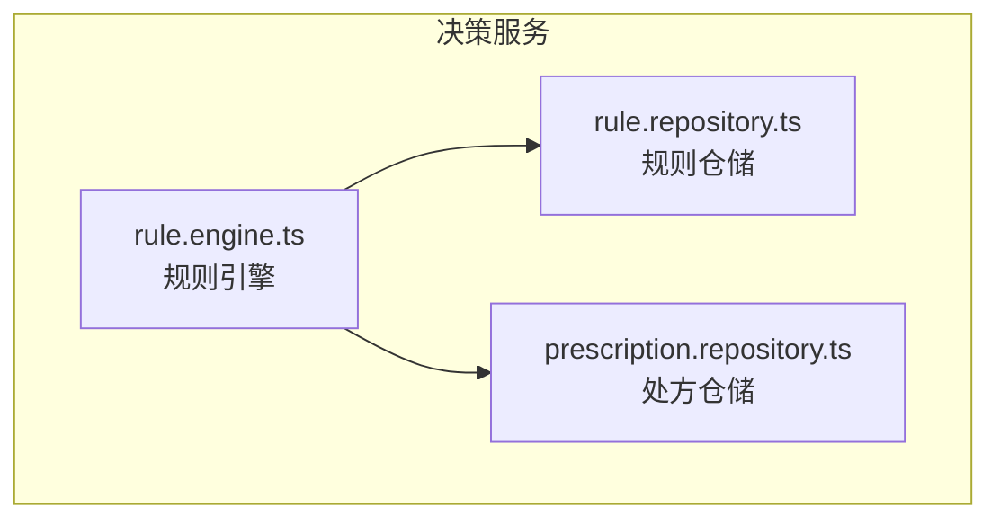
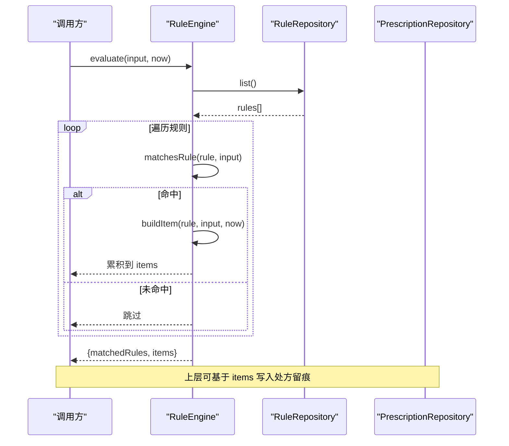
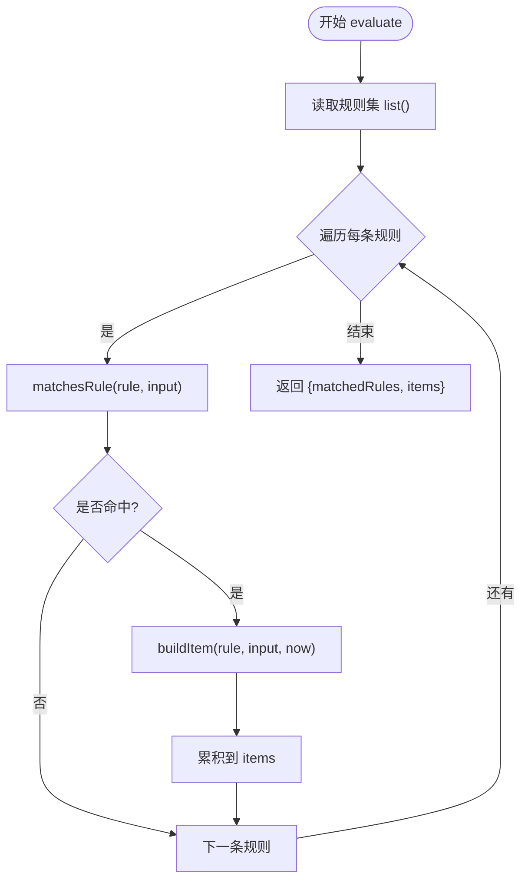
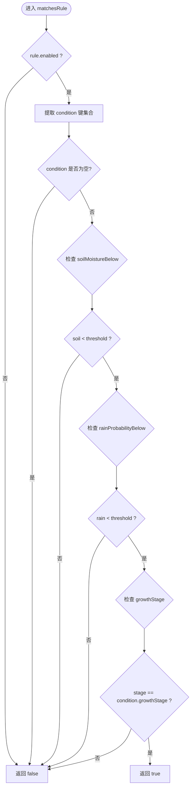
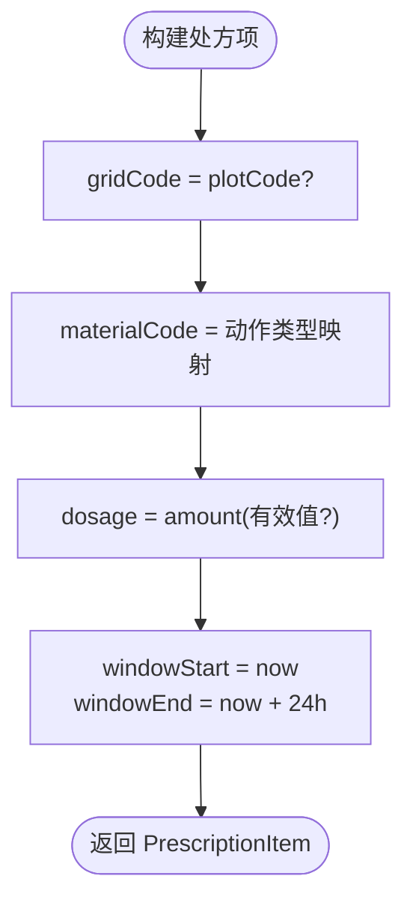
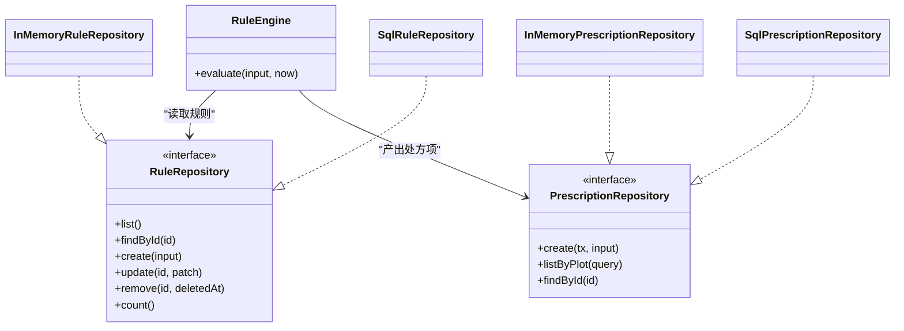

# 规则引擎核心

<cite>
**本文引用的文件**   
- [apps/decision-service/src/rule.engine.ts](file://apps/decision-service/src/rule.engine.ts)
- [apps/decision-service/src/rule.repository.ts](file://apps/decision-service/src/rule.repository.ts)
- [apps/decision-service/src/prescription.repository.ts](file://apps/decision-service/src/prescription.repository.ts)
</cite>

## 目录
1. [引言](#引言)
2. [项目结构](#项目结构)
3. [核心组件](#核心组件)
4. [架构总览](#架构总览)
5. [详细组件分析](#详细组件分析)
6. [依赖关系分析](#依赖关系分析)
7. [性能与扩展性](#性能与扩展性)
8. [故障排查指南](#故障排查指南)
9. [结论](#结论)
10. [附录：决策场景示例](#附录决策场景示例)

## 引言
本文件聚焦决策服务中的规则引擎实现，围绕 RuleEngine 类的设计、规则求值算法与匹配逻辑展开，详细说明输入参数 RuleEvaluationInput 的字段含义与使用方法，解释 matchesRule 的条件判断机制，并文档化 MatchedRule 与 RuleEvaluationResult 的数据结构。同时给出处方项 PrescriptionItem 的生成过程，以及灌溉、施肥等典型决策场景的使用示例。

## 项目结构
决策服务的规则引擎位于 apps/decision-service 模块中，核心由三类文件组成：
- rule.engine.ts：定义规则求值输入、命中规则摘要、求值结果、匹配函数与 RuleEngine 类。
- rule.repository.ts：定义规则数据模型、仓储接口及内存/SQL 实现，并提供默认规则与规范化函数。
- prescription.repository.ts：定义处方明细与处方记录的数据结构，以及内存/SQL 实现。

图表来源
- [apps/decision-service/src/rule.engine.ts:1-97](file://apps/decision-service/src/rule.engine.ts#L1-L97)
- [apps/decision-service/src/rule.repository.ts:1-297](file://apps/decision-service/src/rule.repository.ts#L1-L297)
- [apps/decision-service/src/prescription.repository.ts:1-196](file://apps/decision-service/src/prescription.repository.ts#L1-L196)

章节来源
- [apps/decision-service/src/rule.engine.ts:1-97](file://apps/decision-service/src/rule.engine.ts#L1-L97)
- [apps/decision-service/src/rule.repository.ts:1-297](file://apps/decision-service/src/rule.repository.ts#L1-L297)
- [apps/decision-service/src/prescription.repository.ts:1-196](file://apps/decision-service/src/prescription.repository.ts#L1-L196)

## 核心组件
- RuleEngine：负责读取最新规则集并对输入进行求值，返回命中的规则清单与处方项列表。
- RuleRepository：规则数据的抽象仓储，提供 list、findById、create、update、remove、count 等方法；包含 InMemoryRuleRepository 与 SqlRuleRepository 两种实现。
- PrescriptionRepository：处方数据的抽象仓储，提供 create、listByPlot、findById 等方法；包含 InMemoryPrescriptionRepository 与 SqlPrescriptionRepository 两种实现。
- 数据结构：
  - RuleEvaluationInput：规则求值输入，包含地块编码、地块名称、作物类型、生育期、土壤湿度、降雨概率等。
  - MatchedRule：命中的规则摘要，包含 id、name、expression、action。
  - RuleEvaluationResult：求值结果，包含 matchedRules 与 items（处方项）。
  - PrescriptionItem：处方明细，包含网格编码、农资编码、用量、执行时间窗口等。
  - PrescriptionRecord：处方记录，保留输入快照、命中规则与动作，用于留痕与审计。

章节来源
- [apps/decision-service/src/rule.engine.ts:12-33](file://apps/decision-service/src/rule.engine.ts#L12-L33)
- [apps/decision-service/src/rule.repository.ts:11-84](file://apps/decision-service/src/rule.repository.ts#L11-L84)
- [apps/decision-service/src/prescription.repository.ts:7-59](file://apps/decision-service/src/prescription.repository.ts#L7-L59)

## 架构总览
RuleEngine 在每次求值时从 RuleRepository 拉取最新规则集，按优先级排序后逐条调用 matchesRule 进行条件判断。命中的规则会生成对应的 PrescriptionItem，并最终汇总为 RuleEvaluationResult。处方仓储负责持久化决策留痕，便于事后复核与追溯。

图表来源
- [apps/decision-service/src/rule.engine.ts:81-95](file://apps/decision-service/src/rule.engine.ts#L81-L95)
- [apps/decision-service/src/rule.repository.ts:76-84](file://apps/decision-service/src/rule.repository.ts#L76-L84)
- [apps/decision-service/src/prescription.repository.ts:55-59](file://apps/decision-service/src/prescription.repository.ts#L55-L59)

## 详细组件分析

### RuleEngine 与求值流程
- 职责：
  - 从 RuleRepository 获取最新规则集。
  - 对每条规则执行 matchesRule 判断。
  - 将命中的规则转换为 PrescriptionItem。
  - 返回 RuleEvaluationResult，包含 matchedRules 与 items。
- 关键点：
  - 每次求值都重新读取规则，支持“规则热更新”。
  - 同一输入可能命中多条规则，按优先级顺序累计动作。
  - 处方项的时间窗口默认以当前时间为起点，持续 24 小时。

图表来源
- [apps/decision-service/src/rule.engine.ts:81-95](file://apps/decision-service/src/rule.engine.ts#L81-L95)
- [apps/decision-service/src/rule.engine.ts:68-79](file://apps/decision-service/src/rule.engine.ts#L68-L79)

章节来源
- [apps/decision-service/src/rule.engine.ts:81-95](file://apps/decision-service/src/rule.engine.ts#L81-L95)

### matchesRule 条件判断机制
- 启用状态：仅 enabled 为 true 的规则参与匹配。
- 条件字段：
  - soilMoistureBelow：当输入 soilMoisture 存在且小于该阈值时满足。
  - rainProbabilityBelow：当输入 rainProbability 存在且小于该阈值时满足。
  - growthStage：当输入 growthStage 与规则条件完全一致时满足。
- 缺失值处理：
  - 若 soilMoisture 或 rainProbability 不存在或无法解析为有限数字，则对应条件不满足。
  - growthStage 为空字符串或空值视为不匹配。
- 组合语义：所有给出的条件必须同时满足；若 condition 为空对象，则视为不命中。

图表来源
- [apps/decision-service/src/rule.engine.ts:47-66](file://apps/decision-service/src/rule.engine.ts#L47-L66)

章节来源
- [apps/decision-service/src/rule.engine.ts:47-66](file://apps/decision-service/src/rule.engine.ts#L47-L66)

### RuleEvaluationInput 输入参数说明
- plotCode：地块编码，可选；用于生成处方项的 gridCode。
- plotName：地块名称，可选；用于处方留痕展示。
- crop：作物类型，可选；可用于业务层扩展筛选。
- growthStage：生育期，可选；与规则条件 growthStage 精确匹配。
- soilMoisture：土壤湿度（百分比），可选；与 soilMoistureBelow 比较。
- rainProbability：未来降雨概率（百分比），可选；与 rainProbabilityBelow 比较。

使用建议：
- 至少提供 plotCode 以便处方项关联地块。
- 若需要按生育期过滤，请确保 growthStage 与规则配置一致。
- 数值型字段需为有限数字，否则对应条件不满足。

章节来源
- [apps/decision-service/src/rule.engine.ts:12-20](file://apps/decision-service/src/rule.engine.ts#L12-L20)

### MatchedRule 与 RuleEvaluationResult 数据结构
- MatchedRule：
  - id：规则唯一标识。
  - name：规则名称。
  - expression：人类可读表达式，用于展示与留痕。
  - action：规则动作，包含 type、amount、unit、reason。
- RuleEvaluationResult：
  - matchedRules：命中的规则摘要数组。
  - items：处方项数组，每项代表一次建议作业。

用途：
- matchedRules 用于决策留痕与审计。
- items 用于下游处方生成与任务下发。

章节来源
- [apps/decision-service/src/rule.engine.ts:22-33](file://apps/decision-service/src/rule.engine.ts#L22-L33)

### 处方项 PrescriptionItem 生成过程
- 网格编码：优先使用 input.plotCode 作为 gridCode。
- 农资编码：根据规则动作类型映射到预设 materialCode。
- 用量：取自 rule.action.amount，无效值回退为 0。
- 时间窗口：windowStart 为当前时间，windowEnd 为 windowStart + 24 小时。

图表来源
- [apps/decision-service/src/rule.engine.ts:68-79](file://apps/decision-service/src/rule.engine.ts#L68-L79)

章节来源
- [apps/decision-service/src/rule.engine.ts:68-79](file://apps/decision-service/src/rule.engine.ts#L68-L79)

### 规则数据模型与仓储
- RuleCondition：
  - soilMoistureBelow：土壤含水率阈值（百分比）。
  - rainProbabilityBelow：降雨概率阈值（百分比）。
  - growthStage：生育期（字符串）。
- RuleAction：
  - type：动作类型，IRRIGATION/FERTILIZATION/PEST_WARNING。
  - amount：用量，灌溉为 mm，施肥为 kg/亩。
  - unit：单位。
  - reason：原因说明。
- Rule：
  - id/name/type/enabled/expression/priority/condition/action/createdAt/updatedAt/deletedAt。
- RuleRepository：
  - list/findById/create/update/remove/count。
- InMemoryRuleRepository：内存实现，适合测试与本地模式。
- SqlRuleRepository：PostgreSQL 实现，表结构由迁移脚本管理。

章节来源
- [apps/decision-service/src/rule.repository.ts:11-84](file://apps/decision-service/src/rule.repository.ts#L11-L84)
- [apps/decision-service/src/rule.repository.ts:132-179](file://apps/decision-service/src/rule.repository.ts#L132-L179)
- [apps/decision-service/src/rule.repository.ts:181-296](file://apps/decision-service/src/rule.repository.ts#L181-L296)

### 处方数据模型与仓储
- PrescriptionItem：
  - gridCode：网格编码（可选）。
  - materialCode：农资编码。
  - dosage：用量。
  - windowStart/windowEnd：执行时间窗口。
- PrescriptionRecord：
  - id/plotCode/plotName/status/soilMoisture/rainProbability/growthStage/inputs/matchedRules/actions/generatedAt/issuedAt。
- PrescriptionRepository：
  - create/listByPlot/findById。
- InMemoryPrescriptionRepository：内存实现。
- SqlPrescriptionRepository：PostgreSQL 实现。

章节来源
- [apps/decision-service/src/prescription.repository.ts:7-59](file://apps/decision-service/src/prescription.repository.ts#L7-L59)
- [apps/decision-service/src/prescription.repository.ts:85-154](file://apps/decision-service/src/prescription.repository.ts#L85-L154)
- [apps/decision-service/src/prescription.repository.ts:156-195](file://apps/decision-service/src/prescription.repository.ts#L156-L195)

## 依赖关系分析
- RuleEngine 依赖 RuleRepository 获取规则，并产出 PrescriptionItem 供处方仓储持久化。
- RuleRepository 提供规则数据的增删改查，支持内存与 SQL 两种后端。
- PrescriptionRepository 提供处方记录的持久化能力，同样支持内存与 SQL 两种后端。

图表来源
- [apps/decision-service/src/rule.engine.ts:81-95](file://apps/decision-service/src/rule.engine.ts#L81-L95)
- [apps/decision-service/src/rule.repository.ts:76-84](file://apps/decision-service/src/rule.repository.ts#L76-L84)
- [apps/decision-service/src/prescription.repository.ts:55-59](file://apps/decision-service/src/prescription.repository.ts#L55-L59)

章节来源
- [apps/decision-service/src/rule.engine.ts:81-95](file://apps/decision-service/src/rule.engine.ts#L81-L95)
- [apps/decision-service/src/rule.repository.ts:76-84](file://apps/decision-service/src/rule.repository.ts#L76-L84)
- [apps/decision-service/src/prescription.repository.ts:55-59](file://apps/decision-service/src/prescription.repository.ts#L55-L59)

## 性能与扩展性
- 规则加载策略：每次求值均从仓储读取最新规则，保证热更新生效，但会带来一定的 I/O 开销。在高并发场景下可考虑引入短期缓存与失效策略。
- 匹配复杂度：O(N)，N 为规则数量。可通过索引与分区优化查询与排序。
- 处方项生成：轻量计算，主要开销在 JSON 序列化与数据库写入。
- 扩展点：
  - 新增条件字段：扩展 RuleCondition 与 matchesRule。
  - 新增动作类型：扩展 RuleType 与 MATERIAL_BY_TYPE 映射。
  - 自定义处方项生成：重写 buildItem 逻辑。

[本节为通用指导，不直接分析具体文件]

## 故障排查指南
- 规则未命中：
  - 检查 rule.enabled 是否为 true。
  - 检查 condition 是否为空对象。
  - 检查 soilMoisture/rainProbability 是否为有限数字。
  - 检查 growthStage 是否与输入完全一致。
- 处方项异常：
  - 确认 plotCode 已传入以生成 gridCode。
  - 确认 rule.action.amount 为有效数字。
  - 确认动作类型与 MATERIAL_BY_TYPE 映射一致。
- 规则热更新未生效：
  - 确认 RuleRepository.list() 返回的是最新数据。
  - 确认规则优先级与创建时间排序正确。

章节来源
- [apps/decision-service/src/rule.engine.ts:47-66](file://apps/decision-service/src/rule.engine.ts#L47-L66)
- [apps/decision-service/src/rule.engine.ts:68-79](file://apps/decision-service/src/rule.engine.ts#L68-L79)
- [apps/decision-service/src/rule.repository.ts:128-130](file://apps/decision-service/src/rule.repository.ts#L128-L130)

## 结论
规则引擎通过 RuleEngine 将规则数据与求值逻辑解耦，结合 RuleRepository 与 PrescriptionRepository 实现了可扩展、可审计的决策流程。matchesRule 提供了清晰的土壤湿度、降雨概率与生育期匹配语义，MatchedRule 与 RuleEvaluationResult 保证了决策留痕与处方生成的标准化。通过内存与 SQL 双实现，系统既便于本地开发与测试，也支持生产环境的持久化与高可用。

[本节为总结性内容，不直接分析具体文件]

## 附录：决策场景示例

### 灌溉决策
- 场景描述：当土壤湿度低于阈值且未来降雨概率较低时，触发补灌建议。
- 输入示例：
  - plotCode: "PLOT-001"
  - crop: "小麦"
  - growthStage: "拔节期"
  - soilMoisture: 25
  - rainProbability: 30
- 期望行为：
  - 命中类型为 IRRIGATION 的规则。
  - 生成 PrescriptionItem，materialCode 映射为灌溉农资编码，dosage 为规则配置的用量，windowStart/End 为当前时间与 24 小时后。
- 参考实现位置：
  - 默认灌溉规则定义与条件阈值。
  - 动作类型到农资编码的映射。

章节来源
- [apps/decision-service/src/rule.repository.ts:112-126](file://apps/decision-service/src/rule.repository.ts#L112-L126)
- [apps/decision-service/src/rule.engine.ts:35-40](file://apps/decision-service/src/rule.engine.ts#L35-L40)

### 施肥建议
- 场景描述：在特定生育期且土壤湿度偏低时，建议补充氮肥。
- 输入示例：
  - plotCode: "PLOT-002"
  - crop: "玉米"
  - growthStage: "抽雄期"
  - soilMoisture: 28
  - rainProbability: 40
- 期望行为：
  - 命中类型为 FERTILIZATION 的规则。
  - 生成 PrescriptionItem，materialCode 映射为氮肥农资编码，dosage 为规则配置的用量。
- 参考实现位置：
  - 动作类型到农资编码的映射。
  - matchesRule 对 soilMoistureBelow 与 growthStage 的判断。

章节来源
- [apps/decision-service/src/rule.engine.ts:35-40](file://apps/decision-service/src/rule.engine.ts#L35-L40)
- [apps/decision-service/src/rule.engine.ts:47-66](file://apps/decision-service/src/rule.engine.ts#L47-L66)

### 病虫害预警
- 场景描述：当环境条件符合病虫害发生风险时，发出预警并建议相应农资准备。
- 输入示例：
  - plotCode: "PLOT-003"
  - crop: "水稻"
  - growthStage: "分蘖期"
  - soilMoisture: 35
  - rainProbability: 50
- 期望行为：
  - 命中类型为 PEST_WARNING 的规则。
  - 生成 PrescriptionItem，materialCode 映射为广谱农药农资编码。
- 参考实现位置：
  - 动作类型到农资编码的映射。

章节来源
- [apps/decision-service/src/rule.engine.ts:35-40](file://apps/decision-service/src/rule.engine.ts#L35-L40)