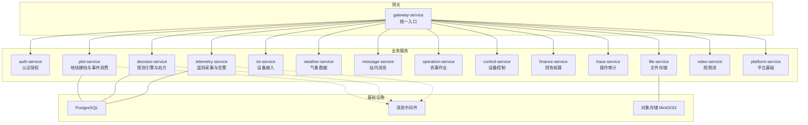
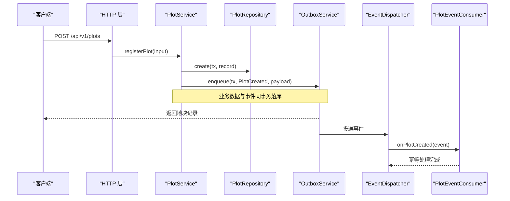
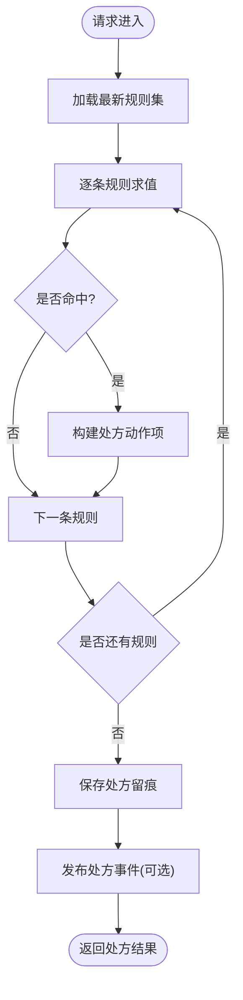
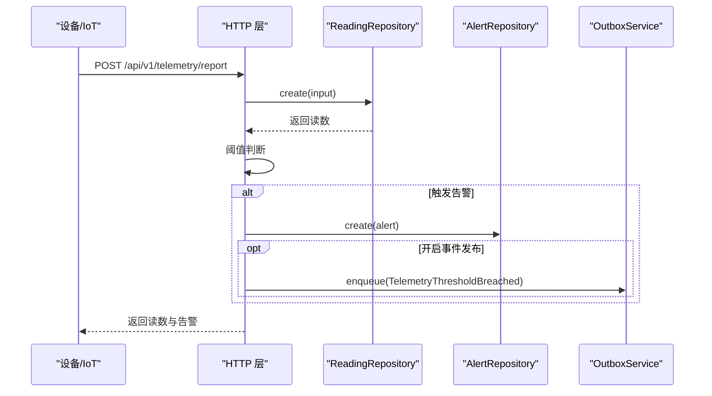
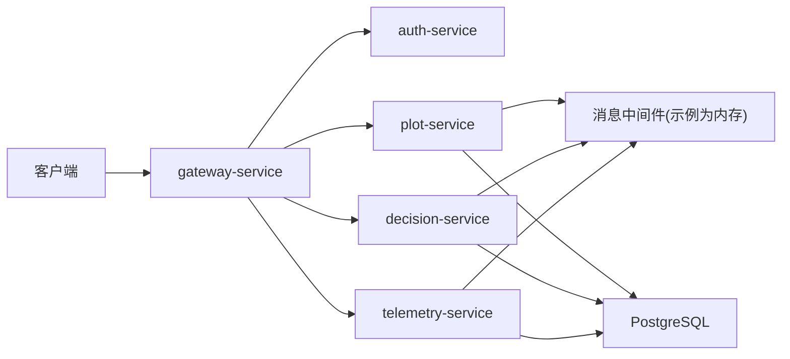
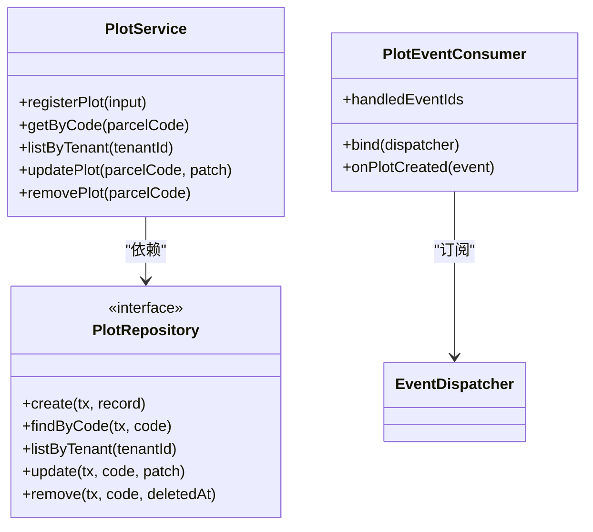
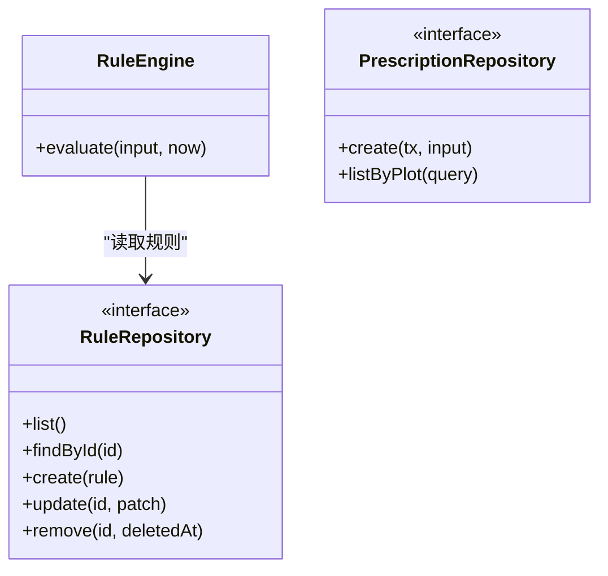
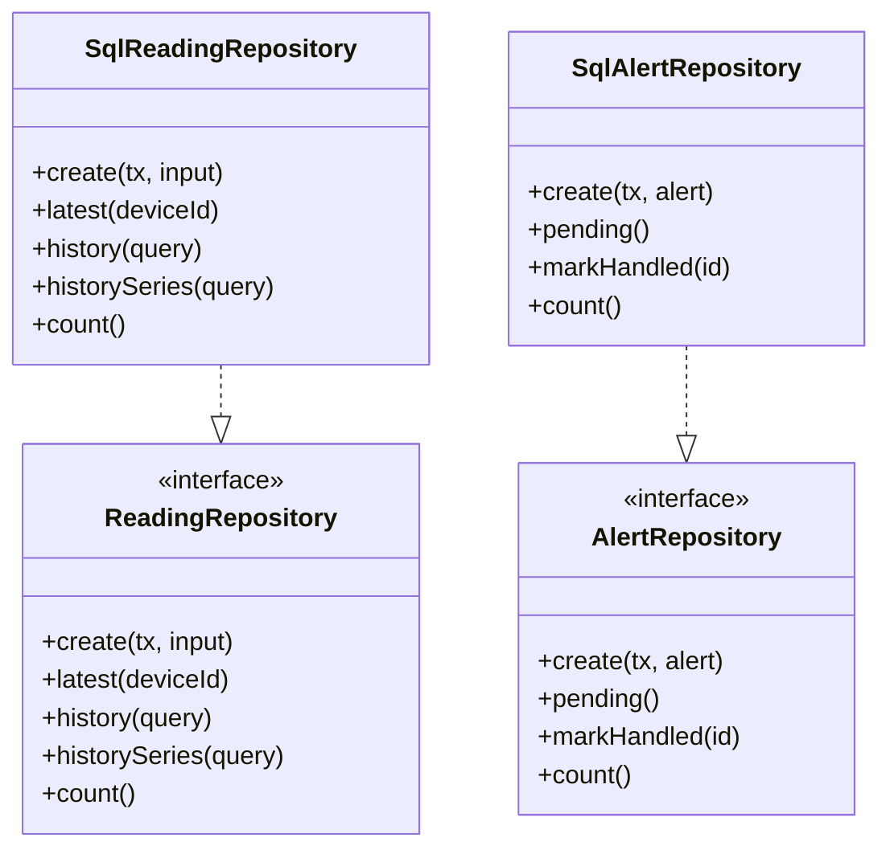
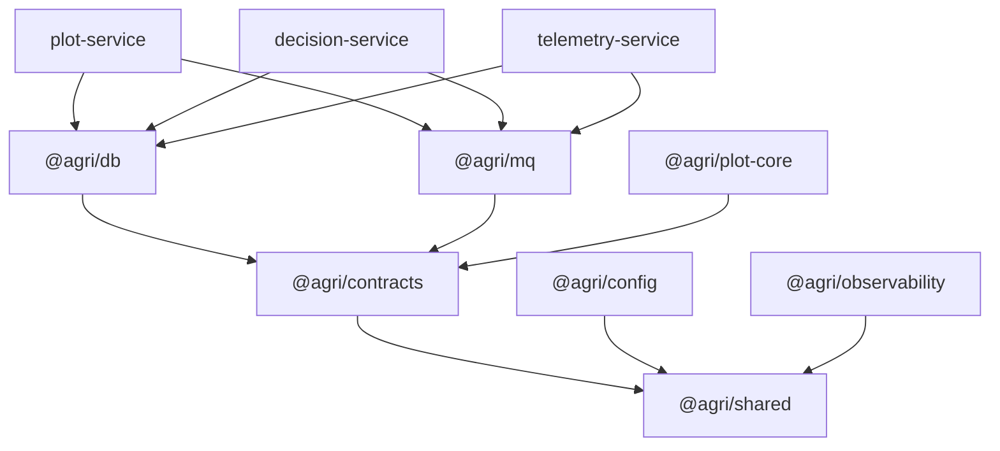

# 核心服务文档

<cite>
**本文引用的文件**   
- [README.md](file://README.md)
- [apps/plot-service/src/main.ts](file://apps/plot-service/src/main.ts)
- [apps/plot-service/src/plot.service.ts](file://apps/plot-service/src/plot.service.ts)
- [apps/plot-service/src/plot.consumer.ts](file://apps/plot-service/src/plot.consumer.ts)
- [apps/plot-service/src/http.ts](file://apps/plot-service/src/http.ts)
- [apps/decision-service/src/main.ts](file://apps/decision-service/src/main.ts)
- [apps/decision-service/src/rule.engine.ts](file://apps/decision-service/src/rule.engine.ts)
- [apps/decision-service/src/http.ts](file://apps/decision-service/src/http.ts)
- [apps/telemetry-service/src/main.ts](file://apps/telemetry-service/src/main.ts)
- [apps/telemetry-service/src/reading.repository.ts](file://apps/telemetry-service/src/reading.repository.ts)
- [apps/telemetry-service/src/http.ts](file://apps/telemetry-service/src/http.ts)
- [apps/gateway-service/src/http.ts](file://apps/gateway-service/src/http.ts)
- [apps/auth-service/src/http.ts](file://apps/auth-service/src/http.ts)
</cite>

## 目录
1. [引言](#引言)
2. [项目结构](#项目结构)
3. [核心组件](#核心组件)
4. [架构总览](#架构总览)
5. [详细组件分析](#详细组件分析)
6. [依赖关系分析](#依赖关系分析)
7. [性能与可扩展性](#性能与可扩展性)
8. [故障排查指南](#故障排查指南)
9. [结论](#结论)
10. [附录：API 接口清单](#附录api-接口清单)

## 引言
本文件面向智慧农业平台的核心微服务，聚焦以下目标：
- 覆盖 15 个 HTTP 微服务的功能说明、API 接口与业务逻辑。
- 重点解析地块管理服务的事件消费、智能决策服务的规则引擎、遥测数据服务的数据采集与告警。
- 为每个服务提供：服务概述、业务逻辑设计、API 接口文档、数据库设计与配置选项。
- 总结服务间通信模式、错误处理策略与性能优化建议，并给出实际使用场景与代码路径参考。

该工程以“地块”为最小管理单元，采用 NestJS + TypeScript，通过 pnpm workspace 与 Turborepo 组织 15 个后端服务与前端管理后台；公共包提供配置、契约、数据库、消息、可观测性等能力。

**章节来源**
- [README.md:1-167](file://README.md#L1-L167)

## 项目结构
仓库根目录包含：
- apps：15 个 HTTP 微服务与一个 Vue 前端应用。
- packages：公共能力包（配置、契约、数据库、消息、可观测性、测试等）。
- infra：PostgreSQL 迁移与 Docker Compose。
- scripts：运维脚本（健康检查、初始化、冒烟测试等）。

**图表来源**
- [apps/gateway-service/src/http.ts:6-23](file://apps/gateway-service/src/http.ts#L6-L23)
- [apps/plot-service/src/main.ts:48-113](file://apps/plot-service/src/main.ts#L48-L113)
- [apps/decision-service/src/main.ts:18-55](file://apps/decision-service/src/main.ts#L18-L55)
- [apps/telemetry-service/src/main.ts:17-56](file://apps/telemetry-service/src/main.ts#L17-L56)

**章节来源**
- [README.md:58-103](file://README.md#L58-L103)

## 核心组件
本节对三个关键服务进行深度剖析：地块服务、决策服务、遥测服务。其他服务在附录中提供 API 概览与定位。

### 地块管理服务（plot-service）
- 服务概述
  - 负责地块建档、查询、更新、删除，以及地块创建事件的发布与消费。
  - 通过本地消息表保证业务数据与事件投递的一致性，消费端幂等去重。
- 业务逻辑设计
  - 编码生成：由地块编码服务生成六段式地块编码。
  - 事务一致性：地块记录与待投递事件写入同一事务，提交后由中继任务投递。
  - 事件消费：监听 PlotCreated 事件，校验面积等字段，扩展网格与地力档案。
- API 接口
  - GET /health
  - GET /api/v1/plots/stats
  - GET /api/v1/plots/bounds
  - GET /api/v1/plots
  - GET /api/v1/plots/{parcelCode}
  - POST /api/v1/plots
  - PUT /api/v1/plots/{parcelCode}
  - DELETE /api/v1/plots/{parcelCode}
- 数据库设计
  - 地块主表：包含 parcelId、parcelCode、tenantId、farmId、areaMu、geom、soilType、时间戳等。
  - 空间索引：坐标系统一 CGCS2000（EPSG:4490），空间运算下沉 PostGIS。
- 配置选项
  - SERVICE_MODE=http 启用 HTTP 模式。
  - DB_URL 连接 PostgreSQL。
  - MQ_BROKERS/MQ_GROUP_ID 消息中间件配置。
  - PLOT_REPOSITORY_MODE=sql|memory 切换仓储实现。

**图表来源**
- [apps/plot-service/src/http.ts:78-82](file://apps/plot-service/src/http.ts#L78-L82)
- [apps/plot-service/src/plot.service.ts:53-104](file://apps/plot-service/src/plot.service.ts#L53-L104)
- [apps/plot-service/src/plot.consumer.ts:21-28](file://apps/plot-service/src/plot.consumer.ts#L21-L28)

**章节来源**
- [apps/plot-service/src/main.ts:48-113](file://apps/plot-service/src/main.ts#L48-L113)
- [apps/plot-service/src/plot.service.ts:13-139](file://apps/plot-service/src/plot.service.ts#L13-L139)
- [apps/plot-service/src/plot.consumer.ts:6-39](file://apps/plot-service/src/plot.consumer.ts#L6-L39)
- [apps/plot-service/src/http.ts:40-104](file://apps/plot-service/src/http.ts#L40-L104)

### 智能决策服务（decision-service）
- 服务概述
  - 提供规则管理与处方生成能力，支持规则热更新与处方留痕。
  - 可与遥测服务联动获取最新墒情，结合规则引擎输出作业处方。
- 业务逻辑设计
  - 规则引擎：从仓储读取最新规则集，按条件匹配并累计动作项。
  - 处方留痕：保存输入数据、命中规则与动作项，便于事后复核。
  - 事件发布：通过本地消息表或进程内发布者发布处方事件。
- API 接口
  - GET /health
  - GET /api/v1/decision/rules
  - POST /api/v1/decision/rules
  - GET /api/v1/decision/rules/{ruleId}
  - PUT /api/v1/decision/rules/{ruleId}
  - DELETE /api/v1/decision/rules/{ruleId}
  - GET /api/v1/decision/prescriptions
  - POST /api/v1/decision/prescriptions
  - POST /api/v1/decision/ask
- 数据库设计
  - 规则表：id、name、type、expression、priority、condition、action、enabled、时间戳。
  - 处方表：id、plotCode、status、inputs、matchedRules、actions、generatedAt 等。
- 配置选项
  - DECISION_REPOSITORY_MODE=memory|sql 切换仓储实现。
  - TENANT_ID 租户标识。
  - SERVICE_MODE=http 启用 HTTP 模式。
  - DB_URL 连接 PostgreSQL。

**图表来源**
- [apps/decision-service/src/rule.engine.ts:47-95](file://apps/decision-service/src/rule.engine.ts#L47-L95)
- [apps/decision-service/src/http.ts:172-209](file://apps/decision-service/src/http.ts#L172-L209)

**章节来源**
- [apps/decision-service/src/main.ts:18-55](file://apps/decision-service/src/main.ts#L18-L55)
- [apps/decision-service/src/rule.engine.ts:1-97](file://apps/decision-service/src/rule.engine.ts#L1-L97)
- [apps/decision-service/src/http.ts:92-235](file://apps/decision-service/src/http.ts#L92-L235)

### 遥测数据服务（telemetry-service）
- 服务概述
  - 负责设备读数上报、历史查询、趋势曲线、阈值告警与越限事件发布。
  - 支持 SQL 与内存两种仓储实现，默认持久化到 PostgreSQL。
- 业务逻辑设计
  - 数据采集：接收 deviceId、plotCode、metric、value、unit、recordedAt。
  - 阈值告警：内置 soilMoisture、airTemperature、windSpeed 的阈值规则。
  - 事件发布：越限时写入本地消息表或直接发布事件（可开关）。
- API 接口
  - GET /health
  - GET /api/v1/telemetry/latest?deviceId=...
  - GET /api/v1/telemetry/history?deviceId=&metric=&from=&to=&size=...
  - GET /api/v1/telemetry/history/series?deviceId=&metric=&from=&to=&size=...
  - GET /api/v1/telemetry/alerts
  - POST /api/v1/telemetry/alerts/{alertId}/handle
  - POST /api/v1/telemetry/report
- 数据库设计
  - telemetry_readings：id、device_id、plot_code、metric、value、unit、recorded_at。
  - telemetry_alerts：id、device_id、plot_code、level、metric、message、created_at、handled、handled_at。
- 配置选项
  - TELEMETRY_REPOSITORY_MODE=memory|sql 切换仓储实现。
  - TELEMETRY_PUBLISH_EVENTS=true|false 控制越限事件发布。
  - TENANT_ID 租户标识。
  - SERVICE_MODE=http 启用 HTTP 模式。
  - DB_URL 连接 PostgreSQL。

**图表来源**
- [apps/telemetry-service/src/http.ts:116-158](file://apps/telemetry-service/src/http.ts#L116-L158)
- [apps/telemetry-service/src/reading.repository.ts:104-118](file://apps/telemetry-service/src/reading.repository.ts#L104-L118)

**章节来源**
- [apps/telemetry-service/src/main.ts:17-56](file://apps/telemetry-service/src/main.ts#L17-L56)
- [apps/telemetry-service/src/http.ts:65-169](file://apps/telemetry-service/src/http.ts#L65-L169)
- [apps/telemetry-service/src/reading.repository.ts:96-202](file://apps/telemetry-service/src/reading.repository.ts#L96-L202)

## 架构总览
整体采用网关聚合路由、微服务独立部署、事件驱动异步解耦的模式：
- 网关服务统一暴露 /api/v1/* 前缀，转发至各业务服务。
- 业务服务通过本地消息表与事件总线实现最终一致性与幂等消费。
- 数据存储以 PostgreSQL 为主，时序数据由物联感知服务直连时序库（本脚手架示例未包含时序库实现）。

**图表来源**
- [apps/gateway-service/src/http.ts:6-23](file://apps/gateway-service/src/http.ts#L6-L23)
- [apps/plot-service/src/main.ts:63-80](file://apps/plot-service/src/main.ts#L63-L80)
- [apps/decision-service/src/main.ts:23-37](file://apps/decision-service/src/main.ts#L23-L37)
- [apps/telemetry-service/src/main.ts:25-40](file://apps/telemetry-service/src/main.ts#L25-L40)

## 详细组件分析

### 地块管理服务
- 关键类与方法
  - PlotService.registerPlot：生成编码、查重、写入地块与事件。
  - PlotEventConsumer.onPlotCreated：消费地块创建事件，校验面积并记录已处理事件 ID。
- 错误处理
  - 冲突与不存在错误使用领域异常码（如 PLOT-409-001、PLOT-404-001）。
- 性能考虑
  - 分页上限 200，排序字段白名单限制。
  - 空间计算下沉数据库，避免在服务端做复杂叠加与缓冲区计算。

**图表来源**
- [apps/plot-service/src/plot.service.ts:39-139](file://apps/plot-service/src/plot.service.ts#L39-L139)
- [apps/plot-service/src/plot.consumer.ts:12-39](file://apps/plot-service/src/plot.consumer.ts#L12-L39)

**章节来源**
- [apps/plot-service/src/plot.service.ts:13-139](file://apps/plot-service/src/plot.service.ts#L13-L139)
- [apps/plot-service/src/plot.consumer.ts:6-39](file://apps/plot-service/src/plot.consumer.ts#L6-L39)

### 智能决策服务
- 关键类与方法
  - RuleEngine.evaluate：读取规则集、逐条匹配、累计动作项。
  - matchesRule：单条规则条件匹配逻辑。
  - HTTP 层：规则 CRUD、处方生成与问答。
- 规则热更新
  - 每次求值都从仓储读取最新规则，无需重启服务。
- 处方留痕
  - 保存 inputs、matchedRules、actions，便于审计与回溯。

**图表来源**
- [apps/decision-service/src/rule.engine.ts:81-95](file://apps/decision-service/src/rule.engine.ts#L81-L95)

**章节来源**
- [apps/decision-service/src/rule.engine.ts:1-97](file://apps/decision-service/src/rule.engine.ts#L1-L97)
- [apps/decision-service/src/http.ts:92-235](file://apps/decision-service/src/http.ts#L92-L235)

### 遥测数据服务
- 关键类与方法
  - SqlReadingRepository.create/history/latest：读写遥测数据。
  - SqlAlertRepository.pending/markHandled：告警处理。
  - HTTP 层：读数上报、阈值告警、事件发布。
- 阈值规则
  - soilMoisture < 30 触发补灌告警。
  - airTemperature > 40 触发高温告警。
  - windSpeed > 10 触发风速告警。

**图表来源**
- [apps/telemetry-service/src/reading.repository.ts:53-67](file://apps/telemetry-service/src/reading.repository.ts#L53-L67)
- [apps/telemetry-service/src/reading.repository.ts:97-202](file://apps/telemetry-service/src/reading.repository.ts#L97-L202)

**章节来源**
- [apps/telemetry-service/src/http.ts:65-169](file://apps/telemetry-service/src/http.ts#L65-L169)
- [apps/telemetry-service/src/reading.repository.ts:96-202](file://apps/telemetry-service/src/reading.repository.ts#L96-L202)

### 其他服务概览
- auth-service：用户登录、注销、用户信息查询，基于内存会话。
- gateway-service：统一路由转发，透传 x-request-id、x-tenant-id、x-user-id 等头。
- iot-service：设备接入（本脚手架未展开具体实现）。
- weather-service：气象数据（本脚手架未展开具体实现）。
- message-service：站内消息（本脚手架未展开具体实现）。
- operation-service：农事作业（本脚手架未展开具体实现）。
- control-service：设备控制（本脚手架未展开具体实现）。
- finance-service：财务核算（本脚手架未展开具体实现）。
- trace-service：操作审计（本脚手架未展开具体实现）。
- file-service：文件存储（S3/MinIO）。
- video-service：视频流（本脚手架未展开具体实现）。
- platform-service：平台基础（本脚手架未展开具体实现）。

**章节来源**
- [apps/auth-service/src/http.ts:1-21](file://apps/auth-service/src/http.ts#L1-L21)
- [apps/gateway-service/src/http.ts:1-41](file://apps/gateway-service/src/http.ts#L1-L41)

## 依赖关系分析
- 服务耦合
  - 网关与各业务服务松耦合，通过 HTTP 调用。
  - 业务服务之间通过事件总线解耦，避免直接同步依赖。
- 外部依赖
  - PostgreSQL：结构化数据与空间数据。
  - 消息中间件：事件发布订阅（示例使用内存实现）。
  - 对象存储：文件与视频资源。
- 循环依赖
  - 契约包与能力包分离，禁止循环引用。

**图表来源**
- [README.md:86-103](file://README.md#L86-L103)

**章节来源**
- [README.md:86-118](file://README.md#L86-L118)

## 性能与可扩展性
- 分页与排序
  - 所有列表接口分页上限 200，排序字段服务端白名单校验。
- 空间计算
  - 坐标系统一 CGCS2000（EPSG:4490），叠加、缓冲区、面积计算落在 PostGIS。
- 事件可靠性
  - 本地消息表保证业务数据与事件投递一致性；消费端幂等去重，重试指数退避，失败转死信。
- 规则热更新
  - 规则引擎每次求值读取最新规则，无需重启服务。
- 缓存与指标
  - 缓存由各服务自行使用缓存中间件；可观测性提供结构化日志、链路追踪与指标采集。

[本节为通用指导，不直接分析具体文件]

## 故障排查指南
- 常见错误码
  - 地块服务：PLOT-409-001（重复建档）、PLOT-404-001（地块不存在）。
  - 决策服务：DECISION-400/404（参数错误或规则不存在）。
  - 遥测服务：TELEMETRY-400/404（参数错误或数据不存在）。
  - 网关：GATEWAY-404/GATEWAY-502（路由不存在或下游不可用）。
- 排查步骤
  - 检查 x-request-id 是否贯穿请求链路。
  - 确认本地消息表是否有待投递事件。
  - 验证消费端是否发生幂等拦截。
  - 查看遥测阈值规则是否被触发。
  - 网关 502 时检查下游服务健康端点。

**章节来源**
- [apps/plot-service/src/http.ts:100-103](file://apps/plot-service/src/http.ts#L100-L103)
- [apps/decision-service/src/http.ts:226-229](file://apps/decision-service/src/http.ts#L226-L229)
- [apps/telemetry-service/src/http.ts:161-164](file://apps/telemetry-service/src/http.ts#L161-L164)
- [apps/gateway-service/src/http.ts:33-39](file://apps/gateway-service/src/http.ts#L33-L39)

## 结论
本智慧农业平台以“地块”为核心，围绕事件驱动与本地消息表构建可靠的服务间通信；规则引擎支持热更新与处方留痕；遥测服务提供数据采集与告警闭环。通过统一的网关与公共能力包，平台具备良好的可扩展性与可维护性。建议在生产环境接入真实消息中间件与时序数据库，并结合缓存与指标体系进一步优化性能与可观测性。

[本节为总结性内容，不直接分析具体文件]

## 附录：API 接口清单
- 网关
  - GET /health
  - 路由转发：/api/v1/auth、/api/v1/plots、/api/v1/platform、/api/v1/devices、/api/v1/telemetry、/api/v1/weather、/api/v1/messages、/api/v1/farm-tasks、/api/v1/operations、/api/v1/control、/api/v1/decision、/api/v1/finance、/api/v1/trace、/api/v1/files、/api/v1/video
- 认证服务
  - POST /api/v1/auth/login
  - GET /api/v1/auth/userinfo
  - POST /api/v1/auth/logout
- 地块服务
  - GET /api/v1/plots/stats
  - GET /api/v1/plots/bounds
  - GET /api/v1/plots
  - GET /api/v1/plots/{parcelCode}
  - POST /api/v1/plots
  - PUT /api/v1/plots/{parcelCode}
  - DELETE /api/v1/plots/{parcelCode}
- 决策服务
  - GET /api/v1/decision/rules
  - POST /api/v1/decision/rules
  - GET /api/v1/decision/rules/{ruleId}
  - PUT /api/v1/decision/rules/{ruleId}
  - DELETE /api/v1/decision/rules/{ruleId}
  - GET /api/v1/decision/prescriptions
  - POST /api/v1/decision/prescriptions
  - POST /api/v1/decision/ask
- 遥测服务
  - GET /api/v1/telemetry/latest
  - GET /api/v1/telemetry/history
  - GET /api/v1/telemetry/history/series
  - GET /api/v1/telemetry/alerts
  - POST /api/v1/telemetry/alerts/{alertId}/handle
  - POST /api/v1/telemetry/report

**章节来源**
- [apps/gateway-service/src/http.ts:6-23](file://apps/gateway-service/src/http.ts#L6-L23)
- [apps/auth-service/src/http.ts:14-20](file://apps/auth-service/src/http.ts#L14-L20)
- [apps/plot-service/src/http.ts:45-98](file://apps/plot-service/src/http.ts#L45-L98)
- [apps/decision-service/src/http.ts:110-224](file://apps/decision-service/src/http.ts#L110-L224)
- [apps/telemetry-service/src/http.ts:78-158](file://apps/telemetry-service/src/http.ts#L78-L158)